# Tema 1. La Constitución Española (I)

**Bloque:** administrativo  
**Enunciado oficial** (BOAM n.º 10.032, de 23 de diciembre de 2025): La Constitución Española (I): Estructura y contenido. Derechos y deberes fundamentales. Su garantía y suspensión.

Versión web: <https://ayuntamientomadrid.github.io/temario-tecnico-auxiliar/temas/tema-01.html> · PDF: [tema-01.pdf](tema-01.pdf) · Test: [../../../tests/administrativo/tema-01.md](../../../tests/administrativo/tema-01.md)

## Índice

- 1. Introducción y características de la Constitución
  - 1.1. Características esenciales
  - 1.2. Valores superiores y principios del Título Preliminar
- 2. Datos clave de aprobación y promulgación
- 3. Estructura del texto constitucional
  - 3.1. Índice de Títulos
  - 3.2. Estructura interna del Título I
- 4. Parte dogmática y parte orgánica
- 5. Título I — De los derechos y deberes fundamentales
  - 5.1. Capítulo I — De los españoles y los extranjeros (arts. 11-13)
  - 5.2. Capítulo II, Sección 1.ª — Derechos fundamentales y libertades públicas (arts. 14-29)
  - 5.3. Capítulo II, Sección 2.ª — Derechos y deberes de los ciudadanos (arts. 30-38)
  - 5.4. Capítulo III — Principios rectores de la política social y económica (arts. 39-52)
  - 5.5. Capítulo IV — Garantías de las libertades y derechos fundamentales (arts. 53-54)
  - 5.6. Capítulo V — Suspensión de los derechos y libertades (art. 55)
- 6. Títulos II a X — Parte orgánica (síntesis)
- 7. Reforma constitucional (Título X)
  - 7.1. Iniciativa (art. 166)
  - 7.2. Procedimiento ordinario (art. 167)
  - 7.3. Procedimiento agravado (art. 168)
  - 7.4. Límite temporal — Artículo 169
- 8. Reformas de la Constitución
  - 8.1. Reforma de 1992 — Artículo 13.2
  - 8.2. Reforma de 2011 — Artículo 135
  - 8.3. Reforma de 2024 — Artículo 49
  - 8.4. Reforma de 2026 — Artículo 69.3
- 9. Garantías del Título I — ampliación del artículo 53
  - 9.1. Regla de reserva de ley
  - 9.2. Tutela judicial preferente y sumaria
  - 9.3. Eficacia de los principios rectores
  - 9.4. Defensor del Pueblo (art. 54)
- 10. Suspensión de derechos — ampliación del artículo 55
  - 10.1. Estados de excepción y de sitio
  - 10.2. Estado de alarma
  - 10.3. Suspensión individual y control judicial
- 11. Posición de la Constitución en el ordenamiento jurídico
  - 11.1. Sujeción a la Constitución
  - 11.2. Jerarquía normativa y fuentes que regula la Constitución
  - 11.3. Vinculación de los poderes públicos
- 12. Organización territorial — introducción al Título VIII
- 13. Esquema resumen
- Cómo estudiar este tema

## Contenido

### Convenciones del documento

Este tema incluye cuatro tipos de **cajas callout** para facilitar el estudio:

> **Dato clave.** Información de alta densidad memorística: fechas, número de artículo, mayorías exigidas.

> **Cita normativa.** Reproducción literal de un precepto de la Constitución Española, con referencia al artículo.

> **Ejemplo de aplicación en el ayto.** Aplicación de la norma al entorno municipal (participación ciudadana, sede electrónica, ordenanzas, Policía Municipal).

> **Relación con otros temas.** Enlace con otros temas del temario o con bloques distintos del propio Tema 1.

Las citas a artículos de la Constitución se expresan como `(art. X CE)` o `(art. X.Y CE)`. Las reformas se identifican como `[REF-1992]`, `[REF-2011]`, `[REF-2024]` o `[REF-2026]`. El registro completo de fuentes está en la pestaña Fuentes.

------------------------------------------------------------------------

### 1. Introducción y características de la Constitución

La **Constitución Española** (en adelante, CE) es la **norma fundamental del Estado** (fórmula de promulgación). Fue ratificada por el pueblo español en referéndum el **6 de diciembre de 1978** y sancionada por el Rey el **27 de diciembre del mismo año**. Su texto organiza los poderes del Estado y regula los derechos y deberes fundamentales. \[CE-1978\]

#### 1.1. Características esenciales

Rasgos que se desprenden del propio texto constitucional:

- **Escrita**: un único texto de 169 artículos, con Preámbulo, Título Preliminar, diez Títulos y disposiciones adicionales, transitorias, derogatoria y final.
- **Rígida**: su reforma exige los procedimientos y las mayorías cualificadas de los artículos 167 y 168; en el procedimiento del artículo 168 la reforma se somete en todo caso a referéndum. (arts. 167-168 CE)
- **Ratificada por el pueblo español**: «las Cortes aprueban y el pueblo español ratifica la siguiente Constitución». \[CE, Preámbulo\]
- **Proclama valores superiores** del ordenamiento jurídico: la libertad, la justicia, la igualdad y el pluralismo político. (art. 1.1 CE)
- **Vinculante**: los ciudadanos y los poderes públicos están sujetos a la Constitución y al resto del ordenamiento jurídico. (art. 9.1 CE)
- **Forma política**: la Monarquía parlamentaria. (art. 1.3 CE)

> **Dato clave.** Los manuales suelen añadir otras calificaciones doctrinales (pactada o de consenso, derivada, extensa, abierta). No figuran en el texto constitucional; los rasgos de la lista anterior sí pueden reconducirse a un precepto.

#### 1.2. Valores superiores y principios del Título Preliminar

El artículo 1 define el modelo de Estado:

> **Cita normativa.** *"España se constituye en un Estado social y democrático de Derecho, que propugna como valores superiores de su ordenamiento jurídico la libertad, la justicia, la igualdad y el pluralismo político"* (art. 1.1 CE)

El mismo artículo establece:

- **Soberanía nacional**: reside en el pueblo español, del que emanan los poderes del Estado. (art. 1.2 CE)
- **Forma política**: Monarquía parlamentaria. (art. 1.3 CE)

El Título Preliminar recoge además la **indisoluble unidad de la Nación española** y el **derecho a la autonomía de las nacionalidades y regiones** que la integran y la solidaridad entre todas ellas (art. 2 CE), y el artículo 9.3 garantiza el **principio de legalidad**, la **jerarquía normativa**, la **publicidad de las normas**, la irretroactividad de las disposiciones sancionadoras no favorables o restrictivas de derechos individuales, la **seguridad jurídica**, la responsabilidad y la interdicción de la arbitrariedad de los poderes públicos. (art. 9.3 CE)

El artículo 10.1, con el que se abre el Título I, dispone que *"la dignidad de la persona, los derechos inviolables que le son inherentes, el libre desarrollo de la personalidad, el respeto a la ley y a los derechos de los demás son fundamento del orden político y de la paz social"*. Las normas relativas a los derechos fundamentales y a las libertades que la Constitución reconoce se interpretarán de conformidad con la Declaración Universal de Derechos Humanos y los tratados y acuerdos internacionales sobre las mismas materias ratificados por España. (art. 10.2 CE)

------------------------------------------------------------------------

### 2. Datos clave de aprobación y promulgación

Las cuatro fechas de 1978:

| Fecha | Acto |
|----|----|
| 31 octubre 1978 | Aprobación por las Cortes en sesiones plenarias del Congreso de los Diputados y del Senado |
| 6 diciembre 1978 | Ratificación por el pueblo español en referéndum |
| 27 diciembre 1978 | Sanción por S.M. el Rey ante las Cortes |
| 29 diciembre 1978 | Publicación en el BOE — entrada en vigor el mismo día de su publicación |

> **Dato clave.** Regla mnemotécnica "31-6-27-29": aprobación 31 octubre, referéndum 6 diciembre, sanción 27 diciembre, publicación 29 diciembre. La entrada en vigor coincide con la publicación: "Esta Constitución entrará en vigor el mismo día de la publicación de su texto oficial en el boletín oficial del Estado" (disposición final).

------------------------------------------------------------------------

### 3. Estructura del texto constitucional

La Constitución consta de:

- **Preámbulo**.
- **Título Preliminar** (arts. 1 a 9).
- **Diez Títulos numerados** (arts. 10 a 169).
- **4 Disposiciones Adicionales**.
- **9 Disposiciones Transitorias**.
- **1 Disposición Derogatoria**.
- **1 Disposición Final**.

Total: **169 artículos**.

#### 3.1. Índice de Títulos

| Título | Materia | Artículos |
|----|----|----|
| Preliminar | (sin rúbrica) | 1-9 |
| I | De los derechos y deberes fundamentales | 10-55 |
| II | De la Corona | 56-65 |
| III | De las Cortes Generales | 66-96 |
| IV | Del Gobierno y de la Administración | 97-107 |
| V | De las relaciones entre el Gobierno y las Cortes Generales | 108-116 |
| VI | Del Poder Judicial | 117-127 |
| VII | Economía y Hacienda | 128-136 |
| VIII | De la Organización Territorial del Estado | 137-158 |
| IX | Del Tribunal Constitucional | 159-165 |
| X | De la reforma constitucional | 166-169 |

> **Dato clave.** El orden de los Títulos y sus artículos iniciales son memorizables con reglas mnemotécnicas. Pista: del Título II al V (56-116) se regulan la Corona, las Cortes, el Gobierno y las relaciones Gobierno-Cortes. El VI es el Poder Judicial. Los Títulos VII-X regulan la economía y hacienda, la organización territorial, el Tribunal Constitucional y la reforma.

#### 3.2. Estructura interna del Título I

El Título I se subdivide en cinco Capítulos:

| Capítulo | Contenido | Artículos |
|----|----|----|
| I | De los españoles y los extranjeros | 11-13 |
| II | Derechos y libertades | 14-38 |
| — Sec. 1.ª | De los derechos fundamentales y de las libertades públicas | 15-29 |
| — Sec. 2.ª | De los derechos y deberes de los ciudadanos | 30-38 |
| III | De los principios rectores de la política social y económica | 39-52 |
| IV | De las garantías de las libertades y derechos fundamentales | 53-54 |
| V | De la suspensión de los derechos y libertades | 55 |

El artículo 10 precede al Capítulo I y el artículo 14 precede a la Sección 1.ª del Capítulo II.

------------------------------------------------------------------------

### 4. Parte dogmática y parte orgánica

> **Dato clave.** La distinción entre **parte dogmática** (Título Preliminar y Título I: principios, valores y derechos y deberes fundamentales) y **parte orgánica** (Títulos II a X: organización, competencias y relaciones entre los poderes del Estado) es una clasificación doctrinal: no aparece en el articulado. Sirve para ubicar cada Título en su bloque.

------------------------------------------------------------------------

### 5. Título I — De los derechos y deberes fundamentales

El Título I agrupa los derechos y deberes en capítulos y secciones a los que el artículo 53 asigna distintas garantías.

#### 5.1. Capítulo I — De los españoles y los extranjeros (arts. 11-13)

- **Nacionalidad española** (art. 11): se adquiere, se conserva y se pierde de acuerdo con lo establecido por la ley. Ningún español de origen podrá ser privado de su nacionalidad.
- **Mayoría de edad** (art. 12): los españoles son mayores de edad a los dieciocho años.
- **Extranjeros** (art. 13.1): gozarán en España de las libertades públicas que garantiza el Título I en los términos que establezcan los tratados y la ley. **Desarrollo**: Ley Orgánica 4/2000, sobre derechos y libertades de los extranjeros en España y su integración social.
- **Derechos del artículo 23** (art. 13.2): solamente los españoles serán titulares de los derechos reconocidos en el artículo 23, salvo lo que, atendiendo a criterios de reciprocidad, pueda establecerse por tratado o ley para el derecho de sufragio activo y pasivo en las elecciones municipales.

> **Dato clave.** La **Reforma de 1992** modificó el artículo 13.2 para añadir el sufragio **pasivo** en las elecciones municipales: los ciudadanos de otros Estados miembros de la UE pueden ser **electores y elegibles** en ellas. \[REF-1992\]

#### 5.2. Capítulo II, Sección 1.ª — Derechos fundamentales y libertades públicas (arts. 14-29)

Conforme al artículo 81.1, son leyes orgánicas las relativas al desarrollo de los derechos fundamentales y de las libertades públicas. Los derechos y libertades del Capítulo II vinculan a todos los poderes públicos (art. 53.1), y el artículo 53.2 reserva para el artículo 14 y la Sección 1.ª la tutela por un procedimiento preferente y sumario y, en su caso, el **recurso de amparo** ante el Tribunal Constitucional.

##### Artículo 14 — Igualdad ante la ley

> *"Los españoles son iguales ante la ley, sin que pueda prevalecer discriminación alguna por razón de nacimiento, raza, sexo, religión, opinión o cualquier otra condición o circunstancia personal o social."* (art. 14 CE)

- **Causas de discriminación**: el precepto enumera nacimiento, raza, sexo, religión y opinión, y cierra la lista con "cualquier otra condición o circunstancia personal o social".
- **Ubicación**: el artículo 14 precede a la Sección 1.ª, pero el artículo 53.2 le extiende la tutela preferente y sumaria y el recurso de amparo.

##### Artículo 15 — Derecho a la vida e integridad física y moral

> *"Todos tienen derecho a la vida y a la integridad física y moral, sin que, en ningún caso, puedan ser sometidos a tortura ni a penas o tratos inhumanos o degradantes. Queda abolida la pena de muerte, salvo lo que puedan disponer las leyes penales militares para tiempos de guerra."* (art. 15 CE)

- **Pena de muerte en tiempo de guerra**: la Ley Orgánica 11/1995, de 27 de noviembre, abolió la pena de muerte en tiempo de guerra.

##### Artículo 16 — Libertad ideológica, religiosa y de culto

> *"Se garantiza la libertad ideológica, religiosa y de culto de los individuos y las comunidades sin más limitación, en sus manifestaciones, que la necesaria para el mantenimiento del orden público protegido por la ley."* (art. 16.1 CE)

- **Nadie podrá ser obligado a declarar sobre su ideología, religión o creencias** (art. 16.2).
- **Aconfesionalidad del Estado**: art. 16.3 — *"Ninguna confesión tendrá carácter estatal. Los poderes públicos tendrán en cuenta las creencias religiosas de la sociedad española y mantendrán las consiguientes relaciones de cooperación con la Iglesia Católica y las demás confesiones."*
- **Desarrollo**: Ley Orgánica 7/1980, de Libertad Religiosa.

##### Artículo 17 — Derecho a la libertad y seguridad

> *"Toda persona tiene derecho a la libertad y a la seguridad. Nadie puede ser privado de su libertad, sino con la observancia de lo establecido en este artículo y en los casos y en la forma previstos en la ley."* (art. 17.1 CE)

- **Detención preventiva** (art. 17.2): no podrá durar más del tiempo estrictamente necesario para la realización de las averiguaciones tendentes al esclarecimiento de los hechos, y, en todo caso, en el plazo máximo de **setenta y dos horas**, el detenido deberá ser puesto en libertad o a disposición de la autoridad judicial. Conforme al artículo 55.2, una ley orgánica puede suspender este derecho de forma individual en relación con las investigaciones sobre bandas armadas o elementos terroristas.
- **Derechos del detenido** (art. 17.3): ser informado de forma inmediata, y de modo que le sea comprensible, de sus derechos y de las razones de su detención; no puede ser obligado a declarar; se garantiza la asistencia de abogado en las diligencias policiales y judiciales.
- **Habeas corpus** (art. 17.4): la ley regulará un procedimiento de «habeas corpus» para producir la inmediata puesta a disposición judicial de toda persona detenida ilegalmente. Por ley se determinará el plazo máximo de duración de la prisión provisional. **Desarrollo**: Ley Orgánica 6/1984, reguladora del procedimiento de «Habeas Corpus».

##### Artículo 18 — Honor, intimidad, imagen, domicilio y comunicaciones

> *"Se garantiza el derecho al honor, a la intimidad personal y familiar y a la propia imagen."* (art. 18.1 CE)

- **18.2 Inviolabilidad del domicilio**: ninguna entrada o registro podrá hacerse en él sin **consentimiento del titular** o **resolución judicial**, salvo en caso de **flagrante delito**.
- **18.3 Secreto de las comunicaciones**: se garantiza el secreto de las comunicaciones y, en especial, de las postales, telegráficas y telefónicas, salvo **resolución judicial**.
- **18.4 Uso de la informática**: *"La ley limitará el uso de la informática para garantizar el honor y la intimidad personal y familiar de los ciudadanos y el pleno ejercicio de sus derechos."* La Ley Orgánica 3/2018 (LOPDGDD) se refiere al derecho fundamental de las personas físicas a la protección de datos personales, "amparado por el artículo 18.4 de la Constitución", que se ejercerá con arreglo al Reglamento (UE) 2016/679 (RGPD) y a esa ley orgánica (art. 1 LOPDGDD).

##### Artículo 19 — Libertad de residencia y circulación

> *"Los españoles tienen derecho a elegir libremente su residencia y a circular por el territorio nacional. Asimismo, tienen derecho a entrar y salir libremente de España en los términos que la ley establezca. Este derecho no podrá ser limitado por motivos políticos o ideológicos."* (art. 19 CE)

##### Artículo 20 — Libertad de expresión e información

> *"Se reconocen y protegen los derechos: a) A expresar y difundir libremente los pensamientos, ideas y opiniones mediante la palabra, el escrito o cualquier otro medio de reproducción; b) A la producción y creación literaria, artística, científica y técnica; c) A la libertad de cátedra; d) A comunicar o recibir libremente información veraz por cualquier medio de difusión."* (art. 20.1 CE)

- **Cláusula de conciencia y secreto profesional** (art. 20.1.d): la ley los regulará en el ejercicio de estas libertades.
- **Censura previa** (art. 20.2): el ejercicio de estos derechos no puede restringirse mediante ningún tipo de censura previa.
- **Límites** (art. 20.4): el respeto a los derechos reconocidos en el Título I, los preceptos de las leyes que lo desarrollen y, especialmente, el derecho al honor, a la intimidad, a la propia imagen y a la protección de la juventud y de la infancia.
- **Secuestro** (art. 20.5): sólo podrá acordarse el secuestro de publicaciones, grabaciones y otros medios de información en virtud de resolución judicial.

##### Artículo 21 — Derecho de reunión

> *"Se reconoce el derecho de reunión pacífica y sin armas. El ejercicio de este derecho no necesitará autorización previa."* (art. 21.1 CE)

- **Reuniones en lugares de tránsito público y manifestaciones** (art. 21.2): se dará **comunicación previa** a la autoridad, que sólo podrá prohibirlas cuando existan razones fundadas de alteración del orden público, con peligro para personas o bienes.
- **Desarrollo**: Ley Orgánica 9/1983, reguladora del derecho de reunión.

##### Artículo 22 — Derecho de asociación

> *"Se reconoce el derecho de asociación."* (art. 22.1 CE)

- **Asociaciones ilegales** (art. 22.2): las que persigan fines o utilicen medios tipificados como delito.
- **Registro** (art. 22.3): las asociaciones constituidas al amparo de este artículo deberán inscribirse en un registro a los solos efectos de publicidad.
- **Disolución o suspensión** (art. 22.4): sólo en virtud de **resolución judicial motivada**.
- **Prohibición** (art. 22.5): se prohíben las asociaciones secretas y las de carácter paramilitar.
- **Desarrollo**: Ley Orgánica 1/2002, reguladora del Derecho de Asociación.

##### Artículo 23 — Derecho de participación política

> *"Los ciudadanos tienen el derecho a participar en los asuntos públicos, directamente o por medio de representantes, libremente elegidos en elecciones periódicas por sufragio universal."* (art. 23.1 CE)

- **23.2** Derecho a acceder en condiciones de igualdad a las **funciones y cargos públicos**, con los requisitos que señalen las leyes.
- **Desarrollo**: Ley Orgánica 5/1985, del Régimen Electoral General (LOREG).

##### Artículo 24 — Tutela judicial efectiva

> *"Todas las personas tienen derecho a obtener la tutela efectiva de los jueces y tribunales en el ejercicio de sus derechos e intereses legítimos, sin que, en ningún caso, pueda producirse indefensión."* (art. 24.1 CE)

- **24.2 Derechos en el proceso**: al Juez ordinario predeterminado por la ley, a la defensa y a la asistencia de letrado, a ser informados de la acusación formulada contra ellos, a un proceso público sin dilaciones indebidas y con todas las garantías, a utilizar los medios de prueba pertinentes para su defensa, a no declarar contra sí mismos, a no confesarse culpables y a la **presunción de inocencia**.
- **Parentesco y secreto profesional** (art. 24.2, párrafo segundo): la ley regulará los casos en que, por razón de parentesco o de secreto profesional, no se estará obligado a declarar sobre hechos presuntamente delictivos.

##### Artículo 25 — Principio de legalidad penal y sancionadora

> *"Nadie puede ser condenado o sancionado por acciones u omisiones que en el momento de producirse no constituyan delito, falta o infracción administrativa, según la legislación vigente en aquel momento."* (art. 25.1 CE)

- **25.2** Las penas privativas de libertad y las medidas de seguridad estarán orientadas hacia la **reeducación y reinserción social** y no podrán consistir en trabajos forzados. El condenado a pena de prisión que estuviere cumpliendo la misma gozará de los derechos fundamentales de este Capítulo, a excepción de los que se vean expresamente limitados por el contenido del fallo condenatorio, el sentido de la pena y la ley penitenciaria. En todo caso, tendrá derecho a un trabajo remunerado y a los beneficios correspondientes de la Seguridad Social, así como al acceso a la cultura y al desarrollo integral de su personalidad.
- **25.3** La Administración civil no podrá imponer sanciones que, directa o subsidiariamente, impliquen privación de libertad.
- **Infracción administrativa**: el artículo 25.1 incluye expresamente la infracción administrativa junto al delito y la falta.

##### Artículo 26 — Prohibición de Tribunales de Honor

> *"Se prohíben los Tribunales de Honor en el ámbito de la Administración civil y de las organizaciones profesionales."* (art. 26 CE)

##### Artículo 27 — Derecho a la educación y libertad de enseñanza

> *"Todos tienen el derecho a la educación. Se reconoce la libertad de enseñanza."* (art. 27.1 CE)

- **27.2 a 27.10** regulan: el objeto de la educación (pleno desarrollo de la personalidad humana en el respeto a los principios democráticos de convivencia y a los derechos y libertades fundamentales), el derecho de los padres a que sus hijos reciban la formación religiosa y moral que esté de acuerdo con sus propias convicciones, la **enseñanza básica obligatoria y gratuita**, la programación general de la enseñanza, la libertad de creación de centros docentes, la intervención de profesores, padres y, en su caso, alumnos en el control y gestión de los centros sostenidos con fondos públicos, la inspección y homologación del sistema educativo, la ayuda a los centros docentes y la **autonomía de las Universidades**.
- **Desarrollo**: Ley Orgánica 2/2006, de Educación (LOE), modificada por la Ley Orgánica 3/2020 (LOMLOE); Ley Orgánica 2/2023, del Sistema Universitario.

##### Artículo 28 — Libertad sindical y derecho de huelga

> *"Todos tienen derecho a sindicarse libremente."* (art. 28.1 CE)

- **Limitaciones** (art. 28.1): la ley podrá limitar o exceptuar el ejercicio de este derecho a las Fuerzas o Institutos armados o a los demás Cuerpos sometidos a disciplina militar y regulará las peculiaridades de su ejercicio para los funcionarios públicos. Los Jueces, Magistrados y Fiscales, mientras se hallen en activo, no podrán pertenecer a partidos políticos o sindicatos (art. 127.1).
- **Contenido** (art. 28.1): la libertad sindical comprende el derecho a fundar sindicatos y a afiliarse al de su elección, así como el derecho de los sindicatos a formar confederaciones y a fundar organizaciones sindicales internacionales o a afiliarse a las mismas. Nadie podrá ser obligado a afiliarse a un sindicato.
- **28.2** Se reconoce el **derecho a la huelga** de los trabajadores para la defensa de sus intereses. La ley que regule el ejercicio de este derecho establecerá las garantías precisas para asegurar el mantenimiento de los **servicios esenciales** de la comunidad.
- **Desarrollo**: Ley Orgánica 11/1985, de Libertad Sindical (LOLS); Real Decreto-ley 17/1977, sobre relaciones de trabajo.

##### Artículo 29 — Derecho de petición

> *"Todos los españoles tendrán el derecho de petición individual y colectiva, por escrito, en la forma y con los efectos que determine la ley."* (art. 29.1 CE)

- **29.2** Los miembros de las Fuerzas o Institutos armados o de los Cuerpos sometidos a disciplina militar podrán ejercer este derecho **sólo individualmente** y con arreglo a lo dispuesto en su legislación específica.
- **Desarrollo**: Ley Orgánica 4/2001, reguladora del Derecho de Petición.

> **Dato clave.** El artículo 14 y los artículos 15 a 29 (Sección 1.ª del Capítulo II) tienen tutela ante los tribunales ordinarios por un procedimiento **preferente y sumario** y, en su caso, **recurso de amparo** ante el TC (art. 53.2). El desarrollo de los derechos fundamentales y de las libertades públicas exige **ley orgánica** (art. 81.1). La objeción de conciencia del artículo 30 también es amparable, por remisión expresa del artículo 53.2.

> **Relación con otros temas.** Los derechos del artículo 18 (intimidad, secreto de las comunicaciones, uso de la informática) se relacionan con el Tema 25 (confidencialidad y disponibilidad en puestos de usuario final), el Tema 32 (seguridad de los sistemas de información) y el Tema 39 (Esquema Nacional de Seguridad).

#### 5.3. Capítulo II, Sección 2.ª — Derechos y deberes de los ciudadanos (arts. 30-38)

Estos derechos y deberes, como todos los del Capítulo II, vinculan a todos los poderes públicos, y sólo por ley, que en todo caso deberá respetar su **contenido esencial**, podrá regularse su ejercicio (art. 53.1). El artículo 53.2 no les extiende el recurso de amparo, salvo a la objeción de conciencia reconocida en el artículo 30.

##### Artículo 30 — Defensa y deberes militares

> *"Los españoles tienen el derecho y el deber de defender a España."* (art. 30.1 CE)

- **30.2** La ley fijará las **obligaciones militares** de los españoles y regulará, con las debidas garantías, la **objeción de conciencia**, así como las demás causas de exención del servicio militar obligatorio, pudiendo imponer, en su caso, una **prestación social sustitutoria**.
- **30.3** Podrá establecerse un **servicio civil** para el cumplimiento de fines de interés general.
- **30.4** Mediante ley podrán regularse los deberes de los ciudadanos en los casos de grave riesgo, catástrofe o calamidad pública.
- **Amparo**: la objeción de conciencia es el único derecho fuera del artículo 14 y de la Sección 1.ª al que el artículo 53.2 extiende el recurso de amparo.

##### Artículo 31 — Deberes tributarios y gasto público

> *"Todos contribuirán al sostenimiento de los gastos públicos de acuerdo con su capacidad económica mediante un sistema tributario justo inspirado en los principios de igualdad y progresividad que, en ningún caso, tendrá alcance confiscatorio."* (art. 31.1 CE)

- **31.2** El gasto público realizará una asignación equitativa de los recursos públicos, y su programación y ejecución responderán a los criterios de **eficiencia y economía**.
- **31.3** Sólo podrán establecerse prestaciones personales o patrimoniales de carácter público **con arreglo a la ley**.
- **Desarrollo**: Ley 58/2003, General Tributaria; Ley 47/2003, General Presupuestaria.

> **Ejemplo de aplicación en el ayto.** Los tributos municipales (IBI, IAE, IVTM, ICIO, plusvalía, tasas) se rigen por el texto refundido de la Ley Reguladora de las Haciendas Locales (Real Decreto Legislativo 2/2004), dentro de los principios del artículo 31 CE.

##### Artículo 32 — Matrimonio

> *"El hombre y la mujer tienen derecho a contraer matrimonio con plena igualdad jurídica."* (art. 32.1 CE)

- **32.2** La ley regulará las formas de matrimonio, la edad y capacidad para contraerlo, los derechos y deberes de los cónyuges, las causas de separación y disolución y sus efectos.
- **Desarrollo**: Código Civil, modificado por la Ley 13/2005, de 1 de julio, en materia de derecho a contraer matrimonio.

##### Artículo 33 — Propiedad privada y herencia

> *"Se reconoce el derecho a la propiedad privada y a la herencia."* (art. 33.1 CE)

- **33.2** La **función social** de estos derechos delimitará su contenido, de acuerdo con las leyes.
- **33.3** Nadie podrá ser privado de sus bienes y derechos sino por causa justificada de **utilidad pública o interés social**, mediante la correspondiente **indemnización** y de conformidad con lo dispuesto por las leyes.
- **Desarrollo**: Ley de Expropiación Forzosa de 1954; Código Civil.

##### Artículo 34 — Derecho de fundación

> *"Se reconoce el derecho de fundación para fines de interés general, con arreglo a la ley."* (art. 34.1 CE)

- **34.2** Regirá también para las fundaciones lo dispuesto en los apartados 2 y 4 del artículo 22 (ilegalidad de las que persigan fines o utilicen medios tipificados como delito; disolución o suspensión sólo en virtud de resolución judicial motivada).
- **Desarrollo**: Ley 50/2002, de Fundaciones.

##### Artículo 35 — Derecho y deber del trabajo

> *"Todos los españoles tienen el deber de trabajar y el derecho al trabajo, a la libre elección de profesión u oficio, a la promoción a través del trabajo y a una remuneración suficiente para satisfacer sus necesidades y las de su familia, sin que en ningún caso pueda hacerse discriminación por razón de sexo."* (art. 35.1 CE)

- **35.2** La ley regulará un **estatuto de los trabajadores**.
- **Desarrollo**: Real Decreto Legislativo 2/2015, texto refundido de la **Ley del Estatuto de los Trabajadores**.

##### Artículo 36 — Colegios profesionales

> *"La ley regulará las peculiaridades propias del régimen jurídico de los Colegios Profesionales y el ejercicio de las profesiones tituladas. La estructura interna y el funcionamiento de los Colegios deberán ser democráticos."* (art. 36 CE)

- **Desarrollo**: Ley 2/1974, sobre Colegios Profesionales.

##### Artículo 37 — Negociación colectiva y conflicto colectivo

> *"La ley garantizará el derecho a la negociación colectiva laboral entre los representantes de los trabajadores y empresarios, así como la fuerza vinculante de los convenios."* (art. 37.1 CE)

- **37.2** Se reconoce el derecho de los trabajadores y empresarios a adoptar **medidas de conflicto colectivo**. La ley que regule el ejercicio de este derecho, sin perjuicio de las limitaciones que puedan establecer, incluirá las garantías precisas para asegurar el funcionamiento de los **servicios esenciales** de la comunidad.

##### Artículo 38 — Libertad de empresa

> *"Se reconoce la libertad de empresa en el marco de la economía de mercado. Los poderes públicos garantizan y protegen su ejercicio y la defensa de la productividad, de acuerdo con las exigencias de la economía general y, en su caso, de la planificación."* (art. 38 CE)

> **Dato clave.** Los artículos 30-38 vinculan a todos los poderes públicos y su ejercicio sólo puede regularse por **ley** que respete su contenido esencial (art. 53.1), pero **no tienen recurso de amparo**, salvo la **objeción de conciencia del artículo 30**, a la que el artículo 53.2 lo extiende expresamente.

#### 5.4. Capítulo III — Principios rectores de la política social y económica (arts. 39-52)

Conforme al artículo 53.3, el reconocimiento, el respeto y la protección de los principios reconocidos en el Capítulo III **informarán**:

- La legislación positiva.
- La práctica judicial.
- La actuación de los poderes públicos.

**Sólo podrán ser alegados ante la Jurisdicción ordinaria de acuerdo con lo que dispongan las leyes que los desarrollen.** El recurso de amparo del artículo 53.2 no los alcanza.

##### Artículo 39 — Protección de la familia y la infancia

> *"Los poderes públicos aseguran la protección social, económica y jurídica de la familia."* (art. 39.1 CE)

- **39.2** Los poderes públicos aseguran, asimismo, la protección integral de los hijos, iguales éstos ante la ley con independencia de su filiación, y de las madres, cualquiera que sea su estado civil. La ley posibilitará la investigación de la paternidad.
- **39.3** Los padres deben prestar asistencia de todo orden a los hijos habidos dentro o fuera del matrimonio, durante su minoría de edad y en los demás casos en que legalmente proceda.
- **39.4** Los niños gozarán de la protección prevista en los acuerdos internacionales que velan por sus derechos.
- **Desarrollo**: Código Civil (filiación, patria potestad); Ley Orgánica 1/1996, de Protección Jurídica del Menor; Ley Orgánica 8/2021, de protección integral a la infancia y la adolescencia frente a la violencia.

##### Artículo 40 — Progreso social y económico

> *"Los poderes públicos promoverán las condiciones favorables para el progreso social y económico y para una distribución de la renta regional y personal más equitativa, en el marco de una política de estabilidad económica. De manera especial realizarán una política orientada al pleno empleo."* (art. 40.1 CE)

- **40.2** Los poderes públicos fomentarán una política que garantice la formación y readaptación profesionales; velarán por la **seguridad e higiene en el trabajo** y garantizarán el **descanso necesario**, mediante la limitación de la jornada laboral, las vacaciones periódicas retribuidas y la promoción de centros adecuados.
- **Desarrollo**: Ley 31/1995, de Prevención de Riesgos Laborales; Estatuto de los Trabajadores.

##### Artículo 41 — Seguridad Social

> *"Los poderes públicos mantendrán un régimen público de Seguridad Social para todos los ciudadanos, que garantice la asistencia y prestaciones sociales suficientes ante situaciones de necesidad, especialmente en caso de desempleo. La asistencia y prestaciones complementarias serán libres."* (art. 41 CE)

- **Desarrollo**: Real Decreto Legislativo 8/2015, texto refundido de la Ley General de la Seguridad Social.

##### Artículo 42 — Trabajadores en el extranjero

> *"El Estado velará especialmente por la salvaguardia de los derechos económicos y sociales de los trabajadores españoles en el extranjero y orientará su política hacia su retorno."* (art. 42 CE)

- **Desarrollo**: Ley 40/2006, del Estatuto de la ciudadanía española en el exterior.

##### Artículo 43 — Protección de la salud

> *"Se reconoce el derecho a la protección de la salud."* (art. 43.1 CE)

- **43.2** Compete a los poderes públicos organizar y tutelar la salud pública a través de medidas preventivas y de las prestaciones y servicios necesarios. La ley establecerá los **derechos y deberes** de todos al respecto.
- **43.3** Los poderes públicos fomentarán la **educación sanitaria, la educación física y el deporte**. Asimismo facilitarán la adecuada utilización del ocio.
- **Desarrollo**: Ley 14/1986, General de Sanidad; Ley 16/2003, de cohesión y calidad del Sistema Nacional de Salud; Ley 33/2011, General de Salud Pública.

##### Artículo 44 — Cultura, ciencia e investigación

> *"Los poderes públicos promoverán y tutelarán el acceso a la cultura, a la que todos tienen derecho."* (art. 44.1 CE)

- **44.2** Los poderes públicos promoverán la **ciencia y la investigación científica y técnica** en beneficio del interés general.
- **Desarrollo**: Ley 14/2011, de la Ciencia, la Tecnología y la Innovación (modificada por la Ley 17/2022).

##### Artículo 45 — Medio ambiente

> *"Todos tienen el derecho a disfrutar de un medio ambiente adecuado para el desarrollo de la persona, así como el deber de conservarlo."* (art. 45.1 CE)

- **45.2** Los poderes públicos velarán por la utilización **racional** de todos los recursos naturales, con el fin de proteger y mejorar la calidad de la vida y defender y restaurar el medio ambiente, apoyándose en la indispensable solidaridad colectiva.
- **45.3** Para quienes violen lo dispuesto en el apartado anterior, en los términos que la ley fije se establecerán sanciones penales o, en su caso, administrativas, así como la obligación de reparar el daño causado.

##### Artículo 46 — Patrimonio histórico, cultural y artístico

> *"Los poderes públicos garantizarán la conservación y promoverán el enriquecimiento del patrimonio histórico, cultural y artístico de los pueblos de España y de los bienes que lo integran, cualquiera que sea su régimen jurídico y su titularidad. La ley penal sancionará los atentados contra este patrimonio."* (art. 46 CE)

- **Desarrollo**: Ley 16/1985, del Patrimonio Histórico Español.

##### Artículo 47 — Vivienda

> *"Todos los españoles tienen derecho a disfrutar de una vivienda digna y adecuada. Los poderes públicos promoverán las condiciones necesarias y establecerán las normas pertinentes para hacer efectivo este derecho, regulando la utilización del suelo de acuerdo con el interés general para impedir la especulación. La comunidad participará en las plusvalías que genere la acción urbanística de los entes públicos."* (art. 47 CE)

- **Desarrollo**: Ley 12/2023, por el derecho a la vivienda; Real Decreto Legislativo 7/2015, texto refundido de la Ley de Suelo y Rehabilitación Urbana.

##### Artículo 48 — Juventud

> *"Los poderes públicos promoverán las condiciones para la participación libre y eficaz de la juventud en el desarrollo político, social, económico y cultural."* (art. 48 CE)

##### Artículo 49 — Personas con discapacidad (reformado en 2024)

> *"1. Las personas con discapacidad ejercen los derechos previstos en este Título en condiciones de libertad e igualdad reales y efectivas. Se regulará por ley la protección especial que sea necesaria para dicho ejercicio. 2. Los poderes públicos impulsarán las políticas que garanticen la plena autonomía personal y la inclusión social de las personas con discapacidad, en entornos universalmente accesibles. Asimismo, fomentarán la participación de sus organizaciones, en los términos que la ley establezca. Se atenderán particularmente las necesidades específicas de las mujeres y los menores con discapacidad."* (art. 49 CE, en la redacción dada por la Reforma de 15 de febrero de 2024)

- **Reforma 2024**: la redacción original (de 1978) se refería a los *"disminuidos físicos, sensoriales y psíquicos"*. El preámbulo de la reforma cita como eje central la Convención sobre los derechos de las personas con discapacidad, hecha en Nueva York el 13 de diciembre de 2006.
- **Desarrollo**: Real Decreto Legislativo 1/2013, texto refundido de la Ley General de derechos de las personas con discapacidad y de su inclusión social.

##### Artículo 50 — Tercera edad

> *"Los poderes públicos garantizarán, mediante pensiones adecuadas y periódicamente actualizadas, la suficiencia económica a los ciudadanos durante la tercera edad. Asimismo, y con independencia de las obligaciones familiares, promoverán su bienestar mediante un sistema de servicios sociales que atenderán sus problemas específicos de salud, vivienda, cultura y ocio."* (art. 50 CE)

- **Desarrollo**: Ley 39/2006, de Promoción de la Autonomía Personal y Atención a las personas en situación de dependencia.

##### Artículo 51 — Defensa de consumidores y usuarios

> *"Los poderes públicos garantizarán la defensa de los consumidores y usuarios, protegiendo, mediante procedimientos eficaces, la seguridad, la salud y los legítimos intereses económicos de los mismos."* (art. 51.1 CE)

- **51.2** Los poderes públicos promoverán la **información y la educación** de los consumidores y usuarios, fomentarán sus organizaciones y oirán a éstas en las cuestiones que puedan afectar a aquéllos, en los términos que la ley establezca.
- **51.3** En el marco de lo dispuesto por los apartados anteriores, la ley regulará el comercio interior y el régimen de autorización de productos comerciales.
- **Desarrollo**: Real Decreto Legislativo 1/2007, texto refundido de la Ley General para la Defensa de los Consumidores y Usuarios.

##### Artículo 52 — Organizaciones profesionales

> *"La ley regulará las organizaciones profesionales que contribuyan a la defensa de los intereses económicos que les sean propios. Su estructura interna y funcionamiento deberán ser democráticos."* (art. 52 CE)

> **Dato clave.** Los principios rectores (arts. 39-52) **informarán** la legislación positiva, la práctica judicial y la actuación de los poderes públicos, y **sólo podrán ser alegados ante la Jurisdicción ordinaria de acuerdo con lo que dispongan las leyes que los desarrollen** (art. 53.3). No tienen recurso de amparo (art. 53.2).

> **Ejemplo de aplicación en el ayto.** El Ayuntamiento de Madrid actúa en el ámbito de los principios rectores mediante, por ejemplo, la red municipal de bibliotecas y centros culturales (art. 44), la protección de los bienes catalogados del patrimonio histórico (art. 46), la Empresa Municipal de la Vivienda y Suelo (art. 47), los servicios sociales municipales (arts. 39, 49 y 50) y la información y defensa de las personas consumidoras (art. 51).

#### 5.5. Capítulo IV — Garantías de las libertades y derechos fundamentales (arts. 53-54)

El artículo 53 establece tres niveles de garantía:

- **Art. 53.1**. Los derechos y libertades reconocidos en el Capítulo II (arts. 14 a 38) **vinculan a todos los poderes públicos**. Sólo **por ley**, que en todo caso deberá respetar su **contenido esencial**, podrá regularse el ejercicio de tales derechos y libertades, que se tutelarán de acuerdo con lo previsto en el artículo 161.1.a) (recurso de inconstitucionalidad).
- **Art. 53.2**. Cualquier ciudadano podrá recabar la tutela de las libertades y derechos **reconocidos en el artículo 14 y la Sección 1.ª del Capítulo II** (arts. 15-29) ante los tribunales ordinarios por un procedimiento basado en los principios de **preferencia y sumariedad** y, en su caso, a través del **recurso de amparo** ante el Tribunal Constitucional. Este último recurso será aplicable a la objeción de conciencia reconocida en el artículo 30.
- **Art. 53.3**. El reconocimiento, el respeto y la protección de los **principios rectores del Capítulo III** informarán la legislación positiva, la práctica judicial y la actuación de los poderes públicos. Sólo podrán ser alegados ante la jurisdicción ordinaria de acuerdo con lo que dispongan las leyes que los desarrollen.

> **Cita normativa.** Artículo 53.1: *"Los derechos y libertades reconocidos en el Capítulo segundo del presente Título vinculan a todos los poderes públicos. Sólo por ley, que en todo caso deberá respetar su contenido esencial, podrá regularse el ejercicio de tales derechos y libertades, que se tutelarán de acuerdo con lo previsto en el artículo 161, 1, a)."* (art. 53.1 CE)

#### 5.6. Capítulo V — Suspensión de los derechos y libertades (art. 55)

El artículo 55 distingue dos regímenes de suspensión:

##### 5.6.1. Suspensión general (art. 55.1) — estados de excepción y de sitio

Cuando se acuerde la declaración del **estado de excepción** o de **sitio** en los términos previstos en la Constitución, podrán ser suspendidos los siguientes derechos:

- Libertad y seguridad (art. 17). En el estado de excepción se exceptúa el apartado 3 (derechos del detenido).
- Inviolabilidad del domicilio (art. 18.2).
- Secreto de las comunicaciones (art. 18.3).
- Libertad de residencia y circulación (art. 19).
- Libertad de expresión y de información (art. 20, apartados 1.a y 1.d, y apartado 5).
- Derecho de reunión (art. 21).
- Derecho de huelga (art. 28.2).
- Derecho a adoptar medidas de conflicto colectivo (art. 37.2).

> **Dato clave.** Nemotécnico para los derechos suspendibles en estado de excepción o sitio: **17-18.2-18.3-19-20-21-28.2-37.2**. El artículo 55.1 no incluye el estado de **alarma** entre los supuestos de suspensión.

##### 5.6.2. Suspensión individual (art. 55.2) — bandas armadas y terrorismo

Una ley orgánica podrá determinar la forma y los casos en los que, **de forma individual y con la necesaria intervención judicial y el adecuado control parlamentario**, pueden ser suspendidos para personas determinadas los derechos reconocidos en:

- Plazo máximo de la detención preventiva (art. 17.2).
- Inviolabilidad del domicilio (art. 18.2).
- Secreto de las comunicaciones (art. 18.3).

Todo ello en relación con las investigaciones correspondientes a la actuación de **bandas armadas o elementos terroristas**. La utilización injustificada o abusiva de las facultades reconocidas en dicha ley orgánica producirá **responsabilidad penal**, como violación de los derechos y libertades reconocidos por las leyes. (art. 55.2 CE)

> **Ejemplo de aplicación en el ayto.** Si la Policía Municipal de Madrid, en colaboración con las Fuerzas y Cuerpos de Seguridad del Estado, identifica indicios de actividad terrorista en un domicilio, la entrada sin consentimiento del titular requiere **resolución judicial**, salvo flagrante delito (art. 18.2). La suspensión individual del artículo 55.2 exige ley orgánica, intervención judicial y control parlamentario.

------------------------------------------------------------------------

### 6. Títulos II a X — Parte orgánica (síntesis)

A los efectos del Tema 1, basta con ubicar correctamente cada materia:

- **Título II — De la Corona** (arts. 56-65): el Rey como Jefe del Estado, la sucesión y la regencia.
- **Título III — De las Cortes Generales** (arts. 66-96): Congreso de los Diputados y Senado. Elaboración de las leyes. Tratados internacionales.
- **Título IV — Del Gobierno y de la Administración** (arts. 97-107): funciones del Gobierno, composición, responsabilidad, Consejo de Estado.
- **Título V — De las relaciones entre el Gobierno y las Cortes Generales** (arts. 108-116): control parlamentario, cuestión de confianza, moción de censura, estados de alarma, excepción y sitio (art. 116).
- **Título VI — Del Poder Judicial** (arts. 117-127): Jueces y Magistrados, Consejo General del Poder Judicial, Ministerio Fiscal.
- **Título VII — Economía y Hacienda** (arts. 128-136): planificación económica, Hacienda Pública, Presupuestos, Tribunal de Cuentas.
- **Título VIII — De la Organización Territorial del Estado** (arts. 137-158): Cap. I Principios generales, Cap. II De la Administración Local, Cap. III De las Comunidades Autónomas.
- **Título IX — Del Tribunal Constitucional** (arts. 159-165): composición y competencias.
- **Título X — De la reforma constitucional** (arts. 166-169).

> **Relación con otros temas.** El Título VIII es objeto del **Tema 2** (La Constitución Española (II): la Organización territorial del Estado).

------------------------------------------------------------------------

### 7. Reforma constitucional (Título X)

El Título X regula los procedimientos y los límites de la reforma de la Constitución.

#### 7.1. Iniciativa (art. 166)

La iniciativa de reforma constitucional se ejercerá en los términos previstos en los apartados 1 y 2 del artículo 87: Gobierno, Congreso y Senado, y las Asambleas de las Comunidades Autónomas, que pueden solicitar del Gobierno la adopción de un proyecto o remitir a la Mesa del Congreso una proposición. El artículo 166 no remite al apartado 3 del artículo 87, que regula la **iniciativa popular**. (art. 166 CE)

#### 7.2. Procedimiento ordinario (art. 167)

Se aplica a toda reforma que **no** esté comprendida en el artículo 168.

- Aprobación por mayoría de **tres quintos** de cada una de las Cámaras.
- Si no hubiera acuerdo entre ambas, se intentará obtenerlo mediante la creación de una **Comisión de composición paritaria** de Diputados y Senadores, que presentará un texto que será votado por el Congreso y el Senado.
- De no lograrse la aprobación mediante ese procedimiento, y siempre que el texto hubiere obtenido el voto favorable de la mayoría absoluta del Senado, el Congreso, por mayoría de **dos tercios**, podrá aprobar la reforma.
- **Referéndum facultativo**: la reforma será sometida a referéndum para su ratificación cuando así lo soliciten, dentro de los quince días siguientes a su aprobación, **una décima parte** de los miembros de cualquiera de las Cámaras.

#### 7.3. Procedimiento agravado (art. 168)

Se aplica cuando se propusiere la **revisión total** de la Constitución o una **parcial** que afecte a:

- El **Título preliminar**.
- El **Capítulo segundo, Sección primera, del Título I** (arts. 15-29 — derechos fundamentales y libertades públicas).
- El **Título II** (De la Corona).

Fases:

1.  Aprobación del **principio** por mayoría de **dos tercios** de cada Cámara.
2.  **Disolución inmediata** de las Cortes.
3.  Las **Cámaras elegidas** deberán **ratificar la decisión** y proceder al estudio del nuevo texto constitucional.
4.  Aprobación del texto por mayoría de **dos tercios** de ambas Cámaras.
5.  **Referéndum** para su ratificación (en todo caso).

#### 7.4. Límite temporal — Artículo 169

No podrá iniciarse la reforma constitucional en tiempo de guerra o de vigencia de alguno de los estados previstos en el artículo 116 (alarma, excepción y sitio).

> **Dato clave.** Tres números a memorizar: **3/5** (ordinario), **2/3 + 2/3** (agravado), **1/10** (petición de referéndum en el ordinario). La reforma agravada requiere disolución de las Cortes y referéndum en todo caso.

------------------------------------------------------------------------

### 8. Reformas de la Constitución

Hasta la fecha, la Constitución Española ha sido reformada **cuatro veces**. Ninguna afecta a las materias del artículo 168.1, por lo que las cuatro se tramitaron por el procedimiento del **artículo 167**; la exposición de motivos de la reforma de 1992 lo cita expresamente.

#### 8.1. Reforma de 1992 — Artículo 13.2

- **Motivo** (exposición de motivos): el Tratado de la Unión Europea reconocía a todo ciudadano de la Unión el derecho a ser elector y elegible en las elecciones municipales del Estado miembro en que resida, y el artículo 13.2 no mencionaba el sufragio pasivo.
- **Contenido**: el artículo 13.2 pasa a referirse al derecho de sufragio **activo y pasivo** en las elecciones municipales.
- **Norma**: Reforma del artículo 13, apartado 2, de la Constitución Española, de 27 de agosto de 1992.
- \[REF-1992\]

#### 8.2. Reforma de 2011 — Artículo 135

- **Motivo** (exposición de motivos): garantizar el principio de estabilidad presupuestaria, vinculando a todas las Administraciones Públicas en su consecución, reforzar el compromiso de España con la Unión Europea y garantizar la sostenibilidad económica y social del país.
- **Contenido**: nueva redacción del artículo 135, que dispone, entre otras cosas, que:
  - Todas las Administraciones Públicas adecuarán sus actuaciones al principio de **estabilidad presupuestaria**.
  - El Estado y las Comunidades Autónomas no podrán incurrir en un **déficit estructural** que supere los márgenes establecidos, en su caso, por la Unión Europea para sus Estados Miembros. Las Entidades Locales deberán presentar equilibrio presupuestario.
  - El pago de los créditos para satisfacer los intereses y el capital de la deuda pública de las Administraciones **gozará de prioridad absoluta**.
- **Norma**: Reforma del artículo 135 de la Constitución Española, de 27 de septiembre de 2011.
- \[REF-2011\]

#### 8.3. Reforma de 2024 — Artículo 49

- **Motivo** (preámbulo): actualizar el lenguaje y el contenido del artículo 49 para reflejar los valores que inspiran la protección de las personas con discapacidad, tanto en el ámbito nacional como internacional.
- **Contenido**: nueva redacción del artículo 49, que sustituye la referencia a los "disminuidos físicos, sensoriales y psíquicos" por **"personas con discapacidad"**, se estructura en dos apartados y menciona las necesidades específicas de las mujeres y los menores con discapacidad.
- **Norma**: Reforma del artículo 49 de la Constitución Española, de 15 de febrero de 2024.
- \[REF-2024\]

#### 8.4. Reforma de 2026 — Artículo 69.3

- **Motivo** (título de la reforma): que la isla de Formentera elija un senador propio.
- **Contenido**: nueva redacción del artículo 69.3: en las provincias insulares, cada isla con Cabildo o Consejo Insular constituye una circunscripción a efectos de elección de Senadores, correspondiendo tres a cada una de las islas mayores (Gran Canaria, Mallorca y Tenerife) y uno a cada una de las siguientes islas: **Ibiza, Formentera**, Menorca, Fuerteventura, La Gomera, El Hierro, Lanzarote y La Palma. Antes, Ibiza-Formentera formaba una sola agrupación.
- **Eficacia**: la creación de las circunscripciones de Ibiza y Formentera queda pospuesta hasta la convocatoria de las primeras elecciones al Senado que se celebren tras la entrada en vigor de la reforma (disposición transitoria única).
- **Norma**: Reforma del apartado 3 del artículo 69 de la Constitución Española, a los efectos de que la isla de Formentera elija un senador propio, de 19 de mayo de 2026 (BOE núm. 123, de 20 de mayo de 2026).
- \[REF-2026\]

> **Dato clave.** Nemotécnico "92-UE · 11-euros · 24-discapacidad · 26-Formentera": 1992 (art. 13.2, sufragio pasivo en municipales), 2011 (art. 135, estabilidad presupuestaria), 2024 (art. 49, personas con discapacidad), 2026 (art. 69.3, senador de Formentera). Las cuatro por el **artículo 167**, ninguna por el agravado.

------------------------------------------------------------------------

### 9. Garantías del Título I — ampliación del artículo 53

#### 9.1. Regla de reserva de ley

El artículo 53.1 impone una **doble regla**:

1.  **Vinculación** de todos los poderes públicos a los derechos del Capítulo II (arts. 14-38).
2.  **Reserva de ley** para la regulación de su ejercicio, que en todo caso deberá respetar **el contenido esencial** del derecho.

Conforme al artículo 81.1, son leyes orgánicas las relativas al **desarrollo de los derechos fundamentales y de las libertades públicas**, rúbrica de la Sección 1.ª del Capítulo II (arts. 15-29). Su aprobación, modificación o derogación exige mayoría absoluta del Congreso, en una votación final sobre el conjunto del proyecto (art. 81.2).

#### 9.2. Tutela judicial preferente y sumaria

El artículo 53.2 establece dos vías de protección para los derechos del artículo 14 y de la Sección 1.ª del Capítulo II (arts. 15-29):

- **Tribunales ordinarios**: procedimiento basado en los principios de **preferencia y sumariedad**.
- **Tribunal Constitucional**: **recurso de amparo**, en su caso.

El amparo se extiende además a la **objeción de conciencia** reconocida en el artículo 30. El Tribunal Constitucional es competente para conocer del recurso de amparo por violación de los derechos y libertades referidos en el artículo 53.2 (art. 161.1.b), y están legitimados para interponerlo toda persona natural o jurídica que invoque un interés legítimo, el Defensor del Pueblo y el Ministerio Fiscal (art. 162.1.b).

#### 9.3. Eficacia de los principios rectores

El artículo 53.3 establece que los principios rectores del Capítulo III (arts. 39-52) **informarán**:

- La legislación positiva.
- La práctica judicial.
- La actuación de los poderes públicos.

Sólo podrán ser alegados ante la jurisdicción ordinaria **de acuerdo con lo que dispongan las leyes que los desarrollen**. El recurso de amparo del artículo 53.2 no los alcanza.

#### 9.4. Defensor del Pueblo (art. 54)

Una **ley orgánica** regulará la institución del **Defensor del Pueblo**, como alto comisionado de las Cortes Generales, designado por éstas para la defensa de los derechos comprendidos en el Título I, a cuyo efecto podrá supervisar la actividad de la Administración, dando cuenta a las Cortes Generales. (art. 54 CE) **Desarrollo**: Ley Orgánica 3/1981, del Defensor del Pueblo.

> **Ejemplo de aplicación en el ayto.** Un ciudadano que considere vulnerado su derecho a la intimidad por el uso de cámaras de videovigilancia municipal en una plaza pública puede: (1) recabar la tutela de los tribunales ordinarios por el procedimiento preferente y sumario (art. 53.2), (2) acudir al Defensor del Pueblo, que puede supervisar la actividad de la Administración (art. 54), y (3) interponer, en su caso, recurso de amparo ante el Tribunal Constitucional una vez agotada la vía judicial.

------------------------------------------------------------------------

### 10. Suspensión de derechos — ampliación del artículo 55

#### 10.1. Estados de excepción y de sitio

El artículo 116 dispone que una ley orgánica regulará los estados de alarma, de excepción y de sitio, y las competencias y limitaciones correspondientes; esa ley es la **Ley Orgánica 4/1981**, de los estados de alarma, excepción y sitio. Durante los estados de **excepción** y **sitio** puede suspenderse el catálogo del artículo 55.1 ya enumerado en la sección 5.6.1.

- **Alarma** (art. 116.2): declarado por el Gobierno mediante decreto acordado en Consejo de Ministros por un plazo máximo de quince días, dando cuenta al Congreso de los Diputados, sin cuya autorización no podrá ser prorrogado.
- **Excepción** (art. 116.3): declarado por el Gobierno mediante decreto acordado en Consejo de Ministros, previa autorización del Congreso de los Diputados; su duración no podrá exceder de treinta días, prorrogables por otro plazo igual, con los mismos requisitos.
- **Sitio** (art. 116.4): declarado por la mayoría absoluta del Congreso de los Diputados, a propuesta exclusiva del Gobierno.

#### 10.2. Estado de alarma

El artículo 55.1 sólo prevé la suspensión de derechos cuando se declara el estado de **excepción** o de **sitio**; el estado de **alarma** no figura en él. La Ley Orgánica 4/1981 dispone que las medidas a adoptar en los estados de alarma, excepción y sitio serán en cualquier caso las estrictamente indispensables para asegurar el restablecimiento de la normalidad, y que su aplicación se realizará de forma proporcionada a las circunstancias (art. 1.2 LO 4/1981).

#### 10.3. Suspensión individual y control judicial

La suspensión individual del artículo 55.2 debe reunir tres requisitos acumulativos:

1.  **Ley orgánica** que determine la forma y los casos.
2.  **Intervención judicial necesaria**.
3.  **Control parlamentario adecuado**.

La utilización injustificada o abusiva de las facultades reconocidas en esa ley orgánica genera **responsabilidad penal** como violación de los derechos y libertades reconocidos por las leyes.

------------------------------------------------------------------------

### 11. Posición de la Constitución en el ordenamiento jurídico

#### 11.1. Sujeción a la Constitución

Los ciudadanos y los poderes públicos están sujetos a la Constitución y al resto del ordenamiento jurídico (art. 9.1). La disposición derogatoria deja sin efecto cuantas disposiciones se opongan a lo establecido en la Constitución (apartado 3). El Tribunal Constitucional, "como intérprete supremo de la Constitución", es independiente de los demás órganos constitucionales y está sometido sólo a la Constitución y a su Ley Orgánica (art. 1.1 de la Ley Orgánica 2/1979, del Tribunal Constitucional).

#### 11.2. Jerarquía normativa y fuentes que regula la Constitución

El artículo 9.3 garantiza el principio de **jerarquía normativa**. La propia Constitución regula, entre otras, estas fuentes:

1.  **Tratados internacionales**: los válidamente celebrados, una vez publicados oficialmente en España, formarán parte del ordenamiento interno (art. 96.1).
2.  **Leyes orgánicas**: las relativas al desarrollo de los derechos fundamentales y de las libertades públicas, las que aprueben los Estatutos de Autonomía y el régimen electoral general y las demás previstas en la Constitución (art. 81).
3.  **Leyes ordinarias**, **decretos legislativos** (arts. 82-85) y **decretos-leyes** (art. 86).
4.  **Reglamentos**: el Gobierno ejerce la potestad reglamentaria de acuerdo con la Constitución y las leyes (art. 97).

#### 11.3. Vinculación de los poderes públicos

Los derechos y libertades del Capítulo II del Título I vinculan a todos los poderes públicos (art. 53.1), y la declaración de los estados de alarma, de excepción y de sitio no modifica el principio de responsabilidad del Gobierno y de sus agentes reconocidos en la Constitución y en las leyes (art. 116.6).

------------------------------------------------------------------------

### 12. Organización territorial — introducción al Título VIII

El Título VIII asienta los principios generales de la organización territorial:

- **Autonomía**: el Estado se organiza territorialmente en **municipios, en provincias y en las Comunidades Autónomas** que se constituyan. Todas estas entidades gozan de autonomía para la gestión de sus respectivos intereses. (art. 137 CE)
- **Solidaridad**: el Estado garantiza la realización efectiva del principio de solidaridad consagrado en el artículo 2, velando por el establecimiento de un equilibrio económico, adecuado y justo entre las diversas partes del territorio español, y atendiendo en particular a las circunstancias del hecho insular. (art. 138.1 CE)
- **No privilegio**: las diferencias entre los Estatutos de las distintas Comunidades Autónomas no podrán implicar, en ningún caso, privilegios económicos o sociales. (art. 138.2 CE)
- **Igualdad**: todos los españoles tienen los mismos derechos y obligaciones en cualquier parte del territorio del Estado. (art. 139.1 CE)

> **Relación con otros temas.** El desarrollo completo de la organización territorial se aborda en el **Tema 2** del temario.

------------------------------------------------------------------------

### 13. Esquema resumen

**CONSTITUCIÓN ESPAÑOLA 1978**

Datos clave:

- Aprobada: 31 octubre 1978
- Referéndum: 6 diciembre 1978
- Sanción: 27 diciembre 1978
- BOE: 29 diciembre 1978
- Artículos: 169

**ESTRUCTURA**

- Parte dogmática: Título Preliminar + Título I
- Parte orgánica: Títulos II al X
- 4 DA + 9 DT + 1 DD + 1 DF

**TÍTULOS (memorizar orden)**

- Preliminar (1-9) · I Derechos (10-55) · II Corona · III Cortes · IV Gobierno · V Relaciones · VI Judicial · VII Economía · VIII Territorial · IX TC · X Reforma.

**DERECHOS FUNDAMENTALES**

- Arts. 14-29 — **Amparo + preferencia y sumariedad** (art. 53.2)
- Arts. 30-38 — Regulación por ley que respete el contenido esencial (art. 53.1)
- Arts. 39-52 — Principios rectores, informan; solo alegables según leyes de desarrollo (art. 53.3)

**GARANTÍAS (art. 53)**

- Vinculan a todos los poderes públicos
- Reserva de ley (orgánica para el desarrollo de los derechos fundamentales y libertades públicas, art. 81.1)
- Recurso de amparo solo para 14-29 y objeción de conciencia del 30

**SUSPENSIÓN (art. 55)**

- Colectiva (excepción/sitio): 17 · 18.2 · 18.3 · 19 · 20 · 21 · 28.2 · 37.2 (el 17.3 se exceptúa en el estado de excepción)
- Individual (terrorismo/bandas armadas): 17.2 · 18.2 · 18.3

**REFORMA**

- Ordinaria (art. 167): 3/5 (o 2/3 del Congreso con mayoría absoluta del Senado)
- Agravada (art. 168): 2/3 + disolución + 2/3 nuevas Cortes + referéndum obligatorio

**REFORMAS**

- 1992 -\> art. 13.2 (UE)
- 2011 -\> art. 135 (estabilidad presupuestaria)
- 2024 -\> art. 49 (personas con discapacidad)
- 2026 -\> art. 69.3 (senador de Formentera)

------------------------------------------------------------------------

### Cómo estudiar este tema

**Paso 1 (memoria pura)**: fechas, estructura, numeración de Títulos, artículos clave (1, 10-14, 17-20, 27, 30-31, 53, 55, 135, 167-168).

**Paso 2 (comprensión)**: diferencia entre derechos fundamentales / derechos y deberes / principios rectores. Garantías (amparo, preferencia y sumariedad). Procedimientos de reforma.

**Paso 3 (pruebas)**: test teórico completo (150 preguntas en la pestaña [Test](../index.html#/examen/1)) + casos prácticos (6 escenarios en la pestaña Casos).

## Diagramas

### Indice de diagramas

| ID | Título | Sección | Tipo |
|----|----|----|----|
| D1 | Características de la CE 1978 | § 1 | Mapa conceptual |
| D2 | Árbol de la estructura constitucional | § 3 | Árbol |
| D3 | Parte dogmática vs parte orgánica | § 4 | Comparativa |
| D4 | Procedimiento ordinario de reforma (art. 167) | § 7.2 | Flowchart |
| D5 | Procedimiento agravado de reforma (art. 168) | § 7.3 | Flowchart |
| D6 | Timeline de reformas (1992-2011-2024) | § 8 | Timeline |
| D7 | Suspensión de derechos (art. 55) | § 5.6 / § 10 | Tabla |
| D8 | Jerarquía normativa | § 11 | Pirámide |
| D9 | Tipos de mayoría parlamentaria | § 7.3 | Comparativa |
| D10 | Niveles de protección de los derechos (art. 53) | § 5.5 / § 9 | Pirámide |
| D11 | Flujo del recurso de amparo | § 9.2 | Flowchart |
| D12 | Organización territorial (Título VIII) | § 12 | Árbol |

#### D1 · Características de la Constitución Española

Sección § 1

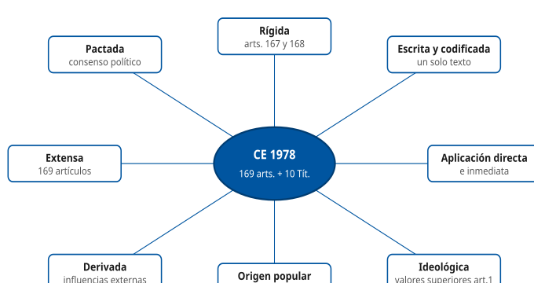

#### D2 · Árbol de la estructura constitucional

Sección § 3

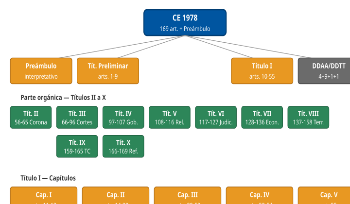

#### D3 · Parte dogmática vs parte orgánica

Sección § 4

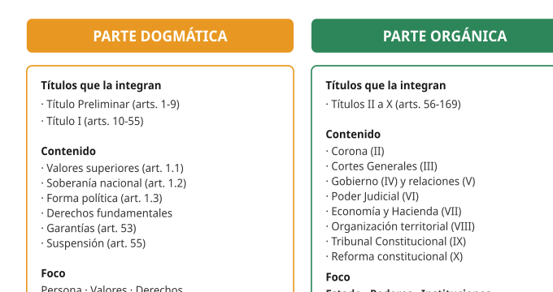

#### D4 · Procedimiento ordinario de reforma (art. 167)

Sección § 7.2

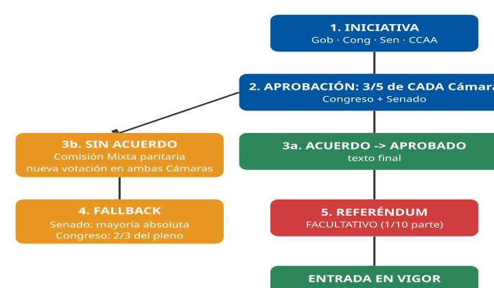

#### D5 · Procedimiento agravado de reforma (art. 168)

Sección § 7.3

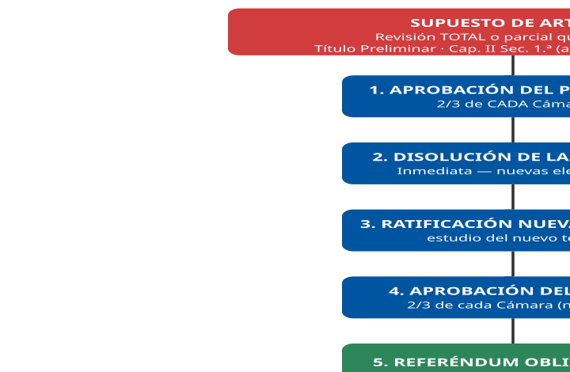

#### D6 · Timeline de reformas (1992-2011-2024-2026)

Sección § 8

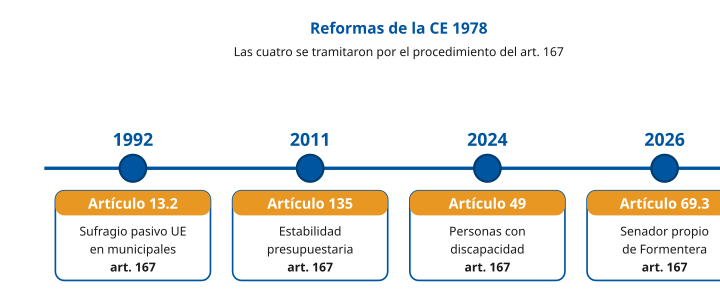

#### D7 · Suspensión de derechos (art. 55) — colectiva vs individual

Sección § 5.6 / § 10

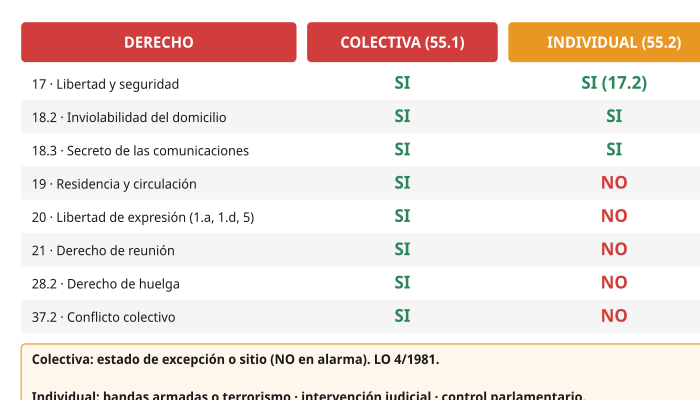

#### D8 · Jerarquía normativa

Sección § 11

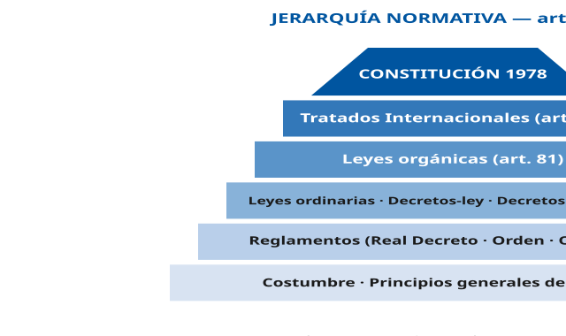

#### D9 · Tipos de mayoría parlamentaria

Sección § 7.3

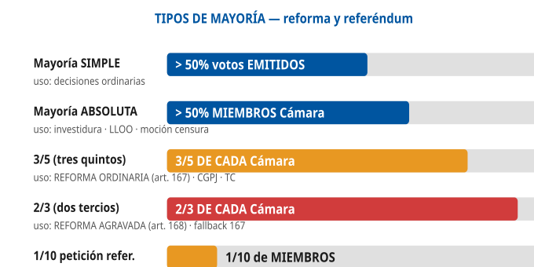

#### D10 · Niveles de protección de los derechos (art. 53)

Sección § 5.5 / § 9

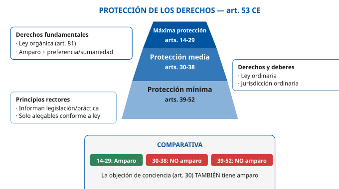

#### D11 · Flujo del recurso de amparo

Sección § 9.2

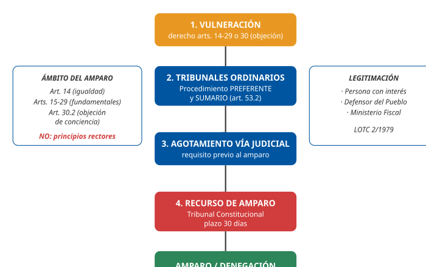

#### D12 · Organización territorial (Título VIII)

Sección § 12

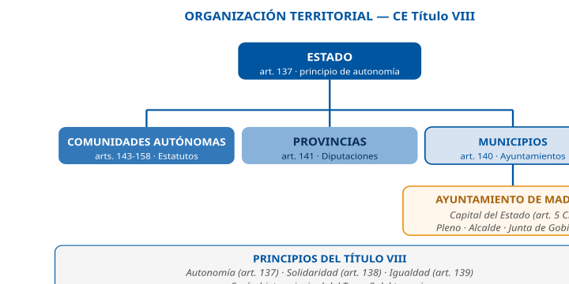

## Casos prácticos

### Caso 1. Plataforma digital de participación ciudadana

El Ayuntamiento de Madrid está implantando una plataforma digital de participación ciudadana que permitirá a los ciudadanos expresar opiniones, participar en consultas públicas y organizar encuentros virtuales. Surgen dudas jurídicas sobre el alcance de los derechos fundamentales, sus garantías, los principios rectores y posibles limitaciones o suspensiones.

#### 1. De acuerdo con la Constitución Española, el derecho a expresar y difundir libremente pensamientos, ideas y opiniones mediante cualquier medio de reproducción:

- a) Requerirá autorización administrativa previa cuando se ejerza a través de plataformas digitales de titularidad pública.
- b) Se reconoce en el artículo 20 y no puede restringirse mediante ningún tipo de censura previa.
- c) Solo podrá ejercerse libremente en medios de comunicación privados.

**Respuesta correcta:** b)

#### 2. De conformidad con la Constitución Española, el derecho de reunión en el entorno descrito:

- a) Requerirá autorización previa en todo caso cuando tenga lugar en espacios virtuales gestionados por la Administración.
- b) Se reconoce como derecho fundamental, sin necesidad de autorización previa, sin perjuicio de la comunicación previa en los casos previstos legalmente.
- c) Solo se reconoce para reuniones físicas en lugares de tránsito público.

**Respuesta correcta:** b)

#### 3. De acuerdo con el artículo 53 de la Constitución Española, el ejercicio de los derechos fundamentales:

- a) Podrá regularse mediante reglamento siempre que exista habilitación legal suficiente.
- b) Solo podrá regularse por ley que, en todo caso, deberá respetar su contenido esencial.
- c) No podrá ser objeto de regulación normativa en ningún caso.

**Respuesta correcta:** b)

#### 4. De conformidad con la Constitución Española, la tutela de los derechos fundamentales ante los tribunales ordinarios:

- a) Se realizara mediante procedimiento ordinario en todos los casos.
- b) Se realizara mediante un procedimiento basado en los principios de preferencia y sumariedad.
- c) Solo podrá ejercerse mediante recurso de amparo.

**Respuesta correcta:** b)

#### 5. Según la Constitución Española, el recurso de amparo ante el Tribunal Constitucional:

- a) Podrá interponerse en defensa de cualquier derecho reconocido en la Constitución.
- b) Protege el principio de igualdad del artículo 14, los derechos de la Sección 1.ª del Capítulo II (artículos 15 a 29) y la objeción de conciencia del artículo 30.
- c) Se limita exclusivamente a la protección de los principios rectores.

**Respuesta correcta:** b)

#### 6. De conformidad con la Constitución Española, el derecho a la protección de la salud:

- a) Se configura como derecho fundamental de aplicación directa.
- b) Forma parte de los principios rectores de la política social y económica, correspondiendo a los poderes públicos su organización y tutela.
- c) Carece de reconocimiento constitucional expreso.

**Respuesta correcta:** b)

#### 7. De acuerdo con la Constitución Española, el derecho a disfrutar de una vivienda digna y adecuada:

- a) Tiene la consideración de derecho fundamental susceptible de recurso de amparo.
- b) Se reconoce como principio rector, debiendo los poderes públicos promover las condiciones necesarias.
- c) Solo podrá ser ejercido en los términos que establezcan los reglamentos municipales.

**Respuesta correcta:** b)

#### 8. De conformidad con el artículo 53 CE, el reconocimiento, el respeto y la protección de los principios rectores:

- a) Informaran la legislación positiva, la práctica judicial y la actuación de los poderes públicos.
- b) Tendrán la misma protección que los derechos fundamentales.
- c) Podrán ser invocados directamente mediante recurso de amparo.

**Respuesta correcta:** a)

#### 9. De acuerdo con el artículo 55 CE, podrá ser suspendido cuando se acuerde la declaración del estado de excepción o de sitio:

- a) El derecho a la igualdad ante la ley.
- b) El derecho a elegir libremente su residencia y a circular por el territorio nacional.
- c) El derecho a la educación.

**Respuesta correcta:** b)

#### 10. De conformidad con la Constitución Española, la suspensión individual de determinados derechos:

- a) Podrá acordarse en cualquier procedimiento penal sin limitación material.
- b) Podrá acordarse en relación con las investigaciones correspondientes a la actuación de bandas armadas o elementos terroristas, en los términos previstos en la ley.
- c) No está permitida en ningún caso en el ordenamiento constitucional.

**Respuesta correcta:** b)

### Caso 2. Ordenanza sobre plataforma digital municipal

El Ayuntamiento de Madrid ha aprobado una ordenanza para regular el uso de una plataforma digital municipal. Se incluyen: moderación previa de contenidos, limitaciones por motivos de orden público, restricciones en situaciones excepcionales y programas de acceso a vivienda y salud. Se plantean dudas sobre naturaleza de los derechos afectados, garantías y posible limitación o suspensión.

#### 1. De acuerdo con la Constitución Española, la exigencia de autorización previa para publicar contenidos en una plataforma pública municipal:

- a) Es compatible con el derecho a la libertad de expresión cuando se trate de medios digitales.
- b) Supone una forma de censura previa prohibida con carácter general por la Constitución.
- c) Es obligatoria en todos los servicios públicos digitales.

**Respuesta correcta:** b)

#### 2. De conformidad con el artículo 20 de la Constitución Española, el ejercicio de la libertad de expresión:

- a) Es ilimitado en cualquier circunstancia.
- b) No puede restringirse mediante censura previa, sin perjuicio de los límites establecidos en la propia Constitución.
- c) Solo puede ejercerse en medios de comunicación autorizados.

**Respuesta correcta:** b)

#### 3. De acuerdo con la Constitución Española, una limitación general del uso de la plataforma por motivos de orden público:

- a) Solo será posible en los casos y en la forma previstos por la ley.
- b) Podrá establecerse libremente mediante reglamento municipal.
- c) No requiere cobertura normativa expresa.

**Respuesta correcta:** a)

#### 4. De conformidad con el artículo 53 de la Constitución Española, los derechos fundamentales:

- a) Podrán ser regulados por normas reglamentarias siempre que no afecten a su contenido esencial.
- b) Solo podrán ser regulados por ley, que en todo caso deberá respetar su contenido esencial.
- c) No pueden ser objeto de regulación en ningún caso.

**Respuesta correcta:** b)

#### 5. Según la Constitución Española, la tutela de los derechos fundamentales ante los tribunales ordinarios:

- a) Se realizara mediante procedimiento ordinario en todo caso.
- b) Se realizara mediante un procedimiento basado en los principios de preferencia y sumariedad.
- c) Solo podrá ejercerse mediante recurso de amparo.

**Respuesta correcta:** b)

#### 6. De acuerdo con la Constitución Española, la inclusión en la plataforma de programas municipales de acceso a la vivienda:

- a) Afecta a un derecho fundamental directamente exigible ante los tribunales.
- b) Se refiere a un principio rector de la política social y económica.
- c) Implica un derecho susceptible de recurso de amparo.

**Respuesta correcta:** b)

#### 7. De conformidad con la Constitución Española, el derecho a la protección de la salud:

- a) Tiene la misma protección que los derechos fundamentales.
- b) Es un principio rector cuya efectividad corresponde a los poderes públicos.
- c) Es un derecho no reconocido constitucionalmente.

**Respuesta correcta:** b)

#### 8. De acuerdo con el artículo 53 CE, los principios rectores:

- a) Podrán ser invocados directamente mediante recurso de amparo.
- b) Informaran la legislación positiva, la práctica judicial y la actuación de los poderes públicos.
- c) Tendrán protección reforzada equivalente a los derechos fundamentales.

**Respuesta correcta:** b)

#### 9. De conformidad con la Constitución Española, los principios rectores:

- a) No podrán ser alegados ante la jurisdicción ordinaria en ningún caso.
- b) Solo podrán ser alegados ante la jurisdicción ordinaria de acuerdo con lo que dispongan las leyes que los desarrollen.
- c) Podrán alegarse directamente sin necesidad de desarrollo legal.

**Respuesta correcta:** b)

#### 10. En relación con una posible situación excepcional, de acuerdo con el artículo 55 CE:

- a) Podrán suspenderse todos los derechos fundamentales sin excepción.
- b) Podrán suspenderse determinados derechos en los casos de estado de excepción o de sitio, en los términos previstos en la Constitución.
- c) No podrá suspenderse ningún derecho en ningún caso.

**Respuesta correcta:** b)

### Caso 3. Infraestructura digital con IA y videovigilancia

El Ayuntamiento de Madrid despliega una infraestructura digital avanzada con plataforma de participación, monitorización de usuarios, registro de logs y comunicaciones, moderación automática, e integración con salud, vivienda y servicios sociales. Como Técnico Auxiliar TIC debes validar que las decisiones respetan el marco constitucional.

#### 1. De conformidad con la Constitución Española, la monitorización sistemática de las comunicaciones de los usuarios de la plataforma:

- a) Podrá realizarse libremente por tratarse de un servicio público digital.
- b) Afecta al derecho al secreto de las comunicaciones, cuya vulneración requiere resolución judicial, salvo en los casos previstos por la ley.
- c) Solo afecta a la protección de datos, no a derechos fundamentales.

**Respuesta correcta:** b)

#### 2. De acuerdo con la Constitución Española, el almacenamiento y análisis de metadatos de comunicaciones electrónicas:

- a) No tiene relevancia constitucional si no se accede al contenido.
- b) Puede incidir en el derecho al secreto de las comunicaciones, que goza de protección reforzada.
- c) Es una materia exclusivamente administrativa.

**Respuesta correcta:** b)

#### 3. En relación con la moderación automática de contenidos, de acuerdo con el artículo 20 CE:

- a) Cualquier filtrado previo constituye censura previa prohibida con carácter general.
- b) La Administración podrá establecer libremente sistemas de control previo por tratarse de un servicio público.
- c) La censura previa solo está prohibida en medios tradicionales.

**Respuesta correcta:** a)

#### 4. De conformidad con la Constitución Española, la eliminación posterior de contenidos que vulneren derechos de terceros:

- a) Está prohibida en todo caso.
- b) Es compatible con el derecho a la libertad de expresión dentro de sus límites constitucionales.
- c) Solo puede realizarse mediante autorización administrativa previa.

**Respuesta correcta:** b)

#### 5. De acuerdo con el artículo 18 CE, la recogida masiva de datos de usuarios en la plataforma:

- a) No tiene límite constitucional al tratarse de un servicio público.
- b) Puede afectar al derecho a la intimidad y al honor, que son derechos fundamentales.
- c) Solo afecta a principios rectores.

**Respuesta correcta:** b)

#### 6. En relación con la trazabilidad de la actividad (logs), de acuerdo con la Constitución Española:

- a) No tiene relevancia constitucional si se realiza con fines técnicos.
- b) Puede incidir en derechos fundamentales como la intimidad, dependiendo de su alcance.
- c) Es una obligación constitucional de la Administración.

**Respuesta correcta:** b)

#### 7. De conformidad con el artículo 53 CE, las limitaciones técnicas implementadas sobre derechos fundamentales:

- a) Podrán establecerse mediante decisiones técnicas sin necesidad de cobertura legal.
- b) Deberán estar previstas en la ley y respetar en todo caso el contenido esencial del derecho.
- c) Podrán establecerse mediante instrucciones internas.

**Respuesta correcta:** b)

#### 8. De acuerdo con la Constitución Española, una restricción del acceso a la plataforma por motivos de orden público:

- a) Podrá establecerse libremente por la Administración.
- b) Deberá estar prevista en la ley y ser proporcional.
- c) No es posible en ningún caso.

**Respuesta correcta:** b)

#### 9. En relación con los servicios digitales de vivienda y salud integrados:

- a) Afectan a derechos fundamentales protegidos por recurso de amparo.
- b) Se refieren a principios rectores de la política social y económica.
- c) Carecen de reconocimiento constitucional.

**Respuesta correcta:** b)

#### 10. De conformidad con el artículo 53 CE, los derechos del Capítulo III:

- a) Son directamente exigibles ante los tribunales mediante procedimiento preferente y sumario.
- b) Solo podrán ser alegados ante la jurisdicción ordinaria de acuerdo con lo que dispongan las leyes que los desarrollen.
- c) Tienen la misma protección que los derechos fundamentales.

**Respuesta correcta:** b)

#### 11. En relación con una posible limitación del acceso a la plataforma en crisis, de acuerdo con la Constitución:

- a) Podrá acordarse libremente por la Administración.
- b) Podrá implicar la suspensión de determinados derechos únicamente en los casos previstos en el artículo 55.
- c) No podrá afectar en ningún caso a derechos fundamentales.

**Respuesta correcta:** b)

#### 12. De conformidad con el artículo 55 CE, en un estado de excepción o de sitio:

- a) Podrán suspenderse todos los derechos fundamentales.
- b) Podrán suspenderse determinados derechos en los términos previstos en la Constitución.
- c) No podrá suspenderse ningún derecho.

**Respuesta correcta:** b)

#### 13. En relación con la suspensión individual de derechos en un entorno digital:

- a) Podrá acordarse en cualquier procedimiento administrativo.
- b) Solo podrá acordarse en relación con investigaciones sobre bandas armadas o terrorismo.
- c) No está permitida en ningún caso.

**Respuesta correcta:** b)

#### 14. De acuerdo con la Constitución Española, el derecho a la protección de datos personales:

- a) Constituye un derecho fundamental autónomo, reconocido a partir del artículo 18.4 CE, que garantiza a la persona un poder de control sobre sus datos personales.
- b) Es un principio rector de la política social y económica.
- c) No tiene reconocimiento constitucional.

**Respuesta correcta:** a)

#### 15. De conformidad con la Constitución Española, la supervisión de la actuación administrativa en estos sistemas digitales corresponde, entre otros, a:

- a) El Defensor del Pueblo.
- b) El Gobierno exclusivamente.
- c) El Tribunal Constitucional únicamente.

**Respuesta correcta:** a)

### Caso 4. Identidad digital municipal y videovigilancia

El Ayuntamiento de Madrid pone en marcha un sistema unificado de identidad digital: certificados electrónicos para empadronados, firma electrónica, cámaras de videovigilancia con lectura automática de matrículas, cámaras corporales en actuaciones policiales municipales y portal único de expedientes (salud, padrón, tributos, servicios sociales). Analiza la compatibilidad con el Título I CE.

#### 1. De acuerdo con el artículo 18 CE, la captación sistemática de la imagen de los ciudadanos en espacios públicos:

- a) Puede afectar al derecho a la propia imagen, que se reconoce como derecho fundamental.
- b) No tiene relevancia constitucional por tratarse de espacio público.
- c) Solo afecta a principios rectores.

**Respuesta correcta:** a)

#### 2. De conformidad con la Constitución Española, el acceso a los datos personales almacenados en el portal único municipal requiere:

- a) Únicamente la autorización del responsable del fichero.
- b) Cobertura legal y respeto al contenido esencial de los derechos a la intimidad y a la protección de datos personales, conforme al artículo 53.1.
- c) Instrucción interna del servicio correspondiente.

**Respuesta correcta:** b)

#### 3. Según la Constitución Española, la protección de los datos personales vinculados a la identidad digital municipal:

- a) Constituye un derecho fundamental autónomo, derivado del artículo 18.4, distinto de los derechos a la intimidad y al honor.
- b) Es un principio rector sin tutela judicial específica.
- c) Carece de reconocimiento constitucional.

**Respuesta correcta:** a)

#### 4. De acuerdo con el artículo 24 CE, los ciudadanos afectados por un tratamiento indebido de sus datos podrán:

- a) Obtener la tutela efectiva de jueces y tribunales, sin que en ningún caso se produzca indefensión.
- b) Únicamente presentar una queja administrativa interna.
- c) Esperar a la resolución del expediente por silencio positivo.

**Respuesta correcta:** a)

#### 5. De conformidad con la Constitución Española, el acceso sin consentimiento al contenido de comunicaciones electrónicas:

- a) Requiere en todo caso resolución judicial, salvo en los supuestos previstos por la ley.
- b) Podrá realizarse libremente por razones de servicio.
- c) No está protegido por el artículo 18.

**Respuesta correcta:** a)

#### 6. Según la Constitución Española, la regulación del sistema de identidad digital debe garantizar:

- a) El contenido esencial del derecho a la intimidad y al secreto de las comunicaciones.
- b) Únicamente la eficiencia técnica del sistema.
- c) Exclusivamente la simplificación administrativa.

**Respuesta correcta:** a)

#### 7. De acuerdo con la Constitución Española, las grabaciones con cámaras corporales de la Policía Municipal:

- a) Están prohibidas en todo caso por afectar a derechos fundamentales.
- b) Son lícitas cuando estén amparadas en ley y respeten el principio de proporcionalidad.
- c) Requieren consentimiento expreso del ciudadano grabado en toda circunstancia.

**Respuesta correcta:** b)

#### 8. De conformidad con la Constitución Española, la posibilidad de recurrir en amparo por vulneración de la intimidad:

- a) Está prevista al tratarse de un derecho de la Sección 1.ª del Capítulo II del Título I.
- b) No está prevista, al ser la intimidad un principio rector.
- c) Solo procede si existe sentencia penal firme.

**Respuesta correcta:** a)

#### 9. De acuerdo con el artículo 54 CE, la figura institucional de supervisión de posibles vulneraciones de derechos fundamentales es:

- a) El Defensor del Pueblo, como alto comisionado de las Cortes Generales.
- b) El Consejo de Ministros.
- c) El Tribunal de Cuentas.

**Respuesta correcta:** a)

#### 10. Según la Constitución Española, el principio de legalidad aplicado al sistema de identidad digital exige:

- a) Que todas las limitaciones de derechos fundamentales tengan cobertura legal expresa.
- b) Que las limitaciones se decidan por consenso técnico sin necesidad de ley.
- c) Que las decisiones técnicas prevalezcan sobre las leyes.

**Respuesta correcta:** a)

#### 11. De conformidad con la Constitución Española, la lectura automática de matrículas en viarios municipales:

- a) Debe contar con cobertura normativa adecuada y respetar el principio de proporcionalidad.
- b) Es libre por tratarse de espacio público sin protección constitucional.
- c) Solo es lícita en poblaciones menores de 50.000 habitantes.

**Respuesta correcta:** a)

#### 12. De acuerdo con el artículo 53 CE, la regulación del tratamiento automatizado de datos con fines de seguridad ciudadana:

- a) Podrá hacerse mediante reglamento sin ley previa.
- b) Requiere ley que respete el contenido esencial de los derechos fundamentales afectados.
- c) Podrá decidirse por instrucción técnica interna.

**Respuesta correcta:** b)

### Caso 5. Elecciones municipales y derechos de participación

En el marco de las próximas elecciones municipales en Madrid, el Ayuntamiento organiza una campaña institucional, gestiona el censo electoral con ciudadanos UE residentes, actos de propaganda electoral en viarios, un sistema de voto accesible para personas con discapacidad, y tramita una iniciativa ciudadana para reformar una ordenanza. Analiza el marco constitucional.

#### 1. De conformidad con la Constitución Española, los ciudadanos UE residentes en Madrid:

- a) Pueden ser electores y elegibles en las elecciones municipales en los términos que establezcan los tratados o la ley, conforme a la reforma del artículo 13.2 operada en 1992.
- b) No pueden participar en elecciones municipales en ningún caso.
- c) Solo son electores, pero nunca elegibles.

**Respuesta correcta:** a)

#### 2. Según la Constitución Española, el derecho de participación política se reconoce en el artículo:

- a) 23 de la Constitución Española.
- b) 13.2 de la Constitución Española.
- c) 27 de la Constitución Española.

**Respuesta correcta:** a)

#### 3. De acuerdo con la Constitución Española, el ejercicio del derecho de sufragio activo requiere:

- a) Ser mayor de edad y cumplir los requisitos establecidos por la ley, siendo la mayoría a los 18 años según el artículo 12.
- b) Tener al menos 21 años según establece la Constitución.
- c) Haber residido en el municipio los últimos 10 años.

**Respuesta correcta:** a)

#### 4. De conformidad con la Constitución Española, la propaganda electoral en viarios municipales:

- a) Es manifestación del derecho de participación política, limitado por la legislación electoral aplicable.
- b) Requiere autorización individualizada para cada formación política.
- c) Está prohibida en todo caso.

**Respuesta correcta:** a)

#### 5. Según la Constitución Española, la protección del derecho de reunión en actos electorales:

- a) Exige comunicación previa a la autoridad cuando se celebren en lugares de tránsito público.
- b) Requiere autorización administrativa expresa.
- c) Puede prohibirse sin motivación.

**Respuesta correcta:** a)

#### 6. De acuerdo con la Constitución Española, el sistema de voto accesible para personas con discapacidad:

- a) Es coherente con la reforma del artículo 49 operada en 2024, que sustituyó la terminología anterior por la expresión personas con discapacidad.
- b) No tiene anclaje constitucional.
- c) Se trata de una mera práctica administrativa.

**Respuesta correcta:** a)

#### 7. De conformidad con la Constitución Española, los partidos políticos:

- a) Expresan el pluralismo político, concurren a la formación y manifestación de la voluntad popular y son instrumento fundamental para la participación política.
- b) Son órganos administrativos dependientes del Ministerio del Interior.
- c) Tienen carácter exclusivamente consultivo.

**Respuesta correcta:** a)

#### 8. En el marco constitucional y legal, una iniciativa ciudadana para la reforma de una ordenanza municipal:

- a) Conecta con el derecho de participación en los asuntos públicos del artículo 23, pero su régimen concreto lo fijan la legislación de régimen local (art. 70 bis LBRL) y la normativa municipal.
- b) No tiene cabida en el marco constitucional.
- c) Requiere autorización del Consejo de Ministros.

**Respuesta correcta:** a)

#### 9. De acuerdo con la Constitución Española, la iniciativa popular para la reforma constitucional:

- a) Está excluida, conforme al artículo 166 en relación con el artículo 87.3.
- b) Se admite con un mínimo de 500.000 firmas.
- c) Se admite con carácter general.

**Respuesta correcta:** a)

#### 10. De conformidad con la Constitución Española, la campaña institucional de fomento de la participación ciudadana:

- a) Debe respetar la neutralidad política e institucional, asegurando el pluralismo político reconocido como valor superior.
- b) Puede orientarse a favor de una formación política concreta.
- c) No tiene limitaciones constitucionales.

**Respuesta correcta:** a)

#### 11. Según la Constitución Española, la tutela del derecho de sufragio activo y pasivo se garantiza:

- a) Mediante el procedimiento preferente y sumario y, en su caso, mediante recurso de amparo.
- b) Únicamente mediante recurso contencioso-administrativo ordinario.
- c) Exclusivamente ante el Tribunal Supremo.

**Respuesta correcta:** a)

#### 12. De acuerdo con la Constitución Española, ningún español podrá ser privado de sus derechos en cualquier parte del territorio del Estado:

- a) Por razón de su origen o vecindad.
- b) Salvo decisión de la Comunidad Autónoma de residencia.
- c) Salvo acuerdo del Pleno del Ayuntamiento correspondiente.

**Respuesta correcta:** a)

### Caso 6. Emergencia climática y estados de crisis

Una situación de emergencia climática grave en Madrid (inundación severa y pérdida prolongada de servicios esenciales) lleva a valorar la adopción de medidas extraordinarias. El Gobierno estudia declarar estado de alarma y el Ayuntamiento dispone de competencias propias en protección civil municipal. Como Técnico Auxiliar TIC, analiza los límites constitucionales y las consecuencias sobre derechos fundamentales.

#### 1. De acuerdo con la Constitución Española, los estados de alarma, excepción y sitio se regulan en el artículo:

- a) 116 de la Constitución Española.
- b) 55 de la Constitución Española.
- c) 137 de la Constitución Española.

**Respuesta correcta:** a)

#### 2. Según la Constitución Española, durante el estado de alarma:

- a) Los derechos fundamentales podrán limitarse en la medida estrictamente necesaria, pero no suspenderse.
- b) Se suspenden automáticamente todos los derechos fundamentales.
- c) Quedan suspendidos los derechos del artículo 55.1 en los mismos términos que en el estado de excepción.

**Respuesta correcta:** a)

#### 3. De conformidad con el artículo 55.1 CE, en el estado de excepción pueden suspenderse:

- a) Los derechos de los artículos 17, 18.2, 18.3, 19, 20, 21, 28.2 y 37.2 de la Constitución.
- b) Todos los derechos y libertades reconocidos en la Constitución sin excepción.
- c) Únicamente el derecho a la libertad de expresión.

**Respuesta correcta:** a)

#### 4. Según la Constitución Española, durante el estado de sitio:

- a) Pueden suspenderse los derechos del artículo 55.1, incluido el de residencia y circulación del artículo 19.
- b) Se suspende en todo caso el derecho a la educación.
- c) Se suspenden automáticamente los principios rectores.

**Respuesta correcta:** a)

#### 5. De acuerdo con la Constitución Española, las limitaciones acordadas por el Ayuntamiento en protección civil:

- a) Deberán respetar el principio de legalidad y el contenido esencial de los derechos afectados.
- b) Podrán decidirse libremente sin cobertura normativa.
- c) Suponen la suspensión automática de derechos fundamentales.

**Respuesta correcta:** a)

#### 6. De conformidad con la Constitución Española, la limitación del derecho de circulación por motivos de emergencia requiere:

- a) Cobertura legal adecuada y respeto del principio de proporcionalidad.
- b) Únicamente acuerdo del Alcalde.
- c) Declaración formal del estado de sitio.

**Respuesta correcta:** a)

#### 7. Según la Constitución Española, el control parlamentario sobre la declaración de los estados excepcionales:

- a) Corresponde al Congreso de los Diputados, conforme al artículo 116.
- b) Corresponde exclusivamente al Senado.
- c) No existe control parlamentario en estas situaciones.

**Respuesta correcta:** a)

#### 8. De acuerdo con la Constitución Española, durante los estados de alarma, excepción o sitio:

- a) No podrá iniciarse la reforma constitucional, conforme al artículo 169.
- b) Podrán iniciarse reformas constitucionales siempre que exista urgencia.
- c) La reforma constitucional se acelera automáticamente.

**Respuesta correcta:** a)

#### 9. De conformidad con la Constitución Española, las decisiones administrativas adoptadas durante una emergencia:

- a) Siguen sujetas al control de la jurisdicción contencioso-administrativa.
- b) Quedan exentas de control judicial durante su vigencia.
- c) Solo pueden ser revisadas por el Gobierno.

**Respuesta correcta:** a)

#### 10. Según la Constitución Española, las medidas de protección del medio ambiente adoptadas en emergencia climática:

- a) Encuentran anclaje constitucional en el artículo 45, como principio rector.
- b) Son contrarias al texto constitucional.
- c) Son un derecho fundamental susceptible de amparo.

**Respuesta correcta:** a)

#### 11. De acuerdo con la Constitución Española, la articulación entre competencias estatales y municipales en emergencia:

- a) Se apoya en los principios de autonomía y solidaridad del Título VIII.
- b) No tiene reflejo constitucional.
- c) Implica siempre la suspensión de la autonomía municipal.

**Respuesta correcta:** a)

#### 12. De conformidad con la Constitución Española, la responsabilidad patrimonial por daños de medidas extraordinarias:

- a) Se reconoce en el marco del artículo 106.2, que garantiza la indemnización por lesiones en sus bienes y derechos.
- b) No existe en situaciones excepcionales.
- c) Corresponde únicamente a las compañías de seguros.

**Respuesta correcta:** a)

#### 13. Según la Constitución Española, la suspensión individual de derechos del artículo 55.2:

- a) Requiere intervención judicial necesaria y adecuado control parlamentario.
- b) Puede acordarse por el Alcalde en situación de emergencia.
- c) No requiere cobertura legal expresa.

**Respuesta correcta:** a)

## Fuentes

### Naturaleza de las fuentes

A diferencia de los temas técnicos (11-40), los temas del bloque administrativo trabajan con **corpus cerrado**: el texto literal de la Constitución Española publicado en el BOE y sus reformas. No se busca doctrina externa ni bibliografía académica. Las citas se expresan como referencias a artículos (`(art. 14 CE)`) o al BOE oficial de cada reforma.

### Tier 1 · Fuentes primarias

| Ref | Título | Publicación | Uso |
|----|----|----|----|
| \[CE-1978\] | [Constitución Española](https://www.boe.es/buscar/act.php?id=BOE-A-1978-31229) | BOE 311 · 29/12/1978 · BOE-A-1978-31229 | Texto literal por artículos |
| \[REF-1992\] | [Reforma del artículo 13.2 CE](https://www.boe.es/buscar/doc.php?id=BOE-A-1992-20403) | BOE 207 · 28/08/1992 | Sufragio UE en elecciones municipales |
| \[REF-2011\] | [Reforma del artículo 135 CE](https://www.boe.es/buscar/doc.php?id=BOE-A-2011-15210) | BOE 233 · 27/09/2011 | Estabilidad presupuestaria · prioridad deuda |
| \[REF-2024\] | [Reforma del artículo 49 CE](https://www.boe.es/buscar/doc.php?id=BOE-A-2024-3099) | BOE 43 · 17/02/2024 | "Personas con discapacidad" sustituye "disminuidos" |
| \[REF-2026\] | [Reforma del artículo 69.3 CE](https://www.boe.es/buscar/doc.php?id=BOE-A-2026-10881) | BOE 123 · 20/05/2026 · BOE-A-2026-10881 | Senador propio de Formentera |
