# Tema 2. La Constitución Española (II)

**Bloque:** administrativo  
**Enunciado oficial** (BOAM n.º 10.032, de 23 de diciembre de 2025): La Constitución Española (II): La Organización territorial del Estado. Principios generales. La Administración Local. Las Comunidades Autónomas: los Estatutos de Autonomía.

Versión web: <https://ayuntamientomadrid.github.io/temario-tecnico-auxiliar/temas/tema-02.html> · PDF: [tema-02.pdf](tema-02.pdf) · Test: [../../../tests/administrativo/tema-02.md](../../../tests/administrativo/tema-02.md)

## Índice

- 1. Introducción: el Estado autonómico y el Título VIII
- 2. Principios generales de la organización territorial (arts. 137-139)
  - 2.1. Principio de autonomía (art. 137)
  - 2.2. Principio de solidaridad y equilibrio territorial (art. 138)
  - 2.3. Igualdad de derechos y unidad de mercado (art. 139)
- 3. El modelo de Estado autonómico: características
- 4. La Administración Local (arts. 140-142)
  - 4.1. El Municipio (art. 140)
  - 4.2. La Provincia (art. 141)
  - 4.3. Islas, comarcas y áreas metropolitanas
  - 4.4. Las Haciendas Locales (art. 142)
  - 4.5. Desarrollo legal: la Ley de Bases del Régimen Local (LBRL 7/1985)
- 5. Las Comunidades Autónomas: acceso a la autonomía (arts. 143-145)
  - 5.1. Vía ordinaria o lenta (art. 143)
  - 5.2. Supuestos especiales del art. 144
  - 5.3. Vía rápida o privilegiada (art. 151) y la Disposición Transitoria 2.ª
  - 5.4. Prohibición de federación y convenios entre CCAA (art. 145)
- 6. Los Estatutos de Autonomía (arts. 146-147)
  - 6.1. Elaboración del proyecto (art. 146)
  - 6.2. Naturaleza, contenido y reforma (art. 147)
- 7. La distribución de competencias (arts. 148-150)
  - 7.1. Competencias asumibles por las Comunidades Autónomas (art. 148)
  - 7.2. Competencias exclusivas del Estado (art. 149)
  - 7.3. Cláusulas de cierre (art. 149.3)
  - 7.4. Leyes marco, de transferencia y de armonización (art. 150)
- 8. La organización institucional autonómica (art. 152)
- 9. Control de las Comunidades Autónomas y coerción estatal (arts. 153-155)
  - 9.1. Vías de control (art. 153) y Delegado del Gobierno (art. 154)
  - 9.2. La coerción estatal del art. 155
- 10. La financiación autonómica (arts. 156-158)
- 11. Madrid: Comunidad de Madrid y Ley de Capitalidad
  - 11.1. La Comunidad de Madrid
  - 11.2. La Ley 22/2006 de Capitalidad y de Régimen Especial de Madrid
- 12. Esquema resumen + cómo estudiar el tema
  - Síntesis del Título VIII
  - Cómo estudiarlo

## Contenido

------------------------------------------------------------------------

### Convenciones del documento

Este tema incluye cuatro tipos de **cajas callout** para facilitar el estudio:

> **Dato clave.** Información de alta densidad memorística: plazos, mayorías, número de competencias, órganos.

> **Cita normativa.** Reproducción literal o paráfrasis cercana de un precepto de la Constitución Española o de otra norma, con referencia al artículo.

> **Ejemplo de aplicación en el ayto.** Aplicación de la norma al entorno municipal de Madrid (Comunidad de Madrid, Ley de Capitalidad, organización del Ayuntamiento).

> **Relación con otros temas.** Relación con otros temas o con otros bloques del propio Tema 2.

Las citas a artículos de la Constitución se expresan como `(art. X CE)` o `(art. X.Y CE)`. El desarrollo legal se identifica con la ley: `(art. X LBRL)`, `(art. X LOFCA)`, `(art. X Ley 22/2006)`. El registro completo de fuentes está en la pestaña Fuentes.

------------------------------------------------------------------------

### 1. Introducción: el Estado autonómico y el Título VIII

La Constitución Española de 1978 regula la **organización territorial del Estado** en su Título VIII. El modelo resultante se conoce como **Estado autonómico** o **Estado de las Autonomías**.

El fundamento de este modelo está en el **artículo 2** de la Constitución, dentro del Título Preliminar:

> **Cita normativa.** *"La Constitución se fundamenta en la indisoluble unidad de la Nación española, patria común e indivisible de todos los españoles, y reconoce y garantiza el derecho a la autonomía de las nacionalidades y regiones que la integran y la solidaridad entre todas ellas"* (art. 2 CE)

El artículo 2 recoge así los principios de **unidad**, **autonomía** y **solidaridad**. La regulación de detalle se contiene en el **Título VIII** de la Constitución, *"De la Organización Territorial del Estado"*, que comprende los **artículos 137 a 158** y se divide en tres capítulos:

| Capítulo     | Rúbrica                      | Artículos |
|--------------|------------------------------|-----------|
| Capítulo I   | Principios generales         | 137-139   |
| Capítulo II  | De la Administración Local   | 140-142   |
| Capítulo III | De las Comunidades Autónomas | 143-158   |

> **Dato clave.** El Título VIII abarca los artículos **137 a 158** y se divide en **tres capítulos**: principios generales (I), Administración Local (II) y Comunidades Autónomas (III). El Estado se organiza territorialmente en **municipios, provincias y Comunidades Autónomas** (art. 137 CE); el Estado no es un cuarto nivel, y la soberanía reside en el pueblo español (art. 1.2 CE).

------------------------------------------------------------------------

### 2. Principios generales de la organización territorial (arts. 137-139)

El Capítulo I del Título VIII fija los principios estructurales que vertebran todo el modelo.

#### 2.1. Principio de autonomía (art. 137)

> **Cita normativa.** *"El Estado se organiza territorialmente en municipios, en provincias y en las Comunidades Autónomas que se constituyan. Todas estas entidades gozan de autonomía para la gestión de sus respectivos intereses"* (art. 137 CE)

La autonomía que reconoce el artículo 137 es «para la gestión de sus respectivos intereses»; la soberanía nacional reside en el pueblo español, del que emanan los poderes del Estado (art. 1.2 CE). Su alcance es distinto según el ente:

- **Autonomía política** (Comunidades Autónomas): incluye la potestad legislativa, que ejerce la Asamblea Legislativa (art. 152.1 CE); el control de la constitucionalidad de sus disposiciones normativas con fuerza de ley corresponde al Tribunal Constitucional (art. 153.a CE).
- **Autonomía administrativa** (Entidades Locales): a los municipios, las provincias y las islas les corresponden, entre otras, las potestades reglamentaria y de autoorganización (art. 4.1.a LBRL), pero **no dictan leyes**.

> **Dato clave.** Las **Comunidades Autónomas tienen autonomía política** (legislan); las **Entidades Locales tienen autonomía administrativa** (no legislan, ejercen potestad reglamentaria). Ambas distintas de la **soberanía**, que es del pueblo español. (arts. 1.2 y 137 CE)

#### 2.2. Principio de solidaridad y equilibrio territorial (art. 138)

> **Cita normativa.** *"El Estado garantiza la realización efectiva del principio de solidaridad consagrado en el artículo 2 de la Constitución, velando por el establecimiento de un equilibrio económico, adecuado y justo entre las diversas partes del territorio español, y atendiendo en particular a las circunstancias del hecho insular"* (art. 138.1 CE)

El artículo 138 contiene dos mandatos:

1.  **Equilibrio económico** entre territorios, con atención especial al **hecho insular** (Canarias y Baleares).
2.  Las **diferencias entre Estatutos** no podrán implicar, **en ningún caso**, privilegios económicos o sociales (art. 138.2 CE).

#### 2.3. Igualdad de derechos y unidad de mercado (art. 139)

> **Cita normativa.** *"Todos los españoles tienen los mismos derechos y obligaciones en cualquier parte del territorio del Estado"* (art. 139.1 CE)

El apartado 2 consagra la **unidad de mercado**: ninguna autoridad podrá adoptar medidas que obstaculicen, directa o indirectamente, la **libertad de circulación y establecimiento** de las personas ni la **libre circulación de bienes** en todo el territorio español (art. 139.2 CE).

> **Dato clave.** Los tres principios del Capítulo I se memorizan con el orden de los artículos: **137 autonomía**, **138 solidaridad**, **139 igualdad + unidad de mercado**.

------------------------------------------------------------------------

### 3. El modelo de Estado autonómico: características

Aunque la Constitución no emplea la expresión "Estado autonómico", el modelo resultante presenta rasgos propios:

- **Principio dispositivo**: las provincias y territorios del artículo 143.1 «podrán acceder a su autogobierno y constituirse en Comunidades Autónomas», y cada Estatuto fija las competencias asumidas dentro del marco establecido en la Constitución (art. 147.2.d CE).
- **Asimetría inicial**: cuando la iniciativa reunía los requisitos del artículo 151.1 (**vía rápida**), no era preciso dejar transcurrir el plazo de cinco años del artículo 148.2 para ampliar las competencias dentro del marco del artículo 149; las Comunidades de la **vía ordinaria** (art. 143) sí quedaban sujetas a ese plazo.
- **Unidad y no federación**: se prohíbe expresamente la **federación de Comunidades Autónomas** (art. 145.1 CE).
- **Indisolubilidad**: la unidad de la Nación es indisoluble (art. 2 CE).

> **Relación con otros temas.** La estructura general de la Constitución y su reforma (incluida la del Título VIII) se estudian en el **Tema 1**. El Título VIII se reforma por el procedimiento **ordinario** del artículo 167, salvo que la modificación afectara al Título Preliminar.

------------------------------------------------------------------------

### 4. La Administración Local (arts. 140-142)

El Capítulo II del Título VIII garantiza la autonomía de las entidades locales. La Constitución reconoce y protege tres entes locales básicos: el **Municipio**, la **Provincia** y la **Isla**.

#### 4.1. El Municipio (art. 140)

> **Cita normativa.** *"La Constitución garantiza la autonomía de los municipios. Estos gozarán de personalidad jurídica plena. Su gobierno y administración corresponde a sus respectivos Ayuntamientos, integrados por los Alcaldes y los Concejales"* (art. 140 CE)

Elementos del régimen municipal:

- **Personalidad jurídica plena**.
- **Gobierno**: el **Ayuntamiento**, integrado por el **Alcalde** y los **Concejales**.
- **Elección de Concejales**: por los vecinos mediante **sufragio universal, igual, libre, directo y secreto**, en la forma establecida por la ley (art. 140 CE).
- **Elección del Alcalde**: por los **Concejales** o por los **vecinos** (art. 140 CE).
- **Concejo abierto**: la ley regulará las condiciones en las que proceda el régimen del concejo abierto (art. 140 CE). En este régimen, el gobierno y la administración municipales corresponden a un Alcalde y una asamblea vecinal de la que forman parte todos los electores (art. 29.3 LBRL).

> **Dato clave.** Los Concejales se eligen por **sufragio universal, igual, libre, directo y secreto** (cinco adjetivos). El Alcalde se elige **por los Concejales o por los vecinos**. El municipio tiene **personalidad jurídica plena**. (art. 140 CE)

#### 4.2. La Provincia (art. 141)

> **Cita normativa.** *"La provincia es una entidad local con personalidad jurídica propia, determinada por la agrupación de municipios y división territorial para el cumplimiento de las actividades del Estado"* (art. 141.1 CE)

Rasgos esenciales:

- **Doble naturaleza**: es a la vez **entidad local** (agrupación de municipios) y **división territorial** para las actividades del Estado.
- **Alteración de límites provinciales**: cualquier alteración deberá ser aprobada por las **Cortes Generales mediante ley orgánica** (art. 141.1 CE).
- **Gobierno y administración**: encomendados a **Diputaciones** u otras Corporaciones de carácter representativo (art. 141.2 CE).

> **Dato clave.** La alteración de los **límites provinciales** exige **ley orgánica** de las Cortes Generales. En cambio, la alteración de **términos municipales** puede ser competencia de la Comunidad Autónoma (arts. 141.1 y 148.1.2.ª CE).

#### 4.3. Islas, comarcas y áreas metropolitanas

- **Islas**: en los archipiélagos, las islas tendrán además su administración propia en forma de **Cabildos** o **Consejos** (art. 141.4 CE). La LBRL regula los Cabildos Insulares Canarios y los Consejos Insulares de las Islas Baleares (art. 41 LBRL).
- **Agrupaciones distintas de la provincia**: se podrán crear agrupaciones de municipios diferentes de la provincia (art. 141.3 CE). La LBRL reconoce la condición de entidades locales a las comarcas u otras entidades que agrupen varios municipios, a las áreas metropolitanas y a las mancomunidades de municipios (art. 3.2 LBRL).

#### 4.4. Las Haciendas Locales (art. 142)

> **Cita normativa.** *"Las Haciendas locales deberán disponer de los medios suficientes para el desempeño de las funciones que la ley atribuye a las Corporaciones respectivas y se nutrirán fundamentalmente de tributos propios y de participación en los del Estado y de las Comunidades Autónomas"* (art. 142 CE)

Este artículo consagra el **principio de suficiencia financiera** de las entidades locales. Su desarrollo está en el **Texto Refundido de la Ley Reguladora de las Haciendas Locales** (RDLeg. 2/2004).

> **Relación con otros temas.** Los recursos de las Haciendas Locales (tributos propios, tasas, contribuciones especiales, impuestos municipales) se estudian en detalle en el **Tema 8** del temario. \[TRLRHL\]

#### 4.5. Desarrollo legal: la Ley de Bases del Régimen Local (LBRL 7/1985)

La Constitución sienta los principios; el desarrollo corresponde a la **Ley 7/1985, Reguladora de las Bases del Régimen Local** (LBRL), cuyo preámbulo identifica como título constitucional el artículo 149.1.18.ª CE (bases del régimen jurídico de las Administraciones públicas), en relación con el artículo 148.1.2.ª CE.

Aspectos esenciales:

- **Autonomía de los entes locales**: los municipios gestionan con autonomía los intereses propios de las correspondientes colectividades; la provincia y, en su caso, la isla gozan de idéntica autonomía (art. 1 LBRL).
- **Entidades locales** (art. 3 LBRL): territoriales —municipio, provincia e isla en los archipiélagos balear y canario— y otras —comarcas u otras entidades que agrupen varios municipios, áreas metropolitanas y mancomunidades de municipios—.
- **Competencias** (art. 7 LBRL): las competencias de las entidades locales son **propias** o **atribuidas por delegación**; el Estado y las Comunidades Autónomas pueden delegar en ellas el ejercicio de sus competencias.
- **Servicios mínimos obligatorios** (art. 26 LBRL): varían por tramos de población (p. ej., alumbrado público, cementerio, recogida de residuos y abastecimiento domiciliario de agua potable en todos los municipios; transporte colectivo urbano de viajeros en los de población superior a 50.000 habitantes).
- **Ley 27/2013 (LRSAL)**: modificó la LBRL. Entre otros cambios, las entidades locales solo pueden ejercer competencias distintas de las propias y de las delegadas cuando no se ponga en riesgo la **sostenibilidad financiera** del conjunto de la Hacienda municipal y no se incurra en un supuesto de ejecución simultánea del mismo servicio público con otra Administración Pública (art. 7.4 LBRL).

> **Ejemplo de aplicación en el ayto.** El **Ayuntamiento de Madrid** es una entidad local de régimen especial: además de la LBRL, se rige por la **Ley 22/2006 de Capitalidad y de Régimen Especial de Madrid** (Ley 22/2006), que adapta su organización a la condición de capital del Estado y de gran ciudad. Ver sección 11.

------------------------------------------------------------------------

### 5. Las Comunidades Autónomas: acceso a la autonomía (arts. 143-145)

El Capítulo III regula la creación de las Comunidades Autónomas. La CE no creó las CCAA, sino que estableció los **procedimientos** para que los territorios accedieran al autogobierno (principio dispositivo). Existen dos grandes vías.

#### 5.1. Vía ordinaria o lenta (art. 143)

Pueden acceder a la autonomía por esta vía las **provincias limítrofes con características históricas, culturales y económicas comunes**, los **territorios insulares** y las **provincias con entidad regional histórica** (art. 143.1 CE).

**Iniciativa del proceso autonómico** (art. 143.2 CE):

- Corresponde a **todas las Diputaciones interesadas** (o al órgano interinsular) **y** a las **dos terceras partes de los municipios** cuya población represente, al menos, la **mayoría del censo electoral** de cada provincia o isla.
- Estos requisitos deben cumplirse en el **plazo de seis meses** desde el primer acuerdo adoptado por alguna de las Corporaciones locales.
- Si la iniciativa **no prospera**, solo podrá **reiterarse pasados cinco años** (art. 143.3 CE).

> **Dato clave.** Vía art. 143: iniciativa de **Diputaciones + 2/3 de municipios** (mayoría del censo), plazo de **6 meses**; si fracasa, se repite a los **5 años**. Las CCAA de esta vía no podían asumir las competencias del art. 149 hasta transcurridos **5 años** y previa reforma de su Estatuto (art. 148.2).

#### 5.2. Supuestos especiales del art. 144

Las **Cortes Generales**, mediante **ley orgánica** y por motivos de **interés nacional**, podrán (art. 144 CE):

- **a)** Autorizar la constitución de una CA cuando su ámbito **no supere una provincia** y no reúna las condiciones del artículo 143.1 (caso de **Madrid**, autorizado por la LO 6/1982).
- **b)** Autorizar o acordar un Estatuto para **territorios no integrados en la organización provincial** (caso de **Ceuta y Melilla**, ciudades autónomas).
- **c)** **Sustituir la iniciativa** de las Corporaciones locales del artículo 143.2.

> **Ejemplo de aplicación en el ayto.** La **Ley Orgánica 6/1982** autorizó a la provincia de Madrid, por razones de interés nacional, para constituirse en Comunidad Autónoma, al amparo del **artículo 144.a)** CE. Su Estatuto de Autonomía se aprobó por la **LO 3/1983**. (EAM)

#### 5.3. Vía rápida o privilegiada (art. 151) y la Disposición Transitoria 2.ª

Conforme al artículo 151.1, no es preciso dejar transcurrir el plazo de cinco años del artículo 148.2 cuando concurren estos requisitos:

- Iniciativa acordada, dentro del plazo del artículo 143.2, por las Diputaciones o los órganos interinsulares **y** por las **tres cuartas partes de los municipios** de cada una de las provincias afectadas que representen, al menos, la mayoría del censo electoral de cada una de ellas.
- **Ratificación mediante referéndum** por el voto afirmativo de la **mayoría absoluta de los electores** de cada provincia, en los términos que establezca una ley orgánica (art. 151.1 CE).

Conforme a la **Disposición transitoria segunda** de la CE, los territorios que en el pasado hubiesen plebiscitado afirmativamente proyectos de Estatuto de autonomía y contasen, al promulgarse la Constitución, con regímenes provisionales de autonomía podían proceder inmediatamente en la forma prevista en el artículo 148.2 cuando así lo acordasen, por mayoría absoluta, sus órganos preautonómicos colegiados superiores; el proyecto de Estatuto se elaboraba conforme al artículo 151.2. Fue el caso de **Cataluña, País Vasco y Galicia**. **Andalucía** accedió por el artículo 151, con referéndum de iniciativa (1980).

> **Dato clave.** Vía art. 151: **3/4 de municipios** + **referéndum de iniciativa** (mayoría absoluta de electores). Cataluña, País Vasco y Galicia se beneficiaron de la **DT 2.ª**; Andalucía usó el artículo 151 con referéndum. Resultado: acceso inicial a un nivel competencial más amplio, sin quedar sujetas al plazo de cinco años del artículo 148.2, siempre dentro del marco constitucional y respetando las competencias reservadas al Estado por el artículo 149.

#### 5.4. Prohibición de federación y convenios entre CCAA (art. 145)

> **Cita normativa.** *"En ningún caso se admitirá la federación de Comunidades Autónomas"* (art. 145.1 CE)

- Los Estatutos podrán prever **convenios** entre CCAA para la gestión y prestación de servicios propios, con comunicación a las Cortes Generales (art. 145.2 CE).
- Los demás **acuerdos de cooperación** entre CCAA necesitan la **autorización de las Cortes Generales**.

------------------------------------------------------------------------

### 6. Los Estatutos de Autonomía (arts. 146-147)

#### 6.1. Elaboración del proyecto (art. 146)

El proyecto de Estatuto (vía ordinaria) lo elabora una **asamblea** compuesta por los miembros de la Diputación u órgano interinsular de las provincias afectadas y por los **Diputados y Senadores** elegidos en ellas, y se eleva a las **Cortes Generales** para su tramitación como ley (art. 146 CE).

#### 6.2. Naturaleza, contenido y reforma (art. 147)

> **Cita normativa.** *"Dentro de los términos de la presente Constitución, los Estatutos serán la norma institucional básica de cada Comunidad Autónoma y el Estado los reconocerá y amparará como parte integrante de su ordenamiento jurídico"* (art. 147.1 CE)

Los Estatutos de Autonomía se aprueban por **ley orgánica** (art. 81.1 CE). **Contenido mínimo obligatorio** (art. 147.2 CE):

- **a)** La **denominación** de la Comunidad que mejor corresponda a su identidad histórica.
- **b)** La **delimitación de su territorio**.
- **c)** La **denominación, organización y sede** de las instituciones autónomas propias.
- **d)** Las **competencias asumidas** dentro del marco constitucional y las bases para el traspaso de los servicios correspondientes.

**Reforma del Estatuto**: se ajustará al procedimiento previsto en el propio Estatuto y requerirá, **en todo caso, la aprobación por las Cortes Generales mediante ley orgánica** (art. 147.3 CE).

> **Dato clave.** El contenido mínimo del Estatuto (art. 147.2) se memoriza con cuatro letras: **a)** denominación, **b)** territorio, **c)** instituciones y sede, **d)** competencias. La reforma siempre requiere **ley orgánica** de las Cortes Generales.

------------------------------------------------------------------------

### 7. La distribución de competencias (arts. 148-150)

El reparto de competencias se articula sobre dos listas (arts. 148 y 149 CE) y las reglas del artículo 149.3 CE.

#### 7.1. Competencias asumibles por las Comunidades Autónomas (art. 148)

El artículo 148.1 enumera **22 materias** que las CCAA **podrán asumir** (no las asumen automáticamente: depende de su Estatuto). Entre ellas:

- Organización de sus instituciones de autogobierno (1.ª).
- Alteración de términos municipales y funciones sobre Corporaciones locales (2.ª).
- **Ordenación del territorio, urbanismo y vivienda** (3.ª).
- Obras públicas de interés de la CA (4.ª).
- Ferrocarriles y carreteras internos (5.ª); puertos y aeropuertos no comerciales (6.ª).
- Agricultura y ganadería (7.ª); montes (8.ª); medio ambiente —gestión— (9.ª).
- Aprovechamientos hidráulicos internos (10.ª); pesca en aguas interiores (11.ª).
- Ferias interiores (12.ª); fomento económico (13.ª); artesanía (14.ª).
- Museos y bibliotecas de interés de la CA (15.ª); patrimonio monumental (16.ª); cultura, investigación y enseñanza de la lengua propia (17.ª).
- Turismo (18.ª); deporte y ocio (19.ª); asistencia social (20.ª); sanidad e higiene (21.ª).
- Vigilancia de edificios y **coordinación de policías locales** (22.ª).

**Ampliación competencial** (art. 148.2 CE): transcurridos **cinco años** y mediante la **reforma de sus Estatutos**, las Comunidades Autónomas podrán ampliar sucesivamente sus competencias dentro del marco establecido en el artículo 149.

#### 7.2. Competencias exclusivas del Estado (art. 149)

El artículo 149.1 enumera **32 materias** de **competencia exclusiva del Estado**, con un alcance distinto según el apartado: en unas la competencia estatal es completa; en otras se limita a la legislación (y la ejecución puede corresponder a las CCAA) o a las bases y la coordinación. Entre ellas:

- Condiciones básicas de igualdad de los españoles (1.ª).
- Nacionalidad, inmigración, extranjería y asilo (2.ª).
- Relaciones internacionales (3.ª); Defensa y Fuerzas Armadas (4.ª); Administración de Justicia (5.ª).
- Legislación mercantil, penal, penitenciaria y procesal (6.ª); laboral (7.ª); civil (8.ª).
- Hacienda general y Deuda del Estado (14.ª).
- Régimen económico de la **Seguridad Social** (17.ª).
- **Bases del régimen jurídico de las Administraciones públicas y procedimiento administrativo común** (18.ª).
- **Seguridad pública** (29.ª), sin perjuicio de las policías autonómicas.
- Régimen de títulos académicos y normas básicas del artículo 27 (30.ª).
- Estadística para fines estatales (31.ª).
- Autorización de **consultas populares por referéndum** (32.ª).

> **Dato clave.** El **artículo 149.1.18.ª** atribuye al Estado las **bases del régimen jurídico de las AAPP** y el **procedimiento administrativo común**. \[Relación con otros temas: Tema 6 y Tema 7\]

#### 7.3. Cláusulas de cierre (art. 149.3)

El artículo 149.3 contiene **tres reglas**:

1.  **Cláusula residual**: las materias **no atribuidas expresamente al Estado** podrán corresponder a las CCAA en virtud de sus Estatutos.
2.  **Competencia estatal por defecto**: la competencia sobre lo **no asumido** por los Estatutos corresponde al **Estado**.
3.  **Prevalencia y supletoriedad**: en caso de conflicto, las normas del **Estado prevalecen** sobre las de las CCAA en lo no atribuido a la exclusiva competencia de éstas; y el **derecho estatal es, en todo caso, supletorio** del derecho de las CCAA. La cláusula de supletoriedad no constituye por sí misma un título competencial que habilite al Estado para regular materias de competencia autonómica (STC 61/1997).

> **Dato clave.** Memorizar la triple cláusula del **artículo 149.3**: **residual** (lo no atribuido al Estado puede ser de las CCAA) → **prevalencia** del derecho estatal en conflicto → **supletoriedad** del derecho estatal "en todo caso".

#### 7.4. Leyes marco, de transferencia y de armonización (art. 150)

El artículo 150 prevé tres tipos de leyes:

- **Leyes marco** (150.1): las Cortes atribuyen a las CCAA la facultad de dictar normas legislativas en el marco de una ley estatal.
- **Leyes orgánicas de transferencia o delegación** (150.2): el Estado transfiere o delega facultades de titularidad estatal susceptibles de ello, con transferencia de medios financieros y controles.
- **Leyes de armonización** (150.3): el Estado dicta principios para **armonizar** disposiciones de las CCAA cuando lo exija el **interés general**; la necesidad la aprecian las Cortes por **mayoría absoluta** de cada Cámara.

------------------------------------------------------------------------

### 8. La organización institucional autonómica (art. 152)

Para los Estatutos aprobados por el procedimiento del artículo 151, el artículo 152.1 establece la siguiente organización institucional autonómica:

- **Asamblea Legislativa**: elegida por sufragio universal con **representación proporcional** que asegure la representación de las diversas zonas del territorio.
- **Consejo de Gobierno**: funciones **ejecutivas y administrativas**.
- **Presidente**: elegido por la Asamblea de entre sus miembros y **nombrado por el Rey**; dirige el Consejo de Gobierno, ostenta la suprema representación de la Comunidad y la ordinaria del Estado en ella. El Presidente y los miembros del Consejo de Gobierno son **políticamente responsables ante la Asamblea**.
- **Tribunal Superior de Justicia (TSJ)**: culmina la organización judicial en el ámbito de la Comunidad, sin perjuicio de la jurisdicción del Tribunal Supremo.

> **Dato clave.** El "triángulo institucional" autonómico del artículo 152: **Asamblea Legislativa** (legisla) + **Consejo de Gobierno** (ejecuta) + **Presidente** (elegido por la Asamblea, nombrado por el Rey). El **TSJ** culmina la organización judicial autonómica.

> **Ejemplo de aplicación en el ayto.** En la Comunidad de Madrid estas instituciones son la **Asamblea de Madrid**, el **Gobierno (Consejo de Gobierno)** presidido por el **Presidente de la Comunidad de Madrid**, y el **Tribunal Superior de Justicia de Madrid**. (EAM)

------------------------------------------------------------------------

### 9. Control de las Comunidades Autónomas y coerción estatal (arts. 153-155)

#### 9.1. Vías de control (art. 153) y Delegado del Gobierno (art. 154)

El control de la actividad de los órganos de las CCAA se ejerce por **cuatro vías** (art. 153 CE):

| Órgano | Objeto del control |
|----|----|
| **Tribunal Constitucional** | Constitucionalidad de disposiciones con **fuerza de ley** |
| **Gobierno** (previo dictamen del Consejo de Estado) | Ejercicio de funciones **delegadas** (art. 150.2) |
| **Jurisdicción contencioso-administrativa** | Administración autónoma y normas **reglamentarias** |
| **Tribunal de Cuentas** | Control **económico y presupuestario** |

El **artículo 154** prevé un **Delegado nombrado por el Gobierno** que dirige la Administración del Estado en el territorio de la CA y la coordina, cuando proceda, con la administración propia de la Comunidad.

#### 9.2. La coerción estatal del art. 155

> **Cita normativa.** *"Si una Comunidad Autónoma no cumpliere las obligaciones que la Constitución u otras leyes le impongan, o actuare de forma que atente gravemente al interés general de España, el Gobierno, previo requerimiento al Presidente de la Comunidad Autónoma y, en el caso de no ser atendido, con la aprobación por mayoría absoluta del Senado, podrá adoptar las medidas necesarias..."* (art. 155.1 CE)

Requisitos del artículo 155:

1.  Que una Comunidad Autónoma no cumpla las obligaciones que la Constitución u otras leyes le impongan, o actúe de forma que atente gravemente al interés general de España.
2.  **Requerimiento previo** al Presidente de la CA.
3.  Si no es atendido, **aprobación por mayoría absoluta del Senado**.
4.  El Gobierno podrá dar **instrucciones a todas las autoridades** de la CA (art. 155.2 CE).

> **Dato clave.** El artículo 155 exige **requerimiento previo** + **mayoría absoluta del Senado**. Es la única vía de coerción directa del Estado sobre una CA. Se aplicó por primera vez en 2017 (Cataluña).

------------------------------------------------------------------------

### 10. La financiación autonómica (arts. 156-158)

- **Autonomía financiera** (art. 156.1 CE): las CCAA gozan de autonomía financiera para el desarrollo de sus competencias con arreglo a los principios de **coordinación** con la Hacienda estatal y de **solidaridad** entre todos los españoles.
- **Recursos de las CCAA** (art. 157.1 CE): impuestos cedidos total o parcialmente y recargos; impuestos, tasas y contribuciones propias; transferencias del **Fondo de Compensación Interterritorial**; rendimientos de su patrimonio; producto de operaciones de crédito.
- **Límites** (art. 157.2 CE): no podrán adoptar medidas tributarias sobre bienes situados **fuera de su territorio** ni que obstaculicen la libre circulación.
- **Fondo de Compensación** (art. 158.2 CE): para corregir desequilibrios interterritoriales y hacer efectiva la solidaridad; sus recursos los distribuyen las Cortes Generales.

El desarrollo de estos preceptos corresponde a la **LO 8/1980 de Financiación de las CCAA (LOFCA)** (LOFCA).

> **Dato clave.** Los dos principios rectores de la autonomía financiera del artículo 156 son **coordinación** (con la Hacienda estatal) y **solidaridad**. El instrumento de corrección de desequilibrios es el **Fondo de Compensación Interterritorial** (art. 158.2).

------------------------------------------------------------------------

### 11. Madrid: Comunidad de Madrid y Ley de Capitalidad

#### 11.1. La Comunidad de Madrid

La **Comunidad de Madrid** es una **Comunidad Autónoma uniprovincial**: la **LO 6/1982** autorizó su constitución al amparo del **artículo 144.a)** CE y su Estatuto de Autonomía se aprobó por la **LO 3/1983** (EAM). Sus poderes se ejercen a través de sus instituciones de autogobierno: la **Asamblea**, el **Gobierno** y el **Presidente** de la Comunidad (art. 8 EAM).

#### 11.2. La Ley 22/2006 de Capitalidad y de Régimen Especial de Madrid

El **municipio de Madrid** tiene un **régimen especial** por su doble condición de **capital del Estado** y de **gran ciudad**. Lo regula la **Ley 22/2006, de Capitalidad y de Régimen Especial de Madrid** (Ley 22/2006), que combina la condición de capitalidad (relaciones con el Estado, la Comunidad y la Corona) con un modelo de gobierno y administración propio.

Rasgos del régimen especial (Ley 22/2006):

- Distingue entre el **Pleno**, órgano deliberante de representación política (art. 7.a LCREM) y «órgano de máxima representación política de los ciudadanos en el gobierno municipal» (art. 9.1 LCREM), y los **órganos ejecutivos de dirección política y administrativa**: el Alcalde, la Junta de Gobierno y los demás que enumera el artículo 7.b LCREM.
- El Pleno debe crear **Distritos**, como divisiones territoriales propias, dotadas de órganos de gestión desconcentrada (art. 22.1 LCREM).
- Crea la **Comisión Interadministrativa de Capitalidad**, órgano de cooperación formado por igual número de miembros de la Administración del Estado, la Comunidad de Madrid y el Ayuntamiento (art. 5 LCREM).

> **Ejemplo de aplicación en el ayto.** Para el puesto de Técnico Auxiliar TIC, lo relevante es situar al **Ayuntamiento de Madrid** como entidad local de **régimen especial** (Ley 22/2006), distinta del régimen común de la LBRL, y reconocer la articulación entre las **tres administraciones** que ejercen competencias en la ciudad: Estado (capitalidad), Comunidad de Madrid (CA uniprovincial) y Ayuntamiento (municipio).

> **Relación con otros temas.** La estructura interna del Ayuntamiento de Madrid (Áreas de Gobierno, Distritos, órganos directivos) se estudia en los **Temas 3 y 4** del temario, a partir del Reglamento Orgánico del Gobierno y de la Administración del Ayuntamiento de Madrid de 31 de mayo de 2004.

------------------------------------------------------------------------

### 12. Esquema resumen + cómo estudiar el tema

#### Síntesis del Título VIII

| Bloque | Artículos | Idea fuerza |
|----|----|----|
| Principios generales | 137-139 | Autonomía · Solidaridad · Igualdad y unidad de mercado |
| Administración Local | 140-142 | Municipio · Provincia · Isla · Suficiencia financiera |
| Acceso a la autonomía | 143-145 | Vía ordinaria (143) vs vía rápida (151) · No federación (145) |
| Estatutos | 146-147 | Norma institucional básica · Ley orgánica · Contenido mínimo |
| Competencias | 148-150 | Lista CCAA (148) vs lista Estado (149) · Cláusulas de cierre (149.3) |
| Instituciones | 152 | Asamblea + Consejo de Gobierno + Presidente + TSJ |
| Control | 153-155 | TC, Gobierno, contencioso, Tribunal de Cuentas · Coerción (155) |
| Financiación | 156-158 | Autonomía financiera · Coordinación y solidaridad · FCI |

#### Cómo estudiarlo

1.  **Memoriza los rangos de artículos por capítulo** (137-139 / 140-142 / 143-158): te orienta en cualquier pregunta.
2.  **Domina los plazos y mayorías**: 6 meses y 5 años (art. 143), 2/3 vs 3/4 de municipios (143 vs 151), mayoría absoluta del Senado (155).
3.  **Diferencia art. 148 vs art. 149**: materias que pueden asumir las CCAA frente a materias estatales de alcance variable; recuerda el 149.1.18.ª.
4.  **Aprende las tres cláusulas de cierre** del 149.3 (residual, prevalencia, supletoriedad).
5.  **Aterriza en Madrid**: CA uniprovincial (art. 144.a) + régimen especial de capitalidad (Ley 22/2006).

## Diagramas

D1 · Organización territorial del Estado (art. 137)

§ 1 — Introducción

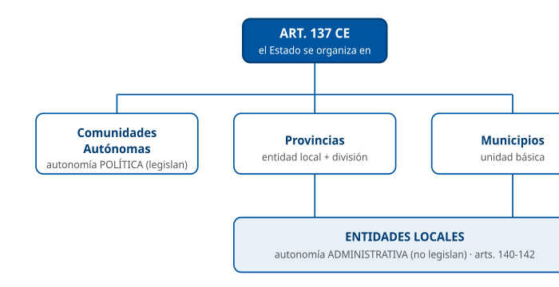

Mostrar las tres entidades del art. 137 y su tipo de autonomía.

D2 · Principios generales del Título VIII (arts. 137-139)

§ 2 — Principios generales

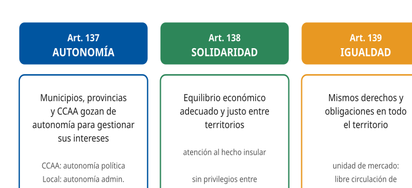

Asociar cada artículo del Capítulo I con su principio.

D3 · Características del Estado autonómico

§ 3 — El modelo de Estado autonómico

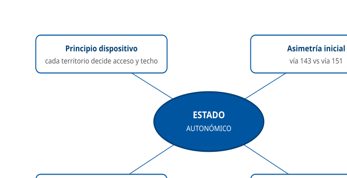

Mapa conceptual de los rasgos del modelo territorial.

D4 · La Administración Local (arts. 140-142)

§ 4 — La Administración Local

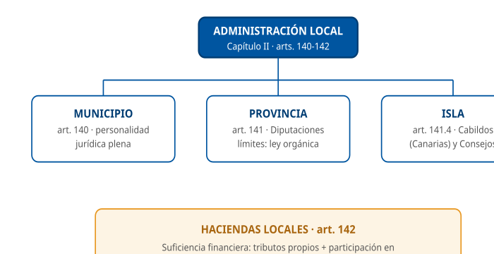

Estructurar los entes locales con garantía constitucional.

D5 · El Municipio: gobierno y elección (art. 140)

§ 4.1 — El Municipio

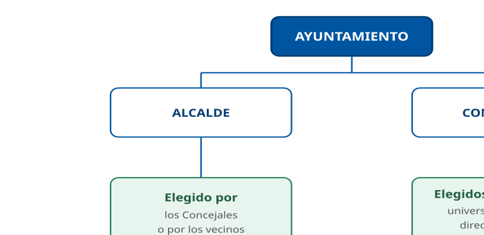

Esquema del Ayuntamiento y la forma de elección.

D6 · Vías de acceso a la autonomía: art. 143 vs art. 151

§ 5 — Acceso a la autonomía

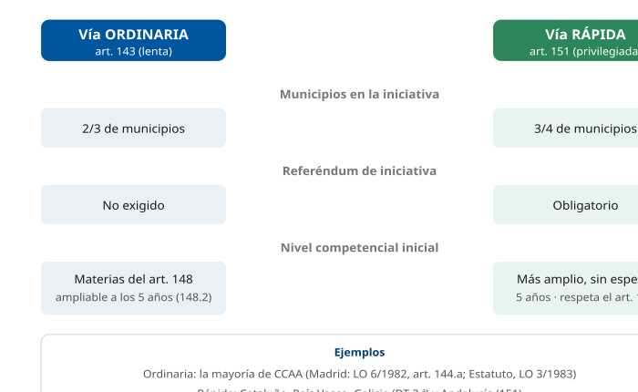

Comparar la vía ordinaria y la vía rápida.

D7 · Contenido mínimo del Estatuto (art. 147.2)

§ 6.2 — Naturaleza, contenido y reforma

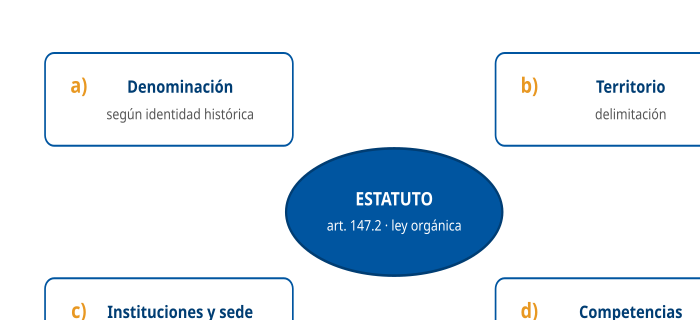

Fijar las cuatro letras del contenido obligatorio.

D8 · Reparto competencial: art. 148 vs art. 149

§ 7 — Distribución de competencias

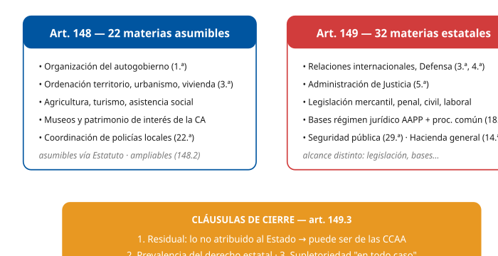

Contraponer las dos listas y las cláusulas de cierre.

D9 · Organización institucional autonómica (modelo del art. 152.1)

§ 8 — Organización institucional autonómica

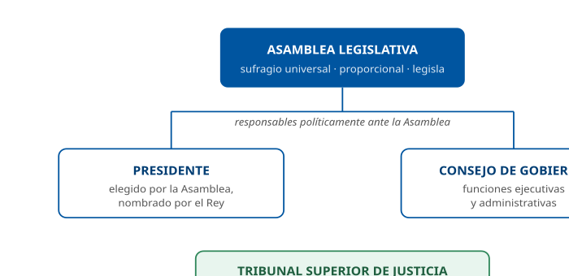

Mostrar el triángulo institucional y el TSJ.

D10 · Control de las CCAA y coerción estatal (arts. 153-155)

§ 9 — Control y coerción

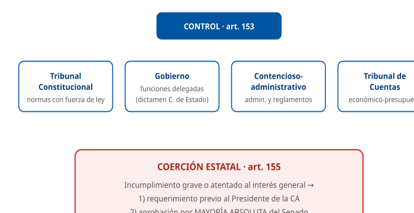

Cuatro vías de control + mecanismo del art. 155.

D11 · Financiación autonómica (arts. 156-158)

§ 10 — La financiación autonómica

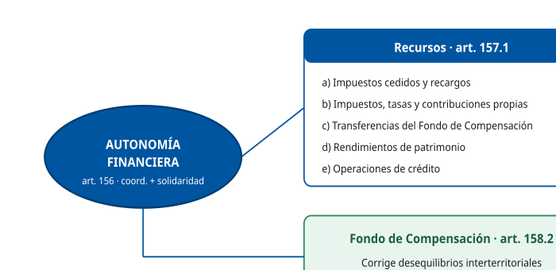

Recursos y principios de la autonomía financiera.

D12 · Madrid: las tres administraciones en la ciudad

§ 11 — Madrid

Situar Estado, Comunidad de Madrid y Ayuntamiento.

D13 · Definiciones clave: entidades locales y Estatutos de Autonomía

§ 4 — La Administración Local

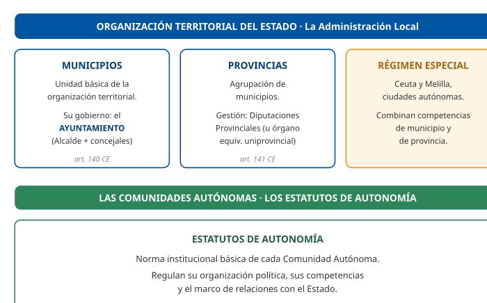

Resumir en fichas las definiciones de municipio, provincia y régimen especial (Ceuta y Melilla) y de los Estatutos de Autonomía.

## Casos prácticos

#### CASO PRÁCTICO 1 — Las administraciones que operan en la ciudad de Madrid

**Escenario**: El Área de Gobierno de Innovación y Transformación Digital del Ayuntamiento de Madrid lanza un proyecto de sede electrónica. Durante la planificación, un técnico debe explicar a un nuevo compañero qué administraciones territoriales operan sobre el territorio de la ciudad y qué naturaleza tiene cada una.

**Cuestiones**:

1.  **(2,5 pts)** Indique en qué entidades se organiza territorialmente el Estado según el artículo 137 de la Constitución y qué administraciones ejercen competencias en la ciudad de Madrid.
2.  **(2,5 pts)** Distinga el tipo de autonomía (política o administrativa) que corresponde a la Comunidad de Madrid y al Ayuntamiento de Madrid.
3.  **(2,5 pts)** ¿En qué se diferencia la "autonomía" de la "soberanía"? ¿Quién es titular de la soberanía?
4.  **(2,5 pts)** ¿Qué norma confiere al municipio de Madrid un régimen especial y por qué?

**Solución orientativa**:

1.  Según el art. 137, el Estado se organiza territorialmente en **municipios, provincias y Comunidades Autónomas**. En la ciudad de Madrid ejercen competencias, entre otras, la Administración del **Estado** (por la capitalidad), la **Comunidad de Madrid** (CA uniprovincial) y el **Ayuntamiento de Madrid** (municipio). La Comunidad de Madrid asumió todas las competencias, medios y recursos que según la Ley correspondían a la Diputación Provincial de Madrid (DT 4.ª.2 EAM).
2.  La Comunidad de Madrid tiene **autonomía política**: la LO 6/1982 autorizó su constitución al amparo del artículo 144.a) CE, su Estatuto de Autonomía (LO 3/1983) es su norma institucional básica (art. 147.1 CE) y la Asamblea de Madrid ejerce la potestad legislativa de la Comunidad (art. 9 EAM). El Ayuntamiento tiene **autonomía administrativa** (potestad reglamentaria y de autoorganización, sin potestad legislativa) para la gestión de sus intereses (arts. 137 y 140 CE).
3.  La **autonomía** se reconoce «para la gestión de sus respectivos intereses» (art. 137 CE); la **soberanía nacional reside en el pueblo español**, del que emanan los poderes del Estado (art. 1.2 CE).
4.  La **Ley 22/2006 de Capitalidad y de Régimen Especial de Madrid**, por la doble condición del municipio como **capital del Estado** y como **gran ciudad** (Ley 22/2006).

**Criterios de evaluación**: se valora citar correctamente el art. 137; distinguir autonomía política/administrativa; identificar la soberanía en el pueblo (art. 1.2); y mencionar la Ley 22/2006.

------------------------------------------------------------------------

#### Preguntas tipo test sobre este caso

##### 1. En el supuesto planteado, el técnico explica al nuevo compañero qué administraciones territoriales conviven en la ciudad de Madrid. Son:

- a) El Estado (por la capitalidad), la Comunidad de Madrid y el Ayuntamiento de Madrid.
- b) La Comunidad de Madrid, la Diputación Provincial de Madrid y el Ayuntamiento de Madrid.
- c) El Estado, la Diputación Provincial de Madrid y el Ayuntamiento de Madrid.

**Respuesta correcta:** a) · **Referencia:** Caso 1, cuestión 1 · art. 137 CE

En Madrid conviven el Estado por la capitalidad, la Comunidad de Madrid (CA uniprovincial) y el Ayuntamiento; no existe una Diputación Provincial diferenciada.

##### 2. El compañero pregunta qué fue de la Diputación Provincial de Madrid, ya que la provincia es uno de los niveles del artículo 137 de la Constitución. El técnico debe responder que:

- a) La Diputación sigue gobernando la provincia junto a la Comunidad de Madrid, con competencias propias.
- b) La Comunidad de Madrid asumió todas las competencias, medios y recursos que correspondían a la Diputación Provincial.
- c) El Ayuntamiento de Madrid asumió las competencias de la Diputación por su condición de capital del Estado.

**Respuesta correcta:** b) · **Referencia:** Caso 1, cuestión 1 · DT 4.ª.2 EAM

La DT 4.ª.2 EAM atribuye a la Comunidad de Madrid todas las competencias, medios y recursos de la antigua Diputación Provincial.

##### 3. ¿Qué rasgo permite afirmar que la Comunidad de Madrid goza de autonomía política?

- a) Que su Presidente es nombrado por el Rey a propuesta del Congreso de los Diputados.
- b) Que puede alterar por ley propia los límites de la provincia de Madrid.
- c) Que la Asamblea de Madrid ejerce la potestad legislativa de la Comunidad.

**Respuesta correcta:** c) · **Referencia:** Caso 1, cuestión 2 · art. 9 EAM

La autonomía política se caracteriza por la potestad legislativa, que en Madrid ejerce la Asamblea; la alteración de límites provinciales exige ley orgánica de las Cortes Generales.

##### 4. Si el Ayuntamiento de Madrid aprueba una ordenanza que regule su sede electrónica, estará ejerciendo:

- a) La potestad reglamentaria, propia de su autonomía administrativa.
- b) La potestad legislativa, propia de su autonomía política.
- c) Una potestad legislativa delegada por la Comunidad mediante ley marco.

**Respuesta correcta:** a) · **Referencia:** Caso 1, cuestión 2 · art. 4.1.a LBRL

El Ayuntamiento tiene autonomía administrativa: potestad reglamentaria y de autoorganización, sin potestad legislativa.

##### 5. En el supuesto planteado, ¿cuál de estas potestades NO corresponde al Ayuntamiento de Madrid?

- a) La potestad reglamentaria.
- b) La potestad de autoorganización.
- c) La potestad legislativa.

**Respuesta correcta:** c) · **Referencia:** Caso 1, cuestión 2 · art. 137 CE y art. 4.1.a LBRL

Las entidades locales ejercen potestad reglamentaria y de autoorganización, pero no dictan leyes.

##### 6. El compañero afirma que, por gozar de autonomía, el Ayuntamiento es «soberano» en sus asuntos. El técnico debe corregirle porque:

- a) La soberanía corresponde a las Cortes Generales y la autonomía se reconoce solo a las Comunidades Autónomas.
- b) La autonomía se reconoce para la gestión de sus respectivos intereses y la soberanía nacional reside en el pueblo español.
- c) La soberanía la comparten el Estado y las Comunidades Autónomas, y la autonomía es solo de los municipios.

**Respuesta correcta:** b) · **Referencia:** Caso 1, cuestión 3 · arts. 1.2 y 137 CE

El art. 137 reconoce autonomía «para la gestión de sus respectivos intereses», y la soberanía nacional reside en el pueblo español (art. 1.2 CE).

##### 7. Para fundamentar quién es el titular de la soberanía, el técnico debe citar:

- a) El artículo 1.2 de la Constitución.
- b) El artículo 137 de la Constitución.
- c) El artículo 140 de la Constitución.

**Respuesta correcta:** a) · **Referencia:** Caso 1, cuestión 3 · art. 1.2 CE

Es el art. 1.2 CE el que dispone que la soberanía nacional reside en el pueblo español; el 137 regula la autonomía y el 140 el municipio.

##### 8. ¿Qué norma confiere al municipio de Madrid su régimen especial?

- a) La Ley 7/1985, Reguladora de las Bases del Régimen Local.
- b) La Ley Orgánica 3/1983, de Estatuto de Autonomía de Madrid.
- c) La Ley 22/2006, de Capitalidad y de Régimen Especial de Madrid.

**Respuesta correcta:** c) · **Referencia:** Caso 1, cuestión 4 · Ley 22/2006

El régimen especial del municipio de Madrid lo regula la Ley 22/2006; la LBRL es el régimen común.

##### 9. ¿Por qué razón el municipio de Madrid cuenta con ese régimen especial?

- a) Por estar situado en una Comunidad Autónoma uniprovincial.
- b) Por su doble condición de capital del Estado y de gran ciudad.
- c) Por haber asumido las competencias de la antigua Diputación.

**Respuesta correcta:** b) · **Referencia:** Caso 1, cuestión 4 · Ley 22/2006

El régimen especial de Madrid responde a su doble condición de capital del Estado y de gran ciudad (Ley 22/2006).

##### 10. Para articular las tres administraciones que operan en la ciudad, la Ley 22/2006 crea un órgano de cooperación. ¿Cuál?

- a) La Junta de Gobierno de la Ciudad de Madrid, con miembros del Estado, la Comunidad y el Ayuntamiento.
- b) La Comisión Interadministrativa de Capitalidad, con igual número de miembros del Estado, la Comunidad y el Ayuntamiento.
- c) La Comisión Mixta de Transferencias, con mayoría de miembros de la Administración del Estado.

**Respuesta correcta:** b) · **Referencia:** Caso 1, cuestión 4 · art. 5 LCREM (§11.2)

La Ley 22/2006 crea la Comisión Interadministrativa de Capitalidad, formada por igual número de miembros de las tres administraciones.

#### CASO PRÁCTICO 2 — Elección de Alcalde y Concejales y régimen municipal

**Escenario**: Tras unas elecciones municipales, en un Ayuntamiento de la Comunidad de Madrid surge una duda sobre la forma de elección de los cargos y sobre la personalidad jurídica del municipio. Un ciudadano presenta una consulta a través del registro electrónico.

**Cuestiones**:

1.  **(2,5 pts)** ¿Cómo se eligen los Concejales según el artículo 140 de la Constitución? Enumere las características del sufragio.
2.  **(2,5 pts)** ¿Cómo se elige al Alcalde según la Constitución?
3.  **(2,5 pts)** ¿Qué personalidad jurídica reconoce la Constitución a los municipios y qué órgano los gobierna?
4.  **(2,5 pts)** ¿Qué es el régimen de concejo abierto y dónde se prevé?

**Solución orientativa**:

1.  Los Concejales son elegidos por los **vecinos del municipio** mediante sufragio **universal, igual, libre, directo y secreto**, en la forma establecida por la ley (LOREG) (art. 140 CE).
2.  El Alcalde se elige **por los Concejales o por los vecinos** (art. 140 CE).
3.  El municipio goza de **personalidad jurídica plena** y su gobierno y administración corresponden al **Ayuntamiento**, integrado por el Alcalde y los Concejales (art. 140 CE).
4.  La Constitución remite a la ley la regulación de las condiciones en las que proceda el régimen del **concejo abierto** (art. 140 CE). En este régimen, el gobierno y la administración municipales corresponden a un Alcalde y una asamblea vecinal de la que forman parte todos los electores (art. 29.3 LBRL).

**Criterios de evaluación**: enumerar correctamente los cinco adjetivos del sufragio; señalar la doble vía de elección del Alcalde; citar la personalidad jurídica plena; identificar el concejo abierto.

------------------------------------------------------------------------

#### Preguntas tipo test sobre este caso

##### 1. El ciudadano pregunta, a través del registro electrónico, cómo se eligen los Concejales. Conforme al artículo 140 de la Constitución, se eligen:

- a) Por los vecinos del municipio mediante sufragio universal, igual, libre, indirecto y secreto.
- b) Por la Asamblea de Madrid, entre los candidatos presentados en cada municipio.
- c) Por los vecinos del municipio mediante sufragio universal, igual, libre, directo y secreto.

**Respuesta correcta:** c) · **Referencia:** Caso 2, cuestión 1 · art. 140 CE

El art. 140 CE atribuye la elección de los Concejales a los vecinos por sufragio universal, igual, libre, directo y secreto.

##### 2. Al contestar, el técnico debe enumerar las características del sufragio en la elección de Concejales. ¿Qué enumeración es correcta?

- a) Cinco: universal, igual, libre, directo y secreto.
- b) Cuatro: universal, libre, directo y secreto.
- c) Cinco: universal, igual, libre, proporcional y secreto.

**Respuesta correcta:** a) · **Referencia:** Caso 2, cuestión 1 · art. 140 CE

El art. 140 CE enumera cinco caracteres del sufragio: universal, igual, libre, directo y secreto.

##### 3. La Constitución no agota la regulación de la elección de Concejales. ¿A qué remite la forma concreta de elección?

- a) Al Reglamento Orgánico del Pleno de cada Ayuntamiento.
- b) A lo que establezca la ley, en este caso la LOREG.
- c) Al Estatuto de Autonomía de la Comunidad de Madrid.

**Respuesta correcta:** b) · **Referencia:** Caso 2, cuestión 1 · art. 140 CE

El art. 140 CE remite a «la forma establecida por la ley», que la solución identifica con la LOREG.

##### 4. El ciudadano sostiene que la Constitución obliga a que el Alcalde sea elegido siempre directamente por los vecinos. El técnico debe responder que la Constitución prevé que el Alcalde sea elegido:

- a) Siempre por los vecinos, en votación separada.
- b) Por el Pleno de la Diputación Provincial.
- c) Por los Concejales o por los vecinos.

**Respuesta correcta:** c) · **Referencia:** Caso 2, cuestión 2 · art. 140 CE

El art. 140 CE contempla una doble vía: elección por los Concejales o por los vecinos.

##### 5. Sobre la personalidad jurídica del municipio desde el que se plantea la consulta, la Constitución establece que:

- a) El municipio goza de personalidad jurídica plena.
- b) El municipio goza de personalidad jurídica limitada.
- c) El municipio actúa con la personalidad de su Comunidad.

**Respuesta correcta:** a) · **Referencia:** Caso 2, cuestión 3 · art. 140 CE

El art. 140 CE reconoce a los municipios personalidad jurídica plena.

##### 6. ¿Qué órgano tiene encomendados el gobierno y la administración del municipio?

- a) La Junta de Gobierno, integrada por el Alcalde y los delegados del Gobierno.
- b) El Ayuntamiento, integrado por el Alcalde y los Concejales.
- c) El Pleno, integrado por los Concejales y por todos los vecinos electores.

**Respuesta correcta:** b) · **Referencia:** Caso 2, cuestión 3 · art. 140 CE

El gobierno y la administración municipales corresponden al Ayuntamiento, integrado por el Alcalde y los Concejales.

##### 7. El ciudadano pregunta si la Constitución regula el régimen de concejo abierto. La respuesta correcta es que la Constitución:

- a) Remite a la ley la regulación de las condiciones en las que proceda ese régimen.
- b) Lo regula íntegramente en el artículo 142, junto a las Haciendas locales.
- c) No lo menciona, porque solo se recoge en los Estatutos de Autonomía.

**Respuesta correcta:** a) · **Referencia:** Caso 2, cuestión 4 · art. 140 CE

El art. 140 CE remite a la ley las condiciones en que proceda el concejo abierto; su régimen se desarrolla en el art. 29.3 LBRL.

##### 8. Si el municipio del supuesto funcionara en régimen de concejo abierto, su gobierno y administración corresponderían a:

- a) Un Alcalde y unos Concejales elegidos por sufragio indirecto entre los electores.
- b) Una asamblea vecinal sin Alcalde, presidida por el vecino de mayor edad.
- c) Un Alcalde y una asamblea vecinal de la que forman parte todos los electores.

**Respuesta correcta:** c) · **Referencia:** Caso 2, cuestión 4 · art. 29.3 LBRL

En el concejo abierto gobiernan un Alcalde y una asamblea vecinal integrada por todos los electores (art. 29.3 LBRL).

##### 9. El ciudadano pregunta si el Ayuntamiento, en virtud de su autonomía, podría aprobar una ley propia sobre la elección de sus Concejales. El técnico debe responder que:

- a) Sí, porque la autonomía municipal del artículo 140 incluye la potestad legislativa.
- b) No, porque las entidades locales tienen autonomía administrativa y no dictan leyes.
- c) Sí, siempre que la Asamblea de Madrid se lo autorice mediante una ley marco.

**Respuesta correcta:** b) · **Referencia:** Caso 2, cuestiones 1 y 3 · art. 4.1.a LBRL (§2.1)

Las entidades locales ejercen potestad reglamentaria y de autoorganización, pero no dictan leyes; además, la forma de elección la fija la ley (LOREG).

##### 10. Para responder sobre el desarrollo legal del concejo abierto, el técnico acude a la norma básica del régimen local, que es:

- a) La Ley 22/2006, de Capitalidad y de Régimen Especial de Madrid.
- b) El Texto Refundido de la Ley Reguladora de las Haciendas Locales.
- c) La Ley 7/1985, Reguladora de las Bases del Régimen Local.

**Respuesta correcta:** c) · **Referencia:** Caso 2, cuestión 4 · art. 29.3 LBRL (§4.5)

El concejo abierto se desarrolla en el art. 29.3 de la LBRL (Ley 7/1985), norma de desarrollo del régimen local.

#### CASO PRÁCTICO 3 — Reparto de competencias: ¿Estado o Comunidad Autónoma?

**Escenario**: La Comunidad de Madrid proyecta una nueva normativa. El servicio jurídico debe determinar, para cada materia, si la competencia puede corresponder a la Comunidad (art. 148) o es exclusiva del Estado (art. 149), y cómo se resuelven las dudas.

**Cuestiones**:

1.  **(2 pts)** Clasifique como competencia "asumible por la CA" o "exclusiva del Estado": (i) ordenación del territorio y urbanismo; (ii) Administración de Justicia; (iii) relaciones internacionales; (iv) promoción del turismo.
2.  **(2 pts)** ¿Qué establece el artículo 149.1.18.ª y qué relevancia tiene para la actividad administrativa?
3.  **(3 pts)** Explique las tres reglas de la cláusula de cierre del artículo 149.3 (cláusula residual, competencia estatal por defecto, y prevalencia y supletoriedad).
4.  **(3 pts)** ¿Qué tipos de leyes prevé el artículo 150?

**Solución orientativa**:

1.  \(i\) Ordenación del territorio y urbanismo: **asumible por la CA** (art. 148.1.3.ª CE); (ii) Administración de Justicia: **exclusiva del Estado** (art. 149.1.5.ª CE); (iii) relaciones internacionales: **exclusiva del Estado** (art. 149.1.3.ª CE); (iv) promoción del turismo: **asumible por la CA** (art. 148.1.18.ª CE).
2.  El artículo 149.1.18.ª atribuye al Estado la competencia exclusiva sobre las **bases del régimen jurídico de las Administraciones públicas** y del régimen estatutario de sus funcionarios, que en todo caso garantizarán a los administrados un **tratamiento común** ante ellas, y sobre el **procedimiento administrativo común**, sin perjuicio de las especialidades derivadas de la organización propia de las CCAA.
3.  \(1\) **Cláusula residual**: las materias no atribuidas expresamente al Estado pueden corresponder a las CCAA en virtud de sus Estatutos. (2) **Competencia estatal por defecto**: la competencia sobre las materias que no se hayan asumido por los Estatutos corresponde al Estado. (3) **Prevalencia y supletoriedad**: en caso de conflicto, las normas del Estado prevalecen sobre las de las CCAA en todo lo que no esté atribuido a la exclusiva competencia de estas; y el derecho estatal es, en todo caso, supletorio del autonómico, sin que esta cláusula sea por sí misma un título competencial del Estado (art. 149.3 CE).
4.  **Leyes marco** (150.1), **leyes orgánicas de transferencia o delegación** (150.2) y **leyes de armonización** (150.3) (art. 150 CE).

**Criterios de evaluación**: acierto en la clasificación competencial; correcta explicación del 149.1.18.ª; enumeración completa de las tres reglas del 149.3; identificación de los tres instrumentos del art. 150.

------------------------------------------------------------------------

#### Preguntas tipo test sobre este caso

##### 1. En el supuesto planteado, el servicio jurídico analiza la materia «ordenación del territorio y urbanismo». Debe concluir que es una competencia:

- a) Exclusiva del Estado (art. 149.1.18.ª CE).
- b) Asumible por la Comunidad Autónoma (art. 148.1.3.ª CE).
- c) Exclusiva del Estado (art. 149.1.3.ª CE).

**Respuesta correcta:** b) · **Referencia:** Caso 3, cuestión 1 · art. 148.1.3.ª CE

La ordenación del territorio y el urbanismo figuran en la lista del art. 148.1 (3.ª), que la CA puede asumir.

##### 2. Respecto de la Administración de Justicia, el servicio jurídico debe advertir que:

- a) Es asumible por la Comunidad como parte de su autogobierno.
- b) Es asumible por la Comunidad a través de su Tribunal Superior de Justicia.
- c) Es competencia exclusiva del Estado (art. 149.1.5.ª CE).

**Respuesta correcta:** c) · **Referencia:** Caso 3, cuestión 1 · art. 149.1.5.ª CE

La Administración de Justicia es competencia exclusiva del Estado (art. 149.1.5.ª CE).

##### 3. Si el interés general exigiera armonizar las disposiciones normativas de las Comunidades Autónomas en esta materia mediante una ley de armonización, ¿quién apreciaría esa necesidad y con qué mayoría?

- a) Las Cortes Generales, por mayoría absoluta de cada Cámara.
- b) El Gobierno, previo dictamen del Consejo de Estado.
- c) El Senado, por mayoría absoluta y previo requerimiento.

**Respuesta correcta:** a) · **Referencia:** Caso 3, cuestión 4 · art. 150.3 CE (§7.4)

En las leyes de armonización, la necesidad la aprecian las Cortes por mayoría absoluta de cada Cámara (art. 150.3 CE).

##### 4. La Comunidad quiere incluir en su norma la promoción del turismo en su territorio y la firma de acuerdos con Estados extranjeros. El servicio jurídico debe advertir que:

- a) La promoción del turismo es asumible por la CA, pero las relaciones internacionales son exclusivas del Estado.
- b) Ambas materias son asumibles por la CA si su Estatuto las recoge expresamente.
- c) Ambas materias son exclusivas del Estado conforme al artículo 149.1.3.ª.

**Respuesta correcta:** a) · **Referencia:** Caso 3, cuestión 1 · arts. 148.1.18.ª y 149.1.3.ª CE

La promoción del turismo es asumible (art. 148.1.18.ª CE) y las relaciones internacionales son exclusivas del Estado (art. 149.1.3.ª CE).

##### 5. La norma autonómica proyectada incluye trámites de procedimiento administrativo. ¿Qué precepto reserva al Estado la competencia exclusiva sobre el procedimiento administrativo común?

- a) El artículo 149.1.1.ª de la Constitución.
- b) El artículo 149.1.18.ª de la Constitución.
- c) El artículo 148.1.1.ª de la Constitución.

**Respuesta correcta:** b) · **Referencia:** Caso 3, cuestión 2 · art. 149.1.18.ª CE

El art. 149.1.18.ª atribuye al Estado las bases del régimen jurídico de las Administraciones públicas y el procedimiento administrativo común.

##### 6. Según el artículo 149.1.18.ª, las bases del régimen jurídico de las Administraciones públicas que fije el Estado deben garantizar a los administrados:

- a) Un procedimiento idéntico ante ellas.
- b) Una tramitación electrónica ante ellas.
- c) Un tratamiento común ante ellas.

**Respuesta correcta:** c) · **Referencia:** Caso 3, cuestión 2 · art. 149.1.18.ª CE

El precepto exige que las bases garanticen a los administrados «un tratamiento común ante ellas».

##### 7. En materia de procedimiento, ¿puede la Comunidad de Madrid introducir alguna especialidad en su norma?

- a) No, porque el artículo 149.1.18.ª excluye cualquier especialidad autonómica en materia de procedimiento.
- b) Sí, las especialidades derivadas de su organización propia, sin perjuicio del procedimiento administrativo común.
- c) Sí, cualquiera, porque el procedimiento administrativo es una materia asumible conforme al artículo 148.

**Respuesta correcta:** b) · **Referencia:** Caso 3, cuestión 2 · art. 149.1.18.ª CE

El 149.1.18.ª reserva al Estado el procedimiento administrativo común «sin perjuicio de las especialidades derivadas de la organización propia de las CCAA».

##### 8. Si la norma autonómica entrara en conflicto con una norma estatal en una materia no atribuida a la exclusiva competencia de la Comunidad, ¿qué regla del artículo 149.3 se aplica?

- a) Prevalece la norma del Estado.
- b) Prevalece la norma autonómica.
- c) Prevalece la norma posterior.

**Respuesta correcta:** a) · **Referencia:** Caso 3, cuestión 3 · art. 149.3 CE

Regla de prevalencia: en conflicto, prevalecen las normas del Estado en lo no atribuido a la exclusiva competencia de las CCAA.

##### 9. En una materia de competencia autonómica, la ley de la Comunidad deja sin regular un aspecto concreto. Conforme a la regla de supletoriedad del artículo 149.3:

- a) Se aplican las ordenanzas del Ayuntamiento afectado, como norma más próxima.
- b) La materia pasa a ser competencia exclusiva del Estado hasta que se regule.
- c) Se aplica el derecho estatal, que es en todo caso supletorio del autonómico.

**Respuesta correcta:** c) · **Referencia:** Caso 3, cuestión 3 · art. 149.3 CE

Regla de supletoriedad: el derecho estatal es, en todo caso, supletorio del autonómico.

##### 10. Si las Cortes quisieran atribuir a la Comunidad la facultad de dictar normas legislativas en el marco de una ley estatal, el instrumento adecuado sería:

- a) Una ley marco (art. 150.1 CE).
- b) Una ley de armonización (art. 150.3 CE).
- c) Una ley de transferencia (art. 150.2 CE).

**Respuesta correcta:** a) · **Referencia:** Caso 3, cuestión 4 · art. 150.1 CE (§7.4)

Mediante las leyes marco las Cortes atribuyen a las CCAA la facultad de dictar normas legislativas en el marco de una ley estatal.

#### CASO PRÁCTICO 4 — Acceso a la autonomía: las dos vías

**Escenario**: En una sesión formativa interna del Ayuntamiento se compara cómo accedieron a la autonomía distintas Comunidades. Se pide sistematizar las vías de acceso del Título VIII.

**Cuestiones**:

1.  **(3 pts)** Describa la iniciativa del proceso autonómico por la vía ordinaria (art. 143): sujetos, fracción de municipios, plazo y reiteración.
2.  **(3 pts)** Describa los requisitos reforzados de la vía rápida (art. 151).
3.  **(2 pts)** ¿Cómo accedieron Cataluña, País Vasco y Galicia, y por qué fue distinto del resto?
4.  **(2 pts)** ¿Bajo qué precepto se constituyó la Comunidad de Madrid y qué peculiaridad presenta?

**Solución orientativa**:

1.  Iniciativa de **todas las Diputaciones interesadas** (u órgano interinsular) **y de las 2/3 partes de los municipios** cuya población represente la mayoría del censo de cada provincia; plazo de **6 meses** desde el primer acuerdo; si fracasa, se reitera a los **5 años** (art. 143.2 y 143.3 CE).
2.  Iniciativa de las Diputaciones **y de las 3/4 partes de los municipios** (mayoría del censo), **ratificada mediante referéndum** por mayoría absoluta de los electores de cada provincia; en ese caso no es preciso dejar transcurrir el plazo de cinco años del artículo 148.2 (art. 151.1 CE).
3.  Se acogieron a la **Disposición transitoria segunda**: los territorios que en el pasado hubiesen plebiscitado afirmativamente proyectos de Estatuto de autonomía y contasen con regímenes provisionales de autonomía podían proceder inmediatamente en la forma prevista en el artículo 148.2, por acuerdo por mayoría absoluta de sus órganos preautonómicos colegiados superiores, sin la iniciativa del artículo 151.1; el proyecto de Estatuto se elaboraba conforme al artículo 151.2 (DT 2.ª CE).
4.  La **LO 6/1982** autorizó a la provincia de Madrid, por razones de interés nacional, para constituirse en Comunidad Autónoma, al amparo del **artículo 144.a)** CE: su ámbito territorial no supera el de una provincia y no reúne las condiciones del artículo 143.1. Posteriormente, la LO 3/1983 aprobó su Estatuto de Autonomía (EAM).

**Criterios de evaluación**: exactitud en plazos (6 meses / 5 años) y fracciones (2/3 vs 3/4); identificación del referéndum en la vía 151; correcta atribución de la DT 2.ª y del art. 144.a) para Madrid.

------------------------------------------------------------------------

#### Preguntas tipo test sobre este caso

##### 1. En la sesión formativa se comparan las fracciones de municipios exigidas en la iniciativa de cada vía. ¿Qué afirmación es correcta?

- a) Tres cuartas partes en la vía del artículo 143 y dos terceras partes en la del artículo 151.
- b) Dos terceras partes en ambas vías; la del artículo 151 solo añade el referéndum.
- c) Dos terceras partes en la vía del artículo 143 y tres cuartas partes en la del artículo 151.

**Respuesta correcta:** c) · **Referencia:** Caso 4, cuestiones 1 y 2 · arts. 143.2 y 151.1 CE

La vía ordinaria exige 2/3 de los municipios (art. 143.2) y la rápida 3/4 (art. 151.1), en ambos casos con la mayoría del censo.

##### 2. Junto a la fracción de municipios, ¿quién más debe promover la iniciativa autonómica por la vía ordinaria del artículo 143?

- a) La mayoría absoluta de los Diputados y Senadores elegidos en las provincias afectadas.
- b) Todas las Diputaciones interesadas o, en su caso, el órgano interinsular.
- c) Las Cortes Generales, mediante ley orgánica y por motivos de interés nacional.

**Respuesta correcta:** b) · **Referencia:** Caso 4, cuestión 1 · art. 143.2 CE

La iniciativa del art. 143.2 corresponde a todas las Diputaciones interesadas (u órgano interinsular) y a 2/3 de los municipios.

##### 3. En un ejemplo de la sesión, la primera Corporación local interesada adopta el acuerdo de iniciativa por la vía del artículo 143. ¿De qué plazo se dispone para reunir los requisitos de la iniciativa?

- a) Seis meses desde ese primer acuerdo.
- b) Cinco años desde ese primer acuerdo.
- c) Tres meses desde ese primer acuerdo.

**Respuesta correcta:** a) · **Referencia:** Caso 4, cuestión 1 · art. 143.2 CE

Los requisitos deben cumplirse en el plazo de seis meses desde el primer acuerdo adoptado.

##### 4. Si esa iniciativa autonómica por la vía del artículo 143 no prospera, ¿cuándo podrá reiterarse?

- a) Pasados seis meses.
- b) Pasados cinco años.
- c) Pasados tres años.

**Respuesta correcta:** b) · **Referencia:** Caso 4, cuestión 1 · art. 143.3 CE

Si la iniciativa fracasa, solo podrá reiterarse a los cinco años (art. 143.3 CE).

##### 5. Además de la iniciativa reforzada de las Corporaciones locales, la vía del artículo 151 exige:

- a) Ratificación mediante referéndum por mayoría simple de los votos emitidos en todo el territorio.
- b) Aprobación de la iniciativa por mayoría absoluta del Senado.
- c) Ratificación mediante referéndum por mayoría absoluta de los electores de cada provincia.

**Respuesta correcta:** c) · **Referencia:** Caso 4, cuestión 2 · art. 151.1 CE

La iniciativa del art. 151 debe ratificarse en referéndum por mayoría absoluta de los electores de cada provincia.

##### 6. ¿Qué consecuencia tenía para una Comunidad acceder a la autonomía cumpliendo los requisitos del artículo 151.1?

- a) No era preciso dejar transcurrir el plazo de cinco años del artículo 148.2.
- b) Podía federarse con otras Comunidades Autónomas sin autorización de las Cortes.
- c) Su Estatuto no necesitaba aprobarse mediante ley orgánica de las Cortes Generales.

**Respuesta correcta:** a) · **Referencia:** Caso 4, cuestión 2 · art. 151.1 CE

Cumplidos los requisitos del 151.1, no hacía falta esperar los cinco años del art. 148.2; la federación de CCAA está prohibida (art. 145.1).

##### 7. ¿Cómo accedieron a la autonomía Cataluña, País Vasco y Galicia?

- a) Por la vía del artículo 151, con referéndum de iniciativa, como Andalucía.
- b) Por el artículo 144.c), al sustituir las Cortes la iniciativa de las Corporaciones.
- c) Por la Disposición transitoria segunda, sin la iniciativa del artículo 151.1.

**Respuesta correcta:** c) · **Referencia:** Caso 4, cuestión 3 · DT 2.ª CE

Se acogieron a la DT 2.ª, que les permitía proceder inmediatamente sin la iniciativa del art. 151.1.

##### 8. ¿Qué circunstancia permitió a esos tres territorios acogerse a la Disposición transitoria segunda?

- a) No superar su ámbito territorial el de una provincia y no reunir las condiciones del artículo 143.1.
- b) Haber plebiscitado afirmativamente en el pasado proyectos de Estatuto y contar con regímenes provisionales de autonomía.
- c) Haber reunido la iniciativa de las tres cuartas partes de sus municipios en el plazo de seis meses.

**Respuesta correcta:** b) · **Referencia:** Caso 4, cuestión 3 · DT 2.ª CE

La DT 2.ª se aplicaba a territorios que hubiesen plebiscitado afirmativamente proyectos de Estatuto y contasen con regímenes provisionales de autonomía.

##### 9. ¿Al amparo de qué precepto se constituyó la Comunidad de Madrid?

- a) Del artículo 144.a), con autorización de la LO 6/1982 por razones de interés nacional.
- b) Del artículo 143, por iniciativa de la Diputación y de dos tercios de los municipios.
- c) Del artículo 144.b), como territorio no integrado en la organización provincial.

**Respuesta correcta:** a) · **Referencia:** Caso 4, cuestión 4 · art. 144.a) CE

La LO 6/1982 autorizó a la provincia de Madrid, por razones de interés nacional, a constituirse en CA al amparo del art. 144.a) CE.

##### 10. ¿Qué peculiaridad de Madrid explica que se acudiera al artículo 144.a)?

- a) No estaba integrada en la organización provincial, igual que Ceuta y Melilla.
- b) Había plebiscitado en el pasado un proyecto de Estatuto de autonomía.
- c) Su ámbito territorial no supera el de una provincia y no reúne las condiciones del artículo 143.1.

**Respuesta correcta:** c) · **Referencia:** Caso 4, cuestión 4 · art. 144.a) CE

Madrid no supera el ámbito de una provincia ni reúne las condiciones del art. 143.1, que es el supuesto del art. 144.a).

#### CASO PRÁCTICO 5 — Control de las Comunidades Autónomas y coerción estatal

**Escenario**: En un seminario sobre relaciones entre administraciones se plantea cómo controla el Estado la actividad de las Comunidades Autónomas y qué ocurre en supuestos de incumplimiento.

**Cuestiones**:

1.  **(4 pts)** Enumere las cuatro vías de control de la actividad de las CCAA del artículo 153 y el objeto de cada una.
2.  **(2 pts)** ¿Qué función desempeña el Delegado nombrado por el Gobierno (art. 154)?
3.  **(3 pts)** Explique el procedimiento de coerción del artículo 155: presupuesto, requerimiento y mayoría exigida.
4.  **(1 pt)** Una vez aprobadas las medidas del art. 155, ¿qué puede hacer el Gobierno?

**Solución orientativa**:

1.  **Tribunal Constitucional** (constitucionalidad de disposiciones con fuerza de ley); **Gobierno**, previo dictamen del Consejo de Estado (ejercicio de funciones delegadas del art. 150.2); **jurisdicción contencioso-administrativa** (administración autónoma y reglamentos); **Tribunal de Cuentas** (control económico y presupuestario) (art. 153 CE).
2.  Dirige la **Administración del Estado** en el territorio de la CA y la coordina, cuando proceda, con la administración propia de la Comunidad (art. 154 CE).
3.  Presupuesto: que una Comunidad Autónoma no cumpla las obligaciones que la Constitución u otras leyes le impongan, o actúe de forma que atente gravemente al interés general de España. Requiere **requerimiento previo** al Presidente de la CA y, si no es atendido, **aprobación por mayoría absoluta del Senado** (art. 155.1 CE).
4.  El Gobierno podrá dar **instrucciones a todas las autoridades** de la Comunidad Autónoma (art. 155.2 CE).

**Criterios de evaluación**: enumeración completa y correcta de las cuatro vías del art. 153; función del Delegado del Gobierno; exactitud del requisito de mayoría absoluta del Senado en el art. 155.

------------------------------------------------------------------------

#### Preguntas tipo test sobre este caso

##### 1. En el seminario se plantea que una ley aprobada por una Asamblea autonómica podría ser contraria a la Constitución. ¿A quién corresponde ese control?

- a) Al Tribunal Constitucional.
- b) A la jurisdicción contencioso-administrativa.
- c) Al Tribunal de Cuentas.

**Respuesta correcta:** a) · **Referencia:** Caso 5, cuestión 1 · art. 153.a) CE

El control de constitucionalidad de las disposiciones autonómicas con fuerza de ley corresponde al Tribunal Constitucional.

##### 2. Un reglamento aprobado por una Consejería autonómica se considera contrario a la ley. ¿Qué vía de control del artículo 153 es la adecuada?

- a) El Tribunal Constitucional.
- b) El Tribunal de Cuentas.
- c) La jurisdicción contencioso-administrativa.

**Respuesta correcta:** c) · **Referencia:** Caso 5, cuestión 1 · art. 153.c) CE

La administración autónoma y sus normas reglamentarias se controlan por la jurisdicción contencioso-administrativa.

##### 3. Una Comunidad ejerce facultades que el Estado le delegó por ley orgánica conforme al artículo 150.2. ¿Quién controla ese ejercicio?

- a) El Senado, previa audiencia del Presidente autonómico.
- b) El Gobierno, previo dictamen del Consejo de Estado.
- c) El Tribunal de Cuentas, previo informe del Gobierno.

**Respuesta correcta:** b) · **Referencia:** Caso 5, cuestión 1 · art. 153.b) CE

El ejercicio de funciones delegadas del art. 150.2 lo controla el Gobierno, previo dictamen del Consejo de Estado.

##### 4. Se detectan irregularidades en la ejecución del presupuesto de una Comunidad Autónoma. ¿Qué órgano ejerce el control económico y presupuestario?

- a) El Tribunal de Cuentas.
- b) El Tribunal Constitucional.
- c) El Delegado del Gobierno.

**Respuesta correcta:** a) · **Referencia:** Caso 5, cuestión 1 · art. 153.d) CE

El control económico y presupuestario de los órganos de las CCAA corresponde al Tribunal de Cuentas.

##### 5. ¿Cuál de estos órganos NO figura entre las cuatro vías de control de la actividad de las Comunidades Autónomas del artículo 153?

- a) El Tribunal de Cuentas.
- b) El Delegado del Gobierno.
- c) El Tribunal Constitucional.

**Respuesta correcta:** b) · **Referencia:** Caso 5, cuestión 1 · arts. 153 y 154 CE

Las cuatro vías del art. 153 son TC, Gobierno, jurisdicción contencioso-administrativa y Tribunal de Cuentas; el Delegado del Gobierno se regula en el art. 154.

##### 6. ¿Qué función atribuye el artículo 154 al Delegado nombrado por el Gobierno?

- a) Dirige la administración propia de la Comunidad y coordina, cuando proceda, la del Estado en su territorio.
- b) Controla la legalidad de los reglamentos autonómicos y la ejecución del presupuesto de la Comunidad.
- c) Dirige la Administración del Estado en el territorio de la Comunidad y la coordina, cuando proceda, con la administración autonómica.

**Respuesta correcta:** c) · **Referencia:** Caso 5, cuestión 2 · art. 154 CE

El Delegado dirige la Administración del Estado en el territorio de la CA y la coordina, cuando proceda, con la administración propia de la Comunidad.

##### 7. ¿Cuál de estas situaciones constituye el presupuesto para aplicar el artículo 155?

- a) Que la Comunidad apruebe una norma que el Gobierno considere inoportuna, aunque sea conforme con la Constitución y las leyes.
- b) Que la Asamblea autonómica rechace un proyecto de ley remitido por su propio Consejo de Gobierno.
- c) Que la Comunidad no cumpla las obligaciones que le imponen la Constitución u otras leyes, o actúe atentando gravemente al interés general de España.

**Respuesta correcta:** c) · **Referencia:** Caso 5, cuestión 3 · art. 155.1 CE

El art. 155 se activa por incumplimiento de obligaciones constitucionales o legales, o por actuación que atente gravemente al interés general de España.

##### 8. Antes de someter las medidas del artículo 155 a la aprobación del Senado, el Gobierno debe:

- a) Formular un requerimiento al Presidente de la Comunidad Autónoma.
- b) Obtener el dictamen previo del Consejo de Estado.
- c) Obtener la autorización del Tribunal Constitucional.

**Respuesta correcta:** a) · **Referencia:** Caso 5, cuestión 3 · art. 155.1 CE

El art. 155 exige requerimiento previo al Presidente de la CA; solo si no es atendido se acude al Senado.

##### 9. Desatendido el requerimiento, ¿qué mayoría exige el artículo 155 para aprobar las medidas?

- a) Mayoría simple del Congreso y del Senado.
- b) Mayoría absoluta del Senado.
- c) Mayoría de dos tercios del Senado.

**Respuesta correcta:** b) · **Referencia:** Caso 5, cuestión 3 · art. 155.1 CE

Las medidas requieren la aprobación por mayoría absoluta del Senado.

##### 10. Una vez aprobadas las medidas del artículo 155, ¿qué puede hacer el Gobierno para ejecutarlas?

- a) Dar instrucciones a todas las autoridades de la Comunidad Autónoma.
- b) Derogar el Estatuto de Autonomía de la Comunidad mediante real decreto.
- c) Asumir la potestad legislativa de la Asamblea por tiempo indefinido.

**Respuesta correcta:** a) · **Referencia:** Caso 5, cuestión 4 · art. 155.2 CE

El art. 155.2 permite al Gobierno dar instrucciones a todas las autoridades de la CA.

#### CASO PRÁCTICO 6 — Financiación, Haciendas locales y suficiencia

**Escenario**: El Área de Hacienda analiza la financiación de las administraciones territoriales. Se pide distinguir la autonomía financiera de las CCAA de la suficiencia financiera de las entidades locales.

**Cuestiones**:

1.  **(2,5 pts)** ¿Cuáles son los dos principios rectores de la autonomía financiera de las CCAA según el artículo 156.1?
2.  **(2,5 pts)** Enumere al menos tres recursos de las Comunidades Autónomas del artículo 157.1.
3.  **(2,5 pts)** ¿Qué principio consagra el artículo 142 respecto de las Haciendas locales y de qué se nutren fundamentalmente?
4.  **(2,5 pts)** ¿Qué es el Fondo de Compensación del artículo 158.2 y quién distribuye sus recursos?

**Solución orientativa**:

1.  **Coordinación** con la Hacienda estatal y **solidaridad** entre todos los españoles (art. 156.1 CE).
2.  Entre otros: impuestos **cedidos** total o parcialmente y recargos; **impuestos, tasas y contribuciones** propias; transferencias del **Fondo de Compensación**; rendimientos de su patrimonio; producto de operaciones de crédito (art. 157.1 CE).
3.  El principio de **suficiencia financiera**: las Haciendas locales deben disponer de medios suficientes y se nutren fundamentalmente de **tributos propios** y de **participación en los del Estado y de las CCAA** (art. 142 CE).
4.  Es un fondo destinado a **gastos de inversión** para corregir desequilibrios económicos interterritoriales y hacer efectiva la solidaridad; sus recursos los distribuyen las **Cortes Generales** (art. 158.2 CE).

**Criterios de evaluación**: identificar coordinación y solidaridad (art. 156); enumerar recursos del art. 157.1; distinguir "autonomía financiera" (CCAA) de "suficiencia financiera" (locales); función y distribución del Fondo de Compensación.

------------------------------------------------------------------------

#### Preguntas tipo test sobre este caso

##### 1. El Área de Hacienda debe identificar los principios rectores de la autonomía financiera de las Comunidades Autónomas. Según el artículo 156.1, son:

- a) La suficiencia financiera y la participación en los tributos del Estado.
- b) La coordinación con la Hacienda estatal y la solidaridad entre todos los españoles.
- c) La coordinación con las Haciendas locales y el equilibrio presupuestario.

**Respuesta correcta:** b) · **Referencia:** Caso 6, cuestión 1 · art. 156.1 CE

El art. 156.1 fija dos principios: coordinación con la Hacienda estatal y solidaridad entre todos los españoles.

##### 2. ¿Cuál de estos ingresos es un recurso de la Comunidad de Madrid según el artículo 157.1?

- a) El producto de sus operaciones de crédito.
- b) Las tasas que cobra el Ayuntamiento de Madrid.
- c) Los rendimientos del patrimonio del Ayuntamiento.

**Respuesta correcta:** a) · **Referencia:** Caso 6, cuestión 2 · art. 157.1 CE

El producto de las operaciones de crédito figura entre los recursos de las CCAA del art. 157.1.

##### 3. En el análisis del Área, ¿cuál de estos ingresos NO es un recurso de las Comunidades Autónomas según el artículo 157.1?

- a) Los impuestos cedidos total o parcialmente por el Estado y los recargos.
- b) Los rendimientos procedentes de su patrimonio.
- c) La participación en los tributos de las entidades locales.

**Respuesta correcta:** c) · **Referencia:** Caso 6, cuestión 2 · art. 157.1 CE

El art. 157.1 incluye impuestos cedidos y recargos y rendimientos del patrimonio, pero no una participación en los tributos locales.

##### 4. La Comunidad estudia establecer un tributo sobre bienes situados fuera de su territorio. ¿Qué debe advertir el Área de Hacienda?

- a) Que puede hacerlo si lo prevé expresamente su Estatuto de Autonomía.
- b) Que no puede adoptar medidas tributarias sobre bienes situados fuera de su territorio.
- c) Que puede hacerlo previa autorización de las Cortes Generales.

**Respuesta correcta:** b) · **Referencia:** Caso 6, cuestión 2 · art. 157.2 CE (§10)

El art. 157.2 impide a las CCAA adoptar medidas tributarias sobre bienes situados fuera de su territorio.

##### 5. Al pasar a la Hacienda del Ayuntamiento de Madrid, ¿qué principio consagra el artículo 142 respecto de las Haciendas locales?

- a) El principio de suficiencia financiera.
- b) El principio de autonomía financiera.
- c) El principio de supletoriedad financiera.

**Respuesta correcta:** a) · **Referencia:** Caso 6, cuestión 3 · art. 142 CE

El art. 142 consagra la suficiencia financiera: las Haciendas locales deben disponer de medios suficientes.

##### 6. ¿De qué se nutre fundamentalmente la Hacienda del Ayuntamiento de Madrid conforme al artículo 142?

- a) De las transferencias del Fondo de Compensación Interterritorial que le asignan las Cortes.
- b) De recargos sobre los impuestos autonómicos y del producto de operaciones de crédito.
- c) De tributos propios y de participación en los del Estado y de las Comunidades Autónomas.

**Respuesta correcta:** c) · **Referencia:** Caso 6, cuestión 3 · art. 142 CE

Las Haciendas locales se nutren fundamentalmente de tributos propios y de participación en los del Estado y de las CCAA.

##### 7. Para su informe, el Área debe emparejar cada nivel territorial con su principio financiero. ¿Qué emparejamiento es correcto?

- a) Comunidades Autónomas: suficiencia financiera (art. 142); entidades locales: autonomía financiera (art. 156.1).
- b) Comunidades Autónomas: autonomía financiera (art. 156.1); entidades locales: suficiencia financiera (art. 142).
- c) Comunidades Autónomas y entidades locales: suficiencia financiera, ambas conforme al artículo 157.

**Respuesta correcta:** b) · **Referencia:** Caso 6, cuestiones 1 y 3 · arts. 142 y 156.1 CE

Los criterios piden distinguir la autonomía financiera de las CCAA (art. 156.1) de la suficiencia financiera de las entidades locales (art. 142).

##### 8. ¿Cuál es la finalidad del Fondo de Compensación del artículo 158.2?

- a) Financiar gastos corrientes de los Ayuntamientos con déficit para garantizar su suficiencia financiera.
- b) Financiar las competencias que asumieron las Comunidades que accedieron por la vía del artículo 151.
- c) Financiar gastos de inversión para corregir desequilibrios económicos interterritoriales y hacer efectiva la solidaridad.

**Respuesta correcta:** c) · **Referencia:** Caso 6, cuestión 4 · art. 158.2 CE

El Fondo se destina a gastos de inversión para corregir desequilibrios interterritoriales y hacer efectiva la solidaridad.

##### 9. ¿Quién distribuye los recursos del Fondo de Compensación?

- a) Las Cortes Generales.
- b) El Gobierno de España.
- c) Las Asambleas autonómicas.

**Respuesta correcta:** a) · **Referencia:** Caso 6, cuestión 4 · art. 158.2 CE

Los recursos del Fondo de Compensación los distribuyen las Cortes Generales.

##### 10. Para profundizar en la financiación autonómica, el Área de Hacienda debe acudir a la norma que desarrolla los artículos 156 a 158. ¿Cuál es?

- a) El Texto Refundido de la Ley Reguladora de las Haciendas Locales (RDLeg. 2/2004).
- b) La LO 8/1980, de Financiación de las Comunidades Autónomas (LOFCA).
- c) La Ley 7/1985, Reguladora de las Bases del Régimen Local (LBRL).

**Respuesta correcta:** b) · **Referencia:** Caso 6, cuestiones 1, 2 y 4 · LOFCA (§10)

El desarrollo de la financiación autonómica corresponde a la LOFCA; el TRLRHL desarrolla el art. 142 (Haciendas locales).

## Fuentes

------------------------------------------------------------------------

### Naturaleza de las fuentes en este tema

Igual que el resto de temas del bloque administrativo (1-10), el Tema 2 trabaja con **corpus normativo cerrado**: el texto literal de la Constitución Española y de las leyes de desarrollo del Título VIII.

- La fuente primaria es el **Título VIII de la CE (arts. 137-158)**.
- A diferencia del Tema 1 (que se ciñó al texto constitucional), aquí se ha optado por un **alcance ampliado**: se incorpora la legislación de desarrollo imprescindible para comprender el modelo territorial —**[LBRL 7/1985](https://www.boe.es/buscar/act.php?id=BOE-A-1985-5392)**, **LOFCA 8/1980**, **Estatuto de Autonomía de Madrid** y **Ley de Capitalidad 22/2006**— sin sobrecargar con doctrina académica.
- Las citas se expresan como referencias a **artículos** (`(art. 140 CE)`) o a la **norma de desarrollo** (`(art. 25 LBRL)`).

------------------------------------------------------------------------

### Tier 1 — Fuentes primarias (cita directa y literal)

| Ref | Título | Publicación | Uso |
|----|----|----|----|
| \[CE-1978\] | [Constitución Española](https://www.boe.es/buscar/act.php?id=BOE-A-1978-31229) — Título VIII (arts. 137-158) | BOE núm. 311 de 29/12/1978 · BOE-A-1978-31229 | Texto literal referenciado por artículos. **Fuente nuclear del tema** |
| \[LBRL\] | [Ley 7/1985](https://www.boe.es/buscar/act.php?id=BOE-A-1985-5392), de 2 de abril, Reguladora de las Bases del Régimen Local | BOE núm. 80 de 03/04/1985 | Desarrollo de la Administración Local (arts. 140-142 CE): municipio, provincia, competencias y organización |
| \[TRRL\] | [RDLeg. 781/1986](https://www.boe.es/buscar/act.php?id=BOE-A-1986-9865), Texto Refundido de disposiciones legales vigentes en materia de Régimen Local | BOE de 22/04/1986 | Complemento de la LBRL |
| \[LRSAL\] | [Ley 27/2013](https://www.boe.es/buscar/act.php?id=BOE-A-2013-13756) de racionalización y sostenibilidad de la Administración Local | BOE de 30/12/2013 | Reforma de la LBRL: competencias propias/delegadas y sostenibilidad financiera |
| \[TRLRHL\] | [RDLeg. 2/2004](https://www.boe.es/buscar/act.php?id=BOE-A-2004-4214), Texto Refundido de la Ley Reguladora de las Haciendas Locales | BOE de 09/03/2004 | Desarrollo del art. 142 CE (Haciendas locales). Conecta con el Tema 8 |
| \[LOFCA\] | [LO 8/1980](https://www.boe.es/buscar/act.php?id=BOE-A-1980-21166), de Financiación de las Comunidades Autónomas | BOE de 01/10/1980 | Desarrollo de la autonomía financiera (arts. 156-158 CE) |
| \[LOREG\] | [LO 5/1985](https://www.boe.es/buscar/act.php?id=BOE-A-1985-11672) del Régimen Electoral General | BOE de 20/06/1985 | Elección de Concejales y Alcalde (art. 140 CE) |
| \[EAM\] | [LO 3/1983](https://www.boe.es/buscar/act.php?id=BOE-A-1983-6317), Estatuto de Autonomía de la Comunidad de Madrid | BOE de 01/03/1983 | Norma institucional básica de la Comunidad de Madrid (art. 147 CE) |
| \[LCREM\] | [Ley 22/2006](https://www.boe.es/buscar/act.php?id=BOE-A-2006-12057), de 4 de julio, de Capitalidad y de Régimen Especial de Madrid | BOE núm. 159 de 05/07/2006 · BOE-A-2006-12057 | Régimen especial del municipio de Madrid. **Clave para el puesto** |
| \[LCM-22-2006\] | — *(alias de \[LCREM\])* | — | — |
| \[LO-6-1982\] | [LO 6/1982](https://www.boe.es/buscar/doc.php?id=BOE-A-1982-18261), de 7 de julio, por la que se autoriza la constitución de la Comunidad Autónoma de Madrid | BOE núm. 173 de 21/07/1982 · BOE-A-1982-18261 | Autorización de la Comunidad de Madrid al amparo del art. 144.a) CE |
| \[BOAM-10032\] | Temario oficial BOAM 10.032 (23-dic-2025) | BOAM | Enunciado oficial del Tema 2 |

#### Reformas constitucionales que afectan al Título VIII

| Ref | Reforma | Efecto |
|----|----|----|
| \[REF-2011\] | [Reforma del art. 135 CE](https://www.boe.es/buscar/doc.php?id=BOE-A-2011-15210) (estabilidad presupuestaria), BOE 27/09/2011 | Aunque está fuera del Título VIII, condiciona la autonomía financiera de CCAA y entes locales (principio de estabilidad y prioridad de la deuda) |

#### Esquema de referencia para el contenido

- **Articulado CE**: `(art. X CE)` o `(art. X.Y CE)` — p. ej. `(art. 149.1.18.ª CE)`
- **Leyes de desarrollo**: `(art. X LBRL)`, `(art. X LOFCA)`, `(art. X `[`Ley 22/2006`](https://www.boe.es/buscar/act.php?id=BOE-A-2006-12057)`)`
- **Disposiciones de la CE**: `(DT 1.ª CE)`, `(DT 2.ª CE)` (relevantes para las CCAA históricas)

------------------------------------------------------------------------
