# Tema 3. El ROGA (I): Las Áreas de Gobierno

**Bloque:** administrativo  
**Enunciado oficial** (BOAM n.º 10.032, de 23 de diciembre de 2025): El Reglamento Orgánico del Gobierno y de la Administración del Ayuntamiento de Madrid, de 31 de mayo de 2004 (I): Las Áreas de Gobierno y su estructura interna. Órganos superiores de las Áreas de Gobierno; Órganos Centrales directivos. Número y denominación de las actuales Áreas de Gobierno.

Versión web: <https://ayuntamientomadrid.github.io/temario-tecnico-auxiliar/temas/tema-03.html> · PDF: [tema-03.pdf](tema-03.pdf) · Test: [../../../tests/administrativo/tema-03.md](../../../tests/administrativo/tema-03.md)

## Índice

- 1. Introducción: el ROGA 2004 y el régimen de gran ciudad
- 2. La organización del Ayuntamiento: órganos centrales, territoriales y organismos
- 3. Órganos superiores y órganos directivos (art. 7)
  - 3.1. Órganos superiores
  - 3.2. Órganos directivos
  - 3.3. El reparto de funciones
- 4. Las Áreas de Gobierno: concepto y número (art. 40)
- 5. Estructura interna de las Áreas de Gobierno (art. 41)
- 6. Ordenación jerárquica de las Áreas (art. 42)
- 7. Órganos de participación en las Áreas (art. 43)
- 8. Órganos superiores de las Áreas de Gobierno (arts. 44-45)
  - 8.1. Concejales de Gobierno y consejeros-delegados de Gobierno (art. 44)
  - 8.2. Concejales de Coordinación y concejales-delegados (art. 45)
- 9. Órganos centrales directivos (arts. 46-49)
  - 9.1. Coordinadores generales (art. 46)
  - 9.2. Secretarios generales técnicos (art. 47)
  - 9.3. Directores generales (art. 48)
  - 9.4. Nombramiento de los titulares de los órganos directivos (art. 49)
- 10. Unidades administrativas inferiores
- 11. Relación con el Alcalde y el Pleno
- 12. Número y denominación de las actuales Áreas de Gobierno
- 13. Esquema resumen + cómo estudiar el tema
  - Síntesis
  - Cómo estudiarlo

## Contenido

------------------------------------------------------------------------

### Convenciones del documento

Este tema incluye cuatro tipos de **cajas callout** para facilitar el estudio:

> **Dato clave.** Información de alta densidad memorística: números máximos, órdenes jerárquicos, órganos competentes.

> **Cita normativa.** Reproducción literal o paráfrasis cercana de un precepto del ROGA o de la LBRL, con referencia al artículo.

> **Ejemplo de aplicación en el ayto.** Aplicación al Ayuntamiento de Madrid (Áreas de Gobierno vigentes, organización interna).

> **Relación con otros temas.** Enlace conceptual a otros temas o a otros bloques del propio Tema 3.

Las citas al articulado se expresan como `(art. X ROGA)` o `(art. X LBRL)`. El registro completo de fuentes está en la pestaña Fuentes.

------------------------------------------------------------------------

### 1. Introducción: el ROGA 2004 y el régimen de gran ciudad

El **Reglamento Orgánico del Gobierno y de la Administración del Ayuntamiento de Madrid**, aprobado por el Pleno el **31 de mayo de 2004** (en adelante, **ROGA**), regula el **gobierno y la administración** del Ayuntamiento de Madrid (art. 1.1 ROGA).

El ROGA se dicta en el marco del **régimen de los municipios de gran población** previsto en el **Título X de la Ley 7/1985 (LBRL)**, introducido por la Ley 57/2003, de 16 de diciembre, de medidas para la modernización del gobierno local \[ROGA, exposición de motivos, I\].

> **Relación con otros temas.** Posteriormente, la **Ley 22/2006, de 4 de julio, de Capitalidad y de Régimen Especial de Madrid** completó el marco jurídico especial de organización del Ayuntamiento de Madrid: regula el **régimen especial** de la Villa de Madrid y sus peculiaridades en cuanto **capital del Estado** (art. 1.1 LCREM). Se estudia en el **Tema 2**.

La organización del Ayuntamiento responde a dos principios:

> **Cita normativa.** *"La organización administrativa del Ayuntamiento de Madrid responde a los principios de división funcional en Áreas de Gobierno y de gestión territorial integrada en distritos"* (art. 5 ROGA)

- **División funcional** → las **Áreas de Gobierno** (objeto de **este tema**, parte I).
- **Gestión territorial** → los **Distritos** (objeto del **Tema 4**, parte II del ROGA).

> **Dato clave.** El ROGA es de **31 de mayo de 2004**. Sus dos principios organizativos son la **división funcional en Áreas de Gobierno** y la **gestión territorial integrada en distritos** (art. 5 ROGA).

------------------------------------------------------------------------

### 2. La organización del Ayuntamiento: órganos centrales, territoriales y organismos

El artículo 6 del ROGA clasifica la organización municipal en tres grandes bloques:

> **Cita normativa.** *"El Ayuntamiento de Madrid se organiza en órganos centrales, territoriales y organismos públicos"* (art. 6.1 ROGA)

- **Órganos centrales**: ejercen sus competencias sobre **todo el territorio** del municipio (las Áreas de Gobierno y su estructura).
- **Órganos territoriales**: ejercen sus competencias **exclusivamente en el ámbito de un distrito** (Tema 4).
- **Organismos públicos** (Título VII del ROGA): organismos autónomos y entidades públicas empresariales, para actividades de ejecución o gestión; dependen del Ayuntamiento y se **adscriben** al Área competente por razón de la materia.

> **Dato clave.** Órganos **centrales** = todo el municipio; órganos **territoriales** = un distrito; **organismos públicos** = ejecución/gestión adscritos a un Área. (art. 6 ROGA)

------------------------------------------------------------------------

### 3. Órganos superiores y órganos directivos (art. 7)

Atendiendo a sus funciones, los órganos del Ayuntamiento se clasifican en **superiores** y **directivos** (art. 7.1 ROGA).

#### 3.1. Órganos superiores

> **Cita normativa.** *"Los órganos superiores de gobierno y administración del Ayuntamiento de Madrid son el alcalde y los miembros de la Junta de Gobierno Local"* (art. 7.2 ROGA)

Tienen además la consideración de órganos superiores: la **Junta de Gobierno Local** y los demás **concejales con responsabilidades de gobierno**, así como, en el ámbito de los distritos, los **concejales-presidentes** (art. 7.2 ROGA).

#### 3.2. Órganos directivos

Son órganos directivos (art. 7.3 ROGA):

- Los **coordinadores generales**.
- Los **directores generales** u órganos similares.
- El titular de la **Asesoría Jurídica**.
- El titular del **órgano de apoyo a la Junta de Gobierno Local**.
- El **interventor general municipal**.
- El titular del **órgano de gestión tributaria**.
- En el ámbito de los **distritos**, los **coordinadores de Distrito**.
- En los organismos autónomos y entidades públicas empresariales, sus **gerentes**.

El **secretario general del Pleno** tiene también carácter de órgano directivo y se nombra entre **funcionarios de Administración Local con habilitación de carácter nacional**; su regulación específica se establecerá en el **Reglamento Orgánico del Pleno** (art. 7.6 ROGA).

#### 3.3. El reparto de funciones

> **Cita normativa.** *"A los órganos superiores corresponde la dirección, planificación y coordinación política, y a los órganos directivos la ejecución de las decisiones adoptadas por aquellos"* (art. 7.4 ROGA)

> **Dato clave.** **Órganos superiores** → dirección/planificación/coordinación **política** (alcalde + Junta de Gobierno Local). **Órganos directivos** → **ejecución** (coordinadores generales, secretarios generales técnicos, directores generales…). Los titulares de ambos quedan sometidos al **régimen de incompatibilidades** de la Ley 53/1984 y de las demás normas estatales o autonómicas que resulten de aplicación (art. 7.7 ROGA).

------------------------------------------------------------------------

### 4. Las Áreas de Gobierno: concepto y número (art. 40)

> **Cita normativa.** *"Las Áreas de Gobierno constituyen los niveles esenciales de la organización municipal y comprenden, cada una de ellas, uno o varios sectores funcionalmente homogéneos de la actividad administrativa municipal"* (art. 40.1 ROGA)

De las Áreas de Gobierno podrán depender **Áreas de Coordinación** o **Áreas Delegadas**, a las que corresponderá la dirección de un sector de la actividad administrativa de aquéllas (art. 40.1 ROGA).

**Número y determinación** (art. 40.2 ROGA):

> **Cita normativa.** *"El número de Áreas de Gobierno no podrá exceder de 15, correspondiendo al alcalde \[…\] determinar el número, denominación y atribuciones de las Áreas"* (art. 40.2 ROGA)

El alcalde actúa al amparo de lo previsto en el **artículo 123.1.c)** en relación con las facultades que le atribuye el **artículo 124.4.k)** de la LBRL.

> **Dato clave.** El número de Áreas de Gobierno **no podrá exceder de 15**. Es el **alcalde** quien determina, por decreto, su **número, denominación y atribuciones** (art. 40.2 ROGA).

------------------------------------------------------------------------

### 5. Estructura interna de las Áreas de Gobierno (art. 41)

Para ejercer sus competencias, las Áreas de Gobierno (art. 41.1 ROGA):

- Podrán contar con uno o más **coordinadores generales**.
- Contarán con una **Secretaría General Técnica**.
- Se estructurarán por **bloques de competencias homogéneas** a través de **Direcciones Generales** u órganos similares.

A su vez, las Secretarías Generales Técnicas y las Direcciones Generales podrán organizarse en **Subdirecciones Generales, Servicios, Departamentos, Secciones** y otras unidades inferiores (art. 41.2 ROGA). Estas unidades también podrán depender directamente de los coordinadores generales.

> **Dato clave.** Toda Área de Gobierno cuenta con una **Secretaría General Técnica** y se estructura en **Direcciones Generales**; por debajo: Subdirecciones Generales, Servicios, Departamentos y Secciones (art. 41 ROGA).

------------------------------------------------------------------------

### 6. Ordenación jerárquica de las Áreas (art. 42)

> **Cita normativa.** *"Los concejales de Gobierno y consejeros-delegados de Gobierno son los jefes superiores del Área de Gobierno correspondiente"* (art. 42.1 ROGA)

Los **concejales de Coordinación** y los **concejales-delegados** son los **jefes directos** de su Área, sin perjuicio de la superior dirección del titular del Área de Gobierno (art. 42.1 ROGA).

**Orden jerárquico de los órganos directivos** (art. 42.2 ROGA):

> **Cita normativa.** *"Los órganos directivos \[…\] se ordenan jerárquicamente del siguiente modo: coordinador general, secretario general técnico, director general u órgano asimilado"* (art. 42.2 ROGA)

> **Dato clave.** Orden jerárquico de los directivos: **1.º coordinador general → 2.º secretario general técnico → 3.º director general**. (art. 42.2 ROGA)

------------------------------------------------------------------------

### 7. Órganos de participación en las Áreas (art. 43)

En las Áreas de Gobierno podrán crearse **órganos de participación** de los vecinos y de las asociaciones que los representen, conforme a las normas orgánicas de participación ciudadana (art. 43 ROGA).

------------------------------------------------------------------------

### 8. Órganos superiores de las Áreas de Gobierno (arts. 44-45)

#### 8.1. Concejales de Gobierno y consejeros-delegados de Gobierno (art. 44)

A ellos corresponde la **dirección** de los ámbitos integrados en su Área. Entre sus funciones (art. 44 ROGA):

- **a)** Representación, dirección, gestión e inspección del Área.
- **b)** Fijar objetivos, aprobar planes de actuación y asignar recursos.
- **c)** Elevar al **Pleno** las propuestas de su competencia.
- **d)** Proponer a la **Junta de Gobierno** la aprobación de proyectos de disposiciones de carácter general.
- **e)** Proponer al **alcalde** los proyectos de organización y estructura de su Área.
- **f)** Evaluar la ejecución de los planes por los órganos directivos (control de eficacia).
- **g)** Superior inspección de los organismos públicos adscritos (art. 85 bis LBRL).
- **h)** Superior autoridad sobre el personal de su Área.
- **i)** Resolver conflictos entre órganos directivos de su Área.
- **j)** Proponer a la **Junta de Gobierno** el nombramiento de los titulares de los órganos directivos de su Área.

#### 8.2. Concejales de Coordinación y concejales-delegados (art. 45)

Tienen las mismas competencias del art. 44, **salvo** las de las letras **b), c), d), e) y j)**, y sin perjuicio de la superior dirección del concejal de Gobierno o consejero-delegado de Gobierno del que dependan (art. 45.1 ROGA). Responden ante el órgano superior inmediato del que dependan (art. 45.2 ROGA).

> **Dato clave.** Los **concejales de Coordinación y concejales-delegados** ejercen las funciones del art. 44 **excepto** las letras **b, c, d, e y j** (objetivos/planes, elevar al Pleno, proponer disposiciones a la Junta, proponer organización al alcalde y proponer nombramiento de directivos). (art. 45 ROGA)

------------------------------------------------------------------------

### 9. Órganos centrales directivos (arts. 46-49)

Las decisiones administrativas que adopten los órganos directivos revestirán la forma de **resolución** (art. 50.1 ROGA).

#### 9.1. Coordinadores generales (art. 46)

Les corresponden las funciones de **coordinación y dirección** de las distintas Direcciones Generales dependientes, y las demás que les deleguen o desconcentren el alcalde o la Junta de Gobierno (art. 46.1 ROGA).

#### 9.2. Secretarios generales técnicos (art. 47)

Con **rango de director general**, les corresponden (art. 47.1 ROGA):

- **a)** La gestión de los **servicios comunes**.
- **b)** La coordinación de las Direcciones Generales en el ámbito de los servicios comunes.
- **c)** La **asistencia jurídica y técnica** al titular del Área de Gobierno (sin perjuicio de la Asesoría Jurídica).
- **d)** La eficiente utilización de los medios y recursos del Área.

Dependen **directamente del titular del Área de Gobierno** (art. 47.3 ROGA).

> **Dato clave.** El **secretario general técnico** tiene **rango de director general**, gestiona los **servicios comunes** y presta **asistencia jurídica y técnica** al titular del Área; depende directamente de éste. (art. 47 ROGA)

#### 9.3. Directores generales (art. 48)

Son los titulares de los órganos directivos a los que corresponde, bajo la dependencia de un coordinador general o de un concejal de Coordinación o delegado, la **dirección y gestión** de uno o varios ámbitos de competencias homogéneos (art. 48.1 ROGA). Entre sus funciones: dirección y gestión de servicios, jefatura de las unidades adscritas, elaboración de proyectos de disposiciones, y elaboración y control del presupuesto que se les asigne (art. 48.2 ROGA).

#### 9.4. Nombramiento de los titulares de los órganos directivos (art. 49)

> **Cita normativa.** *"Los coordinadores generales, los secretarios generales técnicos y los directores generales serán nombrados y cesados por la Junta de Gobierno"* (art. 49.1 ROGA)

Conforme al **artículo 130.3 LBRL**, el nombramiento de los coordinadores generales y de los directores generales, atendiendo a criterios de competencia profesional y experiencia, debe efectuarse entre **funcionarios de carrera** del Estado, de las Comunidades Autónomas, de las Entidades Locales o con habilitación de carácter nacional que pertenezcan a cuerpos o escalas clasificados en el **subgrupo A1**, **salvo** que el Reglamento Orgánico Municipal permita que, en atención a las características específicas de las funciones de tales órganos directivos, su titular no reúna dicha condición de funcionario. En el Ayuntamiento de Madrid, esa posibilidad debe preverla el decreto de estructura del Área, y el nombramiento ha de ser motivado (art. 49.2 ROGA). El artículo 49.2 ROGA, aprobado en 2004, conserva la redacción anterior del artículo 130.3 LBRL («a los que se exija para su ingreso el título de doctor, licenciado, ingeniero, arquitecto o equivalente»); prevalece la redacción vigente de la LBRL, norma básica estatal, dada por la Ley 27/2013, que exige pertenecer a cuerpos o escalas del subgrupo A1.

> **Dato clave.** Los órganos directivos los **nombra y cesa la Junta de Gobierno** (art. 49.1), con carácter general **entre funcionarios de carrera** de cuerpos o escalas del subgrupo A1 (art. 130.3 LBRL). La excepción de no ser funcionario puede aplicarse a los **coordinadores generales** y a determinados **directores generales**, pero **no** a los **secretarios generales técnicos**. (art. 49 ROGA)

> **Relación con otros temas.** El régimen del personal funcionario y los requisitos de titulación se desarrollan en el **Tema 5** (EBEP).

------------------------------------------------------------------------

### 10. Unidades administrativas inferiores

Por debajo de las Direcciones Generales y Secretarías Generales Técnicas, la organización se completa con **Subdirecciones Generales, Servicios, Departamentos, Secciones** y demás unidades (art. 41.2 ROGA). Los órganos directivos y las **Subdirecciones Generales** se crean, modifican o suprimen por la **Junta de Gobierno**, a través de los acuerdos de organización administrativa; los **servicios, departamentos** y las unidades de nivel inferior a éstos, así como los demás puestos de trabajo, a través de la **relación de puestos de trabajo (RPT)** (art. 8.1 ROGA).

> **Ejemplo de aplicación en el ayto.** Un Técnico Auxiliar TIC desarrolla su trabajo, normalmente, dentro de una **unidad administrativa** (Servicio, Departamento o Sección) dependiente de una **Dirección General** o **Secretaría General Técnica** de un Área de Gobierno, o de la estructura administrativa de un distrito (Tema 4).

------------------------------------------------------------------------

### 11. Relación con el Alcalde y el Pleno

- El **alcalde** ostenta la máxima representación del municipio, dirige la política, el gobierno y la Administración Municipal y puede **delegar** mediante decreto sus competencias en la Junta de Gobierno Local, en sus miembros, en los demás concejales y, en su caso, en los coordinadores generales, directores generales u órganos similares, así como en las Juntas Municipales de Distrito, en sus concejales-presidentes y en los coordinadores de Distrito (arts. 9 y 11 ROGA).
- Los **concejales de Gobierno** elevan al **Pleno** las propuestas de su competencia y proponen a la **Junta de Gobierno** las disposiciones de carácter general (art. 44.c) y d) ROGA).

> **Dato clave.** Cadena de decisión: el **alcalde** dirige y delega; la **Junta de Gobierno** nombra a los directivos y aprueba los proyectos de disposiciones de carácter general; el **Pleno** ejerce las funciones normativas y de control. Los concejales de Gobierno son la bisagra entre la dirección política y la ejecución administrativa.

------------------------------------------------------------------------

### 12. Número y denominación de las actuales Áreas de Gobierno

El Ayuntamiento de Madrid se organiza **actualmente en siete (7) Áreas de Gobierno** (organigrama vigente, consultado en 2026):

1.  **Área de Gobierno de Vicealcaldía, Portavoz, Seguridad y Emergencias.**
2.  **Área de Gobierno de Urbanismo, Medio Ambiente y Movilidad.**
3.  **Área de Gobierno de Cultura, Turismo y Deporte.**
4.  **Área de Gobierno de Economía, Innovación y Hacienda.**
5.  **Área de Gobierno de Obras y Equipamientos.**
6.  **Área de Gobierno de Políticas Sociales, Familia e Igualdad.**
7.  **Área de Gobierno de Políticas de Vivienda.**

De ellas dependen, además, diversas **Áreas Delegadas**, entre las vigentes: **Limpieza y Zonas Verdes** (de Urbanismo, Medio Ambiente y Movilidad), **Turismo** y **Deporte** (de Cultura, Turismo y Deporte) e **Innovación y Emprendimiento** (de Economía, Innovación y Hacienda). Junto a las Áreas se sitúan la **Alcaldía** y la **Coordinación General de la Alcaldía**.

> **Dato clave.** Actualmente hay **7 Áreas de Gobierno** (máximo legal: 15). Memorizar sus denominaciones. Existen además **Áreas Delegadas** dependientes de algunas de ellas.

> **Ejemplo de aplicación en el ayto.** Este apartado es **cambiante**: el número y la denominación de las Áreas los fija el alcalde por decreto en cada mandato. Verificar siempre el **organigrama vigente** en *transparencia.madrid.es* antes del examen.

------------------------------------------------------------------------

### 13. Esquema resumen + cómo estudiar el tema

#### Síntesis

| Bloque | Artículos ROGA | Idea fuerza |
|----|----|----|
| Organización | 5-6 | División funcional (Áreas) + territorial (distritos); órganos centrales, territoriales y organismos |
| Órganos superiores/directivos | 7 | Superiores = política (alcalde + Junta de Gobierno) · Directivos = ejecución |
| Áreas de Gobierno | 40 | Niveles esenciales · máx. 15 · las fija el alcalde |
| Estructura interna | 41 | Secretaría General Técnica + Direcciones Generales + unidades inferiores |
| Jerarquía | 42 | Coordinador general → secretario general técnico → director general |
| Órganos superiores de las Áreas | 44-45 | Concejales de Gobierno (todas las funciones) vs concejales de Coordinación/delegados (sin b,c,d,e,j) |
| Órganos centrales directivos | 46-49 | Coordinador general, secretario general técnico (rango DG), director general; nombra la Junta de Gobierno |
| Áreas actuales | organigrama | 7 Áreas de Gobierno + Áreas Delegadas |

#### Cómo estudiarlo

1.  **Fija la dualidad** órganos superiores (política) / órganos directivos (ejecución) — art. 7.
2.  **Memoriza los números**: máximo **15** Áreas; orden jerárquico **coordinador general → secretario general técnico → director general**.
3.  **Distingue** concejales de Gobierno (art. 44, todas las funciones) de concejales de Coordinación/delegados (art. 45, sin b,c,d,e,j).
4.  **Quién nombra**: los directivos los nombra **la Junta de Gobierno** (art. 49), con carácter general entre funcionarios de carrera de cuerpos o escalas del subgrupo A1 (art. 130.3 LBRL).
5.  **Aprende las 7 Áreas de Gobierno** vigentes (apartado 12), recordando que es un dato actualizable.

## Diagramas

D1 · Los dos principios de organización del Ayuntamiento

§ 1 — Introducción

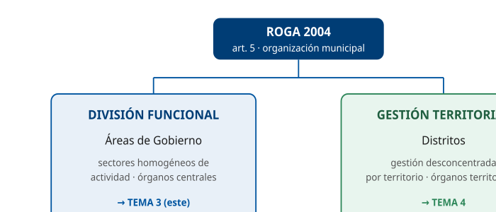

Mostrar la división funcional (Áreas) y territorial (distritos).

D2 · Órganos centrales, territoriales y organismos (art. 6)

§ 2 — La organización del Ayuntamiento

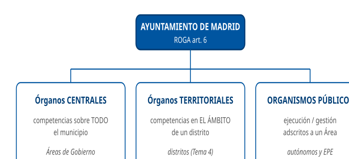

Clasificar la organización municipal en tres bloques.

D3 · Órganos superiores vs órganos directivos (art. 7)

§ 3 — Órganos superiores y directivos

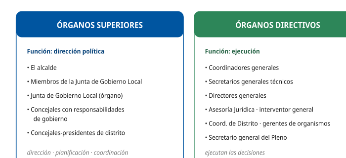

Contraponer las dos categorías y sus funciones.

D4 · Las Áreas de Gobierno: concepto y número (art. 40)

§ 4 — Las Áreas de Gobierno

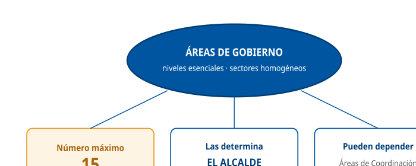

Fijar el concepto, el máximo de 15 y quién las determina.

D5 · Estructura interna de un Área de Gobierno (art. 41)

§ 5 — Estructura interna

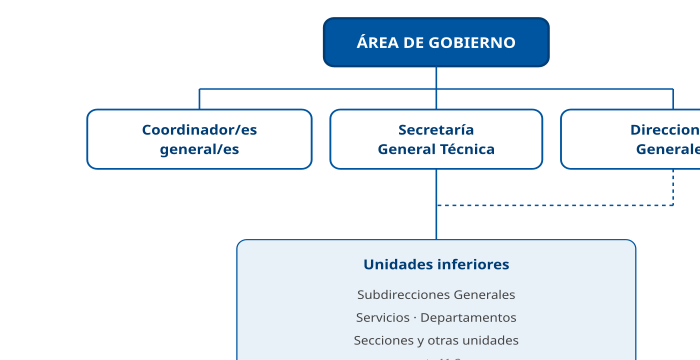

Árbol de la estructura de un Área.

D6 · Ordenación jerárquica de los directivos (art. 42)

§ 6 — Ordenación jerárquica

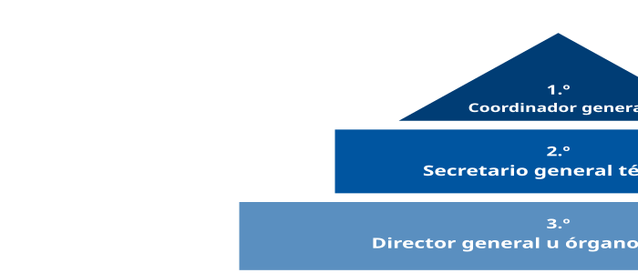

Pirámide del orden jerárquico de los órganos directivos.

D7 · Concejales de Gobierno vs de Coordinación (arts. 44-45)

§ 8 — Órganos superiores de las Áreas

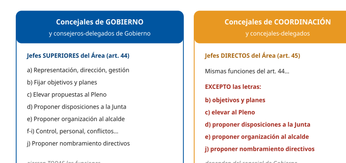

Distinguir las funciones de unos y otros.

D8 · Órganos centrales directivos (arts. 46-48)

§ 9 — Órganos centrales directivos

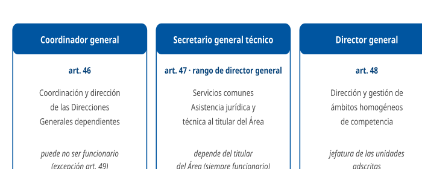

Resumir los tres órganos directivos y su función.

D9 · Nombramiento de los órganos directivos (art. 49)

§ 9.4 — Nombramiento

Quién nombra y entre quién.

D10 · Alcalde, Junta de Gobierno y Pleno

§ 11 — Relación con el Alcalde y el Pleno

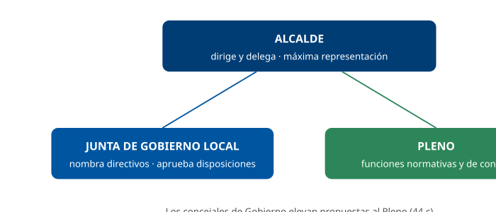

Situar los tres órganos de gobierno y su papel.

D11 · Las 7 Áreas de Gobierno actuales

§ 12 — Áreas de Gobierno actuales

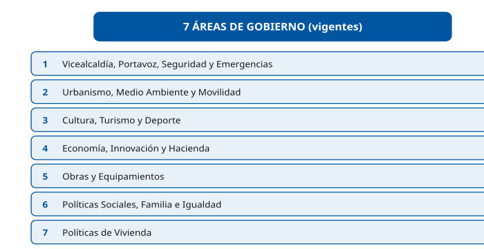

Listar las 7 Áreas vigentes.

D12 · Mapa-resumen del Tema 3

§ 13 — Resumen

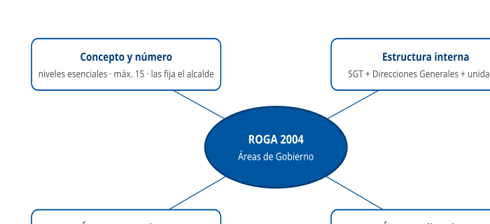

Mapa conceptual de cierre.

## Casos prácticos

#### CASO PRÁCTICO 1 — Órganos superiores y directivos

**Escenario**: Un nuevo Técnico Auxiliar TIC se incorpora a una Dirección General de un Área de Gobierno del Ayuntamiento de Madrid. Para situarse, necesita entender quién es órgano superior y quién directivo, y qué hace cada uno.

**Cuestiones**:

1.  **(2,5 pts)** ¿Cómo clasifica el artículo 7 del ROGA los órganos del Ayuntamiento según sus funciones? Cite dos ejemplos de cada tipo.
2.  **(2,5 pts)** ¿Qué función corresponde a los órganos superiores y cuál a los directivos?
3.  **(2,5 pts)** ¿Qué consideración tienen, en el ámbito de los distritos, los concejales-presidentes y los coordinadores de Distrito?
4.  **(2,5 pts)** ¿A qué régimen de incompatibilidades quedan sometidos unos y otros?

**Solución orientativa**:

1.  En **órganos superiores** y **órganos directivos** (art. 7.1 ROGA). Superiores: el **alcalde** y los **miembros de la Junta de Gobierno Local**. Directivos: **coordinadores generales**, **directores generales** (también secretarios generales técnicos, interventor general, etc.) (art. 7.2 y 7.3 ROGA).
2.  A los superiores, la **dirección, planificación y coordinación política**; a los directivos, la **ejecución** de las decisiones de aquéllos (art. 7.4 ROGA).
3.  Los **concejales-presidentes** son **órganos superiores**; los **coordinadores de Distrito** son **órganos directivos** (art. 7.2 y 7.3 ROGA).
4.  Al régimen de incompatibilidades de la **Ley 53/1984** y de las demás normas estatales o autonómicas que resulten de aplicación (art. 7.7 ROGA).

**Criterios de evaluación**: distinción correcta superiores/directivos; función política vs ejecución; encuadre de concejal-presidente (superior) y coordinador de Distrito (directivo); cita de la Ley 53/1984 y de las demás normas aplicables.

------------------------------------------------------------------------

#### Preguntas tipo test sobre este caso

##### 1. El nuevo técnico quiere saber cómo clasifica el artículo 7 del ROGA los órganos del Ayuntamiento atendiendo a sus funciones. La clasificación es:

- a) Órganos superiores y órganos directivos.
- b) Órganos centrales, órganos territoriales y organismos públicos.
- c) Órganos de gobierno, órganos consultivos y órganos de participación.

**Respuesta correcta:** a) · **Referencia:** Caso 1, cuestión 1 · art. 7.1 ROGA

Atendiendo a sus funciones, el artículo 7.1 ROGA distingue órganos superiores y directivos; la división en centrales, territoriales y organismos públicos es la del artículo 6, que atiende al ámbito y no a la función.

##### 2. El director general del que depende el nuevo técnico es, conforme al artículo 7 del ROGA:

- a) Un órgano superior, al que corresponde la dirección y planificación política del Área.
- b) Un órgano directivo, al que corresponde ejecutar las decisiones de los órganos superiores.
- c) Un órgano territorial, porque ejerce sus competencias sobre una parte del municipio.

**Respuesta correcta:** b) · **Referencia:** Caso 1, cuestiones 1 y 2 · art. 7.3 y 7.4 ROGA

Los directores generales figuran entre los órganos directivos (art. 7.3 ROGA), a los que corresponde la ejecución de las decisiones de los órganos superiores (art. 7.4 ROGA).

##### 3. ¿Cuál de las siguientes parejas está formada solo por órganos superiores del Ayuntamiento?

- a) El alcalde y el coordinador general de la Alcaldía.
- b) Un concejal de Gobierno y el interventor general municipal.
- c) El alcalde y un miembro de la Junta de Gobierno Local.

**Respuesta correcta:** c) · **Referencia:** Caso 1, cuestión 1 · art. 7.2 ROGA

Son órganos superiores el alcalde y los miembros de la Junta de Gobierno Local (art. 7.2 ROGA); los coordinadores generales y el interventor general municipal son órganos directivos (art. 7.3 ROGA).

##### 4. En el reparto de funciones del artículo 7.4 del ROGA, a los órganos superiores les corresponde:

- a) La ejecución de las decisiones adoptadas por los órganos directivos.
- b) La dirección, planificación y coordinación política.
- c) La gestión de los servicios comunes de cada Área de Gobierno.

**Respuesta correcta:** b) · **Referencia:** Caso 1, cuestión 2 · art. 7.4 ROGA

El artículo 7.4 ROGA atribuye a los órganos superiores la dirección, planificación y coordinación política, y a los directivos la ejecución de lo que aquellos deciden; la gestión de los servicios comunes es función del secretario general técnico.

##### 5. ¿Cuál de las siguientes relaciones contiene únicamente órganos directivos?

- a) Coordinador general, titular de la Asesoría Jurídica e interventor general municipal.
- b) Concejal-presidente, coordinador de Distrito y director general.
- c) Junta de Gobierno Local, secretario general técnico y gerente de un organismo autónomo.

**Respuesta correcta:** a) · **Referencia:** Caso 1, cuestión 1 · art. 7.3 ROGA

El artículo 7.3 ROGA incluye entre los órganos directivos a los coordinadores generales, al titular de la Asesoría Jurídica y al interventor general municipal; el concejal-presidente y la Junta de Gobierno Local son órganos superiores.

##### 6. El técnico va a dar soporte a un distrito. Allí, el concejal-presidente y el coordinador de Distrito tienen, respectivamente, la consideración de:

- a) Órgano directivo y órgano superior.
- b) Órganos directivos ambos, por actuar solo en un distrito.
- c) Órgano superior y órgano directivo.

**Respuesta correcta:** c) · **Referencia:** Caso 1, cuestión 3 · art. 7.2 y 7.3 ROGA

En el ámbito de los distritos, los concejales-presidentes son órganos superiores (art. 7.2 ROGA) y los coordinadores de Distrito son órganos directivos (art. 7.3 ROGA).

##### 7. El Área tiene adscrito un organismo autónomo con el que el técnico colabora a diario. Su gerente es, a efectos del artículo 7 del ROGA:

- a) Un órgano directivo.
- b) Un órgano superior.
- c) Un órgano territorial.

**Respuesta correcta:** a) · **Referencia:** Caso 1, cuestión 1 · art. 7.3 ROGA

El artículo 7.3 ROGA incluye entre los órganos directivos a los gerentes de los organismos autónomos y entidades públicas empresariales.

##### 8. Los titulares de los órganos superiores y directivos quedan sometidos al régimen de incompatibilidades establecido en:

- a) La Ley 7/1985, Reguladora de las Bases del Régimen Local, en su título X.
- b) La Ley 57/2003, de medidas para la modernización del gobierno local.
- c) La Ley 53/1984, de Incompatibilidades del Personal al Servicio de las Administraciones Públicas.

**Respuesta correcta:** c) · **Referencia:** Caso 1, cuestión 4 · art. 7.7 ROGA

El artículo 7.7 ROGA somete a los titulares de órganos superiores y directivos al régimen de incompatibilidades de la Ley 53/1984 y de las demás normas estatales o autonómicas que resulten de aplicación.

##### 9. En cuanto al régimen de incompatibilidades, el compañero del técnico afirma que solo afecta a los cargos políticos. Debe corregírsele, porque el artículo 7.7 del ROGA lo aplica:

- a) Solo a los titulares de los órganos directivos, por ser en general funcionarios.
- b) A los titulares de los órganos superiores y también a los de los órganos directivos.
- c) Solo al alcalde y a los concejales que integran la Junta de Gobierno Local.

**Respuesta correcta:** b) · **Referencia:** Caso 1, cuestión 4 · art. 7.7 ROGA

El régimen de incompatibilidades de la Ley 53/1984 alcanza a los titulares de ambos tipos de órganos, superiores y directivos (art. 7.7 ROGA).

##### 10. En la sesión de acogida se menciona al secretario general del Pleno. Según el ROGA, este puesto:

- a) Es órgano directivo y se nombra entre funcionarios de Administración Local con habilitación de carácter nacional.
- b) Es órgano superior y se elige por el Pleno entre sus propios concejales.
- c) Es órgano directivo y lo nombra libremente el alcalde, sin requisito de ser funcionario.

**Respuesta correcta:** a) · **Referencia:** Caso 1, cuestión 1 · art. 7.6 ROGA

El secretario general del Pleno tiene carácter de órgano directivo y se nombra entre funcionarios de Administración Local con habilitación de carácter nacional (art. 7.6 ROGA).

#### CASO PRÁCTICO 2 — Creación de una nueva Área de Gobierno

**Escenario**: Tras la constitución de la nueva corporación, el alcalde quiere reorganizar la estructura municipal y crear una nueva Área de Gobierno especializada en transformación digital.

**Cuestiones**:

1.  **(2,5 pts)** ¿Quién puede determinar el número, denominación y atribuciones de las Áreas de Gobierno y mediante qué instrumento?
2.  **(2,5 pts)** ¿Existe un límite al número de Áreas de Gobierno? ¿Cuál?
3.  **(2,5 pts)** ¿Qué naturaleza tienen las Áreas de Gobierno dentro de la organización del artículo 6 y qué comprenden?
4.  **(2,5 pts)** ¿Pueden depender de un Área de Gobierno otras unidades de nivel "Área"? ¿Cuáles?

**Solución orientativa**:

1.  El **alcalde**, mediante **decreto**, al amparo de lo previsto en los artículos 123.1.c) y 124.4.k) de la LBRL (arts. 14.2 y 40.2 ROGA).
2.  Sí: el número de Áreas de Gobierno **no podrá exceder de 15** (art. 40.2 ROGA).
3.  Son **órganos centrales** (ejercen competencias sobre todo el municipio) y constituyen los **niveles esenciales** de la organización, comprendiendo uno o varios **sectores funcionalmente homogéneos** (arts. 6 y 40.1 ROGA).
4.  Sí: pueden depender **Áreas de Coordinación** o **Áreas Delegadas**, que dirigen un sector de la actividad del Área de la que dependen (art. 40.1 ROGA).

**Criterios de evaluación**: identificar al alcalde y el decreto; el tope de 15; naturaleza de órgano central y sectores homogéneos; Áreas de Coordinación/Delegadas.

------------------------------------------------------------------------

#### Preguntas tipo test sobre este caso

##### 1. ¿Qué órgano puede crear la nueva Área de Gobierno de transformación digital y fijar su denominación y atribuciones?

- a) El Pleno.
- b) El alcalde.
- c) La Junta de Gobierno Local.

**Respuesta correcta:** b) · **Referencia:** Caso 2, cuestión 1 · art. 40.2 ROGA

Corresponde al alcalde determinar el número, la denominación y las atribuciones de las Áreas de Gobierno (art. 40.2 ROGA).

##### 2. La decisión de crear la nueva Área de Gobierno adoptará la forma de:

- a) Un acuerdo del Pleno.
- b) Una ordenanza municipal.
- c) Un decreto.

**Respuesta correcta:** c) · **Referencia:** Caso 2, cuestión 1 · art. 40.2 ROGA

El alcalde determina el número, la denominación y las atribuciones de las Áreas de Gobierno mediante decreto (art. 40.2 ROGA).

##### 3. El alcalde dicta esa decisión al amparo de los siguientes preceptos de la LBRL:

- a) Los artículos 123.1.c) y 124.4.k).
- b) Los artículos 130.3 y 85 bis.
- c) Los artículos 44.e) y 49.1.

**Respuesta correcta:** a) · **Referencia:** Caso 2, cuestión 1 · art. 40.2 ROGA

El alcalde actúa al amparo del artículo 123.1.c) en relación con el artículo 124.4.k) de la LBRL; el 130.3 regula el nombramiento de directivos y el 85 bis los organismos públicos.

##### 4. En cuanto al número de Áreas de Gobierno, la reorganización que plantea el alcalde está sujeta a este límite:

- a) No podrá haber más de 7 Áreas de Gobierno.
- b) No existe límite: el alcalde crea las que considere necesarias.
- c) No podrá haber más de 15 Áreas de Gobierno.

**Respuesta correcta:** c) · **Referencia:** Caso 2, cuestión 2 · art. 40.2 ROGA

El artículo 40.2 ROGA establece que el número de Áreas de Gobierno no podrá exceder de 15; siete es el número vigente, no el máximo.

##### 5. Partiendo de las siete Áreas de Gobierno vigentes, ¿cuántas Áreas de Gobierno nuevas podría crear como máximo el alcalde, sin suprimir ninguna?

- a) Siete.
- b) Ocho.
- c) Nueve.

**Respuesta correcta:** b) · **Referencia:** Caso 2, cuestión 2 · art. 40.2 ROGA · §12

El máximo es de 15 Áreas de Gobierno (art. 40.2 ROGA) y hoy hay siete, por lo que caben 15 − 7 = 8 nuevas.

##### 6. Dentro de la clasificación del artículo 6 del ROGA, la nueva Área de Gobierno será:

- a) Un órgano central, porque ejercerá sus competencias sobre todo el municipio.
- b) Un órgano territorial, porque se implantará en los distritos.
- c) Un organismo público, adscrito a la Alcaldía por razón de la materia.

**Respuesta correcta:** a) · **Referencia:** Caso 2, cuestión 3 · art. 6 ROGA

Las Áreas de Gobierno son órganos centrales, que ejercen sus competencias sobre todo el territorio del municipio; los territoriales actúan solo en un distrito (art. 6 ROGA).

##### 7. ¿Qué comprenderá la nueva Área de Gobierno, conforme al artículo 40.1 del ROGA?

- a) Los servicios comunes de todas las Áreas de Gobierno del Ayuntamiento.
- b) Uno o varios sectores funcionalmente homogéneos de la actividad administrativa municipal.
- c) El conjunto de los organismos autónomos y entidades públicas empresariales.

**Respuesta correcta:** b) · **Referencia:** Caso 2, cuestión 3 · art. 40.1 ROGA

Cada Área de Gobierno comprende uno o varios sectores funcionalmente homogéneos de la actividad administrativa municipal (art. 40.1 ROGA).

##### 8. Dentro de la organización municipal, la nueva Área de Gobierno constituirá:

- a) Uno de los niveles esenciales de la organización municipal.
- b) Una unidad inferior dependiente de una Dirección General.
- c) Un órgano de participación de los vecinos y sus asociaciones.

**Respuesta correcta:** a) · **Referencia:** Caso 2, cuestión 3 · art. 40.1 ROGA

Las Áreas de Gobierno constituyen los niveles esenciales de la organización municipal (art. 40.1 ROGA).

##### 9. El alcalde quiere que, dentro de la nueva Área, un nivel de tipo «Área» se ocupe de la ciberseguridad. De un Área de Gobierno puede depender:

- a) Otra Área de Gobierno, subordinada a la primera.
- b) Una Junta Municipal de Distrito especializada.
- c) Un Área de Coordinación o un Área Delegada.

**Respuesta correcta:** c) · **Referencia:** Caso 2, cuestión 4 · art. 40.1 ROGA

De las Áreas de Gobierno pueden depender Áreas de Coordinación o Áreas Delegadas (art. 40.1 ROGA).

##### 10. Si se crea esa Área Delegada de ciberseguridad, su función será:

- a) Dirigir la actividad de varias Áreas de Gobierno en materia digital.
- b) Dirigir un sector de la actividad administrativa del Área de Gobierno de la que dependa.
- c) Ejercer sus competencias exclusivamente en el ámbito de un distrito.

**Respuesta correcta:** b) · **Referencia:** Caso 2, cuestión 4 · art. 40.1 ROGA

A las Áreas de Coordinación y Delegadas les corresponde la dirección de un sector de la actividad administrativa del Área de la que dependen (art. 40.1 ROGA).

#### CASO PRÁCTICO 3 — Estructura interna y jerarquía de un Área

**Escenario**: El Área de Gobierno de Economía, Innovación y Hacienda revisa su organigrama interno y plantea dudas sobre los niveles directivos y su orden jerárquico.

**Cuestiones**:

1.  **(3 pts)** ¿Con qué órganos cuenta internamente un Área de Gobierno según el artículo 41?
2.  **(3 pts)** Ordene jerárquicamente los órganos directivos del Área conforme al artículo 42.2.
3.  **(2 pts)** ¿En qué unidades pueden organizarse las Secretarías Generales Técnicas y las Direcciones Generales?
4.  **(2 pts)** ¿Quiénes son los jefes superiores y quiénes los jefes directos del Área?

**Solución orientativa**:

1.  Con uno o más **coordinadores generales**, una **Secretaría General Técnica** y **Direcciones Generales** u órganos similares (art. 41.1 ROGA).
2.  **1.º coordinador general → 2.º secretario general técnico → 3.º director general** u órgano asimilado (art. 42.2 ROGA).
3.  En **Subdirecciones Generales, Servicios, Departamentos, Secciones** y otras unidades inferiores (art. 41.2 ROGA).
4.  **Jefes superiores**: los concejales de Gobierno y consejeros-delegados de Gobierno. **Jefes directos**: los concejales de Coordinación y concejales-delegados (art. 42.1 ROGA).

**Criterios de evaluación**: estructura del art. 41; orden jerárquico exacto; unidades inferiores; distinción jefes superiores/directos.

------------------------------------------------------------------------

#### Preguntas tipo test sobre este caso

##### 1. ¿Qué órgano debe existir necesariamente en el Área de Gobierno de Economía, Innovación y Hacienda?

- a) Un coordinador general.
- b) Un Área Delegada.
- c) Una Secretaría General Técnica.

**Respuesta correcta:** c) · **Referencia:** Caso 3, cuestión 1 · art. 41.1 ROGA

Las Áreas de Gobierno «contarán» con una Secretaría General Técnica, mientras que «podrán» contar con coordinadores generales; las Áreas Delegadas también son potestativas (arts. 40.1 y 41.1 ROGA).

##### 2. El borrador del organigrama prevé dos coordinadores generales en el Área. Esta previsión:

- a) Es posible, porque el Área puede contar con uno o más coordinadores generales.
- b) No es posible, porque cada Área solo puede tener un coordinador general.
- c) Solo es posible si el Pleno lo autoriza de forma expresa.

**Respuesta correcta:** a) · **Referencia:** Caso 3, cuestión 1 · art. 41.1 ROGA

El artículo 41.1 ROGA permite que las Áreas de Gobierno cuenten con uno o más coordinadores generales.

##### 3. Los bloques de competencias homogéneas del Área (por ejemplo, Hacienda, por un lado, e Innovación, por otro) se estructuran a través de:

- a) Áreas de Gobierno independientes entre sí.
- b) Direcciones Generales u órganos similares.
- c) Juntas Municipales de Distrito.

**Respuesta correcta:** b) · **Referencia:** Caso 3, cuestión 1 · art. 41.1 ROGA

Las Áreas de Gobierno se estructuran por bloques de competencias homogéneas a través de Direcciones Generales u órganos similares (art. 41.1 ROGA).

##### 4. Al ordenar jerárquicamente los órganos directivos del Área conforme al artículo 42.2 del ROGA, el orden correcto es:

- a) Coordinador general, secretario general técnico y director general.
- b) Secretario general técnico, coordinador general y director general.
- c) Coordinador general, director general y secretario general técnico.

**Respuesta correcta:** a) · **Referencia:** Caso 3, cuestión 2 · art. 42.2 ROGA

El artículo 42.2 ROGA ordena a los órganos directivos así: coordinador general, secretario general técnico y director general u órgano asimilado.

##### 5. La Dirección General de Innovación quiere organizarse internamente. Podrá hacerlo en:

- a) Áreas Delegadas, Direcciones Generales adjuntas y Secretarías Generales Técnicas.
- b) Distritos, Juntas Municipales y órganos de participación vecinal.
- c) Subdirecciones Generales, Servicios, Departamentos, Secciones y otras unidades inferiores.

**Respuesta correcta:** c) · **Referencia:** Caso 3, cuestión 3 · art. 41.2 ROGA

Las Secretarías Generales Técnicas y las Direcciones Generales pueden organizarse en Subdirecciones Generales, Servicios, Departamentos, Secciones y otras unidades inferiores (art. 41.2 ROGA).

##### 6. Se plantea que un Servicio dependa directamente de un coordinador general, sin Dirección General intermedia. Esta opción:

- a) No es posible, porque los Servicios solo pueden depender de una Dirección General.
- b) Es posible, porque las unidades inferiores también pueden depender directamente de los coordinadores generales.
- c) Solo es posible si el Servicio se integra antes en la Secretaría General Técnica.

**Respuesta correcta:** b) · **Referencia:** Caso 3, cuestión 3 · art. 41.2 ROGA

El artículo 41.2 ROGA prevé que las unidades inferiores puedan depender también directamente de los coordinadores generales.

##### 7. Para crear una nueva Subdirección General en el Área, el instrumento adecuado es:

- a) La relación de puestos de trabajo del Área.
- b) Una resolución del secretario general técnico del Área.
- c) Un acuerdo de organización administrativa de la Junta de Gobierno.

**Respuesta correcta:** c) · **Referencia:** Caso 3, cuestión 3 · art. 8.1 ROGA

Los órganos directivos y las Subdirecciones Generales se crean, modifican o suprimen por la Junta de Gobierno mediante acuerdos de organización administrativa (art. 8.1 ROGA).

##### 8. En cambio, para crear una nueva Sección dentro de un Departamento del Área se utiliza:

- a) Un acuerdo de organización de la Junta de Gobierno.
- b) La relación de puestos de trabajo (RPT).
- c) El decreto del alcalde que fija las Áreas.

**Respuesta correcta:** b) · **Referencia:** Caso 3, cuestión 3 · art. 8.1 ROGA

Los servicios, departamentos y las unidades de nivel inferior, así como los demás puestos de trabajo, se crean, modifican y suprimen a través de la relación de puestos de trabajo (art. 8.1 ROGA).

##### 9. ¿Quién es el jefe superior del Área de Gobierno de Economía, Innovación y Hacienda?

- a) El concejal de Gobierno o consejero-delegado de Gobierno titular del Área.
- b) El coordinador general, por ser el primero en el orden jerárquico.
- c) El concejal-delegado que dirige el Área Delegada dependiente.

**Respuesta correcta:** a) · **Referencia:** Caso 3, cuestión 4 · art. 42.1 ROGA

Los concejales de Gobierno y consejeros-delegados de Gobierno son los jefes superiores del Área (art. 42.1 ROGA); el coordinador general encabeza solo a los órganos directivos.

##### 10. Del Área depende el Área Delegada de Innovación y Emprendimiento, dirigida por un concejal-delegado. Este concejal es, respecto de su Área:

- a) Jefe superior, en pie de igualdad con el concejal de Gobierno.
- b) Órgano directivo, situado por debajo del coordinador general.
- c) Jefe directo, sin perjuicio de la superior dirección del titular del Área de Gobierno.

**Respuesta correcta:** c) · **Referencia:** Caso 3, cuestión 4 · art. 42.1 ROGA · §12

Los concejales de Coordinación y los concejales-delegados son los jefes directos de su Área, sin perjuicio de la superior dirección del titular del Área de Gobierno (art. 42.1 ROGA).

#### CASO PRÁCTICO 4 — Funciones de los concejales de Gobierno y de Coordinación

**Escenario**: En un Área de Gobierno con un concejal de Gobierno titular y un concejal-delegado, surge una controversia sobre qué decisiones puede adoptar cada uno.

**Cuestiones**:

1.  **(3 pts)** Enumere tres funciones propias del concejal de Gobierno conforme al artículo 44.
2.  **(3 pts)** ¿Qué funciones del artículo 44 NO pueden ejercer los concejales de Coordinación y concejales-delegados?
3.  **(2 pts)** ¿Ante quién responden los concejales de Coordinación y concejales-delegados?
4.  **(2 pts)** ¿Quién propone a la Junta de Gobierno el nombramiento de los titulares de los órganos directivos del Área?

**Solución orientativa**:

1.  Por ejemplo: **a)** representación, dirección, gestión e inspección del Área; **b)** fijar objetivos y aprobar planes de actuación; **c)** elevar propuestas al Pleno; **d)** proponer disposiciones a la Junta de Gobierno; **e)** proponer al alcalde la organización del Área (basta citar tres) (art. 44 ROGA).
2.  Las de las letras **b), c), d), e) y j)** (art. 45.1 ROGA).
3.  Ante el **órgano superior inmediato** del que dependan (art. 45.2 ROGA).
4.  El **concejal de Gobierno o consejero-delegado de Gobierno** del Área (art. 44.j) ROGA).

**Criterios de evaluación**: tres funciones correctas del art. 44; identificación exacta de las letras excluidas (b, c, d, e, j); responsabilidad ante el superior inmediato; propuesta de nombramiento por el concejal de Gobierno.

------------------------------------------------------------------------

#### Preguntas tipo test sobre este caso

##### 1. ¿Cuál de las siguientes es una función propia del concejal de Gobierno titular del Área, conforme al artículo 44 del ROGA?

- a) Fijar los objetivos del Área, aprobar los planes de actuación y asignar los recursos.
- b) Nombrar y cesar a los directores generales de su Área.
- c) Determinar el número y la denominación de las Áreas de Gobierno.

**Respuesta correcta:** a) · **Referencia:** Caso 4, cuestión 1 · art. 44.b) ROGA

Fijar objetivos, aprobar planes de actuación y asignar recursos es la función de la letra b) del artículo 44 ROGA; el nombramiento de directivos corresponde a la Junta de Gobierno y la fijación de las Áreas, al alcalde.

##### 2. El concejal-delegado pretende elevar directamente al Pleno una propuesta del ámbito del Área. ¿Puede hacerlo?

- a) Sí, porque los concejales-delegados ejercen todas las funciones del artículo 44.
- b) Sí, siempre que la propuesta se limite al sector que dirige su Área Delegada.
- c) No, porque elevar propuestas al Pleno es una de las funciones que el artículo 45 le excluye.

**Respuesta correcta:** c) · **Referencia:** Caso 4, cuestión 2 · arts. 44.c) y 45.1 ROGA

Elevar al Pleno las propuestas es la letra c) del artículo 44 ROGA, y el artículo 45.1 excluye a los concejales de Coordinación y concejales-delegados las letras b), c), d), e) y j).

##### 3. Para resolver la controversia, conviene recordar qué letras del artículo 44 quedan excluidas para los concejales de Coordinación y los concejales-delegados:

- a) Las letras a), b), c), d) y e).
- b) Las letras b), c), d), e) y j).
- c) Las letras b), c), d), h) y j).

**Respuesta correcta:** b) · **Referencia:** Caso 4, cuestión 2 · art. 45.1 ROGA

Los concejales de Coordinación y concejales-delegados tienen las competencias del artículo 44 ROGA salvo las de las letras b), c), d), e) y j) (art. 45.1 ROGA).

##### 4. ¿Cuál de estas funciones del artículo 44 puede ejercer el concejal-delegado?

- a) Proponer al alcalde los proyectos de organización y estructura del Área.
- b) Proponer a la Junta de Gobierno proyectos de disposiciones de carácter general.
- c) Evaluar la ejecución de los planes de actuación por los órganos directivos (control de eficacia).

**Respuesta correcta:** c) · **Referencia:** Caso 4, cuestión 2 · arts. 44.f) y 45.1 ROGA

El control de eficacia es la letra f) del artículo 44, no excluida por el artículo 45.1 ROGA; proponer la organización al alcalde (e) y disposiciones a la Junta de Gobierno (d) sí están excluidas.

##### 5. ¿Cuál de las siguientes funciones NO puede ejercer el concejal-delegado?

- a) Proponer a la Junta de Gobierno el nombramiento de los titulares de los órganos directivos.
- b) Ejercer la representación, dirección, gestión e inspección de su Área.
- c) Resolver los conflictos entre los órganos directivos dependientes de su Área.

**Respuesta correcta:** a) · **Referencia:** Caso 4, cuestión 2 · arts. 44.j) y 45.1 ROGA

Proponer el nombramiento de directivos es la letra j) del artículo 44 ROGA, excluida para los concejales-delegados; las letras a) e i) no están excluidas (art. 45.1 ROGA).

##### 6. En el ejercicio de sus funciones, el concejal-delegado responde:

- a) Ante el Pleno, directamente.
- b) Ante el órgano superior inmediato del que dependa.
- c) Ante el coordinador general del Área.

**Respuesta correcta:** b) · **Referencia:** Caso 4, cuestión 3 · art. 45.2 ROGA

Los concejales de Coordinación y concejales-delegados responden ante el órgano superior inmediato del que dependan (art. 45.2 ROGA).

##### 7. Las funciones que conserva el concejal-delegado las ejerce:

- a) Sin perjuicio de la superior dirección del concejal de Gobierno del que depende.
- b) Con plena independencia del concejal de Gobierno del Área.
- c) Bajo la dirección del secretario general técnico del Área.

**Respuesta correcta:** a) · **Referencia:** Caso 4, cuestión 3 · art. 45.1 ROGA

El artículo 45.1 ROGA precisa que los concejales de Coordinación y concejales-delegados actúan sin perjuicio de la superior dirección del concejal de Gobierno o consejero-delegado de Gobierno del que dependan.

##### 8. Hay que nombrar un nuevo director general en el Área. ¿Quién formula la propuesta de nombramiento?

- a) El concejal-delegado, ante el alcalde.
- b) El concejal de Gobierno titular del Área, ante la Junta de Gobierno.
- c) El coordinador general, ante el Pleno.

**Respuesta correcta:** b) · **Referencia:** Caso 4, cuestión 4 · art. 44.j) ROGA

Proponer a la Junta de Gobierno el nombramiento de los titulares de los órganos directivos del Área corresponde al concejal de Gobierno o consejero-delegado de Gobierno (art. 44.j ROGA).

##### 9. Formulada la propuesta, ¿qué órgano acuerda el nombramiento del director general?

- a) El alcalde, mediante decreto.
- b) El concejal de Gobierno del Área.
- c) La Junta de Gobierno.

**Respuesta correcta:** c) · **Referencia:** Caso 4, cuestión 4 · arts. 44.j) y 49.1 ROGA

Los coordinadores generales, secretarios generales técnicos y directores generales son nombrados y cesados por la Junta de Gobierno (art. 49.1 ROGA).

##### 10. El concejal de Gobierno quiere modificar la estructura de su Área. Su intervención consiste en:

- a) Proponer al alcalde la aprobación de los proyectos de organización y estructura del Área.
- b) Aprobar por sí mismo la nueva estructura del Área mediante resolución.
- c) Proponer al Pleno la modificación del reglamento orgánico para reorganizar el Área.

**Respuesta correcta:** a) · **Referencia:** Caso 4, cuestión 1 · art. 44.e) ROGA

La letra e) del artículo 44 ROGA atribuye al concejal de Gobierno la función de proponer al alcalde los proyectos de organización y estructura de su Área.

#### CASO PRÁCTICO 5 — Nombramiento de un órgano directivo

**Escenario**: El Área de Gobierno de Urbanismo, Medio Ambiente y Movilidad debe cubrir una Dirección General y una Secretaría General Técnica. Recursos Humanos consulta los requisitos.

**Cuestiones**:

1.  **(3 pts)** ¿Qué órgano nombra y cesa a los coordinadores generales, secretarios generales técnicos y directores generales?
2.  **(3 pts)** ¿Entre quiénes deben nombrarse, con carácter general, y a qué subgrupo deben pertenecer?
3.  **(2 pts)** ¿Podría aplicarse la excepción de no ser funcionario a la Dirección General? ¿Y a la Secretaría General Técnica?
4.  **(2 pts)** ¿Qué rango tiene el secretario general técnico y de quién depende?

**Solución orientativa**:

1.  La **Junta de Gobierno** (art. 49.1 ROGA).
2.  Con carácter general, atendiendo a criterios de competencia profesional y experiencia, entre **funcionarios de carrera** del Estado, de las Comunidades Autónomas, de las Entidades Locales o con habilitación de carácter nacional que pertenezcan a cuerpos o escalas clasificados en el **subgrupo A1** (art. 130.3 LBRL) (art. 49.2 ROGA).
3.  A la **Dirección General**, sí, si el decreto de estructura del Área lo prevé en atención a las características específicas del puesto, y el nombramiento ha de ser motivado (art. 49.2 ROGA): la excepción alcanza a los coordinadores generales y a determinados directores generales. A la **Secretaría General Técnica**, **no** (art. 49.3 ROGA).
4.  Tiene **rango de director general** y depende directamente del **titular del Área de Gobierno** (art. 47 ROGA).

**Criterios de evaluación**: la Junta de Gobierno como órgano competente; requisito de funcionario de carrera de cuerpos o escalas del subgrupo A1 (art. 130.3 LBRL); excepción motivada posible para la Dirección General y excluida para la Secretaría General Técnica; rango y dependencia del secretario general técnico.

------------------------------------------------------------------------

#### Preguntas tipo test sobre este caso

##### 1. Para cubrir la Dirección General y la Secretaría General Técnica del Área, ¿qué órgano nombra a sus titulares?

- a) El alcalde.
- b) La Junta de Gobierno.
- c) El concejal de Gobierno del Área.

**Respuesta correcta:** b) · **Referencia:** Caso 5, cuestión 1 · art. 49.1 ROGA

Los coordinadores generales, secretarios generales técnicos y directores generales son nombrados y cesados por la Junta de Gobierno (art. 49.1 ROGA).

##### 2. Con carácter general, ¿entre quiénes debe nombrarse al titular de la Dirección General?

- a) Entre funcionarios de carrera del Estado, de las comunidades autónomas, de las entidades locales o con habilitación nacional, de cuerpos o escalas del subgrupo A1.
- b) Entre funcionarios de carrera del propio Ayuntamiento de Madrid, exclusivamente.
- c) Entre cualquier persona con experiencia en gestión pública o privada, sea o no funcionaria.

**Respuesta correcta:** a) · **Referencia:** Caso 5, cuestión 2 · art. 49.2 ROGA · art. 130.3 LBRL

Conforme al artículo 130.3 LBRL, al que remite el artículo 49.2 ROGA, el nombramiento se hace con carácter general entre funcionarios de carrera del Estado, de las Comunidades Autónomas, de las Entidades Locales o con habilitación de carácter nacional que pertenezcan a cuerpos o escalas clasificados en el subgrupo A1.

##### 3. Una candidata a la Dirección General es funcionaria de carrera de una comunidad autónoma y pertenece a un cuerpo clasificado en el subgrupo A1. ¿Cumple los requisitos generales del nombramiento?

- a) No, porque debe ser funcionaria de carrera del Ayuntamiento de Madrid.
- b) No, porque se exige en todo caso la habilitación de carácter nacional.
- c) Sí, porque es funcionaria de carrera de una comunidad autónoma y su cuerpo está clasificado en el subgrupo A1.

**Respuesta correcta:** c) · **Referencia:** Caso 5, cuestión 2 · art. 49.2 ROGA · art. 130.3 LBRL

Los funcionarios de carrera de las comunidades autónomas figuran entre los colectivos de los que puede proceder el nombramiento, siempre que pertenezcan a cuerpos o escalas clasificados en el subgrupo A1 (art. 130.3 LBRL; art. 49.2 ROGA).

##### 4. Con carácter general, ¿a qué subgrupo deben estar clasificados los cuerpos o escalas de los funcionarios entre los que se nombra a los titulares de estos órganos directivos?

- a) Al subgrupo A1.
- b) Al subgrupo A2.
- c) A cualquier subgrupo, siempre que tengan titulación universitaria.

**Respuesta correcta:** a) · **Referencia:** Caso 5, cuestión 2 · art. 49.2 ROGA · art. 130.3 LBRL

El artículo 130.3 LBRL, al que remite el artículo 49.2 ROGA, exige con carácter general funcionarios de carrera que pertenezcan a cuerpos o escalas clasificados en el subgrupo A1.

##### 5. Se propone para la Secretaría General Técnica a un directivo del sector privado que no es funcionario. ¿Es posible?

- a) Sí, siempre que el decreto de estructura del Área lo prevea de forma motivada.
- b) No, porque la excepción que permite nombrar a quien no es funcionario no se aplica a los secretarios generales técnicos.
- c) Sí, siempre que acredite experiencia en puestos de responsabilidad en la gestión privada.

**Respuesta correcta:** b) · **Referencia:** Caso 5, cuestión 3 · art. 49.3 ROGA

La excepción de no ser funcionario no es aplicable a los secretarios generales técnicos (art. 49.3 ROGA), aunque el decreto de estructura la prevea para otros puestos.

##### 6. ¿A cuál de estos puestos puede aplicarse la excepción de que su titular no sea funcionario?

- a) Al de secretario general técnico.
- b) Al de secretario general del Pleno.
- c) Al de coordinador general.

**Respuesta correcta:** c) · **Referencia:** Caso 5, cuestión 3 · arts. 7.6 y 49.3 ROGA

La excepción puede aplicarse a los coordinadores generales y a determinados directores generales, pero no a los secretarios generales técnicos (art. 49.3 ROGA); el secretario general del Pleno se nombra entre funcionarios con habilitación de carácter nacional (art. 7.6 ROGA).

##### 7. Si se quisiera nombrar coordinador general a una persona que no es funcionaria, esa posibilidad tendría que preverla:

- a) La relación de puestos de trabajo del Área.
- b) El decreto de estructura del Área, de forma motivada.
- c) Un acuerdo del Pleno adoptado para ese nombramiento.

**Respuesta correcta:** b) · **Referencia:** Caso 5, cuestión 3 · art. 49.2 ROGA

El artículo 49.2 ROGA admite que el titular no sea funcionario solo cuando el decreto de estructura del Área lo prevea motivadamente.

##### 8. ¿Qué rango tiene el secretario general técnico que se va a nombrar?

- a) Rango de coordinador general.
- b) Rango de subdirector general.
- c) Rango de director general.

**Respuesta correcta:** c) · **Referencia:** Caso 5, cuestión 4 · art. 47 ROGA

El secretario general técnico tiene rango de director general (art. 47.1 ROGA).

##### 9. ¿De quién dependerá directamente el nuevo secretario general técnico?

- a) Del titular del Área de Gobierno de Urbanismo, Medio Ambiente y Movilidad.
- b) Del coordinador general del Área, primer órgano directivo en jerarquía.
- c) Del director general de mayor antigüedad del Área.

**Respuesta correcta:** a) · **Referencia:** Caso 5, cuestión 4 · art. 47.3 ROGA

Los secretarios generales técnicos dependen directamente del titular del Área de Gobierno (art. 47.3 ROGA).

##### 10. Una vez nombrado, ¿qué funciones corresponderán al nuevo secretario general técnico?

- a) La coordinación y dirección de todas las Direcciones Generales dependientes del Área.
- b) La gestión de los servicios comunes y la asistencia jurídica y técnica al titular del Área.
- c) La dirección y gestión de un único ámbito de competencias sectoriales homogéneas.

**Respuesta correcta:** b) · **Referencia:** Caso 5, cuestión 4 · art. 47.1 ROGA

Al secretario general técnico le corresponden, entre otras, la gestión de los servicios comunes y la asistencia jurídica y técnica al titular del Área (art. 47.1 ROGA); coordinar las Direcciones Generales es propio del coordinador general y gestionar un ámbito homogéneo, del director general.

#### CASO PRÁCTICO 6 — Las Áreas de Gobierno actuales y la relación con Alcalde y Pleno

**Escenario**: En una jornada de acogida se explica a los nuevos empleados el organigrama vigente del Ayuntamiento y la cadena de decisión municipal.

**Cuestiones**:

1.  **(3 pts)** ¿En cuántas Áreas de Gobierno se organiza actualmente el Ayuntamiento de Madrid? Cite tres de ellas.
2.  **(2 pts)** ¿Es un dato fijo? ¿Quién y cómo puede modificarlo?
3.  **(3 pts)** Explique el papel del alcalde, de la Junta de Gobierno y del Pleno en relación con las Áreas de Gobierno.
4.  **(2 pts)** ¿Qué son las Áreas Delegadas y de qué dependen?

**Solución orientativa**:

1.  En **siete (7)** Áreas de Gobierno (organigrama vigente). Por ejemplo: Vicealcaldía, Portavoz, Seguridad y Emergencias; Urbanismo, Medio Ambiente y Movilidad; Economía, Innovación y Hacienda (entre otras) \[Organigrama vigente\].
2.  **No** es fijo: el **alcalde**, por **decreto**, fija el número (máximo 15), la denominación y las atribuciones en cada mandato (art. 40.2 ROGA).
3.  El **alcalde** dirige y delega y determina las Áreas; la **Junta de Gobierno** nombra a los directivos y aprueba los proyectos de disposiciones de carácter general que proponen los concejales de Gobierno; el **Pleno** ejerce las funciones normativas y de control, recibiendo las propuestas que elevan los concejales de Gobierno (arts. 9-11, 44, 49 ROGA).
4.  Son Áreas que **dependen de un Área de Gobierno** y dirigen un sector de su actividad administrativa (art. 40.1 ROGA).

**Criterios de evaluación**: número (7) y ejemplos correctos de Áreas; carácter actualizable y competencia del alcalde; papel diferenciado de alcalde/Junta/Pleno; concepto de Área Delegada.

------------------------------------------------------------------------

#### Preguntas tipo test sobre este caso

##### 1. En la jornada de acogida se explica el organigrama vigente. ¿En cuántas Áreas de Gobierno se organiza actualmente el Ayuntamiento de Madrid?

- a) En nueve.
- b) En quince.
- c) En siete.

**Respuesta correcta:** c) · **Referencia:** Caso 6, cuestión 1 · §12 (organigrama vigente)

El Ayuntamiento se organiza actualmente en siete Áreas de Gobierno; quince es el máximo legal, no el número vigente (art. 40.2 ROGA).

##### 2. ¿Cuál de las siguientes es una de las Áreas de Gobierno vigentes?

- a) Transformación Digital y Administración Electrónica.
- b) Urbanismo, Medio Ambiente y Movilidad.
- c) Hacienda, Personal y Administración Pública.

**Respuesta correcta:** b) · **Referencia:** Caso 6, cuestión 1 · §12

Urbanismo, Medio Ambiente y Movilidad es una de las siete Áreas de Gobierno vigentes; las otras dos denominaciones no figuran en el organigrama actual.

##### 3. Un nuevo empleado cita «Turismo y Deporte» como una de las Áreas de Gobierno. Hay que precisarle que:

- a) Es un Área Delegada que depende del Área de Gobierno de Cultura, Turismo y Deporte.
- b) Es una de las siete Áreas de Gobierno vigentes, con plena autonomía.
- c) Es un organismo autónomo adscrito a la Alcaldía por razón de la materia.

**Respuesta correcta:** a) · **Referencia:** Caso 6, cuestiones 1 y 4 · §12

Entre las Áreas Delegadas vigentes figura Turismo y Deporte, que depende del Área de Gobierno de Cultura, Turismo y Deporte.

##### 4. ¿De qué Área de Gobierno depende el Área Delegada de Limpieza y Zonas Verdes?

- a) De Obras y Equipamientos.
- b) De Urbanismo, Medio Ambiente y Movilidad.
- c) De Vicealcaldía, Portavoz, Seguridad y Emergencias.

**Respuesta correcta:** b) · **Referencia:** Caso 6, cuestión 4 · §12

El organigrama vigente sitúa el Área Delegada de Limpieza y Zonas Verdes bajo el Área de Gobierno de Urbanismo, Medio Ambiente y Movilidad.

##### 5. ¿Es un dato fijo que haya siete Áreas de Gobierno?

- a) Sí: el número lo fija el reglamento orgánico y solo el Pleno puede cambiarlo.
- b) No: la Junta de Gobierno lo revisa cada año al aprobar el presupuesto.
- c) No: el alcalde fija por decreto su número en cada mandato, con un máximo de 15.

**Respuesta correcta:** c) · **Referencia:** Caso 6, cuestión 2 · art. 40.2 ROGA

El número, la denominación y las atribuciones de las Áreas los determina el alcalde por decreto, sin superar las 15 (art. 40.2 ROGA); por eso es un dato cambiante.

##### 6. En la cadena de decisión municipal, al alcalde le corresponde:

- a) Dirigir el gobierno y la Administración municipal, delegar competencias y determinar las Áreas.
- b) Nombrar a los directores generales a propuesta del Pleno.
- c) Ejercer las funciones normativas y de control sobre los concejales de Gobierno.

**Respuesta correcta:** a) · **Referencia:** Caso 6, cuestión 3 · arts. 9, 11 y 40.2 ROGA

El alcalde dirige la política, el gobierno y la Administración municipal, puede delegar sus competencias y determina las Áreas de Gobierno; los directivos los nombra la Junta de Gobierno y las funciones normativas y de control son del Pleno.

##### 7. Un concejal de Gobierno ha preparado un proyecto de disposición de carácter general sobre administración electrónica. ¿A qué órgano lo propone para su aprobación como proyecto?

- a) Al alcalde, mediante decreto.
- b) Al coordinador general del Área.
- c) A la Junta de Gobierno Local.

**Respuesta correcta:** c) · **Referencia:** Caso 6, cuestión 3 · art. 44.d) ROGA

Los concejales de Gobierno proponen a la Junta de Gobierno la aprobación de los proyectos de disposiciones de carácter general (art. 44.d ROGA).

##### 8. ¿Qué papel desempeña el Pleno en relación con las Áreas de Gobierno?

- a) Ejerce las funciones normativas y de control y recibe las propuestas que elevan los concejales de Gobierno.
- b) Nombra y cesa a los titulares de los órganos directivos de cada Área.
- c) Determina por decreto el número y la denominación de las Áreas.

**Respuesta correcta:** a) · **Referencia:** Caso 6, cuestión 3 · arts. 44.c) y 49.1 ROGA

El Pleno ejerce las funciones normativas y de control y recibe las propuestas de los concejales de Gobierno; el nombramiento de directivos es de la Junta de Gobierno y la fijación de las Áreas, del alcalde.

##### 9. ¿Qué órgano nombra a los directores generales de las Áreas de Gobierno dentro de esa cadena de decisión?

- a) El Pleno.
- b) La Junta de Gobierno.
- c) El alcalde.

**Respuesta correcta:** b) · **Referencia:** Caso 6, cuestión 3 · art. 49.1 ROGA

Los coordinadores generales, secretarios generales técnicos y directores generales son nombrados y cesados por la Junta de Gobierno (art. 49.1 ROGA).

##### 10. ¿Qué son las Áreas Delegadas que aparecen en el organigrama?

- a) Áreas que dependen del Pleno y dirigen la actividad de varios distritos.
- b) Áreas que dependen de la Alcaldía y agrupan los servicios comunes del Ayuntamiento.
- c) Áreas que dependen de un Área de Gobierno y dirigen un sector de su actividad administrativa.

**Respuesta correcta:** c) · **Referencia:** Caso 6, cuestión 4 · art. 40.1 ROGA

Las Áreas Delegadas dependen de un Área de Gobierno y les corresponde la dirección de un sector de la actividad administrativa de esta (art. 40.1 ROGA).

## Fuentes

------------------------------------------------------------------------

### Naturaleza de las fuentes en este tema

El Tema 3 trabaja con **corpus normativo cerrado**: el texto del Reglamento Orgánico del Gobierno y de la Administración del Ayuntamiento de Madrid (ROGA), de 31 de mayo de 2004, en su parte relativa a las Áreas de Gobierno (Título V, Capítulo I, arts. 40-49).

- La fuente nuclear es el **texto oficial del ROGA 2004** (Ayuntamiento de Madrid).
- Alcance ampliado coherente con el resto de temas admin: se añade el encuadre del **régimen de gran ciudad** (Título X LBRL, [Ley 57/2003](https://www.boe.es/buscar/act.php?id=BOE-A-2003-23103)) y del régimen especial de Madrid ([Ley 22/2006](https://www.boe.es/buscar/act.php?id=BOE-A-2006-12057) de Capitalidad, posterior al ROGA) y la referencia a la **LBRL** (arts. 123, 124, 130) que el propio ROGA invoca.
- El epígrafe *"número y denominación de las actuales Áreas de Gobierno"* se ha **actualizado con el organigrama oficial vigente** (transparencia.madrid.es), por su carácter cambiante en cada mandato.

------------------------------------------------------------------------

### Tier 1 — Fuentes primarias (cita directa)

| Ref | Título | Publicación / origen | Uso |
|----|----|----|----|
| \[ROGA\] | Reglamento Orgánico del Gobierno y de la Administración del Ayuntamiento de Madrid, de 31 de mayo de 2004 | Acuerdo del Pleno 31/05/2004 · BOCM núm. 148, de 23/06/2004 · BOAM núm. 5610, de 29/07/2004. Texto consolidado (última modificación: 15/02/2023) | **Fuente nuclear**: arts. 5-11 (organización) y 40-49 (Áreas de Gobierno y órganos directivos) |
| \[LBRL\] | [Ley 7/1985](https://www.boe.es/buscar/act.php?id=BOE-A-1985-5392), de 2 de abril, Reguladora de las Bases del Régimen Local | BOE núm. 80 de 03/04/1985 | Título X (régimen de organización de los municipios de gran población): arts. 123, 124, 130. Habilita el ROGA |
| \[LCREM\] | [Ley 22/2006](https://www.boe.es/buscar/act.php?id=BOE-A-2006-12057), de 4 de julio, de Capitalidad y de Régimen Especial de Madrid | BOE núm. 159 de 05/07/2006 | Marco del régimen especial del municipio de Madrid |
| \[ORG-VIGENTE\] | Organigrama y Áreas de Gobierno vigentes del Ayuntamiento de Madrid | transparencia.madrid.es / madrid.es (consultado 2026-06-15) | Número y denominación actuales de las Áreas de Gobierno y Áreas Delegadas |
| \[BOAM-10032\] | Temario oficial BOAM 10.032 (23-dic-2025) | BOAM | Enunciado oficial del Tema 3 |

#### Esquema de referencia para el contenido

- **Articulado ROGA**: `(art. X ROGA)` o `(art. X.Y ROGA)` — p. ej. `(art. 40.2 ROGA)`
- **Ley de bases**: `(art. 123 LBRL)`, `(art. 130.3 LBRL)`
- **Régimen especial**: `[LCREM]`
- **Versión del articulado**: se cita el **texto consolidado vigente** del ROGA (última modificación: 15 de febrero de 2023).

------------------------------------------------------------------------
