# Tema 4. El ROGA (II): Los Distritos

**Bloque:** administrativo  
**Enunciado oficial** (BOAM n.º 10.032, de 23 de diciembre de 2025): El Reglamento Orgánico del Gobierno y de la Administración del Ayuntamiento de Madrid, de 31 de mayo de 2004 (II): Los Distritos: Disposiciones Generales. El Concejal Presidente. Estructura administrativa.

Versión web: <https://ayuntamientomadrid.github.io/temario-tecnico-auxiliar/temas/tema-04.html> · PDF: [tema-04.pdf](tema-04.pdf) · Test: [../../../tests/administrativo/tema-04.md](../../../tests/administrativo/tema-04.md)

## Índice

- 1. Introducción: los distritos en la organización del Ayuntamiento
- 2. Los distritos: concepto y naturaleza (art. 61)
- 3. Órganos de gobierno y administración del distrito (art. 62)
- 4. La Junta Municipal del Distrito (art. 63)
- 5. El concejal-presidente: figura y funciones (art. 64)
- 6. Competencias del concejal-presidente (art. 65)
- 7. Responsabilidad política y forma de los actos (arts. 66-67)
- 8. El vicepresidente (art. 68)
- 9. Estructura administrativa del distrito (art. 69)
- 10. El coordinador del distrito (art. 70)
- 11. Funciones y resoluciones del coordinador del distrito (art. 71)
- 12. Órganos de participación (art. 72)
- 13. Los 21 distritos de Madrid
- 14. Esquema resumen + cómo estudiar el tema
  - Síntesis
  - Cómo estudiarlo

## Contenido

------------------------------------------------------------------------

### Convenciones del documento

Este tema incluye cuatro tipos de **cajas callout** para facilitar el estudio:

> **Dato clave.** Información de alta densidad memorística: órganos competentes, formas de los actos, rangos.

> **Cita normativa.** Reproducción literal o paráfrasis cercana de un precepto del ROGA o de la LBRL, con referencia al artículo.

> **Ejemplo de aplicación en el ayto.** Aplicación real al entorno del Ayuntamiento de Madrid (distritos, Juntas Municipales, organización territorial).

> **Relación con otros temas.** Conexión con otros temas o con otros bloques del propio Tema 4.

Las citas al articulado se expresan como `(art. X ROGA)` o `(art. X LBRL)`. El registro completo de fuentes está en la pestaña Fuentes.

------------------------------------------------------------------------

### 1. Introducción: los distritos en la organización del Ayuntamiento

La organización del Ayuntamiento de Madrid responde, según el **ROGA** (31 de mayo de 2004), a dos principios: la **división funcional en Áreas de Gobierno** y la **gestión territorial integrada en distritos**, salvo las excepciones previstas por el propio Reglamento (art. 5 ROGA).

- La **división funcional** (Áreas de Gobierno y órganos centrales) se estudia en el **Tema 3**.
- La **gestión territorial** (los **distritos** y sus órganos territoriales) es el objeto de **este tema** (parte II del ROGA).

El Ayuntamiento de Madrid se organiza en órganos centrales, territoriales y organismos públicos. Los **órganos territoriales** ejercen sus competencias **exclusivamente en el ámbito de un distrito**; los órganos centrales, sobre todo el territorio del municipio (art. 6.1 ROGA).

> **Relación con otros temas.** La **Ley 22/2006, de Capitalidad y de Régimen Especial de Madrid** (Tema 2), regula el régimen especial de la Villa de Madrid (art. 1.1). Su artículo 22.1 dispone que «el Pleno deberá crear Distritos, como divisiones territoriales propias, dotadas de órganos de gestión desconcentrada»; en términos análogos, el artículo 128.1 LBRL, dentro del Título X (régimen de organización de los municipios de gran población), establece que los ayuntamientos «deberán crear distritos». La presidencia del distrito corresponde en todo caso a un concejal (art. 22.2 de la Ley 22/2006 y art. 128.3 LBRL), y corresponde al Alcalde nombrar y cesar a los Presidentes de los Distritos (art. 14.3.d) de la Ley 22/2006). (arts. 14 y 22 Ley 22/2006; art. 128 LBRL)

------------------------------------------------------------------------

### 2. Los distritos: concepto y naturaleza (art. 61)

> **Cita normativa.** *"Los distritos constituyen divisiones territoriales del municipio de Madrid, y están dotados de órganos de gestión desconcentrada para el impulso y desarrollo de la participación ciudadana en la gestión de los asuntos municipales y su mejora, sin perjuicio de la unidad de gobierno y gestión del municipio"* (art. 61.1 ROGA)

Notas esenciales del concepto:

- Son **divisiones territoriales** del municipio.
- Cuentan con **órganos de gestión desconcentrada**.
- Su finalidad es el **impulso de la participación ciudadana** y la mejora de la gestión, **sin perjuicio de la unidad** de gobierno y gestión del municipio.

**Quién establece la división en distritos** (art. 61.2 ROGA):

> **Cita normativa.** *"Corresponde al Pleno del Ayuntamiento mediante norma orgánica establecer la división del municipio en distritos, y la determinación y regulación de sus órganos y de las competencias de sus órganos representativos y participativos"* (art. 61.2 ROGA)

Ello sin perjuicio de las atribuciones del **alcalde** para determinar la organización y competencias de su administración ejecutiva (art. 123.1.c) LBRL). El presente capítulo del ROGA fija solo las **normas esenciales** de la organización administrativa, que se complementan con el **Reglamento Orgánico de los Distritos** (RO 6/2021).

> **Dato clave.** Los distritos son **divisiones territoriales** con **gestión desconcentrada** (no descentralizada → sin personalidad jurídica propia). La **división del municipio en distritos** la establece el **Pleno** por norma orgánica. Conforme al artículo 128.2 LBRL, corresponde al Pleno la creación de los distritos y su regulación, así como determinar, en una norma de carácter orgánico, el porcentaje mínimo de los recursos presupuestarios que deberán gestionarse por los distritos, en su conjunto. (art. 61 ROGA; art. 128.2 LBRL)

------------------------------------------------------------------------

### 3. Órganos de gobierno y administración del distrito (art. 62)

> **Cita normativa.** *"El gobierno y administración del distrito corresponde a la Junta Municipal y al concejal-presidente de la misma, sin perjuicio de las competencias que correspondan a los demás órganos municipales"* (art. 62 ROGA)

Los dos órganos de gobierno del distrito son, por tanto:

- La **Junta Municipal del Distrito**, «órgano colegiado de representación político-vecinal» (art. 5.a) del Reglamento Orgánico 6/2021 de los Distritos).
- El **concejal-presidente**, que convoca y preside sus sesiones (art. 64 ROGA).

> **Dato clave.** El gobierno y administración del distrito corresponde a **dos órganos**: la **Junta Municipal del Distrito** y el **concejal-presidente** (art. 62 ROGA).

------------------------------------------------------------------------

### 4. La Junta Municipal del Distrito (art. 63)

> **Cita normativa.** *"La Junta Municipal del Distrito ejercerá las competencias ejecutivas o administrativas que le correspondan por delegación del alcalde o de la Junta de Gobierno, sin perjuicio de las demás que le atribuya el Pleno"* (art. 63 ROGA)

La Junta Municipal del Distrito ejerce, pues, competencias:

- **Por delegación** del **alcalde** o de la **Junta de Gobierno** (ejecutivas o administrativas).
- Las que le atribuya el **Pleno** conforme al artículo 123.1.c) LBRL.

> **Dato clave.** La Junta Municipal del Distrito actúa, sobre todo, **por delegación del alcalde o de la Junta de Gobierno** (art. 63 ROGA).

------------------------------------------------------------------------

### 5. El concejal-presidente: figura y funciones (art. 64)

> **Cita normativa.** *"El concejal-presidente, nombrado y separado por el alcalde, representa al distrito y dirige su administración, convoca y preside las sesiones de la Junta Municipal, dirime los empates con su voto de calidad y ejecuta los acuerdos de ésta"* (art. 64 ROGA)

Rasgos clave del concejal-presidente:

- Es **nombrado y separado por el alcalde**.
- **Representa** al distrito y **dirige** su administración.
- **Convoca y preside** las sesiones de la Junta Municipal.
- **Dirime los empates** con su **voto de calidad**.
- **Ejecuta los acuerdos** de la Junta Municipal.

> **Dato clave.** El concejal-presidente es **nombrado y separado por el alcalde**; preside la Junta Municipal, tiene **voto de calidad** para dirimir empates y ejecuta sus acuerdos. Es un **órgano superior** (art. 7.2 ROGA). (art. 64 ROGA)

------------------------------------------------------------------------

### 6. Competencias del concejal-presidente (art. 65)

Corresponde al concejal-presidente la **dirección, planificación y coordinación** de los servicios municipales de la competencia del distrito, y en particular (art. 65.1 ROGA):

- **a)** Ejercer la **representación, dirección, gestión e inspección** del distrito que presida.
- **b)** **Fijar los objetivos** del distrito, aprobar sus **planes de actuación** y **asignar los recursos** necesarios.
- **c)** **Proponer al titular del Área** competente las propuestas que correspondan al Pleno o a la Junta de Gobierno en el ámbito de su distrito.
- **d)** **Proponer al alcalde**, a través del Área correspondiente, la aprobación de los **proyectos de organización** de su distrito.
- **e)** **Evaluar la ejecución** de los planes de actuación por parte de los **coordinadores** del distrito y ejercer el **control de eficacia** sobre su actuación.
- **f)** Ejercer la **superior autoridad sobre el personal** del distrito, sin perjuicio de las competencias del alcalde.
- **g)** Las demás que le atribuyan las disposiciones legales vigentes.

Además, el concejal-presidente ejercerá las **atribuciones delegadas** por el alcalde o la Junta de Gobierno (art. 65.2 ROGA).

> **Dato clave.** El concejal-presidente fija objetivos y planes, propone al Área y al alcalde, evalúa al coordinador (control de eficacia) y ejerce la superior autoridad sobre el personal del distrito (art. 65 ROGA).

------------------------------------------------------------------------

### 7. Responsabilidad política y forma de los actos (arts. 66-67)

**Responsabilidad política** (art. 66 ROGA): el concejal-presidente responde políticamente de su gestión ante los miembros de la **Junta de Gobierno**, sin perjuicio de la responsabilidad exigible ante la propia **Junta Municipal del Distrito**.

**Forma de los actos** (art. 67 ROGA):

> **Cita normativa.** *"Las resoluciones administrativas que adopten los concejales-presidentes revestirán la forma de decreto y se denominarán «Decretos del concejal-presidente de la Junta Municipal de Distrito»"* (art. 67 ROGA)

> **Dato clave.** Los actos del **concejal-presidente** adoptan la forma de **DECRETO**; los del **coordinador del distrito**, la forma de **RESOLUCIÓN** (art. 71.2). No confundir. (arts. 67 y 71 ROGA)

------------------------------------------------------------------------

### 8. El vicepresidente (art. 68)

- El **alcalde** podrá nombrar **vicepresidente** a uno de los **concejales-vocales** de la Junta, quien **sustituirá al concejal-presidente** en caso de **vacante, ausencia o enfermedad** (art. 68.1 ROGA).
- La **suplencia** se produce **sin necesidad de acto expreso** declarativo, dando cuenta a la Junta Municipal (art. 68.2 ROGA).

> **Dato clave.** El vicepresidente es un **concejal-vocal** nombrado por el **alcalde** que sustituye al concejal-presidente en vacante, ausencia o enfermedad, sin necesidad de acto expreso. (art. 68 ROGA)

------------------------------------------------------------------------

### 9. Estructura administrativa del distrito (art. 69)

> **Cita normativa.** *"Los concejales-presidentes son los jefes superiores de la organización administrativa del distrito"* (art. 69.1 ROGA)

- Bajo la **superior dirección del concejal-presidente**, corresponde al **coordinador del distrito** la **dirección y coordinación** de los servicios de la competencia del distrito (art. 69.2 ROGA).
- La organización administrativa del distrito se estructura en **unidades administrativas funcionalmente homogéneas**, que se crean, modifican y suprimen a propuesta del concejal-presidente, previo informe de las Áreas competentes en materia de organización y de coordinación territorial, a través de la **relación de puestos de trabajo (RPT)** (art. 69.3 ROGA).

> **Dato clave.** El **jefe superior** de la organización administrativa del distrito es el **concejal-presidente**; el **coordinador del distrito** dirige y coordina los servicios bajo su superior dirección. (art. 69 ROGA)

------------------------------------------------------------------------

### 10. El coordinador del distrito (art. 70)

> **Cita normativa.** *"El coordinador del distrito será nombrado, y en su caso cesado, por la Junta de Gobierno a propuesta del concejal-presidente de cada Junta"* (art. 70.1 ROGA)

- El coordinador del distrito **ostenta a todos los efectos el rango de director general** y su nombramiento se efectúa conforme al **artículo 49** del ROGA (ver Tema 3) (art. 70.2 ROGA).
- En el ámbito de los distritos, son órganos directivos los coordinadores de Distrito; a los órganos directivos corresponde la ejecución de las decisiones adoptadas por los órganos superiores (art. 7.3 y 7.4 ROGA).

> **Dato clave.** El **coordinador del distrito** lo nombra y cesa la **Junta de Gobierno**, a **propuesta del concejal-presidente**, y tiene **rango de director general** (art. 49 ROGA). Es la figura que antes el ROGA de 2004 denominaba "gerente del distrito"; el término vigente es **coordinador del distrito** (Reglamento de Distritos 6/2021). (art. 70 ROGA)

> **Relación con otros temas.** El nombramiento de los órganos directivos (entre funcionarios de carrera, art. 130.3 LBRL) y el rango de director general se estudian en el **Tema 3** (art. 49 ROGA) y conectan con el régimen del personal del **Tema 5**.

------------------------------------------------------------------------

### 11. Funciones y resoluciones del coordinador del distrito (art. 71)

Con carácter general, y sin perjuicio de las competencias que puedan delegarle el alcalde, la Junta de Gobierno u otros órganos, corresponden al coordinador del distrito (art. 71.1 ROGA):

- La **dirección, planificación y gestión** de los servicios de su competencia.
- La **dirección y coordinación** de las unidades orgánicas adscritas, cuya **jefatura inmediata** ostenta.
- La **propuesta** de disposiciones, acuerdos y convenios de su ámbito.
- La **elaboración, seguimiento y control del presupuesto** anual asignado.
- La **evaluación de los servicios** del distrito.
- La **coordinación de las relaciones** de la Junta Municipal con el Área de Gobierno competente en coordinación territorial y demás Áreas, organismos y empresas municipales.
- Las que le **deleguen** los demás órganos municipales.

**Forma de los actos** (art. 71.2 ROGA):

> **Cita normativa.** *"Las decisiones administrativas que adopten los coordinadores de distrito revestirán la forma de «Resolución»"* (art. 71.2 ROGA)

> **Dato clave.** El coordinador del distrito ejerce la **jefatura inmediata** de las unidades adscritas y sus actos adoptan la forma de **Resolución**. (art. 71 ROGA)

------------------------------------------------------------------------

### 12. Órganos de participación (art. 72)

En los distritos podrán crearse **órganos de participación** de los vecinos y de las asociaciones que los representen, conforme a las normas orgánicas de participación ciudadana (art. 72 ROGA).

> **Ejemplo de aplicación en el ayto.** El órgano de participación vecinal de los distritos es hoy el **Consejo de Proximidad**, creado por el **Reglamento Orgánico 7/2021, de 1 de junio, de los Consejos de Proximidad de los Distritos de Madrid**, que derogó el Reglamento Orgánico de Funcionamiento de los Foros Locales de los Distritos de Madrid, de 23 de diciembre de 2016. Responde a la finalidad que el artículo 61.1 asigna a los distritos: el impulso y desarrollo de la participación ciudadana en la gestión de los asuntos municipales.

------------------------------------------------------------------------

### 13. Los 21 distritos de Madrid

La división del municipio de Madrid en distritos la establece el **Pleno** por norma orgánica (art. 61.2 ROGA). El Reglamento Orgánico 6/2021, de 1 de junio, de los Distritos del Ayuntamiento de Madrid divide el término municipal en **21 distritos** (art. 3.1 RO 6/2021):

| Nº  | Distrito            | Nº  | Distrito            |
|-----|---------------------|-----|---------------------|
| 01  | Centro              | 12  | Usera               |
| 02  | Arganzuela          | 13  | Puente de Vallecas  |
| 03  | Retiro              | 14  | Moratalaz           |
| 04  | Salamanca           | 15  | Ciudad Lineal       |
| 05  | Chamartín           | 16  | Hortaleza           |
| 06  | Tetuán              | 17  | Villaverde          |
| 07  | Chamberí            | 18  | Villa de Vallecas   |
| 08  | Fuencarral-El Pardo | 19  | Vicálvaro           |
| 09  | Moncloa-Aravaca     | 20  | San Blas-Canillejas |
| 10  | Latina              | 21  | Barajas             |
| 11  | Carabanchel         |     |                     |

Corresponde al Pleno, por medio de la modificación de ese reglamento orgánico, alterar el número, denominación y límites territoriales de los distritos y de los barrios que los integran (art. 3.2 RO 6/2021). Cada distrito se divide, a su vez, en **barrios** (art. 3.3 RO 6/2021). La estructura de gobierno (Junta Municipal + concejal-presidente) y administrativa (coordinador del distrito) de los artículos 62 a 71 del ROGA se aplica a los 21 distritos.

> **Dato clave.** Madrid tiene **21 distritos**. El número 1 es **Centro** y el número 21, **Barajas**. La división la fija el **Pleno** (no el alcalde). Es un dato actualizable: conviene verificar la norma vigente antes del examen. (art. 3 RO 6/2021)

------------------------------------------------------------------------

### 14. Esquema resumen + cómo estudiar el tema

#### Síntesis

| Bloque | Artículos | Idea fuerza |
|----|----|----|
| Concepto de distrito | 61 | División territorial · gestión desconcentrada · la divide el Pleno |
| Órganos de gobierno | 62-63 | Junta Municipal + concejal-presidente · competencias por delegación |
| Concejal-presidente | 64-66 | Nombrado por el alcalde · preside la Junta · voto de calidad · responsabilidad |
| Forma de actos | 67 / 71.2 | Concejal-presidente → DECRETO · Coordinador → RESOLUCIÓN |
| Vicepresidente | 68 | Concejal-vocal que sustituye al concejal-presidente |
| Estructura administrativa | 69 | Concejal-presidente jefe superior · coordinador dirige los servicios |
| Coordinador del distrito | 70-71 | Lo nombra la Junta de Gobierno a propuesta del concejal-presidente · rango de director general |
| Participación | 72 | Órganos de participación de vecinos |
| Distritos | — | 21 distritos (Centro … Barajas) |

#### Cómo estudiarlo

1.  **Fija el concepto**: distrito = división territorial con **gestión desconcentrada**; la divide el **Pleno**.
2.  **Distingue los dos órganos de gobierno**: Junta Municipal (colegiado) y concejal-presidente (unipersonal).
3.  **Memoriza quién nombra a quién**: el **alcalde** nombra al concejal-presidente y al vicepresidente; la **Junta de Gobierno** nombra al coordinador (a propuesta del concejal-presidente).
4.  **No confundas la forma de los actos**: concejal-presidente → **decreto**; coordinador → **resolución**.
5.  **Concejal-presidente (superior) vs coordinador (directivo, rango de director general)**.
6.  **Aprende los 21 distritos** (al menos el número y los extremos: Centro = 1, Barajas = 21).

## Diagramas

D1 · División funcional vs territorial del Ayuntamiento

§ 1 — Introducción

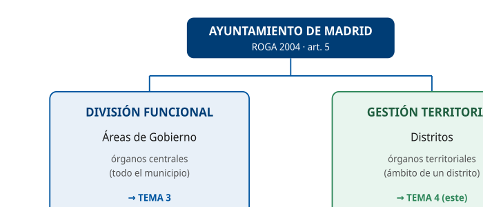

Situar el distrito como la vertiente territorial de la organización.

D2 · El distrito: concepto y naturaleza (art. 61)

§ 2 — Concepto

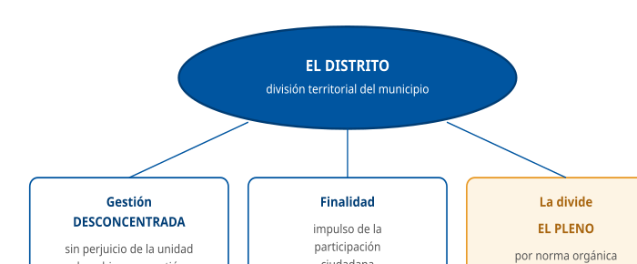

Fijar los rasgos del distrito y quién lo divide.

D3 · Órganos de gobierno del distrito (art. 62)

§ 3 — Órganos de gobierno

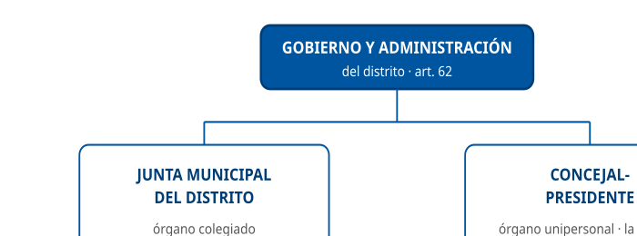

Los dos órganos de gobierno del distrito.

D4 · La Junta Municipal del Distrito (art. 63)

§ 4 — La Junta Municipal

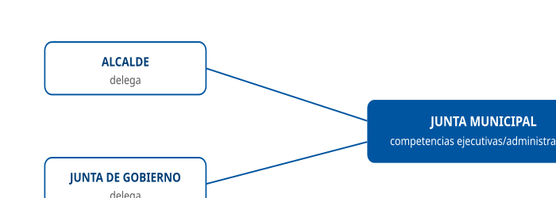

De dónde provienen sus competencias.

D5 · El concejal-presidente (art. 64)

§ 5 — El concejal-presidente

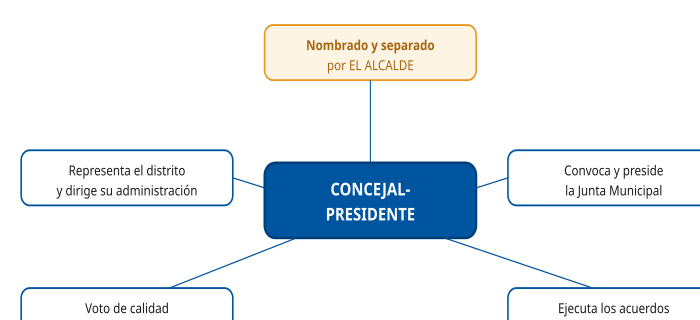

Funciones nucleares de la figura.

D6 · Competencias del concejal-presidente (art. 65)

§ 6 — Competencias

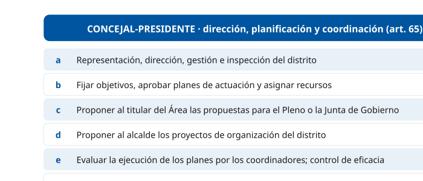

Lista de competencias del art. 65.

D7 · Forma de los actos: Decreto vs Resolución

§ 7 — Forma de los actos

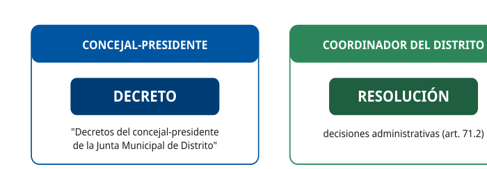

No confundir decreto (concejal-presidente) y resolución (coordinador).

D8 · Estructura administrativa del distrito (art. 69)

§ 9 — Estructura administrativa

Jerarquía de la organización administrativa del distrito.

D9 · El coordinador del distrito (arts. 70-71)

§ 10 — El coordinador del distrito

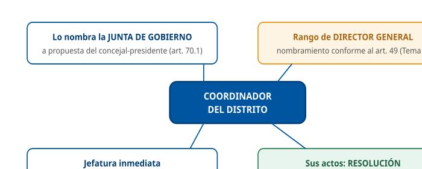

Nombramiento, rango y forma de los actos.

D10 · Concejal-presidente vs coordinador del distrito

§ 10 — Comparativa

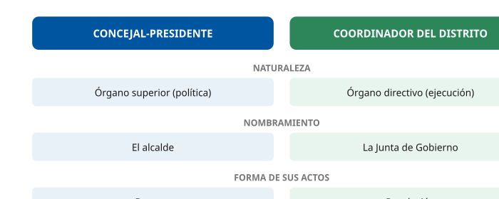

Diferenciar las dos figuras clave del distrito.

D11 · Los 21 distritos de Madrid

§ 13 — Los distritos

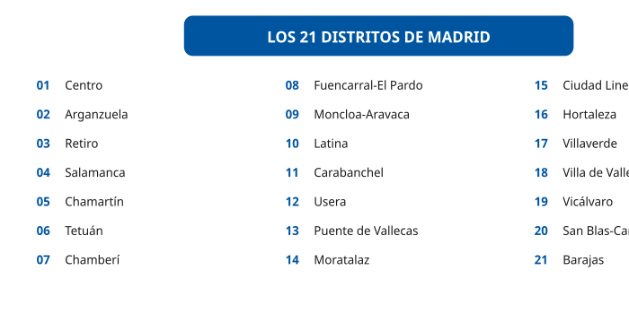

Listar los 21 distritos numerados.

D12 · Mapa-resumen del Tema 4

§ 14 — Resumen

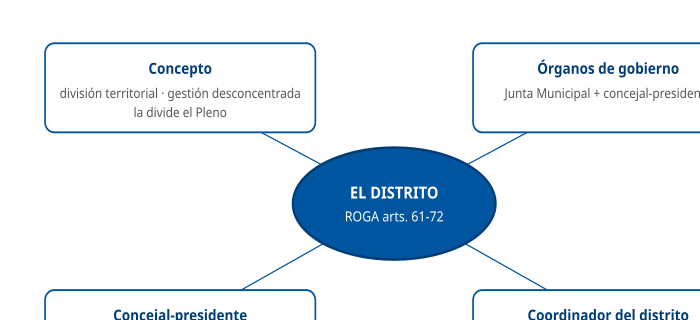

Mapa conceptual de cierre.

## Casos prácticos

#### CASO PRÁCTICO 1 — Naturaleza del distrito

**Escenario**: Un Técnico Auxiliar TIC se incorpora a la Junta Municipal del Distrito de Chamberí y necesita entender qué es un distrito y quién decide su existencia.

**Cuestiones**:

1.  **(2,5 pts)** ¿Qué son los distritos según el artículo 61 del ROGA y qué tipo de gestión tienen?
2.  **(2,5 pts)** ¿Qué establece el capítulo del ROGA dedicado a los distritos y con qué normas se complementa?
3.  **(2,5 pts)** ¿A quién corresponde establecer la división del municipio en distritos y mediante qué norma?
4.  **(2,5 pts)** ¿Cuál es la finalidad de la gestión desconcentrada de los distritos?

**Solución orientativa**:

1.  Son **divisiones territoriales** del municipio de Madrid dotadas de **órganos de gestión desconcentrada** (art. 61.1 ROGA).
2.  Establece las **normas esenciales de la organización administrativa** de los distritos, que se complementan con las normas orgánicas del Pleno sobre la división en distritos y sus órganos, sin perjuicio de las atribuciones del alcalde sobre su administración ejecutiva (art. 61.3 y 61.2 ROGA).
3.  Al **Pleno**, mediante **norma orgánica** (art. 128.2 LBRL), sin perjuicio de las atribuciones del alcalde sobre su administración ejecutiva (art. 61.2 ROGA).
4.  El **impulso y desarrollo de la participación ciudadana** en la gestión de los asuntos municipales y su mejora, sin perjuicio de la unidad de gobierno y gestión del municipio (art. 61.1 ROGA).

**Criterios de evaluación**: definir división territorial + gestión desconcentrada; normas esenciales del capítulo y su complemento (art. 61.3); identificar al Pleno y la norma orgánica; finalidad de participación ciudadana.

------------------------------------------------------------------------

#### Preguntas tipo test sobre este caso

##### 1. El técnico recién incorporado a la Junta Municipal del Distrito de Chamberí pregunta qué es un distrito. Conforme al artículo 61 del ROGA, los distritos son:

- a) Entidades locales con personalidad jurídica propia y gestión descentralizada.
- b) Organismos autónomos adscritos al Área competente en coordinación territorial.
- c) Divisiones territoriales del municipio dotadas de órganos de gestión desconcentrada.

**Respuesta correcta:** c) · **Referencia:** Caso 1, cuestión 1 · art. 61.1 ROGA

El artículo 61.1 ROGA define los distritos como divisiones territoriales del municipio de Madrid dotadas de órganos de gestión desconcentrada.

##### 2. Un compañero sostiene que el Distrito de Chamberí tiene personalidad jurídica propia. ¿Es correcto?

- a) No: su gestión es desconcentrada, por lo que no tiene personalidad jurídica propia.
- b) Sí: su gestión es descentralizada y por eso tiene personalidad jurídica propia.
- c) Sí, pero solo para ejercer las competencias que le atribuya el Pleno.

**Respuesta correcta:** a) · **Referencia:** Caso 1, cuestión 1 · art. 61 ROGA · §2

Los distritos tienen gestión desconcentrada, no descentralizada, y por eso carecen de personalidad jurídica propia (art. 61 ROGA).

##### 3. En la clasificación del artículo 6 del ROGA, los órganos del Distrito de Chamberí son:

- a) Órganos centrales, que actúan sobre todo el territorio del municipio.
- b) Órganos territoriales, que actúan exclusivamente en el ámbito de su distrito.
- c) Organismos públicos adscritos al Área competente por razón de la materia.

**Respuesta correcta:** b) · **Referencia:** Caso 1, cuestión 1 · art. 6.1 ROGA

Los órganos territoriales ejercen sus competencias exclusivamente en el ámbito de un distrito; los centrales, sobre todo el municipio (art. 6.1 ROGA).

##### 4. ¿A quién corresponde establecer la división del municipio de Madrid en distritos y mediante qué norma?

- a) Al Pleno, mediante norma orgánica.
- b) Al alcalde, mediante decreto.
- c) A la Junta de Gobierno, mediante acuerdo.

**Respuesta correcta:** a) · **Referencia:** Caso 1, cuestión 3 · art. 61.2 ROGA · art. 128.2 LBRL

Conforme al artículo 61.2 ROGA, corresponde al Pleno, mediante norma orgánica, establecer la división del municipio en distritos.

##### 5. Aprobada por el Pleno la división en distritos, ¿qué atribución conserva el alcalde respecto de ellos?

- a) La de alterar por decreto los límites territoriales de los distritos.
- b) La de aprobar definitivamente la norma orgánica de los distritos.
- c) La de determinar la organización y competencias de su administración ejecutiva.

**Respuesta correcta:** c) · **Referencia:** Caso 1, cuestiones 2 y 3 · art. 61.2 ROGA

La competencia del Pleno se entiende sin perjuicio de las atribuciones del alcalde para determinar la organización y competencias de su administración ejecutiva (art. 61.2 ROGA); alterar los límites corresponde al Pleno.

##### 6. El técnico consulta el capítulo del ROGA dedicado a los distritos. ¿Qué encontrará en él?

- a) La regulación completa de los distritos, sin necesidad de otras normas.
- b) Las normas esenciales de la organización administrativa de los distritos.
- c) La relación de puestos de trabajo de cada Junta Municipal de Distrito.

**Respuesta correcta:** b) · **Referencia:** Caso 1, cuestión 2 · art. 61.3 ROGA

El capítulo del ROGA solo fija las normas esenciales de la organización administrativa de los distritos, que se complementan con otras normas orgánicas (art. 61.3 ROGA).

##### 7. Esas normas esenciales del ROGA sobre los distritos se complementan con:

- a) Los decretos que dicte cada concejal-presidente para regular su propio distrito.
- b) Los acuerdos de organización administrativa de la Junta de Gobierno, de forma exclusiva.
- c) Las normas orgánicas del Pleno sobre la división en distritos y sus órganos, como el Reglamento Orgánico 6/2021.

**Respuesta correcta:** c) · **Referencia:** Caso 1, cuestión 2 · art. 61.2 y 61.3 ROGA

El capítulo del ROGA se complementa con las normas orgánicas del Pleno sobre la división en distritos y sus órganos, hoy el Reglamento Orgánico 6/2021 de los Distritos.

##### 8. ¿Cuál es la finalidad de la gestión desconcentrada que tiene el Distrito de Chamberí?

- a) Garantizar la autonomía política de cada distrito frente al Ayuntamiento de Madrid.
- b) El impulso y desarrollo de la participación ciudadana en la gestión de los asuntos municipales y su mejora.
- c) Sustituir a las Áreas de Gobierno en la prestación de todos los servicios municipales.

**Respuesta correcta:** b) · **Referencia:** Caso 1, cuestión 4 · art. 61.1 ROGA

Los distritos están dotados de órganos de gestión desconcentrada para el impulso y desarrollo de la participación ciudadana en la gestión de los asuntos municipales y su mejora (art. 61.1 ROGA).

##### 9. La desconcentración en el distrito tiene un límite expreso en el artículo 61.1 del ROGA. ¿Cuál?

- a) La unidad de gobierno y gestión del municipio.
- b) La autorización previa de la Comunidad de Madrid.
- c) El acuerdo unánime de la Junta Municipal del Distrito.

**Respuesta correcta:** a) · **Referencia:** Caso 1, cuestión 4 · art. 61.1 ROGA

La gestión desconcentrada de los distritos opera sin perjuicio de la unidad de gobierno y gestión del municipio (art. 61.1 ROGA).

##### 10. Según la Ley 22/2006 y el artículo 128.1 LBRL, la existencia de distritos en Madrid es:

- a) Potestativa: el Pleno podrá crearlos si lo considera oportuno.
- b) Obligatoria, pero los crea el alcalde por decreto.
- c) Obligatoria: el Pleno deberá crear distritos.

**Respuesta correcta:** c) · **Referencia:** Caso 1, cuestión 3 · art. 22.1 Ley 22/2006 · art. 128.1 LBRL

El artículo 22.1 de la Ley 22/2006 dispone que «el Pleno deberá crear Distritos», y el artículo 128.1 LBRL, que los ayuntamientos de gran población «deberán crear distritos».

#### CASO PRÁCTICO 2 — Órganos de gobierno del distrito

**Escenario**: En el Distrito de Carabanchel se debate quién adopta las decisiones y de dónde provienen sus competencias.

**Cuestiones**:

1.  **(2,5 pts)** ¿Qué órganos ejercen el gobierno y la administración del distrito?
2.  **(2,5 pts)** ¿Qué naturaleza tiene cada uno (colegiado/unipersonal)?
3.  **(2,5 pts)** ¿De dónde provienen las competencias ejecutivas o administrativas de la Junta Municipal del Distrito?
4.  **(2,5 pts)** ¿Quién preside la Junta Municipal y qué ocurre en caso de empate?

**Solución orientativa**:

1.  La **Junta Municipal del Distrito** y el **concejal-presidente** (art. 62 ROGA).
2.  La Junta Municipal es el «órgano **colegiado** de representación político-vecinal» (art. 5.a) RO 6/2021); el concejal-presidente es un órgano **unipersonal**, que convoca y preside sus sesiones (art. 64 ROGA).
3.  De la **delegación del alcalde o de la Junta de Gobierno**, además de las que le atribuya el Pleno conforme al artículo 123.1.c) LBRL (art. 63 ROGA).
4.  La preside el **concejal-presidente**, que **dirime los empates con su voto de calidad** (art. 64 ROGA).

**Criterios de evaluación**: identificar los dos órganos; naturaleza colegiada/unipersonal; competencias por delegación; presidencia y voto de calidad del concejal-presidente.

------------------------------------------------------------------------

#### Preguntas tipo test sobre este caso

##### 1. En el Distrito de Carabanchel se debate quién adopta las decisiones. Conforme al artículo 62 del ROGA, el gobierno y la administración del distrito corresponden a:

- a) La Junta Municipal del Distrito y el concejal-presidente.
- b) La Junta Municipal del Distrito y el coordinador del distrito.
- c) El concejal-presidente y el Consejo de Proximidad del distrito.

**Respuesta correcta:** a) · **Referencia:** Caso 2, cuestión 1 · art. 62 ROGA

El artículo 62 ROGA atribuye el gobierno y la administración del distrito a la Junta Municipal y a su concejal-presidente; el coordinador es un órgano directivo.

##### 2. ¿Qué naturaleza tiene la Junta Municipal del Distrito de Carabanchel?

- a) Órgano unipersonal de dirección de la administración del distrito.
- b) Órgano colegiado de representación político-vecinal.
- c) Órgano directivo con rango de director general.

**Respuesta correcta:** b) · **Referencia:** Caso 2, cuestión 2 · art. 5.a) RO 6/2021

El Reglamento Orgánico 6/2021 de los Distritos define la Junta Municipal como «órgano colegiado de representación político-vecinal» (art. 5.a).

##### 3. Y el concejal-presidente del Distrito de Carabanchel es:

- a) Un órgano colegiado, integrado por los concejales-vocales de la Junta.
- b) Un órgano directivo, que ejecuta las decisiones de la Junta de Gobierno.
- c) Un órgano unipersonal, que convoca y preside las sesiones de la Junta Municipal.

**Respuesta correcta:** c) · **Referencia:** Caso 2, cuestión 2 · art. 64 ROGA

El concejal-presidente es un órgano unipersonal que convoca y preside las sesiones de la Junta Municipal (art. 64 ROGA); en la clasificación del ROGA es órgano superior, no directivo.

##### 4. ¿De dónde provienen las competencias ejecutivas o administrativas de la Junta Municipal del Distrito?

- a) De la atribución directa que le hace la Ley 7/1985.
- b) De la delegación del alcalde o de la Junta de Gobierno.
- c) De la delegación del coordinador del distrito.

**Respuesta correcta:** b) · **Referencia:** Caso 2, cuestión 3 · art. 63 ROGA

La Junta Municipal ejerce las competencias ejecutivas o administrativas que le correspondan por delegación del alcalde o de la Junta de Gobierno (art. 63 ROGA).

##### 5. Además de las competencias delegadas, la Junta Municipal de Carabanchel puede ejercer:

- a) Las que le atribuya el Pleno conforme al artículo 123.1.c) LBRL.
- b) Las que le atribuya el coordinador del distrito mediante resolución.
- c) Las que le reconozca el Consejo de Proximidad del distrito.

**Respuesta correcta:** a) · **Referencia:** Caso 2, cuestión 3 · art. 63 ROGA

El artículo 63 ROGA añade a las competencias delegadas las demás que atribuya el Pleno a la Junta Municipal, conforme al artículo 123.1.c) LBRL.

##### 6. La presidencia del Distrito de Carabanchel corresponde, en todo caso, a:

- a) Un funcionario con rango de director general.
- b) Un vecino elegido por el Consejo de Proximidad.
- c) Un concejal.

**Respuesta correcta:** c) · **Referencia:** Caso 2, cuestión 4 · art. 128.3 LBRL · art. 22.2 Ley 22/2006

La presidencia del distrito corresponde en todo caso a un concejal (art. 22.2 de la Ley 22/2006 y art. 128.3 LBRL), que es el concejal-presidente.

##### 7. En una sesión de la Junta Municipal de Carabanchel se produce un empate en la votación. ¿Cómo se resuelve?

- a) Lo dirime el concejal-presidente con su voto de calidad.
- b) Se eleva la cuestión al Pleno del Ayuntamiento.
- c) Decide el coordinador del distrito mediante resolución.

**Respuesta correcta:** a) · **Referencia:** Caso 2, cuestión 4 · art. 64 ROGA

El concejal-presidente preside la Junta Municipal y dirime los empates con su voto de calidad (art. 64 ROGA).

##### 8. Adoptado un acuerdo por la Junta Municipal del Distrito, ¿quién lo ejecuta?

- a) El Área de Gobierno competente por razón de la materia.
- b) El vicepresidente de la Junta Municipal.
- c) El concejal-presidente.

**Respuesta correcta:** c) · **Referencia:** Caso 2, cuestión 4 · art. 64 ROGA

El artículo 64 ROGA atribuye al concejal-presidente la ejecución de los acuerdos de la Junta Municipal.

##### 9. El gobierno y la administración del distrito por la Junta Municipal y el concejal-presidente se entienden:

- a) Con exclusión de cualquier otro órgano municipal en el ámbito del distrito.
- b) Sin perjuicio de las competencias que correspondan a los demás órganos municipales.
- c) Sujetos a la aprobación previa de cada acto por el Pleno del Ayuntamiento.

**Respuesta correcta:** b) · **Referencia:** Caso 2, cuestión 1 · art. 62 ROGA

El artículo 62 ROGA atribuye el gobierno y la administración del distrito a sus dos órganos sin perjuicio de las competencias que correspondan a los demás órganos municipales.

##### 10. En la clasificación del artículo 7 del ROGA, el concejal-presidente de Carabanchel tiene la consideración de:

- a) Órgano superior.
- b) Órgano directivo.
- c) Órgano de participación.

**Respuesta correcta:** a) · **Referencia:** Caso 2, cuestión 2 · art. 7.2 ROGA

En el ámbito de los distritos, los concejales-presidentes tienen la consideración de órganos superiores (art. 7.2 ROGA); el coordinador del distrito es el órgano directivo.

#### CASO PRÁCTICO 3 — El concejal-presidente

**Escenario**: Tras la constitución de la corporación, el alcalde designa a los concejales-presidentes de los distritos. En el Distrito de Retiro surgen dudas sobre sus funciones.

**Cuestiones**:

1.  **(2 pts)** ¿Quién nombra y separa al concejal-presidente?
2.  **(3 pts)** Enumere tres funciones del concejal-presidente conforme al artículo 65.
3.  **(2 pts)** ¿Ante quién responde políticamente?
4.  **(3 pts)** ¿Qué forma adoptan sus actos y cómo se denominan?

**Solución orientativa**:

1.  El **alcalde** (art. 64 ROGA).
2.  Por ejemplo: representación, dirección, gestión e inspección del distrito (a); fijar objetivos, aprobar planes y asignar recursos (b); proponer al alcalde la organización del distrito (d); evaluar la ejecución de los planes por los coordinadores y ejercer el control de eficacia (e); superior autoridad sobre el personal (f) — bastan tres (art. 65 ROGA).
3.  Ante los miembros de la **Junta de Gobierno** y, en todo caso, ante la propia **Junta Municipal del Distrito** (art. 66 ROGA).
4.  La forma de **decreto**; se denominan **"Decretos del concejal-presidente de la Junta Municipal de Distrito"** (art. 67 ROGA).

**Criterios de evaluación**: nombramiento por el alcalde; tres funciones correctas del art. 65; doble responsabilidad política; forma de decreto y denominación.

------------------------------------------------------------------------

#### Preguntas tipo test sobre este caso

##### 1. Constituida la corporación, ¿quién nombra y, en su caso, separa al concejal-presidente del Distrito de Retiro?

- a) El Pleno.
- b) El alcalde.
- c) La Junta de Gobierno.

**Respuesta correcta:** b) · **Referencia:** Caso 3, cuestión 1 · art. 64 ROGA

El concejal-presidente es nombrado y separado por el alcalde (art. 64 ROGA; también art. 14.3.d de la Ley 22/2006).

##### 2. ¿Cuál de las siguientes es una función del concejal-presidente de Retiro conforme al artículo 65 del ROGA?

- a) Fijar los objetivos del distrito, aprobar sus planes de actuación y asignar los recursos necesarios.
- b) Nombrar y cesar al coordinador del distrito mediante decreto de la Presidencia.
- c) Establecer la división del municipio en distritos y fijar sus límites territoriales.

**Respuesta correcta:** a) · **Referencia:** Caso 3, cuestión 2 · art. 65.1.b) ROGA

Fijar objetivos, aprobar planes y asignar recursos es la letra b) del artículo 65.1 ROGA; el coordinador lo nombra la Junta de Gobierno y la división en distritos es del Pleno.

##### 3. El concejal-presidente de Retiro quiere reorganizar la estructura del distrito. Según el artículo 65 del ROGA, debe:

- a) Aprobar la nueva organización por sí mismo mediante decreto, sin intervención del alcalde.
- b) Someter la nueva organización a la aprobación del Consejo de Proximidad del distrito.
- c) Proponer al alcalde, a través del Área correspondiente, la aprobación del proyecto de organización.

**Respuesta correcta:** c) · **Referencia:** Caso 3, cuestión 2 · art. 65.1.d) ROGA

La letra d) del artículo 65.1 ROGA atribuye al concejal-presidente la función de proponer al alcalde, a través del Área correspondiente, la aprobación de los proyectos de organización de su distrito.

##### 4. Respecto del coordinador del Distrito de Retiro, el concejal-presidente:

- a) Evalúa la ejecución de los planes de actuación y ejerce el control de eficacia sobre su actuación.
- b) Lo nombra y lo cesa libremente mediante decreto, sin intervención de otros órganos.
- c) Depende jerárquicamente de él en la dirección y gestión de los servicios del distrito.

**Respuesta correcta:** a) · **Referencia:** Caso 3, cuestión 2 · art. 65.1.e) ROGA

La letra e) del artículo 65.1 ROGA atribuye al concejal-presidente la evaluación de la ejecución de los planes por los coordinadores y el control de eficacia; el nombramiento corresponde a la Junta de Gobierno (art. 70.1 ROGA).

##### 5. Sobre el personal del distrito, incluido el técnico TIC, el concejal-presidente:

- a) No tiene competencia alguna, que corresponde en exclusiva al coordinador.
- b) Ejerce la superior autoridad, sin perjuicio de las competencias del alcalde.
- c) Ejerce una autoridad exclusiva que desplaza las competencias del alcalde.

**Respuesta correcta:** b) · **Referencia:** Caso 3, cuestión 2 · art. 65.1.f) ROGA

La letra f) del artículo 65.1 ROGA atribuye al concejal-presidente la superior autoridad sobre el personal del distrito, sin perjuicio de las competencias del alcalde.

##### 6. El concejal-presidente quiere que la Junta de Gobierno apruebe una medida que afecta a Retiro. ¿Cómo la canaliza?

- a) Elevándola él mismo directamente al Pleno del Ayuntamiento.
- b) Remitiéndola al coordinador del distrito para que la resuelva.
- c) Formulando la propuesta al titular del Área competente.

**Respuesta correcta:** c) · **Referencia:** Caso 3, cuestión 2 · art. 65.1.c) ROGA

La letra c) del artículo 65.1 ROGA prevé que el concejal-presidente proponga al titular del Área competente las propuestas que correspondan al Pleno o a la Junta de Gobierno en el ámbito de su distrito.

##### 7. ¿Ante quién responde políticamente de su gestión el concejal-presidente de Retiro?

- a) Solo ante el Pleno del Ayuntamiento, como cualquier otro concejal de la corporación.
- b) Ante los miembros de la Junta de Gobierno y, en todo caso, ante la propia Junta Municipal del Distrito.
- c) Ante el coordinador del distrito y el Consejo de Proximidad, que controlan su gestión.

**Respuesta correcta:** b) · **Referencia:** Caso 3, cuestión 3 · art. 66 ROGA

El artículo 66 ROGA establece una doble responsabilidad política: ante los miembros de la Junta de Gobierno y, en todo caso, ante la Junta Municipal del Distrito.

##### 8. ¿Qué forma adoptan las resoluciones administrativas del concejal-presidente?

- a) Resolución.
- b) Acuerdo.
- c) Decreto.

**Respuesta correcta:** c) · **Referencia:** Caso 3, cuestión 4 · art. 67 ROGA

Las resoluciones administrativas de los concejales-presidentes revisten la forma de decreto (art. 67 ROGA); la forma de resolución es la del coordinador del distrito.

##### 9. ¿Cómo se denominan esos actos del concejal-presidente?

- a) «Decretos del concejal-presidente de la Junta Municipal de Distrito».
- b) «Resoluciones del Distrito de Retiro».
- c) «Acuerdos de la Junta Municipal del Distrito».

**Respuesta correcta:** a) · **Referencia:** Caso 3, cuestión 4 · art. 67 ROGA

El artículo 67 ROGA dispone que se denominarán «Decretos del concejal-presidente de la Junta Municipal de Distrito».

##### 10. Además de las competencias propias del artículo 65.1, el concejal-presidente de Retiro puede ejercer:

- a) Las funciones de jefatura inmediata que corresponden al coordinador.
- b) Las atribuciones que le deleguen el alcalde o la Junta de Gobierno.
- c) La potestad de fijar el número y los límites de los distritos.

**Respuesta correcta:** b) · **Referencia:** Caso 3, cuestión 2 · art. 65.2 ROGA

El artículo 65.2 ROGA prevé que el concejal-presidente ejerza también las atribuciones delegadas por el alcalde o la Junta de Gobierno.

#### CASO PRÁCTICO 4 — Suplencia y estructura administrativa

**Escenario**: El concejal-presidente del Distrito de Latina causa baja por enfermedad y el coordinador del distrito plantea una reorganización de unidades.

**Cuestiones**:

1.  **(2,5 pts)** ¿Quién sustituye al concejal-presidente y cómo se nombra a esa figura?
2.  **(2,5 pts)** ¿Es necesario un acto expreso para que opere la suplencia?
3.  **(2,5 pts)** ¿Quién es el jefe superior de la organización administrativa del distrito y quién dirige y coordina los servicios?
4.  **(2,5 pts)** ¿Cómo se crean, modifican o suprimen las unidades administrativas del distrito?

**Solución orientativa**:

1.  El **vicepresidente**, que es un **concejal-vocal** de la Junta nombrado por el **alcalde** (art. 68.1 ROGA).
2.  **No**: la suplencia opera **sin necesidad de acto expreso declarativo**, debiendo darse cuenta a la Junta Municipal (art. 68.2 ROGA).
3.  El **jefe superior** es el **concejal-presidente**; la dirección y coordinación de los servicios corresponde al **coordinador del distrito**, bajo su superior dirección (art. 69.1 y 69.2 ROGA).
4.  En **unidades administrativas funcionalmente homogéneas**, que se crean, modifican y suprimen a **propuesta del concejal-presidente**, previo informe de las Áreas competentes en materia de organización y de coordinación territorial, a través de la **RPT** (art. 69.3 ROGA).

**Criterios de evaluación**: vicepresidente (concejal-vocal, nombrado por el alcalde); suplencia sin acto expreso; jefe superior = concejal-presidente, coordinador dirige servicios; creación de unidades vía RPT.

------------------------------------------------------------------------

#### Preguntas tipo test sobre este caso

##### 1. El concejal-presidente del Distrito de Latina causa baja por enfermedad. ¿Quién lo sustituye?

- a) El coordinador del distrito.
- b) El concejal-presidente de otro distrito que designe el Pleno.
- c) El vicepresidente de la Junta Municipal.

**Respuesta correcta:** c) · **Referencia:** Caso 4, cuestión 1 · art. 68.1 ROGA

El vicepresidente sustituye al concejal-presidente en caso de vacante, ausencia o enfermedad (art. 68.1 ROGA).

##### 2. ¿Quién es el vicepresidente y quién lo nombra?

- a) Un funcionario del distrito, nombrado por la Junta de Gobierno.
- b) Un concejal-vocal de la Junta, nombrado por el alcalde.
- c) Un vocal vecino, elegido por la propia Junta Municipal.

**Respuesta correcta:** b) · **Referencia:** Caso 4, cuestión 1 · art. 68.1 ROGA

El alcalde puede nombrar vicepresidente a uno de los concejales-vocales de la Junta (art. 68.1 ROGA).

##### 3. ¿Activa la baja por enfermedad del concejal-presidente la suplencia del vicepresidente?

- a) Sí, porque la suplencia procede en caso de vacante, ausencia o enfermedad.
- b) No, porque la suplencia solo procede en caso de vacante definitiva.
- c) Solo si la baja se prolonga y lo acuerda expresamente el Pleno.

**Respuesta correcta:** a) · **Referencia:** Caso 4, cuestión 1 · art. 68.1 ROGA

El artículo 68.1 ROGA prevé la sustitución del concejal-presidente por el vicepresidente en caso de vacante, ausencia o enfermedad.

##### 4. ¿Es necesario un acto expreso para que el vicepresidente asuma la suplencia?

- a) Sí: se requiere un decreto del alcalde que declare la suplencia.
- b) No: la suplencia opera sin necesidad de acto expreso declarativo.
- c) Sí: se requiere un acuerdo de la Junta Municipal adoptado por mayoría.

**Respuesta correcta:** b) · **Referencia:** Caso 4, cuestión 2 · art. 68.2 ROGA

La suplencia se produce sin necesidad de acto expreso declarativo (art. 68.2 ROGA).

##### 5. Producida la suplencia, ¿a qué órgano debe darse cuenta?

- a) Al Pleno del Ayuntamiento.
- b) A la Junta de Gobierno.
- c) A la Junta Municipal del Distrito.

**Respuesta correcta:** c) · **Referencia:** Caso 4, cuestión 2 · art. 68.2 ROGA

El artículo 68.2 ROGA exige dar cuenta de la suplencia a la Junta Municipal.

##### 6. ¿Quién es el jefe superior de la organización administrativa del Distrito de Latina?

- a) El concejal-presidente.
- b) El coordinador del distrito.
- c) El alcalde.

**Respuesta correcta:** a) · **Referencia:** Caso 4, cuestión 3 · art. 69.1 ROGA

Los concejales-presidentes son los jefes superiores de la organización administrativa del distrito (art. 69.1 ROGA).

##### 7. ¿A quién corresponde la dirección y coordinación de los servicios de la competencia del distrito?

- a) Al vicepresidente, como sustituto permanente del concejal-presidente.
- b) Al Área de Gobierno competente en coordinación territorial.
- c) Al coordinador del distrito, bajo la superior dirección del concejal-presidente.

**Respuesta correcta:** c) · **Referencia:** Caso 4, cuestión 3 · art. 69.2 ROGA

El artículo 69.2 ROGA atribuye al coordinador del distrito la dirección y coordinación de los servicios, bajo la superior dirección del concejal-presidente.

##### 8. El coordinador plantea reorganizar las unidades. ¿En qué se estructura la organización administrativa del distrito?

- a) En unidades administrativas funcionalmente homogéneas.
- b) En Direcciones Generales y Secretarías Generales Técnicas.
- c) En barrios dotados de órganos de gestión propios.

**Respuesta correcta:** a) · **Referencia:** Caso 4, cuestión 4 · art. 69.3 ROGA

La organización administrativa del distrito se estructura en unidades administrativas funcionalmente homogéneas (art. 69.3 ROGA).

##### 9. Aunque la idea parta del coordinador, ¿a propuesta de quién se crean, modifican o suprimen esas unidades?

- a) Del coordinador del distrito.
- b) Del concejal-presidente.
- c) De la Junta Municipal del Distrito.

**Respuesta correcta:** b) · **Referencia:** Caso 4, cuestión 4 · art. 69.3 ROGA

Las unidades administrativas del distrito se crean, modifican y suprimen a propuesta del concejal-presidente (art. 69.3 ROGA).

##### 10. ¿Mediante qué instrumento se crean, modifican o suprimen las unidades administrativas del distrito?

- a) Mediante decreto del concejal-presidente.
- b) Mediante norma orgánica aprobada por el Pleno.
- c) A través de la relación de puestos de trabajo (RPT).

**Respuesta correcta:** c) · **Referencia:** Caso 4, cuestión 4 · art. 69.3 ROGA

El artículo 69.3 ROGA establece que las unidades del distrito se crean, modifican y suprimen a través de la relación de puestos de trabajo.

#### CASO PRÁCTICO 5 — El coordinador del distrito

**Escenario**: El Distrito de Hortaleza debe cubrir el puesto de coordinador del distrito. Recursos Humanos consulta el régimen aplicable.

**Cuestiones**:

1.  **(3 pts)** ¿Quién nombra y cesa al coordinador del distrito y a propuesta de quién?
2.  **(2 pts)** ¿Qué rango ostenta y conforme a qué artículo se efectúa su nombramiento?
3.  **(3 pts)** Cite tres funciones del coordinador del distrito (art. 71).
4.  **(2 pts)** ¿Qué forma adoptan sus decisiones administrativas?

**Solución orientativa**:

1.  La **Junta de Gobierno**, a **propuesta del concejal-presidente** de cada Junta (art. 70.1 ROGA).
2.  Tiene **rango de director general** y su nombramiento se efectúa conforme al **artículo 49** del ROGA (art. 70.2 ROGA).
3.  Por ejemplo: dirección, planificación y gestión de los servicios de su competencia; jefatura inmediata de las unidades adscritas; elaboración, seguimiento y control del presupuesto; evaluación de los servicios; coordinación de las relaciones con las Áreas de Gobierno — bastan tres (art. 71.1 ROGA).
4.  La forma de **resolución** (art. 71.2 ROGA).

**Criterios de evaluación**: nombramiento por la Junta de Gobierno a propuesta del concejal-presidente; rango de director general y art. 49; tres funciones del art. 71; forma de resolución.

------------------------------------------------------------------------

#### Preguntas tipo test sobre este caso

##### 1. Recursos Humanos consulta el régimen del coordinador del Distrito de Hortaleza. ¿Quién lo nombra y lo cesa?

- a) La Junta de Gobierno, a propuesta del concejal-presidente.
- b) El alcalde, a propuesta del Pleno.
- c) El concejal-presidente, previo informe de la Junta de Gobierno.

**Respuesta correcta:** a) · **Referencia:** Caso 5, cuestión 1 · art. 70.1 ROGA

El coordinador del distrito es nombrado y, en su caso, cesado por la Junta de Gobierno a propuesta del concejal-presidente de cada Junta (art. 70.1 ROGA).

##### 2. ¿Qué rango ostenta el coordinador del distrito?

- a) Rango de subdirector general.
- b) Rango de coordinador general.
- c) Rango de director general, a todos los efectos.

**Respuesta correcta:** c) · **Referencia:** Caso 5, cuestión 2 · art. 70.2 ROGA

El coordinador del distrito ostenta a todos los efectos el rango de director general (art. 70.2 ROGA).

##### 3. Como su nombramiento se efectúa conforme al artículo 49 del ROGA, el coordinador deberá nombrarse, con carácter general:

- a) Entre los concejales-vocales de la Junta Municipal.
- b) Entre funcionarios de carrera, conforme al artículo 130.3 LBRL.
- c) Entre los vecinos del distrito que propongan sus asociaciones.

**Respuesta correcta:** b) · **Referencia:** Caso 5, cuestión 2 · arts. 49 y 70.2 ROGA · art. 130.3 LBRL

El artículo 70.2 ROGA remite al artículo 49, que exige con carácter general el nombramiento de los órganos directivos entre funcionarios de carrera (art. 130.3 LBRL).

##### 4. En la clasificación del artículo 7 del ROGA, el coordinador del Distrito de Hortaleza es:

- a) Un órgano superior, al que corresponde la dirección política del distrito.
- b) Un órgano colegiado de representación político-vecinal.
- c) Un órgano directivo, al que corresponde ejecutar las decisiones de los órganos superiores.

**Respuesta correcta:** c) · **Referencia:** Caso 5 · art. 7.3 y 7.4 ROGA

En el ámbito de los distritos, los coordinadores son órganos directivos (art. 7.3 ROGA), a los que corresponde la ejecución de las decisiones de los órganos superiores (art. 7.4 ROGA).

##### 5. ¿Cuál de las siguientes es una función del coordinador del distrito según el artículo 71 del ROGA?

- a) La elaboración, seguimiento y control del presupuesto anual asignado.
- b) Fijar los objetivos del distrito y aprobar sus planes de actuación.
- c) Dirimir con su voto de calidad los empates de la Junta Municipal.

**Respuesta correcta:** a) · **Referencia:** Caso 5, cuestión 3 · art. 71.1 ROGA

El artículo 71.1 ROGA atribuye al coordinador la elaboración, seguimiento y control del presupuesto anual asignado; fijar objetivos y dirimir empates corresponden al concejal-presidente.

##### 6. El técnico TIC trabaja en una unidad orgánica adscrita a la coordinación del distrito. ¿Quién ostenta la jefatura inmediata de esa unidad?

- a) El concejal-presidente.
- b) El coordinador del distrito.
- c) El Área de Gobierno competente en coordinación territorial.

**Respuesta correcta:** b) · **Referencia:** Caso 5, cuestión 3 · art. 71.1 ROGA

Al coordinador del distrito le corresponde la dirección y coordinación de las unidades orgánicas adscritas, cuya jefatura inmediata ostenta (art. 71.1 ROGA); el concejal-presidente es el jefe superior, no el inmediato.

##### 7. El distrito necesita coordinar sus actuaciones con el Área de Gobierno competente en coordinación territorial. ¿A quién corresponde coordinar esas relaciones?

- a) Al coordinador del distrito.
- b) Al vicepresidente de la Junta Municipal.
- c) Al Consejo de Proximidad del distrito.

**Respuesta correcta:** a) · **Referencia:** Caso 5, cuestión 3 · art. 71.1 ROGA

El artículo 71.1 ROGA atribuye al coordinador la coordinación de las relaciones de la Junta Municipal con el Área competente en coordinación territorial y con las demás Áreas, organismos y empresas municipales.

##### 8. ¿Qué forma adoptan las decisiones administrativas del coordinador del distrito?

- a) Decreto.
- b) Resolución.
- c) Acuerdo.

**Respuesta correcta:** b) · **Referencia:** Caso 5, cuestión 4 · art. 71.2 ROGA

Las decisiones administrativas de los coordinadores de distrito revisten la forma de «Resolución» (art. 71.2 ROGA); el decreto es la forma de los actos del concejal-presidente.

##### 9. Además de las funciones del artículo 71.1, el coordinador del distrito puede ejercer:

- a) Las competencias normativas del Pleno sobre la división en distritos.
- b) La presidencia de la Junta Municipal en ausencia del concejal-presidente.
- c) Las competencias que le deleguen el alcalde, la Junta de Gobierno u otros órganos.

**Respuesta correcta:** c) · **Referencia:** Caso 5, cuestión 3 · art. 71.1 ROGA

Las funciones del coordinador se entienden sin perjuicio de las competencias que puedan delegarle el alcalde, la Junta de Gobierno u otros órganos (art. 71.1 ROGA); la suplencia del concejal-presidente corresponde al vicepresidente.

##### 10. En un expediente antiguo del distrito aparece la figura del «gerente del distrito». ¿Qué figura le corresponde hoy?

- a) El coordinador del distrito.
- b) El vicepresidente de la Junta Municipal.
- c) El concejal-presidente.

**Respuesta correcta:** a) · **Referencia:** Caso 5 · art. 70 ROGA · §10

El ROGA de 2004 denominaba «gerente del distrito» a la figura que hoy se llama coordinador del distrito (Reglamento Orgánico 6/2021).

#### CASO PRÁCTICO 6 — Los distritos de Madrid y la participación

**Escenario**: En una jornada de acogida se explica el mapa de distritos de Madrid y los cauces de participación vecinal.

**Cuestiones**:

1.  **(2,5 pts)** ¿En cuántos distritos se organiza Madrid y quién establece esa división? Cite tres distritos.
2.  **(2,5 pts)** ¿Tienen todos los distritos la misma estructura de gobierno?
3.  **(2,5 pts)** ¿Qué órganos pueden crearse en los distritos para la participación de los vecinos?
4.  **(2,5 pts)** Diferencie la forma de los actos del concejal-presidente y del coordinador del distrito.

**Solución orientativa**:

1.  En **21 distritos**, establecidos por el **Pleno** mediante norma orgánica (art. 61.2 ROGA). Por ejemplo: Centro (1), Salamanca (4), Barajas (21).
2.  **Sí**: la estructura de gobierno (Junta Municipal + concejal-presidente) y administrativa (coordinador del distrito) regulada en los artículos 62 a 71 del ROGA se aplica a los 21 distritos (arts. 62-71 ROGA).
3.  **Órganos de participación** de los vecinos y de las asociaciones que los representen, conforme a las normas orgánicas de participación ciudadana (art. 72 ROGA); hoy, los **Consejos de Proximidad** (Reglamento Orgánico 7/2021).
4.  Los actos del **concejal-presidente** son **decretos**; los del **coordinador del distrito**, **resoluciones** (arts. 67 y 71.2 ROGA).

**Criterios de evaluación**: 21 distritos fijados por el Pleno + ejemplos; estructura común; órganos de participación; distinción decreto/resolución.

------------------------------------------------------------------------

#### Preguntas tipo test sobre este caso

##### 1. En la jornada de acogida se presenta el mapa de distritos. ¿En cuántos distritos se divide el término municipal de Madrid?

- a) En 19.
- b) En 21.
- c) En 23.

**Respuesta correcta:** b) · **Referencia:** Caso 6, cuestión 1 · art. 3.1 RO 6/2021

El Reglamento Orgánico 6/2021 de los Distritos divide el término municipal de Madrid en 21 distritos.

##### 2. Si en el futuro se quisiera alterar el número o los límites de los distritos, ¿quién podría hacerlo?

- a) El alcalde, mediante decreto de organización.
- b) La Junta de Gobierno, mediante acuerdo.
- c) El Pleno, modificando el reglamento orgánico de los distritos.

**Respuesta correcta:** c) · **Referencia:** Caso 6, cuestión 1 · art. 61.2 ROGA · art. 3.2 RO 6/2021

Corresponde al Pleno, mediante la modificación del reglamento orgánico, alterar el número, denominación y límites territoriales de los distritos (art. 3.2 RO 6/2021).

##### 3. ¿Cuál de las siguientes relaciones contiene solo distritos de Madrid?

- a) Centro, Salamanca y Barajas.
- b) Retiro, Tetuán y Pozuelo.
- c) Centro, Usera y Alcorcón.

**Respuesta correcta:** a) · **Referencia:** Caso 6, cuestión 1 · §13

Centro, Salamanca y Barajas figuran entre los 21 distritos de Madrid; Pozuelo y Alcorcón no son distritos de la ciudad.

##### 4. En el mapa numerado, los distritos 1 y 21 son, respectivamente:

- a) Barajas y Centro.
- b) Centro y Vicálvaro.
- c) Centro y Barajas.

**Respuesta correcta:** c) · **Referencia:** Caso 6, cuestión 1 · §13

En la numeración de los distritos, el 1 es Centro y el 21 es Barajas; Vicálvaro es el 19.

##### 5. ¿Tienen todos los distritos la misma estructura de gobierno y administración?

- a) No: solo los distritos más poblados tienen Junta Municipal.
- b) Sí: Junta Municipal, concejal-presidente y coordinador se aplican a los 21 distritos.
- c) No: cada distrito fija su estructura por decreto de su concejal-presidente.

**Respuesta correcta:** b) · **Referencia:** Caso 6, cuestión 2 · arts. 62-71 ROGA

La estructura de gobierno (Junta Municipal y concejal-presidente) y administrativa (coordinador del distrito) de los artículos 62 a 71 del ROGA se aplica a los 21 distritos.

##### 6. ¿Qué órganos pueden crearse en los distritos para la participación vecinal, según el artículo 72 del ROGA?

- a) Órganos de participación de los vecinos y de las asociaciones que los representen.
- b) Áreas Delegadas de participación ciudadana en cada distrito.
- c) Juntas de Gobierno de distrito elegidas directamente por los vecinos.

**Respuesta correcta:** a) · **Referencia:** Caso 6, cuestión 3 · art. 72 ROGA

El artículo 72 ROGA permite crear en los distritos órganos de participación de los vecinos y de las asociaciones que los representen.

##### 7. ¿Por qué normas se rigen esos órganos de participación?

- a) Por los decretos del concejal-presidente de cada distrito.
- b) Por las normas orgánicas de participación ciudadana.
- c) Por la relación de puestos de trabajo del distrito.

**Respuesta correcta:** b) · **Referencia:** Caso 6, cuestión 3 · art. 72 ROGA

Los órganos de participación de los distritos se crean conforme a las normas orgánicas de participación ciudadana (art. 72 ROGA).

##### 8. ¿Cuál es hoy el órgano de participación vecinal de los distritos de Madrid?

- a) El Consejo de Proximidad, regulado por el Reglamento Orgánico 7/2021.
- b) El Foro Local, regulado por el reglamento orgánico de 2016.
- c) La Comisión Interadministrativa de Capitalidad.

**Respuesta correcta:** a) · **Referencia:** Caso 6, cuestión 3 · RO 7/2021

El Reglamento Orgánico 7/2021 creó los Consejos de Proximidad de los Distritos y derogó el reglamento de 2016 de los Foros Locales.

##### 9. En el registro del distrito hay dos documentos: uno del concejal-presidente y otro del coordinador del distrito. Revisten, respectivamente, la forma de:

- a) Resolución y decreto.
- b) Acuerdo y decreto.
- c) Decreto y resolución.

**Respuesta correcta:** c) · **Referencia:** Caso 6, cuestión 4 · arts. 67 y 71.2 ROGA

Los actos del concejal-presidente son decretos (art. 67 ROGA) y los del coordinador del distrito, resoluciones (art. 71.2 ROGA).

##### 10. Un nuevo empleado encuentra un documento del distrito titulado «Resolución». ¿Qué órgano lo ha adoptado?

- a) El concejal-presidente, cuando actúa por delegación del alcalde.
- b) El coordinador del distrito.
- c) La Junta Municipal del Distrito, en sesión plenaria.

**Respuesta correcta:** b) · **Referencia:** Caso 6, cuestión 4 · arts. 67 y 71.2 ROGA

La forma de «Resolución» es la de las decisiones administrativas del coordinador del distrito (art. 71.2 ROGA); las del concejal-presidente revisten siempre la forma de decreto (art. 67 ROGA).

## Fuentes

------------------------------------------------------------------------

### Naturaleza de las fuentes en este tema

El Tema 4 trabaja con **corpus normativo cerrado**: el articulado del Reglamento Orgánico del Gobierno y de la Administración del Ayuntamiento de Madrid (ROGA), de 31 de mayo de 2004, en su **Capítulo II del Título V (arts. 61-72)**, relativo a los distritos.

- **Nota de actualización terminológica**: el término **vigente** es "**coordinador del distrito**" (arts. 69-71 del ROGA en su redacción vigente). El antiguo ROGA de 2004 denominaba a esta figura "gerente del distrito"; la organización de los distritos se rige hoy por el **[Reglamento Orgánico 6/2021](https://www.bocm.es/boletin/CM_Orden_BOCM/2021/06/16/BOCM-20210616-62.PDF), de 1 de junio, de los Distritos del Ayuntamiento de Madrid**, que consolida la denominación "coordinador del distrito".
- Alcance ampliado coherente con el resto de temas admin: encuadre del régimen de gran ciudad (LBRL Título X, art. 123 y 128) y régimen especial de capitalidad ([Ley 22/2006](https://www.boe.es/buscar/act.php?id=BOE-A-2006-12057)), más la lista de los **21 distritos** vigentes.

------------------------------------------------------------------------

### Tier 1 — Fuentes primarias (cita directa)

| Ref | Título | Publicación / origen | Uso |
|----|----|----|----|
| \[ROGA\] | Reglamento Orgánico del Gobierno y de la Administración del Ayuntamiento de Madrid, de 31 de mayo de 2004 | Acuerdo del Pleno 31/05/2004 · BOCM núm. 148, de 23/06/2004 · BOAM núm. 5610, de 29/07/2004 (texto consolidado; última modificación 15/02/2023) | **Fuente nuclear**: Capítulo II del Título V, arts. 61-72 (distritos) |
| \[RO-DISTRITOS\] | [Reglamento Orgánico 6/2021](https://www.bocm.es/boletin/CM_Orden_BOCM/2021/06/16/BOCM-20210616-62.PDF), de 1 de junio, de los Distritos del Ayuntamiento de Madrid | BOCM núm. 142, de 16/06/2021 | Organización vigente de los distritos; consolida "coordinador del distrito" (art. 5.c)) y la división en 21 distritos (art. 3) |
| \[RO-PROXIMIDAD\] | [Reglamento Orgánico 7/2021](https://www.bocm.es/boletin/CM_Orden_BOCM/2021/06/16/BOCM-20210616-63.PDF), de 1 de junio, de los Consejos de Proximidad de los Distritos de Madrid | BOCM núm. 142, de 16/06/2021 | Órgano de participación vigente en los distritos; deroga el Reglamento Orgánico de Funcionamiento de los Foros Locales (2016) |
| \[LBRL\] | [Ley 7/1985](https://www.boe.es/buscar/act.php?id=BOE-A-1985-5392), de 2 de abril, Reguladora de las Bases del Régimen Local | BOE núm. 80 de 03/04/1985 | Régimen de los municipios de gran población: arts. 123.1.c) y 128 (distritos). Habilita la creación de distritos |
| \[LCREM\] | [Ley 22/2006](https://www.boe.es/buscar/act.php?id=BOE-A-2006-12057), de 4 de julio, de Capitalidad y de Régimen Especial de Madrid | BOE núm. 159 de 05/07/2006 | Marco del régimen especial del municipio de Madrid (arts. 1, 14.3.d) y 22) |
| \[BOAM-10032\] | Temario oficial BOAM 10.032 (23-dic-2025) | BOAM | Enunciado oficial del Tema 4 |

#### Esquema de referencia para el contenido

- **Articulado ROGA**: `(art. X ROGA)` o `(art. X.Y ROGA)` — p. ej. `(art. 65 ROGA)`
- **Ley de bases**: `(art. 123.1.c) LBRL)`, `(art. 128 LBRL)`
- **Reglamento de Distritos**: `(art. X RO 6/2021)`

------------------------------------------------------------------------
