# Tema 5. El personal al servicio de la Administración Pública (TREBEP)

**Bloque:** administrativo  
**Enunciado oficial** (BOAM n.º 10.032, de 23 de diciembre de 2025): El personal al servicio de la Administración Pública conforme al texto refundido de la Ley del Estatuto Básico del Empleado Público, aprobado por Real Decreto Legislativo 5/2015, de 30 de octubre: clases de personal. Adquisición y pérdida de la relación de servicio. Situaciones administrativas. Derechos de los empleados públicos. Derecho a la carrera profesional y a la promoción interna. La evaluación del desempeño. Derechos retributivos. Derechos a la jornada de trabajo, permisos y vacaciones. Régimen disciplinario.

Versión web: <https://ayuntamientomadrid.github.io/temario-tecnico-auxiliar/temas/tema-05.html> · PDF: [tema-05.pdf](tema-05.pdf) · Test: [../../../tests/administrativo/tema-05.md](../../../tests/administrativo/tema-05.md)

## Índice

- 1. El TREBEP: objeto, ámbito de aplicación y estructura
- 2. Clases de personal al servicio de las Administraciones Públicas
  - 2.1 Funcionarios de carrera (art. 9)
  - 2.2 Funcionarios interinos (art. 10)
  - 2.3 Personal laboral (art. 11)
  - 2.4 Personal eventual (art. 12)
  - 2.5 Personal directivo (art. 13)
- 3. Adquisición y pérdida de la relación de servicio
  - 3.1 Principios y requisitos de acceso (arts. 55-56)
  - 3.2 Adquisición de la condición de funcionario (art. 62)
  - 3.3 Pérdida de la condición de funcionario (arts. 63-68)
- 4. Situaciones administrativas de los funcionarios
  - 4.1 Servicio activo (art. 86)
  - 4.2 Servicios especiales (art. 87)
  - 4.3 Servicio en otras Administraciones Públicas (art. 88)
  - 4.4 Excedencia (art. 89)
  - 4.5 Suspensión de funciones (art. 90)
- 5. Derechos de los empleados públicos
  - 5.1 Derechos individuales (art. 14)
  - 5.2 Derechos individuales que se ejercen de forma colectiva (art. 15)
- 6. Carrera profesional y promoción interna
- 7. La evaluación del desempeño (art. 20)
- 8. Derechos retributivos
  - 8.1 Retribuciones básicas (art. 23)
  - 8.2 Retribuciones complementarias (art. 24)
- 9. Jornada de trabajo, permisos y vacaciones
  - 9.1 Jornada de trabajo (art. 47) y teletrabajo (art. 47 bis)
  - 9.2 Permisos (art. 48)
  - 9.3 Permisos por conciliación, corresponsabilidad y violencia de género (art. 49)
  - 9.4 Vacaciones (art. 50)
  - 9.5 El Acuerdo-Convenio del Ayuntamiento de Madrid (aplicable al IAM)
- 10. Negociación colectiva, representación y participación institucional
  - 10.1 Principios y mesas de negociación (arts. 31-36)
  - 10.2 Pactos y acuerdos (art. 38)
  - 10.3 Órganos de representación (arts. 39-44)
  - 10.4 Derecho de reunión (art. 46)
- 11. Deberes de los empleados públicos. Código de conducta
- 12. Régimen disciplinario
  - 12.1 Principios (art. 94)
  - 12.2 Faltas (art. 95)
  - 12.3 Sanciones (art. 96)
  - 12.4 Prescripción (art. 97)
- 13. Régimen de incompatibilidades (Ley 53/1984)
- 14. Esquema resumen y cómo estudiar el tema
  - 14.1 Mapa de los conceptos esenciales
  - 14.2 Cómo estudiar este tema

### Conceptos clave por sección

#### Datos memorísticos de alto valor (Dato clave)

| Concepto | Dato | Artículo |
|----|----|----|
| Norma reguladora | TREBEP = **RDL 5/2015, de 30 de octubre** | RDL 5/2015, artículo único |
| Clases de empleados públicos | Funcionario de carrera, interino, laboral, eventual (+ directivo) | Arts. 8-13 |
| Funcionario interino por vacante | Máximo **3 años** | Art. 10.1.a) |
| Funcionario interino por exceso/acumulación de tareas | Máximo **9 meses** en 18 meses | Art. 10.1.d) |
| Personal eventual | Funciones de **confianza o asesoramiento especial**; nombramiento y cese **libres** | Art. 12 |
| Situaciones administrativas | Activo · Servicios especiales · Servicio en otras AAPP · Excedencia · Suspensión | Art. 85 |
| Excedencia voluntaria por interés particular | Exige **5 años** de servicios efectivos inmediatamente anteriores; **no** devenga retribuciones | Art. 89.2 |
| Excedencia por cuidado de familiares/hijos | Máx. **3 años**; reserva del puesto, al menos, **2 años**; computa a trienios, carrera y Seguridad Social | Art. 89.4 |
| Suspensión de funciones | Pierde el puesto si excede de **6 meses**; suspensión firme disciplinaria máx. **6 años** | Art. 90.1 y 90.2 |
| Derechos individuales | Inamovilidad, carrera, retribuciones, formación, intimidad… | Art. 14 |
| Derechos ejercidos colectivamente | Libertad sindical, negociación colectiva, **huelga**, conflictos colectivos, reunión | Art. 15 |
| Tipos de carrera | Horizontal, vertical, promoción interna vertical y horizontal | Art. 16 |
| Retribuciones básicas | **Sueldo + trienios** (se fijan en los PGE) | Art. 23 |
| Vacaciones | **22 días hábiles** anuales (o proporcional) | Art. 50.1 |
| Permiso por nacimiento | **19 semanas** (6 obligatorias tras el parto) | Art. 49.a) |
| Vacaciones IAM por antigüedad | 15/20/25/30 años → **+1/+2/+3/+4** días hábiles | Acuerdo-Convenio, art. 14 |
| Asuntos particulares IAM | **6 días** + 2 desde el 6.º trienio + 1 por trienio desde el 8.º | Acuerdo-Convenio, art. 15.l) |
| Permiso por fallecimiento de familiar (1.er/2.º grado) | **3/5** días hábiles (1.er grado) · **2/4** días hábiles (2.º grado), según misma o distinta localidad | Art. 48.a) |
| Permiso por accidente o enfermedad graves de familiar | **5** días hábiles (1.er grado) · **4** días hábiles (2.º grado) | Art. 48.a) |
| Faltas disciplinarias | **Muy graves, graves y leves** | Art. 95.1 |
| Prescripción de faltas | Muy graves **3 años**, graves **2 años**, leves **6 meses** | Art. 97.1 |
| Separación del servicio | Solo por falta **muy grave** | Art. 96.1.a) |

#### Tabla comparativa — Clases de personal

|  | Funcionario de carrera | Funcionario interino | Personal laboral | Personal eventual |
|----|----|----|----|----|
| Vínculo | Estatutario (Derecho Admvo.) | Estatutario temporal | Contrato de trabajo | Nombramiento |
| Permanencia | **Permanente** | **Temporal** | Fijo/indefinido/temporal | **No permanente** |
| Funciones | Servicios profesionales retribuidos de carácter permanente | Propias de funcionarios de carrera | Las del contrato | **Confianza o asesoramiento especial** |
| Selección | Igualdad, mérito, capacidad y principios del art. 55.2 | Públicos: igualdad, mérito, capacidad, publicidad y celeridad | Públicos: igualdad, mérito y capacidad | **Libre** nombramiento y cese |

------------------------------------------------------------------------

## Contenido

------------------------------------------------------------------------

### Convenciones del documento

Este tema incluye cuatro tipos de **cajas callout** para facilitar el estudio:

> **Dato clave.** Información de alta densidad memorística: plazos, mayorías, órganos competentes, cuantías de prescripción.

> **Cita normativa.** Reproducción literal o paráfrasis cercana de un precepto del TREBEP, con referencia al artículo.

> **Ejemplo de aplicación en el ayto.** Aplicación de la norma al entorno del Ayuntamiento de Madrid y, en particular, a un puesto de Técnico Auxiliar TIC del IAM.

> **Relación con otros temas.** Enlace conceptual a otros temas del temario o a otros bloques del propio Tema 5.

Las citas al articulado se expresan como `(art. X TREBEP)`. El registro completo de fuentes está en la pestaña Fuentes.

------------------------------------------------------------------------

### 1. El TREBEP: objeto, ámbito de aplicación y estructura

El **Estatuto Básico del Empleado Público (EBEP)** se aprobó por la Ley 7/2007 y hoy se contiene en su **texto refundido (TREBEP)**, aprobado por el **Real Decreto Legislativo 5/2015, de 30 de octubre** (TREBEP).

> **Cita normativa.** El TREBEP *"tiene por objeto establecer las bases del régimen estatutario de los funcionarios públicos incluidos en su ámbito de aplicación"* y *"determinar las normas aplicables al personal laboral al servicio de las Administraciones Públicas"* (art. 1 TREBEP).

**Fundamentos de actuación** (art. 1.3 TREBEP): servicio a los ciudadanos y a los intereses generales; igualdad, mérito y capacidad en el acceso y en la promoción profesional; sometimiento pleno a la ley y al Derecho; igualdad de trato entre mujeres y hombres; objetividad, profesionalidad e imparcialidad en el servicio garantizadas con la inamovilidad en la condición de funcionario de carrera; eficacia en la planificación y gestión de los recursos humanos; desarrollo y cualificación profesional permanente de los empleados públicos; transparencia; evaluación y responsabilidad en la gestión; jerarquía en la atribución, ordenación y desempeño de las funciones y tareas; negociación colectiva y participación, a través de los representantes, en la determinación de las condiciones de empleo; y cooperación entre las Administraciones Públicas en la regulación y gestión del empleo público.

**Ámbito de aplicación** (art. 2 TREBEP). El TREBEP se aplica al personal funcionario y, en lo que proceda, al personal laboral de:

- a\) La **Administración General del Estado**.
- b\) Las Administraciones de las **comunidades autónomas** y de las ciudades de Ceuta y Melilla.
- c\) Las Administraciones de las **entidades locales**.
- d\) Los **organismos públicos**, agencias y demás entidades de derecho público con personalidad jurídica propia, vinculadas o dependientes de cualquiera de las AAPP.
- e\) Las **Universidades Públicas**.

> **Ejemplo de aplicación en el ayto.** El **Ayuntamiento de Madrid** es una **entidad local** (art. 2.1.c)). Conforme al artículo 3.1 TREBEP, el personal funcionario de las entidades locales se rige por la legislación estatal que resulte de aplicación, de la que forma parte este Estatuto, y por la legislación de las comunidades autónomas, con respeto a la autonomía local. Un Técnico Auxiliar TIC del IAM es, por tanto, **empleado público** sujeto a este Estatuto. \[Relación con otros temas: Tema 2 — Administración Local\]

> **Dato clave.** El EBEP vigente es el **TREBEP, aprobado por el RDL 5/2015, de 30 de octubre**. Establece las **bases** del régimen estatutario de los funcionarios; en su desarrollo, las Cortes Generales y las asambleas legislativas de las comunidades autónomas aprueban las leyes de Función Pública. (arts. 1 y 6 TREBEP)

------------------------------------------------------------------------

### 2. Clases de personal al servicio de las Administraciones Públicas

> **Cita normativa.** *"Son empleados públicos quienes desempeñan funciones retribuidas en las Administraciones Públicas al servicio de los intereses generales"* (art. 8.1 TREBEP).

Conforme al artículo 8.2 TREBEP, los empleados públicos se clasifican en:

#### 2.1 Funcionarios de carrera (art. 9)

Quienes, en virtud de **nombramiento legal**, están vinculados a una Administración Pública por una **relación estatutaria** regulada por el Derecho Administrativo para el desempeño de servicios profesionales retribuidos de **carácter permanente**.

> **Dato clave.** El **ejercicio de funciones que impliquen la participación directa o indirecta en el ejercicio de potestades públicas o en la salvaguardia de los intereses generales** corresponde **exclusivamente a los funcionarios públicos** (art. 9.2 TREBEP).

#### 2.2 Funcionarios interinos (art. 10)

Los nombrados, por razones **expresamente justificadas de necesidad y urgencia**, con carácter **temporal**, para desempeñar funciones propias de funcionarios de carrera, en alguno de estos supuestos:

| Supuesto | Duración máxima |
|----|----|
| a\) Existencia de **plazas vacantes** sin posible cobertura por funcionarios de carrera | **3 años** |
| b\) **Sustitución transitoria** de los titulares | El tiempo estrictamente necesario |
| c\) **Programas de carácter temporal** | **3 años** (ampliable 12 meses por leyes de FP) |
| d\) **Exceso o acumulación de tareas** | **9 meses** dentro de un periodo de 18 meses |

La selección será **pública**, por los principios de igualdad, mérito, capacidad, **publicidad y celeridad**, con la finalidad de la cobertura inmediata del puesto (art. 10.2).

#### 2.3 Personal laboral (art. 11)

El que, en virtud de **contrato de trabajo** formalizado por escrito, presta servicios retribuidos por las AAPP. Según la duración del contrato puede ser **fijo, por tiempo indefinido o temporal**.

#### 2.4 Personal eventual (art. 12)

> **Cita normativa.** Es el que, en virtud de nombramiento y con **carácter no permanente**, solo realiza funciones expresamente calificadas como de **confianza o asesoramiento especial** (art. 12.1 TREBEP).

- Su **nombramiento y cese son libres**. El cese tiene lugar, en todo caso, cuando cese la autoridad a la que sirve.
- La condición de personal eventual **no constituye mérito** para el acceso a la función pública ni para la promoción interna (art. 12.4).

#### 2.5 Personal directivo (art. 13)

Desarrolla funciones directivas profesionales, definidas como tales en las normas específicas de cada Administración. Su designación atiende a **mérito, capacidad e idoneidad** mediante procedimientos que garanticen publicidad y concurrencia, y está sujeto a **evaluación** (eficacia, eficiencia y responsabilidad por la gestión).

> **Relación con otros temas.** El **coordinador del distrito** del Ayuntamiento de Madrid, con rango de director general, es un ejemplo de figura directiva del nivel local (Tema 4).

> **Dato clave.** Cuatro clases del art. 8 + el directivo del art. 13: **funcionario de carrera, funcionario interino, personal laboral y personal eventual** (el directivo se regula aparte, en el capítulo II del título II). **Plazos del interino**: vacante 3 años · exceso de tareas 9 meses/18. (arts. 8-13 TREBEP)

------------------------------------------------------------------------

### 3. Adquisición y pérdida de la relación de servicio

> **Nota de alcance**: este epígrafe es exigido por el enunciado oficial del Tema 5 y se desarrolla a partir del **texto oficial del TREBEP** (arts. 55-68).

#### 3.1 Principios y requisitos de acceso (arts. 55-56)

> **Cita normativa.** Todos los ciudadanos tienen derecho al acceso al empleo público de acuerdo con los principios constitucionales de **igualdad, mérito y capacidad** (art. 55.1 TREBEP; arts. 23.2 y 103.3 CE).

Principios rectores de los procesos selectivos (art. 55.2): publicidad de las convocatorias, transparencia, imparcialidad y profesionalidad de los miembros de los órganos de selección, independencia y discrecionalidad técnica, adecuación entre pruebas y funciones, y agilidad.

**Requisitos generales** para participar (art. 56.1): tener la **nacionalidad española**, sin perjuicio de lo dispuesto en el artículo 57 para los nacionales de otros Estados; poseer la **capacidad funcional** para el desempeño de las tareas; tener cumplidos **dieciséis años** y no exceder, en su caso, de la edad máxima de jubilación forzosa; **no haber sido separado** mediante expediente disciplinario del servicio de cualquiera de las Administraciones Públicas ni hallarse en **inhabilitación absoluta o especial** para empleos o cargos públicos por resolución judicial; y poseer la **titulación** exigida.

- **Personas con discapacidad** (art. 59.1): en las ofertas de empleo público se reserva un cupo **no inferior al siete por ciento** de las vacantes.
- **Órganos de selección** (art. 60): colegiados, con imparcialidad y profesionalidad; **no** pueden formar parte el personal de elección o designación política, los funcionarios interinos ni el personal eventual.
- **Sistemas selectivos** de funcionarios de carrera (art. 61.6): **oposición** y **concurso-oposición**; solo en virtud de ley podrá aplicarse, con carácter excepcional, el sistema de **concurso**, que consistirá únicamente en la valoración de méritos.

#### 3.2 Adquisición de la condición de funcionario (art. 62)

La condición de funcionario de carrera se adquiere por el cumplimiento sucesivo de:

1.  **Superación** del proceso selectivo.
2.  **Nombramiento** por el órgano o autoridad competente, que será publicado en el Diario Oficial correspondiente.
3.  **Acto de acatamiento** de la Constitución y, en su caso, del Estatuto de Autonomía y del resto del ordenamiento jurídico.
4.  **Toma de posesión** dentro del plazo establecido.

> **Dato clave.** La condición de funcionario de carrera se adquiere por el **cumplimiento sucesivo** de los cuatro requisitos del art. 62: superación del proceso → nombramiento → acatamiento de la Constitución → toma de posesión. (art. 62.1 TREBEP)

#### 3.3 Pérdida de la condición de funcionario (arts. 63-68)

Son causas de **pérdida** (art. 63):

- a\) **Renuncia** a la condición de funcionario (art. 64): habrá de ser **manifestada por escrito** y será aceptada expresamente por la Administración. No podrá ser aceptada cuando el funcionario esté sujeto a expediente disciplinario o se haya dictado en su contra auto de procesamiento o de apertura de juicio oral por la comisión de algún delito. No inhabilita para ingresar de nuevo en la Administración Pública a través del procedimiento de selección establecido.
- b\) **Pérdida de la nacionalidad** española o de la habilitante (art. 65).
- c\) **Jubilación total** del funcionario (art. 67).
- d\) **Sanción disciplinaria de separación del servicio** que tuviere carácter firme (arts. 63.d y 96.1.a).
- e\) **Pena principal o accesoria de inhabilitación absoluta o especial** para cargo público que tuviere carácter firme (art. 66).

**Jubilación (art. 67)** puede ser: **voluntaria**, a solicitud del funcionario; **forzosa**, al cumplir la edad legalmente establecida; o por la **declaración de incapacidad permanente** para el ejercicio de las funciones propias de su cuerpo o escala, o por el reconocimiento de una pensión de incapacidad permanente absoluta o total en relación con dichas funciones. La jubilación forzosa se declarará de oficio al cumplir el funcionario los **sesenta y cinco años**; en los términos de las leyes de Función Pública, se podrá solicitar la prolongación de la permanencia en el servicio activo como máximo hasta los **setenta años** (art. 67.3). Para el personal funcionario incluido en el Régimen General de la Seguridad Social, la edad de jubilación forzosa será la que prevean las normas de dicho régimen para el acceso a la pensión de jubilación contributiva sin coeficiente reductor por razón de la edad (art. 67.4).

> **Cita normativa.** **Rehabilitación (art. 68)**: en caso de extinción de la relación de servicios como consecuencia de **pérdida de la nacionalidad** o **jubilación por incapacidad permanente**, el interesado, una vez desaparecida la causa objetiva que la motivó, podrá solicitar la rehabilitación de su condición de funcionario, *"que le será concedida"*. Los órganos de gobierno podrán conceder, **con carácter excepcional**, la rehabilitación de quien hubiera perdido la condición de funcionario por haber sido condenado a la **pena de inhabilitación**, atendiendo a las circunstancias y entidad del delito cometido; si no se resuelve de forma expresa en plazo, la solicitud se entiende desestimada (art. 68 TREBEP).

> **Dato clave.** La **renuncia** **no inhabilita** para ingresar de nuevo en la Administración Pública (art. 64.3). La **separación del servicio** firme es causa de pérdida de la condición de funcionario (art. 63.d) y, entre los requisitos de acceso, se exige no haber sido separado mediante expediente disciplinario (art. 56.1.d). La rehabilitación del art. 68 se prevé para la pérdida de la nacionalidad, la jubilación por incapacidad permanente y la condena a pena de inhabilitación. La **jubilación forzosa** se declara de oficio a los **65 años**, con prolongación como máximo hasta los **70** (art. 67.3). (arts. 56, 63, 64, 67 y 68 TREBEP)

------------------------------------------------------------------------

### 4. Situaciones administrativas de los funcionarios

El artículo 85.1 TREBEP establece que los funcionarios de carrera se hallarán en alguna de estas situaciones:

- a\) **Servicio activo**.
- b\) **Servicios especiales**.
- c\) **Servicio en otras Administraciones Públicas**.
- d\) **Excedencia**.
- e\) **Suspensión de funciones**.

#### 4.1 Servicio activo (art. 86)

Quienes prestan servicios en su condición de funcionarios cualquiera que sea la Administración u organismo de destino y no les corresponda otra situación. Gozan de **todos los derechos** inherentes a su condición y quedan sujetos a sus deberes y responsabilidades.

#### 4.2 Servicios especiales (art. 87)

Se declaran (art. 87.1), entre otros supuestos, cuando el funcionario es designado **miembro del Gobierno** o de los órganos de gobierno de las comunidades autónomas, **alto cargo**, accede a la condición de **Diputado o Senador**, es designado miembro del CGPJ o de órganos constitucionales, es designado **personal eventual** y no opta por permanecer en servicio activo, o es activado como **reservista voluntario** para prestar servicios en las Fuerzas Armadas.

> **Dato clave.** En **servicios especiales** el funcionario percibe las retribuciones del **puesto o cargo** que desempeña y no las que le correspondan como funcionario de carrera, sin perjuicio del derecho a percibir los **trienios** que tenga reconocidos; el tiempo se le **computa** a efectos de ascensos, reconocimiento de trienios, promoción interna y derechos en el régimen de Seguridad Social. (art. 87.2 TREBEP)

#### 4.3 Servicio en otras Administraciones Públicas (art. 88)

Funcionarios que, en virtud de los procesos de transferencias o por los procedimientos de provisión de puestos de trabajo, obtienen destino en una Administración Pública distinta (art. 88.1). Los **transferidos** a las comunidades autónomas se integran plenamente en su Función Pública, hallándose en **servicio activo** en la Función Pública de la comunidad autónoma, que respetará el Grupo o Subgrupo del cuerpo o escala de procedencia y los derechos económicos inherentes a la posición en la carrera (art. 88.2).

#### 4.4 Excedencia (art. 89)

Modalidades (art. 89.1):

| Modalidad | Requisito | Retribuciones | Cómputo y reserva |
|----|----|----|----|
| **Voluntaria por interés particular** | **5 años** de servicios efectivos inmediatamente anteriores | No devenga | No computa a ascensos/trienios/SS |
| **Voluntaria por agrupación familiar** | Sin tiempo previo (cónyuge que reside en otra localidad por haber obtenido y estar desempeñando un puesto de carácter definitivo) | No devenga | No computa |
| **Por cuidado de familiares** (hijos o familiares hasta el 2.º grado) | Hasta **3 años** por cada sujeto causante | — | **Computa** a trienios, carrera y SS; reserva del puesto **al menos 2 años** (luego, puesto en la misma localidad e igual retribución) |
| **Por razón de violencia de género o de violencia sexual** | Sin tiempo mínimo de servicios previos ni plazo de permanencia | 2 primeros meses, retribuciones íntegras | Reserva de puesto **6 meses** (prorrogable por periodos de tres meses, con un máximo de 18, cuando las actuaciones judiciales lo exijan); computa a antigüedad, carrera y SS |
| **Por razón de violencia terrorista** | Previo reconocimiento del Ministerio del Interior o sentencia judicial firme | En las mismas condiciones que la anterior | — |

> **Cita normativa.** La excedencia voluntaria por interés particular **no podrá declararse** cuando al funcionario se le instruya **expediente disciplinario**. Procederá declararla **de oficio** cuando, finalizada la causa que determinó el pase a una situación distinta a la de servicio activo, se incumpla la obligación de solicitar el reingreso al servicio activo en el plazo que se determine reglamentariamente (art. 89.2 TREBEP).

#### 4.5 Suspensión de funciones (art. 90)

> **Dato clave.** La suspensión priva del ejercicio de funciones y de todos los derechos inherentes a la condición. La suspensión **determina la pérdida del puesto** cuando exceda de **6 meses** (art. 90.1). La **suspensión firme** se impone en virtud de sentencia dictada en causa criminal o de sanción disciplinaria y, por sanción disciplinaria, **no podrá exceder de 6 años** (art. 90.2). (art. 90 TREBEP)

Los plazos, procedimientos y condiciones para solicitar el **reingreso al servicio activo** se regularán reglamentariamente, según las situaciones administrativas de procedencia, con respeto al derecho a la reserva del puesto de trabajo en los casos en que proceda (art. 91).

> **Ejemplo de aplicación en el ayto.** Un Técnico Auxiliar TIC del IAM con 6 años de antigüedad podría solicitar **excedencia voluntaria por interés particular** (cumple los 5 años), durante la cual **no percibiría retribuciones** ni se le computaría el tiempo; en cambio, una **excedencia por cuidado de un hijo** (máx. 3 años) le **reservaría el puesto 2 años** y le **computaría** a trienios y carrera.

------------------------------------------------------------------------

### 5. Derechos de los empleados públicos

#### 5.1 Derechos individuales (art. 14)

Los empleados públicos tienen, entre otros, derecho:

- a\) A la **inamovilidad** en la condición de funcionario de carrera.
- b\) Al **desempeño efectivo** de las funciones propias de su condición.
- c\) A la **progresión en la carrera** profesional y promoción interna (igualdad, mérito y capacidad).
- d\) A percibir las **retribuciones** e indemnizaciones por razón del servicio.
- e\) A **participar** en la consecución de los objetivos de su unidad y a ser informado por sus superiores.
- f\) A la **defensa jurídica** y protección de la Administración Pública en los procedimientos que se sigan ante cualquier orden jurisdiccional como consecuencia del ejercicio legítimo de sus funciones o cargos públicos.
- g\) A la **formación continua** y actualización permanente, preferentemente en horario laboral.
- h\) Al respeto de su **intimidad**, orientación e identidad sexual, expresión de género, características sexuales, propia imagen y dignidad en el trabajo, especialmente frente al acoso sexual y por razón de sexo, de orientación e identidad sexual, expresión de género o características sexuales, moral y laboral.
- i\) A la **no discriminación**.
- j\) A medidas de **conciliación** de la vida personal, familiar y laboral.
- j bis) A la **intimidad** en el uso de dispositivos digitales y a la **desconexión digital**.
- k\) A la **libertad de expresión** dentro de los límites del ordenamiento.
- l\) A recibir protección eficaz en materia de **seguridad y salud** en el trabajo. \[Relación con otros temas: Tema 9 — PRL\]
- m\) A **vacaciones, descansos, permisos y licencias**.
- n\) A la **jubilación** según los términos y condiciones establecidas en las normas aplicables.
- o\) A las prestaciones de la **Seguridad Social** correspondientes al régimen que les sea de aplicación.
- p\) A la libre **asociación profesional**.
- q\) A los demás derechos reconocidos por el ordenamiento jurídico.

#### 5.2 Derechos individuales que se ejercen de forma colectiva (art. 15)

- a\) A la **libertad sindical**.
- b\) A la **negociación colectiva** y participación en la determinación de las condiciones de trabajo.
- c\) Al ejercicio de la **huelga**, con la garantía del mantenimiento de los **servicios esenciales** de la comunidad.
- d\) Al planteamiento de **conflictos colectivos**.
- e\) Al de **reunión**, en los términos establecidos en el artículo 46.

> **Dato clave.** No confundir: el art. 14 recoge derechos **individuales** (inamovilidad, carrera, retribuciones, formación, intimidad…); el art. 15 recoge derechos individuales **de ejercicio colectivo** (libertad sindical, negociación colectiva, **huelga**, conflicto colectivo y reunión). (arts. 14-15 TREBEP)

------------------------------------------------------------------------

### 6. Carrera profesional y promoción interna

> **Cita normativa.** La carrera profesional es *"el conjunto ordenado de oportunidades de ascenso y expectativas de progreso profesional conforme a los principios de igualdad, mérito y capacidad"* (art. 16.2 TREBEP).

Modalidades (art. 16.3):

- a\) **Carrera horizontal**: progresión de grado, categoría, escalón u otros conceptos análogos, **sin necesidad de cambiar de puesto** de trabajo.
- b\) **Carrera vertical**: **ascenso** en la estructura de puestos de trabajo por los procedimientos de provisión establecidos en el capítulo III del título V.
- c\) **Promoción interna vertical**: ascenso desde un cuerpo/escala de un Subgrupo a otro **superior** (art. 18).
- d\) **Promoción interna horizontal**: acceso a cuerpos o escalas del **mismo Subgrupo** (art. 18).

La **promoción interna** (art. 18) se realiza mediante procesos selectivos que garanticen los principios constitucionales de igualdad, mérito y capacidad y los del artículo 55.2; los funcionarios deben poseer los requisitos exigidos para el ingreso, tener una antigüedad de, al menos, **dos años** de servicio activo en el inferior Subgrupo y superar las correspondientes pruebas selectivas.

El **personal laboral** tiene derecho a la **promoción profesional**, que se hará efectiva a través de los procedimientos previstos en el Estatuto de los Trabajadores o en los convenios colectivos (art. 19).

> **Ejemplo de aplicación en el ayto.** Un Técnico Auxiliar TIC del IAM (Subgrupo C1) puede acceder por **promoción interna vertical** a un cuerpo del Subgrupo A2 si posee la titulación exigida y al menos **2 años** de servicio activo, en convocatoria que respete igualdad, mérito y capacidad.

------------------------------------------------------------------------

### 7. La evaluación del desempeño (art. 20)

> **Cita normativa.** La evaluación del desempeño es *"el procedimiento mediante el cual se mide y valora la conducta profesional y el rendimiento o el logro de resultados"* (art. 20.1 TREBEP).

Los sistemas de evaluación se adecuarán, en todo caso, a criterios de **transparencia, objetividad, imparcialidad y no discriminación** y se aplicarán sin menoscabo de los derechos de los empleados públicos (art. 20.2).

Las AAPP determinarán los **efectos** de la evaluación en la **carrera profesional horizontal**, la **formación**, la **provisión de puestos de trabajo** y la percepción de las **retribuciones complementarias** previstas en el artículo 24 (art. 20.3).

> **Dato clave.** Las AAPP determinan los efectos de la evaluación del desempeño en cuatro elementos: **carrera horizontal, formación, provisión de puestos y retribuciones complementarias**. La continuidad en un puesto de trabajo obtenido por concurso **quedará vinculada** a la evaluación del desempeño, con audiencia al interesado y por resolución motivada. (art. 20.3 y 20.4 TREBEP)

------------------------------------------------------------------------

### 8. Derechos retributivos

Las retribuciones de los funcionarios de carrera se clasifican en **básicas** y **complementarias** (art. 22.1).

#### 8.1 Retribuciones básicas (art. 23)

Se fijan en la **Ley de Presupuestos Generales del Estado** y están integradas **única y exclusivamente** por:

- a\) El **sueldo** asignado a cada Subgrupo o Grupo de clasificación profesional.
- b\) Los **trienios**: una cantidad igual para cada Subgrupo/Grupo por cada **tres años** de servicio.

#### 8.2 Retribuciones complementarias (art. 24)

Su cuantía y estructura se establecen por las correspondientes leyes de cada Administración Pública atendiendo, entre otros factores, a: la **progresión** en la carrera; la **especial dificultad técnica, responsabilidad, dedicación o incompatibilidad** del puesto; el **grado de interés, iniciativa o esfuerzo** y el rendimiento o resultados; y los **servicios extraordinarios** fuera de la jornada normal.

Otros conceptos: retribuciones de los **funcionarios interinos** (art. 25), de los **funcionarios en prácticas** (art. 26), del **personal laboral** (art. 27, según legislación laboral y convenio), **indemnizaciones por razón del servicio** (art. 28) y **retribuciones diferidas** (planes de pensiones, art. 29).

> **Dato clave.** Las **básicas** (sueldo + trienios) se fijan en la **Ley de Presupuestos Generales del Estado**; las **complementarias** se establecen por las leyes de cada Administración Pública y retribuyen las características de los puestos, la carrera profesional o el desempeño, rendimiento o resultados. Las **pagas extraordinarias** son **dos al año**, cada una por el importe de una mensualidad de retribuciones básicas y de la totalidad de las complementarias, salvo las de los apartados c) y d) del artículo 24. (arts. 22-24 TREBEP)

------------------------------------------------------------------------

### 9. Jornada de trabajo, permisos y vacaciones

> **Nota de alcance**: epígrafe exigido por el enunciado oficial del Tema 5, completado desde el **texto oficial del TREBEP** (arts. 47-51).

#### 9.1 Jornada de trabajo (art. 47) y teletrabajo (art. 47 bis)

Las AAPP establecerán la **jornada general y las especiales** de trabajo de sus funcionarios; la jornada podrá ser a tiempo completo o a tiempo parcial (art. 47.1). El **teletrabajo** (art. 47 bis) es la modalidad de prestación de servicios a distancia en la que el contenido competencial del puesto puede desarrollarse, siempre que las necesidades del servicio lo permitan, fuera de las dependencias de la Administración, mediante el uso de TIC; ha de ser expresamente autorizado y tiene carácter voluntario y reversible, salvo supuestos excepcionales debidamente justificados. El personal que teletrabaja tiene los **mismos deberes y derechos** (individuales y colectivos) que el presencial, incluida la **normativa de prevención de riesgos laborales** aplicable, salvo los inherentes a la prestación presencial.

#### 9.2 Permisos (art. 48)

Conforme al artículo 48, los funcionarios tendrán, entre otros, los siguientes permisos:

| Permiso | Supuesto | Duración |
|----|----|----|
| Accidente o enfermedad graves, hospitalización o intervención quirúrgica sin hospitalización que precise de reposo domiciliario (art. 48.a) | Cónyuge, pareja de hecho, parientes hasta el **1.er grado** o conviviente que requiera cuidado efectivo | **5 días hábiles** |
| Ídem (art. 48.a) | Familiar dentro del **2.º grado** | **4 días hábiles** |
| **Fallecimiento** (art. 48.a) | Cónyuge, pareja de hecho o familiar de **1.er grado** | **3 días hábiles** (misma localidad) · **5 días hábiles** (distinta localidad) |
| **Fallecimiento** (art. 48.a) | Familiar de **2.º grado** | **2 días hábiles** (misma localidad) · **4 días hábiles** (distinta localidad) |
| **Traslado de domicilio** (art. 48.b) | Sin cambio de residencia | **1 día** |
| **Exámenes finales** y demás pruebas definitivas de aptitud (art. 48.d) | — | Los días de su celebración |
| **Lactancia** de hijo menor de 12 meses (art. 48.f) | Ausencia del trabajo, que podrá dividirse en dos fracciones o sustituirse por reducción de jornada o acumularse en jornadas completas | **1 hora** |
| **Asuntos particulares** (art. 48.k) | — | **6 días** al año |
| **Matrimonio** o registro o constitución formalizada por documento público de pareja de hecho (art. 48.l) | — | **15 días** |

> **Dato clave.** Art. 48.a): por **fallecimiento**, familiar de **1.er grado → 3 días hábiles** (misma localidad) / **5** (distinta); familiar de **2.º grado → 2 días hábiles** / **4**. Por **accidente o enfermedad graves, hospitalización o intervención quirúrgica** sin hospitalización con reposo domiciliario: **5 días hábiles** (1.er grado) y **4 días hábiles** (2.º grado), sin distinción de localidad. (art. 48.a) TREBEP)

#### 9.3 Permisos por conciliación, corresponsabilidad y violencia de género (art. 49)

- a\) Permiso por **nacimiento para la madre biológica**: **diecinueve semanas** (treinta y dos en caso de monoparentalidad); las **seis semanas** ininterrumpidas inmediatamente posteriores al parto son obligatorias y se disfrutan a jornada completa.
- b\) Permiso por **adopción, guarda con fines de adopción o acogimiento**, tanto temporal como permanente: **diecinueve semanas** para cada adoptante, guardador o acogedor (treinta y dos en caso de monoparentalidad).
- c\) Permiso del **progenitor diferente de la madre biológica** por nacimiento, guarda con fines de adopción, acogimiento o adopción: **diecinueve semanas** (treinta y dos en caso de monoparentalidad).
- d\) Permiso por razón de **violencia de género o de violencia sexual** sobre la mujer funcionaria: las faltas de asistencia, totales o parciales, tienen la consideración de justificadas, y existe derecho a la reducción o reordenación de la jornada.
- e\) Permiso por **cuidado de hijo menor afectado por cáncer** u otra enfermedad grave: reducción de la jornada de al menos la mitad, con retribuciones íntegras.
- f\) Medidas para los funcionarios **víctimas del terrorismo**: reducción o reordenación del tiempo de trabajo.
- g\) **Permiso parental** para el cuidado de hijo o menor acogido por tiempo superior a un año, hasta que cumpla ocho años: no retribuido, de duración no superior a **ocho semanas**, continuas o discontinuas.

#### 9.4 Vacaciones (art. 50)

> **Dato clave.** Las vacaciones retribuidas son de **22 días hábiles** durante cada año natural, o de los días que correspondan proporcionalmente si el tiempo de servicio durante el año fue menor. A estos efectos, **no se consideran días hábiles los sábados**, sin perjuicio de las adaptaciones que se establezcan para los horarios especiales. El periodo de vacaciones no puede ser sustituido por una cuantía económica, salvo en los casos de conclusión de la relación de servicios por causas ajenas a la voluntad del funcionario. (art. 50 TREBEP)

#### 9.5 El Acuerdo-Convenio del Ayuntamiento de Madrid (aplicable al IAM)

> **Ejemplo de aplicación en el ayto.** Para una plaza del **IAM**, el **Acuerdo-Convenio sobre Condiciones de Trabajo Comunes al Personal Funcionario y Laboral del Ayuntamiento de Madrid y de sus Organismos Autónomos para el periodo 2019-2022** (prorrogado tácitamente por periodos anuales, art. 4) es **normativa directamente aplicable**. En vacaciones y asuntos particulares reconoce, además de los días del TREBEP, días adicionales por antigüedad.

**Vacaciones (art. 14 del Acuerdo-Convenio): 22 días hábiles (art. 14.1) + días adicionales por antigüedad en la Administración (art. 14.7)**

| Antigüedad en la Administración | Días hábiles adicionales |
|---------------------------------|--------------------------|
| 15 años de servicio             | **+1**                   |
| 20 años de servicio             | **+2**                   |
| 25 años de servicio             | **+3**                   |
| 30 o más años de servicio       | **+4**                   |

**Asuntos particulares (art. 15, letra l, del Acuerdo-Convenio): 6 días al año + adicionales por antigüedad**

- **+2 días** desde el día siguiente al del cumplimiento del **sexto trienio**.
- **+1 día adicional** por cada **trienio** cumplido **a partir del octavo**.

> **Dato clave.** Para el IAM: vacaciones **22 días hábiles** + escala de antigüedad (15/20/25/30 o más años → +1/+2/+3/+4 días hábiles) y **6 días** de asuntos particulares (+2 desde el 6.º trienio, +1 por trienio desde el 8.º). (arts. 48.k y 50 TREBEP; arts. 14 y 15 del Acuerdo-Convenio del Ayuntamiento de Madrid)

> **Relación con otros temas.** La negociación colectiva, la representación del personal municipal y el propio **Acuerdo-Convenio** se estudian en el **Tema 9**. Los datos anteriores dependen del Acuerdo-Convenio vigente en cada momento.

------------------------------------------------------------------------

### 10. Negociación colectiva, representación y participación institucional

> **Nota de alcance**: epígrafe exigido por el enunciado oficial del Tema 5, completado desde el **texto oficial del TREBEP** (arts. 31-46).

#### 10.1 Principios y mesas de negociación (arts. 31-36)

La negociación colectiva de condiciones de trabajo de los funcionarios está sujeta a los principios de **legalidad, cobertura presupuestaria, obligatoriedad, buena fe negocial, publicidad y transparencia** (art. 33.1). Se articula mediante **mesas de negociación**:

- **Mesa General de Negociación de las AAPP** (art. 36.1 y 2): presidida por la Administración General del Estado; negocia las materias del artículo 37 susceptibles de regulación estatal con carácter de norma básica y, específicamente, el incremento global de las retribuciones del personal al servicio de las AAPP que corresponda incluir en el Proyecto de Ley de Presupuestos Generales del Estado.
- **Mesa General de Negociación** de los funcionarios en la Administración General del Estado, en cada comunidad autónoma, en Ceuta y Melilla y en cada entidad local, y **Mesas Sectoriales** que pueden constituirse dependiendo de ellas (art. 34).
- **Mesa General de Negociación** de cada Administración Pública para las materias y condiciones de trabajo comunes al personal funcionario, estatutario y laboral (art. 36.3).

#### 10.2 Pactos y acuerdos (art. 38)

En el seno de las Mesas de Negociación, los representantes de las AAPP y de las organizaciones sindicales legitimadas pueden concertar **Pactos y Acuerdos** (art. 38.1):

- Los **Pactos** se celebran sobre materias que se correspondan estrictamente con el ámbito competencial del órgano administrativo que los suscriba y se aplican directamente al personal del ámbito correspondiente (art. 38.2).
- Los **Acuerdos** versan sobre materias competencia de los órganos de gobierno de las AAPP; para su validez y eficacia **es necesaria su aprobación expresa y formal** por estos órganos (art. 38.3).

#### 10.3 Órganos de representación (arts. 39-44)

> **Dato clave.** Los órganos específicos de representación de los funcionarios son los **Delegados de Personal** (unidades electorales con un número de funcionarios igual o superior a 6 e inferior a 50) y las **Juntas de Personal** (unidades electorales con un censo mínimo de 50 funcionarios) (art. 39 TREBEP). Sus miembros gozan de **garantías** (art. 41), como el crédito de horas mensuales y la no discriminación en su formación ni en su promoción económica o profesional por razón del desempeño de su representación.

#### 10.4 Derecho de reunión (art. 46)

Están legitimados para convocar una reunión, además de las organizaciones sindicales, los Delegados de Personal, las Juntas de Personal, los Comités de Empresa y los empleados públicos de las Administraciones respectivas en número no inferior al **40 por 100** del colectivo convocado (art. 46.1).

> **Relación con otros temas.** La representación de los empleados públicos del Ayuntamiento de Madrid y el Acuerdo-Convenio se estudian en el **Tema 9** (PRL y representación).

------------------------------------------------------------------------

### 11. Deberes de los empleados públicos. Código de conducta

> **Cita normativa.** *"Los empleados públicos deberán desempeñar con diligencia las tareas que tengan asignadas y velar por los intereses generales con sujeción y observancia de la Constitución y del resto del ordenamiento jurídico"* (art. 52 TREBEP).

Los principios que inspiran el **Código de Conducta** (art. 52): objetividad, integridad, neutralidad, responsabilidad, imparcialidad, confidencialidad, dedicación al servicio público, transparencia, ejemplaridad, austeridad, accesibilidad, eficacia, honradez, promoción del entorno cultural y medioambiental, y respeto a la igualdad entre mujeres y hombres.

El Código de Conducta se concreta en:

- **Principios éticos (art. 53)**: respeto a la Constitución y al resto del ordenamiento jurídico; actuación dirigida a la satisfacción de los intereses generales, fundamentada en consideraciones objetivas orientadas hacia la imparcialidad y el interés común; lealtad y buena fe; respeto de los derechos fundamentales y libertades públicas; **abstención** en los asuntos en que tengan un interés personal y en toda actividad privada o interés que pueda suponer un riesgo de conflicto de intereses; no aceptar ningún trato de favor o situación que implique privilegio o ventaja injustificada; secreto de las materias clasificadas u otras cuya difusión esté prohibida legalmente.
- **Principios de conducta (art. 54)**: trato con atención y respeto a los ciudadanos, a los superiores y a los restantes empleados públicos; cumplimiento de la jornada y el horario; **obediencia** a las instrucciones y órdenes profesionales de los superiores, salvo que constituyan una infracción manifiesta del ordenamiento jurídico, en cuyo caso las pondrán inmediatamente en conocimiento de los órganos de inspección procedentes; información a los ciudadanos; administración de los recursos y bienes públicos con austeridad; rechazo de cualquier regalo, favor o servicio en condiciones ventajosas que vaya más allá de los usos habituales, sociales y de cortesía; mantenimiento actualizado de la formación; observancia de las normas sobre seguridad y salud laboral.

> **Dato clave.** Distinguir en el Código de Conducta: **principios éticos = art. 53** y **principios de conducta = art. 54** (los deberes generales están en el art. 52). El deber de **obediencia** cede cuando la orden suponga **infracción manifiesta del ordenamiento jurídico**. (arts. 52-54 TREBEP)

------------------------------------------------------------------------

### 12. Régimen disciplinario

Los funcionarios públicos y el personal laboral quedan sujetos al régimen disciplinario del TREBEP y de las normas que las leyes de Función Pública dicten en su desarrollo (art. 93.1).

#### 12.1 Principios (art. 94)

La potestad disciplinaria se ejerce conforme a los principios de **legalidad y tipicidad** de las faltas y sanciones, **irretroactividad** de las disposiciones sancionadoras no favorables y retroactividad de las favorables, **proporcionalidad**, **culpabilidad** y **presunción de inocencia** (art. 94.2).

#### 12.2 Faltas (art. 95)

Las faltas se clasifican en **muy graves, graves y leves** (art. 95.1). Son **muy graves** (art. 95.2), entre otras: el incumplimiento del deber de respeto a la Constitución y a los Estatutos de Autonomía; **toda actuación que suponga discriminación** y el acoso por las causas que enumera la ley, así como el acoso moral y sexual; el **abandono del servicio**; la adopción de acuerdos manifiestamente ilegales que causen perjuicio grave; la publicación o utilización indebida de la documentación o información a que se tenga acceso por razón del cargo; la **desobediencia abierta** a las órdenes o instrucciones de un superior, salvo que constituyan infracción manifiesta del ordenamiento; el incumplimiento de las normas sobre incompatibilidades cuando dé lugar a una situación de incompatibilidad; y el **acoso laboral**. También lo son las que tipifique como tales una ley de las Cortes Generales o de la asamblea legislativa autonómica o, para el personal laboral, los convenios colectivos (art. 95.2.p).

> **Cita normativa.** Las faltas **graves** serán establecidas por ley de las Cortes Generales o de la asamblea legislativa de la correspondiente comunidad autónoma o por los convenios colectivos en el caso de personal laboral, atendiendo al grado en que se haya vulnerado la legalidad, a la gravedad de los daños causados y al descrédito para la imagen pública de la Administración. Las leyes de Función Pública determinarán el régimen aplicable a las faltas **leves**, atendiendo a las mismas circunstancias (art. 95.3 y 95.4 TREBEP).

#### 12.3 Sanciones (art. 96)

| Sanción (art. 96.1) | Lo que dispone el TREBEP |
|----|----|
| a\) **Separación del servicio** de los funcionarios | Solo podrá sancionar la comisión de faltas **muy graves**; en el caso de los funcionarios interinos comporta la **revocación de su nombramiento** |
| b\) **Despido disciplinario** del personal laboral | Solo podrá sancionar la comisión de faltas **muy graves**; comporta la inhabilitación para ser titular de un nuevo contrato de trabajo con funciones similares |
| c\) **Suspensión firme** de funciones, o de empleo y sueldo en el caso del personal laboral | Duración máxima de **6 años** |
| d\) **Traslado forzoso** | Con o sin cambio de localidad de residencia, por el período que en cada caso se establezca |
| e\) **Demérito** | Penalización a efectos de carrera, promoción o movilidad voluntaria |
| f\) **Apercibimiento** | — |
| g\) Cualquier otra que se establezca por ley | — |

El TREBEP solo reserva **expresamente** la **separación del servicio** y el **despido disciplinario** a las **faltas muy graves** (art. 96.1.a y b). El alcance de cada sanción se establece teniendo en cuenta el grado de intencionalidad, descuido o negligencia, el daño al interés público, la reiteración o reincidencia y el grado de participación (art. 96.3).

#### 12.4 Prescripción (art. 97)

> **Dato clave.** **Prescripción de las faltas**: muy graves **3 años**, graves **2 años**, leves **6 meses**. **Prescripción de las sanciones**: por faltas muy graves **3 años**, graves **2 años**, leves **1 año**. El plazo de las faltas se cuenta desde que se hubieran cometido, y desde el cese de su comisión cuando se trate de faltas continuadas; el de las sanciones, desde la firmeza de la resolución sancionadora. (art. 97 TREBEP)

No podrá imponerse sanción por faltas muy graves o graves sino mediante el **procedimiento** previamente establecido; las faltas leves se sancionan por procedimiento sumario con audiencia al interesado. En el procedimiento quedará establecida la debida separación entre la fase instructora y la sancionadora, encomendándose a órganos distintos. Pueden adoptarse **medidas provisionales**; la suspensión provisional como medida cautelar en la tramitación de un expediente disciplinario no podrá exceder de 6 meses, salvo en caso de paralización del procedimiento imputable al interesado (art. 98).

------------------------------------------------------------------------

### 13. Régimen de incompatibilidades (Ley 53/1984)

> **Nota de alcance**: el enunciado oficial del Tema 5 no cita de forma literal la **Ley 53/1984** de incompatibilidades. Se incluye por su conexión con los deberes del empleado público: el incumplimiento de las normas sobre incompatibilidades, cuando dé lugar a una situación de incompatibilidad, es falta muy grave (art. 95.2.n TREBEP).

La **Ley 53/1984, de 26 de diciembre**, de Incompatibilidades del personal al servicio de las Administraciones Públicas, parte, según su preámbulo, del principio de **dedicación del personal a un solo puesto de trabajo**. El personal comprendido en su ámbito no podrá compatibilizar sus actividades con el desempeño de un segundo puesto de trabajo, cargo o actividad en el sector público, salvo en los supuestos previstos en la misma (art. 1.1): las funciones docente y sanitaria, los casos de los artículos 5 y 6, y los que, por razón de interés público, determine el Consejo de Ministros, mediante real decreto, o el órgano de gobierno de la comunidad autónoma (art. 3.1). Las **actividades privadas** tienen un régimen propio (arts. 11 a 15): el ejercicio de actividades profesionales, laborales, mercantiles o industriales fuera de las Administraciones Públicas requiere el **previo reconocimiento de compatibilidad** (art. 14 Ley 53/1984).

> **Dato clave.** Para el ejercicio de la **segunda actividad en el sector público** es **indispensable la previa y expresa autorización de compatibilidad**, que no supondrá modificación de la jornada de trabajo y horario de los dos puestos; la autorización se efectuará en todo caso en razón del **interés público** (art. 3.1 Ley 53/1984). El incumplimiento de las normas sobre incompatibilidades, cuando dé lugar a una situación de incompatibilidad, es **falta muy grave** (art. 95.2.n) TREBEP).

------------------------------------------------------------------------

### 14. Esquema resumen y cómo estudiar el tema

#### 14.1 Mapa de los conceptos esenciales

- **Norma**: TREBEP = RDL 5/2015. Establece las **bases** del régimen estatutario.
- **Clases de personal**: carrera · interino (vacante 3 años / tareas 9 meses) · laboral · eventual (confianza, libre cese) · directivo.
- **Acceso y pérdida**: igualdad, mérito y capacidad; adquisición por 4 requisitos sucesivos; pérdida por renuncia, pérdida de la nacionalidad, jubilación total, separación del servicio firme o inhabilitación firme.
- **Situaciones**: activo · servicios especiales · servicio en otras AAPP · excedencia (5 modalidades) · suspensión (pierde puesto si \> 6 meses).
- **Derechos**: individuales (art. 14) y de ejercicio colectivo (art. 15).
- **Carrera**: horizontal/vertical + promoción interna vertical/horizontal; evaluación del desempeño.
- **Retribuciones**: básicas (sueldo + trienios, PGE) y complementarias.
- **Jornada/permisos/vacaciones**: 22 días hábiles; permisos del art. 48 y del art. 49 (nacimiento: 19 semanas).
- **Negociación**: mesas, pactos y acuerdos; delegados (6 a 49 funcionarios) y juntas (50 o más) de personal.
- **Deberes**: código de conducta (éticos art. 53 / conducta art. 54).
- **Disciplinario**: faltas (MG/G/L) → sanciones (separación, suspensión ≤6 años…) → prescripción (3/2 años y 6 meses faltas; 3/2 años y 1 año sanciones).

#### 14.2 Cómo estudiar este tema

1.  **Empieza por las clases de personal** y los plazos del interino (art. 10).
2.  **Las excedencias**: repasa, para cada modalidad, el requisito, la retribución, el cómputo y la reserva de puesto (art. 89).
3.  **Los plazos numéricos** (5 años de excedencia voluntaria, 6 meses de suspensión, prescripciones, 22 días de vacaciones, 2 años de antigüedad para promoción interna) se estudian con el texto literal del artículo.
4.  **Distingue el art. 14 (derechos individuales) del art. 15 (derechos individuales ejercidos colectivamente)**: la huelga y la negociación colectiva son del art. 15.
5.  **El régimen disciplinario** se memoriza en cascada: principios → tipos de falta → sanciones → prescripción.
6.  Repasa con los **diagramas**, valida con el **test** (150 preguntas) y aplica con los **casos prácticos** del IAM.

## Diagramas

D1 · El TREBEP: objeto, ámbito y estructura

§ 1 — El TREBEP

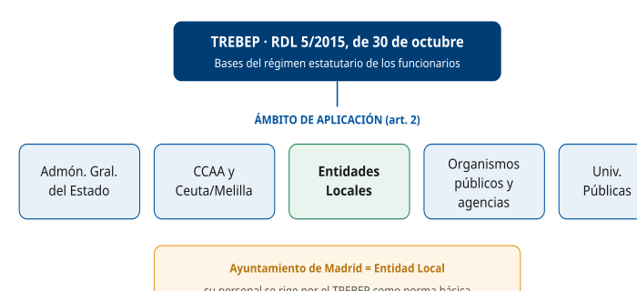

Situar la norma (RDL 5/2015) y a quién se aplica.

D2 · Clases de personal al servicio de las AAPP

§ 2 — Clases de personal

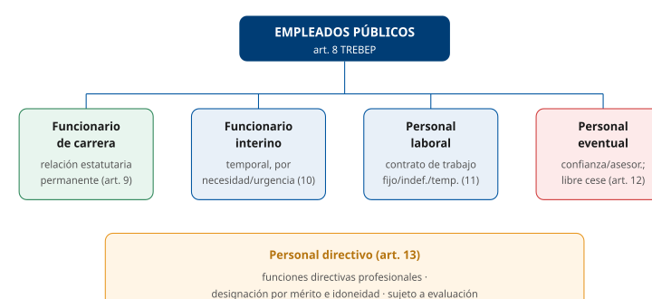

Distinguir las cuatro clases de empleados públicos más el personal directivo.

D3 · Funcionario interino: supuestos y plazos

§ 2 — Clases de personal

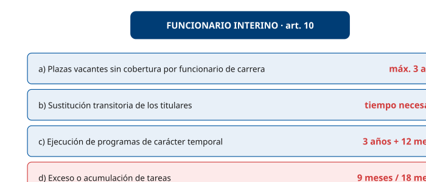

Memorizar los cuatro supuestos del art. 10 y sus plazos.

D4 · Adquisición y pérdida de la relación de servicio

§ 3 — Adquisición y pérdida

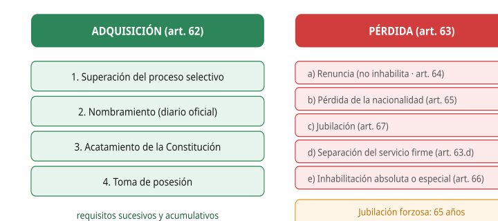

Los cuatro requisitos de adquisición (art. 62) y las causas de pérdida (art. 63).

D5 · Las cinco situaciones administrativas

§ 4 — Situaciones administrativas

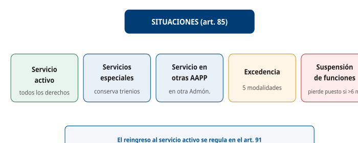

Visualizar las cinco situaciones del art. 85.

D6 · Modalidades de excedencia y sus efectos

§ 4 — Situaciones administrativas

Comparar las excedencias por requisito, retribución y reserva de puesto.

D7 · Derechos individuales (art. 14) vs colectivos (art. 15)

§ 5 — Derechos

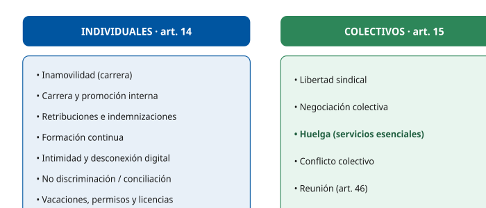

No confundir los derechos individuales con los de ejercicio colectivo.

D8 · Carrera profesional y promoción interna

§ 6 — Carrera profesional

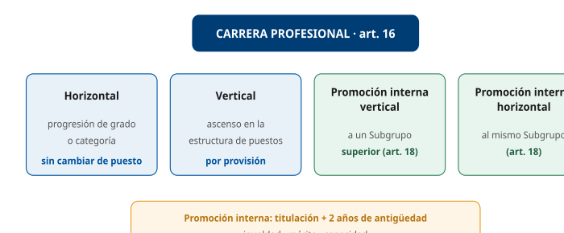

Las cuatro modalidades de carrera del art. 16.

D9 · Retribuciones: básicas vs complementarias

§ 8 — Retribuciones

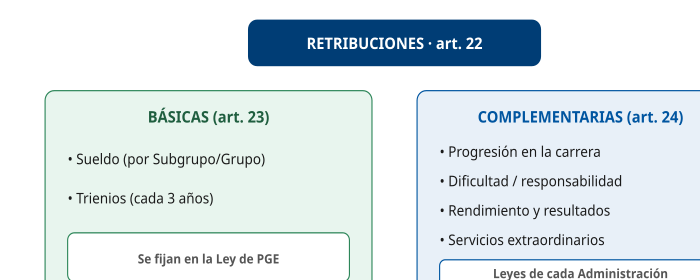

Distinguir las retribuciones básicas (PGE) de las complementarias.

D10 · Jornada, permisos y vacaciones

§ 9 — Jornada, permisos y vacaciones

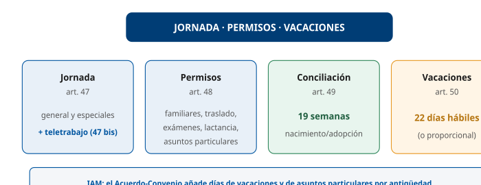

Resumir jornada/teletrabajo, permisos y vacaciones.

D11 · Régimen disciplinario: faltas, sanciones y prescripción

§ 12 — Régimen disciplinario

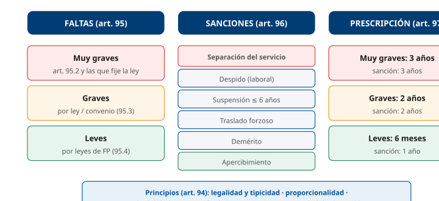

La cascada faltas → sanciones → prescripción.

D12 · Mapa-resumen del Tema 5

§ 14 — Esquema resumen

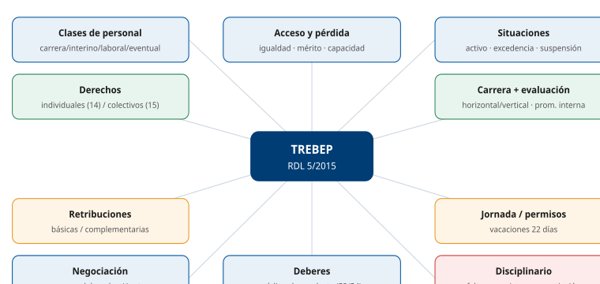

Visión global del personal al servicio de la Administración Pública según el TREBEP.

## Casos prácticos

#### CASO PRÁCTICO 1 — Clases de personal e interinidad

**Escenario**: El IAM necesita cubrir con urgencia una plaza vacante de Técnico Auxiliar TIC que no puede proveerse de inmediato por funcionario de carrera, y además quiere reforzar un proyecto temporal de digitalización de expedientes durante un pico de trabajo.

**Cuestiones**:

1.  **(2,5 pts)** ¿Qué clase de personal permitiría cubrir la plaza vacante y con qué duración máxima?
2.  **(2,5 pts)** ¿Y para el pico de trabajo por acumulación de tareas? Indique el plazo.
3.  **(2,5 pts)** ¿Qué principios rigen la selección del personal funcionario interino?
4.  **(2,5 pts)** ¿Podría cubrirse el proyecto de digitalización con personal eventual? Justifique.

**Solución orientativa**:

1.  Un **funcionario interino** por **plaza vacante** (art. 10.1.a), con un máximo de **3 años**.
2.  Un **funcionario interino** por **exceso o acumulación de tareas** (art. 10.1.d), máximo **9 meses** dentro de un periodo de **18 meses**.
3.  Igualdad, mérito, capacidad, **publicidad y celeridad**; procedimiento público para la cobertura inmediata del puesto (art. 10.2).
4.  **No**: el personal eventual solo realiza funciones de **confianza o asesoramiento especial** (art. 12), no funciones técnicas ordinarias como la digitalización de expedientes.

**Criterios de evaluación**: identificar correctamente la figura del interino y sus plazos (3 años / 9 meses); citar los principios de selección; descartar el eventual por razón de sus funciones.

------------------------------------------------------------------------

#### Preguntas tipo test sobre este caso

##### 1. El IAM necesita cubrir con urgencia una plaza vacante de Técnico Auxiliar TIC que no puede proveerse de inmediato por funcionario de carrera. ¿Qué clase de personal permitiría cubrirla?

- a) Un funcionario interino por existencia de plaza vacante.
- b) Personal eventual, por la urgencia de la cobertura.
- c) Personal directivo profesional, designado por su idoneidad.

**Respuesta correcta:** a) · **Referencia:** Caso 1, cuestión 1 · art. 10.1.a) TREBEP

El artículo 10.1.a) TREBEP permite nombrar funcionarios interinos cuando existan plazas vacantes que no puedan cubrirse por funcionarios de carrera.

##### 2. ¿Qué duración máxima puede tener el nombramiento del interino que cubra la plaza vacante?

- a) Nueve meses.
- b) Tres años.
- c) Dieciocho meses.

**Respuesta correcta:** b) · **Referencia:** Caso 1, cuestión 1 · art. 10.1.a) TREBEP

El interino por plaza vacante puede permanecer como máximo tres años (art. 10.1.a TREBEP); nueve meses dentro de un periodo de dieciocho es el límite del interino por exceso o acumulación de tareas.

##### 3. Para atender el pico de trabajo por acumulación de tareas en la digitalización de expedientes, la figura adecuada es:

- a) Un funcionario interino por sustitución transitoria de los titulares.
- b) Personal eventual nombrado por la autoridad a la que sirve.
- c) Un funcionario interino por exceso o acumulación de tareas.

**Respuesta correcta:** c) · **Referencia:** Caso 1, cuestión 2 · art. 10.1.d) TREBEP

El artículo 10.1.d) TREBEP prevé el nombramiento de interinos por exceso o acumulación de tareas; la sustitución transitoria exige que haya titulares a los que sustituir.

##### 4. ¿Qué plazo máximo tiene el interino nombrado por exceso o acumulación de tareas?

- a) Doce meses dentro de un periodo de veinticuatro meses.
- b) Nueve meses dentro de un periodo de dieciocho meses.
- c) Tres años, ampliables doce meses por las leyes de Función Pública.

**Respuesta correcta:** b) · **Referencia:** Caso 1, cuestión 2 · art. 10.1.d) TREBEP

El nombramiento por exceso o acumulación de tareas tiene un máximo de nueve meses dentro de un periodo de dieciocho meses (art. 10.1.d TREBEP); los tres años ampliables corresponden a los programas temporales.

##### 5. El interino por acumulación de tareas ya ha prestado seis meses de servicio dentro del periodo de referencia. ¿Cuánto tiempo más podría mantenerse su nombramiento, como máximo?

- a) Tres meses.
- b) Seis meses.
- c) Doce meses.

**Respuesta correcta:** a) · **Referencia:** Caso 1, cuestión 2 · art. 10.1.d) TREBEP

Con un máximo de nueve meses dentro de un periodo de dieciocho, y seis ya consumidos, quedan como máximo tres meses (9 − 6 = 3).

##### 6. ¿Qué principios rigen la selección de estos funcionarios interinos?

- a) Confianza, libre designación y cese discrecional.
- b) Antigüedad, preferencia local y urgencia administrativa.
- c) Igualdad, mérito, capacidad, publicidad y celeridad.

**Respuesta correcta:** c) · **Referencia:** Caso 1, cuestión 3 · art. 10.2 TREBEP

La selección de los interinos es pública y se rige por los principios de igualdad, mérito, capacidad, publicidad y celeridad (art. 10.2 TREBEP).

##### 7. El procedimiento público de selección de los interinos tiene como finalidad:

- a) La cobertura inmediata del puesto.
- b) La adquisición de la condición de funcionario de carrera.
- c) La conversión del puesto en plaza de personal laboral fijo.

**Respuesta correcta:** a) · **Referencia:** Caso 1, cuestión 3 · art. 10.2 TREBEP

El artículo 10.2 TREBEP establece que la selección del interino se hace mediante procedimiento público con la finalidad de la cobertura inmediata del puesto.

##### 8. ¿Podría el IAM encargar el proyecto de digitalización de expedientes a personal eventual?

- a) Sí, porque su nombramiento es libre y permite atender necesidades urgentes del servicio.
- b) Sí, siempre que el proyecto no se prolongue durante más de tres años.
- c) No, porque el eventual solo realiza funciones expresamente calificadas de confianza o asesoramiento especial.

**Respuesta correcta:** c) · **Referencia:** Caso 1, cuestión 4 · art. 12 TREBEP

El personal eventual solo realiza funciones expresamente calificadas como de confianza o asesoramiento especial (art. 12.1 TREBEP); la digitalización de expedientes es una función técnica ordinaria.

##### 9. Para nombrar a cualquiera de estos funcionarios interinos, el IAM debe justificar expresamente:

- a) La imposibilidad de contratar personal laboral fijo.
- b) Razones de necesidad y urgencia.
- c) La conformidad previa de la Junta de Personal.

**Respuesta correcta:** b) · **Referencia:** Caso 1, cuestiones 1 y 2 · art. 10.1 TREBEP

Los funcionarios interinos se nombran por razones expresamente justificadas de necesidad y urgencia (art. 10.1 TREBEP).

##### 10. El interino que cubra la plaza vacante de Técnico Auxiliar TIC desempeñará:

- a) Funciones propias de funcionarios de carrera, con carácter temporal.
- b) Solo funciones de confianza o asesoramiento especial.
- c) Funciones directivas profesionales sujetas a evaluación.

**Respuesta correcta:** a) · **Referencia:** Caso 1, cuestión 1 · art. 10.1 TREBEP

El funcionario interino se nombra con carácter temporal para desempeñar funciones propias de funcionarios de carrera (art. 10.1 TREBEP); las de confianza son del eventual y las directivas, del personal directivo.

#### CASO PRÁCTICO 2 — Situaciones administrativas y excedencias

**Escenario**: Una funcionaria de carrera, Técnica TIC del IAM con 7 años de servicio, plantea tres opciones: (a) pedir excedencia para atender al cuidado de su hija de un año; (b) marcharse dos años por motivos personales; (c) ser nombrada asesora en un organismo internacional.

**Cuestiones**:

1.  **(2,5 pts)** ¿Qué situación corresponde a la opción (a) y qué efectos tiene sobre la reserva del puesto y el cómputo de antigüedad?
2.  **(2,5 pts)** ¿Qué modalidad corresponde a la opción (b)? ¿Cumple el requisito temporal?
3.  **(2,5 pts)** En la opción (b), ¿devenga retribuciones y se computa el tiempo?
4.  **(2,5 pts)** ¿Qué situación corresponde a la opción (c)?

**Solución orientativa**:

1.  **Excedencia por cuidado de familiares** (art. 89.4), duración máxima **3 años**; **computa** a trienios, carrera y Seguridad Social; reserva del puesto **2 años** (después, puesto en la misma localidad e igual retribución).
2.  **Excedencia voluntaria por interés particular** (art. 89.2); **sí** cumple el requisito, pues exige **5 años** de servicios previos y tiene 7.
3.  **No** devenga retribuciones ni computa a ascensos, trienios y Seguridad Social (art. 89.2).
4.  **Servicios especiales** cuando concurra alguno de los supuestos del art. 87.1: entre otros, ser designada miembro de las organizaciones internacionales (art. 87.1.a), ser autorizada para realizar una misión por periodo determinado superior a seis meses en organismos internacionales (art. 87.1.b) o adquirir la condición de funcionaria al servicio de organizaciones internacionales (art. 87.1.j).

**Criterios de evaluación**: distinguir las modalidades de excedencia y sus efectos; aplicar correctamente el requisito de 5 años; identificar la situación de servicios especiales.

------------------------------------------------------------------------

#### Preguntas tipo test sobre este caso

##### 1. La funcionaria quiere atender el cuidado de su hija de un año (opción a). ¿Qué situación le corresponde?

- a) Excedencia voluntaria por interés particular.
- b) Excedencia voluntaria por agrupación familiar.
- c) Excedencia por cuidado de familiares.

**Respuesta correcta:** c) · **Referencia:** Caso 2, cuestión 1 · art. 89.4 TREBEP

El cuidado de un hijo da lugar a la excedencia por cuidado de familiares del artículo 89.4 TREBEP.

##### 2. ¿Cuánto tiempo, como máximo, podría permanecer en esa excedencia por el cuidado de su hija?

- a) Hasta tres años.
- b) Hasta dos años.
- c) Hasta que la hija cumpla ocho años.

**Respuesta correcta:** a) · **Referencia:** Caso 2, cuestión 1 · art. 89.4 TREBEP

La excedencia por cuidado de familiares dura hasta tres años por cada sujeto causante (art. 89.4 TREBEP); los dos años son el periodo de reserva del puesto.

##### 3. En la opción (a), ¿qué ocurre con su puesto de trabajo?

- a) Se le reserva durante toda la excedencia, sea cual sea su duración.
- b) Se le reserva durante dos años; después, tendrá derecho a un puesto en la misma localidad e igual retribución.
- c) No se le reserva, porque se trata de una excedencia sin derecho a reserva.

**Respuesta correcta:** b) · **Referencia:** Caso 2, cuestión 1 · art. 89.4 TREBEP

En la excedencia por cuidado de familiares se reserva el puesto durante dos años y, después, se garantiza un puesto en la misma localidad y de igual retribución (art. 89.4 TREBEP).

##### 4. A efectos de antigüedad, el tiempo de la excedencia de la opción (a):

- a) Computa a efectos de trienios, carrera y Seguridad Social.
- b) No computa a ningún efecto mientras dure la excedencia.
- c) Computa a efectos de Seguridad Social, pero no de trienios.

**Respuesta correcta:** a) · **Referencia:** Caso 2, cuestión 1 · art. 89.4 TREBEP

El periodo de excedencia por cuidado de familiares es computable a efectos de trienios, carrera y derechos en el régimen de Seguridad Social (art. 89.4 TREBEP).

##### 5. La opción (b), marcharse dos años por motivos personales, corresponde a:

- a) La excedencia por cuidado de familiares.
- b) La situación de servicios especiales.
- c) La excedencia voluntaria por interés particular.

**Respuesta correcta:** c) · **Referencia:** Caso 2, cuestión 2 · art. 89.2 TREBEP

Ausentarse por motivos personales encaja en la excedencia voluntaria por interés particular del artículo 89.2 TREBEP.

##### 6. ¿Cumple la funcionaria, con siete años de servicio, el requisito temporal de la opción (b)?

- a) No, porque se exigen diez años de servicios efectivos previos.
- b) Sí, porque se exigen cinco años de servicios efectivos previos y tiene siete.
- c) No, porque se exigen ocho años de servicios en la misma Administración.

**Respuesta correcta:** b) · **Referencia:** Caso 2, cuestión 2 · art. 89.2 TREBEP

La excedencia voluntaria por interés particular exige cinco años de servicios efectivos inmediatamente anteriores; con siete años, el requisito se cumple.

##### 7. Durante la excedencia de la opción (b), la funcionaria:

- a) No devengará retribuciones, pero el tiempo sí computará a efectos de trienios.
- b) Percibirá el sueldo base, pero no las retribuciones complementarias.
- c) No devengará retribuciones y el tiempo no computará a ascensos, trienios ni Seguridad Social.

**Respuesta correcta:** c) · **Referencia:** Caso 2, cuestión 3 · art. 89.2 TREBEP

Los funcionarios en excedencia voluntaria por interés particular no devengan retribuciones ni les computa el tiempo a efectos de ascensos, trienios y Seguridad Social (art. 89.2 TREBEP).

##### 8. Si al solicitar la opción (b) se le estuviera instruyendo un expediente disciplinario:

- a) La excedencia se declararía y el expediente quedaría archivado.
- b) No podría declarársele la excedencia voluntaria por interés particular.
- c) Podría declararse, pero por un máximo de dos años.

**Respuesta correcta:** b) · **Referencia:** Caso 2, cuestión 2 · art. 89.2 TREBEP

El artículo 89.2 TREBEP impide declarar la excedencia voluntaria por interés particular cuando al funcionario se le instruya expediente disciplinario.

##### 9. La opción (c), ser nombrada asesora en un organismo internacional, se encuadra en la situación de:

- a) La situación de servicios especiales.
- b) La situación de servicio en otras Administraciones Públicas.
- c) Excedencia voluntaria por interés particular.

**Respuesta correcta:** a) · **Referencia:** Caso 2, cuestión 4 · art. 87.1 TREBEP

Ser designada miembro de organizaciones internacionales o autorizada para una misión en organismos internacionales son supuestos de servicios especiales (art. 87.1 TREBEP).

##### 10. Si pasa a servicios especiales, ¿qué retribuciones percibirá?

- a) Las de funcionaria de carrera del IAM, más las del nuevo puesto o cargo.
- b) Ninguna, igual que en la excedencia voluntaria por interés particular.
- c) Las del puesto o cargo que desempeñe, sin perjuicio de los trienios que tenga reconocidos.

**Respuesta correcta:** c) · **Referencia:** Caso 2, cuestión 4 · art. 87.2 TREBEP

En servicios especiales se perciben las retribuciones del puesto o cargo que se desempeña y no las de funcionario de carrera, sin perjuicio del derecho a los trienios reconocidos (art. 87.2 TREBEP).

#### CASO PRÁCTICO 3 — Acceso y pérdida de la condición de funcionario

**Escenario**: Un aspirante supera el proceso selectivo de Técnico Auxiliar TIC del Ayuntamiento de Madrid. Antes de tomar posesión, duda sobre los requisitos para ser funcionario y sobre qué podría hacerle perder esa condición en el futuro.

**Cuestiones**:

1.  **(2,5 pts)** ¿Qué requisitos debe cumplir, y en qué orden, para adquirir la condición de funcionario de carrera?
2.  **(2,5 pts)** Enumere tres causas de pérdida de la condición de funcionario.
3.  **(2,5 pts)** Si en el futuro renunciara, ¿podría volver a la Administración? ¿Y si fuera separado del servicio por sanción?
4.  **(2,5 pts)** ¿A qué edad se jubilaría forzosamente y hasta cuándo podría prolongar el servicio activo?

**Solución orientativa**:

1.  Cuatro requisitos **sucesivos** (art. 62): superación del proceso selectivo → nombramiento → acatamiento de la Constitución → toma de posesión.
2.  Renuncia (art. 64), pérdida de la nacionalidad (art. 65), jubilación total (art. 67), sanción disciplinaria de separación del servicio firme (art. 63.d) y pena de inhabilitación absoluta o especial firme (art. 66) — bastan tres (art. 63).
3.  La **renuncia no inhabilita** para ingresar de nuevo en la Administración Pública a través del procedimiento de selección establecido (art. 64.3). La **separación del servicio** firme es causa de pérdida de la condición de funcionario (art. 63.d), y no haber sido separado mediante expediente disciplinario es requisito para participar en los procesos selectivos (art. 56.1.d).
4.  La jubilación forzosa se declara de oficio a los **65 años**; se puede solicitar la prolongación de la permanencia en el servicio activo como máximo hasta los **70**, en los términos de las leyes de Función Pública (art. 67.3). No obstante, para el personal funcionario incluido en el **Régimen General de la Seguridad Social**, la edad de jubilación forzosa es la que prevean las normas de dicho régimen para el acceso a la pensión de jubilación contributiva **sin coeficiente reductor** por razón de la edad (art. 67.4).

**Criterios de evaluación**: orden correcto de los cuatro requisitos; tres causas válidas de pérdida; diferenciar renuncia (art. 64.3) de separación (arts. 56.1.d y 63.d); edades de jubilación.

------------------------------------------------------------------------

#### Preguntas tipo test sobre este caso

##### 1. ¿En qué orden debe cumplir el aspirante los requisitos para adquirir la condición de funcionario de carrera?

- a) Superación del proceso selectivo, toma de posesión, nombramiento y acatamiento de la Constitución.
- b) Superación del proceso selectivo, nombramiento, acatamiento de la Constitución y toma de posesión.
- c) Nombramiento, superación del proceso selectivo, toma de posesión y acatamiento de la Constitución.

**Respuesta correcta:** b) · **Referencia:** Caso 3, cuestión 1 · art. 62 TREBEP

La condición de funcionario de carrera se adquiere por el cumplimiento sucesivo de cuatro requisitos: superación del proceso selectivo, nombramiento, acatamiento de la Constitución y toma de posesión (art. 62 TREBEP).

##### 2. El aspirante ya ha sido nombrado y ha prestado el acto de acatamiento de la Constitución. ¿Qué le falta para ser funcionario de carrera?

- a) Superar un periodo de evaluación del desempeño de dos años.
- b) Obtener la autorización de compatibilidad del Ayuntamiento.
- c) Tomar posesión dentro del plazo establecido.

**Respuesta correcta:** c) · **Referencia:** Caso 3, cuestión 1 · art. 62 TREBEP

El último de los cuatro requisitos sucesivos del artículo 62 TREBEP es la toma de posesión dentro del plazo establecido.

##### 3. ¿Cuál de las siguientes es causa de pérdida de la condición de funcionario?

- a) La renuncia a la condición de funcionario.
- b) El traslado forzoso con cambio de localidad.
- c) El pase a excedencia voluntaria por interés particular.

**Respuesta correcta:** a) · **Referencia:** Caso 3, cuestión 2 · art. 63 TREBEP

La renuncia es causa de pérdida de la condición de funcionario (arts. 63.a y 64 TREBEP); el traslado forzoso es una sanción y la excedencia, una situación administrativa.

##### 4. ¿Cuál de las siguientes situaciones también le haría perder la condición de funcionario?

- a) Una sanción firme de suspensión de funciones de seis meses.
- b) La declaración en la situación de servicios especiales.
- c) Una condena firme a pena de inhabilitación especial para cargo público.

**Respuesta correcta:** c) · **Referencia:** Caso 3, cuestión 2 · arts. 63.e) y 66 TREBEP

La pena principal o accesoria de inhabilitación absoluta o especial para cargo público, cuando es firme, es causa de pérdida de la condición de funcionario (art. 66 TREBEP).

##### 5. Si en el futuro quisiera renunciar mientras se le instruye un expediente disciplinario:

- a) La renuncia se aceptaría y el expediente se archivaría.
- b) La renuncia no podría ser aceptada.
- c) La renuncia se entendería aceptada por silencio.

**Respuesta correcta:** b) · **Referencia:** Caso 3, cuestión 3 · art. 64 TREBEP

La renuncia no puede ser aceptada cuando el funcionario esté sujeto a expediente disciplinario (art. 64 TREBEP).

##### 6. Si renunciara y, años después, quisiera volver a la Administración:

- a) Podría hacerlo superando de nuevo el procedimiento de selección establecido.
- b) No podría, porque la renuncia inhabilita para volver a ingresar.
- c) Podría reingresar directamente solicitando la rehabilitación.

**Respuesta correcta:** a) · **Referencia:** Caso 3, cuestión 3 · art. 64.3 TREBEP

La renuncia no inhabilita para ingresar de nuevo en la Administración Pública a través del procedimiento de selección establecido (art. 64.3 TREBEP); la rehabilitación del artículo 68 no está prevista para la renuncia.

##### 7. Si, en cambio, fuera separado del servicio por sanción disciplinaria firme, ¿podría presentarse a un nuevo proceso selectivo?

- a) Sí, en las mismas condiciones que quien ha renunciado.
- b) No, porque se exige no haber sido separado mediante expediente disciplinario.
- c) Sí, una vez transcurridos seis años desde la sanción.

**Respuesta correcta:** b) · **Referencia:** Caso 3, cuestión 3 · arts. 56.1.d) y 63.d) TREBEP

Entre los requisitos para participar en los procesos selectivos figura no haber sido separado mediante expediente disciplinario del servicio de cualquier Administración Pública (art. 56.1.d TREBEP).

##### 8. Si perdiera la nacionalidad y, más tarde, desapareciera esa causa, ¿qué podría hacer?

- a) Solicitar la rehabilitación de su condición de funcionario, que le será concedida.
- b) Volver únicamente superando un nuevo proceso selectivo.
- c) Nada, porque no podría volver a la función pública.

**Respuesta correcta:** a) · **Referencia:** Caso 3, cuestión 3 · art. 68 TREBEP

En caso de pérdida de la nacionalidad, desaparecida la causa, el interesado puede solicitar la rehabilitación, «que le será concedida» (art. 68 TREBEP).

##### 9. Conforme al artículo 67.3 del TREBEP, la jubilación forzosa se declara de oficio al cumplir:

- a) Sesenta y siete años.
- b) Setenta años.
- c) Sesenta y cinco años.

**Respuesta correcta:** c) · **Referencia:** Caso 3, cuestión 4 · art. 67.3 TREBEP

El artículo 67.3 TREBEP dispone que la jubilación forzosa se declare de oficio a los sesenta y cinco años; los setenta son el límite de la prolongación.

##### 10. ¿Hasta qué edad podría solicitar, como máximo, la prolongación de la permanencia en el servicio activo?

- a) Hasta los sesenta y siete años.
- b) Hasta los setenta años.
- c) Hasta los setenta y dos años.

**Respuesta correcta:** b) · **Referencia:** Caso 3, cuestión 4 · art. 67.3 TREBEP

En los términos de las leyes de Función Pública, puede solicitarse la prolongación de la permanencia en el servicio activo como máximo hasta los setenta años (art. 67.3 TREBEP).

#### CASO PRÁCTICO 4 — Derechos, jornada, permisos y vacaciones

**Escenario**: Un Técnico Auxiliar TIC del IAM, que va a ser padre, consulta sus derechos: el permiso por nacimiento, sus vacaciones, la posibilidad de teletrabajar y su derecho a la formación.

**Cuestiones**:

1.  **(2,5 pts)** ¿De cuántas semanas dispone como progenitor diferente de la madre biológica?
2.  **(2,5 pts)** ¿Cuántos días de vacaciones anuales le reconoce el TREBEP y cómo computan los sábados?
3.  **(2,5 pts)** Si solicita teletrabajar, ¿qué derechos y deberes tendría respecto del personal presencial?
4.  **(2,5 pts)** ¿Es la formación continua un derecho individual? ¿En qué horario se realiza preferentemente?

**Solución orientativa**:

1.  **Diecinueve semanas** de permiso del progenitor diferente de la madre biológica (art. 49.c); las seis semanas ininterrumpidas inmediatamente posteriores al hecho causante son obligatorias.
2.  **22 días hábiles** anuales (o la parte proporcional); los **sábados no se consideran hábiles**, sin perjuicio de las adaptaciones para los horarios especiales (art. 50.1). Como personal del IAM, el Acuerdo-Convenio añade días por antigüedad (art. 14.7).
3.  Los **mismos derechos y deberes**, individuales y colectivos, que el personal presencial, incluida la PRL aplicable (art. 47 bis).
4.  **Sí**, es un derecho individual (art. 14.g); se realiza **preferentemente en horario laboral**.

**Criterios de evaluación**: 19 semanas; 22 días hábiles y tratamiento de los sábados; equiparación del teletrabajo; formación como derecho individual en horario laboral.

------------------------------------------------------------------------

#### Preguntas tipo test sobre este caso

##### 1. El técnico va a ser padre y no es la madre biológica. ¿De cuántas semanas de permiso dispone?

- a) Diecinueve semanas.
- b) Dieciséis semanas.
- c) Seis semanas.

**Respuesta correcta:** a) · **Referencia:** Caso 4, cuestión 1 · art. 49.c) TREBEP

El permiso del progenitor diferente de la madre biológica por nacimiento es de diecinueve semanas (art. 49.c TREBEP), treinta y dos en caso de monoparentalidad.

##### 2. De ese permiso, ¿qué parte es de disfrute obligatorio?

- a) Las dos primeras semanas, que pueden disfrutarse de forma discontinua.
- b) Ninguna, porque todo el permiso es de disfrute voluntario.
- c) Las seis semanas ininterrumpidas inmediatamente posteriores al nacimiento.

**Respuesta correcta:** c) · **Referencia:** Caso 4, cuestión 1 · art. 49.c) TREBEP

Las seis semanas ininterrumpidas inmediatamente posteriores al hecho causante son obligatorias (art. 49.c TREBEP).

##### 3. ¿Cuántos días de vacaciones anuales retribuidas le reconoce el TREBEP?

- a) Treinta días naturales.
- b) Veintidós días hábiles.
- c) Veinticinco días hábiles.

**Respuesta correcta:** b) · **Referencia:** Caso 4, cuestión 2 · art. 50.1 TREBEP

El artículo 50.1 TREBEP reconoce veintidós días hábiles de vacaciones retribuidas por año natural, o los que correspondan proporcionalmente.

##### 4. Para computar esos días de vacaciones, los sábados:

- a) Se consideran días hábiles, salvo que el puesto tenga horario especial.
- b) Se consideran días hábiles, pero solo durante el periodo de verano.
- c) No se consideran días hábiles, sin perjuicio de las adaptaciones para los horarios especiales.

**Respuesta correcta:** c) · **Referencia:** Caso 4, cuestión 2 · art. 50.1 TREBEP

A efectos de vacaciones, los sábados no se consideran días hábiles, sin perjuicio de las adaptaciones que se establezcan para los horarios especiales (art. 50.1 TREBEP).

##### 5. Si el técnico se hubiera incorporado al IAM a mitad de año, sus vacaciones de ese año serían:

- a) Los días que correspondan proporcionalmente al tiempo de servicio.
- b) Los veintidós días hábiles completos, sin reducción alguna.
- c) Ninguna, hasta completar un año entero de servicio.

**Respuesta correcta:** a) · **Referencia:** Caso 4, cuestión 2 · art. 50.1 TREBEP

Si el tiempo de servicio durante el año es menor, corresponden los días que resulten proporcionalmente (art. 50.1 TREBEP).

##### 6. Un compañero del IAM con veinte años de antigüedad en la Administración consulta sus vacaciones anuales. Conforme al Acuerdo-Convenio, le corresponden:

- a) Veintidós días hábiles.
- b) Veinticuatro días hábiles.
- c) Veintitrés días hábiles.

**Respuesta correcta:** b) · **Referencia:** Caso 4, cuestión 2 · art. 50 TREBEP · art. 14 Acuerdo-Convenio

Al personal del IAM el Acuerdo-Convenio le reconoce 22 días hábiles más días adicionales por antigüedad; con 20 años de servicio suma dos, es decir, 24.

##### 7. Si el técnico no llegara a disfrutar sus vacaciones, ¿podría pedir que se le abonaran en dinero?

- a) No, salvo que concluya la relación de servicios por causas ajenas a su voluntad.
- b) Sí, siempre que lo solicite antes de que termine el año natural.
- c) Sí, pero solo por la mitad de los días no disfrutados.

**Respuesta correcta:** a) · **Referencia:** Caso 4, cuestión 2 · art. 50 TREBEP

El periodo de vacaciones no puede sustituirse por una cuantía económica, salvo cuando concluya la relación de servicios por causas ajenas a la voluntad del funcionario (art. 50 TREBEP).

##### 8. Si se le autoriza a teletrabajar, ¿qué derechos y deberes tendrá respecto del personal presencial?

- a) Los mismos derechos individuales, pero no los colectivos, al no prestar servicio presencial.
- b) Los mismos derechos y deberes, individuales y colectivos, incluida la normativa de prevención de riesgos laborales.
- c) Los mismos derechos y deberes, salvo la protección en materia de prevención de riesgos laborales.

**Respuesta correcta:** b) · **Referencia:** Caso 4, cuestión 3 · art. 47 bis TREBEP

El personal que teletrabaja tiene los mismos deberes y derechos, individuales y colectivos, que el presencial, incluida la normativa de prevención de riesgos laborales aplicable (art. 47 bis TREBEP).

##### 9. En cuanto a su régimen, el teletrabajo que solicita el técnico:

- a) Es un derecho automático del empleado que no necesita autorización.
- b) Es obligatorio e irreversible una vez que la Administración lo concede.
- c) Ha de autorizarse expresamente y es voluntario y reversible, salvo supuestos excepcionales.

**Respuesta correcta:** c) · **Referencia:** Caso 4, cuestión 3 · art. 47 bis TREBEP

El teletrabajo ha de ser expresamente autorizado y tiene carácter voluntario y reversible, salvo supuestos excepcionales debidamente justificados (art. 47 bis TREBEP).

##### 10. En cuanto a la formación continua, el técnico debe saber que:

- a) Es un derecho individual y se realiza preferentemente en horario laboral.
- b) Es un derecho de ejercicio colectivo y se realiza fuera del horario laboral.
- c) Es una mera facultad de la Administración y se realiza fuera de la jornada.

**Respuesta correcta:** a) · **Referencia:** Caso 4, cuestión 4 · art. 14.g) TREBEP

La formación continua y la actualización permanente son un derecho individual del artículo 14.g) TREBEP, que se ejerce preferentemente en horario laboral.

#### CASO PRÁCTICO 5 — Carrera, evaluación y retribuciones

**Escenario**: Un Técnico Auxiliar TIC del IAM (Subgrupo C1) quiere progresar profesionalmente y entender su nómina: qué parte es básica, qué parte depende del puesto y cómo influye su evaluación del desempeño.

**Cuestiones**:

1.  **(2,5 pts)** ¿Qué vía le permitiría ascender a un Subgrupo superior y qué antigüedad mínima se exige?
2.  **(2,5 pts)** ¿Qué conceptos integran sus retribuciones básicas y dónde se fijan?
3.  **(2,5 pts)** ¿De qué dependen sus retribuciones complementarias?
4.  **(2,5 pts)** ¿Sobre qué elementos puede repercutir su evaluación del desempeño?

**Solución orientativa**:

1.  La **promoción interna vertical** (arts. 16.3.c y 18), con titulación y al menos **2 años** de servicio activo en el Subgrupo inferior, en proceso de igualdad, mérito y capacidad.
2.  **Sueldo + trienios** (art. 23), fijados en la **Ley de Presupuestos Generales del Estado**.
3.  De factores como la **progresión** en la carrera, la **especial dificultad técnica, responsabilidad, dedicación** o incompatibilidad del puesto, el **rendimiento** y los **servicios extraordinarios** (art. 24); su cuantía y estructura se establecen por las leyes de cada Administración Pública.
4.  Sobre la **carrera horizontal**, la **formación**, la **provisión de puestos** y las **retribuciones complementarias** (art. 20.3).

**Criterios de evaluación**: identificar promoción interna vertical y los 2 años; básicas (sueldo + trienios, PGE); factores de las complementarias (art. 24); efectos de la evaluación.

------------------------------------------------------------------------

#### Preguntas tipo test sobre este caso

##### 1. El técnico, del Subgrupo C1, quiere ascender a un Subgrupo superior. ¿Qué vía de la carrera profesional se lo permite?

- a) La promoción interna horizontal.
- b) La carrera horizontal.
- c) La promoción interna vertical.

**Respuesta correcta:** c) · **Referencia:** Caso 5, cuestión 1 · arts. 16.3.c) y 18 TREBEP

La promoción interna vertical consiste en el ascenso desde un cuerpo o escala de un Subgrupo a otro superior (arts. 16.3.c y 18 TREBEP); la horizontal da acceso a cuerpos del mismo Subgrupo.

##### 2. ¿Qué antigüedad mínima se le exige para la promoción interna?

- a) Tres años de servicio activo en el Subgrupo inferior.
- b) Dos años de servicio activo en el Subgrupo inferior.
- c) Cinco años de servicios efectivos en cualquier Administración.

**Respuesta correcta:** b) · **Referencia:** Caso 5, cuestión 1 · art. 18 TREBEP

El artículo 18 TREBEP exige una antigüedad de, al menos, dos años de servicio activo en el inferior Subgrupo; los cinco años son el requisito de la excedencia por interés particular.

##### 3. El técnico lleva dieciocho meses de servicio activo en el Subgrupo C1. ¿Puede presentarse ya a la promoción interna a un cuerpo del Subgrupo A2?

- a) No, porque necesita al menos dos años de servicio activo en el Subgrupo inferior.
- b) Sí, porque basta con haber superado el periodo de prácticas.
- c) Sí, porque la promoción interna no exige una antigüedad mínima.

**Respuesta correcta:** a) · **Referencia:** Caso 5, cuestión 1 · art. 18 TREBEP

Dieciocho meses no alcanzan los dos años de servicio activo en el Subgrupo inferior que exige el artículo 18 TREBEP.

##### 4. Además de la antigüedad, para la promoción interna vertical el técnico necesitará:

- a) Obtener una evaluación del desempeño favorable durante cinco años consecutivos.
- b) Poseer la titulación y los demás requisitos exigidos para el ingreso y superar las pruebas selectivas.
- c) Contar con la propuesta favorable de su superior jerárquico inmediato.

**Respuesta correcta:** b) · **Referencia:** Caso 5, cuestión 1 · art. 18 TREBEP

La promoción interna exige poseer los requisitos exigidos para el ingreso, la antigüedad mínima y superar las pruebas selectivas, en procesos que garanticen igualdad, mérito y capacidad (art. 18 TREBEP).

##### 5. Si quisiera progresar de grado o categoría sin cambiar de puesto de trabajo, la modalidad aplicable sería:

- a) La carrera vertical.
- b) La promoción interna vertical.
- c) La carrera horizontal.

**Respuesta correcta:** c) · **Referencia:** Caso 5, cuestión 1 · art. 16.3.a) TREBEP

La carrera horizontal consiste en la progresión de grado, categoría, escalón u otros conceptos análogos sin necesidad de cambiar de puesto de trabajo (art. 16.3.a TREBEP).

##### 6. Al revisar su nómina, ¿qué conceptos integran sus retribuciones básicas?

- a) Únicamente el sueldo y los trienios.
- b) El sueldo, los trienios y el complemento de destino.
- c) El sueldo y las indemnizaciones por razón del servicio.

**Respuesta correcta:** a) · **Referencia:** Caso 5, cuestión 2 · art. 23 TREBEP

Las retribuciones básicas están integradas única y exclusivamente por el sueldo y los trienios (art. 23 TREBEP).

##### 7. ¿Dónde se fijan las retribuciones básicas del técnico?

- a) En las leyes de Función Pública de cada Administración Pública.
- b) En el Acuerdo-Convenio del Ayuntamiento de Madrid.
- c) En la Ley de Presupuestos Generales del Estado.

**Respuesta correcta:** c) · **Referencia:** Caso 5, cuestión 2 · art. 23 TREBEP

Las retribuciones básicas se fijan en la Ley de Presupuestos Generales del Estado (art. 23 TREBEP); las leyes de cada Administración fijan las complementarias.

##### 8. Si el técnico acumula diez años de servicio, ¿cuántos trienios completos tendrá reconocidos en su nómina?

- a) Tres.
- b) Dos.
- c) Cuatro.

**Respuesta correcta:** a) · **Referencia:** Caso 5, cuestión 2 · art. 23.b) TREBEP

Los trienios consisten en una cantidad por cada tres años de servicio; con diez años se completan tres trienios (3 × 3 = 9 años).

##### 9. ¿De qué dependen sus retribuciones complementarias?

- a) Exclusivamente del Subgrupo de clasificación profesional y de los años de servicio prestados.
- b) De la progresión en la carrera, las características del puesto, el rendimiento y los servicios extraordinarios.
- c) De la cuantía uniforme que fija cada año la Ley de Presupuestos Generales del Estado.

**Respuesta correcta:** b) · **Referencia:** Caso 5, cuestión 3 · art. 24 TREBEP

Las retribuciones complementarias atienden, entre otros factores, a la progresión en la carrera, la especial dificultad técnica, responsabilidad, dedicación o incompatibilidad del puesto, el rendimiento y los servicios extraordinarios (art. 24 TREBEP).

##### 10. ¿Sobre qué elementos puede repercutir su evaluación del desempeño?

- a) El sueldo, los trienios y las demás retribuciones básicas fijadas en los Presupuestos.
- b) Las vacaciones, los permisos, la jornada de trabajo y la edad de jubilación forzosa.
- c) La carrera horizontal, la formación, la provisión de puestos y las retribuciones complementarias.

**Respuesta correcta:** c) · **Referencia:** Caso 5, cuestión 4 · art. 20.3 TREBEP

Las Administraciones determinan los efectos de la evaluación del desempeño en la carrera horizontal, la formación, la provisión de puestos y las retribuciones complementarias (art. 20.3 TREBEP).

#### CASO PRÁCTICO 6 — Régimen disciplinario e incompatibilidades

**Escenario**: A un Técnico Auxiliar TIC del IAM se le abre expediente por haber difundido información reservada de expedientes municipales y, además, por desempeñar una segunda actividad privada sin haber obtenido el reconocimiento de compatibilidad. Se analizan las consecuencias.

**Cuestiones**:

1.  **(2,5 pts)** ¿Qué principios rigen la potestad disciplinaria que debe respetar el expediente?
2.  **(2,5 pts)** ¿De qué tipo es la falta por publicación o uso indebido de información reservada y qué sanción máxima cabría?
3.  **(2,5 pts)** ¿Qué se exige para ejercer legalmente una segunda actividad y qué falta supone su incumplimiento?
4.  **(2,5 pts)** Si la falta fuera muy grave, ¿en qué plazo prescribiría, y desde cuándo se cuenta?

**Solución orientativa**:

1.  Legalidad y tipicidad, irretroactividad de las disposiciones sancionadoras no favorables, proporcionalidad, culpabilidad y presunción de inocencia (art. 94.2).
2.  La publicación o utilización indebida de la documentación o información a que se tenga acceso por razón del cargo es **falta muy grave** (art. 95.2.e); la **separación del servicio** solo puede sancionar faltas muy graves (art. 96.1.a).
3.  Al tratarse de una actividad **privada**, el **previo reconocimiento de compatibilidad** (Ley 53/1984, art. 14), que no puede modificar la jornada de trabajo y horario del interesado y no cabe para las actividades prohibidas por los artículos 11 y 12; la previa y expresa autorización del artículo 3.1 es la que se exige para un segundo puesto o actividad en el sector público. El incumplimiento de las normas sobre incompatibilidades, cuando dé lugar a una situación de incompatibilidad, es **falta muy grave** (art. 95.2.n).
4.  Prescribe a los **3 años** (art. 97.1), contados desde que se cometió, o desde el cese de su comisión si es continuada (art. 97.2).

**Criterios de evaluación**: enunciar los principios del art. 94; calificar la falta como muy grave y vincularla a la separación; exigir el previo reconocimiento de compatibilidad para la actividad privada; plazo de prescripción de 3 años y su cómputo.

#### Preguntas tipo test sobre este caso

##### 1. ¿Qué principios rigen la potestad disciplinaria que debe respetar el expediente abierto al técnico?

- a) Oportunidad, discrecionalidad técnica, jerarquía, responsabilidad objetiva y celeridad en la resolución del expediente.
- b) Legalidad y tipicidad, irretroactividad de las disposiciones sancionadoras no favorables, proporcionalidad, culpabilidad y presunción de inocencia.
- c) Legalidad, aplicación analógica de las faltas, retroactividad de las sanciones y presunción de responsabilidad.

**Respuesta correcta:** b) · **Referencia:** Caso 6, cuestión 1 · art. 94.2 TREBEP

El artículo 94.2 TREBEP enumera los principios de legalidad y tipicidad, irretroactividad de las disposiciones sancionadoras no favorables, proporcionalidad, culpabilidad y presunción de inocencia.

##### 2. Si, después de los hechos, entrara en vigor una norma que agravara la sanción prevista, ¿se aplicaría al técnico?

- a) No, por la irretroactividad de las disposiciones sancionadoras no favorables.
- b) Sí, porque se aplica siempre la norma vigente en el momento de resolver.
- c) Sí, siempre que el expediente no se hubiera iniciado todavía.

**Respuesta correcta:** a) · **Referencia:** Caso 6, cuestión 1 · art. 94.2 TREBEP

La potestad disciplinaria respeta la irretroactividad de las disposiciones sancionadoras no favorables (art. 94.2 TREBEP), por lo que la norma más severa posterior no se aplica.

##### 3. ¿Cómo se califica la difusión de información reservada de expedientes municipales a la que el técnico tenía acceso por su puesto?

- a) Como falta grave.
- b) Como falta leve.
- c) Como falta muy grave.

**Respuesta correcta:** c) · **Referencia:** Caso 6, cuestión 2 · art. 95.2.e) TREBEP

La publicación o utilización indebida de la documentación o información a que se tenga acceso por razón del cargo es falta muy grave (art. 95.2.e TREBEP).

##### 4. ¿Cuál es la sanción más grave que podría imponérsele por esa falta?

- a) La separación del servicio del funcionario.
- b) La suspensión firme de funciones durante seis meses.
- c) El traslado forzoso con cambio de localidad.

**Respuesta correcta:** a) · **Referencia:** Caso 6, cuestión 2 · art. 96.1.a) TREBEP

La separación del servicio es la sanción más grave para un funcionario y solo puede imponerse por faltas muy graves (art. 96.1.a TREBEP).

##### 5. Si la falta se hubiera calificado solo como grave, ¿podría imponérsele la separación del servicio?

- a) Sí, si concurre reincidencia dentro del mismo año.
- b) No, porque la separación del servicio solo puede sancionar faltas muy graves.
- c) Sí, si así lo propone el instructor del expediente.

**Respuesta correcta:** b) · **Referencia:** Caso 6, cuestión 2 · art. 96.1.a) TREBEP

El TREBEP reserva expresamente la separación del servicio a la comisión de faltas muy graves (art. 96.1.a TREBEP).

##### 6. El desempeño de la segunda actividad sin reconocimiento de compatibilidad, cuando dé lugar a una situación de incompatibilidad, constituye:

- a) Una falta leve.
- b) Una falta grave.
- c) Una falta muy grave.

**Respuesta correcta:** c) · **Referencia:** Caso 6, cuestión 3 · art. 95.2.n) TREBEP

El incumplimiento de las normas sobre incompatibilidades, cuando dé lugar a una situación de incompatibilidad, es falta muy grave (art. 95.2.n TREBEP).

##### 7. El régimen de incompatibilidades de la Ley 53/1984 que se aplica al técnico parte del principio de:

- a) Libre compatibilidad de cualquier actividad fuera del horario.
- b) Dedicación del personal a un solo puesto de trabajo.
- c) Compatibilidad automática si no se altera la jornada.

**Respuesta correcta:** b) · **Referencia:** Caso 6, cuestión 3 · Ley 53/1984

La Ley 53/1984 parte, según su preámbulo, del principio de dedicación del personal a un solo puesto de trabajo.

##### 8. Si la falta fuera muy grave, ¿en qué plazo prescribiría?

- a) A los dos años.
- b) A los seis meses.
- c) A los tres años.

**Respuesta correcta:** c) · **Referencia:** Caso 6, cuestión 4 · art. 97.1 TREBEP

Las faltas muy graves prescriben a los tres años, las graves a los dos y las leves a los seis meses (art. 97 TREBEP).

##### 9. La segunda actividad se mantuvo durante meses (falta continuada). ¿Desde cuándo se cuenta el plazo de prescripción?

- a) Desde el cese de su comisión.
- b) Desde el día en que comenzó la actividad.
- c) Desde la incoación del expediente disciplinario.

**Respuesta correcta:** a) · **Referencia:** Caso 6, cuestión 4 · art. 97.2 TREBEP

El plazo de prescripción de las faltas se cuenta desde que se cometieron y, en las faltas continuadas, desde el cese de su comisión (art. 97 TREBEP).

##### 10. Durante la tramitación se acuerda la suspensión provisional del técnico como medida cautelar. Salvo paralización imputable a él, esa suspensión no podrá exceder de:

- a) Seis años.
- b) Seis meses.
- c) Tres años.

**Respuesta correcta:** b) · **Referencia:** Caso 6 · art. 98 TREBEP

La suspensión provisional como medida cautelar no puede exceder de seis meses, salvo paralización del procedimiento imputable al interesado (art. 98 TREBEP); los seis años son el máximo de la suspensión firme.

## Fuentes

------------------------------------------------------------------------

### Naturaleza de las fuentes en este tema

El Tema 5 trabaja con un **corpus normativo cerrado**: el articulado del **texto refundido de la Ley del Estatuto Básico del Empleado Público (TREBEP)**, aprobado por el **Real Decreto Legislativo 5/2015, de 30 de octubre**, en su redacción vigente (versión consolidada del BOE).

- Todos los epígrafes del enunciado oficial se desarrollan a partir del **texto oficial del TREBEP (BOE, versión consolidada)**, entre ellos:
- **Adquisición y pérdida de la relación de servicio** (arts. 55-68 TREBEP).
- **Jornada de trabajo, permisos y vacaciones** (arts. 47-51 TREBEP).
- **Negociación colectiva, representación y participación institucional** (arts. 31-46 TREBEP).
- Se incluye además el **régimen de incompatibilidades** ([Ley 53/1984](https://www.boe.es/buscar/act.php?id=BOE-A-1985-151)), que **no figura** literalmente en el enunciado oficial del Tema 5, por su conexión con los deberes del empleado público (su incumplimiento puede ser falta muy grave, art. 95.2.n TREBEP).
- Se incorpora el **Acuerdo-Convenio sobre Condiciones de Trabajo Comunes al Personal Funcionario y Laboral del Ayuntamiento de Madrid y de sus Organismos Autónomos** como normativa **directamente aplicable al IAM** en materia de jornada, permisos y vacaciones (texto tomado del portal de transparencia del Ayuntamiento de Madrid).

------------------------------------------------------------------------

### Tier 1 — Fuentes primarias (cita directa)

| Ref | Título | Publicación / origen | Uso |
|----|----|----|----|
| \[TREBEP\] | [Real Decreto Legislativo 5/2015](https://www.boe.es/buscar/act.php?id=BOE-A-2015-11719), de 30 de octubre, texto refundido de la Ley del Estatuto Básico del Empleado Público | BOE núm. 261 de 31/10/2015 (versión consolidada, consultada el 01/10/2026; el art. 49 recoge la redacción del [Real Decreto-ley 9/2025](https://www.boe.es/buscar/doc.php?id=BOE-A-2025-15741), de 29 de julio) | **Fuente nuclear**: arts. 1-98 (clases de personal, acceso y pérdida, situaciones, derechos, carrera, evaluación, retribuciones, jornada/permisos, negociación, deberes, disciplinario) |
| \[L53/1984\] | [Ley 53/1984](https://www.boe.es/buscar/act.php?id=BOE-A-1985-151), de 26 de diciembre, de Incompatibilidades del personal al servicio de las Administraciones Públicas | BOE núm. 4 de 04/01/1985 (versión consolidada) | Sección de incompatibilidades (§13): arts. 1.1 y 3.1 |
| \[AC-MADRID\] | Acuerdo-Convenio sobre Condiciones de Trabajo Comunes al Personal Funcionario y Laboral del Ayuntamiento de Madrid y de sus Organismos Autónomos para el periodo 2019-2022 (prorrogado tácitamente por periodos anuales, art. 4) | Acuerdo de 27/12/2018 de la Junta de Gobierno de la Ciudad de Madrid · BOAM núm. 8307 de 02/01/2019 · portal de transparencia del Ayuntamiento de Madrid (transparencia.madrid.es) | Vacaciones (art. 14.1 y 14.7) y asuntos particulares (art. 15, letra l) aplicables al IAM (§9.5) |
| \[CE\] | [Constitución Española](https://www.boe.es/buscar/act.php?id=BOE-A-1978-31229) de 1978 | BOE núm. 311 de 29/12/1978 | Arts. 23.2 y 103.3 (acceso por igualdad, mérito y capacidad); art. 28 (libertad sindical y huelga) |
| \[LCREM\] | [Ley 22/2006](https://www.boe.es/buscar/act.php?id=BOE-A-2006-12057), de 4 de julio, de Capitalidad y de Régimen Especial de Madrid | BOE núm. 159 de 05/07/2006 | Encuadre del personal del Ayuntamiento de Madrid |
| \[BOAM-10032\] | Temario oficial BOAM 10.032 (23-dic-2025) | BOAM | Enunciado oficial del Tema 5 |

#### Esquema de referencia para el contenido

- **Articulado TREBEP**: `(art. X TREBEP)` o `(art. X.Y TREBEP)` — p. ej. `(art. 89 TREBEP)`
- **Ley de incompatibilidades**: `(art. X `[`Ley 53/1984`](https://www.boe.es/buscar/act.php?id=BOE-A-1985-151)`)`
- **Constitución**: `(art. 103.3 CE)`

------------------------------------------------------------------------
