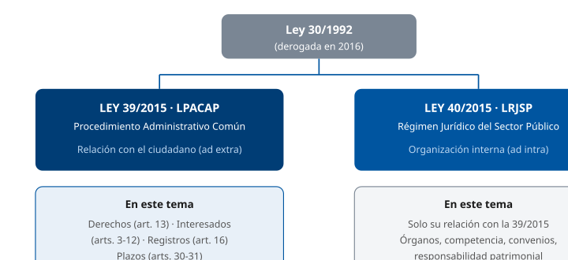
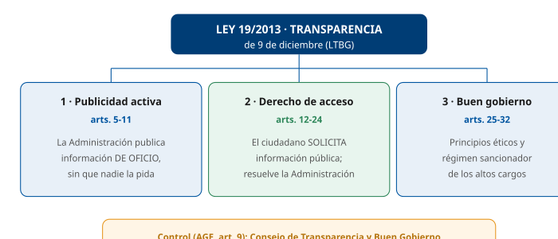
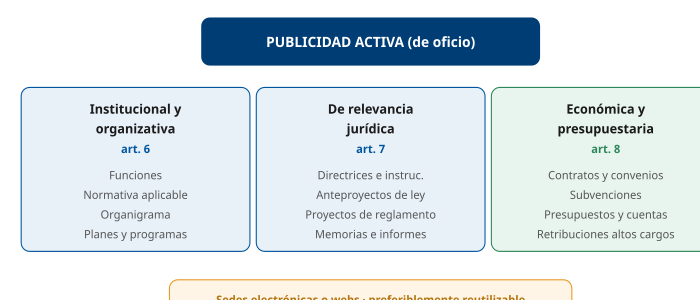

# Tema 6. Procedimiento Administrativo Común (Ley 39/2015) y Transparencia (Ley 19/2013)

**Bloque:** administrativo  
**Enunciado oficial** (BOAM n.º 10.032, de 23 de diciembre de 2025): Ley 39/2015, de 1 de octubre, del Procedimiento Administrativo Común de las Administraciones Públicas: derechos de los ciudadanos en sus relaciones con las Administraciones Públicas y Registros. Ley 19/2013, de 9 de diciembre, de transparencia, acceso a la información pública y buen gobierno: derecho de acceso a la información pública. Ordenanza de Transparencia de la Ciudad de Madrid de 27 de julio de 2016: ámbito de aplicación y principios generales.

Versión web: <https://ayuntamientomadrid.github.io/temario-tecnico-auxiliar/temas/tema-06.html> · PDF: [tema-06.pdf](tema-06.pdf) · Test: [../../../tests/administrativo/tema-06.md](../../../tests/administrativo/tema-06.md)

## Índice

- 1. La Ley 39/2015 (LPACAP): objeto, ámbito y estructura
- 2. Relación con la Ley 40/2015 (LRJSP)
- 3. Derechos de las personas ante las Administraciones (art. 13)
- 4. Derechos del interesado en el procedimiento (art. 53)
- 5. Derechos en el ámbito digital y administración electrónica
- 6. Los interesados: concepto, capacidad de obrar y representación
  - 6.1 Concepto de interesado (art. 4)
  - 6.2 Capacidad de obrar (art. 3)
  - 6.3 Representación (arts. 5-6)
- 7. Identificación y firma electrónica de los interesados (arts. 9-12)
- 8. Los registros administrativos. El Registro Electrónico General (art. 16)
- 9. Los archivos administrativos. El Archivo Electrónico Único (art. 17)
- 10. Obligación de relacionarse electrónicamente y cómputo de plazos
  - 10.1 Sujetos obligados a relacionarse electrónicamente (art. 14)
  - 10.2 Cómputo de plazos (arts. 30-31)
- 11. La Ley 19/2013 (LTBG): objeto, ámbito subjetivo y principios
- 12. La publicidad activa (arts. 5-11 LTBG)
- 13. El derecho de acceso a la información pública (arts. 12-24 LTBG)
- 14. Límites, causas de inadmisión y procedimiento de acceso
  - 14.1 Límites al derecho de acceso (art. 14)
  - 14.2 Causas de inadmisión (art. 18)
  - 14.3 Procedimiento (arts. 17-22)
- 15. El Consejo de Transparencia y Buen Gobierno. Reclamación (arts. 23-24, 33-40)
- 16. La Ordenanza de Transparencia de la Ciudad de Madrid (2016)
  - 16.1 El Registro de lobbies
- 17. Esquema resumen y conexiones entre normas

### Conceptos clave por sección

#### Datos de memorización (Dato clave)

| Concepto | Dato | Artículo |
|----|----|----|
| Procedimiento Administrativo Común | **Ley 39/2015, de 1 de octubre (LPACAP)** | Encabezamiento |
| Régimen jurídico del sector público | **Ley 40/2015, de 1 de octubre (LRJSP)** | Encabezamiento |
| Entrada en vigor de la LPACAP | **2 de octubre de 2016** (un año tras su publicación) | DF 7.ª |
| Derechos de las personas ante las AAPP | Catálogo del **art. 13** (comunicación electrónica, lenguas oficiales, acceso a la información, identificación/firma, protección de datos) | Art. 13 |
| Derechos del **interesado** en el procedimiento | Conocer el estado de la tramitación, no presentar documentos ya en poder de las AAPP, alegar; en el sancionador, **presunción de no existencia de responsabilidad administrativa** | Art. 53 |
| Registro vs archivo | **Registro** (art. 16) = entrada/salida; **Archivo Electrónico Único** (art. 17) = conservación de procedimientos **finalizados** | Arts. 16-17 |
| Concepto de interesado | Titulares de derechos o intereses **legítimos**, individuales o colectivos | Art. 4 |
| Capacidad de obrar | La de las normas civiles **+ menores** para derechos que el ordenamiento les permita sin asistencia | Art. 3 |
| Sujetos obligados a relacionarse electrónicamente | Personas **jurídicas**, entidades sin personalidad, profesionales colegiados, empleados públicos… | Art. 14.2 |
| Sistemas de identificación | Certificado cualificado de firma electrónica, certificado cualificado de sello electrónico y otros sistemas que las AAPP consideren válidos, con **registro previo como usuario** | Art. 9.2 |
| Firma electrónica | Obligatoria solo para solicitudes, declaraciones responsables o comunicaciones, recursos, desistimiento y renuncia | Arts. 10-11 |
| Registro Electrónico General | Cada Administración dispondrá de **un** registro electrónico general; interoperables | Art. 16.1 |
| Cómputo de plazos por horas | Las horas son **hábiles**; de hora en hora y de minuto en minuto; máximo 24 horas | Art. 30.1 |
| Sábados | Los **sábados, domingos y festivos** son **inhábiles** (plazos por días) | Art. 30.2 |
| Cómputo por meses/años | Concluye el mismo día del mes o año de vencimiento; si no lo hay, el último día del mes | Art. 30.4 |
| Transparencia (Ley 19/2013) | **Publicidad activa + derecho de acceso + buen gobierno** | Estructura LTBG |
| Plazo de resolución del acceso | **1 mes** desde la recepción (ampliable otro mes) | Art. 20.1 |
| Silencio en el derecho de acceso | **Desestimatorio** | Art. 20.4 |
| Reclamación ante el CTBG | Potestativa y previa a lo contencioso; plazo **1 mes** | Art. 24 |
| Consejo de Transparencia y Buen Gobierno | Organismo público con **autonomía y plena independencia**; conoce de la reclamación del art. 24 | Arts. 24 y 33 |
| Ordenanza de Transparencia de Madrid | Aprobada por el **Pleno el 27 de julio de 2016** (BOAM y BOCM de 17/08/2016) | Ord. Madrid |
| Registro de lobbies (Madrid) | **Gratuito** y **público**; inscripción **previa y obligatoria** para reunirse con concejales, directivos y personal eventual | Ord. Madrid, arts. 35 y 38 |

#### Las tres normas del tema de un vistazo

|  | Ley 39/2015 (LPACAP) | Ley 40/2015 (LRJSP) | Ley 19/2013 (LTBG) |
|----|----|----|----|
| Regula | El **procedimiento** administrativo común (relación ciudadano-Administración) | El **régimen jurídico** del sector público (organización ad intra) | La **transparencia** y el acceso a la información |
| Eje | Derechos, interesados, registros, plazos, fases del procedimiento | Órganos, competencia, convenios, principios de la responsabilidad patrimonial | Publicidad activa + derecho de acceso + buen gobierno |
| En este tema | Arts. 13 (derechos), 3-12 (interesados), 16 (registros), 30-31 (plazos) | Solo su **relación** con la 39/2015 | Arts. 5-11 (publicidad activa), 12-24 (acceso) + CTBG |

------------------------------------------------------------------------

## Contenido

------------------------------------------------------------------------

### Convenciones del documento

Este tema incluye cuatro tipos de **cajas** para facilitar el estudio:

> **Dato clave.** Datos de memorización: plazos, órganos competentes, sujetos obligados, cifras.

> **Cita normativa.** Reproducción literal o paráfrasis cercana de un precepto, con referencia al artículo.

> **Ejemplo de aplicación en el ayto.** Aplicación al entorno del Ayuntamiento de Madrid y, en particular, a un puesto de Técnico Auxiliar TIC del IAM.

> **Relación con otros temas.** Relación con otros temas del temario o con otros epígrafes del propio Tema 6.

Las citas se expresan como `(art. X LPACAP)`, `(art. X LTBG)` u `[ORD-MAD, art. X]`. El registro completo de fuentes está en la pestaña Fuentes.

------------------------------------------------------------------------

### 1. La Ley 39/2015 (LPACAP): objeto, ámbito y estructura

La **Ley 39/2015, de 1 de octubre, del Procedimiento Administrativo Común de las Administraciones Públicas (LPACAP)** regula los requisitos de validez y eficacia de los actos administrativos y el procedimiento administrativo común a todas las Administraciones Públicas (art. 1.1 LPACAP).

> **Cita normativa.** La LPACAP *"tiene por objeto regular los requisitos de validez y eficacia de los actos administrativos, el procedimiento administrativo común a todas las Administraciones Públicas, incluyendo el sancionador y el de reclamación de responsabilidad de las Administraciones Públicas, así como los principios a los que se ha de ajustar el ejercicio de la iniciativa legislativa y la potestad reglamentaria"* (art. 1.1 LPACAP).

**Ámbito de aplicación** (art. 2). La ley se aplica al **sector público**, que comprende: la Administración General del Estado, las Administraciones de las **comunidades autónomas**, las **entidades que integran la Administración local** y el **sector público institucional** (art. 2.1 LPACAP). El sector público institucional se integra por los organismos públicos y entidades de derecho público vinculados o dependientes de las Administraciones Públicas, las entidades de derecho privado vinculadas o dependientes de ellas y las Universidades públicas (art. 2.2 LPACAP).

> **Dato clave.** La LPACAP entró en vigor **al año de su publicación** en el BOE (publicada el 2 de octubre de 2015, en vigor el **2 de octubre de 2016**). Las previsiones relativas al registro electrónico de apoderamientos, registro electrónico, registro de empleados públicos habilitados, punto de acceso general electrónico y archivo único electrónico producen efectos a partir del **2 de abril de 2021** (DF 7.ª LPACAP). La LPACAP deroga expresamente, entre otras, la **Ley 30/1992** y la **Ley 11/2007** \[LPACAP, DD única.2\].

> **Ejemplo de aplicación en el ayto.** El **Ayuntamiento de Madrid**, como entidad local, tramita todos sus procedimientos (licencias, multas, ayudas, contratación) conforme a la LPACAP. Un Técnico Auxiliar TIC del IAM da soporte a las aplicaciones que materializan esos procedimientos (sede electrónica, registro, expedientes electrónicos). \[Relación con otros temas: Tema 7 — fases del procedimiento\]

------------------------------------------------------------------------

### 2. Relación con la Ley 40/2015 (LRJSP)

La exposición de motivos de la LPACAP articula la reforma en **dos leyes**: la LPACAP y la Ley 40/2015, de 1 de octubre, de Régimen Jurídico del Sector Público (LRJSP) (preámbulo I LPACAP):

| Ley 39/2015 (LPACAP) | Ley 40/2015 (LRJSP) |
|----|----|
| Relaciones **«ad extra»** entre las Administraciones y los administrados | Regulación **«ad intra»** del funcionamiento interno de cada Administración y de las relaciones entre ellas |
| **Procedimiento** administrativo común (derechos, interesados, registros, plazos, fases, recursos) | **Régimen jurídico**: órganos, competencia, abstención y recusación, convenios, responsabilidad patrimonial, potestad sancionadora (principios), relaciones interadministrativas |

> **Cita normativa.** La exposición de motivos de la LPACAP propone *"una reforma del ordenamiento jurídico público articulada en dos ejes fundamentales: las relaciones «ad extra» y «ad intra» de las Administraciones Públicas"*, mediante *"dos nuevas leyes"*: la del Procedimiento Administrativo Común y la de Régimen Jurídico del Sector Público (preámbulo I LPACAP).

> **Dato clave.** Regla mnemotécnica: **39 = procedimiento (ad extra)**, **40 = régimen jurídico (ad intra)**. La LRJSP regula *"los principios del sistema de responsabilidad de las Administraciones Públicas y de la potestad sancionadora"* (art. 1 LRJSP), mientras que el procedimiento sancionador y el de reclamación de responsabilidad se incluyen en el objeto de la LPACAP (art. 1.1 LPACAP).

------------------------------------------------------------------------

### 3. Derechos de las personas ante las Administraciones (art. 13)

El **artículo 13 de la LPACAP** recoge el catálogo de **derechos de las personas en sus relaciones con las Administraciones Públicas**.

> **Cita normativa.** *"Quienes de conformidad con el artículo 3, tienen capacidad de obrar ante las Administraciones Públicas, son titulares, en sus relaciones con ellas, de los siguientes derechos"* (art. 13 LPACAP).

**Catálogo del artículo 13** (derechos de *todas* las personas):

- a\) A **comunicarse** con las Administraciones Públicas a través de un **Punto de Acceso General electrónico** de la Administración.
- b\) A ser **asistidos** en el uso de medios electrónicos en sus relaciones con las Administraciones Públicas.
- c\) A utilizar las **lenguas oficiales** en el territorio de su comunidad autónoma, de acuerdo con lo previsto en esta Ley y en el resto del ordenamiento jurídico.
- d\) **Al acceso a la información pública, archivos y registros**, de acuerdo con lo previsto en la Ley 19/2013, de 9 de diciembre, y el resto del ordenamiento jurídico.
- e\) A ser tratados con **respeto y deferencia** por las autoridades y empleados públicos, que habrán de facilitarles el ejercicio de sus derechos y el cumplimiento de sus obligaciones.
- f\) A exigir las **responsabilidades** de las Administraciones Públicas y autoridades, cuando así corresponda legalmente.
- g\) A la **obtención y utilización** de los medios de identificación y firma electrónica contemplados en esta Ley.
- h\) A la **protección de datos** de carácter personal y, en particular, a la seguridad y confidencialidad de los datos que figuren en los ficheros, sistemas y aplicaciones de las Administraciones Públicas.
- i\) **Cualesquiera otros** que les reconozcan la Constitución y las leyes.

Estos derechos se entienden sin perjuicio de los reconocidos en el artículo 53 referidos a los interesados en el procedimiento administrativo (art. 13 LPACAP).

> **Dato clave.** El derecho de la letra d) del artículo 13 (**acceso a la información pública, archivos y registros**) **remite expresamente a la Ley 19/2013**. Por eso este tema une la LPACAP con la transparencia: el artículo 13 LPACAP es la puerta y la LTBG el desarrollo. (art. 13.d LPACAP)

> **Relación con otros temas.** Varias letras del artículo 13 **no se agotan aquí**, sino que se desarrollan en otros epígrafes de este mismo tema; conviene estudiarlas enlazadas y no como bloques sueltos: - La **letra d)** (acceso a la información pública, archivos y registros) → se desarrolla en la **Ley 19/2013** (§§11-15) y, en cuanto a archivos, en el **artículo 17 LPACAP** (§9). - La **letra g)** (identificación y firma electrónica) → se desarrolla en el **§7** (identificación ≠ firma). - La **letra h)** (protección de datos) → opera como **límite** del derecho de acceso (art. 15 LTBG, §14). - Los **derechos del interesado** una vez iniciado el procedimiento → **art. 53** (§4, a continuación).

> **Dato clave.** Distingue dos planos de derechos: el **artículo 13** reconoce derechos a quienes tienen **capacidad de obrar** ante las Administraciones Públicas, en sus relaciones con ellas; el **artículo 53** reconoce derechos a los **interesados en un procedimiento administrativo**. El propio artículo 13 precisa que sus derechos se entienden *"sin perjuicio de los reconocidos en el artículo 53"*. (arts. 13 y 53 LPACAP)

------------------------------------------------------------------------

### 4. Derechos del interesado en el procedimiento (art. 53)

Además de los derechos del artículo 13, el **artículo 53 LPACAP** enumera los derechos de los **interesados en un procedimiento administrativo**.

> **Cita normativa.** *"Además del resto de derechos previstos en esta Ley, los interesados en un procedimiento administrativo, tienen los siguientes derechos"* (art. 53.1 LPACAP).

**Catálogo del artículo 53.1** (derechos del interesado):

- a\) A **conocer, en cualquier momento, el estado de la tramitación** de los procedimientos en los que tengan la condición de interesados; el **sentido del silencio administrativo** que corresponda, en caso de que la Administración no dicte ni notifique resolución expresa en plazo; el órgano competente para su instrucción, en su caso, y resolución; y los actos de trámite dictados. También tienen derecho a **acceder y a obtener copia** de los documentos contenidos en los citados procedimientos. Quienes se relacionen electrónicamente pueden consultar esa información en el **Punto de Acceso General electrónico** de la Administración.
- b\) A **identificar a las autoridades y al personal** al servicio de las Administraciones Públicas bajo cuya responsabilidad se tramiten los procedimientos.
- c\) A **no presentar documentos originales** salvo que, de manera excepcional, la normativa reguladora aplicable establezca lo contrario; si deben presentar un original, tienen derecho a obtener una **copia autenticada** de este.
- d\) A **no presentar datos y documentos** no exigidos por las normas aplicables al procedimiento de que se trate, que ya se encuentren en poder de las Administraciones Públicas o que hayan sido elaborados por estas.
- e\) A **formular alegaciones**, utilizar los medios de defensa admitidos por el ordenamiento jurídico y a **aportar documentos** en cualquier fase del procedimiento anterior al **trámite de audiencia**, que deberán ser tenidos en cuenta por el órgano competente al redactar la propuesta de resolución.
- f\) A **obtener información y orientación** acerca de los requisitos jurídicos o técnicos que las disposiciones vigentes impongan a los proyectos, actuaciones o solicitudes que se propongan realizar.
- g\) A **actuar asistidos de asesor** cuando lo consideren conveniente en defensa de sus intereses.
- h\) A **cumplir las obligaciones de pago** a través de los medios electrónicos previstos en el artículo 98.2.
- i\) **Cualesquiera otros** que les reconozcan la Constitución y las leyes.

> **Dato clave.** En los **procedimientos de naturaleza sancionadora**, los presuntos responsables tienen además los derechos del **artículo 53.2**: a ser **notificados de los hechos que se les imputen**, de las infracciones que tales hechos puedan constituir y de las sanciones que, en su caso, se les pudieran imponer, así como de la identidad del **instructor**, de la **autoridad competente** para imponer la sanción y de la norma que atribuya tal competencia; y a la **presunción de no existencia de responsabilidad administrativa** mientras no se demuestre lo contrario. (art. 53.2 LPACAP)

> **Ejemplo de aplicación en el ayto.** Cuando una persona consulta en la **Carpeta Ciudadana** del Ayuntamiento de Madrid el estado de su expediente de licencia o de una multa, está ejerciendo el derecho del **artículo 53.1.a)**. El IAM da soporte a la aplicación que expone ese estado de tramitación. (art. 53.1.a LPACAP)

> **Relación con otros temas.** El derecho del artículo 53.1.d) (no aportar documentos ya en poder de la Administración) se apoya en el **artículo 28 LPACAP** y conecta con la **interoperabilidad** de los registros (§8). El procedimiento donde se ejercen estos derechos se estudia en el **Tema 7** (fases del procedimiento).

------------------------------------------------------------------------

### 5. Derechos en el ámbito digital y administración electrónica

Según su exposición de motivos, en la LPACAP la tramitación electrónica *"debe constituir la actuación habitual de las Administraciones"* (preámbulo III LPACAP). Varios preceptos concretan esa dimensión digital:

- **Punto de Acceso General electrónico** (art. 13.a): derecho a comunicarse con las Administraciones Públicas a través de él.
- **Asistencia en el uso de medios electrónicos** (arts. 13.b y 12.2): las Administraciones asisten a los interesados no incluidos en los apartados 2 y 3 del artículo 14 que así lo soliciten, especialmente en la identificación y firma electrónica, la presentación de solicitudes a través del registro electrónico general y la obtención de copias auténticas.
- **Derecho a no aportar documentos** que ya se encuentren en poder de la Administración actuante o hayan sido elaborados por cualquier otra Administración (art. 28.2): la Administración actuante puede consultarlos o recabarlos salvo que el interesado se oponga.
- **Registro Electrónico General** de cada Administración (art. 16) y **obligación de relacionarse electrónicamente** para los sujetos del artículo 14.2.

> **Dato clave.** La persona física **puede elegir** en todo momento si se comunica con la Administración por medios electrónicos o **no**, salvo que esté obligada a relacionarse electrónicamente (art. 14.1). El medio elegido **puede ser modificado** en cualquier momento. (art. 14.1 LPACAP)

> **Ejemplo de aplicación en el ayto.** El Punto de Acceso General del Ayuntamiento de Madrid es su **sede electrónica** (sede.madrid.es), desde la que se accede al Registro Electrónico, a la Carpeta Ciudadana y a la consulta del estado de los expedientes. El IAM mantiene esa infraestructura. \[Relación con otros temas: Tema 32 — firma digital y criptografía\]

------------------------------------------------------------------------

### 6. Los interesados: concepto, capacidad de obrar y representación

#### 6.1 Concepto de interesado (art. 4)

> **Cita normativa.** Se consideran interesados en el procedimiento administrativo: *(a)* quienes lo promuevan como titulares de **derechos o intereses legítimos individuales o colectivos**; *(b)* los que, **sin haber iniciado** el procedimiento, tengan derechos que puedan resultar afectados por la decisión que en el mismo se adopte; *(c)* aquellos cuyos **intereses legítimos**, individuales o colectivos, puedan resultar afectados por la resolución y se personen en el procedimiento en tanto no haya recaído **resolución definitiva** (art. 4.1 LPACAP).

Las **asociaciones y organizaciones** representativas de intereses económicos y sociales serán titulares de intereses legítimos colectivos en los términos que la Ley reconozca (art. 4.2 LPACAP).

#### 6.2 Capacidad de obrar (art. 3)

> **Cita normativa.** Tienen capacidad de obrar ante las Administraciones Públicas: *(a)* las **personas físicas o jurídicas** que ostenten capacidad de obrar con arreglo a las normas civiles; *(b)* los **menores de edad** para el ejercicio y defensa de aquellos de sus derechos e intereses cuya actuación esté permitida por el ordenamiento jurídico **sin la asistencia** de la persona que ejerza la patria potestad, tutela o curatela, salvo el supuesto de los menores incapacitados cuando la extensión de la incapacitación afecte al ejercicio y defensa de los derechos o intereses de que se trate; *(c)* cuando la Ley así lo declare expresamente, los **grupos de afectados, las uniones y entidades sin personalidad jurídica** y los patrimonios independientes o autónomos (art. 3 LPACAP).

> **Dato clave.** Según la exposición de motivos, la LPACAP extiende la capacidad de obrar *"por primera vez a los grupos de afectados, las uniones y entidades sin personalidad jurídica y los patrimonios independientes o autónomos cuando la Ley así lo declare expresamente"*. (preámbulo V LPACAP)

#### 6.3 Representación (arts. 5-6)

Los interesados con capacidad de obrar pueden actuar **por medio de representante** (art. 5.1 LPACAP). Para **formular solicitudes, presentar declaraciones responsables o comunicaciones, interponer recursos, desistir de acciones y renunciar a derechos** en nombre de otra persona debe **acreditarse** la representación; para los **actos y gestiones de mero trámite** se presume (art. 5.3 LPACAP).

La representación puede acreditarse mediante **cualquier medio válido en Derecho** que deje constancia fidedigna de su existencia. Se entiende acreditada la realizada mediante **apoderamiento apud acta** efectuado por comparecencia personal o comparecencia electrónica en la correspondiente sede electrónica, o a través de la acreditación de su inscripción en el **registro electrónico de apoderamientos** de la Administración Pública competente (art. 5.4 LPACAP). La falta o insuficiente acreditación de la representación no impide que se tenga por realizado el acto, siempre que se aporte o se subsane el defecto dentro del plazo de **diez días** que debe conceder el órgano administrativo, o de un plazo superior cuando las circunstancias del caso así lo requieran (art. 5.6 LPACAP).

> **Dato clave.** La AGE, las comunidades autónomas y las entidades locales dispondrán de un **registro electrónico general de apoderamientos**, en el que deben inscribirse, al menos, los de carácter general otorgados apud acta, presencial o electrónicamente (art. 6.1). Los registros de apoderamientos deben ser **plenamente interoperables** entre sí (art. 6.2). Los poderes inscritos tienen una validez máxima de **cinco años** desde la fecha de inscripción (art. 6.6). (art. 6 LPACAP)

------------------------------------------------------------------------

### 7. Identificación y firma electrónica de los interesados (arts. 9-12)

La LPACAP **distingue** la identificación de la firma:

| Identificación (art. 9) | Firma (art. 10) |
|----|----|
| Las Administraciones están obligadas a **verificar la identidad** de los interesados (art. 9.1) | Los interesados pueden firmar a través de cualquier medio que permita acreditar la **autenticidad de la expresión de su voluntad y consentimiento**, así como la integridad e inalterabilidad del documento (art. 10.1) |
| Con carácter general, para realizar **cualquier actuación** prevista en el procedimiento basta con acreditar previamente la identidad (art. 11.1) | Solo es obligatoria para **formular solicitudes, presentar declaraciones responsables o comunicaciones, interponer recursos, desistir de acciones y renunciar a derechos** (art. 11.2) |
| Los sistemas de identificación pueden admitirse como sistema de firma cuando así lo disponga expresamente la normativa reguladora aplicable (art. 10.4) | Cuando se utiliza un sistema de firma, la identidad se entiende ya acreditada mediante el propio acto de la firma (art. 10.5) |

> **Cita normativa.** Los interesados podrán identificarse electrónicamente ante las Administraciones Públicas a través de: *(a)* sistemas basados en **certificados electrónicos cualificados de firma electrónica**; *(b)* sistemas basados en **certificados electrónicos cualificados de sello electrónico**, en ambos casos expedidos por prestadores incluidos en la «Lista de confianza de prestadores de servicios de certificación»; *(c)* **cualquier otro sistema** que las Administraciones Públicas consideren válido en los términos y condiciones que se establezca, siempre que cuenten con un **registro previo como usuario** que permita garantizar su identidad y previa comunicación a la Secretaría General de Administración Digital (art. 9.2 LPACAP).

> **Dato clave.** Con carácter general, para **identificarse** y actuar en el procedimiento basta un medio de identificación (art. 11.1); la **firma** solo se exige para los actos del artículo 11.2 (solicitudes, declaraciones responsables o comunicaciones, recursos, desistimiento y renuncia). **Identificación ≠ firma.** Las Administraciones deben garantizar que los sistemas de las letras a) y b) puedan utilizarse en todo procedimiento (arts. 9.2 y 10.2). (arts. 9-11 LPACAP)

**Asistencia en el uso de medios electrónicos** (art. 12): si alguno de los interesados no incluidos en los apartados 2 y 3 del artículo 14 no dispone de los medios electrónicos necesarios, su identificación o firma electrónica podrá ser válidamente realizada por un **funcionario público** mediante el uso del sistema de firma electrónica del que esté dotado; el interesado debe identificarse ante el funcionario y prestar su **consentimiento expreso**, del que debe quedar constancia para los casos de discrepancia o litigio (art. 12.2 LPACAP). La AGE, las comunidades autónomas y las entidades locales mantienen actualizado un **registro, u otro sistema equivalente, de funcionarios habilitados** para la identificación o firma (art. 12.3 LPACAP).

> **Ejemplo de aplicación en el ayto.** En las **Oficinas de Atención a la Ciudadanía** del Ayuntamiento de Madrid, un funcionario habilitado puede realizar la identificación o firma electrónica de una persona que carece de medios electrónicos, con su consentimiento expreso y dejando constancia de él. El IAM da soporte al sistema de identificación (Cl@ve) integrado en la sede. (art. 12 LPACAP)

------------------------------------------------------------------------

### 8. Los registros administrativos. El Registro Electrónico General (art. 16)

> **Cita normativa.** *"Cada Administración dispondrá de un Registro Electrónico General, en el que se hará el correspondiente asiento de todo documento que sea presentado o que se reciba en cualquier órgano administrativo, Organismo público o Entidad vinculado o dependiente a éstos. También se podrán anotar en el mismo, la salida de los documentos oficiales dirigidos a otros órganos o particulares"* (art. 16.1 LPACAP).

Características del registro:

- Los organismos públicos vinculados o dependientes de cada Administración pueden disponer de su **propio registro electrónico**, plenamente interoperable e interconectado con el Registro Electrónico General de la Administración de la que dependen (art. 16.1 LPACAP).
- Garantiza la **constancia**, en cada asiento, de un número, epígrafe expresivo de su naturaleza, fecha y hora de su presentación, identificación del interesado, órgano administrativo remitente, si procede, y persona u órgano administrativo al que se envía, y, en su caso, referencia al contenido del documento (art. 16.3 LPACAP).
- Permite la presentación de documentos **todos los días del año durante las veinticuatro horas** (art. 31.2.a LPACAP).
- Los documentos presentados de manera presencial deben ser **digitalizados** por la oficina de asistencia en materia de registros en la que se hayan presentado, para su incorporación al expediente administrativo electrónico, devolviéndose los originales al interesado, salvo las excepciones previstas (art. 16.5 LPACAP).

**Dónde se pueden presentar documentos**: en el registro electrónico de la Administración u Organismo al que se dirijan, así como en los restantes registros electrónicos de cualquiera de los sujetos del artículo 2.1; en las **oficinas de Correos**, en la forma que reglamentariamente se establezca; en las **representaciones diplomáticas u oficinas consulares** de España en el extranjero; en las **oficinas de asistencia en materia de registros**; y en cualquier otro que establezcan las disposiciones vigentes (art. 16.4 LPACAP).

> **Dato clave.** Cada Administración dispone de **un Registro Electrónico General** (art. 16.1), y los registros electrónicos de todas las Administraciones deben ser **plenamente interoperables** (art. 16.4). Según la exposición de motivos, la red de oficinas en materia de registros *"pasarán a denominarse oficinas de asistencia en materia de registros"*. (art. 16 y preámbulo V LPACAP)

> **Ejemplo de aplicación en el ayto.** El **Registro Electrónico del Ayuntamiento de Madrid** permite presentar escritos 24/7 desde la sede electrónica; las **Oficinas de Asistencia en Materia de Registros (OAMR)** dan soporte presencial y digitalizan los documentos en papel que aún se presenten. (art. 16 LPACAP)

------------------------------------------------------------------------

### 9. Los archivos administrativos. El Archivo Electrónico Único (art. 17)

Junto al **registro** (art. 16), el **artículo 17 LPACAP** regula el **archivo de documentos**.

> **Cita normativa.** *"Cada Administración deberá mantener un archivo electrónico único de los documentos electrónicos que correspondan a procedimientos finalizados, en los términos establecidos en la normativa reguladora aplicable"* (art. 17.1 LPACAP).

Características del **archivo electrónico único** (art. 17):

- Conserva los documentos electrónicos de **procedimientos finalizados** (art. 17.1).
- Los documentos se conservan en un **formato que permita garantizar la autenticidad, integridad y conservación** del documento, así como su **consulta con independencia del tiempo transcurrido** desde su emisión (art. 17.2).
- Se asegura en todo caso la posibilidad de **trasladar los datos a otros formatos y soportes** que garanticen el acceso desde diferentes aplicaciones; la **eliminación** de los documentos debe ser autorizada de acuerdo con la normativa aplicable (art. 17.2).
- Los medios o soportes de almacenamiento cuentan con medidas de seguridad conforme al **Esquema Nacional de Seguridad** y aseguran la **identificación de los usuarios y el control de accesos**, así como el cumplimiento de las garantías de **protección de datos** (art. 17.3).

> **Dato clave.** Diferencia: **art. 16 = registro** (asiento de los documentos presentados o recibidos y, en su caso, de la salida de documentos oficiales); **art. 17 = archivo electrónico único** (conservación de los documentos de procedimientos **finalizados**, garantizando autenticidad, integridad y consulta en el tiempo). (arts. 16-17 LPACAP)

> **Ejemplo de aplicación en el ayto.** El **IAM** da soporte técnico al sistema de **gestión documental y archivo electrónico** del Ayuntamiento de Madrid: es la infraestructura donde se **preservan** los expedientes electrónicos una vez cerrados, con sus metadatos y firmas, para su consulta posterior. Conecta con el Esquema Nacional de Interoperabilidad (ENI) y sus normas técnicas. (art. 17 LPACAP)

> **Relación con otros temas.** El desarrollo reglamentario del archivo electrónico (formatos, metadatos, política de gestión documental) se contiene en el **RD 203/2021** y en las Normas Técnicas de Interoperabilidad del ENI, citados como remisión. La firma y conservación a largo plazo conectan con el **Tema 32** (firma digital).

------------------------------------------------------------------------

### 10. Obligación de relacionarse electrónicamente y cómputo de plazos

#### 10.1 Sujetos obligados a relacionarse electrónicamente (art. 14)

> **Cita normativa.** Las personas **físicas** podrán elegir en todo momento si se comunican con las Administraciones Públicas a través de medios electrónicos o no, salvo que estén obligadas a ello (art. 14.1 LPACAP). *"En todo caso, estarán obligados a relacionarse a través de medios electrónicos con las Administraciones Públicas para la realización de cualquier trámite de un procedimiento administrativo, al menos, los siguientes sujetos"* (art. 14.2 LPACAP):

- a\) Las **personas jurídicas**.
- b\) Las **entidades sin personalidad jurídica**.
- c\) Quienes ejerzan una **actividad profesional para la que se requiera colegiación obligatoria**, para los trámites y actuaciones que realicen con las Administraciones Públicas en ejercicio de dicha actividad profesional. En todo caso, se entienden incluidos los **notarios y registradores** de la propiedad y mercantiles.
- d\) Quienes **representen** a un interesado que esté obligado a relacionarse electrónicamente con la Administración.
- e\) Los **empleados de las Administraciones Públicas** para los trámites y actuaciones que realicen con ellas por razón de su condición de empleado público, en la forma en que se determine reglamentariamente por cada Administración.

> **Dato clave.** El **artículo 14.2** enumera **cinco** sujetos obligados: personas jurídicas · entidades sin personalidad jurídica · profesionales de colegiación obligatoria · representantes de obligados · empleados públicos. Reglamentariamente puede establecerse la obligación para determinados procedimientos y ciertos colectivos de personas físicas que, por razón de su capacidad económica, técnica, dedicación profesional u otros motivos, tengan acceso y disponibilidad de los medios electrónicos necesarios. (art. 14.2-14.3 LPACAP)

> **Relación con otros temas.** Un **Técnico Auxiliar TIC del IAM**, como **empleado público**, está obligado a relacionarse electrónicamente con su Administración para los trámites que realice por razón de su condición (art. 14.2.e). \[Tema 5 — empleado público\]

#### 10.2 Cómputo de plazos (arts. 30-31)

| Regla | Contenido | Artículo |
|----|----|----|
| Plazos por **horas** | Las horas son **hábiles** (todas las del día que formen parte de un día hábil); se cuentan **de hora en hora y de minuto en minuto** y no pueden durar más de **veinticuatro horas** (si no, se expresan en días) | Art. 30.1 |
| Plazos por **días** | Salvo que una ley o el Derecho de la UE dispongan otro cómputo, son **días hábiles**: se excluyen los sábados, los domingos y los declarados festivos | Art. 30.2 |
| Plazos en días **naturales** | Cuando una ley o el Derecho de la UE los señalen así, se hace constar en las notificaciones | Art. 30.2 |
| **Día de inicio** | El día **siguiente** a aquel en que tenga lugar la notificación o publicación, o se produzca la estimación o desestimación por silencio | Art. 30.3 |
| Plazos por **meses o años** | Se computan desde el día siguiente y concluyen el **mismo día** en que se produjo la notificación, publicación o silencio en el mes o año de vencimiento; si no hay día equivalente, el plazo expira el **último día del mes** | Art. 30.4 |
| **Vencimiento en inhábil** | Si el último día del plazo es inhábil, se entiende prorrogado al **primer día hábil siguiente** | Art. 30.5 |
| **Hábil en un sitio e inhábil en otro** | Si un día es hábil en el municipio o comunidad autónoma de residencia del interesado e inhábil en la sede del órgano, o a la inversa, se considera **inhábil en todo caso** | Art. 30.6 |

> **Dato clave.** En la LPACAP los **sábados** se excluyen del cómputo de los plazos señalados por días (art. 30.2), a diferencia de la Ley 30/1992. Los plazos por **meses/años** concluyen el mismo día del mes o año de vencimiento (art. 30.4). (art. 30 LPACAP)

El registro electrónico se rige, a efectos de cómputo de los plazos, por la **fecha y hora oficial de la sede electrónica de acceso** (art. 31.2 LPACAP). A los efectos del cómputo de plazo fijado en días hábiles, la presentación en un **día inhábil** se entiende realizada en la **primera hora del primer día hábil siguiente**, salvo que una norma permita expresamente la recepción en día inhábil (art. 31.2.b LPACAP). La AGE y las comunidades autónomas fijan, en su respectivo ámbito, el **calendario de días inhábiles**; el de cada comunidad autónoma comprende los días inhábiles de las entidades locales de su ámbito territorial (art. 30.7 LPACAP).

------------------------------------------------------------------------

### 11. La Ley 19/2013 (LTBG): objeto, ámbito subjetivo y principios

La **Ley 19/2013, de 9 de diciembre, de transparencia, acceso a la información pública y buen gobierno (LTBG)** se estructura en tres bloques:

1.  **Publicidad activa** (arts. 5-11): los sujetos del artículo 2.1 publican de forma periódica y actualizada la información relevante para garantizar la transparencia de su actividad (art. 5.1).
2.  **Derecho de acceso** a la información pública (arts. 12-24): se ejerce mediante la presentación de una solicitud (art. 17.1).
3.  **Buen gobierno** (arts. 25-32): principios de buen gobierno (art. 26) y régimen sancionador (arts. 27-32) aplicables a los miembros del Gobierno, Secretarios de Estado y altos cargos, incluidos los altos cargos o asimilados de la normativa autonómica o local (art. 25).

> **Cita normativa.** La LTBG *"tiene por objeto ampliar y reforzar la transparencia de la actividad pública, regular y garantizar el derecho de acceso a la información relativa a aquella actividad y establecer las obligaciones de buen gobierno que deben cumplir los responsables públicos así como las consecuencias derivadas de su incumplimiento"* (art. 1 LTBG).

**Ámbito subjetivo**: las disposiciones del título I se aplican, entre otros, a la Administración General del Estado, las Administraciones de las comunidades autónomas y de las Ciudades de Ceuta y Melilla y las entidades que integran la Administración Local; al sector público vinculado o dependiente; y a la Casa de Su Majestad el Rey, el Congreso de los Diputados, el Senado, el Tribunal Constitucional y el Consejo General del Poder Judicial, entre otros órganos, en relación con sus actividades sujetas a Derecho Administrativo (art. 2.1 LTBG). Las obligaciones de publicidad activa se aplican también a los **partidos políticos, organizaciones sindicales y organizaciones empresariales** y a las **entidades privadas** que perciban durante un año ayudas o subvenciones públicas superiores a 100.000 euros, o cuando al menos el 40 % de sus ingresos anuales tengan ese carácter, siempre que alcancen como mínimo 5.000 euros (art. 3 LTBG).

> **Dato clave.** La LTBG se ordena en **publicidad activa + derecho de acceso + buen gobierno**. La parte de **buen gobierno** (arts. 25-32) regula los **principios** de buen gobierno de los altos cargos y un **régimen sancionador** propio. (LTBG)

> **Relación con otros temas.** El derecho de acceso a la información pública se reconoce *"en los términos previstos en el artículo 105.b) de la Constitución Española, desarrollados por esta Ley"* (art. 12 LTBG). El artículo 105.b) CE se refiere al *"acceso de los ciudadanos a los archivos y registros administrativos"*. \[Tema 1 — Constitución\]

------------------------------------------------------------------------

### 12. La publicidad activa (arts. 5-11 LTBG)

Los sujetos del artículo 2.1 publicarán de forma **periódica y actualizada** la información cuyo conocimiento sea relevante para garantizar la transparencia de su actividad relacionada con el funcionamiento y control de la actuación pública (art. 5.1 LTBG). La información se publica en las **sedes electrónicas o páginas web**, de una manera **clara, estructurada y entendible** para los interesados y, preferiblemente, en **formatos reutilizables** (art. 5.4 LTBG). Son de aplicación, en su caso, los **límites** del derecho de acceso de los artículos 14 y 15 (art. 5.3 LTBG).

**Categorías de información de publicidad activa**:

| Categoría | Contenido | Artículo |
|----|----|----|
| **Institucional, organizativa y de planificación** | Funciones, normativa aplicable, estructura organizativa (organigrama actualizado); las Administraciones Públicas, además, sus planes y programas anuales y plurianuales | Art. 6 |
| **De relevancia jurídica** | Directrices, instrucciones, acuerdos, circulares o respuestas a consultas; anteproyectos de ley y proyectos de decretos legislativos; proyectos de reglamentos; memorias e informes de los expedientes normativos; documentos sometidos a información pública | Art. 7 |
| **Económica, presupuestaria y estadística** | Contratos, convenios y encomiendas de gestión, subvenciones y ayudas, presupuestos, cuentas anuales, retribuciones de altos cargos, resoluciones de compatibilidad, declaraciones de bienes de los representantes locales, información estadística; las Administraciones Públicas, además, la relación de sus bienes inmuebles | Art. 8 |

> **Dato clave.** La información de **publicidad activa** se publica **de oficio** (sin solicitud). El **Portal de la Transparencia** de la AGE, dependiente del Ministerio de la Presidencia, facilita el acceso a esa información en su ámbito de actuación (art. 10). El cumplimiento por la **AGE** de estas obligaciones lo controla el **CTBG** (art. 9.1), y su incumplimiento reiterado es **infracción grave** a efectos disciplinarios (art. 9.3). (arts. 5-11 LTBG)

> **Ejemplo de aplicación en el ayto.** El **Portal de Transparencia del Ayuntamiento de Madrid** (transparencia.madrid.es) publica contratos, subvenciones, presupuestos, retribuciones de cargos y agenda institucional. La Ordenanza de 2016 añade categorías de información que la LTBG no recoge (§16). (art. 8 LTBG)

------------------------------------------------------------------------

### 13. El derecho de acceso a la información pública (arts. 12-24 LTBG)

> **Cita normativa.** *"Todas las personas tienen derecho a acceder a la información pública"* (art. 12 LTBG). Se entiende por información pública *"los contenidos o documentos, cualquiera que sea su formato o soporte, que obren en poder de alguno de los sujetos incluidos en el ámbito de aplicación de este título y que hayan sido elaborados o adquiridos en el ejercicio de sus funciones"* (art. 13 LTBG).

**Titulares**: **todas las personas** (art. 12 LTBG). El solicitante **no está obligado a motivar** su solicitud (art. 17.3 LTBG).

> **Dato clave.** El solicitante **no está obligado a motivar** su solicitud de acceso; puede exponer los motivos, que **podrán ser tenidos en cuenta** cuando se dicte la resolución, pero la ausencia de motivación **no será por sí sola causa de rechazo** de la solicitud. (art. 17.3 LTBG)

------------------------------------------------------------------------

### 14. Límites, causas de inadmisión y procedimiento de acceso

#### 14.1 Límites al derecho de acceso (art. 14)

El derecho de acceso podrá ser **limitado** cuando acceder a la información suponga un perjuicio para: la seguridad nacional; la defensa; las relaciones exteriores; la seguridad pública; la prevención, investigación y sanción de los ilícitos penales, administrativos o disciplinarios; la igualdad de las partes en los procesos judiciales y la tutela judicial efectiva; las funciones administrativas de vigilancia, inspección y control; los intereses económicos y comerciales; la política económica y monetaria; el secreto profesional y la propiedad intelectual e industrial; la garantía de la confidencialidad o el secreto requerido en procesos de toma de decisión; y la protección del medio ambiente (art. 14.1 LTBG). La aplicación de los límites será **justificada y proporcionada** a su objeto y finalidad de protección y atenderá a las circunstancias del caso concreto (art. 14.2 LTBG).

**Protección de datos personales** (art. 15):

- Datos que revelen la **ideología, afiliación sindical, religión o creencias**: el acceso solo puede autorizarse con el **consentimiento expreso y por escrito** del afectado, salvo que este hubiese hecho manifiestamente públicos los datos con anterioridad (art. 15.1 LTBG).
- Datos sobre **origen racial, salud o vida sexual**, datos **genéticos o biométricos** o relativos a la comisión de infracciones penales o administrativas que no conlleven amonestación pública: **consentimiento expreso** del afectado o amparo en una **norma con rango de ley** (art. 15.1 LTBG).
- **Datos meramente identificativos** relacionados con la organización, funcionamiento o actividad pública del órgano: con carácter general se concede el acceso, salvo que en el caso concreto prevalezca la protección de datos u otros derechos constitucionalmente protegidos (art. 15.2 LTBG).
- Resto de datos no especialmente protegidos: acceso previa **ponderación** suficientemente razonada del interés público en la divulgación y los derechos de los afectados (art. 15.3 LTBG).

**Acceso parcial** (art. 16): si un límite no afecta a la totalidad de la información, se concede el acceso parcial previa omisión de la información afectada, salvo que resulte una información distorsionada o que carezca de sentido, indicando al solicitante qué parte se ha omitido.

#### 14.2 Causas de inadmisión (art. 18)

Se **inadmitirán a trámite, mediante resolución motivada**, las solicitudes: *(a)* que se refieran a información que esté **en curso de elaboración** o de publicación general; *(b)* referidas a información de carácter **auxiliar o de apoyo** como la contenida en notas, borradores, opiniones, resúmenes, comunicaciones e informes internos o entre órganos o entidades administrativas; *(c)* relativas a información para cuya divulgación sea necesaria una acción previa de **reelaboración**; *(d)* dirigidas a un órgano en cuyo poder **no obre** la información cuando se desconozca el competente; *(e)* que sean **manifiestamente repetitivas** o tengan un carácter **abusivo** no justificado con la finalidad de transparencia de la Ley (art. 18.1 LTBG). En el caso de la letra d), la resolución de inadmisión debe indicar el órgano que se considera competente (art. 18.2 LTBG).

#### 14.3 Procedimiento (arts. 17-22)

| Fase | Regla | Artículo |
|----|----|----|
| **Solicitud** | Dirigida al titular del órgano o entidad que posea la información, por cualquier medio que permita tener constancia de la identidad del solicitante, la información solicitada, una dirección de contacto (preferentemente electrónica) y, en su caso, la modalidad de acceso preferida | Art. 17 |
| **Solicitud imprecisa** | Se pide al solicitante que la concrete en **10 días**, con indicación de que, si no lo hace, se le tendrá por desistido; se suspende el plazo para resolver | Art. 19.2 |
| **Terceros afectados** | Se les concede un plazo de **15 días** para alegaciones; se informa al solicitante y se suspende el plazo para resolver | Art. 19.3 |
| **Resolución** | Notificación en el plazo **máximo de 1 mes** desde la recepción de la solicitud por el órgano competente para resolver; **ampliable por otro mes** si el volumen o la complejidad de la información lo hacen necesario, previa notificación al solicitante | Art. 20.1 |
| **Silencio** | Transcurrido el plazo máximo sin resolución expresa, la solicitud se entiende **desestimada** | Art. 20.4 |
| **Formalización del acceso** | Preferentemente por **vía electrónica**; si no puede darse en el momento de la notificación, en un plazo no superior a **10 días**. Es **gratuito**, aunque la expedición de copias o la trasposición a otro formato puede dar lugar a exacciones | Art. 22 |

> **Dato clave.** Cifras del procedimiento de acceso: resolución en **1 mes** (ampliable por otro mes); alegaciones de terceros **15 días**; concreción de la solicitud **10 días**; silencio **desestimatorio**; reclamación ante el CTBG en **1 mes**. (arts. 19-24 LTBG)

------------------------------------------------------------------------

### 15. El Consejo de Transparencia y Buen Gobierno. Reclamación (arts. 23-24, 33-40)

El **Consejo de Transparencia y Buen Gobierno (CTBG)** es un **organismo público** con personalidad jurídica propia y plena capacidad de obrar, que actúa con **autonomía y plena independencia** en el cumplimiento de sus fines (art. 33 LTBG). Tiene por finalidad promover la transparencia de la actividad pública, velar por el cumplimiento de las obligaciones de publicidad, salvaguardar el ejercicio del derecho de acceso a la información pública y garantizar la observancia de las disposiciones de buen gobierno (art. 34 LTBG).

> **Cita normativa.** *"Frente a toda resolución expresa o presunta en materia de acceso podrá interponerse una reclamación ante el Consejo de Transparencia y Buen Gobierno, con carácter potestativo y previo a su impugnación en vía contencioso-administrativa"* (art. 24.1 LTBG).

**Régimen de impugnaciones**:

- Las resoluciones en materia de acceso son **recurribles directamente** ante la jurisdicción contencioso-administrativa, sin perjuicio de la reclamación potestativa del artículo 24 (art. 20.5 LTBG).
- La reclamación tiene la consideración de **sustitutiva de los recursos administrativos** (art. 23.1 LTBG). Contra las resoluciones de los órganos del artículo 2.1.f) solo cabe recurso contencioso-administrativo (art. 23.2 LTBG).
- Plazo para reclamar: **1 mes** a contar desde el día siguiente al de la notificación del acto impugnado o desde el día siguiente a aquel en que se produzcan los efectos del silencio administrativo (art. 24.2 LTBG).
- Plazo máximo para resolver y notificar: **3 meses**; transcurrido, la reclamación se entiende **desestimada** (art. 24.4 LTBG).
- La competencia corresponde al CTBG, salvo en los supuestos en que las comunidades autónomas la atribuyan a un **órgano específico** (art. 24.6 LTBG). Para las resoluciones de las Administraciones de las comunidades autónomas y su sector público, y de las **entidades locales** comprendidas en su ámbito territorial, resuelve el órgano independiente que determinen las comunidades autónomas, que también pueden atribuir la competencia al CTBG mediante **convenio** con la AGE (DA 4.ª LTBG).

> **Dato clave.** La **reclamación ante el CTBG** (art. 24) es **potestativa y previa** a lo contencioso; plazo para interponerla **1 mes**; plazo para resolver **3 meses** (silencio desestimatorio). Las comunidades autónomas pueden atribuir su resolución a un órgano propio o, por convenio con la AGE, al CTBG. (art. 24 y DA 4.ª LTBG)

> **Ejemplo de aplicación en el ayto.** Si el Ayuntamiento de Madrid deniega el acceso a una información, el solicitante puede **reclamar ante el órgano de transparencia competente** antes de acudir a los tribunales.

------------------------------------------------------------------------

### 16. La Ordenanza de Transparencia de la Ciudad de Madrid (2016)

El Ayuntamiento de Madrid aprobó su **Ordenanza de Transparencia** por **Acuerdo del Pleno de 27 de julio de 2016** (BOAM nº 7724 y BOCM nº 196, ambos de 17 de agosto de 2016). Regula el régimen de transparencia de la actividad de los sujetos comprendidos en su ámbito de aplicación, las condiciones de ejercicio del derecho de acceso a la información pública y su **reutilización**, y el **Registro de lobbies**; se aprueba en el marco de la Ley 19/2013 y de la Ley 37/2007, de 16 de noviembre, sobre reutilización de la información del sector público \[ORD-MAD, art. 1\].

**Ámbito de aplicación**:

- **Sujetos** (art. 2.1): el Ayuntamiento de Madrid; los organismos autónomos, entidades públicas empresariales y entidades de derecho público vinculadas o dependientes de él; las sociedades mercantiles en cuyo capital la participación de esas entidades sea superior al 50 %; las fundaciones de iniciativa pública municipal; los consorcios adscritos al Ayuntamiento; y las asociaciones constituidas por el Ayuntamiento y sus organismos y entidades.
- **Otros sujetos obligados** (art. 3): las entidades privadas que perciban ayudas o subvenciones de los sujetos del artículo 2.1, sujetas a publicidad activa en los términos del artículo 3.b) LTBG; y quienes presten servicios públicos de titularidad municipal, ejerzan potestades administrativas o sean adjudicatarios de contratos del sector público municipal, obligados a suministrar la información que se les requiera.

**Principios generales** (art. 4): transparencia, facilidad de acceso, no discriminación tecnológica, veracidad, simplicidad, gratuidad, reutilización y seguridad.

**Contenido propio de la Ordenanza**:

- Crea el **Registro de lobbies** (capítulo VI, arts. 34-39).
- En publicidad activa, además de las categorías de la LTBG, regula la información relativa a la gestión de los **recursos humanos** (art. 12), a la **atención y participación ciudadana** (art. 13), la información **medioambiental** (art. 14), **urbanística** (art. 15), sobre **movilidad** (art. 16) y relativa a la **actividad inspectora** (art. 17).
- **Reutilización**: con carácter general, la información publicada es reutilizable **sin necesidad de autorización previa y de forma gratuita** (art. 27), con el principio de **dato abierto** y formatos estándar, de uso libre y abiertos (art. 29.a) y un **Portal de Datos Abiertos** (art. 32).
- **Recursos y reclamaciones** (art. 26): las resoluciones en materia de acceso pueden ser objeto de recurso contencioso-administrativo o de reclamación potestativa ante el órgano competente de la Comunidad de Madrid, en los términos de los artículos 20.5, 23.1 y 24 y de la DA 4.ª LTBG.

#### 16.1 El Registro de lobbies

- **Objeto** (art. 34.1): la inscripción y el control de las **personas físicas y jurídicas o entidades sin personalidad jurídica** que actúan directamente o en representación de un tercero o de un grupo organizado de carácter privado o no gubernamental con el objetivo de hacer valer algún interés en la **elaboración de la normativa municipal**, en el **diseño y desarrollo de las políticas públicas municipales** y en la **toma de decisiones** del Ayuntamiento de Madrid y sus organismos autónomos. No están sujetas las relaciones relativas a **asuntos de índole particular** carentes de relevancia económica o social susceptibles de afectar a intereses colectivos o generales.
- **Gestión** (art. 34.2): corresponde al titular del área de gobierno competente en materia de transparencia.
- **Naturaleza** (art. 35): es **gratuito y público**, y su información es accesible sin restricción alguna y en **formato abierto**, con respeto a la normativa de protección de datos.
- **Contenido** (art. 36): como mínimo, la **identidad del lobby** y de la persona física que lo represente, las entidades a las que representa, la **actividad o área de interés** y su **financiación**. De las reuniones con el Alcalde, los concejales, los titulares de órganos directivos y el personal eventual se da publicidad a través de sus **agendas**.
- **Inscripción** (art. 37): mediante **declaración responsable**, y supone obligaciones como aceptar que la información proporcionada se haga pública y mantenerla actualizada.
- **Carácter obligatorio** (art. 38.1): la inscripción es un **requisito previo y obligatorio** para mantener reuniones y encuentros, con esos fines, con los concejales, los titulares de los órganos directivos del Ayuntamiento y sus organismos autónomos y el personal eventual, que son los **responsables de verificar** que esas reuniones se mantienen con personas inscritas (art. 39).

> **Dato clave.** El **Registro de lobbies** de Madrid es **gratuito y público** (art. 35); la inscripción es **requisito previo y obligatorio** para mantener reuniones con concejales, titulares de órganos directivos y personal eventual (art. 38.1), y las reuniones se publican en sus **agendas** (art. 36.2). \[ORD-MAD, arts. 35-39\]

> **Dato clave.** La **Ordenanza de Transparencia de Madrid (27-jul-2016)** regula la transparencia, el acceso a la información, su reutilización y el **Registro de lobbies** (art. 1). Es norma **vigente** y aplicable al Ayuntamiento de Madrid y a sus organismos autónomos (art. 2.1). \[ORD-MAD\]

> **Ejemplo de aplicación en el ayto.** El **IAM** soporta técnicamente el Portal de Transparencia (transparencia.madrid.es) y el portal de **datos abiertos** del Ayuntamiento, materializando las obligaciones de publicidad activa y reutilización de la Ordenanza. \[ORD-MAD\]

------------------------------------------------------------------------

### 17. Esquema resumen y conexiones entre normas

**Mapa mental del tema**:

- **Ley 39/2015 (LPACAP)** → relación ciudadano-Administración:
- **Derechos de las personas** (art. 13) — incluye el acceso a la información (letra d → remite a la LTBG).
- **Derechos del interesado** en el procedimiento (art. 53) — estado de tramitación, no aportar documentos, alegar; en el sancionador, presunción de no existencia de responsabilidad.
- **Interesados** (arts. 3-12) — capacidad de obrar, representación, identificación y firma.
- **Registros** (art. 16) — un Registro Electrónico General por Administración, interoperable.
- **Archivos** (art. 17) — archivo electrónico único de los documentos de procedimientos finalizados.
- **Plazos** (arts. 30-31) — sábados excluidos del cómputo por días; meses y años, hasta el mismo día del mes o año de vencimiento.
- **Ley 40/2015 (LRJSP)** → organización interna (pareja de la 39/2015).
- **Ley 19/2013 (LTBG)** → transparencia:
- **Publicidad activa** (arts. 5-11) — de oficio.
- **Derecho de acceso** (arts. 12-24) — a solicitud; 1 mes; silencio desestimatorio; reclamación potestativa.
- **Buen gobierno** (arts. 25-32) — altos cargos.
- **Ordenanza de Transparencia de Madrid (2016)** → transparencia municipal, reutilización (datos abiertos) y Registro de lobbies.

**Cinco cifras clave**:

| Dato | Valor | Norma |
|----|----|----|
| Entrada en vigor de la LPACAP | 2 de octubre de **2016** | LPACAP, DF 7.ª |
| Sujetos obligados a relacionarse electrónicamente | **5** (art. 14.2) | LPACAP |
| Plazo de resolución del derecho de acceso | **1 mes** (ampliable por otro mes) | LTBG, art. 20.1 |
| Silencio en el derecho de acceso | **Desestimatorio** | LTBG, art. 20.4 |
| Plazo de reclamación ante el CTBG | **1 mes** | LTBG, art. 24.2 |

> **Dato clave.** Si tuvieras que memorizar **una sola frase** del tema: *la LPACAP regula el procedimiento (derechos, interesados, registros, plazos), la LTBG regula la transparencia (publicidad activa + acceso + buen gobierno) y la Ordenanza de Madrid regula la transparencia municipal, la reutilización y el Registro de lobbies.*

## Diagramas

D1 · LPACAP y LRJSP: la pareja de leyes de 2015

§ 1-2 — Objeto y relación entre normas

Situar la Ley 39/2015 frente a la Ley 40/2015 y deslindar qué regula cada una.

D2 · Derechos de las personas ante las AAPP (art. 13)

§ 3-4 — Catálogo de derechos (art. 13) y derechos del interesado (art. 53)

Fijar el catálogo del art. 13 LPACAP, distinguiéndolo de los derechos del interesado (art. 53).

D3 · Derechos en el ámbito digital

§ 5 — Administración electrónica

Mostrar la dimensión digital de los derechos y la regla de elección de canal.

D4 · Los interesados: capacidad de obrar y representación

§ 6 — Interesados (arts. 3-6)

Distinguir quién es interesado, quién tiene capacidad de obrar y cómo se acredita la representación.

D5 · Identificación vs firma electrónica

§ 7 — Identificación y firma (arts. 9-12)

Fijar la diferencia identificación ≠ firma (arts. 9-11 LPACAP).

D6 · El Registro Electrónico General

§ 8-9 — Registros (art. 16) y archivos (art. 17)

Características del Registro Electrónico General y lugares de presentación.

D7 · Sujetos obligados a relacionarse electrónicamente

§ 10 — Art. 14.2 LPACAP

Memorizar los cinco sujetos obligados del art. 14.2.

D8 · La Ley 19/2013: los tres pilares de la transparencia

§ 11 — Estructura de la LTBG

Fijar los tres pilares de la Ley de Transparencia.

D9 · Publicidad activa: categorías de información

§ 12 — Arts. 6-8 LTBG

Las tres grandes categorías de información de publicidad activa.

D10 · El derecho de acceso: procedimiento y plazos

§ 13-14 — Arts. 17-22 LTBG

Flujo del procedimiento de acceso con los plazos clave.

D11 · Límites, inadmisión y reclamación ante el CTBG

§ 14-15 — Arts. 14, 18, 24 LTBG

Síntesis de límites, causas de inadmisión y vía de reclamación.

D12 · Mapa-resumen del Tema 6

§ 17 — Síntesis

Visión integrada de las tres normas y la ordenanza municipal.

## Casos prácticos

#### CASO PRÁCTICO 1 — Identificación, firma y representación

**Escenario**: Una ciudadana acude a una Oficina de Atención a la Ciudadanía del Ayuntamiento de Madrid para presentar una solicitud de ayuda. No dispone de certificado electrónico ni de Cl@ve. Además, quiere que sea su hijo quien gestione el procedimiento en su nombre.

**Cuestiones**:

1.  **(2,5 pts)** ¿Puede presentar la solicitud pese a no tener medios de identificación o firma electrónica? ¿Cómo?
2.  **(2,5 pts)** ¿Qué diferencia hay entre identificación y firma electrónica y cuál de las dos exige la solicitud?
3.  **(2,5 pts)** Para que su hijo actúe en su nombre, ¿debe acreditar la representación? ¿Para qué actos?
4.  **(2,5 pts)** ¿Dónde puede inscribirse el poder otorgado por la ciudadana a su hijo?

**Solución orientativa**:

1.  Sí. Si no dispone de los medios electrónicos necesarios, su identificación o firma electrónica puede realizarla válidamente un **funcionario público** habilitado, mediante el sistema de firma del que esté dotado; la ciudadana debe identificarse ante él y prestar su **consentimiento expreso**, del que debe quedar constancia (art. 12.2 LPACAP). También puede presentar la solicitud en una **oficina de asistencia en materia de registros** (art. 16.4.d LPACAP).
2.  Con carácter general, para cualquier actuación basta con acreditar previamente la **identidad** (art. 11.1 LPACAP); la **firma** acredita la autenticidad de la expresión de la voluntad y consentimiento (art. 10.1) y solo es obligatoria para formular solicitudes, presentar declaraciones responsables o comunicaciones, interponer recursos, desistir de acciones y renunciar a derechos (art. 11.2). Presentar una **solicitud** exige **firma**.
3.  Sí: para **formular solicitudes** en nombre de otra persona debe **acreditarse** la representación (art. 5.3 LPACAP). Para los actos y gestiones de mero trámite se presume.
4.  En el **registro electrónico general de apoderamientos** de la Administración (art. 6.1 LPACAP). El apoderamiento **apud acta** se otorga mediante comparecencia electrónica en la sede electrónica o comparecencia personal en las oficinas de asistencia en materia de registros (art. 6.5).

**Criterios de evaluación**: identificar la asistencia del funcionario habilitado (art. 12.2); distinguir correctamente identificación (arts. 9 y 11.1) de firma (arts. 10 y 11.2); exigir la acreditación de la representación para solicitudes (art. 5.3) y citar el registro de apoderamientos (art. 6).

------------------------------------------------------------------------

#### Preguntas tipo test sobre este caso

##### 1. En el supuesto planteado, la ciudadana no dispone de certificado electrónico ni de Cl@ve. ¿Puede presentar la solicitud de ayuda por medios electrónicos?

- a) Sí: un funcionario público habilitado puede realizar su identificación o firma electrónica con el sistema de firma del que esté dotado.
- b) No: antes de presentar la solicitud debe obtener un certificado electrónico cualificado de firma.
- c) No: la asistencia en el uso de medios electrónicos solo se presta a las personas jurídicas.

**Respuesta correcta:** a) · **Referencia:** Caso 1, cuestión 1 · art. 12.2 LPACAP

Si un interesado no obligado a relacionarse electrónicamente carece de medios electrónicos, su identificación o firma puede realizarla válidamente un funcionario público habilitado (art. 12.2 LPACAP).

##### 2. Para que el funcionario de la Oficina de Atención a la Ciudadanía pueda firmar la solicitud por ella, la ciudadana debe:

- a) Otorgar un poder notarial a favor del funcionario e inscribirlo en el registro de apoderamientos.
- b) Identificarse ante el funcionario y prestar su consentimiento expreso, del que debe quedar constancia.
- c) Obtener una resolución motivada del órgano competente que autorice esa firma.

**Respuesta correcta:** b) · **Referencia:** Caso 1, cuestión 1 · art. 12.2 LPACAP

El artículo 12.2 LPACAP exige que el interesado se identifique ante el funcionario y preste su consentimiento expreso, del que queda constancia para los casos de discrepancia o litigio.

##### 3. Además de la asistencia del funcionario habilitado, ¿dónde puede la ciudadana presentar su solicitud de forma presencial?

- a) Únicamente en el Registro Electrónico General, sin oficinas presenciales.
- b) Solo en la sede del órgano que vaya a resolver la ayuda, previa cita.
- c) En cualquier oficina de asistencia en materia de registros.

**Respuesta correcta:** c) · **Referencia:** Caso 1, cuestión 1 · art. 16.4.d LPACAP

El artículo 16.4 LPACAP admite la presentación de documentos, entre otros lugares, en las oficinas de asistencia en materia de registros, que digitalizan los documentos en papel.

##### 4. En el supuesto, ¿qué acredita la firma de la solicitud que no acredita por sí sola la identificación?

- a) La capacidad de obrar de la ciudadana con arreglo a las normas civiles.
- b) La autenticidad de la expresión de su voluntad y consentimiento, y la integridad del documento.
- c) La representación de su hijo para los actos de mero trámite del procedimiento.

**Respuesta correcta:** b) · **Referencia:** Caso 1, cuestión 2 · art. 10.1 LPACAP

La firma permite acreditar la autenticidad de la expresión de la voluntad y consentimiento, así como la integridad e inalterabilidad del documento (art. 10.1 LPACAP); la identificación solo verifica la identidad.

##### 5. La solicitud de ayuda que quiere presentar la ciudadana, ¿exige firma o basta con la identificación?

- a) Exige firma, porque la firma es obligatoria para formular solicitudes.
- b) Basta la identificación, porque con carácter general es suficiente para cualquier actuación.
- c) Exige firma solo si la ayuda solicitada supera la cuantía que fije la convocatoria.

**Respuesta correcta:** a) · **Referencia:** Caso 1, cuestión 2 · art. 11.2 LPACAP

Aunque con carácter general basta acreditar la identidad (art. 11.1 LPACAP), la firma es obligatoria para formular solicitudes, presentar declaraciones responsables o comunicaciones, recurrir, desistir y renunciar (art. 11.2).

##### 6. Días después, la ciudadana quiere consultar en la sede electrónica el estado de tramitación de su expediente. Para esa actuación, con carácter general:

- a) Debe firmar electrónicamente la consulta, como cualquier trámite del procedimiento.
- b) Debe acreditar de nuevo la representación otorgada a su hijo.
- c) Basta con que acredite previamente su identidad.

**Respuesta correcta:** c) · **Referencia:** Caso 1, cuestión 2 · arts. 11.1 y 53.1.a LPACAP

Para cualquier actuación prevista en el procedimiento basta con acreditar previamente la identidad (art. 11.1 LPACAP); consultar el estado de tramitación no es uno de los actos del artículo 11.2 que exigen firma.

##### 7. Si es el hijo quien presenta la solicitud de ayuda en nombre de su madre, ¿debe acreditar la representación?

- a) No: la representación se presume siempre entre familiares en primer grado.
- b) Solo si la solicitud se presenta por medios electrónicos y no en papel.
- c) Sí, porque se trata de formular una solicitud en nombre de otra persona.

**Respuesta correcta:** c) · **Referencia:** Caso 1, cuestión 3 · art. 5.3 LPACAP

Para formular solicitudes, presentar declaraciones responsables o comunicaciones, recurrir, desistir y renunciar en nombre de otra persona debe acreditarse la representación (art. 5.3 LPACAP).

##### 8. Una vez iniciado el procedimiento, el hijo se limita a realizar actos y gestiones de mero trámite en el expediente. Para esos actos, la representación:

- a) Se presume, sin necesidad de acreditarla.
- b) Debe acreditarse mediante poder notarial.
- c) No cabe: solo puede realizarlos la interesada.

**Respuesta correcta:** a) · **Referencia:** Caso 1, cuestión 3 · art. 5.3 LPACAP

El artículo 5.3 LPACAP exige acreditar la representación para los actos que enumera, pero para los actos y gestiones de mero trámite la representación se presume.

##### 9. ¿Dónde puede inscribirse el poder que la ciudadana otorgue a su hijo?

- a) En el Registro Electrónico General del Ayuntamiento, como un escrito más.
- b) En el registro electrónico general de apoderamientos de la Administración.
- c) En el archivo electrónico único de los procedimientos finalizados.

**Respuesta correcta:** b) · **Referencia:** Caso 1, cuestión 4 · art. 6.1 LPACAP

Las entidades locales, como la AGE y las comunidades autónomas, disponen de un registro electrónico general de apoderamientos (art. 6.1 LPACAP), distinto del registro de documentos del artículo 16 y del archivo del artículo 17.

##### 10. Si la ciudadana opta por otorgar a su hijo un apoderamiento apud acta, puede hacerlo:

- a) Por comparecencia electrónica en la sede electrónica o por comparecencia personal en las oficinas de asistencia en materia de registros.
- b) Únicamente ante notario, con inscripción posterior en el registro de apoderamientos.
- c) Únicamente por comparecencia personal ante el órgano que vaya a resolver la ayuda.

**Respuesta correcta:** a) · **Referencia:** Caso 1, cuestión 4 · art. 6.5 LPACAP

El apoderamiento apud acta se otorga mediante comparecencia electrónica en la sede electrónica o comparecencia personal en las oficinas de asistencia en materia de registros (art. 6.5 LPACAP).

#### CASO PRÁCTICO 2 — Sujetos obligados a relacionarse electrónicamente

**Escenario**: En el registro del Ayuntamiento se presentan, el mismo día, cuatro escritos: (a) el de una S.L. constructora; (b) el de un abogado en ejercicio de su profesión; (c) el de un vecino jubilado; (d) el de un funcionario del IAM en un trámite relativo a su puesto.

**Cuestiones**:

1.  **(2,5 pts)** ¿Cuáles de los cuatro están obligados a relacionarse electrónicamente con la Administración?
2.  **(2,5 pts)** ¿Puede el vecino jubilado presentar su escrito en papel? Justifique.
3.  **(2,5 pts)** ¿Por qué el funcionario del IAM está obligado a la vía electrónica?
4.  **(2,5 pts)** Si la S.L. presenta el escrito en papel pese a estar obligada, ¿qué consecuencia prevé la ley?

**Solución orientativa**:

1.  Están obligados: la **S.L.** (persona jurídica, art. 14.2.a), el **abogado** para los trámites y actuaciones que realice en ejercicio de su actividad profesional de colegiación obligatoria (art. 14.2.c) y el **funcionario del IAM** para los trámites que realice por razón de su condición de empleado público (art. 14.2.e). El **jubilado** (persona física) **no** está incluido en el artículo 14.2.
2.  Sí, salvo que esté obligado a relacionarse electrónicamente: la **persona física puede elegir** en todo momento si se comunica por medios electrónicos o no (art. 14.1 LPACAP).
3.  Porque es **empleado público** y el trámite se realiza por su **condición de empleado público** (art. 14.2.e).
4.  La Administración requerirá a la S.L. para que la **subsane** a través de su presentación electrónica; se considerará como fecha de presentación aquella en la que se haya realizado la subsanación (art. 68.4 LPACAP).

**Criterios de evaluación**: clasificar correctamente los cinco sujetos del art. 14.2; aplicar la libertad de canal de la persona física (art. 14.1); justificar la obligación del empleado público; conocer la consecuencia de subsanación (art. 68.4).

------------------------------------------------------------------------

#### Preguntas tipo test sobre este caso

##### 1. En el supuesto planteado, ¿cuáles de los cuatro sujetos están obligados a relacionarse electrónicamente con la Administración?

- a) Los cuatro, porque con la LPACAP la tramitación electrónica es obligatoria para todos.
- b) La S.L. constructora, el abogado y el funcionario del IAM.
- c) Solo la S.L. y el abogado; el funcionario elige canal como cualquier persona física.

**Respuesta correcta:** b) · **Referencia:** Caso 2, cuestión 1 · art. 14.2 LPACAP

La S.L. (persona jurídica), el abogado en ejercicio de su profesión colegiada y el empleado público por razón de su condición figuran en el artículo 14.2 LPACAP; el vecino jubilado, persona física, no.

##### 2. La S.L. constructora está obligada a la vía electrónica por ser:

- a) Una empresa que contrata habitualmente con el sector público.
- b) Un sujeto que ejerce una actividad profesional de colegiación obligatoria.
- c) Una persona jurídica, con independencia de su actividad.

**Respuesta correcta:** c) · **Referencia:** Caso 2, cuestión 1 · art. 14.2.a LPACAP

Las personas jurídicas figuran en la letra a) del artículo 14.2 LPACAP entre los sujetos obligados a relacionarse electrónicamente.

##### 3. El abogado del supuesto está obligado a relacionarse electrónicamente:

- a) Para los trámites que realice en ejercicio de su profesión de colegiación obligatoria.
- b) Para cualquier trámite, también los que realice a título particular como vecino.
- c) Solo cuando actúe en representación de una persona jurídica.

**Respuesta correcta:** a) · **Referencia:** Caso 2, cuestión 1 · art. 14.2.c LPACAP

La obligación de los profesionales colegiados se limita a los trámites y actuaciones que realicen en ejercicio de esa actividad profesional (art. 14.2.c LPACAP).

##### 4. Para clasificar los escritos, el técnico repasa el artículo 14.2 LPACAP. ¿Cuál de estos sujetos NO figura en esa lista?

- a) Las entidades sin personalidad jurídica.
- b) Quienes representen a un interesado obligado a relacionarse electrónicamente.
- c) Las personas físicas que dispongan de certificado electrónico.

**Respuesta correcta:** c) · **Referencia:** Caso 2, cuestión 1 · art. 14.2 LPACAP

El artículo 14.2 enumera personas jurídicas, entidades sin personalidad jurídica, profesionales colegiados, representantes de obligados y empleados públicos; tener certificado no convierte a una persona física en obligada.

##### 5. ¿Puede el vecino jubilado presentar su escrito en papel?

- a) No: desde la entrada en vigor de la LPACAP todas las personas deben usar el registro electrónico.
- b) Sí: como persona física no obligada, puede elegir en todo momento si se comunica por medios electrónicos o no.
- c) Sí, pero solo si acredita que no dispone de certificado electrónico ni de Cl@ve.

**Respuesta correcta:** b) · **Referencia:** Caso 2, cuestión 2 · art. 14.1 LPACAP

Las personas físicas pueden elegir en todo momento el canal de comunicación con la Administración, salvo que estén obligadas a relacionarse electrónicamente (art. 14.1 LPACAP).

##### 6. Si el vecino jubilado presenta este escrito en papel y más adelante prefiere relacionarse por medios electrónicos:

- a) Puede modificar el medio elegido en cualquier momento.
- b) Queda vinculado al papel hasta que concluya el procedimiento.
- c) Necesita autorización expresa del órgano que tramita el expediente.

**Respuesta correcta:** a) · **Referencia:** Caso 2, cuestión 2 · art. 14.1 LPACAP

La persona física no obligada elige el canal y el medio elegido puede ser modificado en cualquier momento (art. 14.1 LPACAP).

##### 7. ¿Por qué el funcionario del IAM está obligado a usar la vía electrónica en su trámite?

- a) Porque el IAM, como organismo tecnológico, solo admite escritos electrónicos.
- b) Porque es empleado público y el trámite se refiere a su condición de empleado público.
- c) Porque su certificado de empleado público le impide elegir canal en cualquier trámite, también en los personales.

**Respuesta correcta:** b) · **Referencia:** Caso 2, cuestión 3 · art. 14.2.e LPACAP

Los empleados de las Administraciones Públicas están obligados para los trámites y actuaciones que realicen con ellas por razón de su condición de empleado público (art. 14.2.e LPACAP), no para todos sus trámites.

##### 8. Un particular, que no está obligado por sí mismo, presenta un escrito como representante de la S.L. constructora. Ese representante:

- a) Puede elegir el papel, porque la obligación es personal de la sociedad representada.
- b) Solo está obligado a la vía electrónica si además es abogado colegiado.
- c) También está obligado a relacionarse electrónicamente, por representar a un interesado obligado.

**Respuesta correcta:** c) · **Referencia:** Caso 2, cuestión 1 · art. 14.2.d LPACAP

Quienes representen a un interesado obligado a relacionarse electrónicamente están también obligados (art. 14.2.d LPACAP).

##### 9. Si la S.L. presenta su escrito en papel pese a estar obligada a la vía electrónica, la Administración:

- a) Le requerirá para que lo subsane mediante su presentación electrónica.
- b) Lo inadmitirá sin más trámite y sin posibilidad de subsanación.
- c) Lo admitirá y lo digitalizará en la oficina de asistencia en materia de registros.

**Respuesta correcta:** a) · **Referencia:** Caso 2, cuestión 4 · art. 68.4 LPACAP

Cuando un sujeto obligado presenta su solicitud presencialmente, la Administración le requiere para que la subsane a través de su presentación electrónica (art. 68.4 LPACAP).

##### 10. Si la S.L. subsana presentando el escrito electrónicamente, ¿qué fecha de presentación se le tiene en cuenta?

- a) La fecha en que entregó el escrito en papel.
- b) La fecha en que se haya realizado la subsanación.
- c) La fecha en que la Administración le notificó el requerimiento.

**Respuesta correcta:** b) · **Referencia:** Caso 2, cuestión 4 · art. 68.4 LPACAP

El artículo 68.4 LPACAP considera como fecha de presentación aquella en la que se haya realizado la subsanación, no la del escrito en papel.

#### CASO PRÁCTICO 3 — Cómputo de plazos en el registro electrónico

**Escenario**: El Ayuntamiento notifica a un interesado una resolución el **viernes 5 de junio**. El interesado dispone de un plazo de **un mes** para recurrir. Además, presenta un escrito en el registro electrónico un **sábado** a las 23:50 h.

**Cuestiones**:

1.  **(2,5 pts)** ¿Cuándo empieza a contar el plazo de un mes?
2.  **(2,5 pts)** ¿Cómo se computa un plazo fijado en meses?
3.  **(2,5 pts)** El escrito presentado el sábado a las 23:50, ¿en qué fecha se entiende presentado a efectos de registro?
4.  **(2,5 pts)** Si el último día del plazo cae en sábado, ¿qué ocurre?

**Solución orientativa**:

1.  El plazo fijado en meses se computa a partir del **día siguiente** a aquel en que tenga lugar la notificación (art. 30.4 LPACAP).
2.  El plazo concluye el **mismo día** en que se produjo la notificación en el mes de vencimiento; si en ese mes no hubiera día equivalente, expira el último día del mes (art. 30.4 LPACAP).
3.  El registro electrónico permite presentar documentos todos los días del año durante las veinticuatro horas (art. 31.2.a LPACAP) y se rige por la **fecha y hora oficial de la sede electrónica** (art. 31.2). La regla de la «primera hora del primer día hábil siguiente» opera **a los efectos del cómputo de plazo fijado en días hábiles** (art. 31.2.b LPACAP); como el plazo del supuesto es de **un mes**, que se computa de fecha a fecha (art. 30.4) y solo se prorroga si su último día es inhábil (art. 30.5), el escrito se entiende presentado el propio **sábado a las 23:50 h**. Si el plazo estuviera fijado en días hábiles, se entendería presentado en la primera hora del primer día hábil siguiente.
4.  Si el último día es **inhábil** (sábado), el plazo se **prorroga al primer día hábil siguiente** (art. 30.5 LPACAP).

**Criterios de evaluación**: inicio del cómputo al día siguiente (art. 30.4); conclusión del plazo en meses el mismo día del mes de vencimiento (art. 30.4); alcance de la regla de la presentación en día inhábil, limitada a los plazos fijados en días hábiles (art. 31.2.b); prórroga al día hábil siguiente (art. 30.5). Los **sábados** se excluyen del cómputo de los plazos por días (art. 30.2).

------------------------------------------------------------------------

#### Preguntas tipo test sobre este caso

##### 1. En el supuesto planteado, la resolución se notifica el viernes 5 de junio y el plazo para recurrir es de un mes. ¿Desde cuándo se computa?

- a) Desde el mismo viernes 5 de junio, día de la notificación.
- b) Desde el lunes 8 de junio, primer día hábil posterior a la notificación.
- c) Desde el día 6 de junio, día siguiente a aquel en que tuvo lugar la notificación.

**Respuesta correcta:** c) · **Referencia:** Caso 3, cuestión 1 · art. 30.4 LPACAP

Los plazos fijados en meses se computan a partir del día siguiente a aquel en que tenga lugar la notificación (art. 30.4 LPACAP).

##### 2. Sin tener en cuenta todavía si ese día es hábil o inhábil, ¿qué día concluye el plazo de un mes del supuesto?

- a) El 5 de julio, el mismo día en que se produjo la notificación, en el mes de vencimiento.
- b) El 6 de julio, al cumplirse un mes completo desde el día siguiente a la notificación.
- c) El 30 de junio, último día del mes siguiente al de la notificación.

**Respuesta correcta:** a) · **Referencia:** Caso 3, cuestión 2 · art. 30.4 LPACAP

Los plazos en meses concluyen el mismo día en que se produjo la notificación en el mes de vencimiento (art. 30.4 LPACAP): notificado el 5 de junio, el plazo concluye el 5 de julio.

##### 3. Variante del supuesto: si la resolución se hubiera notificado el 31 de enero, el plazo de un mes expiraría:

- a) El 1 de marzo, primer día del mes posterior al de vencimiento.
- b) El último día de febrero, al no existir en ese mes un día equivalente.
- c) El 3 de marzo, sumando los días que faltan para completar treinta y uno.

**Respuesta correcta:** b) · **Referencia:** Caso 3, cuestión 2 · art. 30.4 LPACAP

Si en el mes de vencimiento no hay día equivalente a aquel en que comienza el cómputo, el plazo expira el último día del mes (art. 30.4 LPACAP).

##### 4. ¿Pudo el interesado presentar su escrito en el registro electrónico un sábado a las 23:50 h?

- a) Sí: el registro electrónico permite presentar documentos todos los días del año durante las veinticuatro horas.
- b) No: el registro electrónico solo admite presentaciones en días hábiles y en horario de oficina.
- c) Solo si el órgano competente hubiera habilitado expresamente ese sábado.

**Respuesta correcta:** a) · **Referencia:** Caso 3, cuestión 3 · art. 31.2.a LPACAP

El registro electrónico permite la presentación de documentos todos los días del año durante las veinticuatro horas (art. 31.2.a LPACAP); otra cosa es la fecha a la que se entiende presentado.

##### 5. A efectos del cómputo del plazo de un mes del supuesto, el escrito presentado en el registro electrónico el sábado a las 23:50 h se entiende presentado:

- a) En la primera hora del primer día hábil siguiente, porque el sábado es inhábil.
- b) El viernes anterior, último día hábil antes de la presentación.
- c) El sábado a las 23:50 h, porque la regla del primer día hábil siguiente solo opera en los plazos fijados en días hábiles.

**Respuesta correcta:** c) · **Referencia:** Caso 3, cuestión 3 · art. 31.2.b LPACAP

La presentación en día inhábil se entiende realizada en la primera hora del primer día hábil siguiente solo a los efectos del cómputo de plazo fijado en días hábiles (art. 31.2.b LPACAP). En un plazo de un mes cuenta la fecha y hora oficial de la sede electrónica (art. 31.2): el propio sábado.

##### 6. ¿Qué fecha y hora se toman como referencia para el cómputo de plazos del escrito presentado en el registro electrónico?

- a) Las del dispositivo desde el que el interesado presentó el escrito.
- b) La fecha y hora oficial de la sede electrónica de acceso.
- c) Las que el propio interesado haga constar en su escrito.

**Respuesta correcta:** b) · **Referencia:** Caso 3, cuestión 3 · art. 31.2 LPACAP

El registro electrónico se rige, a efectos de cómputo de los plazos, por la fecha y hora oficial de la sede electrónica de acceso (art. 31.2 LPACAP).

##### 7. Si el último día del plazo de un mes cae en sábado, ¿qué ocurre?

- a) El plazo vence el viernes anterior, último día hábil.
- b) El plazo vence ese sábado, porque en los plazos por meses no se excluyen los inhábiles.
- c) El plazo se prorroga al primer día hábil siguiente.

**Respuesta correcta:** c) · **Referencia:** Caso 3, cuestión 4 · art. 30.5 LPACAP

Si el último día del plazo es inhábil, se entiende prorrogado al primer día hábil siguiente (art. 30.5 LPACAP); el sábado es inhábil.

##### 8. Variante del supuesto: si la resolución hubiera concedido un plazo de diez días en lugar de un mes, ¿se contarían los sábados?

- a) Sí, porque en la LPACAP solo se excluyen los domingos y los festivos.
- b) No: en los plazos por días se excluyen los sábados, los domingos y los festivos.
- c) Sí, porque los plazos administrativos se cuentan siempre en días naturales.

**Respuesta correcta:** b) · **Referencia:** Caso 3, cuestión 2 · art. 30.2 LPACAP

Salvo que una ley o el Derecho de la UE dispongan otro cómputo, los plazos por días son de días hábiles y se excluyen los sábados, los domingos y los festivos (art. 30.2 LPACAP).

##### 9. El interesado vive en otro municipio, donde el último día del plazo es festivo local, aunque es hábil en la sede del órgano municipal que resolvió. Ese día se considera:

- a) Inhábil en todo caso, por serlo en uno de los dos lugares.
- b) Hábil, porque prevalece el calendario de la sede del órgano.
- c) Hábil solo para las presentaciones electrónicas.

**Respuesta correcta:** a) · **Referencia:** Caso 3, cuestión 4 · art. 30.6 LPACAP

Si un día es hábil en el municipio de residencia del interesado e inhábil en la sede del órgano, o a la inversa, se considera inhábil en todo caso (art. 30.6 LPACAP).

##### 10. El plazo del supuesto se expresa en meses. Si un plazo se fijara en horas, ¿cuál sería su duración máxima?

- a) Setenta y dos horas; por encima, se expresa en días naturales.
- b) Cuarenta y ocho horas; por encima, se expresa en semanas.
- c) Veinticuatro horas; por encima, se expresa en días.

**Respuesta correcta:** c) · **Referencia:** Caso 3, cuestión 2 · art. 30.1 LPACAP

Los plazos por horas se cuentan de hora en hora y de minuto en minuto y no pueden durar más de veinticuatro horas; si no, se expresan en días (art. 30.1 LPACAP).

#### CASO PRÁCTICO 4 — Derecho de acceso a la información pública

**Escenario**: Un periodista solicita al Ayuntamiento de Madrid el detalle de un contrato de mantenimiento informático adjudicado por el IAM, incluyendo importe, adjudicatario y prórrogas. No expone ningún motivo en su solicitud.

**Cuestiones**:

1.  **(2,5 pts)** ¿Tiene derecho a acceder pese a no motivar la solicitud?
2.  **(2,5 pts)** ¿En qué plazo debe resolver el Ayuntamiento y qué ocurre si no resuelve?
3.  **(2,5 pts)** Parte de esa información ya está publicada en el Portal de Transparencia. ¿Cómo puede resolverse?
4.  **(2,5 pts)** ¿Por qué cauce puede reclamar el periodista si se le deniega el acceso?

**Solución orientativa**:

1.  Sí. **Todas las personas** tienen derecho a acceder a la información pública (art. 12 LTBG) y el solicitante **no está obligado a motivar** su solicitud; la ausencia de motivación no es por sí sola causa de rechazo (art. 17.3 LTBG). Los datos del contrato son, además, objeto de **publicidad activa** (art. 8.1.a LTBG).
2.  Plazo **máximo de un mes** desde la recepción de la solicitud por el órgano competente para resolver, ampliable por otro mes si el volumen o la complejidad de la información lo hacen necesario, previa notificación al solicitante (art. 20.1 LTBG). Si no resuelve, la solicitud se entiende **desestimada** (art. 20.4 LTBG).
3.  La resolución puede **limitarse a indicar al solicitante cómo acceder** a la información ya publicada (art. 22.3 LTBG).
4.  Mediante **reclamación potestativa** y previa a la vía contencioso-administrativa ante el **Consejo de Transparencia y Buen Gobierno** o el órgano autonómico al que se haya atribuido la competencia (art. 24.6 y DA 4.ª LTBG), en el plazo de **un mes** (art. 24.2 LTBG). También puede acudir directamente a la jurisdicción contencioso-administrativa (art. 20.5 LTBG).

**Criterios de evaluación**: acceso de todas las personas sin necesidad de motivar (arts. 12 y 17.3); plazo de un mes y silencio desestimatorio (art. 20); remisión a información publicada (art. 22.3); reclamación potestativa (art. 24).

------------------------------------------------------------------------

#### Preguntas tipo test sobre este caso

##### 1. En el supuesto planteado, el periodista no expone ningún motivo en su solicitud. ¿Tiene derecho a acceder a la información del contrato?

- a) No: debe acreditar un interés legítimo vinculado a su actividad periodística.
- b) Sí: todas las personas tienen derecho de acceso y el solicitante no está obligado a motivar su solicitud.
- c) Sí, pero solo si acredita su condición de periodista ante el órgano competente.

**Respuesta correcta:** b) · **Referencia:** Caso 4, cuestión 1 · arts. 12 y 17.3 LTBG

Todas las personas tienen derecho a acceder a la información pública (art. 12 LTBG) y el solicitante no está obligado a motivar su solicitud (art. 17.3 LTBG).

##### 2. Si el periodista hubiera expuesto los motivos de su solicitud, esos motivos:

- a) Podrían tenerse en cuenta al dictar la resolución, aunque su ausencia no sería por sí sola causa de rechazo.
- b) Serían irrelevantes, porque la ley prohíbe valorarlos al resolver.
- c) Serían imprescindibles para que la solicitud pudiera admitirse a trámite.

**Respuesta correcta:** a) · **Referencia:** Caso 4, cuestión 1 · art. 17.3 LTBG

El solicitante puede exponer los motivos, que podrán ser tenidos en cuenta al dictar la resolución, pero la ausencia de motivación no es por sí sola causa de rechazo (art. 17.3 LTBG).

##### 3. El importe, el adjudicatario y las prórrogas del contrato de mantenimiento informático son, además, información:

- a) De carácter auxiliar, excluida del derecho de acceso.
- b) Reservada hasta que finalice la ejecución del contrato.
- c) Sujeta a publicidad activa, que debe publicarse de oficio.

**Respuesta correcta:** c) · **Referencia:** Caso 4, cuestión 1 · art. 8.1.a LTBG

Los contratos forman parte de la información económica, presupuestaria y estadística de publicidad activa (art. 8 LTBG), que se publica de oficio, sin solicitud.

##### 4. ¿En qué plazo debe resolver el Ayuntamiento la solicitud del periodista?

- a) En tres meses desde la presentación de la solicitud en cualquier registro.
- b) En diez días hábiles desde la presentación de la solicitud.
- c) En un mes desde la recepción de la solicitud por el órgano competente para resolver.

**Respuesta correcta:** c) · **Referencia:** Caso 4, cuestión 2 · art. 20.1 LTBG

La resolución debe notificarse en el plazo máximo de un mes desde la recepción de la solicitud por el órgano competente para resolver (art. 20.1 LTBG).

##### 5. El contrato tiene numerosas prórrogas y la documentación es muy voluminosa. Para resolver, el Ayuntamiento puede:

- a) Ampliar el plazo por otro mes, previa notificación al solicitante.
- b) Suspender el plazo indefinidamente hasta reunir toda la información.
- c) Inadmitir la solicitud por el volumen de la información pedida.

**Respuesta correcta:** a) · **Referencia:** Caso 4, cuestión 2 · art. 20.1 LTBG

El plazo de un mes es ampliable por otro mes si el volumen o la complejidad de la información lo hacen necesario, previa notificación al solicitante (art. 20.1 LTBG).

##### 6. Si el Ayuntamiento no resuelve en plazo, la solicitud del periodista se entiende:

- a) Estimada por silencio administrativo.
- b) Desestimada por silencio administrativo.
- c) Caducada, con archivo de las actuaciones.

**Respuesta correcta:** b) · **Referencia:** Caso 4, cuestión 2 · art. 20.4 LTBG

Transcurrido el plazo máximo sin resolución expresa, la solicitud de acceso se entiende desestimada (art. 20.4 LTBG).

##### 7. Parte de la información pedida ya está publicada en el Portal de Transparencia. ¿Cómo puede resolverse esa parte?

- a) Indicando al solicitante cómo acceder a la información ya publicada.
- b) Inadmitiendo la solicitud por referirse a información en curso de publicación general.
- c) Desestimando la solicitud porque la información ya es pública.

**Respuesta correcta:** a) · **Referencia:** Caso 4, cuestión 3 · art. 22.3 LTBG

Si la información ya ha sido publicada, la resolución puede limitarse a indicar al solicitante cómo puede acceder a ella (art. 22.3 LTBG).

##### 8. Si se deniega el acceso, ¿qué cauce administrativo tiene el periodista antes de acudir a los tribunales?

- a) Un recurso de alzada obligatorio ante el Alcalde.
- b) Una queja ante el Defensor del Pueblo, que resuelve con carácter vinculante.
- c) Una reclamación potestativa ante el CTBG o el órgano autonómico competente.

**Respuesta correcta:** c) · **Referencia:** Caso 4, cuestión 4 · art. 24 y DA 4.ª LTBG

Frente a las resoluciones en materia de acceso cabe una reclamación potestativa y previa a la vía contencioso-administrativa ante el CTBG o el órgano autonómico al que se haya atribuido la competencia (art. 24 y DA 4.ª LTBG).

##### 9. ¿En qué plazo puede el periodista presentar esa reclamación?

- a) En tres meses desde la notificación de la resolución.
- b) En un mes, desde el día siguiente a la notificación o al silencio.
- c) En quince días hábiles desde la notificación de la resolución.

**Respuesta correcta:** b) · **Referencia:** Caso 4, cuestión 4 · art. 24.2 LTBG

El plazo para reclamar es de un mes, a contar desde el día siguiente al de la notificación del acto o al de producción de los efectos del silencio (art. 24.2 LTBG).

##### 10. ¿Está obligado el periodista a presentar la reclamación antes de acudir a la jurisdicción contencioso-administrativa?

- a) Sí: la reclamación es un requisito previo obligatorio para recurrir.
- b) No: puede acudir directamente a la jurisdicción contencioso-administrativa.
- c) Sí: debe interponer antes un recurso potestativo de reposición.

**Respuesta correcta:** b) · **Referencia:** Caso 4, cuestión 4 · arts. 20.5 y 24.1 LTBG

La reclamación es potestativa: las resoluciones en materia de acceso son recurribles directamente ante la jurisdicción contencioso-administrativa (art. 20.5 LTBG).

#### CASO PRÁCTICO 5 — Límites e inadmisión del derecho de acceso

**Escenario**: Una persona solicita al IAM: (a) las **notas internas y borradores** del equipo técnico sobre un futuro pliego; (b) un informe que contiene **datos de salud** de varios empleados; (c) un estudio que el órgano **aún está elaborando**.

**Cuestiones**:

1.  **(2,5 pts)** ¿Puede inadmitirse la solicitud de las notas internas y borradores? Fundamente.
2.  **(2,5 pts)** ¿Qué régimen especial se aplica al informe con datos de salud?
3.  **(2,5 pts)** ¿Procede el acceso al estudio en curso de elaboración?
4.  **(2,5 pts)** Si concurre un límite, ¿cómo debe aplicarse? ¿Cabe el acceso parcial?

**Solución orientativa**:

1.  Sí: es información de **carácter auxiliar o de apoyo** como la contenida en notas, borradores, opiniones, resúmenes, comunicaciones e informes internos, causa de **inadmisión** del artículo 18.1.b) LTBG, que se acuerda mediante resolución motivada (art. 18.1).
2.  Si la información incluye datos personales relativos a la **salud**, el acceso solo se puede autorizar con el **consentimiento expreso** del afectado o si estuviera amparado por una **norma con rango de ley** (art. 15.1 LTBG).
3.  No: las solicitudes que se refieren a información **en curso de elaboración** se inadmiten a trámite (art. 18.1.a LTBG).
4.  La aplicación de los **límites** será **justificada y proporcionada** a su objeto y finalidad de protección (art. 14.2 LTBG). Cabe el **acceso parcial** previa omisión de la información afectada por el límite, salvo que resulte una información distorsionada o sin sentido, indicando al solicitante qué parte se ha omitido (art. 16 LTBG).

**Criterios de evaluación**: identificar la inadmisión por información auxiliar (art. 18.1.b) y en elaboración (art. 18.1.a); aplicar el art. 15 a los datos especialmente protegidos; exigir aplicación justificada y proporcionada de los límites (art. 14.2) y reconocer el acceso parcial (art. 16).

------------------------------------------------------------------------

#### Preguntas tipo test sobre este caso

##### 1. En el supuesto planteado, ¿puede inadmitirse la solicitud de las notas internas y borradores del equipo técnico sobre el futuro pliego?

- a) Sí: es información de carácter auxiliar o de apoyo, causa de inadmisión prevista en la LTBG.
- b) No: toda la información que obra en poder del IAM debe facilitarse sin excepción.
- c) Sí, pero solo porque el solicitante no ha motivado su solicitud.

**Respuesta correcta:** a) · **Referencia:** Caso 5, cuestión 1 · art. 18.1.b LTBG

Las solicitudes referidas a información auxiliar o de apoyo, como notas, borradores, opiniones o informes internos, se inadmiten a trámite (art. 18.1.b LTBG).

##### 2. La inadmisión de la petición de notas y borradores debe acordarse:

- a) Por silencio, sin necesidad de dictar resolución.
- b) Mediante comunicación verbal al solicitante.
- c) Mediante resolución motivada.

**Respuesta correcta:** c) · **Referencia:** Caso 5, cuestión 1 · art. 18.1 LTBG

El artículo 18.1 LTBG exige que la inadmisión a trámite se acuerde mediante resolución motivada.

##### 3. El informe pedido contiene datos de salud de varios empleados. El acceso solo puede autorizarse:

- a) Previa ponderación razonada del interés público y de los derechos de los afectados.
- b) Con el consentimiento expreso del afectado o si lo ampara una norma con rango de ley.
- c) Siempre que el solicitante se comprometa a no difundir los datos.

**Respuesta correcta:** b) · **Referencia:** Caso 5, cuestión 2 · art. 15.1 LTBG

Los datos relativos a la salud son especialmente protegidos: su acceso exige el consentimiento expreso del afectado o el amparo de una norma con rango de ley (art. 15.1 LTBG); la ponderación es para los datos no especialmente protegidos (art. 15.3).

##### 4. Variante del supuesto: si el informe revelara la afiliación sindical de los empleados, el acceso exigiría:

- a) Que una norma con rango de ley lo ampare, aunque no conste el consentimiento.
- b) El consentimiento expreso y por escrito del afectado, salvo que este hubiera hecho manifiestamente públicos los datos.
- c) La autorización del jefe del servicio del IAM que custodia el informe.

**Respuesta correcta:** b) · **Referencia:** Caso 5, cuestión 2 · art. 15.1 LTBG

Para los datos que revelan ideología, afiliación sindical, religión o creencias, el acceso solo puede autorizarse con consentimiento expreso y por escrito del afectado, salvo que los hubiera hecho manifiestamente públicos (art. 15.1 LTBG).

##### 5. Si el informe solo incluyera los nombres y cargos de los técnicos que lo firman, datos meramente identificativos relacionados con la actividad del órgano, con carácter general:

- a) Se denegaría siempre el acceso, por tratarse de datos personales.
- b) Se exigiría el consentimiento expreso y por escrito de cada técnico.
- c) Se concedería el acceso, salvo que en el caso concreto prevaleciera la protección de datos u otros derechos.

**Respuesta correcta:** c) · **Referencia:** Caso 5, cuestión 2 · art. 15.2 LTBG

Con carácter general se concede el acceso a los datos meramente identificativos relacionados con la organización, funcionamiento o actividad pública del órgano, salvo que prevalezca en el caso concreto la protección de datos (art. 15.2 LTBG).

##### 6. ¿Procede el acceso al estudio que el órgano aún está elaborando?

- a) No: la solicitud se inadmite por referirse a información en curso de elaboración.
- b) Sí: se entrega el borrador en el estado en que se encuentre.
- c) Sí, pero el plazo de resolución se amplía hasta que el estudio esté terminado.

**Respuesta correcta:** a) · **Referencia:** Caso 5, cuestión 3 · art. 18.1.a LTBG

Las solicitudes que se refieren a información en curso de elaboración o de publicación general se inadmiten a trámite (art. 18.1.a LTBG).

##### 7. Si concurre alguno de los límites del artículo 14 LTBG, el IAM debe aplicarlo:

- a) De forma justificada y proporcionada a su objeto y finalidad de protección, atendiendo a las circunstancias del caso.
- b) De forma automática, en cuanto la información encaje en alguna de las categorías del artículo 14.1.
- c) Solo cuando el solicitante no haya expuesto los motivos de su solicitud.

**Respuesta correcta:** a) · **Referencia:** Caso 5, cuestión 4 · art. 14.2 LTBG

La aplicación de los límites será justificada y proporcionada a su objeto y finalidad de protección y atenderá a las circunstancias del caso concreto (art. 14.2 LTBG).

##### 8. Si el límite afecta solo a una parte del informe, ¿cabe el acceso parcial?

- a) No: si un límite afecta a parte del documento, se deniega el acceso a todo él.
- b) Sí: se concede previa omisión de la información afectada, indicando al solicitante qué parte se ha omitido.
- c) Sí, pero sin indicar qué se ha omitido, para no revelar el contenido protegido.

**Respuesta correcta:** b) · **Referencia:** Caso 5, cuestión 4 · art. 16 LTBG

Si un límite no afecta a la totalidad de la información, se concede el acceso parcial previa omisión de la información afectada, indicando al solicitante qué parte se ha omitido (art. 16 LTBG).

##### 9. ¿En qué caso NO procede conceder el acceso parcial al informe?

- a) Cuando el informe contenga cualquier dato de carácter personal.
- b) Cuando el solicitante no haya indicado la modalidad de acceso que prefiere.
- c) Cuando, tras la omisión, resulte una información distorsionada o que carezca de sentido.

**Respuesta correcta:** c) · **Referencia:** Caso 5, cuestión 4 · art. 16 LTBG

El acceso parcial se concede salvo que de la omisión resulte una información distorsionada o que carezca de sentido (art. 16 LTBG).

##### 10. Si el IAM se planteara dar acceso al informe y los empleados cuyos datos aparecen pudieran resultar afectados, debe:

- a) Concederles un plazo de quince días para alegaciones, informando al solicitante y suspendiendo el plazo para resolver.
- b) Comunicarles la resolución una vez concedido el acceso, sin trámite previo de alegaciones.
- c) Concederles diez días para alegar, transcurridos los cuales se les tiene por desistidos.

**Respuesta correcta:** a) · **Referencia:** Caso 5, cuestión 2 · art. 19.3 LTBG

Cuando la información pueda afectar a derechos o intereses de terceros, se les concede un plazo de quince días para alegaciones, se informa al solicitante y se suspende el plazo para resolver (art. 19.3 LTBG).

#### CASO PRÁCTICO 6 — La Ordenanza de Transparencia de Madrid y la publicidad activa

**Escenario**: El Ayuntamiento de Madrid quiere reforzar su portal de transparencia y plantea: (a) publicar más información de la que exige la ley estatal; (b) crear un registro de quienes intentan influir en sus decisiones; (c) permitir descargar los datos en formatos abiertos para su reutilización.

**Cuestiones**:

1.  **(2,5 pts)** ¿Permite la normativa municipal ampliar la publicidad activa por encima del mínimo estatal?
2.  **(2,5 pts)** ¿Qué registro crea la Ordenanza de Madrid para quienes pretenden hacer valer algún interés en la elaboración de la normativa y las políticas públicas municipales?
3.  **(2,5 pts)** ¿Qué principio ampara la descarga y reutilización de datos en formatos abiertos?
4.  **(2,5 pts)** ¿Qué papel cumple el IAM en todo esto?

**Solución orientativa**:

1.  Sí. Las obligaciones de publicidad activa de la LTBG se entienden sin perjuicio de otras disposiciones específicas que prevean un régimen más amplio en materia de publicidad (art. 5.2 LTBG). La **Ordenanza de Transparencia de Madrid (27-jul-2016)** regula categorías de información que la LTBG no recoge, como la urbanística, la medioambiental o la de movilidad (arts. 14-16 ORD-MAD).
2.  El **Registro de lobbies**, para la inscripción y el control de las personas físicas y jurídicas o entidades sin personalidad jurídica que actúan con el objetivo de hacer valer algún interés en la elaboración de la normativa municipal, en el diseño y desarrollo de las políticas públicas municipales y en la toma de decisiones del Ayuntamiento (art. 34.1 ORD-MAD). Es gratuito y público (art. 35).
3.  El principio de **reutilización** (art. 4.g ORD-MAD): con carácter general, la información publicada es reutilizable sin necesidad de autorización previa y de forma gratuita (art. 27), y se utilizan formatos estándar, de uso libre y abiertos (art. 29.a).
4.  El **IAM** da **soporte técnico** al Portal de Transparencia (transparencia.madrid.es) y al portal de datos abiertos, materializando las obligaciones de la Ordenanza.

**Criterios de evaluación**: citar el art. 5.2 LTBG y las categorías propias de la Ordenanza; identificar el Registro de lobbies (art. 34); citar el principio de reutilización (arts. 4.g y 27); ubicar el rol técnico del IAM.

------------------------------------------------------------------------

#### Preguntas tipo test sobre este caso

##### 1. En el supuesto planteado, el Ayuntamiento quiere publicar más información de la que exige la ley estatal. ¿Es posible?

- a) No: la LTBG fija un régimen cerrado que las entidades locales no pueden ampliar.
- b) Sí, pero solo con autorización previa del Consejo de Transparencia y Buen Gobierno.
- c) Sí: las obligaciones de publicidad activa de la LTBG se entienden sin perjuicio de normas que prevean un régimen más amplio.

**Respuesta correcta:** c) · **Referencia:** Caso 6, cuestión 1 · art. 5.2 LTBG

Las obligaciones de publicidad activa de la LTBG se entienden sin perjuicio de otras disposiciones específicas que prevean un régimen más amplio en materia de publicidad (art. 5.2 LTBG).

##### 2. ¿Cuál de estas categorías de información regula la Ordenanza de Transparencia de Madrid como contenido propio, que la LTBG no recoge?

- a) Los contratos, convenios y encomiendas de gestión.
- b) La información urbanística.
- c) Los presupuestos y las cuentas anuales.

**Respuesta correcta:** b) · **Referencia:** Caso 6, cuestión 1 · arts. 14-16 ORD-MAD

La Ordenanza añade categorías como la información medioambiental, urbanística y de movilidad; contratos, presupuestos y cuentas anuales ya figuran en el artículo 8 LTBG.

##### 3. La Ordenanza de Transparencia de la Ciudad de Madrid en la que se apoya el supuesto se aprobó:

- a) Por Acuerdo del Pleno de 27 de julio de 2016.
- b) Por Decreto del Alcalde de 9 de diciembre de 2013.
- c) Por Acuerdo de la Junta de Gobierno de 2 de octubre de 2016.

**Respuesta correcta:** a) · **Referencia:** Caso 6, cuestión 1 · ORD-MAD

El Ayuntamiento de Madrid aprobó su Ordenanza de Transparencia por Acuerdo del Pleno de 27 de julio de 2016, en el marco de la Ley 19/2013.

##### 4. ¿Qué registro crea la Ordenanza para quienes pretenden hacer valer algún interés en la elaboración de la normativa y las políticas públicas municipales?

- a) El Registro de lobbies, gestionado por el área de transparencia.
- b) El registro electrónico general de apoderamientos.
- c) El Registro Electrónico General del Ayuntamiento.

**Respuesta correcta:** a) · **Referencia:** Caso 6, cuestión 2 · art. 34.1 ORD-MAD

El Registro de lobbies tiene por objeto la inscripción y el control de quienes actúan para hacer valer algún interés en la normativa, las políticas públicas y las decisiones municipales (art. 34.1 ORD-MAD).

##### 5. ¿Qué naturaleza tiene ese registro?

- a) Es de pago, con una tasa por cada inscripción que se practique.
- b) Es gratuito y público, y su información es accesible en formato abierto.
- c) Es reservado y solo pueden consultarlo los concejales y directivos.

**Respuesta correcta:** b) · **Referencia:** Caso 6, cuestión 2 · art. 35 ORD-MAD

El Registro de lobbies es gratuito y público, y su información es accesible sin restricción y en formato abierto, con respeto a la protección de datos (art. 35 ORD-MAD).

##### 6. Una consultora quiere reunirse con un concejal para influir en el contenido de una futura ordenanza municipal. Conforme a la Ordenanza de Transparencia:

- a) Puede reunirse libremente, porque la inscripción en el registro es voluntaria.
- b) Solo debe inscribirse si la reunión es con el Alcalde.
- c) Debe inscribirse antes en el Registro de lobbies, requisito obligatorio para esa reunión.

**Respuesta correcta:** c) · **Referencia:** Caso 6, cuestión 2 · art. 38.1 ORD-MAD

La inscripción es requisito previo y obligatorio para mantener reuniones con esos fines con concejales, titulares de órganos directivos y personal eventual (art. 38.1 ORD-MAD).

##### 7. En ese caso, ¿a quién corresponde verificar que la reunión se mantiene con una persona inscrita en el registro?

- a) Al Consejo de Transparencia y Buen Gobierno.
- b) Al IAM, a través del Portal de Transparencia.
- c) Al propio concejal con el que se celebra la reunión.

**Respuesta correcta:** c) · **Referencia:** Caso 6, cuestión 2 · art. 39 ORD-MAD

Los concejales, titulares de órganos directivos y personal eventual son los responsables de verificar que esas reuniones se mantienen con personas inscritas (art. 39 ORD-MAD).

##### 8. ¿Qué principio de la Ordenanza ampara que los datos del portal puedan descargarse en formatos abiertos para su reutilización?

- a) El principio de reutilización.
- b) El principio de veracidad.
- c) El principio de simplicidad.

**Respuesta correcta:** a) · **Referencia:** Caso 6, cuestión 3 · art. 4.g ORD-MAD

Entre los principios generales de la Ordenanza figura el de reutilización, que ampara la descarga y el uso de la información publicada en formatos abiertos.

##### 9. Con carácter general, la información que publique el portal municipal podrá reutilizarse:

- a) Previa licencia individual y pago del precio público correspondiente.
- b) Sin necesidad de autorización previa y de forma gratuita.
- c) Solo para fines no comerciales y con autorización del área competente.

**Respuesta correcta:** b) · **Referencia:** Caso 6, cuestión 3 · art. 27 ORD-MAD

Con carácter general, la información publicada es reutilizable sin necesidad de autorización previa y de forma gratuita (art. 27 ORD-MAD), en formatos estándar, de uso libre y abiertos (art. 29.a).

##### 10. ¿Qué papel cumple el IAM en las tres iniciativas del supuesto?

- a) Resuelve las reclamaciones que se presenten en materia de acceso a la información.
- b) Gestiona el Registro de lobbies como titular del área de gobierno de transparencia.
- c) Da soporte técnico al Portal de Transparencia y al portal de datos abiertos.

**Respuesta correcta:** c) · **Referencia:** Caso 6, cuestión 4 · ORD-MAD

El IAM es el soporte técnico del Portal de Transparencia (transparencia.madrid.es) y del portal de datos abiertos; la gestión del Registro de lobbies corresponde al titular del área de gobierno competente en transparencia (art. 34.2 ORD-MAD).

## Fuentes

------------------------------------------------------------------------

### Naturaleza de las fuentes en este tema

El Tema 6 trabaja con un **corpus normativo cerrado de tres normas estatales + una ordenanza municipal**, todas en su redacción vigente (versión consolidada del BOE / texto consolidado del Ayuntamiento de Madrid):

- **[Ley 39/2015](https://www.boe.es/buscar/act.php?id=BOE-A-2015-10565), de 1 de octubre (LPACAP)** — el enunciado oficial acota tres bloques: **derechos de los ciudadanos** (art. 13), **los interesados** (arts. 3-12) y **los registros** (arts. 16-17). Se añade, por conexión directa, el **cómputo de plazos** (arts. 30-31) y la **obligación de relacionarse electrónicamente** (art. 14), imprescindibles para comprender el registro.
- **[Ley 40/2015](https://www.boe.es/buscar/act.php?id=BOE-A-2015-10566), de 1 de octubre (LRJSP)** — entra solo en lo relativo a su **relación** con la LPACAP (la pareja de leyes que en 2015 sustituyó a la [Ley 30/1992](https://www.boe.es/buscar/act.php?id=BOE-A-1992-26318)).
- **[Ley 19/2013](https://www.boe.es/buscar/act.php?id=BOE-A-2013-12887), de 9 de diciembre (LTBG)** — el enunciado acota el **derecho de acceso a la información pública**; se desarrolla también la **publicidad activa** (arts. 5-11) y el **Consejo de Transparencia y Buen Gobierno** por ser inseparables del derecho de acceso.
- **[Ordenanza de Transparencia de la Ciudad de Madrid](https://www.bocm.es/boletin/CM_Orden_BOCM/2016/08/17/BOCM-20160817-30.PDF)** — aprobada por **Acuerdo del Pleno de 27 de julio de 2016**, publicada en el **BOAM nº 7724** y en el **BOCM nº 196**, ambos **de 17 de agosto de 2016**. **Vigente** (texto consolidado en transparencia.madrid.es). Aporta la capa municipal aplicable directamente al Ayuntamiento de Madrid y al IAM.

------------------------------------------------------------------------

### Tier 1 — Fuentes primarias (cita directa)

| Ref | Título | Publicación / origen | Uso |
|----|----|----|----|
| \[LPACAP\] | [Ley 39/2015](https://www.boe.es/buscar/act.php?id=BOE-A-2015-10565), de 1 de octubre, del Procedimiento Administrativo Común de las Administraciones Públicas | BOE núm. 236 de 02/10/2015 (versión consolidada) | **Fuente nuclear 1**: derechos del art. 13, **derechos del interesado (art. 53)**, interesados (arts. 3-12), registros (art. 16) y **archivos / Archivo Electrónico Único (art. 17)**, identificación/firma (arts. 9-12), plazos (arts. 30-31), relación electrónica (art. 14) |
| \[LRJSP\] | [Ley 40/2015](https://www.boe.es/buscar/act.php?id=BOE-A-2015-10566), de 1 de octubre, de Régimen Jurídico del Sector Público | BOE núm. 236 de 02/10/2015 (versión consolidada) | Relación 39/2015 ↔ 40/2015 (§2); deslinde procedimiento vs régimen jurídico |
| \[LTBG\] | [Ley 19/2013](https://www.boe.es/buscar/act.php?id=BOE-A-2013-12887), de 9 de diciembre, de transparencia, acceso a la información pública y buen gobierno | BOE núm. 295 de 10/12/2013 (versión consolidada) | **Fuente nuclear 2**: publicidad activa (arts. 5-11), derecho de acceso (arts. 12-24), CTBG (arts. 33-40) |
| \[ORD-MAD\] | [Ordenanza de Transparencia de la Ciudad de Madrid](https://www.bocm.es/boletin/CM_Orden_BOCM/2016/08/17/BOCM-20160817-30.PDF) | Acuerdo del Pleno de 27/07/2016 · BOAM nº 7724 y BOCM nº 196 de 17/08/2016 (texto consolidado) | Capa municipal (§16): objeto, ámbito, principios, publicidad activa propia, reutilización, recursos y Registro de lobbies |
| \[CE\] | [Constitución Española](https://www.boe.es/buscar/act.php?id=BOE-A-1978-31229) de 1978 | BOE núm. 311 de 29/12/1978 | Art. 105.b) (acceso a archivos y registros); art. 9.3 (publicidad de normas); art. 103.1 (objetividad) |
| \[BOAM-10032\] | Temario oficial BOAM 10.032 (23-dic-2025) | BOAM | Enunciado oficial del Tema 6 |

#### Esquema de referencia para el contenido

- **LPACAP**: `(art. X LPACAP)` o `(art. X.Y LPACAP)` — p. ej. `(art. 13 LPACAP)`
- **LRJSP**: `(art. X LRJSP)`
- **LTBG**: `(art. X LTBG)` — p. ej. `(art. 20.1 LTBG)`
- **Ordenanza de Madrid**: `[ORD-MAD, art. X]`
- **Constitución**: `(art. 105.b CE)`

------------------------------------------------------------------------
