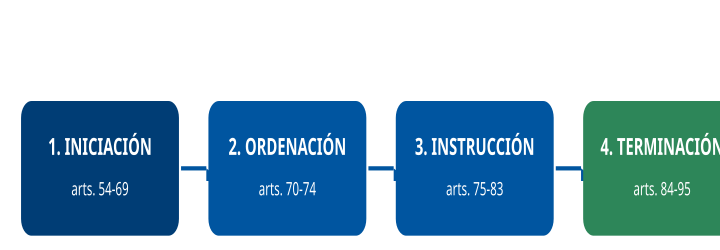

# Tema 7. El procedimiento administrativo y los recursos administrativos

**Bloque:** administrativo  
**Enunciado oficial** (BOAM n.º 10.032, de 23 de diciembre de 2025): Ley 39/2015, de 1 de octubre del Procedimiento Administrativo Común de las Administraciones Públicas: El procedimiento administrativo: Concepto, naturaleza y principios generales. Fases del procedimiento. Los recursos administrativos: Concepto y clases.

Versión web: <https://ayuntamientomadrid.github.io/temario-tecnico-auxiliar/temas/tema-07.html> · PDF: [tema-07.pdf](tema-07.pdf) · Test: [../../../tests/administrativo/tema-07.md](../../../tests/administrativo/tema-07.md)

## Índice

- 1. La Ley 39/2015 (LPACAP): contexto, relación con el Tema 6 y estructura
  - 1.1 Las dos leyes administrativas básicas de 2015
  - 1.2 Objeto y ámbito de aplicación
  - 1.3 Relación con el Tema 6
  - 1.4 Estructura de la Ley: qué regula cada título
- 2. El procedimiento administrativo: concepto y naturaleza
  - 2.1 Concepto: qué es y para qué sirve
  - 2.2 Naturaleza jurídica: garantía del ciudadano y cauce de actuación
  - 2.3 Fundamento constitucional (art. 105 CE)
- 3. Principios generales del procedimiento administrativo
  - 3.1 Principios de ordenación
  - 3.2 Principios de instrucción
  - 3.3 Principios de eficacia y proporcionalidad
- 4. Fases del procedimiento: iniciación, ordenación e instrucción
  - 4.1 Iniciación (arts. 54-69)
  - 4.2 Ordenación (arts. 70-74)
  - 4.3 Instrucción (arts. 75-83)
- 5. Fases del procedimiento: terminación y silencio administrativo
  - 5.1 La obligación de resolver (art. 21)
  - 5.2 Modos de terminación (art. 84)
  - 5.3 El silencio administrativo (arts. 24-25)
- 6. El acto administrativo: concepto, eficacia, nulidad y anulabilidad
  - 6.1 Concepto y requisitos de validez
  - 6.2 Eficacia: notificación y publicación
  - 6.3 Ejecutividad y ejecutoriedad
  - 6.4 Nulidad y anulabilidad (arts. 47-48)
- 7. Los recursos administrativos: concepto y clases
  - 7.1 Concepto y fundamento
  - 7.2 El recurso de alzada (arts. 121-122)
  - 7.3 El recurso potestativo de reposición (arts. 123-124)
  - 7.4 El recurso extraordinario de revisión (art. 125)
  - 7.5 Cuadro comparativo de los tres recursos
- 8. La revisión de oficio. Esquema resumen y conexiones
  - 8.1 La revisión de oficio (arts. 106-111)
  - 8.2 Mapa: procedimiento → acto → recursos → vía judicial
  - 8.3 Tabla de plazos críticos para el examen

### Conceptos clave por sección

#### Datos memorísticos de alto valor (Dato clave)

| Concepto | Dato | Artículo |
|----|----|----|
| Norma reguladora | LPACAP = **Ley 39/2015, de 1 de octubre** | Encabezamiento |
| Plazo subsidiario para resolver | **3 meses** si la norma no fija otro | Art. 21.3 |
| Cómputo de plazos por días | Días **hábiles**: se excluyen sábados, domingos y festivos | Art. 30.2 |
| Cómputo por meses/años | Concluye el **mismo día** de la notificación o publicación en el mes o año de vencimiento | Art. 30.4 |
| Inicio del procedimiento | De **oficio** o a **solicitud** del interesado | Art. 54 |
| Iniciación de oficio (modalidades) | Propia iniciativa, orden superior, **petición razonada** de otro órgano, **denuncia** | Art. 58 |
| Plazo de subsanación de solicitudes | **10 días** (ampliable hasta 5 más) | Art. 68.1-2 |
| Informes (regla general) | **Facultativos** y **no vinculantes**, salvo disposición en contrario | Art. 80.1 |
| Trámite de audiencia | Plazo de **10 a 15 días** | Art. 82.2 |
| Información pública | Plazo **no inferior a 20 días** | Art. 83.2 |
| Caducidad (paralización por el interesado) | Advertencia + **3 meses** de inactividad | Art. 95.1 |
| Silencio a solicitud del interesado | Regla general **estimatorio (positivo)**, salvo excepciones | Art. 24.1 |
| Silencio en procedimientos de oficio | Favorables: **desestimatorio**; sancionadores/desfavorables: **caducidad** | Art. 25 |
| Nulidad de pleno derecho | Supuestos tasados (incompetencia manifiesta, contenido imposible…) | Art. 47 |
| Anulabilidad | Cualquier infracción del ordenamiento, incluida la **desviación de poder** | Art. 48 |
| Presunción de validez | Los actos **se presumen válidos** y son ejecutivos | Arts. 39, 38 |
| Recurso de alzada — plazo | **1 mes** si expreso; si presunto, en **cualquier momento** | Art. 122.1 |
| Recurso de reposición — plazo | **1 mes** si expreso; si presunto, en **cualquier momento** | Art. 124.1 |
| Recurso extraordinario de revisión — plazo | **4 años** (error de hecho) o **3 meses** (resto de causas) | Art. 125.2 |
| Plazo de resolución de los recursos | Alzada **3 meses** · Reposición **1 mes** · Revisión **3 meses** | Arts. 122, 124, 126 |
| Revisión de oficio de actos nulos | **De oficio** (o a instancia), previo dictamen favorable del órgano consultivo | Art. 106 |
| Declaración de lesividad (actos anulables) | Plazo **4 años** desde que se dictó el acto + recurso contencioso | Art. 107 |

#### Tabla comparativa — Los tres recursos administrativos

|  | Alzada (arts. 121-122) | Reposición (arts. 123-124) | Extraordinario de revisión (arts. 125-126) |
|----|----|----|----|
| Objeto | Actos que **no** ponen fin a la vía administrativa | Actos que **sí** ponen fin a la vía administrativa | Actos **firmes** en vía administrativa |
| Carácter | **Obligatorio** (previo al contencioso) | **Potestativo** | **Extraordinario** (causas tasadas) |
| Órgano que resuelve | El **superior jerárquico** del que dictó el acto | El **mismo órgano** que dictó el acto | El **mismo órgano** que dictó el acto |
| Plazo de interposición | 1 mes (expreso) / cualquier momento (presunto) | 1 mes (expreso) / cualquier momento (presunto) | 4 años (error de hecho) / 3 meses (resto) |
| Plazo de resolución | **3 meses** | **1 mes** | **3 meses** |
| Silencio | Desestimatorio (salvo doble silencio → estimatorio) | Desestimatorio | Desestimatorio |

------------------------------------------------------------------------

## Contenido

------------------------------------------------------------------------

### Convenciones del documento

Este tema incluye cuatro tipos de **cajas callout** para facilitar el estudio:

> **Dato clave.** Información de alta densidad memorística: plazos, órganos competentes, efectos del silencio, supuestos tasados.

> **Cita normativa.** Reproducción literal o paráfrasis cercana de un precepto de la Ley 39/2015, con referencia al artículo.

> **Ejemplo de aplicación en el ayto.** Aplicación de la norma al entorno del Ayuntamiento de Madrid y, en particular, a un puesto de Técnico Auxiliar TIC del IAM.

> **Relación con otros temas.** Enlace conceptual a otros temas del temario o a otras secciones del propio Tema 7.

Las citas al articulado se expresan como `(art. X LPACAP)`. El registro completo de fuentes está en la pestaña Fuentes.

------------------------------------------------------------------------

### 1. La Ley 39/2015 (LPACAP): contexto, relación con el Tema 6 y estructura

#### 1.1 Las dos leyes administrativas básicas de 2015

El **1 de octubre de 2015** se aprobaron dos leyes que, según su preámbulo, articulan la reforma en dos ejes: las relaciones «ad extra» y «ad intra» de las Administraciones Públicas. La Ley 39/2015 derogó expresamente la anterior **Ley 30/1992, de 26 de noviembre, de Régimen Jurídico de las Administraciones Públicas y del Procedimiento Administrativo Común (LRJPAC)** (disposición derogatoria única.2.a):

- La **Ley 39/2015, del Procedimiento Administrativo Común de las Administraciones Públicas (LPACAP)** — regula las **relaciones «ad extra»**, es decir, de la Administración con los ciudadanos: el **procedimiento** que deben seguir los actos administrativos y los **recursos** frente a ellos.
- La **Ley 40/2015, de Régimen Jurídico del Sector Público (LRJSP)** — regula las **relaciones «ad intra»**: la organización y el funcionamiento interno del sector público (órganos, competencia, órganos colegiados, responsabilidad patrimonial en su vertiente sustantiva, relaciones interadministrativas). Según su artículo 1, establece y regula las bases del régimen jurídico de las Administraciones Públicas, los principios del sistema de responsabilidad de las Administraciones Públicas y de la potestad sancionadora, así como la organización y funcionamiento de la Administración General del Estado y de su sector público institucional.

> **Dato clave.** **Dos leyes, una fecha** (1 de octubre de 2015): la **39/2015** es la del **procedimiento** (cómo se relaciona la Administración con el ciudadano); la **40/2015** es la del **régimen jurídico** (cómo se organiza la Administración por dentro). La Ley 39/2015 derogó expresamente la Ley 30/1992. \[LPACAP, disposición derogatoria única; LRJSP\]

La competencia sobre el procedimiento administrativo común corresponde **en exclusiva al Estado** en virtud del **artículo 149.1.18.ª CE**, «sin perjuicio de las especialidades derivadas de la organización propia de las Comunidades Autónomas»; por eso la LPACAP se aplica a **todas** las Administraciones (estatal, autonómica y local) y, por tanto, también al Ayuntamiento de Madrid (art. 149.1.18.ª CE).

#### 1.2 Objeto y ámbito de aplicación

> **Cita normativa.** La Ley 39/2015 *"tiene por objeto regular los requisitos de validez y eficacia de los actos administrativos, el procedimiento administrativo común a todas las Administraciones Públicas, incluyendo el sancionador y el de reclamación de responsabilidad de las Administraciones Públicas, así como los principios a los que se ha de ajustar el ejercicio de la iniciativa legislativa y la potestad reglamentaria"* (art. 1.1 LPACAP).

Según el preámbulo de la Ley 39/2015, los anteriores procedimientos especiales sobre **potestad sancionadora** y **responsabilidad patrimonial**, que la Ley 30/1992 regulaba en títulos separados, se integran como **especialidades del procedimiento administrativo común** (preámbulo de la LPACAP, apartado V).

El **ámbito subjetivo** (art. 2) alcanza a la Administración General del Estado, las Administraciones de las Comunidades Autónomas, las **Entidades que integran la Administración Local** y el sector público institucional (art. 2 LPACAP).

> **Ejemplo de aplicación en el ayto.** El **Ayuntamiento de Madrid** es una entidad local y, como tal, tramita sus expedientes (licencias, multas, ayudas, contratación menor, expedientes del padrón, etc.) conforme a la Ley 39/2015. Un Técnico Auxiliar TIC del **IAM (Informática del Ayuntamiento de Madrid)** maneja a diario expedientes electrónicos que son la materialización informática de este procedimiento. \[Relación con otros temas: Tema 2 — Administración Local\]

#### 1.3 Relación con el Tema 6

Este Tema 7 **continúa** el Tema 6. Mientras el Tema 6 estudia los **sujetos y presupuestos** del procedimiento —los **interesados** (arts. 3-12), sus **derechos** (art. 13) y los **registros** (arts. 16-17)—, el Tema 7 estudia **cómo se tramita** el procedimiento de esos interesados: sus **fases**, el **acto** que lo resuelve y los **recursos** frente a él.

> **Relación con otros temas.** Conceptos del Tema 6 que se dan por sabidos aquí: quién es **interesado** (art. 4), la **capacidad de obrar** y la **representación** (arts. 3 y 5), la **obligación de relacionarse electrónicamente** de las personas jurídicas (art. 14) y el **Registro Electrónico General** (art. 16), que es por donde **entran** las solicitudes que inician el procedimiento. \[Tema 6\]

#### 1.4 Estructura de la Ley: qué regula cada título

| Título | Artículos | Contenido | ¿Tema 6 o 7? |
|----|----|----|----|
| Preliminar | 1-2 | Objeto y ámbito de aplicación | Ambos |
| I — De los interesados | 3-12 | Capacidad, interesado, representación, registros de apoderamientos | **Tema 6** |
| II — De la actividad de las AAPP | 13-33 | Derechos (13), registros (16), **términos y plazos (29-33)** | Tema 6 (derechos/registros) y **Tema 7 (plazos)** |
| III — De los actos administrativos | 34-52 | Requisitos, eficacia, notificación, **nulidad y anulabilidad** | **Tema 7** |
| IV — Del procedimiento administrativo común | 53-105 | **Garantías y las cuatro fases** del procedimiento | **Tema 7** |
| V — De la revisión de los actos en vía administrativa | 106-126 | **Revisión de oficio y recursos administrativos** | **Tema 7** |

> **Dato clave.** El **procedimiento administrativo común** se regula en el **Título IV** (arts. 53-105); los **recursos** y la **revisión de oficio** en el **Título V** (arts. 106-126); el **acto administrativo** en el **Título III** (arts. 34-52). (LPACAP)

------------------------------------------------------------------------

### 2. El procedimiento administrativo: concepto y naturaleza

#### 2.1 Concepto: qué es y para qué sirve

El **procedimiento administrativo** es el **conjunto ordenado de trámites y actuaciones** que la Administración sigue, según el cauce legalmente previsto, para dictar un **acto administrativo**. Ese cauce cumple una doble función:

- **Garantía del ciudadano**: la decisión administrativa se adopta oyendo al interesado, con pruebas e informes, y de forma motivada.
- **Acierto y eficacia de la decisión**: ordena la formación de la voluntad administrativa.

> **Cita normativa.** El preámbulo de la Ley 39/2015 se refiere al procedimiento administrativo *"entendido como el conjunto ordenado de trámites y actuaciones formalmente realizadas, según el cauce legalmente previsto, para dictar un acto administrativo o expresar la voluntad de la Administración"*. El acto es el **resultado**; el procedimiento es el **camino** que conduce a él. (preámbulo de la LPACAP, apartado II)

#### 2.2 Naturaleza jurídica: garantía del ciudadano y cauce de actuación

La naturaleza del procedimiento es **instrumental y garantista**:

1.  Es un **instrumento** al servicio del acto: el cauce para dictarlo.
2.  Es una **garantía** de los derechos de los ciudadanos: la audiencia, la prueba o la motivación.
3.  Es **reglado** en sus elementos esenciales: omitir trámites esenciales puede acarrear la **nulidad** o **anulabilidad** del acto (ver §6).

> **Dato clave.** Prescindir **"total y absolutamente del procedimiento legalmente establecido"** es causa de **nulidad de pleno derecho** (art. 47.1.e) LPACAP). En cambio, los defectos de forma menores solo producen **anulabilidad** si impiden al acto alcanzar su fin o generan **indefensión** (art. 48.2 LPACAP). (Ver §6.)

#### 2.3 Fundamento constitucional (art. 105 CE)

El procedimiento administrativo tiene **anclaje directo en la Constitución**:

> **Cita normativa.** El artículo 105 CE remite a la ley para regular: *"a) La audiencia de los ciudadanos, directamente o a través de las organizaciones y asociaciones reconocidas por la ley, en el procedimiento de elaboración de las disposiciones administrativas que les afecten. b) El acceso de los ciudadanos a los archivos y registros administrativos, salvo en lo que afecte a la seguridad y defensa del Estado, la averiguación de los delitos y la intimidad de las personas. c) El procedimiento a través del cual deben producirse los actos administrativos, garantizando, cuando proceda, la audiencia del interesado."* (art. 105 CE).

A ello se añaden otros preceptos constitucionales que enmarcan el procedimiento:

- **Art. 103.1 CE**: la Administración sirve con **objetividad** los intereses generales y actúa de acuerdo con los principios de **eficacia**, jerarquía, descentralización, desconcentración y coordinación, con sometimiento pleno a la ley y al Derecho.
- **Art. 106.1 CE**: los tribunales **controlan** la potestad reglamentaria y la legalidad de la actuación administrativa, así como el sometimiento de esta a los fines que la justifican.
- **Art. 9.3 CE**: garantiza, entre otros, los principios de **seguridad jurídica**, responsabilidad e interdicción de la arbitrariedad de los poderes públicos.

> **Dato clave.** El precepto constitucional que ordena que exista un **procedimiento** para producir los actos administrativos, garantizando la **audiencia del interesado**, es el **artículo 105.c) CE**. (art. 105 CE)

------------------------------------------------------------------------

### 3. Principios generales del procedimiento administrativo

Los principios del procedimiento se deducen del articulado de la Ley 39/2015 (sobre todo de la fase de ordenación e instrucción) y de los principios generales de actuación del artículo 3 LRJSP. Se agrupan en tres bloques.

#### 3.1 Principios de ordenación

Ordenan el **impulso y la marcha** del expediente:

- **Impulso de oficio** (art. 71.1): el procedimiento se impulsa de oficio en todos sus trámites.
- **Celeridad** y **simplificación administrativa**: de acuerdo con el principio de simplificación administrativa, se acuerdan en un solo acto todos los trámites que, por su naturaleza, admitan un impulso simultáneo y no sea obligado su cumplimiento sucesivo (**concentración de trámites**, art. 72.1).
- **Tramitación simplificada** (art. 96.1): cuando razones de interés público o la falta de complejidad del procedimiento así lo aconsejen, las Administraciones Públicas pueden acordar, de oficio o a solicitud del interesado, la tramitación simplificada del procedimiento.

> **Cita normativa.** *"El procedimiento, sometido al principio de celeridad, se impulsará de oficio en todos sus trámites y a través de medios electrónicos, respetando los principios de transparencia y publicidad"* (art. 71.1 LPACAP).

#### 3.2 Principios de instrucción

- **Contradicción**: el interesado puede aducir alegaciones y aportar documentos u otros elementos de juicio en cualquier momento anterior al trámite de audiencia (art. 76).
- **Audiencia**: antes de redactar la propuesta de resolución se da vista del expediente al interesado para que alegue (art. 82).
- **Imparcialidad** y **objetividad**: las autoridades y el personal en quienes concurra causa de **abstención** deben abstenerse (y pueden ser **recusados**), conforme a los artículos 23 y 24 LRJSP.
- **Igualdad** de los interesados en el procedimiento: el órgano instructor adopta las medidas necesarias para lograr el pleno respeto a los principios de contradicción y de igualdad de los interesados (art. 75.4).

> **Relación con otros temas.** La **abstención** (deber del empleado público de apartarse cuando tiene interés personal, parentesco, amistad íntima o enemistad, etc.) y la **recusación** (derecho del interesado a pedir que se aparte) se regulan en la **Ley 40/2015** (arts. 23-24). Conectan con los **deberes** y el **código de conducta** del empleado público. \[Tema 5 — TREBEP; LRJSP\]

#### 3.3 Principios de eficacia y proporcionalidad

- **Eficacia** (art. 103 CE): la actuación se orienta al resultado.
- **Proporcionalidad**: las medidas (provisionales, sancionadoras, de ejecución forzosa) deben ser **adecuadas** al fin y elegir, entre varias posibles, la **menos restrictiva** (art. 100.2 para la ejecución forzosa; con carácter general, art. 4.1 LRJSP).
- **Conservación de actos y trámites** (art. 51): se conservan los actos y trámites cuyo contenido se hubiera mantenido igual de no haberse cometido la infracción.

------------------------------------------------------------------------

### 4. Fases del procedimiento: iniciación, ordenación e instrucción

El procedimiento administrativo común se ordena en **cuatro fases**: **iniciación → ordenación → instrucción → terminación**. Las tres primeras se estudian en esta sección; la terminación y el silencio, en la §5.

> **Dato clave.** Las cuatro fases del procedimiento son **iniciación, ordenación, instrucción y terminación**. La **ordenación** no es una fase "entre medias" con trámites propios cerrados: es el conjunto de reglas que **impulsan** el expediente mientras se instruye. \[LPACAP, Título IV, capítulos II a V\]

#### 4.1 Iniciación (arts. 54-69)

El procedimiento puede iniciarse **de oficio** o **a solicitud del interesado** (art. 54 LPACAP).

**A) Iniciación de oficio** (art. 58). Se acuerda por el órgano competente, por alguna de estas **cuatro vías**:

| Vía | En qué consiste |
|----|----|
| **Propia iniciativa** | El órgano actúa por su propio conocimiento de los hechos |
| **Orden superior** | Mandato de un órgano jerárquicamente superior |
| **Petición razonada de otros órganos** | Un órgano que no es competente propone a otro que inicie |
| **Denuncia** | Acto por el que cualquier persona pone en conocimiento de la Administración hechos que pueden justificar el inicio |

> **Dato clave.** La **denuncia no obliga** a iniciar el procedimiento ni convierte al denunciante en interesado por ese solo hecho. La presentación de una denuncia **no confiere, por sí sola, la condición de interesado** (art. 62.5 LPACAP).

Antes de iniciar, el órgano puede abrir un **periodo de información o actuaciones previas** para conocer las circunstancias y decidir si procede iniciar (art. 55), y adoptar **medidas provisionales** (art. 56).

**B) Iniciación a solicitud del interesado** (arts. 66-68). La **solicitud** debe contener: nombre y apellidos del interesado y, en su caso, del representante; identificación del medio electrónico o lugar para notificaciones; hechos, razones y petición; lugar y fecha; firma; y órgano al que se dirige (art. 66 LPACAP).

- **Subsanación y mejora** (art. 68): si la solicitud no reúne los requisitos, se requiere al interesado para que en **10 días** subsane, con indicación de que, si no lo hace, **se le tendrá por desistido** de su petición, previa resolución dictada en los términos del artículo 21 (art. 68.1). El plazo puede **ampliarse hasta 5 días** más (salvo procedimientos selectivos o de concurrencia competitiva) (art. 68.2).

> **Dato clave.** Plazo de **subsanación de la solicitud: 10 días**, ampliable hasta **5 más** (no en concurrencia competitiva). Si no se subsana → **desistimiento** (art. 68.1-2 LPACAP). No confundir con el plazo de **audiencia** (10-15 días).

**Medidas provisionales** (art. 56). Pueden adoptarse, de oficio o a instancia de parte, las medidas provisionales necesarias para asegurar la eficacia de la resolución, si hay elementos de juicio suficientes. Antes de iniciar el procedimiento, solo en casos de **urgencia inaplazable** y para la protección provisional de los intereses implicados; deben ser **confirmadas, modificadas o levantadas** en el acuerdo de inicio (que debe producirse dentro de los **15 días** siguientes). No cabe adoptar medidas que causen **perjuicio de difícil o imposible reparación** ni que impliquen violación de derechos amparados por las leyes.

> **Ejemplo de aplicación en el ayto.** Si la Inspección municipal detecta un local con una instalación eléctrica peligrosa, el Ayuntamiento de Madrid puede acordar como **medida provisional** el **precinto** de la actividad (art. 56) mientras tramita el expediente de disciplina, para evitar un riesgo inminente. (art. 56 LPACAP)

#### 4.2 Ordenación (arts. 70-74)

La ordenación es el conjunto de reglas que mantienen vivo y ordenado el expediente.

- **Expediente administrativo** (art. 70): es el **conjunto ordenado de documentos y actuaciones** que sirven de antecedente y fundamento a la resolución, así como las diligencias para ejecutarla. Tiene formato **electrónico** y se forma mediante la agregación ordenada de documentos; **no forma parte** del expediente la información de carácter auxiliar o de apoyo (notas, borradores, opiniones internas).
- **Impulso de oficio y celeridad** (art. 71): se impulsa de oficio y se respeta el **orden de incoación** en asuntos de homogénea naturaleza (salvo orden motivada en contrario).
- **Concentración de trámites** (art. 72): se acuerdan en un solo acto todos los trámites que admitan impulso simultáneo.
- **Cumplimiento de trámites** (art. 73): los trámites a cumplir por los interesados se realizan en **10 días** desde la notificación del acto, salvo que la norma fije otro plazo.

**Términos y plazos**

- **Obligatoriedad** (art. 29): los términos y plazos obligan a las autoridades y al personal y a los interesados.
- **Cómputo** (art. 30):
- Plazos por **horas**: son **hábiles** todas las horas del día que formen parte de un día hábil; se cuentan de hora en hora y de minuto en minuto.
- Plazos por **días**: se entienden **días hábiles**, **excluyéndose sábados, domingos y festivos**. El cómputo empieza el **día siguiente** a la notificación o publicación.
- Plazos por **meses o años**: se computan a partir del día siguiente a la notificación o publicación y concluyen **el mismo día** en que se produjo la notificación, publicación o silencio en el mes o el año de vencimiento; si en el mes de vencimiento no hay día equivalente, el plazo expira el **último día del mes**.
- Si el último día es **inhábil**, se entiende prorrogado al **primer día hábil siguiente**.
- **Cómputo de plazos en registros** (art. 31): el registro electrónico permite la presentación **todos los días del año durante las 24 horas** (art. 31.2.a).
- **Ampliación** (art. 32): la Administración puede ampliar los plazos, de oficio o a petición, si las circunstancias lo aconsejan y no se perjudican derechos de tercero; la ampliación no podrá exceder de la **mitad** del plazo. Los acuerdos sobre ampliación de plazos o sobre su denegación **no son susceptibles de recurso** (art. 32.3).
- **Tramitación de urgencia** (art. 33): se pueden **reducir a la mitad** los plazos del procedimiento ordinario (salvo los relativos a la presentación de solicitudes y recursos). Contra el acuerdo que declara la urgencia **no cabe recurso**.

> **Dato clave.** Días en plazos administrativos = **días hábiles** (no cuentan sábados, domingos ni festivos), salvo que la norma diga "días naturales". El cómputo arranca **el día siguiente** a la notificación. Meses/años = **de fecha a fecha**. (art. 30 LPACAP)

> **Ejemplo de aplicación en el ayto.** Una notificación electrónica del Ayuntamiento de Madrid se entiende **rechazada** si transcurren **10 días naturales** desde su puesta a disposición en la sede electrónica sin que el interesado acceda (art. 43.2). En cambio, el plazo para **interponer el recurso** que aparece en esa notificación se cuenta por **días hábiles** o por meses. Distinguir ambos cómputos es un error frecuente. (arts. 43.2 y 30 LPACAP)

#### 4.3 Instrucción (arts. 75-83)

Los **actos de instrucción** son los necesarios para la determinación, conocimiento y comprobación de los hechos. Se realizan **de oficio** por el órgano que tramita (art. 75). Comprende cuatro trámites principales:

**A) Alegaciones** (art. 76). Los interesados pueden, en **cualquier momento anterior al trámite de audiencia**, aducir alegaciones y aportar documentos, que el órgano tendrá en cuenta al redactar la propuesta de resolución.

**B) Prueba** (arts. 77-78). Los hechos relevantes pueden acreditarse por cualquier medio admisible en Derecho. El instructor acuerda la apertura de un **periodo de prueba** de **10 a 30 días** cuando la Administración no tenga por ciertos los hechos alegados por los interesados o la naturaleza del procedimiento lo exija (art. 77.2); solo puede **rechazar** las pruebas propuestas mediante resolución motivada cuando sean **manifiestamente improcedentes o innecesarias**.

> **Dato clave.** Los **hechos declarados probados por resoluciones judiciales penales firmes vinculan** a las Administraciones respecto de los procedimientos sancionadores que tramiten (art. 77.4 LPACAP).

**C) Informes** (arts. 79-81). Son las opiniones técnicas o jurídicas que se incorporan al expediente. Se clasifican en dos ejes:

| Eje | Clases | Regla general |
|----|----|----|
| Según su **exigibilidad** | **Preceptivos** (la norma los exige) / **Facultativos** (los pide el instructor si lo cree conveniente) | Salvo disposición expresa, los informes son **facultativos** |
| Según su **fuerza** | **Vinculantes** (obligan al órgano que resuelve) / **No vinculantes** | Salvo disposición expresa, los informes son **no vinculantes** |

> **Cita normativa.** *"Salvo disposición expresa en contrario, los informes serán facultativos y no vinculantes"* (art. 80.1 LPACAP).

Se solicitan los informes que sean preceptivos por las disposiciones legales y los que se juzguen necesarios para resolver (art. 79.1). Los informes se emiten en **10 días**, salvo que una disposición o el cumplimiento del resto de los plazos del procedimiento permita o exija otro plazo mayor o menor (art. 80.2). De no emitirse el informe en plazo, se podrán **proseguir las actuaciones**, salvo cuando se trate de un informe **preceptivo**, en cuyo caso se podrá suspender el transcurso del plazo máximo legal para resolver (art. 80.3).

**D) Trámite de audiencia e información pública** (arts. 82-83).

- **Audiencia** (art. 82): instruido el procedimiento e **inmediatamente antes** de redactar la propuesta de resolución, se pone de manifiesto a los interesados (o a su representante) el expediente para que aleguen y presenten documentos. Plazo: **no inferior a 10 días ni superior a 15**. Se puede **prescindir** del trámite cuando no figuren en el procedimiento ni sean tenidos en cuenta en la resolución otros hechos ni otras alegaciones y pruebas que las aducidas por el interesado (art. 82.4).
- **Información pública** (art. 83): cuando la naturaleza del procedimiento lo requiera, el órgano puede acordar un periodo de **información pública** anunciado en el diario oficial correspondiente, por plazo **no inferior a 20 días**. La comparecencia en la información pública **no otorga, por sí misma, la condición de interesado**; pero quienes presenten alegaciones tienen derecho a obtener respuesta razonada.

> **Dato clave.** Tres plazos que se confunden: **audiencia 10-15 días** (art. 82.2) · **información pública no inferior a 20 días** (art. 83.2) · **prueba 10-30 días** (art. 77.2). (LPACAP)

> **Ejemplo de aplicación en el ayto.** En la tramitación de una **ordenanza municipal** del Ayuntamiento de Madrid (p. ej. una ordenanza de movilidad), se abre **información pública** para que cualquier vecino formule alegaciones; en cambio, en un expediente de **reintegro de una subvención** a un beneficiario concreto se practica el **trámite de audiencia** a ese beneficiario. (arts. 82-83 LPACAP)

------------------------------------------------------------------------

### 5. Fases del procedimiento: terminación y silencio administrativo

#### 5.1 La obligación de resolver (art. 21)

> **Cita normativa.** *"La Administración está obligada a dictar resolución expresa y a notificarla en todos los procedimientos cualquiera que sea su forma de iniciación"* (art. 21.1 LPACAP).

El **plazo máximo** para notificar la resolución es el que fije la norma del procedimiento, y **nunca podrá exceder de 6 meses** salvo que una norma con rango de ley o el Derecho de la UE establezcan uno mayor. **Si la norma no fija plazo, el supletorio es de 3 meses** (art. 21.2 y 21.3 LPACAP).

> **Dato clave.** Plazo **supletorio** para resolver y notificar: **3 meses**. Cómputo del inicio: en procedimientos de **oficio**, desde el **acuerdo de iniciación**; a **solicitud** del interesado, desde la fecha en que la solicitud haya tenido **entrada en el registro electrónico** de la Administración u Organismo competente para su tramitación (art. 21.3 LPACAP).

#### 5.2 Modos de terminación (art. 84)

> **Cita normativa.** *"Pondrán fin al procedimiento la resolución, el desistimiento, la renuncia al derecho en que se funde la solicitud, cuando tal renuncia no esté prohibida por el ordenamiento jurídico, y la declaración de caducidad"* (art. 84.1 LPACAP). También produce la terminación la **imposibilidad material** de continuarlo por causas sobrevenidas, mediante resolución motivada (art. 84.2).

A ello se añade la **terminación convencional** (art. 86).

**A) Resolución: requisitos y motivación** (arts. 88, 35).

- La resolución **decide todas las cuestiones planteadas** y aquellas derivadas del procedimiento (art. 88.1). Cuando se trate de cuestiones conexas que no hubieran sido planteadas por los interesados, el órgano competente podrá pronunciarse sobre ellas, poniéndolo antes de manifiesto a aquellos por un plazo no superior a 15 días.
- En los procedimientos tramitados a solicitud del interesado, la resolución es **congruente** con las peticiones formuladas por este y **no puede agravar su situación inicial**, sin perjuicio de la potestad de la Administración de incoar de oficio un nuevo procedimiento (prohibición de la *reformatio in peius*, art. 88.2).
- En ningún caso puede la Administración **abstenerse de resolver** so pretexto de silencio, oscuridad o insuficiencia de los preceptos legales aplicables al caso, aunque podrá acordar la inadmisión de las solicitudes de reconocimiento de derechos no previstos en el ordenamiento jurídico o manifiestamente carentes de fundamento (art. 88.5).
- **Motivación** (art. 35): deben motivarse, con sucinta referencia a hechos y fundamentos, entre otros: los actos que **limiten derechos** subjetivos o intereses legítimos; los que **resuelvan recursos**; los que se **separen del criterio** seguido en actuaciones precedentes; los **discrecionales**; los acuerdos de **suspensión** y de adopción de **medidas provisionales**; etc.

> **Dato clave.** **Resolver recursos siempre exige motivación** (art. 35.1.b). La resolución de un procedimiento a solicitud del interesado **no puede empeorar su situación de partida** (*reformatio in peius* prohibida, art. 88.2).

**B) Desistimiento y renuncia** (arts. 93-94).

- **Desistimiento de la Administración** (art. 93): solo cabe en procedimientos iniciados de oficio, en los supuestos y con los requisitos previstos en las leyes.
- **Desistimiento y renuncia del interesado** (art. 94): todo interesado puede **desistir de su solicitud** o, cuando ello no esté prohibido por el ordenamiento jurídico, **renunciar a sus derechos** (art. 94.1). La Administración acepta de plano el desistimiento o la renuncia y declara concluso el procedimiento, salvo que, habiéndose personado terceros interesados, instasen estos su continuación en el plazo de **10 días** desde que fueron notificados (art. 94.4).

> **Dato clave.** **Desistimiento** = abandono **del procedimiento** (se conserva el derecho, se puede volver a pedir). **Renuncia** = abandono **del derecho** (no se podrá volver a pedir). (art. 94 LPACAP)

**C) Caducidad** (art. 95). En los procedimientos iniciados **a solicitud del interesado**, cuando se produzca su **paralización por causa imputable al interesado**, la Administración le **advierte** que, transcurridos **3 meses**, se producirá la caducidad. Consumido ese plazo sin actividad, se declara la caducidad y se archivan las actuaciones. La caducidad **no produce por sí sola la prescripción** de las acciones, y los procedimientos caducados no interrumpen el plazo de prescripción.

> **Dato clave.** No confundir las **dos caducidades**: (1) la **caducidad del artículo 95** (paralización por el **interesado** en procedimientos a solicitud, advertencia + 3 meses); (2) la **caducidad-perención del artículo 25.1.b)**, que se produce cuando es la **Administración** la que no resuelve en plazo un procedimiento **de oficio** del que pudieran derivarse efectos **desfavorables o de gravamen** (p. ej. sancionador). (arts. 95 y 25 LPACAP)

**D) Terminación convencional** (art. 86). Las Administraciones pueden celebrar **acuerdos, pactos, convenios o contratos** con personas de Derecho público o privado, siempre que no sean contrarios al ordenamiento ni versen sobre materias no susceptibles de transacción, y tengan por objeto satisfacer el interés público. Estos acuerdos pueden tener la consideración de **finalizadores del procedimiento** o insertarse en él con carácter previo a la resolución.

#### 5.3 El silencio administrativo (arts. 24-25)

El silencio administrativo regula los efectos del **vencimiento del plazo máximo sin que se haya notificado resolución expresa**. La ley distingue según la forma de iniciación del procedimiento (arts. 24 y 25).

**A) Silencio en procedimientos iniciados a solicitud del interesado** (art. 24).

> **Cita normativa.** *"En los procedimientos iniciados a solicitud del interesado... el vencimiento del plazo máximo sin haberse notificado resolución expresa legitima al interesado... para entenderla estimada por silencio administrativo"* (art. 24.1 LPACAP). **La regla general es el silencio positivo (estimatorio).**

**Excepciones en que el silencio es negativo (desestimatorio)** — cuando una **norma con rango de ley** o una **norma de Derecho de la UE o de Derecho internacional aplicable en España** así lo establezcan (si el procedimiento tiene por objeto el acceso a actividades o su ejercicio, esa ley deberá fundarse en razones imperiosas de interés general), y además en estos casos legales:

- Procedimientos relativos al **ejercicio del derecho de petición** (art. 29 CE).
- Aquellos cuya estimación tuviera como consecuencia que se **transfirieran al solicitante o a terceros facultades sobre el dominio público o el servicio público**.
- Procedimientos que impliquen el ejercicio de **actividades que puedan dañar el medio ambiente**.
- Procedimientos de **responsabilidad patrimonial** de las Administraciones.
- Procedimientos de **impugnación de actos y disposiciones** y los de **revisión de oficio** iniciados a solicitud de los interesados.

> **Dato clave.** **Doble silencio en alzada**: si se recurre en alzada una **desestimación por silencio** y la alzada **tampoco se resuelve** en plazo, el silencio de la alzada es **positivo (estimatorio)**, siempre que no se refiera a las materias del párrafo anterior (petición, dominio o servicio público, medio ambiente, responsabilidad patrimonial) (art. 24.1 LPACAP, párrafo tercero). Es la excepción a la excepción.

**Efectos del silencio** (art. 24.2-4):

- La estimación por silencio tiene a todos los efectos la consideración de **acto administrativo finalizador del procedimiento** (art. 24.2): la resolución expresa posterior solo podrá dictarse de ser **confirmatoria** (art. 24.3.a).
- La desestimación por silencio tiene los **solos efectos** de permitir a los interesados la interposición del recurso administrativo o contencioso-administrativo que resulte procedente (art. 24.2); la resolución expresa posterior se adopta **sin vinculación alguna al sentido del silencio** (art. 24.3.b).
- Los actos producidos por silencio pueden acreditarse por cualquier medio de prueba admitido en Derecho, incluido el **certificado acreditativo del silencio**, que el órgano competente para resolver expide de oficio en el plazo de **15 días** desde que expire el plazo máximo para resolver (art. 24.4).

> **Cita normativa.** *"En los casos de desestimación por silencio administrativo, la resolución expresa posterior al vencimiento del plazo se adoptará por la Administración sin vinculación alguna al sentido del silencio"* (art. 24.3.b) LPACAP).

**B) Falta de resolución expresa en procedimientos iniciados de oficio** (art. 25). El vencimiento del plazo no exime a la Administración del cumplimiento de la obligación legal de resolver y produce estos efectos (art. 25.1):

| Tipo de procedimiento de oficio | Efecto del transcurso del plazo |
|----|----|
| De los que pudiera derivarse el **reconocimiento o constitución de derechos** u otras situaciones jurídicas favorables | Los interesados que hubieren comparecido pueden entender **desestimadas** sus pretensiones por silencio |
| Aquellos en que la Administración ejercite potestades **sancionadoras** o, en general, de **intervención**, susceptibles de producir **efectos desfavorables o de gravamen** | **Caducidad**: la resolución que la declare ordena el archivo de las actuaciones |

> **Ejemplo de aplicación en el ayto.** Si un ciudadano solicita una **licencia** al Ayuntamiento de Madrid y la concejalía competente no resuelve en plazo, el régimen del silencio depende de la ley sectorial: muchas licencias urbanísticas tienen, por ley, **silencio negativo** (no se pueden adquirir por silencio facultades contrarias al planeamiento). En cambio, si la Inspección municipal abre de oficio un **expediente sancionador** por una infracción y no lo resuelve en plazo, se produce la **caducidad** y debe archivarse (sin perjuicio de reiniciarlo si no ha prescrito la infracción). (arts. 24-25 LPACAP)

------------------------------------------------------------------------

### 6. El acto administrativo: concepto, eficacia, nulidad y anulabilidad

#### 6.1 Concepto y requisitos de validez

El **acto administrativo** es la **declaración de voluntad, de juicio, de conocimiento o de deseo** realizada por una Administración en el ejercicio de una potestad administrativa distinta de la potestad reglamentaria. Es el **resultado** del procedimiento.

Para que sean válidos, se han de cumplir estos requisitos:

- que sean dictados por **órgano competente** (art. 34).
- ajustado al **ordenamiento jurídico**, con contenido **determinado** y adecuado a sus fines (art. 34.2).
- **producido conforme al procedimiento** y a través del **órgano competente**; se produce por escrito a través de medios electrónicos, salvo que su naturaleza exija otra forma (art. 36).
- motivado en los supuestos ya vistos (actos que limitan derechos, resuelven recursos, discrecionales, se separan del criterio, etc.) (art. 35).

#### 6.2 Eficacia: notificación y publicación

> **Cita normativa.** *"Los actos de las Administraciones Públicas... se presumirán válidos y producirán efectos desde la fecha en que se dicten, salvo que en ellos se disponga otra cosa"* (art. 39.1 LPACAP).

La eficacia puede quedar **demorada** cuando lo exija el contenido del acto o esté supeditada a su **notificación** o **publicación** (art. 39.2).

**Notificación** (arts. 40-44):

- Se notifican a los interesados las resoluciones y actos que afecten a sus derechos e intereses (art. 40.1). Se cursa en el **plazo de 10 días** desde que el acto se dictó (art. 40.2).
- La notificación debe contener: el **texto íntegro** del acto, si es o no definitivo en vía administrativa, los **recursos** procedentes, el **órgano** ante el que presentarlos y el **plazo** (art. 40.2).
- **Práctica preferentemente electrónica** (arts. 41 y 43): la notificación electrónica se entiende practicada cuando se accede a su contenido; y **rechazada** si transcurren **10 días naturales** desde la puesta a disposición en la sede sin que se acceda (art. 43.2).
- Notificaciones **infructuosas** (art. 44): cuando los interesados sean desconocidos, se ignore el lugar de la notificación o, intentada esta, no se haya podido practicar, la notificación se hace por medio de un anuncio publicado en el **«Boletín Oficial del Estado»**.

**Publicación** (arts. 45-46): los actos se publican cuando lo establezcan las normas reguladoras de cada procedimiento o lo aconsejen razones de interés público; en todo caso, la publicación surte los efectos de la notificación cuando el acto tenga por destinatario a una pluralidad indeterminada de personas y cuando se trate de actos integrantes de un procedimiento selectivo o de concurrencia competitiva (art. 45.1).

> **Dato clave.** La notificación se cursa en **10 días** desde que se dicta el acto (art. 40.2) y debe indicar **recursos, órgano y plazo**. La notificación electrónica se entiende **rechazada** a los **10 días naturales** sin acceder (art. 43.2).

#### 6.3 Ejecutividad y ejecutoriedad

- **Ejecutividad** (art. 38): los actos administrativos son **ejecutivos** con arreglo a lo dispuesto en la ley. Unida a la **presunción de validez** (art. 39.1), constituye la **autotutela declarativa** de la Administración.
- **Ejecutoriedad / ejecución forzosa** (arts. 97-101): la Administración puede **ejecutar forzosamente** sus propios actos (autotutela ejecutiva), previo apercibimiento, salvo en los supuestos en que se suspenda la ejecución de acuerdo con la Ley o cuando la Constitución o la Ley exijan la intervención de un órgano judicial (art. 99). Los **medios de ejecución forzosa** son **apremio sobre el patrimonio**, **ejecución subsidiaria**, **multa coercitiva** y **compulsión sobre las personas**, respetando siempre el principio de proporcionalidad (art. 100.1); si fueran varios los admisibles, se elige el menos restrictivo de la libertad individual (art. 100.2).

> **Relación con otros temas.** El **apremio sobre el patrimonio** (art. 100.1.a y art. 101) es el medio típico para cobrar deudas de derecho público; conecta directamente con la **recaudación de los ingresos de derecho público** de las Haciendas Locales (tasas, contribuciones especiales, multas). \[Tema 8 — Haciendas Locales\]

#### 6.4 Nulidad y anulabilidad (arts. 47-48)

La invalidez puede ser de dos grados:

**A) Nulidad de pleno derecho** (art. 47) — el acto **no produce efectos desde el origen** (*ex tunc*), es **insubsanable** e **imprescriptible**. Son nulos de pleno derecho los actos:

- a\) Que **lesionen los derechos y libertades** susceptibles de amparo constitucional.
- b\) Dictados por **órgano manifiestamente incompetente** por razón de la **materia o del territorio**.
- c\) De **contenido imposible**.
- d\) Que sean **constitutivos de infracción penal** o se dicten como consecuencia de ésta.
- e\) Dictados **prescindiendo total y absolutamente del procedimiento** legalmente establecido o de las normas que contienen las **reglas esenciales para la formación de la voluntad de los órganos colegiados**.
- f\) Actos **expresos o presuntos contrarios al ordenamiento** por los que se **adquieren facultades o derechos cuando se carezca de los requisitos esenciales** para su adquisición.
- g\) Cualquier otro que se establezca expresamente en una **disposición con rango de ley**.

Además, son nulas de pleno derecho las **disposiciones administrativas** (reglamentos) que vulneren la Constitución, las leyes u otras de rango superior, las que regulen materias reservadas a la ley y las que establezcan la retroactividad de disposiciones sancionadoras no favorables o restrictivas (art. 47.2).

> **Dato clave.** La incompetencia que causa **nulidad** es la **manifiesta por razón de materia o territorio**. La incompetencia **jerárquica** (de grado) solo produce **anulabilidad** y, además, es **convalidable** por el órgano superior competente (art. 52.3). (arts. 47.1.b) y 52 LPACAP)

**B) Anulabilidad** (art. 48) — la regla general de la invalidez; el acto produce efectos mientras no se anule, y el vicio es **subsanable** (convalidación, art. 52):

> **Cita normativa.** *"Son anulables los actos de la Administración que incurran en cualquier infracción del ordenamiento jurídico, incluso la desviación de poder"* (art. 48.1 LPACAP).

- **Defecto de forma**: solo determina la anulabilidad cuando el acto **carezca de los requisitos formales indispensables para alcanzar su fin** o **dé lugar a indefensión** de los interesados (art. 48.2).
- **Actuaciones fuera de plazo**: solo implican la anulabilidad del acto cuando **lo imponga la naturaleza del término o plazo** (art. 48.3).

> **Dato clave.** **Desviación de poder** = ejercicio de potestades administrativas para **fines distintos** de los fijados por el ordenamiento. Produce **anulabilidad** (art. 48.1), no nulidad.

**Mecanismos de conservación** (arts. 49-52):

- **Límites a la extensión de la invalidez** (art. 49.1): la nulidad o anulabilidad de un acto no implica la de los sucesivos en el procedimiento que sean independientes del primero.
- **Conversión** (art. 50): el acto nulo o anulable que contenga los elementos de otro distinto produce los efectos de éste.
- **Conservación** de actos y trámites (art. 51).
- **Convalidación** (art. 52): la Administración puede **convalidar** los actos **anulables** subsanando los vicios (efecto desde la fecha de la convalidación, salvo retroactividad del art. 39.3).

------------------------------------------------------------------------

### 7. Los recursos administrativos: concepto y clases

#### 7.1 Concepto y fundamento

El **recurso administrativo** es el acto del interesado por el que solicita a la propia Administración la **revisión** de un acto que estima contrario a Derecho.

> **Cita normativa.** *"Contra las resoluciones y los actos de trámite, si estos últimos deciden directa o indirectamente el fondo del asunto, determinan la imposibilidad de continuar el procedimiento, producen indefensión o perjuicio irreparable a derechos e intereses legítimos, podrán interponerse por los interesados los recursos de alzada y potestativo de reposición, que cabrá fundar en cualquiera de los motivos de nulidad o anulabilidad previstos en los artículos 47 y 48 de esta Ley"* (art. 112.1 LPACAP).

Son **recurribles** las **resoluciones** y los **actos de trámite cualificados** (los que deciden directa o indirectamente el fondo, determinan la imposibilidad de continuar el procedimiento, producen indefensión o perjuicio irreparable a derechos e intereses legítimos). Los **actos de trámite no cualificados** no son recurribles de forma autónoma; la oposición a ellos puede alegarse para su consideración en la resolución que ponga fin al procedimiento (art. 112.1). Contra las **disposiciones administrativas de carácter general** no cabe recurso en vía administrativa (art. 112.3).

**Recurso administrativo vs recurso judicial (contencioso-administrativo):**

|  | Recurso administrativo | Recurso contencioso-administrativo |
|----|----|----|
| Ante quién | La **propia Administración** | Los **tribunales** (jurisdicción contencioso-administrativa) |
| Naturaleza | Autotutela administrativa | Control judicial (art. 106 CE) |
| Presupuesto | Acto no firme | Agotamiento de la vía administrativa |

**Principios comunes** (arts. 115-120):

- **Interposición** (art. 115): el escrito indica el acto recurrido, el recurrente, el lugar de notificaciones, el órgano y la firma. El **error en la calificación** del recurso por el recurrente no es obstáculo para su tramitación si se deduce su verdadero carácter (art. 115.2).
- **Suspensión** (art. 117): la interposición **no suspende** la ejecución del acto, excepto en los casos en que una disposición establezca lo contrario (art. 117.1); el órgano a quien competa resolver puede acordar la suspensión, de oficio o a solicitud del recurrente, previa ponderación entre el perjuicio que causaría al interés público o a terceros la suspensión y el ocasionado al recurrente, cuando la ejecución pudiera causar perjuicios de **imposible o difícil reparación** o la impugnación se fundamente en alguna causa de **nulidad de pleno derecho** del artículo 47.1 (art. 117.2).
- **Audiencia** (art. 118): si han de tenerse en cuenta nuevos hechos o documentos no recogidos en el expediente originario, se ponen de manifiesto a los interesados para que aleguen en un plazo no inferior a 10 días ni superior a 15. **No se tienen en cuenta** los hechos, documentos o alegaciones del recurrente cuando, habiendo podido aportarlos en el trámite de alegaciones, no lo haya hecho.
- **Resolución** (art. 119): estima o desestima; si aprecia vicio de forma que no permite resolver el fondo, ordena la **retroacción** del procedimiento al momento en el que el vicio fue cometido (art. 119.2).

> **Dato clave.** Regla general: la interposición del recurso **NO suspende** la ejecución del acto (art. 117.1). La suspensión es **excepcional** y debe acordarse motivadamente (perjuicios irreparables o causa de nulidad de pleno derecho).

#### 7.2 El recurso de alzada (arts. 121-122)

- **Objeto**: las **resoluciones y actos** que **no pongan fin a la vía administrativa** (art. 121.1).
- **Órgano**: se interpone ante el órgano que dictó el acto **o** ante el competente para resolverlo (art. 121.2). Resuelve el **órgano superior jerárquico** del que dictó el acto (art. 121.1).
- **Carácter**: es **obligatorio** (preceptivo) para agotar la vía administrativa y poder acudir después al contencioso. No es potestativo.
- **Plazo de interposición** (art. 122.1): **1 mes** si el acto es **expreso**. Si el acto **no es expreso** (presunto), el solicitante y otros posibles interesados podrán interponerlo **en cualquier momento** a partir del día siguiente a aquel en que se produzcan los efectos del silencio.
- **Plazo de resolución** (art. 122.2): **3 meses**. Transcurrido sin resolución, se podrá entender **desestimado** el recurso, salvo en el supuesto de **doble silencio** del artículo 24.1, tercer párrafo (si la alzada se interpuso contra la desestimación por silencio de una solicitud, el silencio de la alzada es **estimatorio**, siempre que no se refiera a las materias del párrafo segundo de ese apartado, como el dominio público o el servicio público).
- Contra la resolución de la alzada **no cabe** otro recurso administrativo, salvo el extraordinario de revisión en los casos del artículo 125.1 (art. 122.3).

> **Dato clave.** Alzada = acto que **NO** agota la vía administrativa → resuelve el **superior jerárquico**. Plazo: **1 mes** (expreso) / **cualquier momento** (presunto). Resolución: **3 meses** → desestimación por silencio (salvo doble silencio). (arts. 121-122 LPACAP)

#### 7.3 El recurso potestativo de reposición (arts. 123-124)

- Se interpone contra los **actos que pongan fin a la vía administrativa** (art. 123.1), ante el **mismo órgano** que dictó el acto, que es quien lo resuelve.
- **Carácter**: es **potestativo**. El interesado puede elegir entre interponer reposición **o** acudir directamente al recurso **contencioso-administrativo**. Lo que **no puede** es interponer el contencioso mientras la reposición no se haya resuelto expresamente o por silencio (art. 123.2).
- **Plazo de interposición** (art. 124.1): **1 mes** si el acto es **expreso**; si no es expreso, en **cualquier momento** a partir del día siguiente a aquel en que se produzca el acto presunto.
- **Plazo de resolución**: **1 mes** (art. 124.2). Transcurrido sin resolución, el silencio es **desestimatorio** (arts. 24.1 y 123.2).

> **Dato clave.** Reposición = acto que **SÍ** agota la vía administrativa → resuelve el **mismo órgano** → es **potestativo**. Plazo de interposición **1 mes** (expreso); plazo de **resolución 1 mes**. No cabe interponer el contencioso hasta que se resuelva la reposición. (arts. 123-124 LPACAP)

#### 7.4 El recurso extraordinario de revisión (art. 125)

- **Objeto**: los **actos firmes en vía administrativa**, solo por **causas tasadas**.
- **Órgano**: el **mismo órgano** administrativo que los dictó (art. 125.1).
- **Causas** (art. 125.1) — son **cuatro**:

| Causa | Supuesto |
|----|----|
| a\) | Que al dictarlos se hubiera incurrido en **error de hecho** que resulte de los propios documentos incorporados al expediente |
| b\) | Que **aparezcan documentos** de valor esencial para la resolución del asunto que, aunque sean posteriores, evidencien el error de la resolución recurrida |
| c\) | Que en la resolución hayan influido esencialmente **documentos o testimonios declarados falsos** por sentencia judicial firme, anterior o posterior a aquella resolución |
| d\) | Que se hubiera dictado como consecuencia de **prevaricación, cohecho, violencia, maquinación fraudulenta** u otra conducta punible, declarada por sentencia judicial firme |

- **Plazo de interposición** (art. 125.2): para la causa **a) (error de hecho)**, **4 años** siguientes a la fecha de la notificación de la resolución impugnada. Para las causas **b), c) y d)**, **3 meses** desde el conocimiento de los documentos o desde que la sentencia quedó firme.
- **Plazo de resolución** (art. 126.3): **3 meses** desde la interposición; transcurrido sin resolución, se entiende **desestimado** y queda expedita la vía contencioso-administrativa.
- El órgano puede **inadmitir** a trámite el recurso, motivadamente, sin necesidad de recabar dictamen del Consejo de Estado u órgano consultivo de la Comunidad Autónoma, cuando no se funde en alguna de las causas o se hubieran desestimado en cuanto al fondo otros recursos sustancialmente iguales (art. 126.1).

> **Dato clave.** Las **cuatro causas** del extraordinario de revisión: **error de hecho** documental, **documentos esenciales sobrevenidos**, **documentos/testimonios falsos** (sentencia firme) y **prevaricación/cohecho/violencia/maquinación** (sentencia firme). Plazos: **4 años** (error de hecho) / **3 meses** (las otras tres). (art. 125 LPACAP)

#### 7.5 Cuadro comparativo de los tres recursos

|  | **Alzada** (121-122) | **Reposición** (123-124) | **Extraordinario de revisión** (125-126) |
|----|----|----|----|
| **Objeto** | Actos que **no** agotan la vía administrativa | Actos que **sí** agotan la vía administrativa | Actos **firmes** en vía administrativa |
| **Carácter** | **Obligatorio** | **Potestativo** | **Extraordinario** (causas tasadas) |
| **Órgano que resuelve** | **Superior jerárquico** | **Mismo órgano** | **Mismo órgano** |
| **Plazo de interposición** | 1 mes (expreso) / cualquier momento (presunto) | 1 mes (expreso) / cualquier momento (presunto) | 4 años (error de hecho) / 3 meses (resto) |
| **Plazo de resolución** | **3 meses** | **1 mes** | **3 meses** |
| **Silencio** | Desestimatorio (salvo doble silencio) | Desestimatorio | Desestimatorio |

> **Ejemplo de aplicación en el ayto.** Si una **concejalía** del Ayuntamiento de Madrid dicta una resolución que **no agota** la vía administrativa, el ciudadano interpone **alzada** ante el superior jerárquico (p. ej. el órgano superior de la concejalía o la Alcaldía/Junta de Gobierno según la materia). Si el acto procede de la **Junta de Gobierno** o del **Alcalde** —que **sí agotan** la vía administrativa (art. 114 LPACAP, art. 52.2 LBRL y art. 53 de la Ley 22/2006 de Capitalidad)—, el recurso procedente es la **reposición potestativa**, y después el contencioso. (arts. 114, 121 y 123 LPACAP; art. 52.2 LBRL; art. 53 de la Ley 22/2006)

------------------------------------------------------------------------

### 8. La revisión de oficio. Esquema resumen y conexiones

#### 8.1 La revisión de oficio (arts. 106-111)

La **revisión de oficio** es la potestad de la Administración de **revisar sus propios actos y disposiciones** sin necesidad de recurso del interesado (aunque también puede instarse a solicitud). Se distingue según el grado de invalidez del acto.

**A) Revisión de actos nulos de pleno derecho** (art. 106).

> **Cita normativa.** Las Administraciones, **en cualquier momento**, por iniciativa propia o a solicitud de interesado, y **previo dictamen favorable** del Consejo de Estado u órgano consultivo equivalente, **declararán de oficio la nulidad** de los actos administrativos que hayan puesto fin a la vía administrativa o que no hayan sido recurridos en plazo, en los supuestos del artículo 47.1 (art. 106.1 LPACAP).

- Puede ejercerse **en cualquier momento** (art. 106.1).
- Exige **dictamen favorable** del Consejo de Estado u órgano consultivo equivalente de la Comunidad Autónoma, si lo hubiere (art. 106.1).
- También cabe revisar de oficio las **disposiciones administrativas nulas** (reglamentos) en cualquier momento (art. 106.2).

**B) Declaración de lesividad de actos anulables** (art. 107). La Administración **no puede anular por sí misma** sus actos favorables para los interesados que sean **anulables**; debe seguir dos pasos:

1.  **Declararlos lesivos** para el interés público (no podrá hacerlo una vez transcurridos **4 años** desde que se dictó el acto administrativo), previa audiencia de cuantos aparezcan como interesados (art. 107.2).
2.  **Impugnarlos** ante la **jurisdicción contencioso-administrativa** (no los anula la propia Administración, sino el juez).

> **Dato clave.** Acto **nulo** (art. 47) → la Administración lo **anula ella misma** de oficio (art. 106), **sin plazo**, con dictamen favorable del órgano consultivo. Acto **anulable** favorable para el interesado → la Administración **no lo anula sola**: lo declara **lesivo** (plazo **4 años** desde que se dictó) y lo impugna ante los **tribunales** (art. 107).

**C) Otras potestades de revisión:**

- **Suspensión** (art. 108): iniciado el procedimiento de revisión de oficio, el órgano competente puede **suspender** la ejecución del acto cuando pudiera causar perjuicios de imposible o difícil reparación.
- **Revocación de actos de gravamen o desfavorables** (art. 109.1): la Administración puede **revocarlos en cualquier momento**, mientras no haya transcurrido el plazo de prescripción, siempre que no sea contraria al ordenamiento (no constituya dispensa o exención no permitida).
- **Rectificación de errores** (art. 109.2): puede rectificar **en cualquier momento** los errores **materiales, de hecho o aritméticos**.
- **Límites de la revisión** (art. 110): las facultades de revisión no pueden ejercerse cuando, por **prescripción, por el tiempo transcurrido o por otras circunstancias**, su ejercicio resulte **contrario a la equidad, a la buena fe, al derecho de los particulares o a las leyes**.

> **Dato clave.** **Revocación** (art. 109.1): solo de actos **desfavorables o de gravamen** (no de los favorables, que exigen lesividad). **Rectificación de errores** (art. 109.2): errores **materiales, de hecho o aritméticos**, en cualquier momento, sin alterar el fondo.

#### 8.2 Mapa: procedimiento → acto → recursos → vía judicial

El recorrido completo de un asunto administrativo encadena los conceptos del tema:

1.  **Procedimiento** (Título IV): iniciación → ordenación → instrucción → terminación.
2.  **Acto administrativo** (Título III): la resolución que pone fin al procedimiento; se presume válida y es ejecutiva.
3.  **Recursos administrativos** (Título V, cap. II): si el acto no agota la vía → **alzada**; si la agota → **reposición** (potestativa); si es firme y concurre causa tasada → **revisión extraordinaria**.
4.  **Revisión de oficio** (Título V, cap. I): la propia Administración revisa actos nulos (art. 106) o declara lesivos los anulables (art. 107).
5.  **Vía judicial**: agotada la vía administrativa, el control corresponde a la **jurisdicción contencioso-administrativa** (art. 106 CE).

#### 8.3 Tabla de plazos críticos para el examen

| Concepto | Plazo | Artículo |
|----|----|----|
| Resolver (supletorio) | 3 meses | 21.3 |
| Plazo máximo de resolución (tope legal) | 6 meses (salvo ley/UE) | 21.2 |
| Subsanación de la solicitud | 10 días (+5) | 68.1-2 |
| Cumplimiento de trámites por el interesado | 10 días | 73.1 |
| Periodo de prueba | 10-30 días | 77.2 |
| Emisión de informes | 10 días | 80.2 |
| Trámite de audiencia | 10-15 días | 82.2 |
| Información pública | ≥ 20 días | 83.2 |
| Caducidad (paralización del interesado) | Advertencia + 3 meses | 95 |
| Notificación (desde que se dicta el acto) | 10 días | 40.2 |
| Notificación electrónica rechazada | 10 días naturales | 43.2 |
| Alzada — interposición | 1 mes (expreso) / cualquier momento (presunto) | 122.1 |
| Alzada — resolución | 3 meses | 122.2 |
| Reposición — interposición | 1 mes (expreso) / cualquier momento (presunto) | 124.1 |
| Reposición — resolución | 1 mes | 124.2 |
| Revisión extraordinaria — interposición | 4 años (error de hecho) / 3 meses (resto) | 125.2 |
| Revisión extraordinaria — resolución | 3 meses | 126.3 |
| Declaración de lesividad | 4 años desde que se dictó el acto | 107.2 |

## Diagramas

D1 · Las dos leyes de 2015 y la estructura de la LPACAP

§ 1 — Contexto y estructura

Situar la Ley 39/2015 frente a la 40/2015 y mostrar cómo se reparten los títulos de la Ley 39/2015 entre el Tema 6 y el Tema 7. La Ley 40/2015 no se estudia en este tema: solo se cita como apoyo.

D2 · El procedimiento administrativo: concepto y naturaleza

§ 2 — Concepto y naturaleza

Mostrar la doble función del procedimiento (garantía del ciudadano y cauce de acierto) y su anclaje en el artículo 105 CE.

D3 · Principios generales del procedimiento

§ 3 — Principios generales

Agrupar los principios en tres bloques (ordenación, instrucción y eficacia/proporcionalidad).

D4 · Iniciación del procedimiento: de oficio y a solicitud

§ 4 — Iniciación

Distinguir las dos formas de inicio y las cuatro vías de la iniciación de oficio.

D5 · Las cuatro fases del procedimiento

§ 4-5 — Fases

Presentar la secuencia iniciación → ordenación → instrucción → terminación con sus artículos.

D6 · La instrucción: alegaciones, prueba, informes y audiencia

§ 4 — Instrucción

Detallar los cuatro trámites de la instrucción con sus plazos.

D7 · Modos de terminación del procedimiento

§ 5 — Terminación

Enumerar los modos de terminación del artículo 84 más la terminación convencional.

D8 · El silencio administrativo: a solicitud vs de oficio

§ 5 — Silencio administrativo

Contrastar el régimen del silencio según quién inició el procedimiento.

D9 · Nulidad (art. 47) vs anulabilidad (art. 48)

§ 6 — Invalidez del acto

Contrastar los dos grados de invalidez y sus efectos.

D10 · ¿Qué recurso procede? Agota o no la vía administrativa

§ 7 — Recursos

Árbol de decisión para elegir el recurso según el acto.

D11 · Cuadro comparativo de los tres recursos administrativos

§ 7 — Recursos

Tabla visual con objeto, órgano, plazo y resolución de los tres recursos.

D12 · Mapa-resumen del Tema 7

§ 8 — Esquema resumen

![Mapa resumen. El procedimiento (iniciación, ordenación, instrucción, terminación) produce el acto administrativo, que se presume válido y es ejecutivo. Frente al acto caben recursos administrativos (alzada si no agota la vía, reposición si la agota, revisión extraordinaria si es firme). La propia Administración puede revisar de oficio actos nulos (artículo 106) o declarar lesivos los anulables (artículo 107). Agotada la vía administrativa, el control corresponde a la jurisdicción contencioso-administrativa](diagramas/diagrama-12.svg)

Encadenar procedimiento → acto → recursos → revisión de oficio → vía judicial.

## Casos prácticos

#### CASO PRÁCTICO 1 — Iniciación, subsanación y plazos

**Escenario**: Una empresa presenta el **lunes 2 de marzo** en el Registro Electrónico General del Ayuntamiento de Madrid una solicitud de subvención para digitalización. La solicitud no acompaña el certificado de estar al corriente con la Seguridad Social, requisito exigido por la convocatoria. La Administración detecta el defecto.

**Cuestiones**:

1.  **(2,5 pts)** ¿Qué debe hacer la Administración antes de inadmitir o denegar la solicitud, y con qué plazo?
2.  **(2,5 pts)** Si el requerimiento de subsanación se notifica el martes 3 de marzo, ¿cómo se computa el plazo y qué días no cuentan?
3.  **(2,5 pts)** ¿Qué ocurre si la empresa no subsana en plazo?
4.  **(2,5 pts)** ¿Desde qué momento se cuenta el plazo máximo para que la Administración resuelva el procedimiento?

**Solución orientativa**:

1.  Debe **requerir la subsanación** (art. 68.1) concediendo **10 días** para aportar el documento, con indicación de que, si no lo hace, se le tendrá por **desistido** de su petición, previa resolución dictada en los términos del artículo 21. El plazo puede ampliarse hasta 5 días más, salvo que se trate de un procedimiento selectivo o de concurrencia competitiva (art. 68.2).
2.  Se computa por **días hábiles** (art. 30.2): el cómputo empieza el **día siguiente** a la notificación (miércoles 4 de marzo) y **no cuentan** sábados, domingos ni festivos. Si el último día fuera inhábil, se prorroga al primer día hábil siguiente (art. 30.5).
3.  Se le tiene por **desistido** de su solicitud, previa resolución que así lo declare (art. 68.1 en relación con el art. 21).
4.  Desde la fecha en que la solicitud haya tenido **entrada en el registro electrónico de la Administración u Organismo competente para su tramitación** (art. 21.3.b); el plazo es el que fije la convocatoria y, en su defecto, **3 meses** (art. 21.2-3).

**Criterios de evaluación**: identificar el trámite de subsanación y su plazo (10 + 5 días); aplicar el cómputo por días hábiles desde el día siguiente; conocer el efecto del desistimiento; situar el *dies a quo* del plazo de resolución en la entrada en el registro del órgano competente.

------------------------------------------------------------------------

#### Preguntas tipo test sobre este caso

##### 1. En el supuesto planteado, la solicitud de subvención llega sin el certificado de estar al corriente con la Seguridad Social. Antes de inadmitirla o denegarla, la Administración debe:

- a) Inadmitirla directamente, porque la convocatoria exige el certificado desde la presentación.
- b) Denegarla por resolución sobre el fondo, al no cumplir un requisito de la convocatoria.
- c) Requerir a la empresa para que subsane en 10 días, advirtiéndole de que, si no lo hace, se le tendrá por desistida.

**Respuesta correcta:** c) · **Referencia:** Caso 1, cuestión 1 · art. 68.1 LPACAP

Si la solicitud no reúne los requisitos, se requiere al interesado para que en 10 días subsane, con indicación de que, si no lo hace, se le tendrá por desistido de su petición (art. 68.1 LPACAP).

##### 2. ¿Puede ampliarse el plazo de subsanación concedido a la empresa?

- a) Sí, hasta 5 días más, salvo en procedimientos selectivos o de concurrencia competitiva.
- b) No: el plazo de subsanación es improrrogable en todo caso.
- c) Sí, hasta 10 días más, también en procedimientos de concurrencia competitiva.

**Respuesta correcta:** a) · **Referencia:** Caso 1, cuestión 1 · art. 68.2 LPACAP

El plazo de subsanación de 10 días puede ampliarse hasta 5 días más, salvo que se trate de un procedimiento selectivo o de concurrencia competitiva (art. 68.2 LPACAP).

##### 3. El requerimiento de subsanación se notifica el martes 3 de marzo. ¿Qué día empieza el cómputo del plazo?

- a) El martes 3 de marzo, día de la notificación.
- b) El miércoles 4 de marzo, día siguiente a la notificación.
- c) El lunes 2 de marzo, fecha de entrada de la solicitud.

**Respuesta correcta:** b) · **Referencia:** Caso 1, cuestión 2 · art. 30.3 LPACAP

El cómputo de los plazos empieza el día siguiente a aquel en que tenga lugar la notificación (art. 30 LPACAP).

##### 4. ¿Qué días se excluyen del cómputo del plazo de subsanación de la empresa?

- a) Los sábados, los domingos y los festivos.
- b) Solo los domingos y los festivos.
- c) Ninguno, porque el plazo se cuenta en días naturales.

**Respuesta correcta:** a) · **Referencia:** Caso 1, cuestión 2 · art. 30.2 LPACAP

Los plazos señalados por días se entienden de días hábiles y se excluyen los sábados, los domingos y los festivos (art. 30.2 LPACAP).

##### 5. Si no hay ningún festivo en ese periodo, ¿qué día vence el plazo de 10 días para subsanar?

- a) El viernes 13 de marzo.
- b) El lunes 16 de marzo.
- c) El martes 17 de marzo.

**Respuesta correcta:** c) · **Referencia:** Caso 1, cuestión 2 · art. 30.2 LPACAP

Contando diez días hábiles desde el miércoles 4 de marzo y excluyendo los sábados y domingos (7, 8, 14 y 15), el décimo día es el martes 17 de marzo.

##### 6. Si el último día del plazo de subsanación fuera inhábil, ¿qué ocurriría?

- a) Vencería el último día hábil anterior.
- b) Se entendería prorrogado al primer día hábil siguiente.
- c) Vencería ese mismo día, porque los inhábiles ya se han excluido del cómputo.

**Respuesta correcta:** b) · **Referencia:** Caso 1, cuestión 2 · art. 30.5 LPACAP

Cuando el último día del plazo es inhábil, se entiende prorrogado al primer día hábil siguiente (art. 30.5 LPACAP).

##### 7. Si la empresa no aporta el certificado dentro del plazo, ¿qué ocurre?

- a) Se archiva la solicitud automáticamente, sin necesidad de resolución.
- b) Se le deniega la subvención mediante resolución desestimatoria sobre el fondo.
- c) Se le tiene por desistida de su solicitud, previa resolución que así lo declare.

**Respuesta correcta:** c) · **Referencia:** Caso 1, cuestión 3 · arts. 68.1 y 21 LPACAP

La falta de subsanación lleva a tener al interesado por desistido de su petición, previa resolución dictada en los términos del artículo 21 LPACAP.

##### 8. ¿Desde qué momento se cuenta el plazo máximo para resolver el procedimiento de subvención?

- a) Desde que la empresa aporta, tras el requerimiento, el certificado que faltaba.
- b) Desde que la solicitud entra en el registro electrónico del órgano competente para tramitarla.
- c) Desde que se notifica a la empresa el requerimiento de subsanación del defecto.

**Respuesta correcta:** b) · **Referencia:** Caso 1, cuestión 4 · art. 21.3.b LPACAP

En los procedimientos iniciados a solicitud del interesado, el plazo se cuenta desde la fecha en que la solicitud haya tenido entrada en el registro electrónico de la Administración u Organismo competente para su tramitación (art. 21.3.b LPACAP).

##### 9. ¿Cuál es el plazo máximo para resolver y notificar la subvención?

- a) El que fije la convocatoria y, en su defecto, tres meses.
- b) Seis meses en todo caso, cualquiera que sea la convocatoria.
- c) Un mes, salvo que la convocatoria fije otro mayor.

**Respuesta correcta:** a) · **Referencia:** Caso 1, cuestión 4 · art. 21.2-3 LPACAP

El plazo máximo es el que fije la norma del procedimiento (aquí, la convocatoria); si no lo fija, el plazo supletorio es de tres meses (art. 21.3 LPACAP).

##### 10. La norma que regule el procedimiento de la subvención, ¿puede fijar un plazo máximo para resolver de ocho meses?

- a) Sí, cualquier convocatoria puede fijar el plazo que considere oportuno.
- b) No, porque el plazo máximo nunca puede superar los tres meses.
- c) Solo si es una norma con rango de ley o lo establece el Derecho de la Unión Europea.

**Respuesta correcta:** c) · **Referencia:** Caso 1, cuestión 4 · art. 21.2 LPACAP

El plazo máximo para notificar no puede exceder de seis meses salvo que una norma con rango de ley o el Derecho de la UE establezcan uno mayor (art. 21.2 LPACAP).

#### CASO PRÁCTICO 2 — Instrucción: prueba, informes y audiencia

**Escenario**: En un expediente de responsabilidad patrimonial, un ciudadano reclama por una caída en la vía pública. El instructor del Ayuntamiento de Madrid debe acreditar los hechos, recabar el informe del servicio de mantenimiento y dar oportunidad de alegar al interesado antes de proponer la resolución.

**Cuestiones**:

1.  **(2,5 pts)** ¿Qué plazo tiene el periodo de prueba y cuándo puede el instructor rechazar pruebas?
2.  **(2,5 pts)** El informe del servicio de mantenimiento, ¿es vinculante? ¿En qué plazo debe emitirse?
3.  **(2,5 pts)** ¿En qué momento y con qué plazo se da el trámite de audiencia?
4.  **(2,5 pts)** ¿Puede prescindirse del trámite de audiencia en algún caso?

**Solución orientativa**:

1.  El periodo de prueba se abre por un plazo **no superior a 30 días ni inferior a 10** (art. 77.2). El instructor solo puede **rechazar** las pruebas mediante **resolución motivada** cuando sean **manifiestamente improcedentes o innecesarias** (art. 77.3).
2.  En los procedimientos de responsabilidad patrimonial es **preceptivo** solicitar informe al servicio cuyo funcionamiento haya ocasionado la presunta lesión, sin que el plazo de emisión pueda exceder de **10 días** (art. 81.1). Salvo disposición expresa en contrario, los informes son **no vinculantes** (art. 80.1). Por ser preceptivo, si no se emite en plazo se podrá suspender el transcurso del plazo máximo legal para resolver (art. 80.3).
3.  El trámite de audiencia se realiza **instruido el procedimiento e inmediatamente antes de redactar la propuesta de resolución**, por un plazo **no inferior a 10 días ni superior a 15** (art. 82.1-2).
4.  Sí: se puede **prescindir** del trámite de audiencia cuando **no figuren en el procedimiento ni sean tenidos en cuenta en la resolución** otros hechos ni otras alegaciones y pruebas que las aducidas por el interesado (art. 82.4).

**Criterios de evaluación**: dominar el plazo de prueba (10-30) y los motivos de rechazo; identificar el informe preceptivo del artículo 81.1 y el carácter no vinculante de los informes; situar correctamente la audiencia y su plazo (10-15); conocer la excepción del artículo 82.4.

------------------------------------------------------------------------

#### Preguntas tipo test sobre este caso

##### 1. En el supuesto planteado, el instructor no tiene por ciertos los hechos de la caída alegados por el ciudadano. ¿Qué periodo de prueba puede abrir?

- a) Uno no inferior a 10 días ni superior a 30.
- b) Uno no inferior a 10 días ni superior a 15.
- c) Uno no inferior a 20 días.

**Respuesta correcta:** a) · **Referencia:** Caso 2, cuestión 1 · art. 77.2 LPACAP

El instructor acuerda la apertura de un periodo de prueba por un plazo no superior a 30 días ni inferior a 10 (art. 77.2 LPACAP); 10-15 es la audiencia y 20 la información pública.

##### 2. El ciudadano propone varias pruebas. ¿Cuándo puede el instructor rechazarlas?

- a) Cuando lo considere oportuno, sin necesidad de motivarlo.
- b) Solo cuando sean manifiestamente improcedentes o innecesarias, mediante resolución motivada.
- c) Solo cuando el ciudadano no haya adelantado el coste de su práctica.

**Respuesta correcta:** b) · **Referencia:** Caso 2, cuestión 1 · art. 77.3 LPACAP

El instructor solo puede rechazar las pruebas propuestas mediante resolución motivada cuando sean manifiestamente improcedentes o innecesarias (art. 77.3 LPACAP).

##### 3. En este procedimiento de responsabilidad patrimonial, el informe del servicio de mantenimiento cuyo funcionamiento habría causado la caída es:

- a) Facultativo y vinculante para el órgano que resuelve.
- b) Preceptivo y vinculante para el órgano que resuelve.
- c) Preceptivo y, salvo disposición expresa en contrario, no vinculante.

**Respuesta correcta:** c) · **Referencia:** Caso 2, cuestión 2 · arts. 81.1 y 80.1 LPACAP

En la responsabilidad patrimonial es preceptivo pedir informe al servicio cuyo funcionamiento haya ocasionado la presunta lesión (art. 81.1), y los informes, salvo disposición expresa, no son vinculantes (art. 80.1 LPACAP).

##### 4. ¿En qué plazo debe emitir su informe el servicio de mantenimiento?

- a) En un plazo no inferior a 15 días.
- b) En un plazo que no puede exceder de 10 días.
- c) En el plazo de un mes desde que se le solicita.

**Respuesta correcta:** b) · **Referencia:** Caso 2, cuestión 2 · art. 81.1 LPACAP

En los procedimientos de responsabilidad patrimonial, el plazo de emisión del informe del servicio no puede exceder de 10 días (art. 81.1 LPACAP).

##### 5. Si el servicio de mantenimiento no emite el informe en plazo, el instructor:

- a) Podrá suspender el plazo máximo para resolver, por ser un informe preceptivo.
- b) Deberá entender que el informe es favorable a la reclamación del ciudadano.
- c) Deberá archivar el expediente hasta que el informe se emita.

**Respuesta correcta:** a) · **Referencia:** Caso 2, cuestión 2 · art. 80.3 LPACAP

Si un informe preceptivo no se emite en plazo, se podrá suspender el transcurso del plazo máximo legal para resolver (art. 80.3 LPACAP).

##### 6. Durante la instrucción, el ciudadano quiere aportar fotografías del lugar de la caída. Puede hacerlo:

- a) Solo junto con el escrito inicial de reclamación.
- b) Solo si el instructor abre expresamente un plazo para ello.
- c) En cualquier momento anterior al trámite de audiencia.

**Respuesta correcta:** c) · **Referencia:** Caso 2, cuestión 3 · art. 76 LPACAP

Los interesados pueden, en cualquier momento anterior al trámite de audiencia, aducir alegaciones y aportar documentos, que se tienen en cuenta al redactar la propuesta de resolución (art. 76 LPACAP).

##### 7. ¿En qué momento debe el instructor dar al ciudadano el trámite de audiencia?

- a) Al iniciar el procedimiento, antes de abrir el periodo de prueba.
- b) Una vez dictada la resolución, para que el ciudadano decida si recurre.
- c) Instruido el procedimiento e inmediatamente antes de redactar la propuesta de resolución.

**Respuesta correcta:** c) · **Referencia:** Caso 2, cuestión 3 · art. 82.1 LPACAP

La audiencia se realiza instruido el procedimiento e inmediatamente antes de redactar la propuesta de resolución (art. 82.1 LPACAP).

##### 8. ¿Qué plazo debe concederse al ciudadano en el trámite de audiencia?

- a) No inferior a 10 días ni superior a 15.
- b) No inferior a 10 días ni superior a 30.
- c) No inferior a 20 días.

**Respuesta correcta:** a) · **Referencia:** Caso 2, cuestión 3 · art. 82.2 LPACAP

El plazo de audiencia es no inferior a 10 días ni superior a 15 (art. 82.2 LPACAP); 10-30 es el de prueba y el mínimo de 20 días es el de información pública.

##### 9. ¿En qué caso podría el instructor prescindir del trámite de audiencia?

- a) Cuando el informe del servicio de mantenimiento sea desfavorable a la reclamación.
- b) Cuando no figuren ni se tengan en cuenta otros hechos, alegaciones o pruebas que los aducidos por el ciudadano.
- c) Cuando el instructor considere que la reclamación es manifiestamente infundada.

**Respuesta correcta:** b) · **Referencia:** Caso 2, cuestión 4 · art. 82.4 LPACAP

Se puede prescindir de la audiencia cuando no figuren en el procedimiento ni sean tenidos en cuenta en la resolución otros hechos ni otras alegaciones y pruebas que las aducidas por el interesado (art. 82.4 LPACAP).

##### 10. En el expediente, el informe del servicio aporta hechos nuevos que se tendrán en cuenta al resolver. Con ese informe en el expediente, la audiencia al ciudadano:

- a) No puede omitirse, porque figuran hechos distintos de los aducidos por él.
- b) Puede omitirse, porque el informe es preceptivo.
- c) Puede omitirse, porque el informe no es vinculante.

**Respuesta correcta:** a) · **Referencia:** Caso 2, cuestión 4 · art. 82.4 LPACAP

La excepción del artículo 82.4 solo opera si no figuran ni se tienen en cuenta otros hechos, alegaciones o pruebas que los del interesado; si el informe aporta hechos nuevos, la audiencia es necesaria.

#### CASO PRÁCTICO 3 — El silencio administrativo

**Escenario**: Tres situaciones distintas en el Ayuntamiento de Madrid: (a) un vecino solicita una autorización de uso común especial de la vía pública y la Administración no resuelve en plazo; (b) la Inspección municipal incoa de oficio un expediente sancionador por una infracción de la ordenanza de terrazas y no lo resuelve en el plazo legal; (c) el vecino del caso (a) recurre en alzada la desestimación presunta y la alzada tampoco se resuelve.

**Cuestiones**:

1.  **(2,5 pts)** En el caso (a), ¿qué regla general de silencio se aplica y qué excepción podría operar?
2.  **(2,5 pts)** En el caso (b), ¿qué efecto produce que la Administración no resuelva en plazo?
3.  **(2,5 pts)** En el caso (c), ¿qué sentido tiene el silencio de la alzada?
4.  **(2,5 pts)** ¿Qué diferencia hay entre los efectos del silencio positivo y los del negativo?

**Solución orientativa**:

1.  La regla general en procedimientos a solicitud es el **silencio positivo** (art. 24.1). Pero, si su estimación transfiriera al solicitante facultades relativas al **dominio público**, el silencio tiene **efecto desestimatorio** (art. 24.1, párrafo segundo).
2.  Se produce la **caducidad** del procedimiento sancionador, y la resolución que la declare ordena el **archivo** de las actuaciones, con los efectos previstos en el artículo 95 (art. 25.1.b); si no se ha producido la prescripción, puede iniciarse un nuevo procedimiento (art. 95.3).
3.  Con carácter general, si la alzada se interpuso contra una desestimación por silencio y tampoco se resuelve en plazo, el silencio de la alzada es estimatorio (**doble silencio**), pero solo si no se refiere a las materias del párrafo segundo del artículo 24.1. Como la autorización de uso común especial de la vía pública transfiere facultades relativas al **dominio público** (cuestión 1), el doble silencio no opera y el silencio de la alzada es **desestimatorio (negativo)** (art. 24.1, párrafo tercero).
4.  La estimación por silencio tiene a todos los efectos la consideración de **acto administrativo finalizador del procedimiento** y la resolución expresa posterior solo puede ser confirmatoria; la desestimación tiene los **solos efectos** de permitir la interposición del recurso que proceda, y la resolución expresa posterior se adopta sin vinculación alguna al sentido del silencio (art. 24.2 y 24.3).

**Criterios de evaluación**: aplicar la regla general y la excepción del dominio público; identificar la caducidad del sancionador de oficio; reconocer que el doble silencio no opera en materia de dominio público; distinguir los efectos del silencio positivo y negativo.

------------------------------------------------------------------------

#### Preguntas tipo test sobre este caso

##### 1. En el caso (a) del supuesto, el vecino solicita una autorización. ¿Cuál es la regla general del silencio en los procedimientos iniciados a solicitud del interesado?

- a) El silencio estimatorio (positivo).
- b) El silencio desestimatorio (negativo).
- c) La caducidad del procedimiento.

**Respuesta correcta:** a) · **Referencia:** Caso 3, cuestión 1 · art. 24.1 LPACAP

En los procedimientos iniciados a solicitud del interesado, el vencimiento del plazo sin resolución expresa legitima para entender estimada la solicitud: la regla general es el silencio positivo (art. 24.1 LPACAP).

##### 2. Pero la autorización de uso común especial de la vía pública transferiría al vecino facultades relativas al dominio público. Por eso, en el caso (a), el silencio:

- a) Es estimatorio, por aplicarse la regla general.
- b) Produce la caducidad del procedimiento.
- c) Tiene efecto desestimatorio.

**Respuesta correcta:** c) · **Referencia:** Caso 3, cuestión 1 · art. 24.1, párrafo segundo, LPACAP

El silencio es desestimatorio en los procedimientos cuya estimación transfiriera al solicitante o a terceros facultades relativas al dominio público o al servicio público (art. 24.1 LPACAP).

##### 3. En el caso (b), la Inspección no resuelve en plazo el expediente sancionador que incoó de oficio. ¿Qué efecto se produce?

- a) El silencio estimatorio a favor del expedientado.
- b) La caducidad, con archivo de las actuaciones.
- c) La sanción se entiende impuesta por silencio.

**Respuesta correcta:** b) · **Referencia:** Caso 3, cuestión 2 · art. 25.1.b LPACAP

En los procedimientos de oficio en que se ejercitan potestades sancionadoras, el vencimiento del plazo produce la caducidad, y la resolución que la declara ordena el archivo de las actuaciones (art. 25.1.b LPACAP).

##### 4. Declarada la caducidad del caso (b), ¿puede la Inspección volver a perseguir la misma infracción de la ordenanza de terrazas?

- a) No, porque la caducidad extingue en todo caso la infracción.
- b) Sí, puede iniciar un nuevo procedimiento si la infracción no ha prescrito.
- c) Sí, reanudando el procedimiento caducado en el punto en que quedó.

**Respuesta correcta:** b) · **Referencia:** Caso 3, cuestión 2 · art. 95.3 LPACAP

La caducidad no produce por sí sola la prescripción; si esta no se ha producido, puede iniciarse un nuevo procedimiento (art. 95.3 LPACAP).

##### 5. La caducidad del caso (b) se distingue de la caducidad del artículo 95 LPACAP en que se produce porque:

- a) El interesado paraliza el procedimiento por una causa que le es imputable.
- b) El denunciante no presenta alegaciones en el plazo concedido.
- c) Es la Administración la que no resuelve en plazo un procedimiento de oficio de gravamen.

**Respuesta correcta:** c) · **Referencia:** Caso 3, cuestión 2 · arts. 25.1.b y 95 LPACAP

La caducidad del artículo 25.1.b se debe a la falta de resolución en plazo por la Administración en procedimientos de oficio de gravamen; la del artículo 95, a la paralización imputable al interesado en procedimientos a solicitud.

##### 6. Para recurrir en alzada la desestimación presunta de su solicitud, como hace en el caso (c), el vecino dispone de:

- a) Cualquier momento a partir del día siguiente a aquel en que se produzcan los efectos del silencio.
- b) Un mes, contado desde el día en que venció el plazo máximo para resolver.
- c) Tres meses, contados desde la presentación de la solicitud inicial.

**Respuesta correcta:** a) · **Referencia:** Caso 3, cuestión 3 · art. 122.1 LPACAP

Si el acto no es expreso, la alzada puede interponerse en cualquier momento a partir del día siguiente a aquel en que se produzcan los efectos del silencio (art. 122.1 LPACAP).

##### 7. En un procedimiento a solicitud en que se produce silencio estimatorio, la resolución expresa que se dicte después:

- a) Solo puede dictarse si es confirmatoria del silencio.
- b) Puede ser denegatoria si el órgano revisa el fondo del asunto.
- c) Es nula en todo caso, por haberse dictado fuera de plazo.

**Respuesta correcta:** a) · **Referencia:** Caso 3, cuestión 4 · art. 24.2 y 24.3.a LPACAP

La estimación por silencio tiene a todos los efectos la consideración de acto finalizador del procedimiento, y la resolución expresa posterior solo puede dictarse de ser confirmatoria (art. 24.3.a LPACAP).

##### 8. En el caso (a), ¿qué efecto produce para el vecino la desestimación por silencio de su solicitud?

- a) Pone fin al procedimiento y exime a la Administración de resolver.
- b) Le permite interponer el recurso administrativo o contencioso-administrativo que proceda.
- c) Le concede la autorización si no recurre en el plazo de un mes.

**Respuesta correcta:** b) · **Referencia:** Caso 3, cuestión 4 · art. 24.2 LPACAP

La desestimación por silencio tiene los solos efectos de permitir a los interesados la interposición del recurso administrativo o contencioso-administrativo que resulte procedente (art. 24.2 LPACAP).

##### 9. Si, tras la desestimación por silencio del caso (a), la Administración dicta una resolución expresa fuera de plazo, esa resolución:

- a) Debe ser necesariamente desestimatoria, como el silencio.
- b) No puede dictarse, porque el silencio ya resolvió el procedimiento.
- c) Se adopta sin vinculación alguna al sentido del silencio.

**Respuesta correcta:** c) · **Referencia:** Caso 3, cuestión 4 · art. 24.3.b LPACAP

En los casos de desestimación por silencio, la resolución expresa posterior se adopta sin vinculación alguna al sentido del silencio (art. 24.3.b LPACAP).

##### 10. El vecino quiere acreditar ante terceros que su solicitud se ha desestimado por silencio. El certificado acreditativo del silencio lo expide de oficio el órgano competente en el plazo de:

- a) 15 días desde que expire el plazo máximo para resolver.
- b) Un mes desde que el vecino lo solicite.
- c) 10 días naturales desde la presentación de la solicitud.

**Respuesta correcta:** a) · **Referencia:** Caso 3, cuestión 4 · art. 24.4 LPACAP

Los actos producidos por silencio se acreditan por cualquier medio de prueba, incluido el certificado que el órgano competente expide de oficio en 15 días desde que expira el plazo máximo para resolver (art. 24.4 LPACAP).

#### CASO PRÁCTICO 4 — Nulidad y anulabilidad

**Escenario**: Se detectan irregularidades en cuatro actos del Ayuntamiento de Madrid: (1) una resolución dictada por un órgano de un distrito sobre una materia que corresponde exclusivamente a otra Área de Gobierno; (2) una licencia concedida prescindiendo por completo del procedimiento; (3) una resolución con un error en la suma de una liquidación; (4) un acto dictado por un órgano inferior cuando correspondía a su superior jerárquico dentro de la misma Área.

**Cuestiones**:

1.  **(2,5 pts)** Califique la irregularidad del acto (1) y su consecuencia.
2.  **(2,5 pts)** Califique la irregularidad del acto (2).
3.  **(2,5 pts)** Califique la irregularidad del acto (3) y cómo se corrige.
4.  **(2,5 pts)** Califique la irregularidad del acto (4) y diga si es subsanable.

**Solución orientativa**:

1.  **Nulidad de pleno derecho**: incompetencia **manifiesta por razón de la materia** (art. 47.1.b). El acto no produce efectos desde el origen, es insubsanable e imprescriptible.
2.  **Nulidad de pleno derecho**: dictado **prescindiendo total y absolutamente del procedimiento** legalmente establecido (art. 47.1.e).
3.  Es un **error material o aritmético**; no es causa de invalidez: se **rectifica en cualquier momento** por la propia Administración (art. 109.2), sin alterar el fondo.
4.  **Anulabilidad** (art. 48.1): es una incompetencia no determinante de nulidad (la nulidad exige incompetencia manifiesta por razón de la materia o del territorio, art. 47.1.b). Es **subsanable** mediante **convalidación** por el órgano competente cuando sea superior jerárquico del que dictó el acto viciado (art. 52.3).

**Criterios de evaluación**: distinguir la incompetencia por materia/territorio (nulidad) de la jerárquica (anulabilidad convalidable); identificar la ausencia total de procedimiento como nulidad; no confundir el error material (rectificable) con un vicio de invalidez.

------------------------------------------------------------------------

#### Preguntas tipo test sobre este caso

##### 1. En el supuesto planteado, el acto (1) lo dicta un órgano de distrito sobre una materia que corresponde exclusivamente a otra Área de Gobierno. ¿Cómo se califica?

- a) Anulabilidad por incompetencia, convalidable por el órgano competente.
- b) Nulidad de pleno derecho por incompetencia manifiesta por razón de la materia.
- c) Irregularidad no invalidante, rectificable en cualquier momento.

**Respuesta correcta:** b) · **Referencia:** Caso 4, cuestión 1 · art. 47.1.b LPACAP

Son nulos de pleno derecho los actos dictados por órgano manifiestamente incompetente por razón de la materia o del territorio (art. 47.1.b LPACAP).

##### 2. ¿Qué consecuencia tiene la calificación del acto (1)?

- a) Produce efectos mientras no se anule y puede convalidarse.
- b) Produce efectos hasta que se declare su nulidad, y desde entonces deja de producirlos.
- c) No produce efectos desde el origen, es insubsanable e imprescriptible.

**Respuesta correcta:** c) · **Referencia:** Caso 4, cuestión 1 · art. 47 LPACAP

El acto nulo de pleno derecho no produce efectos desde el origen (ex tunc), es insubsanable e imprescriptible.

##### 3. El acto (2) es una licencia concedida prescindiendo por completo del procedimiento. ¿Cómo se califica?

- a) Nulidad de pleno derecho por prescindir totalmente del procedimiento establecido.
- b) Anulabilidad por un defecto de forma que genera indefensión al interesado.
- c) Nulidad de pleno derecho por tener un contenido imposible.

**Respuesta correcta:** a) · **Referencia:** Caso 4, cuestión 2 · art. 47.1.e LPACAP

Son nulos de pleno derecho los actos dictados prescindiendo total y absolutamente del procedimiento legalmente establecido (art. 47.1.e LPACAP).

##### 4. Variante del acto (2): si la licencia solo hubiera omitido un requisito formal menor, sin impedir al acto alcanzar su fin ni causar indefensión, ese defecto de forma:

- a) Determinaría igualmente la nulidad de pleno derecho.
- b) Determinaría la anulabilidad de la licencia en todo caso.
- c) No determinaría por sí solo la anulabilidad de la licencia.

**Respuesta correcta:** c) · **Referencia:** Caso 4, cuestión 2 · art. 48.2 LPACAP

El defecto de forma solo determina la anulabilidad cuando el acto carezca de los requisitos formales indispensables para alcanzar su fin o dé lugar a indefensión (art. 48.2 LPACAP).

##### 5. El acto (3) contiene un error en la suma de una liquidación. ¿Cómo se califica?

- a) Es un vicio de anulabilidad por infracción del ordenamiento jurídico.
- b) Es un error material o aritmético, que no es causa de invalidez.
- c) Es un vicio de nulidad de pleno derecho por contenido imposible.

**Respuesta correcta:** b) · **Referencia:** Caso 4, cuestión 3 · art. 109.2 LPACAP

Un error en una suma es un error material o aritmético: no afecta a la validez del acto y se corrige por rectificación (art. 109.2 LPACAP).

##### 6. ¿Cómo se corrige el error del acto (3)?

- a) La propia Administración lo rectifica en cualquier momento, sin alterar el fondo del acto.
- b) Mediante declaración de lesividad, dentro de los cuatro años siguientes.
- c) Solo si el interesado interpone recurso en el plazo de un mes.

**Respuesta correcta:** a) · **Referencia:** Caso 4, cuestión 3 · art. 109.2 LPACAP

Las Administraciones pueden rectificar en cualquier momento, de oficio o a instancia de los interesados, los errores materiales, de hecho o aritméticos (art. 109.2 LPACAP).

##### 7. El acto (4) lo dicta un órgano inferior cuando correspondía a su superior jerárquico dentro de la misma Área. ¿Cómo se califica?

- a) Nulidad de pleno derecho por incompetencia manifiesta.
- b) Anulabilidad, por tratarse de una incompetencia no determinante de nulidad.
- c) Error material rectificable de oficio en cualquier momento.

**Respuesta correcta:** b) · **Referencia:** Caso 4, cuestión 4 · art. 48.1 LPACAP

La incompetencia jerárquica no es manifiesta por razón de la materia o del territorio, por lo que solo produce anulabilidad (art. 48.1 LPACAP).

##### 8. ¿Es subsanable el vicio del acto (4)?

- a) No, porque la incompetencia del órgano nunca es subsanable.
- b) Sí, mediante la rectificación de errores del artículo 109.2 LPACAP.
- c) Sí, mediante convalidación por el órgano competente, superior jerárquico del que dictó el acto.

**Respuesta correcta:** c) · **Referencia:** Caso 4, cuestión 4 · art. 52.3 LPACAP

La incompetencia no determinante de nulidad puede convalidarse por el órgano competente cuando sea superior jerárquico del que dictó el acto viciado (art. 52.3 LPACAP).

##### 9. Si el superior convalida el acto (4), la convalidación produce efectos, como regla general:

- a) Desde la fecha de la convalidación.
- b) Desde la fecha en que se dictó el acto viciado, en todo caso.
- c) Desde que la convalidación sea confirmada por el Pleno.

**Respuesta correcta:** a) · **Referencia:** Caso 4, cuestión 4 · art. 52 LPACAP

La convalidación surte efecto desde su fecha, salvo lo dispuesto sobre la retroactividad de los actos en el artículo 39.3 LPACAP.

##### 10. Para calificar los actos (1) y (4), ¿qué incompetencia NO determina la nulidad de pleno derecho?

- a) La incompetencia manifiesta por razón de la materia.
- b) La incompetencia jerárquica, de un órgano inferior respecto de su superior.
- c) La incompetencia manifiesta por razón del territorio.

**Respuesta correcta:** b) · **Referencia:** Caso 4, cuestiones 1 y 4 · arts. 47.1.b y 48.1 LPACAP

Solo la incompetencia manifiesta por razón de la materia o del territorio causa nulidad (art. 47.1.b); la jerárquica produce anulabilidad convalidable (arts. 48.1 y 52.3).

#### CASO PRÁCTICO 5 — Los recursos administrativos

**Escenario**: Un Técnico Auxiliar TIC del IAM asesora a varios ciudadanos sobre la vía de recurso adecuada. (a) Un ciudadano ha recibido una resolución de una concejalía que **no agota** la vía administrativa y quiere recurrirla. (b) Otro ha recibido una resolución de la **Junta de Gobierno** —que **sí agota** la vía— y duda entre recurrir en vía administrativa o ir al juzgado. (c) Un tercero descubre, dos años después, que una resolución firme se basó en un documento que una sentencia penal acaba de declarar **falso**.

**Cuestiones**:

1.  **(2,5 pts)** ¿Qué recurso procede en el caso (a), ante quién y con qué plazo si el acto es expreso?
2.  **(2,5 pts)** En el caso (b), ¿qué opciones tiene el ciudadano y qué carácter tiene el recurso administrativo posible?
3.  **(2,5 pts)** En el caso (b), si interpone el recurso administrativo, ¿puede acudir simultáneamente al contencioso?
4.  **(2,5 pts)** ¿Qué recurso procede en el caso (c) y con qué plazo?

**Solución orientativa**:

1.  Procede el recurso de **alzada**, que puede interponerse ante el **órgano que dictó el acto** o ante el **competente para resolverlo** (art. 121.2) y que resuelve el **superior jerárquico** del órgano que dictó el acto (art. 121.1). Plazo de interposición: **1 mes** si el acto es expreso (art. 122.1). El plazo máximo para dictar y notificar la resolución es de **3 meses** (art. 122.2).
2.  Como el acto **agota** la vía administrativa, puede interponer el recurso **potestativo de reposición** ante el **mismo órgano** (la Junta de Gobierno) o acudir **directamente** al recurso contencioso-administrativo (art. 123.1). Su carácter es **potestativo**.
3.  **No**: si opta por la reposición, **no puede** interponer el contencioso hasta que la reposición se haya resuelto expresamente o por silencio (art. 123.2).
4.  Procede el recurso **extraordinario de revisión** (art. 125.1.c, documento declarado falso por sentencia judicial firme), ante el **mismo órgano** que dictó el acto, en el plazo de **3 meses** desde que la sentencia judicial quedó firme (art. 125.2).

**Criterios de evaluación**: elegir alzada vs reposición según agote o no la vía; conocer órgano y plazo de cada recurso; aplicar la regla de no simultaneidad reposición/contencioso; identificar la causa y el plazo de la revisión extraordinaria.

------------------------------------------------------------------------

#### Preguntas tipo test sobre este caso

##### 1. En el caso (a) del supuesto, la resolución de la concejalía no agota la vía administrativa. ¿Qué recurso procede?

- a) El recurso de reposición.
- b) El recurso de revisión.
- c) El recurso de alzada.

**Respuesta correcta:** c) · **Referencia:** Caso 5, cuestión 1 · art. 121 LPACAP

Contra las resoluciones y actos que no ponen fin a la vía administrativa procede el recurso de alzada (art. 121.1 LPACAP).

##### 2. ¿Qué órgano resuelve el recurso del caso (a)?

- a) El mismo órgano que dictó el acto.
- b) El superior jerárquico del órgano que dictó el acto.
- c) El juzgado de lo contencioso-administrativo.

**Respuesta correcta:** b) · **Referencia:** Caso 5, cuestión 1 · art. 121.1 LPACAP

El recurso de alzada lo resuelve el órgano superior jerárquico del que dictó el acto (art. 121.1 LPACAP).

##### 3. Si la resolución de la concejalía es expresa, ¿de qué plazo dispone el ciudadano para interponer el recurso?

- a) Un mes.
- b) Tres meses.
- c) Quince días hábiles.

**Respuesta correcta:** a) · **Referencia:** Caso 5, cuestión 1 · art. 122.1 LPACAP

El plazo para interponer el recurso de alzada contra un acto expreso es de un mes (art. 122.1 LPACAP).

##### 4. Si el superior no resuelve la alzada del caso (a), ¿cuándo podrá el ciudadano entenderla desestimada?

- a) Transcurridos tres meses.
- b) Transcurrido un mes.
- c) Transcurridos seis meses.

**Respuesta correcta:** a) · **Referencia:** Caso 5, cuestión 1 · art. 122.2 LPACAP

El plazo para resolver la alzada es de tres meses; transcurrido sin resolución, se podrá entender desestimado el recurso, salvo el doble silencio (art. 122.2 LPACAP).

##### 5. En el caso (b), la resolución de la Junta de Gobierno agota la vía administrativa. ¿Qué opciones tiene el ciudadano?

- a) Interponer recurso de alzada ante el Alcalde, que es obligatorio antes del contencioso.
- b) Interponer recurso potestativo de reposición ante la Junta de Gobierno o acudir directamente al contencioso-administrativo.
- c) Solo acudir al contencioso, porque estos actos no admiten recurso administrativo.

**Respuesta correcta:** b) · **Referencia:** Caso 5, cuestión 2 · art. 123.1 LPACAP

Contra los actos que ponen fin a la vía administrativa cabe el recurso potestativo de reposición ante el mismo órgano o la impugnación directa ante la jurisdicción contencioso-administrativa (art. 123.1 LPACAP).

##### 6. Si el ciudadano del caso (b) interpone recurso de reposición, ¿en qué plazo debe resolverlo la Junta de Gobierno?

- a) En tres meses; si no resuelve, el silencio es estimatorio.
- b) En quince días; si no resuelve, el recurso caduca.
- c) En un mes; si no resuelve, el silencio es desestimatorio.

**Respuesta correcta:** c) · **Referencia:** Caso 5, cuestión 2 · art. 124.2 LPACAP

El plazo para dictar y notificar la resolución del recurso de reposición es de un mes, y el silencio es desestimatorio (art. 124.2 LPACAP).

##### 7. Si el ciudadano del caso (b) interpone la reposición, ¿puede acudir a la vez al contencioso-administrativo?

- a) Sí, puede tramitar ambas vías de forma simultánea.
- b) Sí, siempre que comunique a la Junta de Gobierno que ha acudido al juzgado.
- c) No, hasta que la reposición se resuelva expresamente o por silencio.

**Respuesta correcta:** c) · **Referencia:** Caso 5, cuestión 3 · art. 123.2 LPACAP

Si se opta por la reposición, no puede interponerse el recurso contencioso-administrativo hasta que aquella se resuelva expresamente o se produzca su desestimación presunta (art. 123.2 LPACAP).

##### 8. En el caso (c), la resolución firme se basó en un documento que una sentencia penal acaba de declarar falso. ¿Qué recurso procede?

- a) El recurso extraordinario de revisión.
- b) El recurso de alzada ante el superior jerárquico.
- c) El recurso potestativo de reposición.

**Respuesta correcta:** a) · **Referencia:** Caso 5, cuestión 4 · art. 125.1.c LPACAP

Contra actos firmes cabe el recurso extraordinario de revisión cuando en la resolución hayan influido esencialmente documentos o testimonios declarados falsos por sentencia judicial firme (art. 125.1.c LPACAP).

##### 9. ¿En qué plazo debe interponer el recurso el ciudadano del caso (c)?

- a) En cuatro años desde la notificación de la resolución impugnada.
- b) En tres meses desde que la sentencia judicial quedó firme.
- c) En un mes desde que tuvo conocimiento de la sentencia.

**Respuesta correcta:** b) · **Referencia:** Caso 5, cuestión 4 · art. 125.2 LPACAP

Para la causa del documento declarado falso, el plazo es de tres meses desde que la sentencia judicial quedó firme (art. 125.2 LPACAP); los cuatro años son para el error de hecho.

##### 10. ¿Ante qué órgano se interpone el recurso del caso (c)?

- a) Ante el superior jerárquico del órgano que dictó el acto.
- b) Ante el Consejo de Estado u órgano consultivo autonómico.
- c) Ante el mismo órgano que dictó el acto.

**Respuesta correcta:** c) · **Referencia:** Caso 5, cuestión 4 · art. 125.1 LPACAP

El recurso extraordinario de revisión se interpone ante el mismo órgano administrativo que dictó el acto firme (art. 125.1 LPACAP).

#### CASO PRÁCTICO 6 — Revisión de oficio y ejecutividad

**Escenario**: El Ayuntamiento de Madrid advierte que concedió hace tres años, mediante acto firme, una ayuda económica a un beneficiario que carecía de un requisito esencial (el acto es **nulo de pleno derecho** del art. 47.1.f). En otro expediente, una resolución firme reconoció un derecho a un particular pero, siendo solo **anulable**, la Administración considera ahora que es lesiva para el interés público. Además, un tercer interesado no paga una multa firme y la Administración quiere cobrarla.

**Cuestiones**:

1.  **(2,5 pts)** ¿Cómo puede el Ayuntamiento dejar sin efecto el acto **nulo**, con qué requisitos y plazo?
2.  **(2,5 pts)** Respecto del acto **anulable** favorable para el interesado, ¿puede anularlo la propia Administración? ¿Qué debe hacer?
3.  **(2,5 pts)** ¿Qué plazo tiene la declaración de lesividad y ante quién se impugna después?
4.  **(2,5 pts)** Para cobrar la multa firme impagada, ¿qué prerrogativa y qué medio puede usar la Administración?

**Solución orientativa**:

1.  Mediante la **revisión de oficio** del artículo 106: la Administración puede declarar la nulidad **en cualquier momento** (no hay plazo, por ser nulo de pleno derecho), por iniciativa propia o a solicitud, y **previo dictamen favorable** del Consejo de Estado u órgano consultivo equivalente (art. 106.1).
2.  **No** puede anularlo por sí misma. Debe seguir el procedimiento de **declaración de lesividad** (art. 107): declararlo lesivo para el interés público y, después, impugnarlo en vía judicial.
3.  La declaración de lesividad no puede adoptarse una vez transcurridos **4 años** desde que se dictó el acto administrativo (art. 107.2), y exige la previa audiencia de cuantos aparezcan como interesados. Después se **impugna ante la jurisdicción contencioso-administrativa** (no lo anula la propia Administración).
4.  Puede usar su **autotutela ejecutiva** (los actos son ejecutivos, art. 38) y el medio de **apremio sobre el patrimonio** (arts. 100.1.a y 101), que conecta con la recaudación de los ingresos de derecho público de las Haciendas Locales. \[Relación con otros temas: Tema 8\]

**Criterios de evaluación**: distinguir revisión de oficio de actos nulos (art. 106, en cualquier momento, con dictamen) de la declaración de lesividad de actos anulables (art. 107, 4 años desde que se dictó el acto + contencioso); identificar la autotutela ejecutiva y el apremio sobre el patrimonio como vía de cobro.

------------------------------------------------------------------------

#### Preguntas tipo test sobre este caso

##### 1. En el supuesto planteado, ¿cómo puede el Ayuntamiento dejar sin efecto la ayuda concedida mediante un acto nulo de pleno derecho?

- a) Mediante la declaración de lesividad y su posterior impugnación judicial.
- b) Mediante la revisión de oficio de los actos nulos.
- c) Mediante la revocación de los actos de gravamen.

**Respuesta correcta:** b) · **Referencia:** Caso 6, cuestión 1 · art. 106 LPACAP

Los actos nulos de pleno derecho que pusieron fin a la vía administrativa o no se recurrieron en plazo se revisan de oficio por la propia Administración (art. 106 LPACAP).

##### 2. Han pasado tres años desde que se concedió la ayuda. ¿Llega a tiempo el Ayuntamiento para revisar el acto nulo?

- a) Sí: la nulidad puede declararse en cualquier momento.
- b) Solo si el beneficiario no se opone a la revisión.
- c) No: el plazo para revisar de oficio es de un año desde que se dictó el acto.

**Respuesta correcta:** a) · **Referencia:** Caso 6, cuestión 1 · art. 106.1 LPACAP

La revisión de oficio de los actos nulos puede ejercerse en cualquier momento (art. 106.1 LPACAP); el plazo de cuatro años es el de la declaración de lesividad.

##### 3. ¿Qué requisito exige la declaración de nulidad de la ayuda?

- a) La autorización previa del juzgado de lo contencioso-administrativo.
- b) La conformidad expresa del beneficiario de la ayuda.
- c) El dictamen favorable del Consejo de Estado u órgano consultivo equivalente.

**Respuesta correcta:** c) · **Referencia:** Caso 6, cuestión 1 · art. 106.1 LPACAP

La revisión de oficio de actos nulos exige el dictamen favorable del Consejo de Estado u órgano consultivo equivalente de la comunidad autónoma, si lo hubiere (art. 106.1 LPACAP).

##### 4. ¿Quién puede promover la revisión de oficio de la ayuda nula?

- a) Solo un interesado, mediante solicitud dirigida al órgano que dictó el acto.
- b) Solo el Consejo de Estado, a propuesta del órgano consultivo autonómico.
- c) La propia Administración por iniciativa propia, o un interesado mediante solicitud.

**Respuesta correcta:** c) · **Referencia:** Caso 6, cuestión 1 · art. 106.1 LPACAP

La revisión de oficio de los actos nulos puede iniciarse por iniciativa propia de la Administración o a solicitud de interesado (art. 106.1 LPACAP).

##### 5. Respecto de la resolución firme, favorable al particular y solo anulable, ¿puede la Administración anularla por sí misma?

- a) No: debe declararla lesiva para el interés público y después impugnarla en vía judicial.
- b) Sí: puede anularla mediante la revisión de oficio de los actos nulos.
- c) Sí: puede revocarla libremente en cualquier momento.

**Respuesta correcta:** a) · **Referencia:** Caso 6, cuestión 2 · art. 107 LPACAP

La Administración no puede anular por sí misma sus actos favorables anulables: debe declararlos lesivos y después impugnarlos ante la jurisdicción contencioso-administrativa (art. 107 LPACAP).

##### 6. ¿Hasta cuándo puede adoptarse la declaración de lesividad de esa resolución?

- a) Hasta que transcurran cuatro años desde que la Administración advirtió la lesividad.
- b) Hasta que transcurran cuatro años desde que se dictó el acto.
- c) En cualquier momento, como en los actos nulos de pleno derecho.

**Respuesta correcta:** b) · **Referencia:** Caso 6, cuestión 3 · art. 107.2 LPACAP

La declaración de lesividad no puede adoptarse una vez transcurridos cuatro años desde que se dictó el acto administrativo (art. 107.2 LPACAP).

##### 7. Antes de declarar lesiva la resolución, el Ayuntamiento debe:

- a) Dar audiencia a cuantos aparezcan como interesados en el procedimiento.
- b) Obtener el dictamen favorable del Consejo de Estado.
- c) Obtener el consentimiento del particular beneficiado.

**Respuesta correcta:** a) · **Referencia:** Caso 6, cuestión 3 · art. 107.2 LPACAP

La declaración de lesividad exige la previa audiencia de cuantos aparezcan como interesados en el procedimiento (art. 107.2 LPACAP).

##### 8. Declarada la lesividad, ¿ante quién se impugna la resolución?

- a) Ante el Consejo de Estado, que la anula mediante dictamen.
- b) Ante el propio órgano, mediante recurso de reposición.
- c) Ante la jurisdicción contencioso-administrativa.

**Respuesta correcta:** c) · **Referencia:** Caso 6, cuestión 3 · art. 107 LPACAP

Tras la declaración de lesividad, el acto se impugna ante la jurisdicción contencioso-administrativa: no lo anula la propia Administración, sino el juez.

##### 9. ¿Qué prerrogativa permite al Ayuntamiento cobrar la multa firme impagada sin acudir previamente a un juez?

- a) La potestad reglamentaria del Pleno del Ayuntamiento.
- b) La autotutela ejecutiva, porque los actos administrativos son ejecutivos.
- c) La declaración de lesividad de la multa.

**Respuesta correcta:** b) · **Referencia:** Caso 6, cuestión 4 · arts. 38 y 99 LPACAP

Los actos administrativos son ejecutivos (art. 38 LPACAP) y la Administración puede ejecutarlos forzosamente, previo apercibimiento (autotutela ejecutiva).

##### 10. ¿Qué medio de ejecución forzosa corresponde usar para cobrar la multa?

- a) La compulsión sobre las personas.
- b) El apremio sobre el patrimonio.
- c) La ejecución subsidiaria.

**Respuesta correcta:** b) · **Referencia:** Caso 6, cuestión 4 · arts. 100.1.a y 101 LPACAP

El apremio sobre el patrimonio es el medio típico para cobrar deudas de derecho público, como una multa (arts. 100.1.a y 101 LPACAP).

## Fuentes

------------------------------------------------------------------------

### Naturaleza de las fuentes en este tema

El Tema 7 trabaja con un **corpus normativo cerrado**: el articulado de la **Ley 39/2015, de 1 de octubre, del Procedimiento Administrativo Común de las Administraciones Públicas (LPACAP)**, en su redacción vigente (versión consolidada del BOE).

- El tema se apoya de forma puntual en la **[Ley 40/2015](https://www.boe.es/buscar/act.php?id=BOE-A-2015-10566), de 1 de octubre, de Régimen Jurídico del Sector Público (LRJSP)** para las nociones de **órgano administrativo, competencia y abstención/recusación**, que la LPACAP presupone, y en la **[Constitución Española](https://www.boe.es/buscar/act.php?id=BOE-A-1978-31229)** como fundamento (arts. 9.3, 103, 105 y 106 CE).
- La aplicación al **Ayuntamiento de Madrid** se realiza a través de la **[Ley 22/2006](https://www.boe.es/buscar/act.php?id=BOE-A-2006-12057), de Capitalidad y de Régimen Especial de Madrid**, la **[Ley 7/1985](https://www.boe.es/buscar/act.php?id=BOE-A-1985-5392) de Bases del Régimen Local (LBRL)** —en particular su artículo 52.2 sobre qué actos ponen fin a la vía administrativa en el ámbito local, que completa el artículo 53 de la Ley 22/2006— y los datos del portal del Ayuntamiento de Madrid sobre órganos competentes (Junta de Gobierno, Alcalde, concejalías y distritos).

------------------------------------------------------------------------

### Tier 1 — Fuentes primarias (cita directa)

| Ref | Título | Publicación / origen | Uso |
|----|----|----|----|
| \[LPACAP\] | [Ley 39/2015](https://www.boe.es/buscar/act.php?id=BOE-A-2015-10565), de 1 de octubre, del Procedimiento Administrativo Común de las Administraciones Públicas | BOE núm. 236 de 02/10/2015 (versión consolidada) | **Fuente nuclear**: arts. 1-2 (objeto/ámbito), 21-25 (obligación de resolver y silencio), 29-33 (términos y plazos), 34-52 (acto administrativo), 53-101 (procedimiento administrativo común y ejecución), 106-126 (revisión de actos y recursos), disposición derogatoria única y preámbulo (apartados I, II y V) |
| \[LRJSP\] | [Ley 40/2015](https://www.boe.es/buscar/act.php?id=BOE-A-2015-10566), de 1 de octubre, de Régimen Jurídico del Sector Público | BOE núm. 236 de 02/10/2015 | Noción de órgano, competencia, jerarquía y abstención/recusación (arts. 5-24) que la LPACAP presupone; principios de actuación (art. 3) y de intervención (art. 4.1); objeto (art. 1) |
| \[CE\] | [Constitución Española](https://www.boe.es/buscar/act.php?id=BOE-A-1978-31229) de 1978 | BOE núm. 311 de 29/12/1978 | Art. 105 (audiencia y acceso a archivos; procedimiento de los actos), art. 103 (objetividad y eficacia), art. 106 (control judicial), art. 9.3 (seguridad jurídica), art. 149.1.18.ª (competencia estatal sobre el procedimiento administrativo común) |
| \[LBRL\] | [Ley 7/1985](https://www.boe.es/buscar/act.php?id=BOE-A-1985-5392), de 2 de abril, reguladora de las Bases del Régimen Local | BOE núm. 80 de 03/04/1985 | Art. 52.2: actos que ponen fin a la vía administrativa en las entidades locales (§7) |
| \[LCREM\] | [Ley 22/2006](https://www.boe.es/buscar/act.php?id=BOE-A-2006-12057), de 4 de julio, de Capitalidad y de Régimen Especial de Madrid | BOE núm. 159 de 05/07/2006 | Encuadre de los órganos del Ayuntamiento de Madrid (Junta de Gobierno, Alcalde) a efectos de competencia y recursos; art. 53 (fin de la vía administrativa) |
| \[BOAM-10032\] | Temario oficial BOAM 10.032 (23-dic-2025) | BOAM | Enunciado oficial del Tema 7 |

#### Esquema de referencia para el contenido

- **Articulado LPACAP**: `(art. X LPACAP)` o `(art. X.Y LPACAP)` — p. ej. `(art. 47 LPACAP)`
- **Régimen Jurídico del Sector Público**: `(art. X LRJSP)`
- **Constitución**: `(art. 105 CE)`
- **Bases del Régimen Local**: `(art. 52.2 LBRL)`

------------------------------------------------------------------------
