# Tema 8. Recursos de las Haciendas Locales (TRLHL)

**Bloque:** administrativo  
**Enunciado oficial** (BOAM n.º 10.032, de 23 de diciembre de 2025): Real Decreto Legislativo 2/2004, de 5 de marzo, por el que se aprueba el texto refundido de la Ley Reguladora de las Haciendas Locales: Recursos de las Haciendas Locales. Clasificación: Ingresos de derecho público e ingresos de derecho privado. Especial referencia a las tasas. Contribuciones especiales y precios públicos. Impuestos municipales: concepto y clasificación.

Versión web: <https://ayuntamientomadrid.github.io/temario-tecnico-auxiliar/temas/tema-08.html> · PDF: [tema-08.pdf](tema-08.pdf) · Test: [../../../tests/administrativo/tema-08.md](../../../tests/administrativo/tema-08.md)

## Índice

- 1. Introducción: el marco normativo de la Hacienda Local
  - 1.1 El TRLHL: objeto y estructura
  - 1.2 Fundamento constitucional: autonomía y suficiencia financiera local
  - 1.3 Relación con la Ley 7/1985, de Bases del Régimen Local (LBRL)
  - 1.4 Suficiencia financiera
- 2. Los recursos de las Haciendas Locales: enumeración y clasificación
  - 2.1 El listado legal del art. 2 TRLHL
  - 2.2 Ingresos de derecho público e ingresos de derecho privado
- 3. Ingresos de derecho público
  - 3.1 Concepto
  - 3.2 Clases de ingresos de derecho público
  - 3.3 Régimen de exacción
- 4. Ingresos de derecho privado
  - 4.1 Concepto (art. 3 TRLHL)
  - 4.2 Clases
  - 4.3 Régimen jurídico (arts. 4 y 5 TRLHL)
- 5. Las tasas
  - 5.1 Concepto y hecho imponible (art. 20)
  - 5.2 Supuestos concretos: los listados de los arts. 20.3 y 20.4
  - 5.3 Supuestos excluidos y compatibilidad (arts. 21 y 22)
  - 5.4 Sujeto pasivo (art. 23)
  - 5.5 Cuantía (arts. 24-25)
  - 5.6 Establecimiento, modificación y entrada en vigor
  - 5.7 Tasa frente a precio público
- 6. Las contribuciones especiales
  - 6.1 Concepto y hecho imponible (art. 28)
  - 6.2 Sujetos pasivos (art. 30)
  - 6.3 Base imponible y cuota (arts. 31-32)
  - 6.4 Devengo, imposición y ordenación (arts. 33-37)
- 7. Los precios públicos
  - 7.1 Concepto (arts. 41 y 42)
  - 7.2 Obligados al pago y cuantía (arts. 43 y 44)
  - 7.3 Gestión, cobro y fijación (arts. 45-47)
- 8. Los impuestos municipales: concepto y clasificación
  - 8.1 Concepto
  - 8.2 Clasificación: impuestos obligatorios e impuestos potestativos
  - 8.3 Cuadro comparativo: impuestos obligatorios vs. potestativos
- 9. La distinción tasa / contribución especial / precio público / impuesto
- 10. Especialidad: el Ayuntamiento de Madrid
  - 10.1 La Ley 22/2006, de Capitalidad y de Régimen Especial de Madrid
  - 10.2 La gestión tributaria de la Agencia Tributaria Madrid
  - 10.3 Relevancia para el técnico del IAM
- 11. Esquema resumen y cómo estudiar el tema
  - 11.1 Mapa de los conceptos esenciales
  - 11.2 Cómo estudiar este tema

### Conceptos clave por sección

#### Datos clave

| Concepto | Dato | Artículo |
|----|----|----|
| Norma reguladora | TRLHL = **RDLeg 2/2004, de 5 de marzo** | Encabezamiento |
| Fundamento constitucional | Autonomía local **arts. 137 y 140 CE** + suficiencia financiera **art. 142 CE** | CE |
| Tributos propios | **Tasas, contribuciones especiales e impuestos** | Art. 2.1.b) |
| Cobranza de ingresos de derecho público | **Prerrogativas** de la Hacienda del Estado | Art. 2.2 |
| Ingresos de derecho privado | Patrimonio + herencias/legados/donaciones | Art. 3.1 |
| Efectividad de los derechos de derecho privado | **Normas y procedimientos del derecho privado** | Art. 4 |
| Tasa — supuestos de dominio público | Listado no cerrado, letras a)-v) (vados, mesas y sillas, subsuelo y vuelo, zonas de bajas emisiones) | **Art. 20.3** |
| Tasa — supuestos de servicios | Listado no cerrado, letras a)-z) (documentos, licencias, basuras, alcantarillado, cementerios) | **Art. 20.4** |
| Tasa — cuantía por servicios | **No excede del coste** real o previsible (máximo) | Art. 24.2 |
| Tasa — utilización dominio público | Valor de mercado de la **utilidad** derivada | Art. 24.1 |
| Contribuciones especiales — base | Máximo **90 %** del coste soportado | **Art. 31** |
| Contribuciones especiales — módulos | Fachada, superficie, volumen edificable, valor catastral | **Art. 32** |
| Precio público — cuantía | **Mínimo = coste** (salvo razones sociales) | Art. 44 |
| Precio público — naturaleza | **No** figura entre los tributos propios | Art. 2.1.b) y e) |
| IBI — tipos | Urbana **0,4–1,10 %** · rústica **0,3–0,90 %** | Art. 72 |
| IBI — gestión | Liquidación y recaudación: **ayuntamiento**; padrón catastral: **Dirección General del Catastro** | Art. 77.1 y 77.5 |
| IAE — exención clave | Cifra de negocios **\< 1.000.000 €** (+ personas físicas) | Art. 82.1.c) |
| IVTM — coeficiente | Incremento municipal máximo **2** | Art. 95.4 |
| ICIO — tipo | Máximo **4 %** sobre coste real | Art. 102.3 |
| IIVTNU | Base por coeficientes o incremento real si es inferior, tras STC 182/2021 + RDL 26/2021 | Arts. 104.5 y 107 |
| Gastos suntuarios | Solo **cotos de caza y pesca** | DT 6.ª TRLHL |
| Régimen especial Madrid | **Ley 22/2006** de Capitalidad | LCREM |

#### Tabla comparativa — Las cuatro figuras

|  | Impuesto | Tasa | Contribución especial | Precio público |
|----|----|----|----|----|
| ¿Es tributo propio? (art. 2.1.b) | **Sí** | **Sí** | **Sí** | **No** |
| Lo justifica | Capacidad económica (sin contraprestación) | Dominio público o servicio **no voluntario** o **no prestado por el sector privado** | **Beneficio** o aumento de valor por obra/servicio | Servicio **voluntario** + prestado también por el sector privado |
| Cuantía | Ley + ordenanza | **Máx. = coste** (24.2) | **Máx. 90 %** del coste (31) | **Mín. = coste** (44) |
| Aprobación | Ordenanza fiscal (Pleno) | Ordenanza fiscal (Pleno) | Acuerdo imposición + ordenación | Pleno (delegable, art. 47.1) |

#### Impuestos municipales — obligatorios vs potestativos

| Obligatorios (art. 59.1) | Potestativos (art. 59.2)           |
|--------------------------|------------------------------------|
| IBI (arts. 60-77)        | ICIO (arts. 100-103)               |
| IAE (arts. 78-91)        | IIVTNU (arts. 104-110)             |
| IVTM (arts. 92-99)       | Gastos suntuarios — cotos (DT 6.ª) |

------------------------------------------------------------------------

## Contenido

------------------------------------------------------------------------

### Convenciones del documento

Este tema incluye cuatro tipos de **cajas** para facilitar el estudio:

> **Dato clave.** Información de alta densidad memorística: cuantías, porcentajes, límites, órganos competentes y artículos.

> **Cita normativa.** Reproducción literal o paráfrasis cercana de un precepto del TRLHL, de la Constitución Española o de otra norma, con referencia al artículo.

> **Ejemplo de aplicación en el ayto.** Aplicación al entorno del Ayuntamiento de Madrid y, en particular, a un puesto de Técnico Auxiliar TIC del IAM.

> **Relación con otros temas.** Relación con otros temas del temario o con otros bloques del propio Tema 8.

Las citas al articulado se expresan como `(art. X TRLHL)`. El registro completo de fuentes está en la pestaña Fuentes.

------------------------------------------------------------------------

### 1. Introducción: el marco normativo de la Hacienda Local

#### 1.1 El TRLHL: objeto y estructura

El régimen de las **Haciendas Locales** se contiene en el **texto refundido de la Ley Reguladora de las Haciendas Locales (TRLHL)**, aprobado por el **Real Decreto Legislativo 2/2004, de 5 de marzo** (TRLHL). Este texto refundió la Ley 39/1988, de 28 de diciembre, Reguladora de las Haciendas Locales, y sus reformas posteriores.

> **Cita normativa.** Tienen la consideración de **bases del régimen jurídico financiero de la Administración local**, dictadas al amparo del artículo 149.1.18.ª de la Constitución, los preceptos contenidos en esta ley, con excepción de los apartados 2 y 3 del artículo 186, salvo los que regulan el **sistema tributario local**, dictados en virtud del **artículo 133** de la Constitución, y los que desarrollan las **participaciones en los tributos del Estado** a que se refiere el **artículo 142** de la Constitución. La ley se aplica en todo el territorio nacional, **sin perjuicio de los regímenes financieros forales** de los Territorios Históricos del País Vasco y Navarra (art. 1.1 y 1.2 TRLHL).

Su estructura es la siguiente:

- **Título Preliminar** (art. 1): ámbito de aplicación.
- **Título I — Recursos de las haciendas locales** (arts. 2 a 55): enumeración de los recursos, ingresos de derecho privado, tributos (tasas, contribuciones especiales, impuestos y recargos), participaciones en tributos del Estado y de las CCAA, subvenciones, precios públicos y operaciones de crédito.
- **Título II — Recursos de los municipios** (arts. 56 a 130): incluye los **impuestos municipales** (arts. 59 a 110).
- **Títulos III a V**: recursos de las provincias, de otras entidades locales y regímenes especiales.
- **Título VI en adelante**: presupuesto y gasto público y demás materias económico-financieras (fuera del objeto de este tema).

#### 1.2 Fundamento constitucional: autonomía y suficiencia financiera local

> **Cita normativa.** El Estado se organiza territorialmente en municipios, en provincias y en las Comunidades Autónomas que se constituyan, y *"todas estas entidades gozan de autonomía para la gestión de sus respectivos intereses"* (art. 137 CE). *"La Constitución garantiza la autonomía de los municipios"*, cuyo gobierno y administración corresponde a sus respectivos **Ayuntamientos** (art. 140 CE).

> **Cita normativa.** *"Las Haciendas locales deberán disponer de los medios suficientes para el desempeño de las funciones que la ley atribuye a las Corporaciones respectivas y se nutrirán fundamentalmente de tributos propios y de participación en los del Estado y de las Comunidades Autónomas"* (art. 142 CE).

A ello se añade el **principio de legalidad tributaria**: la potestad originaria para establecer los tributos corresponde exclusivamente al Estado, mediante ley, y las Corporaciones locales podrán establecer y exigir tributos *de acuerdo con la Constitución y las leyes* (art. 133.1 y 133.2 CE).

> **Dato clave.** Fundamento constitucional de la Hacienda Local: **artículos 137, 140 y 142 CE** (autonomía local + suficiencia financiera), más el **artículo 133.2 CE** (las Corporaciones locales establecen y exigen tributos de acuerdo con la Constitución y las leyes). **Cuidado**: el **artículo 156 CE** se refiere a la autonomía financiera de las **Comunidades Autónomas**, no de las entidades locales.

#### 1.3 Relación con la Ley 7/1985, de Bases del Régimen Local (LBRL)

Conforme al artículo 106.1 LBRL, las entidades locales tendrán **autonomía para establecer y exigir tributos** de acuerdo con lo previsto en la legislación del Estado reguladora de las Haciendas locales y en las leyes que dicten las CCAA en los supuestos expresamente previstos en aquélla. La potestad reglamentaria de las entidades locales en materia tributaria se ejerce a través de **ordenanzas fiscales** reguladoras de sus tributos propios y de **ordenanzas generales de gestión, recaudación e inspección** (art. 106.2 LBRL).

> **Relación con otros temas.** La organización municipal, las competencias y los **municipios de gran población** (Título X LBRL) — categoría en la que se encuadra Madrid — se estudian en los Temas 2-4. Aquí interesa que esa autonomía organizativa tiene su correlato económico en la **autonomía financiera** del TRLHL.

#### 1.4 Suficiencia financiera

La **suficiencia financiera** exige que las Haciendas locales dispongan de los medios suficientes para el desempeño de las funciones que la ley atribuye a las Corporaciones respectivas, y que se nutran fundamentalmente de **tributos propios** y de **participación en los tributos del Estado y de las Comunidades Autónomas** (art. 142 CE). Las entidades locales participan en los tributos del Estado en la cuantía y según los criterios que establece el TRLHL, y en los tributos propios de las comunidades autónomas en la forma y cuantía que determinen las leyes de sus respectivos Parlamentos (art. 39 TRLHL).

> **Dato clave.** Norma reguladora: **TRLHL = RDLeg 2/2004, de 5 de marzo** (refunde la Ley 39/1988). Suficiencia financiera: **artículo 142 CE**. Habilitación: el **artículo 106.1 LBRL** remite a la legislación del Estado reguladora de las Haciendas locales.

------------------------------------------------------------------------

### 2. Los recursos de las Haciendas Locales: enumeración y clasificación

#### 2.1 El listado legal del art. 2 TRLHL

> **Cita normativa.** La hacienda de las entidades locales estará constituida por los siguientes recursos (art. 2.1 TRLHL):

- a\) Los **ingresos procedentes de su patrimonio y demás de derecho privado**.
- b\) Los **tributos propios** clasificados en **tasas, contribuciones especiales e impuestos** y los **recargos** exigibles sobre los impuestos de las comunidades autónomas o de otras entidades locales.
- c\) Las **participaciones en los tributos del Estado y de las comunidades autónomas**.
- d\) Las **subvenciones**.
- e\) Los percibidos en concepto de **precios públicos**.
- f\) El producto de las **operaciones de crédito**.
- g\) El producto de las **multas y sanciones** en el ámbito de sus competencias.
- h\) Las **demás prestaciones de derecho público**.

> **Dato clave.** Memoriza el artículo 2.1 con la regla "**Pa-Tri-Pa-Su-Pre-Cré-Mul-Demás**": **Pa**trimonio · **Tri**butos propios (+ recargos sobre impuestos de las CCAA o de otras entidades locales) · **Pa**rticipación en tributos del Estado y CCAA · **Su**bvenciones · **Pre**cios públicos · **Cré**dito · **Mul**tas y sanciones · **demás** prestaciones de derecho público. Los **tributos propios** son tres: **tasas, contribuciones especiales e impuestos**.

#### 2.2 Ingresos de derecho público e ingresos de derecho privado

El TRLHL distingue los **ingresos de derecho público**, para cuya cobranza la Hacienda local ostenta las prerrogativas de la Hacienda del Estado (art. 2.2), y los **ingresos de derecho privado** (arts. 3 a 5).

> **Cita normativa.** Para la **cobranza** de los tributos y de las cantidades que como **ingresos de derecho público**, tales como prestaciones patrimoniales de carácter público no tributarias, precios públicos, y multas y sanciones pecuniarias, debe percibir la hacienda de las entidades locales, dicha Hacienda **ostentará las prerrogativas establecidas legalmente para la hacienda del Estado**, y actuará, en su caso, conforme a los procedimientos administrativos correspondientes (art. 2.2 TRLHL).

> **Dato clave.** **Ingresos de derecho público**: tributos, prestaciones patrimoniales de carácter público no tributarias, precios públicos, multas y sanciones pecuniarias → **prerrogativas de la Hacienda del Estado** (art. 2.2). **Ingresos de derecho privado**: rendimientos del patrimonio y adquisiciones por herencia, legado o donación (art. 3.1) → su efectividad se sujeta a las **normas y procedimientos del derecho privado** (art. 4).

------------------------------------------------------------------------

### 3. Ingresos de derecho público

#### 3.1 Concepto

Son **ingresos de derecho público** los tributos y las cantidades que, como tales, debe percibir la hacienda local: entre ellos, las prestaciones patrimoniales de carácter público no tributarias, los precios públicos y las multas y sanciones pecuniarias. Para su cobranza, la Hacienda local **ostenta las prerrogativas establecidas legalmente para la Hacienda del Estado** y actúa, en su caso, conforme a los procedimientos administrativos correspondientes (art. 2.2 TRLHL).

#### 3.2 Clases de ingresos de derecho público

- **Tributos propios**: **impuestos, tasas y contribuciones especiales** (art. 2.1.b).
- **Recargos** exigibles sobre los impuestos de las comunidades autónomas o de otras entidades locales (art. 2.1.b).
- **Participaciones en los tributos del Estado** y de las comunidades autónomas (art. 2.1.c).
- **Subvenciones** (art. 2.1.d).
- **Precios públicos** (art. 2.1.e).
- **Multas y sanciones** en el ámbito de sus competencias (art. 2.1.g).
- **Demás prestaciones de derecho público** (art. 2.1.h).

> **Dato clave.** No confundir las tres categorías tributarias: **impuesto** (sin contraprestación, grava la capacidad económica), **tasa** (utilización privativa o aprovechamiento especial del dominio público, o servicio que no sea de solicitud o recepción voluntaria o que no preste el sector privado) y **contribución especial** (beneficio o aumento de valor de los bienes por obras o servicios públicos). Las tres son **tributos propios** (art. 2.1.b); los **precios públicos** se enumeran aparte (art. 2.1.e).

#### 3.3 Régimen de exacción

La gestión, liquidación, inspección y recaudación de los tributos locales se realizará de acuerdo con lo prevenido en la **Ley 58/2003, General Tributaria (LGT)** y en las demás leyes del Estado reguladoras de la materia, así como en las disposiciones dictadas para su desarrollo (art. 12.1 TRLHL). A través de sus ordenanzas fiscales, las entidades locales pueden adaptar esa normativa a su régimen de organización y funcionamiento interno, sin que tal adaptación pueda contravenir su contenido material (art. 12.2 TRLHL).

> **Cita normativa.** La recaudación de las deudas tributarias podrá realizarse en **período voluntario** o en **período ejecutivo**, mediante el pago o cumplimiento espontáneo del obligado tributario o, en su defecto, a través del **procedimiento administrativo de apremio** (art. 160.2 LGT). El procedimiento de apremio es **exclusivamente administrativo** (art. 163.1 LGT).

En la exacción de los tributos locales y de los restantes ingresos de derecho público de las entidades locales, los **recargos e intereses de demora** se exigirán y determinarán en los mismos casos, forma y cuantía que en la exacción de los tributos del Estado (art. 10 TRLHL).

Los tributos que establezcan las entidades locales respetarán, en todo caso, los principios del artículo 6 TRLHL: no someter a gravamen bienes situados, actividades desarrolladas, rendimientos originados ni gastos realizados fuera del territorio de la respectiva entidad; no gravar negocios, actos o hechos celebrados o realizados fuera de ese territorio; y no implicar obstáculo alguno para la libre circulación de personas, mercancías o servicios y capitales.

Las entidades locales podrán **delegar** en la comunidad autónoma o en otras entidades locales en cuyo territorio estén integradas las facultades de gestión, liquidación, inspección y recaudación tributarias (art. 7.1 TRLHL). El acuerdo lo adopta el **Pleno** de la corporación y ha de fijar el alcance y contenido de la delegación (art. 7.2 TRLHL).

> **Ejemplo de aplicación en el ayto.** Cuando una deuda por IBI de un local en Madrid no se ingresa en período voluntario, la **Agencia Tributaria Madrid** la recauda en período ejecutivo mediante el **procedimiento administrativo de apremio**, que es exclusivamente administrativo (arts. 161.3 y 163.1 LGT, aplicables por la remisión del art. 12.1 TRLHL).

------------------------------------------------------------------------

### 4. Ingresos de derecho privado

#### 4.1 Concepto (art. 3 TRLHL)

> **Cita normativa.** Constituyen **ingresos de derecho privado** de las entidades locales los **rendimientos o productos de cualquier naturaleza derivados de su patrimonio**, así como las **adquisiciones a título de herencia, legado o donación** (art. 3.1 TRLHL).

A estos efectos, se considera **patrimonio** de las entidades locales el constituido por los bienes de su propiedad, así como por los derechos reales o personales de que sean titulares, **susceptibles de valoración económica**, siempre que unos y otros **no se hallen afectos al uso o servicio público** (art. 3.2 TRLHL). En ningún caso tendrán la consideración de ingresos de derecho privado los que procedan, por cualquier concepto, de los **bienes de dominio público local** (art. 3.3 TRLHL).

También son ingresos de derecho privado el importe obtenido en la **enajenación de bienes** del patrimonio de las entidades locales como consecuencia de su **desafectación** como bienes de dominio público y posterior venta, aunque hasta entonces estuvieran sujetos a concesión administrativa. En tales casos, salvo que la legislación autonómica de desarrollo prevea otra cosa, quien fuera el **último concesionario** antes de la desafectación tendrá **derecho preferente de adquisición directa** sin necesidad de subasta pública (art. 3.4 TRLHL).

#### 4.2 Clases

- **Rendimientos o productos de cualquier naturaleza derivados del patrimonio** (art. 3.1).
- **Adquisiciones a título de herencia, legado o donación** (art. 3.1).
- **Importe de la enajenación de bienes desafectados** del dominio público (art. 3.4).

#### 4.3 Régimen jurídico (arts. 4 y 5 TRLHL)

> **Cita normativa.** La **efectividad de los derechos** de la hacienda local comprendidos en el capítulo de ingresos de derecho privado se llevará a cabo con sujeción a las **normas y procedimientos del derecho privado** (art. 4 TRLHL).

> **Cita normativa.** Los ingresos procedentes de la **enajenación o gravamen de bienes y derechos patrimoniales** no podrán destinarse a la financiación de **gastos corrientes**, salvo que se trate de parcelas sobrantes de vías públicas no edificables o de efectos no utilizables en servicios municipales o provinciales (art. 5 TRLHL).

> **Dato clave.** Derecho público → prerrogativas de la Hacienda del Estado (art. 2.2). Derecho privado → **normas y procedimientos del derecho privado** (art. 4). Los ingresos que procedan de bienes de **dominio público local** nunca son de derecho privado (art. 3.3).

> **Relación con otros temas.** El régimen de los bienes de las entidades locales (dominio público y bienes patrimoniales) se relaciona con el tema de patrimonio y dominio público.

------------------------------------------------------------------------

### 5. Las tasas

#### 5.1 Concepto y hecho imponible (art. 20)

> **Cita normativa.** Las entidades locales podrán establecer **tasas** por la **utilización privativa o el aprovechamiento especial del dominio público local**, así como por la **prestación de servicios públicos o la realización de actividades administrativas** de competencia local que se refieran, afecten o beneficien de modo particular a los sujetos pasivos (art. 20.1 TRLHL).

En todo caso, tendrán la consideración de tasas las prestaciones patrimoniales que establezcan las entidades locales por (art. 20.1):

1.  **A) La utilización privativa o el aprovechamiento especial del dominio público local.**
2.  **B) La prestación de un servicio público o la realización de una actividad administrativa en régimen de derecho público** de competencia local que se refiera, afecte o beneficie de modo particular al sujeto pasivo, **cuando se produzca cualquiera de las circunstancias siguientes**:

- a\) que **no sean de solicitud o recepción voluntaria** para los administrados (no se considera voluntaria cuando venga impuesta por disposiciones legales o reglamentarias, o cuando los bienes, servicios o actividades requeridos sean imprescindibles para la vida privada o social del solicitante), **o**
- b\) que **no se presten o realicen por el sector privado**, esté o no establecida su reserva a favor del sector público conforme a la normativa vigente.

Se entenderá que la actividad administrativa o servicio afecta o se refiere al sujeto pasivo cuando haya sido motivado directa o indirectamente por este en razón de que sus actuaciones u omisiones obliguen a las entidades locales a realizar de oficio actividades o a prestar servicios por razones de seguridad, salubridad, de abastecimiento de la población o de orden urbanístico, o cualesquiera otras (art. 20.2).

> **Dato clave.** En la modalidad B) basta con que se produzca **cualquiera** de las dos circunstancias: que el servicio **no sea de solicitud o recepción voluntaria** *o* que **no lo preste el sector privado**. Si no concurre ninguna de ellas, la entidad local podrá establecer un **precio público** (art. 41).

#### 5.2 Supuestos concretos: los listados de los arts. 20.3 y 20.4

Los **apartados 3 y 4 del artículo 20** permiten establecer tasas por *cualquier* supuesto de utilización privativa o aprovechamiento especial del dominio público local y de prestación de servicios o realización de actividades administrativas de competencia local, y enumeran *"en particular"* los siguientes. Los listados, por tanto, no son cerrados.

**Art. 20.3 — Utilización privativa o aprovechamiento especial del dominio público local** (letras a-v). Entre otros:

- **Entradas de vehículos a través de las aceras** y **reservas de vía pública** para aparcamiento exclusivo, parada de vehículos, carga y descarga de mercancías (letra h).
- Ocupación de terrenos de uso público local con **mesas, sillas, tribunas, tablados** y otros elementos análogos, con finalidad lucrativa (letra l); **quioscos** en la vía pública (letra m); puestos, barracas, casetas de venta, industrias callejeras y ambulantes y rodaje cinematográfico (letra n).
- Ocupación del **subsuelo** de terrenos de uso público local (letra e) y del **vuelo** de las vías públicas con terrazas, miradores, balcones, marquesinas o toldos (letra j); **tendidos, tuberías y galerías** para conducciones (letra k).
- **Apertura de zanjas, calicatas y calas** (letra f); **sacas de arena** y de otros materiales de construcción (letra a).
- **Estacionamiento de vehículos** de tracción mecánica en las vías de los municipios dentro de las zonas que a tal efecto se determinen (letra u).
- En las **zonas de bajas emisiones**, la circulación de vehículos que superen los límites o categorías máximas establecidos para circular por ellas (letra v, añadida por la Ley 9/2025, de 3 de diciembre).

**Art. 20.4 — Prestación de servicios o realización de actividades administrativas** (letras a-z). Entre otros:

- **Documentos** que expidan o de que entiendan las Administraciones o autoridades locales, a instancia de parte (letra a).
- Otorgamiento de las **licencias urbanísticas** (letra h) y de las **licencias de apertura** de establecimientos (letra i), o realización de las actividades administrativas de control cuando la licencia se sustituya por declaración responsable o comunicación previa.
- Servicios de **prevención y extinción de incendios** (letra k) e **inspección sanitaria** y análisis (letra l).
- **Cementerios** locales y servicios fúnebres (letra p); **alcantarillado** y tratamiento y depuración de aguas residuales (letra r); **recogida de residuos sólidos urbanos** (letra s).
- Casas de baños, duchas, **piscinas e instalaciones deportivas** (letra o); **enseñanzas especiales** en establecimientos docentes de las entidades locales (letra v); **visitas a museos**, exposiciones, bibliotecas y monumentos (letra w).

Además, los ayuntamientos podrán establecer una tasa para la celebración de los **matrimonios en forma civil** (art. 20.5).

> **Dato clave.** El artículo **20.3** lista los aprovechamientos del **dominio público** (vados, mesas y sillas, quioscos, ocupación de subsuelo y vuelo, estacionamiento en zonas determinadas, circulación en zonas de bajas emisiones); el artículo **20.4** lista los **servicios y actividades** (documentos, licencias, basuras, alcantarillado, cementerios, incendios). Ambos se introducen con *"en particular"*: no son listados cerrados.

#### 5.3 Supuestos excluidos y compatibilidad (arts. 21 y 22)

> **Cita normativa.** Las entidades locales **no podrán exigir tasas** por los servicios siguientes: a) abastecimiento de aguas en fuentes públicas; b) alumbrado de vías públicas; c) vigilancia pública en general; d) protección civil; e) limpieza de la vía pública; f) enseñanza en los niveles de educación obligatoria (art. 21.1 TRLHL).

El Estado, las comunidades autónomas y las entidades locales no están obligados al pago de las tasas por utilización privativa o aprovechamiento especial del dominio público por los aprovechamientos inherentes a los servicios públicos de comunicaciones que exploten directamente y por todos los que inmediatamente interesen a la seguridad ciudadana o a la defensa nacional (art. 21.2). Las tasas por la prestación de servicios **no excluyen** la exacción de contribuciones especiales por el establecimiento o ampliación de aquéllos (art. 22).

#### 5.4 Sujeto pasivo (art. 23)

> **Cita normativa.** Son **sujetos pasivos** de las tasas, en concepto de contribuyentes, las **personas físicas y jurídicas** así como las **entidades a que se refiere el artículo 35.4 de la Ley General Tributaria** (herencias yacentes, comunidades de bienes y demás entidades que, carentes de personalidad jurídica, constituyan una unidad económica o un patrimonio separado susceptibles de imposición): a) que **disfruten, utilicen o aprovechen especialmente** el dominio público local en beneficio particular, conforme a alguno de los supuestos del artículo 20.3; b) que **soliciten o resulten beneficiadas o afectadas** por los servicios o actividades locales, conforme a alguno de los supuestos del artículo 20.4 (art. 23.1 TRLHL; art. 35.4 LGT).

#### 5.5 Cuantía (arts. 24-25)

La cuantía depende de la modalidad de hecho imponible:

| Modalidad | Regla de cuantificación | Artículo |
|----|----|----|
| **Utilización del dominio público** | Con carácter general, el **valor que tendría en el mercado la utilidad** derivada de la utilización o aprovechamiento, si los bienes no fuesen de dominio público; si hay licitación pública, el valor económico de la proposición adjudicataria; para las empresas explotadoras de servicios de suministros de interés general, el **1,5 %** de los ingresos brutos de facturación en el término municipal | art. 24.1 |
| **Prestación de servicios** | El importe **no podrá exceder, en su conjunto, del coste real o previsible** del servicio o actividad o, en su defecto, del valor de la prestación recibida | art. 24.2 |

> **Cita normativa.** En general, el importe de las tasas por la prestación de un servicio o por la realización de una actividad **no podrá exceder, en su conjunto, del coste real o previsible** del servicio o actividad, o, en su defecto, del valor de la prestación recibida. Para determinarlo se toman en consideración los **costes directos e indirectos**, inclusive los de carácter financiero, amortización del inmovilizado y, en su caso, los necesarios para garantizar el mantenimiento y un desarrollo razonable del servicio o actividad (art. 24.2 TRLHL).

La **cuota tributaria** consistirá, según disponga la ordenanza fiscal, en la cantidad resultante de aplicar una **tarifa**, una **cantidad fija** señalada al efecto, o la aplicación conjunta de ambos procedimientos (art. 24.3). Para la determinación de la cuantía **podrán** tenerse en cuenta **criterios genéricos de capacidad económica** de los sujetos obligados (art. 24.4).

> **Dato clave.** Las tasas por servicios tienen el coste como **máximo** (art. 24.2); los **precios públicos** deben **cubrir como mínimo** el coste (art. 44.1), salvo razones sociales, benéficas, culturales o de interés público (art. 44.2).

Los acuerdos de establecimiento de tasas por la utilización privativa o el aprovechamiento especial del dominio público, o para financiar total o parcialmente los nuevos servicios, deberán adoptarse a la vista de **informes técnico-económicos** en los que se ponga de manifiesto el **valor de mercado** o la **previsible cobertura del coste** de aquellos, respectivamente (art. 25).

#### 5.6 Establecimiento, modificación y entrada en vigor

- Salvo en los impuestos del artículo 59.1, las entidades locales deberán acordar la **imposición y supresión** de sus tributos propios y aprobar las correspondientes **ordenanzas fiscales** reguladoras de estos (art. 15.1 TRLHL).
- La aprobación de las ordenanzas y la determinación de los recursos propios de carácter tributario corresponden al **Pleno** (art. 22.2.d) y e) LBRL; en Madrid, art. 11.1.d) y g) LCREM).
- Los acuerdos provisionales se exponen en el **tablón de anuncios** de la entidad durante **treinta días, como mínimo**, para que los interesados puedan examinar el expediente y presentar reclamaciones (art. 17.1 TRLHL).
- **Entrada en vigor**: los acuerdos definitivos y el **texto íntegro** de las ordenanzas o de sus modificaciones habrán de publicarse en el **boletín oficial de la provincia** o, en su caso, de la **comunidad autónoma uniprovincial**, sin que entren en vigor hasta que se haya llevado a cabo dicha publicación (art. 17.4 TRLHL).

> **Ejemplo de aplicación en el ayto.** En Madrid, las ordenanzas fiscales de las tasas (p. ej., la de paso de vehículos o la de terrazas) las aprueba el **Pleno** del Ayuntamiento y se publican en el **Boletín Oficial de la Comunidad de Madrid (BOCM)**, que es el boletín de la comunidad autónoma uniprovincial al que se refiere el artículo 17.4 TRLHL.

#### 5.7 Tasa frente a precio público

> **Dato clave.** **Tasa**: el servicio **no es de solicitud o recepción voluntaria** *o* **no lo presta el sector privado** (art. 20.1.B). **Precio público**: no concurre ninguna de esas circunstancias, es decir, el servicio es voluntario **y** lo presta también el sector privado (art. 41). La tasa es un **tributo propio** (art. 2.1.b); el precio público se enumera aparte (art. 2.1.e). Esta diferencia se desarrolla en la sección 9.

------------------------------------------------------------------------

### 6. Las contribuciones especiales

#### 6.1 Concepto y hecho imponible (art. 28)

> **Cita normativa.** Constituye el **hecho imponible** de las contribuciones especiales la **obtención por el sujeto pasivo de un beneficio o de un aumento de valor de sus bienes** como consecuencia de la **realización de obras públicas** o del **establecimiento o ampliación de servicios públicos**, de carácter local, por las entidades respectivas (art. 28 TRLHL).

Las cantidades recaudadas por contribuciones especiales **sólo podrán destinarse** a sufragar los gastos de la obra o del servicio por cuya razón se hubiesen exigido (art. 29.3).

> **Ejemplo de aplicación en el ayto.** La pavimentación de una calle, la instalación de alumbrado o la apertura de una nueva vía pueden aumentar el valor de los inmuebles colindantes. El Ayuntamiento puede repartir parte del coste de esas obras entre los propietarios **especialmente beneficiados** mediante una contribución especial.

#### 6.2 Sujetos pasivos (art. 30)

> **Cita normativa.** Son sujetos pasivos de las contribuciones especiales las **personas físicas y jurídicas** y las **entidades a que se refiere el artículo 35.4 LGT**, **especialmente beneficiadas** por la realización de las obras o por el establecimiento o ampliación de los servicios locales que originen la obligación de contribuir (art. 30.1 TRLHL).

Se consideran personas especialmente beneficiadas (art. 30.2): en obras o servicios que afecten a bienes inmuebles, sus **propietarios**; en los que se realicen a consecuencia de explotaciones empresariales, sus **titulares**; en el establecimiento o ampliación de los servicios de extinción de incendios, además de los propietarios de los bienes afectados, las **compañías de seguros** que desarrollen su actividad en el ramo en el término municipal; y en la construcción de galerías subterráneas, las **empresas suministradoras** que deban utilizarlas.

#### 6.3 Base imponible y cuota (arts. 31-32)

> **Cita normativa.** La **base imponible** de las contribuciones especiales está constituida, como **máximo, por el 90 por ciento** del **coste que la entidad local soporte** por la realización de las obras o por el establecimiento o ampliación de los servicios (art. 31.1 TRLHL).

Se entiende por **coste soportado** la cuantía resultante de restar a la cifra del coste total el importe de las **subvenciones o auxilios** que la entidad local obtenga del Estado o de cualquier otra persona, o entidad pública o privada (art. 31.5). El coste total presupuestado tiene carácter de **mera previsión**: si el coste real fuese mayor o menor, se tomará aquél a efectos del cálculo de las cuotas (art. 31.3).

> **Dato clave.** El límite del **90 %** es de la **base imponible** y está en el **artículo 31**; los **módulos de reparto** están en el **artículo 32**.

**Módulos de reparto** (art. 32.1.a): con carácter general se aplicarán conjunta o separadamente, como módulos de reparto,

- los **metros lineales de fachada** de los inmuebles;
- su **superficie**;
- su **volumen edificable**;
- el **valor catastral** a efectos del IBI.

> **Cita normativa.** La **base imponible** de las contribuciones especiales **se repartirá entre los sujetos pasivos**, teniendo en cuenta la clase y naturaleza de las obras y servicios, con sujeción a las reglas del artículo 32.1. Una vez determinada la cuota, la corporación podrá conceder, a solicitud del sujeto pasivo, el **fraccionamiento o aplazamiento** por un plazo máximo de **cinco años** (art. 32.1 y 32.3 TRLHL).

#### 6.4 Devengo, imposición y ordenación (arts. 33-37)

- Se **devengan** en el momento en que las obras se hayan ejecutado o el servicio haya comenzado a prestarse (art. 33.1).
- La exacción precisa la previa adopción del **acuerdo de imposición** en cada caso concreto (art. 34.1), y la obra o el servicio no puede ejecutarse hasta que se haya aprobado su **ordenación concreta** (art. 34.2).
- El **acuerdo de ordenación** es de inexcusable adopción y contiene la determinación del **coste previsto**, de la **cantidad a repartir** entre los beneficiarios y de los **criterios de reparto**; puede remitirse a la ordenanza general de contribuciones especiales, si la hubiera (art. 34.3).
- Los propietarios o titulares afectados pueden constituirse en **asociación administrativa de contribuyentes** (art. 36); el acuerdo de constitución debe tomarse por la **mayoría absoluta** de los afectados que representen, al menos, los **dos tercios** de las cuotas (art. 37).

> **Dato clave.** Una vez aprobado el acuerdo concreto de imposición y ordenación, la entidad local puede **exigir por anticipado el pago** en función del importe del coste previsto **para el año siguiente**; no puede exigirse el anticipo de una nueva anualidad sin que se hayan ejecutado las obras para las que se exigió el anterior (art. 33.2).

------------------------------------------------------------------------

### 7. Los precios públicos

#### 7.1 Concepto (arts. 41 y 42)

> **Cita normativa.** Las entidades locales podrán establecer **precios públicos** por la **prestación de servicios o la realización de actividades** de la competencia de la entidad local, siempre que **no concurra ninguna de las circunstancias especificadas en el artículo 20.1.B)** de esta ley (art. 41 TRLHL).

Por tanto, cabe precio público cuando no se da ninguna de las circunstancias del artículo 20.1.B):

1.  el servicio es de **solicitud o recepción voluntaria**, **y**
2.  se **presta o realiza también por el sector privado**.

Si se produce **cualquiera** de esas circunstancias, la prestación tiene la consideración de **tasa** (art. 20.1.B). No podrán exigirse precios públicos por los servicios y actividades enumerados en el **artículo 21** (art. 42).

> **Dato clave.** Los precios públicos **no figuran entre los tributos propios** (tasas, contribuciones especiales e impuestos, art. 2.1.b): el artículo 2.1 los enumera en una letra propia, la e). Son **ingresos de derecho público** (art. 2.2) y las deudas por precios públicos **podrán exigirse por el procedimiento administrativo de apremio** (art. 46.3).

#### 7.2 Obligados al pago y cuantía (arts. 43 y 44)

Están obligados al pago quienes **se beneficien** de los servicios o actividades por los que deban satisfacerse (art. 43).

> **Cita normativa.** El importe de los precios públicos deberá **cubrir como mínimo el coste** del servicio prestado o de la actividad realizada (art. 44.1 TRLHL).

> **Cita normativa.** Cuando existan **razones sociales, benéficas, culturales o de interés público** que así lo aconsejen, la entidad podrá fijar precios públicos **por debajo** de ese límite. En estos casos deberán consignarse en los presupuestos de la entidad las **dotaciones oportunas para la cobertura de la diferencia** resultante si la hubiera (art. 44.2 TRLHL).

> **Dato clave.** **Precio público**: el coste como **mínimo** (art. 44.1), con la excepción del artículo 44.2. **Tasa por servicios**: el coste como **máximo** (art. 24.2).

#### 7.3 Gestión, cobro y fijación (arts. 45-47)

- Las entidades locales podrán exigir los precios públicos en régimen de **autoliquidación** (art. 45).
- La obligación de pagar nace **desde que se inicie la prestación** del servicio o la realización de la actividad, si bien podrá exigirse el **depósito previo** de su importe total o parcial (art. 46.1). Si por causas no imputables al obligado el servicio no se presta, procede la **devolución** (art. 46.2).

> **Cita normativa.** El establecimiento o modificación de los precios públicos corresponderá al **Pleno** de la corporación, sin perjuicio de sus facultades de **delegación en la Comisión de Gobierno**, conforme al artículo 23.2.b) de la Ley 7/1985, Reguladora de las Bases de Régimen Local (art. 47.1 TRLHL).

El artículo 23.2.b) LBRL atribuye hoy a la **Junta de Gobierno Local** las atribuciones que le deleguen otros órganos municipales. Las entidades locales podrán **atribuir a sus organismos autónomos** la fijación de los precios públicos correspondientes a los servicios a su cargo, **salvo cuando los precios no cubran su coste**; también, en iguales términos, a los **consorcios**, a menos que otra cosa se diga en sus estatutos (art. 47.2).

> **Ejemplo de aplicación en el ayto.** Puede ser un precio público del Ayuntamiento de Madrid el de los **campamentos urbanos de verano** o las **actividades de ocio** que organiza un distrito, cuando la actividad es de solicitud voluntaria y la ofrece también el sector privado; si falta cualquiera de esas dos condiciones, la contraprestación es una tasa (art. 20.1.B).

------------------------------------------------------------------------

### 8. Los impuestos municipales: concepto y clasificación

#### 8.1 Concepto

> **Cita normativa.** **Impuestos** son los tributos exigidos **sin contraprestación** cuyo hecho imponible está constituido por **negocios, actos o hechos que ponen de manifiesto la capacidad económica del contribuyente** (art. 2.2.c) LGT).

El TRLHL regula los impuestos municipales en los **artículos 59 a 110** y distingue los que los ayuntamientos **exigirán** y los que **podrán establecer y exigir**.

#### 8.2 Clasificación: impuestos obligatorios e impuestos potestativos

> **Cita normativa.** Los ayuntamientos **exigirán**, de acuerdo con esta ley y las disposiciones que la desarrollan, el IBI, el IAE y el IVTM. Asimismo, **podrán establecer y exigir** el ICIO y el IIVTNU, de acuerdo con esta ley, las disposiciones que la desarrollen y las respectivas ordenanzas fiscales (art. 59.1 y 59.2 TRLHL).

##### Impuestos obligatorios (art. 59.1)

**a) Impuesto sobre Bienes Inmuebles (IBI, arts. 60-77)**

- **Naturaleza**: tributo directo de carácter real que grava el **valor** de los bienes inmuebles (art. 60).
- **Hecho imponible**: la **titularidad** de una concesión administrativa, un derecho real de superficie, un derecho real de usufructo o el derecho de propiedad sobre los bienes inmuebles **rústicos y urbanos** y sobre los inmuebles **de características especiales** (art. 61.1).
- **Base imponible**: el **valor catastral** de los bienes inmuebles (art. 65).
- **Gestión**: la liquidación y recaudación, así como la revisión de los actos dictados en vía de gestión tributaria, son **competencia exclusiva de los ayuntamientos** (art. 77.1); el impuesto se gestiona a partir del **padrón catastral** elaborado por la **Dirección General del Catastro** (art. 77.5).
- **Tipos de gravamen** (art. 72):

| Tipo de bien | Mínimo y supletorio | Máximo |
|----|----|----|
| **Urbana** | **0,4 %** | **1,10 %** |
| **Rústica** | **0,3 %** | **0,90 %** |
| **Características especiales (BICE)** | 0,6 % (supletorio); tipo diferenciado no inferior al 0,4 % | 1,3 % |

> **Dato clave.** El tipo del IBI **no es igual** para urbana y rústica: **urbana 0,4 %–1,10 %** y **rústica 0,3 %–0,90 %** (art. 72.1). Para los BICE, tipo supletorio del **0,6 %** (art. 72.2).

**b) Impuesto sobre Actividades Económicas (IAE, arts. 78-91)**

- **Hecho imponible**: el **mero ejercicio**, en territorio nacional, de **actividades empresariales, profesionales o artísticas**, se ejerzan o no en local determinado y se hallen o no especificadas en las tarifas del impuesto (art. 78.1).
- **Exenciones** (art. 82.1): están exentos, entre otros, los sujetos pasivos que **inicien** el ejercicio de su actividad en territorio español, durante los **dos primeros períodos impositivos** en que se desarrolle aquélla (letra b); las **personas físicas**, y los sujetos pasivos del Impuesto sobre Sociedades, las sociedades civiles y las entidades del artículo 35.4 LGT que tengan un **importe neto de la cifra de negocios inferior a 1.000.000 de euros** (letra c).
- **Gestión**: se gestiona a partir de la **matrícula** del impuesto (art. 90.1); la gestión censal corresponde a la Administración tributaria del Estado y la liquidación y recaudación, a los ayuntamientos (art. 91.1 y 91.2).

> **Dato clave.** IAE: exención para las **personas físicas** y para los sujetos pasivos con **importe neto de la cifra de negocios inferior a 1.000.000 €** (art. 82.1.c), y para quienes **inicien** su actividad, durante los **dos primeros períodos impositivos** (art. 82.1.b).

**c) Impuesto sobre Vehículos de Tracción Mecánica (IVTM, arts. 92-99)**

- **Hecho imponible**: tributo directo que grava la **titularidad** de los vehículos de esta naturaleza, **aptos para circular** por las vías públicas, cualesquiera que sean su clase y categoría (art. 92.1).
- **Cuota**: se exige con arreglo a un **cuadro de tarifas** según la **clase y potencia** del vehículo (caballos fiscales en turismos, plazas en autobuses, carga útil en camiones…) (art. 95.1); el cuadro puede modificarse por la Ley de Presupuestos Generales del Estado (art. 95.2).
- Los ayuntamientos pueden incrementar las cuotas mediante un **coeficiente que no podrá ser superior a 2** (art. 95.4).
- **Gestión**: corresponde al **ayuntamiento del domicilio** que conste en el permiso de circulación del vehículo (art. 97).

> **Dato clave.** IVTM: cuotas por **tarifa** según clase y potencia; **coeficiente de incremento máximo de 2** (art. 95.4); gestión del ayuntamiento del domicilio del permiso de circulación (art. 97).

##### Impuestos potestativos (art. 59.2)

**d) Impuesto sobre Construcciones, Instalaciones y Obras (ICIO, arts. 100-103)**

- **Hecho imponible**: tributo indirecto; la realización, dentro del término municipal, de cualquier **construcción, instalación u obra** para la que se exija **licencia de obras o urbanística**, se haya obtenido o no, o **declaración responsable o comunicación previa**, siempre que la expedición de la licencia o la actividad de control corresponda al ayuntamiento de la imposición (art. 100.1).
- **Base imponible**: el **coste real y efectivo** de la construcción, instalación u obra, entendido como su **coste de ejecución material**; no forman parte de ella el IVA y demás impuestos análogos, las tasas, precios públicos y demás prestaciones patrimoniales de carácter público local, los honorarios de profesionales ni el beneficio empresarial del contratista (art. 102.1).
- **Tipo de gravamen**: el fijado por cada ayuntamiento, **sin que pueda exceder del cuatro por cien** (art. 102.3).

> **Dato clave.** ICIO: impuesto **potestativo** (art. 59.2), tipo **máximo 4 %** (art. 102.3), base = **coste real y efectivo** (art. 102.1). Se devenga al **iniciarse** la construcción, instalación u obra, aun cuando no se haya obtenido la licencia (art. 102.4).

**e) Impuesto sobre el Incremento de Valor de los Terrenos de Naturaleza Urbana (IIVTNU, arts. 104-110)**

- Tributo directo que grava el **incremento de valor** que experimenten los **terrenos de naturaleza urbana** y se ponga de manifiesto a consecuencia de la **transmisión de la propiedad** por cualquier título o de la constitución o transmisión de cualquier derecho real de goce limitativo del dominio sobre ellos (art. 104.1). No está sujeto el incremento de valor de los terrenos rústicos a efectos del IBI (art. 104.2).
- **Reforma de 2021**: la **STC 182/2021, de 26 de octubre**, declaró la inconstitucionalidad y nulidad de preceptos del artículo 107 TRLHL. El **Real Decreto-ley 26/2021, de 8 de noviembre**, adaptó el TRLHL a esa jurisprudencia. La base imponible queda así:

| Método | Cómo se calcula | Cuándo se aplica |
|----|----|----|
| **Coeficientes** (art. 107.1-107.4) | Valor del terreno en el momento del devengo × **coeficiente** que corresponda al periodo de generación (coeficientes máximos fijados por ley y actualizables anualmente) | Regla general |
| **Incremento de valor real** (art. 107.5) | Diferencia entre los valores del terreno en las fechas de transmisión y adquisición | Cuando, **a instancia del sujeto pasivo**, se constate que ese incremento es **inferior** a la base calculada por coeficientes |

> **Dato clave.** Tras la **STC 182/2021** y el **RDL 26/2021**: (1) la base se calcula por **coeficientes** salvo que, **a instancia del sujeto pasivo**, se constate que el incremento real es inferior (art. 107.5); (2) **no hay sujeción** en las transmisiones respecto de las que se constate la **inexistencia de incremento de valor** (art. 104.5); (3) si el periodo de generación es **inferior a un año**, se prorratea el coeficiente anual (art. 107.4). Sigue siendo un impuesto **potestativo** (art. 59.2).

**f) Impuesto sobre Gastos Suntuarios**

- A partir del 1 de enero de 1991, los ayuntamientos **podrán continuar exigiendo** el Impuesto Municipal sobre Gastos Suntuarios exclusivamente en su modalidad que grava el **aprovechamiento de cotos de caza y pesca**; las restantes modalidades quedan suprimidas (**Disposición transitoria sexta del TRLHL**).

> **Dato clave.** El Impuesto sobre Gastos Suntuarios **solo subsiste en su modalidad de cotos de caza y pesca** y su base legal es la **DT 6.ª del TRLHL**, no el artículo 59.

#### 8.3 Cuadro comparativo: impuestos obligatorios vs. potestativos

| Impuesto | Hecho imponible | Sujeto pasivo | Tipo / cuota | Carácter |
|----|----|----|----|----|
| **IBI** | Titularidad de derechos reales y concesiones sobre inmuebles (art. 61) | Titular del derecho constitutivo del hecho imponible (art. 63) | Urbana 0,4–1,10 % · rústica 0,3–0,90 % (art. 72) | **Obligatorio** |
| **IAE** | Ejercicio de actividades empresariales, profesionales o artísticas (art. 78) | Quien ejerce la actividad (exentas las personas físicas y la cifra de negocios \< 1 M €, art. 82) | Tarifas del impuesto | **Obligatorio** |
| **IVTM** | Titularidad de vehículos aptos para circular (art. 92) | Persona a cuyo nombre conste el vehículo en el permiso de circulación (art. 94) | Tarifa por clase/potencia; coeficiente máx. 2 (art. 95) | **Obligatorio** |
| **ICIO** | Construcciones, instalaciones y obras sujetas a licencia, declaración responsable o comunicación previa (art. 100) | Dueño de la construcción, instalación u obra (art. 101) | Máx. 4 % sobre el coste real y efectivo (art. 102) | **Potestativo** |
| **IIVTNU** | Incremento de valor de terrenos urbanos puesto de manifiesto en su transmisión (art. 104) | Adquirente (título lucrativo) / transmitente (título oneroso) (art. 106) | Base por coeficientes o incremento real (art. 107) | **Potestativo** |
| **Gastos Suntuarios** | Aprovechamiento de cotos de caza y pesca | El que fijen las disposiciones que la DT 6.ª mantiene vigentes | Según esas disposiciones y la ordenanza fiscal | **Potestativo** (DT 6.ª) |

------------------------------------------------------------------------

### 9. La distinción tasa / contribución especial / precio público / impuesto

| Figura | ¿Tributo propio? (art. 2.1.b) | Hecho que la justifica | Regla de cuantía | Norma de aprobación |
|----|----|----|----|----|
| **Impuesto** | Sí | Capacidad económica, **sin contraprestación** (art. 2.2.c LGT) | Ley + ordenanza | Los del art. 59.1 se exigen sin acuerdo de imposición; los potestativos, ordenanza fiscal (arts. 15.1 y 38.1) |
| **Tasa** | Sí | Dominio público o servicio que no es voluntario o que no presta el sector privado (art. 20.1) | **Máximo = coste** (art. 24.2) | Ordenanza fiscal (Pleno) |
| **Contribución especial** | Sí | **Beneficio** o aumento de valor por obra o servicio (art. 28) | **Máx. 90 % del coste soportado** (art. 31) | Acuerdo de imposición + ordenación (art. 34) |
| **Precio público** | **No** (art. 2.1.e) | Servicio **voluntario** y prestado **también por el sector privado** (art. 41) | **Mínimo = coste** (art. 44) | Pleno, delegable (art. 47.1) |

> **Dato clave.** Árbol de decisión: ¿hay **contraprestación**? Si **no** → **impuesto**. Si es un servicio, ¿es **voluntario Y lo presta también el sector privado**? Si **sí** → **precio público**; si **no** (no voluntario o no lo presta el sector privado) → **tasa**. ¿Se exige por un **beneficio o aumento de valor** derivado de una **obra o servicio público**? → **contribución especial**.

------------------------------------------------------------------------

### 10. Especialidad: el Ayuntamiento de Madrid

#### 10.1 La Ley 22/2006, de Capitalidad y de Régimen Especial de Madrid

El **Ayuntamiento de Madrid** se rige por el **régimen especial** de la **Ley 22/2006, de 4 de julio, de Capitalidad y de Régimen Especial de Madrid (LCREM)**. En materia tributaria destacan dos instituciones:

- **Tribunal Económico-Administrativo Municipal de Madrid** (art. 25 LCREM): conoce y resuelve las **reclamaciones** que se interpongan en relación con la aplicación de los tributos y la imposición de sanciones tributarias que realicen el Ayuntamiento de Madrid y sus entidades de derecho público, y las relativas a los actos recaudatorios de ingresos de derecho público no tributarios. Su resolución **pone fin a la vía administrativa**; contra ella solo cabe recurso contencioso-administrativo. La LBRL prevé este órgano para todos los municipios de gran población (art. 137 LBRL).
- **Ente autónomo de gestión tributaria** (art. 26 LCREM): para la consecución de una **gestión integral** del sistema tributario municipal, el **Pleno** podrá crear un ente autónomo de gestión tributaria, responsable de ejercer como propias las competencias municipales de gestión en materia tributaria, al que corresponderá la función de recaudación. En Madrid es la **Agencia Tributaria Madrid**.

> **Dato clave.** Régimen especial de Madrid = **Ley 22/2006 de Capitalidad**: **Tribunal Económico-Administrativo Municipal** (art. 25 LCREM) y **ente autónomo de gestión tributaria** (art. 26 LCREM), que es la **Agencia Tributaria Madrid**. Madrid es, además, **municipio de gran población** (Título X LBRL).

#### 10.2 La gestión tributaria de la Agencia Tributaria Madrid

La **Agencia Tributaria Madrid (ATM)** ejerce las competencias municipales de gestión en materia tributaria y la función de recaudación (art. 26 LCREM). Según la **forma de gestión** que prevé el TRLHL para cada figura, cabe distinguir dos grupos:

| Forma de gestión | Tributos | Cómo funciona |
|----|----|----|
| **Padrón / matrícula** (gestión por la Administración) | **IBI**, **IVTM** e **IAE** | El IBI se gestiona a partir del padrón catastral (art. 77.5) y el IAE a partir de la matrícula (art. 90.1); la ATM emite los documentos de cobro y el contribuyente paga en el periodo voluntario sin tener que declarar cada año |
| **Autoliquidación** (gestión iniciada por el obligado) | **ICIO** e **IIVTNU** | Los ayuntamientos pueden exigir el ICIO en régimen de autoliquidación (art. 103.4) y establecer la autoliquidación del IIVTNU (art. 110.4); el contribuyente declara y calcula la cuota al producirse la obra o la transmisión |

> **Dato clave.** En Madrid: **IBI, IVTM e IAE** por **padrón/matrícula** (documento de cobro periódico que emite la Agencia Tributaria Madrid); **ICIO e IIVTNU** por **autoliquidación** del contribuyente. El TRLHL permite la autoliquidación del IVTM (art. 98.1), del ICIO (art. 103.4) y del IIVTNU (art. 110.4). En el **IBI**, el padrón se nutre del Catastro (art. 77.5).

#### 10.3 Relevancia para el técnico del IAM

> **Ejemplo de aplicación en el ayto.** Un Técnico Auxiliar TIC del IAM da soporte a los sistemas de información que sostienen la recaudación municipal: los **padrones del IBI y del IVTM y la matrícula del IAE**, las **autoliquidaciones del ICIO y del IIVTNU**, y la **sede electrónica** de la **Agencia Tributaria Madrid**. Conocer **qué tributos gestiona** el Ayuntamiento, su **carácter (obligatorio/potestativo)** y su **forma de gestión (padrón vs. autoliquidación)** permite entender los flujos de datos que la informática municipal soporta.

> **Relación con otros temas.** La organización del Ayuntamiento de Madrid, sus distritos y los órganos de gobierno (Pleno, Junta de Gobierno Local) se estudian en los Temas 3 y 4; la Administración electrónica y la sede electrónica, en el bloque técnico.

------------------------------------------------------------------------

### 11. Esquema resumen y cómo estudiar el tema

#### 11.1 Mapa de los conceptos esenciales

- **Norma**: TRLHL = **RDLeg 2/2004** (refunde la Ley 39/1988). Fundamento: **arts. 137, 140 y 142 CE** (autonomía + suficiencia) y **art. 133.2 CE**.
- **Recursos (art. 2.1)**: patrimonio · tributos propios (tasas, contribuciones especiales, impuestos) + recargos · participación en tributos del Estado y CCAA · subvenciones · precios públicos · crédito · multas · demás prestaciones de derecho público.
- **Clasificación**: **derecho público** (prerrogativas de la Hacienda del Estado, art. 2.2) vs **derecho privado** (patrimonio, herencias, legados y donaciones; normas y procedimientos del derecho privado, art. 4).
- **Tasas**: dos hechos imponibles (dominio público / servicio no voluntario o no prestado por el sector privado). Cuantía **máximo = coste** (art. 24.2). Ordenanza fiscal.
- **Contribuciones especiales**: **beneficio o aumento de valor** por obra/servicio; base **máx. 90 %** del coste soportado (art. 31); módulos de reparto (art. 32); pago anticipado (art. 33.2).
- **Precios públicos**: voluntario **y** con prestación también por el sector privado (art. 41); **no** son tributo propio (art. 2.1); cuantía **mínimo = coste** (art. 44).
- **Impuestos obligatorios**: **IBI** (0,4–1,10 % urbana / 0,3–0,90 % rústica) · **IAE** (exención \< 1 M €) · **IVTM** (tarifa, coef. máx. 2).
- **Impuestos potestativos**: **ICIO** (máx. 4 %) · **IIVTNU** (coeficientes o incremento real, tras la STC 182/2021) · **gastos suntuarios** (solo cotos, DT 6.ª).
- **Madrid**: Ley 22/2006 de Capitalidad → Tribunal Económico-Administrativo Municipal + Agencia Tributaria Madrid.

#### 11.2 Cómo estudiar este tema

1.  **Domina primero la clasificación** derecho público / derecho privado y el listado del artículo 2: es el esqueleto del tema.
2.  **Construye la tabla de las cuatro figuras** (impuesto / tasa / contribución especial / precio público) por columnas: ¿es tributo?, qué la justifica, regla de cuantía, quién la aprueba.
3.  **Memoriza los porcentajes y cifras**: IBI 0,4–1,10 % / 0,3–0,90 %; IAE 1.000.000 €; ICIO 4 %; IVTM coeficiente 2; contribuciones especiales 90 %.
4.  **No confundas artículos**: base 90 % = **art. 31**; módulos = **art. 32**; cuantía de las tasas por servicios = **art. 24.2**; cuantía de precios públicos = **art. 44**.
5.  **Estudia la distinción tasa / precio público** como un árbol de decisión (voluntariedad + prestación por el sector privado).
6.  **Repasa la reforma del IIVTNU** (STC 182/2021 + RDL 26/2021): base por coeficientes o incremento real y no sujeción si no hay incremento.
7.  Repasa con los **diagramas**, valida con el **test** (150 preguntas) y aplica con los **casos prácticos** del IAM.

## Diagramas

D1 · El marco normativo de la Hacienda Local

§ 1 — Introducción

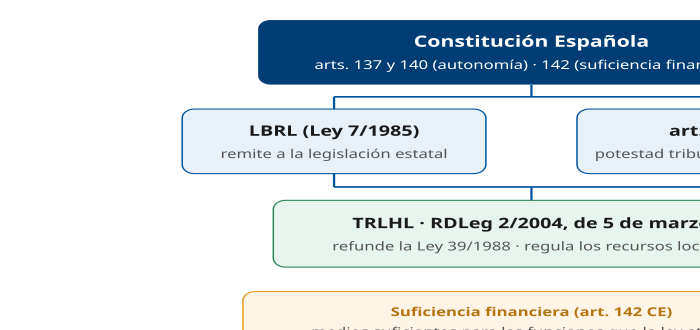

Situar el TRLHL bajo el fundamento constitucional y su relación con la LBRL.

D2 · Los recursos de las Haciendas Locales (art. 2)

§ 2 — Recursos

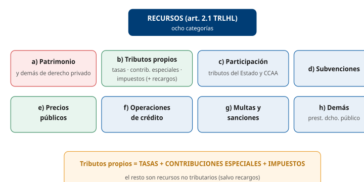

Enumerar los ocho recursos del art. 2.1 TRLHL.

D3 · Ingresos de derecho público vs. derecho privado

§ 3-4 — Clasificación nuclear

Contrastar régimen, clases y cobro de ambas categorías.

D4 · Las tasas: las dos modalidades del hecho imponible

§ 5 — Tasas

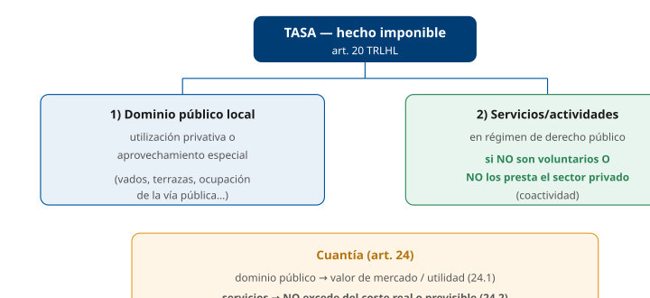

Distinguir las dos modalidades del art. 20 y la regla de cuantía.

D5 · Tasa vs. precio público: árbol de decisión

§ 9 — Distinción de figuras

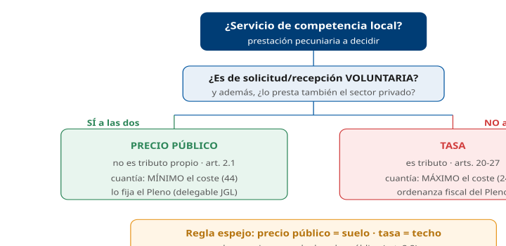

Resolver por descarte si una prestación es tasa o precio público.

D6 · Contribuciones especiales: base, módulos y límite

§ 6 — Contribuciones especiales

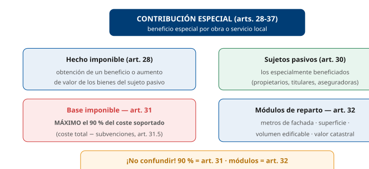

Fijar el hecho imponible, el límite del 90 % (art. 31) y los módulos (art. 32).

D7 · Precios públicos: requisitos y cuantía

§ 7 — Precios públicos

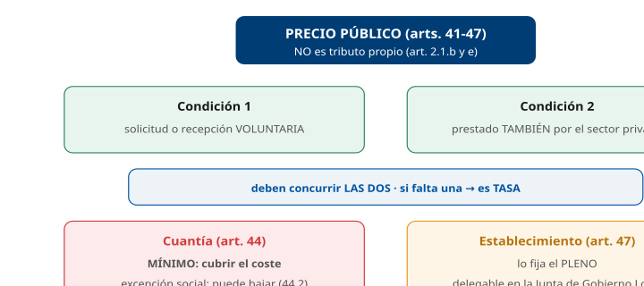

Fijar las dos condiciones, la naturaleza no tributaria y la regla de cuantía.

D8 · Impuestos municipales: obligatorios vs. potestativos

§ 8 — Impuestos municipales

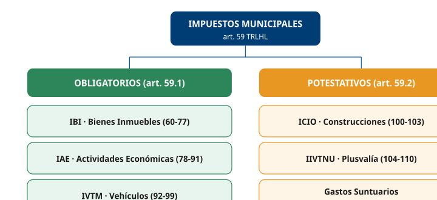

Clasificar los seis impuestos según el art. 59.

D9 · Impuestos obligatorios: IBI · IAE · IVTM

§ 8 — Impuestos obligatorios

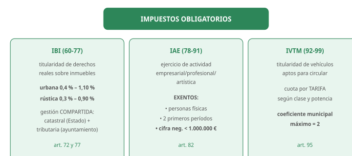

Ficha de los tres impuestos de exacción obligatoria y sus cifras clave.

D10 · Impuestos potestativos: ICIO · IIVTNU · suntuarios

§ 8 — Impuestos potestativos

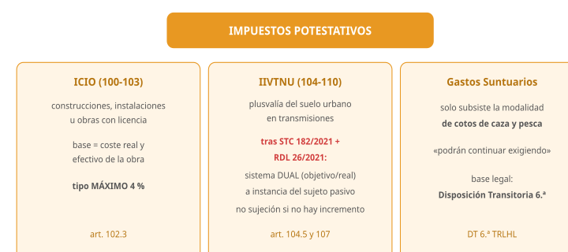

Ficha de los impuestos potestativos, con la reforma dual del IIVTNU.

D11 · Especialidad del Ayuntamiento de Madrid

§ 10 — Especialidad Madrid

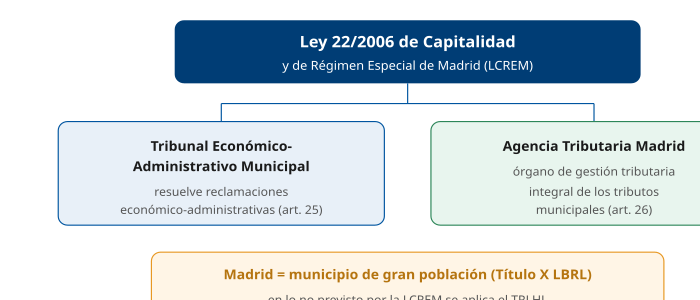

Situar la Ley 22/2006 y sus dos instituciones tributarias propias.

D12 · Mapa-resumen del Tema 8

§ 11 — Esquema resumen

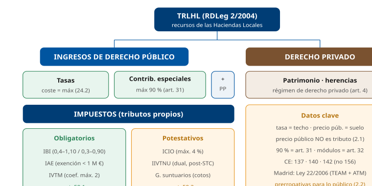

Visión global del tema en un solo golpe de vista.

## Casos prácticos

#### CASO PRÁCTICO 1 — Tasa, precio público o contribución especial

**Escenario**: El Ayuntamiento estudia cómo financiar tres actuaciones: (a) la recogida domiciliaria de basuras, de prestación obligatoria; (b) un campamento urbano de verano para menores, de inscripción voluntaria, que también ofrecen empresas privadas de la zona; y (c) la pavimentación de una calle, que revaloriza los inmuebles colindantes.

**Cuestiones**:

1.  **(3 pts)** ¿Qué figura corresponde a cada actuación (a, b, c)? Justifique.
2.  **(3 pts)** ¿Cuál de las tres NO tiene naturaleza tributaria?
3.  **(2 pts)** ¿Cuál es el límite de cuantía aplicable a la actuación (a) y a la (b)?
4.  **(2 pts)** ¿Qué porcentaje máximo del coste puede repartirse en la actuación (c) y mediante qué artículo?

**Solución orientativa**:

1.  \(a\) **Tasa**: el servicio no es de solicitud o recepción voluntaria (art. 20.1.B.a). (b) **Precio público**: no concurre ninguna de las circunstancias del artículo 20.1.B), porque el servicio es voluntario y lo presta también el sector privado (art. 41). (c) **Contribución especial**: aumento de valor de los bienes como consecuencia de la realización de una obra pública (art. 28).
2.  El **precio público** (b): no figura entre los tributos propios, que son tasas, contribuciones especiales e impuestos (art. 2.1.b); el artículo 2.1.e) lo enumera aparte.
3.  La **tasa** (a) tiene el coste como **máximo** (art. 24.2); el **precio público** (b) tiene el coste como **mínimo**, salvo razones sociales (art. 44).
4.  Como **máximo el 90 %** del coste soportado, conforme al **artículo 31** (los módulos de reparto van por el art. 32).

**Criterios de evaluación**: identificar correctamente las tres figuras (art. 20.1.B / art. 41 / art. 28); señalar que el precio público no es tributo propio (art. 2.1); aplicar las reglas de cuantía (coste como máximo en la tasa, coste como mínimo en el precio público, 90 % del coste soportado en las contribuciones especiales).

------------------------------------------------------------------------

#### Preguntas tipo test sobre este caso

##### 1. En el supuesto planteado, ¿qué figura corresponde a la recogida domiciliaria de basuras, de prestación obligatoria?

- a) Un precio público, porque es un servicio de competencia local.
- b) Una tasa, porque el servicio no es de solicitud o recepción voluntaria.
- c) Una contribución especial, porque beneficia a todos los vecinos.

**Respuesta correcta:** b) · **Referencia:** Caso 1, cuestión 1 · art. 20.1.B.a TRLHL

Es tasa la prestación de un servicio de competencia local cuando no sea de solicitud o recepción voluntaria para los administrados (art. 20.1.B.a TRLHL); la recogida de residuos figura además en el art. 20.4.

##### 2. ¿Qué figura corresponde al campamento urbano de verano, de inscripción voluntaria, que también ofrecen empresas privadas de la zona?

- a) Una tasa, porque es un servicio que presta el Ayuntamiento a quien lo solicita.
- b) Un impuesto, porque se exige sin contraprestación a las familias inscritas.
- c) Un precio público, porque el servicio es voluntario y lo presta también el sector privado.

**Respuesta correcta:** c) · **Referencia:** Caso 1, cuestión 1 · art. 41 TRLHL

Cabe precio público cuando no concurre ninguna de las circunstancias del art. 20.1.B): el servicio es de solicitud voluntaria y lo presta también el sector privado (art. 41 TRLHL).

##### 3. Variante del supuesto: si ninguna empresa privada ofreciera campamentos en la zona, aunque la inscripción siguiera siendo voluntaria, la contraprestación sería:

- a) Una tasa, porque basta con que el servicio no lo preste el sector privado.
- b) Un precio público, porque la inscripción sigue siendo voluntaria.
- c) Una contribución especial, porque el campamento beneficia a las familias.

**Respuesta correcta:** a) · **Referencia:** Caso 1, cuestión 1 · art. 20.1.B.b TRLHL

En la modalidad B) basta con que se produzca cualquiera de las dos circunstancias: que el servicio no sea voluntario o que no lo preste el sector privado (art. 20.1.B TRLHL).

##### 4. ¿Qué figura corresponde a la pavimentación de la calle, que revaloriza los inmuebles colindantes?

- a) Una tasa por el aprovechamiento especial del dominio público local.
- b) Un precio público, porque los propietarios se benefician de forma voluntaria.
- c) Una contribución especial, por el aumento de valor de los bienes derivado de una obra pública.

**Respuesta correcta:** c) · **Referencia:** Caso 1, cuestión 1 · art. 28 TRLHL

El hecho imponible de las contribuciones especiales es el beneficio o aumento de valor de los bienes como consecuencia de obras públicas o del establecimiento o ampliación de servicios públicos locales (art. 28 TRLHL).

##### 5. ¿Cuál de las tres figuras del supuesto carece de naturaleza tributaria?

- a) La tasa por la recogida de basuras (a).
- b) El precio público del campamento urbano (b).
- c) La contribución especial por la pavimentación (c).

**Respuesta correcta:** b) · **Referencia:** Caso 1, cuestión 2 · art. 2.1.b y e TRLHL

Los tributos propios son tasas, contribuciones especiales e impuestos (art. 2.1.b TRLHL); el precio público no es tributo y se enumera aparte (art. 2.1.e).

##### 6. ¿Por qué el precio público del campamento carece de naturaleza tributaria?

- a) Porque el art. 2.1 TRLHL no lo incluye entre los tributos propios y lo enumera en una letra aparte.
- b) Porque no es un ingreso de derecho público y se rige por el derecho privado.
- c) Porque lo aprueba la Junta de Gobierno y no el Pleno mediante ordenanza fiscal.

**Respuesta correcta:** a) · **Referencia:** Caso 1, cuestión 2 · art. 2.1.e TRLHL

El artículo 2.1 TRLHL enumera los tributos propios en la letra b) y los precios públicos en la letra e); aun así, el precio público es un ingreso de derecho público (art. 2.2).

##### 7. ¿Qué límite de cuantía rige la tasa de recogida de basuras (a)?

- a) Debe cubrir, como mínimo, el coste del servicio prestado.
- b) No puede exceder, en su conjunto, del coste real o previsible del servicio.
- c) No puede exceder del 90 % del coste soportado por el Ayuntamiento.

**Respuesta correcta:** b) · **Referencia:** Caso 1, cuestión 3 · art. 24.2 TRLHL

El importe de las tasas por prestación de servicios no puede exceder, en su conjunto, del coste real o previsible del servicio (art. 24.2 TRLHL): el coste es el máximo.

##### 8. ¿Qué límite de cuantía rige el precio público del campamento (b)?

- a) No puede exceder del coste real o previsible del servicio prestado.
- b) Se fija libremente por el Pleno, sin referencia al coste del servicio.
- c) Debe cubrir como mínimo el coste, salvo razones sociales u otras de interés público.

**Respuesta correcta:** c) · **Referencia:** Caso 1, cuestión 3 · art. 44 TRLHL

El importe de los precios públicos debe cubrir como mínimo el coste del servicio (art. 44.1), aunque puede fijarse por debajo por razones sociales, benéficas, culturales o de interés público (art. 44.2 TRLHL).

##### 9. Si, por razones sociales, el Ayuntamiento fija el precio del campamento por debajo del coste, deberá:

- a) Consignar en el presupuesto las dotaciones oportunas para cubrir la diferencia.
- b) Transformar el precio público en una tasa mediante ordenanza fiscal.
- c) Obtener la autorización previa de la Comunidad de Madrid.

**Respuesta correcta:** a) · **Referencia:** Caso 1, cuestión 3 · art. 44.2 TRLHL

Cuando se fijen precios públicos por debajo del coste, deben consignarse en los presupuestos las dotaciones oportunas para la cobertura de la diferencia resultante (art. 44.2 TRLHL).

##### 10. ¿Qué porcentaje máximo del coste de la pavimentación puede repartirse entre los propietarios beneficiados, y en qué artículo se fija?

- a) El 90 % del coste soportado, conforme al artículo 32.
- b) El 90 % del coste soportado, conforme al artículo 31.
- c) El 100 % del coste total de la obra, conforme al artículo 31.

**Respuesta correcta:** b) · **Referencia:** Caso 1, cuestión 4 · art. 31.1 TRLHL

La base imponible de las contribuciones especiales es, como máximo, el 90 % del coste soportado (art. 31.1 TRLHL); el artículo 32 regula los módulos de reparto.

#### CASO PRÁCTICO 2 — Ingresos de derecho público y privado

**Escenario**: El Ayuntamiento tiene pendientes de cobro dos importes: (a) el IBI impagado de un local comercial, y (b) varias mensualidades de renta de un piso de su patrimonio que tiene alquilado a un particular. Además, recibe en testamento un inmueble legado por un vecino.

**Cuestiones**:

1.  **(2,5 pts)** Clasifique cada concepto (a, b y el legado) como ingreso de derecho público o privado.
2.  **(2,5 pts)** ¿Por qué procedimiento puede cobrar el Ayuntamiento la deuda del IBI (a)?
3.  **(2,5 pts)** La renta del alquiler (b) es un ingreso de derecho privado: ¿con sujeción a qué normas y procedimientos hará efectivo el Ayuntamiento su derecho si el inquilino no paga?
4.  **(2,5 pts)** ¿Puede ser ingreso de derecho privado el rendimiento de un bien de dominio público (p. ej., una plaza)?

**Solución orientativa**:

1.  \(a\) IBI = **ingreso de derecho público** (tributo). (b) Renta del alquiler = **ingreso de derecho privado** (rendimiento del patrimonio, art. 3). El **legado** = **ingreso de derecho privado** (adquisición a título lucrativo, art. 3.1).
2.  La Hacienda local ostenta para su cobranza las **prerrogativas de la Hacienda del Estado** (art. 2.2 TRLHL); la recaudación se rige por la LGT (art. 12.1 TRLHL) y, en período ejecutivo, se realiza mediante el **procedimiento administrativo de apremio** (arts. 160.2.b y 161.3 LGT).
3.  Con sujeción a las **normas y procedimientos del derecho privado**: la efectividad de los derechos de la hacienda local derivados de ingresos de derecho privado se rige por ellos (art. 4 TRLHL); las prerrogativas del artículo 2.2 se refieren a los ingresos de derecho público.
4.  **No**: en ningún caso tendrán la consideración de ingresos de derecho privado los que procedan, por cualquier concepto, de los bienes de **dominio público local** (art. 3.3); el patrimonio a estos efectos excluye los bienes afectos al uso o servicio público (art. 3.2).

**Criterios de evaluación**: distinguir bien las dos categorías (arts. 2 y 3); reconocer las prerrogativas para lo público (art. 2.2); aplicar el régimen de derecho privado a la renta impagada (art. 4); excluir el dominio público (art. 3.3).

------------------------------------------------------------------------

#### Preguntas tipo test sobre este caso

##### 1. En el supuesto planteado, ¿cómo se clasifica el IBI impagado del local comercial?

- a) Como ingreso de derecho privado, porque el local es de un particular.
- b) Como ingreso de derecho público, por ser un tributo.
- c) Como ingreso de derecho privado, por ser rendimiento del patrimonio.

**Respuesta correcta:** b) · **Referencia:** Caso 2, cuestión 1 · art. 2.2 TRLHL

Los tributos son ingresos de derecho público de la hacienda local (art. 2.2 TRLHL); el IBI es un impuesto municipal.

##### 2. ¿Cómo se clasifica la renta del piso municipal alquilado a un particular?

- a) Como ingreso de derecho privado, por ser un rendimiento del patrimonio municipal.
- b) Como ingreso de derecho público, por ser un bien del Ayuntamiento.
- c) Como precio público, por tratarse de un servicio voluntario.

**Respuesta correcta:** a) · **Referencia:** Caso 2, cuestión 1 · art. 3.1 TRLHL

Son ingresos de derecho privado los rendimientos o productos de cualquier naturaleza derivados del patrimonio de la entidad local (art. 3.1 TRLHL).

##### 3. ¿Cómo se clasifica el inmueble que un vecino lega al Ayuntamiento en su testamento?

- a) Como ingreso de derecho público, por adquirirlo una Administración.
- b) Como una subvención, por tratarse de una aportación sin contraprestación.
- c) Como ingreso de derecho privado, por ser una adquisición a título de legado.

**Respuesta correcta:** c) · **Referencia:** Caso 2, cuestión 1 · art. 3.1 TRLHL

Las adquisiciones a título de herencia, legado o donación son ingresos de derecho privado de las entidades locales (art. 3.1 TRLHL).

##### 4. A efectos de los ingresos de derecho privado, el piso alquilado forma parte del patrimonio municipal porque:

- a) Está inscrito en el Registro de la Propiedad a nombre del Ayuntamiento.
- b) Produce rentas superiores a su coste de mantenimiento.
- c) Es un bien de propiedad municipal que no está afecto al uso o servicio público.

**Respuesta correcta:** c) · **Referencia:** Caso 2, cuestión 4 · art. 3.2 TRLHL

Se considera patrimonio de las entidades locales el constituido por los bienes de su propiedad y los derechos susceptibles de valoración económica, siempre que no se hallen afectos al uso o servicio público (art. 3.2 TRLHL).

##### 5. Para cobrar el IBI impagado, la hacienda municipal:

- a) Ostenta las prerrogativas establecidas legalmente para la Hacienda del Estado.
- b) Debe acudir a la jurisdicción civil, como cualquier otro acreedor.
- c) Solo puede compensarlo con los pagos futuros que deba al contribuyente.

**Respuesta correcta:** a) · **Referencia:** Caso 2, cuestión 2 · art. 2.2 TRLHL

Para la cobranza de los tributos y demás ingresos de derecho público, la hacienda local ostenta las prerrogativas establecidas legalmente para la Hacienda del Estado (art. 2.2 TRLHL).

##### 6. ¿Qué ley rige la recaudación del IBI del supuesto?

- a) El Código Civil, por tratarse de una deuda pendiente.
- b) La Ley General Tributaria, por remisión del TRLHL.
- c) La ordenanza fiscal, sin remisión a ninguna ley estatal.

**Respuesta correcta:** b) · **Referencia:** Caso 2, cuestión 2 · art. 12.1 TRLHL

La gestión, liquidación, inspección y recaudación de los tributos locales se realizan conforme a la Ley 58/2003, General Tributaria, y demás leyes del Estado reguladoras de la materia (art. 12.1 TRLHL).

##### 7. Si el IBI no se paga en período voluntario, ¿por qué procedimiento se cobra en período ejecutivo?

- a) Por el procedimiento administrativo de apremio.
- b) Por un juicio monitorio ante el juzgado civil.
- c) Por una reclamación ante el Tribunal Económico-Administrativo Municipal.

**Respuesta correcta:** a) · **Referencia:** Caso 2, cuestión 2 · arts. 160.2 y 161.3 LGT

La recaudación en período ejecutivo se realiza a través del procedimiento administrativo de apremio (art. 160.2 LGT, aplicable por la remisión del art. 12.1 TRLHL).

##### 8. El procedimiento de apremio con que se cobra el IBI es:

- a) Judicial, ante los juzgados de lo contencioso-administrativo.
- b) Mixto: lo inicia la Administración y lo concluye un juez civil.
- c) Exclusivamente administrativo.

**Respuesta correcta:** c) · **Referencia:** Caso 2, cuestión 2 · art. 163.1 LGT

El procedimiento de apremio es exclusivamente administrativo (art. 163.1 LGT).

##### 9. Si el inquilino no paga la renta del piso municipal, ¿cómo hará efectivo el Ayuntamiento su derecho?

- a) Con las prerrogativas de la Hacienda del Estado y el apremio administrativo.
- b) Con sujeción a las normas y procedimientos del derecho privado.
- c) Mediante una liquidación tributaria y la vía económico-administrativa.

**Respuesta correcta:** b) · **Referencia:** Caso 2, cuestión 3 · art. 4 TRLHL

La efectividad de los derechos de la hacienda local derivados de ingresos de derecho privado se lleva a cabo con sujeción a las normas y procedimientos del derecho privado (art. 4 TRLHL).

##### 10. ¿Puede ser ingreso de derecho privado el rendimiento que obtenga el Ayuntamiento de una plaza pública?

- a) Sí, si el Ayuntamiento lo obtiene mediante un contrato con un particular.
- b) No: los ingresos que procedan de bienes de dominio público local nunca son de derecho privado.
- c) Sí, cuando se trate de un rendimiento de carácter periódico.

**Respuesta correcta:** b) · **Referencia:** Caso 2, cuestión 4 · art. 3.3 TRLHL

En ningún caso tendrán la consideración de ingresos de derecho privado los que procedan, por cualquier concepto, de los bienes de dominio público local (art. 3.3 TRLHL).

#### CASO PRÁCTICO 3 — Las tasas: cuantía y aprobación

**Escenario**: El Ayuntamiento quiere crear una nueva tasa por la tramitación de licencias y otra por la ocupación de la vía pública con terrazas de hostelería. El servicio de tramitación de licencias cuesta a la entidad 500.000 € anuales y se prevé recaudar con la tasa.

**Cuestiones**:

1.  **(2,5 pts)** ¿Cuál es el importe máximo, en su conjunto, que puede recaudarse con la tasa de tramitación de licencias? ¿Qué artículo lo establece?
2.  **(2,5 pts)** ¿Cómo se cuantifica la tasa por las terrazas (ocupación del dominio público)?
3.  **(2,5 pts)** ¿A la vista de qué documento deben adoptarse los acuerdos de establecimiento de estas tasas y qué debe poner de manifiesto?
4.  **(2,5 pts)** ¿Qué órgano aprueba la tasa y cuándo entra en vigor?

**Solución orientativa**:

1.  Como **máximo 500.000 €**: el importe de la tasa por prestación de servicios **no puede exceder, en su conjunto, del coste real o previsible** del servicio (**art. 24.2**).
2.  Tomando como referencia el **valor que tendría en el mercado la utilidad** derivada de la utilización o aprovechamiento, si los bienes afectados no fuesen de dominio público (art. 24.1.a).
3.  De **informes técnico-económicos** (art. 25), que deben poner de manifiesto el **valor de mercado** (tasa por las terrazas) o la **previsible cobertura del coste** (tasa por un servicio nuevo).
4.  La aprueba el **Pleno** mediante **ordenanza fiscal** (art. 15.1 TRLHL; art. 11.1.d) y g) LCREM), y no entra en vigor hasta la **publicación de su texto íntegro** en el boletín oficial de la provincia o de la comunidad autónoma uniprovincial (art. 17.4 TRLHL); en Madrid, el BOCM.

**Criterios de evaluación**: aplicar el tope del coste (art. 24.2) y diferenciarlo de la cuantía por dominio público (art. 24.1); citar el informe técnico-económico (art. 25); identificar el Pleno y la publicación (art. 17.4).

------------------------------------------------------------------------

#### Preguntas tipo test sobre este caso

##### 1. En el supuesto planteado, el servicio de tramitación de licencias cuesta 500.000 € anuales. ¿Cuánto puede recaudarse como máximo, en su conjunto, con la tasa?

- a) 450.000 €.
- b) 550.000 €.
- c) 500.000 €.

**Respuesta correcta:** c) · **Referencia:** Caso 3, cuestión 1 · art. 24.2 TRLHL

El importe de las tasas por prestación de servicios no puede exceder, en su conjunto, del coste real o previsible del servicio (art. 24.2 TRLHL): aquí, 500.000 €.

##### 2. ¿Qué artículo del TRLHL establece ese tope para la tasa de tramitación de licencias?

- a) El artículo 44.1.
- b) El artículo 24.2.
- c) El artículo 31.1.

**Respuesta correcta:** b) · **Referencia:** Caso 3, cuestión 1 · art. 24.2 TRLHL

El artículo 24.2 TRLHL fija el coste del servicio como máximo de las tasas; el 44.1 se refiere a los precios públicos y el 31.1 a las contribuciones especiales.

##### 3. Para calcular el coste de 500.000 € del servicio, el Ayuntamiento puede tener en cuenta:

- a) Los costes directos e indirectos, incluidos los financieros y la amortización del inmovilizado.
- b) Solo los costes directos del personal que tramita las licencias.
- c) Los costes directos más un margen de beneficio para el Ayuntamiento.

**Respuesta correcta:** a) · **Referencia:** Caso 3, cuestión 1 · art. 24.2 TRLHL

Para determinar el coste se consideran los costes directos e indirectos, inclusive los financieros, la amortización del inmovilizado y los necesarios para el mantenimiento y desarrollo razonable del servicio (art. 24.2 TRLHL).

##### 4. La tasa por las terrazas de hostelería es una tasa por:

- a) La utilización privativa o el aprovechamiento especial del dominio público local.
- b) La prestación de un servicio que no es de solicitud voluntaria.
- c) El aumento de valor de los locales de hostelería.

**Respuesta correcta:** a) · **Referencia:** Caso 3, cuestión 2 · art. 20.3 TRLHL

La ocupación de terrenos de uso público local con mesas, sillas y elementos análogos con finalidad lucrativa es un supuesto de utilización privativa o aprovechamiento especial del dominio público (art. 20.3 TRLHL).

##### 5. ¿Cómo se cuantifica, con carácter general, la tasa por las terrazas?

- a) Por el coste real o previsible del servicio de inspección de terrazas.
- b) Tomando como referencia el valor de mercado de la utilidad, si los bienes no fuesen de dominio público.
- c) Por el 1,5 % de los ingresos brutos de facturación de cada establecimiento.

**Respuesta correcta:** b) · **Referencia:** Caso 3, cuestión 2 · art. 24.1.a TRLHL

En las tasas por utilización del dominio público se toma como referencia el valor que tendría en el mercado la utilidad derivada, si los bienes no fuesen de dominio público (art. 24.1.a); el 1,5 % solo rige para las empresas de suministros de interés general.

##### 6. ¿A la vista de qué documento deben adoptarse los acuerdos de establecimiento de las dos tasas?

- a) De un dictamen del Tribunal Económico-Administrativo Municipal.
- b) De un informe de la Dirección General del Catastro.
- c) De informes técnico-económicos.

**Respuesta correcta:** c) · **Referencia:** Caso 3, cuestión 3 · art. 25 TRLHL

Los acuerdos de establecimiento de tasas por utilización del dominio público o para financiar nuevos servicios se adoptan a la vista de informes técnico-económicos (art. 25 TRLHL).

##### 7. ¿Qué deben poner de manifiesto esos informes en cada tasa del supuesto?

- a) La previsible cobertura del coste en la de terrazas y el valor de mercado en la de licencias.
- b) En ambas, el número previsto de contribuyentes y la recaudación estimada.
- c) El valor de mercado en la de terrazas y la previsible cobertura del coste en la de licencias.

**Respuesta correcta:** c) · **Referencia:** Caso 3, cuestión 3 · art. 25 TRLHL

El informe técnico-económico pone de manifiesto el valor de mercado en las tasas por dominio público y la previsible cobertura del coste en las tasas por nuevos servicios (art. 25 TRLHL).

##### 8. ¿Qué órgano aprueba las nuevas tasas y mediante qué instrumento?

- a) El Pleno, mediante ordenanza fiscal.
- b) La Junta de Gobierno, mediante decreto.
- c) El Alcalde, mediante bando.

**Respuesta correcta:** a) · **Referencia:** Caso 3, cuestión 4 · art. 15.1 TRLHL y art. 11.1.d y g LCREM

Las entidades locales acuerdan la imposición de sus tributos propios y aprueban las ordenanzas fiscales (art. 15.1 TRLHL); en Madrid, la aprobación corresponde al Pleno (art. 11.1.d y g LCREM).

##### 9. Antes de la aprobación definitiva, el acuerdo provisional de las tasas debe exponerse en el tablón de anuncios para reclamaciones durante:

- a) Quince días, como mínimo.
- b) Treinta días, como mínimo.
- c) Diez días hábiles.

**Respuesta correcta:** b) · **Referencia:** Caso 3, cuestión 4 · art. 17.1 TRLHL

Los acuerdos provisionales se exponen en el tablón de anuncios durante treinta días, como mínimo, para que los interesados examinen el expediente y presenten reclamaciones (art. 17.1 TRLHL).

##### 10. ¿Cuándo entran en vigor las nuevas tasas del Ayuntamiento de Madrid?

- a) Al día siguiente de su aprobación definitiva por el Pleno.
- b) Al publicarse un extracto de la ordenanza en el BOE.
- c) Al publicarse el texto íntegro de la ordenanza en el BOCM.

**Respuesta correcta:** c) · **Referencia:** Caso 3, cuestión 4 · art. 17.4 TRLHL

Las ordenanzas fiscales no entran en vigor hasta que se publica su texto íntegro en el boletín oficial de la provincia o de la comunidad autónoma uniprovincial (art. 17.4 TRLHL): en Madrid, el BOCM.

#### CASO PRÁCTICO 4 — Contribuciones especiales

**Escenario**: El Ayuntamiento ejecuta el soterramiento de un tramo de vía y la mejora del alumbrado, con un coste total de 1.000.000 €, de los que 200.000 € los financia una subvención autonómica. Los inmuebles colindantes resultan claramente revalorizados.

**Cuestiones**:

1.  **(2,5 pts)** ¿Cuál es el "coste soportado" por la entidad a efectos de la base imponible?
2.  **(2,5 pts)** ¿Cuál es la base imponible máxima que puede repartirse entre los beneficiarios? ¿Qué artículo?
3.  **(2,5 pts)** Indique al menos tres módulos de reparto que podrían usarse y el artículo aplicable.
4.  **(2,5 pts)** ¿Puede el Ayuntamiento exigir el pago antes de terminar las obras?

**Solución orientativa**:

1.  El coste soportado = coste total **menos** subvenciones = 1.000.000 − 200.000 = **800.000 €** (art. 31.5).
2.  Como **máximo el 90 %** de 800.000 € = **720.000 €** (**art. 31.1**).
3.  **Metros lineales de fachada, superficie, volumen edificable y valor catastral** de los inmuebles (**art. 32.1**). (Bastan tres.)
4.  **Sí**: aprobado el acuerdo concreto de imposición y ordenación, puede **exigir por anticipado el pago** en función del importe del coste previsto para el año siguiente (art. 33.2).

**Criterios de evaluación**: calcular el coste soportado descontando la subvención; aplicar el 90 % sobre la base correcta (art. 31); citar los módulos del artículo 32 sin confundir el artículo; reconocer el anticipo del pago.

------------------------------------------------------------------------

#### Preguntas tipo test sobre este caso

##### 1. En el supuesto planteado, la obra cuesta 1.000.000 € y una subvención autonómica financia 200.000 €. ¿Cuál es el coste soportado por el Ayuntamiento?

- a) 800.000 €.
- b) 1.000.000 €.
- c) 720.000 €.

**Respuesta correcta:** a) · **Referencia:** Caso 4, cuestión 1 · art. 31.5 TRLHL

El coste soportado es el coste total menos las subvenciones o auxilios obtenidos (art. 31.5 TRLHL): 1.000.000 − 200.000 = 800.000 €.

##### 2. ¿Cuál es la base imponible máxima que puede repartirse entre los propietarios beneficiados?

- a) 900.000 €.
- b) 720.000 €.
- c) 800.000 €.

**Respuesta correcta:** b) · **Referencia:** Caso 4, cuestión 2 · art. 31.1 TRLHL

La base imponible es, como máximo, el 90 % del coste soportado (art. 31.1 TRLHL): 90 % de 800.000 € = 720.000 €. El 90 % no se aplica sobre el coste total.

##### 3. ¿Qué artículo del TRLHL fija el límite del 90 % de la base imponible?

- a) El artículo 32.1.
- b) El artículo 24.2.
- c) El artículo 31.1.

**Respuesta correcta:** c) · **Referencia:** Caso 4, cuestión 2 · art. 31.1 TRLHL

El límite del 90 % de la base imponible está en el artículo 31.1 TRLHL; el 32 regula los módulos de reparto y el 24.2 la cuantía de las tasas.

##### 4. ¿Quiénes son los sujetos pasivos de esta contribución especial?

- a) Todos los vecinos empadronados en el distrito donde se ejecuta la obra.
- b) Los propietarios de los inmuebles colindantes, especialmente beneficiados por la obra.
- c) Las personas que circulan habitualmente por el tramo soterrado.

**Respuesta correcta:** b) · **Referencia:** Caso 4 (escenario) · art. 30 TRLHL

Son sujetos pasivos las personas especialmente beneficiadas por la obra; en obras que afectan a bienes inmuebles, se consideran tales sus propietarios (art. 30.2 TRLHL).

##### 5. ¿Cuál de estos grupos está formado por módulos de reparto que prevé la ley?

- a) Metros lineales de fachada, superficie y volumen edificable de los inmuebles.
- b) Renta de los propietarios, número de ocupantes y antigüedad del inmueble.
- c) Cifra de negocios, potencia fiscal y número de plazas de aparcamiento.

**Respuesta correcta:** a) · **Referencia:** Caso 4, cuestión 3 · art. 32.1 TRLHL

Con carácter general se aplican, conjunta o separadamente, como módulos de reparto los metros lineales de fachada, la superficie, el volumen edificable y el valor catastral a efectos del IBI (art. 32.1 TRLHL).

##### 6. ¿Puede usarse el valor catastral a efectos del IBI como módulo de reparto de esta contribución especial?

- a) No, porque el valor catastral solo sirve para el IBI.
- b) Solo si lo autoriza la Dirección General del Catastro.
- c) Sí, de forma conjunta o separada con los demás módulos.

**Respuesta correcta:** c) · **Referencia:** Caso 4, cuestión 3 · art. 32.1 TRLHL

El valor catastral a efectos del IBI es uno de los módulos de reparto que el artículo 32.1 TRLHL permite aplicar conjunta o separadamente.

##### 7. ¿Puede el Ayuntamiento exigir el pago de la contribución especial antes de terminar las obras?

- a) No: solo puede exigirse una vez ejecutadas íntegramente las obras de soterramiento.
- b) Sí: puede exigir desde el inicio el importe total de la base imponible repartida.
- c) Sí: aprobada la imposición y ordenación, por anticipado según el coste previsto del año siguiente.

**Respuesta correcta:** c) · **Referencia:** Caso 4, cuestión 4 · art. 33.2 TRLHL

Aprobado el acuerdo concreto de imposición y ordenación, la entidad local puede exigir por anticipado el pago en función del importe del coste previsto para el año siguiente (art. 33.2 TRLHL).

##### 8. Si el Ayuntamiento ha cobrado ya un anticipo, ¿puede exigir el de una nueva anualidad?

- a) Solo si se han ejecutado las obras para las que se exigió el anticipo anterior.
- b) Sí, en cualquier caso, aunque las obras anteriores no se hayan ejecutado.
- c) No, porque solo puede exigirse un único anticipo por obra.

**Respuesta correcta:** a) · **Referencia:** Caso 4, cuestión 4 · art. 33.2 TRLHL

No puede exigirse el anticipo de una nueva anualidad sin que se hayan ejecutado las obras para las que se exigió el anterior (art. 33.2 TRLHL).

##### 9. Si no se exige anticipo, ¿cuándo se devenga la contribución especial?

- a) Al aprobarse el acuerdo de imposición.
- b) En el momento en que las obras se hayan ejecutado.
- c) Al adjudicarse el contrato de las obras.

**Respuesta correcta:** b) · **Referencia:** Caso 4, cuestión 4 · art. 33.1 TRLHL

Las contribuciones especiales se devengan en el momento en que las obras se hayan ejecutado o el servicio haya comenzado a prestarse (art. 33.1 TRLHL).

##### 10. Si al final el coste real de la obra resulta mayor que el presupuestado, para calcular las cuotas se toma:

- a) El coste real.
- b) El presupuestado.
- c) La media de ambos.

**Respuesta correcta:** a) · **Referencia:** Caso 4, cuestión 2 · art. 31.3 TRLHL

El coste total presupuestado tiene carácter de mera previsión: si el coste real es mayor o menor, se toma aquel a efectos del cálculo de las cuotas (art. 31.3 TRLHL).

#### CASO PRÁCTICO 5 — Impuestos municipales: clasificación y cifras

**Escenario**: Una empresa con cifra de negocios de 800.000 € abre una nave industrial en Madrid (obra con licencia), adquiere una flota de furgonetas y es propietaria del local. Pasado un tiempo, vende un solar urbano obteniendo una plusvalía.

**Cuestiones**:

1.  **(2 pts)** ¿Está obligada esta empresa a pagar el IAE? Justifique con la cuantía y el artículo.
2.  **(2 pts)** ¿Qué impuesto grava la obra de la nave y cuál es su tipo máximo?
3.  **(2 pts)** ¿Qué impuestos obligatorios gravarán el local y las furgonetas?
4.  **(2 pts)** Clasifique en obligatorios y potestativos todos los impuestos citados.
5.  **(2 pts)** ¿Cómo se determina hoy la base imponible del impuesto sobre la plusvalía del solar?

**Solución orientativa**:

1.  **No**: está **exenta del IAE** por tener una cifra de negocios **inferior a 1.000.000 €** (800.000 €), conforme al **artículo 82.1.c)**.
2.  El **ICIO** (impuesto potestativo), con un **tipo máximo del 4 %** sobre el coste real y efectivo de la obra (art. 102.3).
3.  El **IBI** grava la titularidad del derecho de propiedad sobre el local (art. 61.1) y el **IVTM** grava la titularidad de las furgonetas (art. 92).
4.  **Obligatorios**: IBI, IAE (aunque exenta, es de exacción obligatoria) e IVTM. **Potestativos**: ICIO e IIVTNU.
5.  Tras la **STC 182/2021** y el **RDL 26/2021**: la base es el valor del terreno en el devengo multiplicado por el **coeficiente** del periodo de generación (art. 107.1); si, **a instancia del sujeto pasivo**, se constata que el incremento real es inferior, se toma ese incremento (art. 107.5); y **no hay sujeción** si se constata la inexistencia de incremento de valor (art. 104.5).

**Criterios de evaluación**: aplicar la exención del IAE (art. 82.1.c); identificar el ICIO y su tipo (art. 102.3); asignar IBI e IVTM (arts. 61 y 92); clasificar obligatorios/potestativos (art. 59); explicar la base del IIVTNU (arts. 104.5 y 107).

------------------------------------------------------------------------

#### Preguntas tipo test sobre este caso

##### 1. En el supuesto planteado, la empresa tiene una cifra de negocios de 800.000 €. ¿Está obligada a pagar el IAE?

- a) Sí: toda empresa que ejerce una actividad económica debe pagarlo.
- b) Sí: la exención por cifra de negocios solo alcanza a las personas físicas.
- c) No: está exenta por tener una cifra de negocios inferior a 1.000.000 €.

**Respuesta correcta:** c) · **Referencia:** Caso 5, cuestión 1 · art. 82.1.c TRLHL

Están exentos del IAE los sujetos pasivos del Impuesto sobre Sociedades y demás entidades con un importe neto de la cifra de negocios inferior a 1.000.000 € (art. 82.1.c TRLHL).

##### 2. ¿Qué impuesto grava la obra de la nave industrial?

- a) El Impuesto sobre Construcciones, Instalaciones y Obras (ICIO).
- b) El Impuesto sobre el Incremento de Valor de los Terrenos (IIVTNU).
- c) El Impuesto sobre Bienes Inmuebles (IBI).

**Respuesta correcta:** a) · **Referencia:** Caso 5, cuestión 2 · art. 100.1 TRLHL

El ICIO grava la realización en el término municipal de construcciones, instalaciones u obras para las que se exija licencia, declaración responsable o comunicación previa (art. 100.1 TRLHL).

##### 3. ¿Cuál es el tipo máximo de ese impuesto?

- a) El 1,10 %.
- b) El 4 %.
- c) El 3 %.

**Respuesta correcta:** b) · **Referencia:** Caso 5, cuestión 2 · art. 102.3 TRLHL

El tipo del ICIO lo fija cada ayuntamiento sin que pueda exceder del cuatro por cien (art. 102.3 TRLHL); el 1,10 % es el tipo máximo del IBI urbano.

##### 4. ¿Qué impuesto obligatorio grava el local del que la empresa es propietaria?

- a) El IBI, que grava la titularidad del derecho de propiedad sobre el inmueble.
- b) El IAE, que grava el local en el que se ejerce la actividad.
- c) El ICIO, que grava los inmuebles de uso comercial.

**Respuesta correcta:** a) · **Referencia:** Caso 5, cuestión 3 · art. 61.1 TRLHL

El hecho imponible del IBI incluye la titularidad del derecho de propiedad sobre los bienes inmuebles (art. 61.1 TRLHL).

##### 5. ¿Qué impuesto grava la flota de furgonetas de la empresa?

- a) El IAE, porque las furgonetas se usan en la actividad empresarial.
- b) El Impuesto sobre Gastos Suntuarios, en su modalidad de vehículos.
- c) El IVTM, que grava la titularidad de vehículos aptos para circular.

**Respuesta correcta:** c) · **Referencia:** Caso 5, cuestión 3 · art. 92 TRLHL

El IVTM grava la titularidad de los vehículos de tracción mecánica aptos para circular por las vías públicas (art. 92.1 TRLHL); el de gastos suntuarios solo subsiste para cotos de caza y pesca.

##### 6. ¿Qué impuestos de los citados en el supuesto son de exacción obligatoria para el Ayuntamiento?

- a) El IBI, el IVTM y el ICIO.
- b) El IBI, el IAE y el IVTM.
- c) El IBI, el IAE y el IIVTNU.

**Respuesta correcta:** b) · **Referencia:** Caso 5, cuestión 4 · art. 59.1 TRLHL

Los ayuntamientos exigirán el IBI, el IAE y el IVTM (art. 59.1 TRLHL); el ICIO y el IIVTNU son potestativos (art. 59.2).

##### 7. ¿Cuál de estos impuestos NO es de exacción obligatoria para el Ayuntamiento?

- a) El IAE, aunque la empresa del supuesto esté exenta.
- b) El IVTM que grava las furgonetas.
- c) El IIVTNU que grava la plusvalía del solar.

**Respuesta correcta:** c) · **Referencia:** Caso 5, cuestión 4 · art. 59.2 TRLHL

El IIVTNU, como el ICIO, es potestativo (art. 59.2 TRLHL); el IAE es obligatorio aunque un sujeto concreto esté exento.

##### 8. Con la regulación vigente, ¿cómo se calcula como regla general la base imponible del impuesto sobre la plusvalía del solar?

- a) Diferencia entre el precio de venta y el de compra del solar, en todo caso.
- b) Valor del terreno en el devengo multiplicado por el coeficiente del periodo de generación.
- c) Valor catastral de las construcciones multiplicado por el tipo del IBI.

**Respuesta correcta:** b) · **Referencia:** Caso 5, cuestión 5 · art. 107.1 TRLHL

Tras la STC 182/2021 y el RDL 26/2021, la base es, por regla general, el valor del terreno en el devengo multiplicado por el coeficiente del periodo de generación (art. 107.1 TRLHL).

##### 9. Si, a instancia de la empresa, se constata que el incremento real de valor del solar es inferior al que resulta de los coeficientes:

- a) Se toma como base ese incremento real.
- b) Se aplican igualmente los coeficientes.
- c) Se aplica la media de los dos importes.

**Respuesta correcta:** a) · **Referencia:** Caso 5, cuestión 5 · art. 107.5 TRLHL

Cuando, a instancia del sujeto pasivo, se constata que el incremento real es inferior a la base calculada por coeficientes, se toma ese incremento como base imponible (art. 107.5 TRLHL).

##### 10. Variante del supuesto: si se constatara que la venta del solar no ha generado ningún incremento de valor:

- a) Se pagaría la cuota mínima fijada por la ordenanza.
- b) La base se calcularía igualmente por coeficientes.
- c) La transmisión no estaría sujeta al impuesto.

**Respuesta correcta:** c) · **Referencia:** Caso 5, cuestión 5 · art. 104.5 TRLHL

No hay sujeción al IIVTNU en las transmisiones respecto de las que se constate la inexistencia de incremento de valor (art. 104.5 TRLHL).

#### CASO PRÁCTICO 6 — Especialidad de Madrid y gestión TIC

**Escenario**: Un contribuyente de Madrid no está conforme con una liquidación del IBI y quiere reclamar. El IAM debe garantizar que la sede electrónica permita presentar la reclamación y que los padrones fiscales estén actualizados.

**Cuestiones**:

1.  **(2,5 pts)** ¿Ante qué órgano puede el contribuyente reclamar contra la liquidación del IBI en Madrid y en virtud de qué norma?
2.  **(2,5 pts)** ¿Qué órgano gestiona de forma integral los tributos del Ayuntamiento de Madrid?
3.  **(2,5 pts)** En el IBI, ¿qué corresponde al Ayuntamiento y qué elabora la Dirección General del Catastro?
4.  **(2,5 pts)** Relacione el papel del IAM con la gestión tributaria municipal.

**Solución orientativa**:

1.  Ante el **Tribunal Económico-Administrativo Municipal de Madrid**, que conoce y resuelve las reclamaciones en relación con la aplicación de los tributos y la imposición de sanciones tributarias del Ayuntamiento (art. 25.1.a LCREM). Con carácter potestativo, puede interponer antes recurso de reposición (art. 25.3 LCREM).
2.  La **Agencia Tributaria Madrid**, ente autónomo de gestión tributaria que el artículo 26 LCREM permite crear al Pleno para la gestión integral del sistema tributario municipal.
3.  La liquidación y recaudación, así como la revisión de los actos dictados en vía de gestión tributaria, son **competencia exclusiva del Ayuntamiento** (art. 77.1 TRLHL); el impuesto se gestiona a partir del **padrón catastral** elaborado por la **Dirección General del Catastro** (art. 77.5 TRLHL).
4.  El **IAM** desarrolla y mantiene los sistemas de información que soportan padrones (IBI, IVTM), censos (IAE), autoliquidaciones (ICIO, IIVTNU) y la sede electrónica de la Agencia Tributaria Madrid, garantizando la disponibilidad y la integridad de los datos tributarios.

**Criterios de evaluación**: identificar el Tribunal Económico-Administrativo Municipal (art. 25 LCREM); citar la Agencia Tributaria Madrid (art. 26 LCREM); explicar el reparto de funciones en el IBI (art. 77 TRLHL); conectar la función del IAM con el soporte TIC de la recaudación.

#### Preguntas tipo test sobre este caso

##### 1. En el supuesto planteado, ¿ante qué órgano puede reclamar el contribuyente contra la liquidación del IBI en Madrid?

- a) Ante el Tribunal Económico-Administrativo Municipal de Madrid.
- b) Ante la Dirección General del Catastro.
- c) Ante Informática del Ayuntamiento de Madrid (IAM).

**Respuesta correcta:** a) · **Referencia:** Caso 6, cuestión 1 · art. 25.1.a LCREM

El Tribunal Económico-Administrativo Municipal de Madrid conoce y resuelve las reclamaciones en relación con la aplicación de los tributos y la imposición de sanciones tributarias del Ayuntamiento (art. 25 LCREM).

##### 2. ¿Qué norma atribuye a ese órgano el conocimiento de las reclamaciones tributarias en Madrid?

- a) El texto refundido de la Ley Reguladora de las Haciendas Locales.
- b) La Ley 39/2015, del Procedimiento Administrativo Común.
- c) La Ley 22/2006, de Capitalidad y de Régimen Especial de Madrid.

**Respuesta correcta:** c) · **Referencia:** Caso 6, cuestión 1 · art. 25 LCREM

El Tribunal Económico-Administrativo Municipal de Madrid se regula en el artículo 25 de la Ley 22/2006, de Capitalidad y de Régimen Especial de Madrid (LCREM).

##### 3. Antes de acudir a ese órgano, el contribuyente:

- a) Debe interponer obligatoriamente recurso de alzada ante el Pleno.
- b) Puede interponer, con carácter potestativo, recurso de reposición.
- c) Debe presentar una reclamación previa ante la Dirección General del Catastro.

**Respuesta correcta:** b) · **Referencia:** Caso 6, cuestión 1 · art. 25.3 LCREM

Con carácter potestativo, el contribuyente puede interponer recurso de reposición antes de la reclamación económico-administrativa (art. 25.3 LCREM).

##### 4. Si el Tribunal Económico-Administrativo Municipal desestima la reclamación, ¿qué puede hacer el contribuyente?

- a) Interponer recurso de alzada ante la Junta de Gobierno de la Ciudad.
- b) Acudir al contencioso-administrativo, al poner fin a la vía administrativa.
- c) Interponer recurso de reposición ante la Agencia Tributaria Madrid.

**Respuesta correcta:** b) · **Referencia:** Caso 6, cuestión 1 · art. 25 LCREM

La resolución del Tribunal Económico-Administrativo Municipal pone fin a la vía administrativa; contra ella solo cabe recurso contencioso-administrativo.

##### 5. ¿Qué órgano gestiona de forma integral los tributos del Ayuntamiento de Madrid?

- a) La Dirección General del Catastro.
- b) Informática del Ayuntamiento de Madrid (IAM).
- c) La Agencia Tributaria Madrid.

**Respuesta correcta:** c) · **Referencia:** Caso 6, cuestión 2 · art. 26 LCREM

La Agencia Tributaria Madrid es el ente autónomo de gestión tributaria previsto en el artículo 26 LCREM para la gestión integral del sistema tributario municipal, con la función de recaudación.

##### 6. ¿Qué órgano puede crear ese ente autónomo de gestión tributaria?

- a) El Pleno del Ayuntamiento.
- b) La Junta de Gobierno de la Ciudad de Madrid.
- c) La Asamblea de Madrid, mediante ley autonómica.

**Respuesta correcta:** a) · **Referencia:** Caso 6, cuestión 2 · art. 26 LCREM

Para la gestión integral del sistema tributario municipal, el Pleno podrá crear un ente autónomo de gestión tributaria (art. 26 LCREM).

##### 7. En el IBI del contribuyente, ¿a quién corresponden la liquidación, la recaudación y la revisión de los actos de gestión tributaria?

- a) Al Ayuntamiento, con carácter exclusivo.
- b) A la Dirección General del Catastro.
- c) A la Administración tributaria del Estado.

**Respuesta correcta:** a) · **Referencia:** Caso 6, cuestión 3 · art. 77.1 TRLHL

La liquidación y recaudación del IBI, así como la revisión de los actos dictados en vía de gestión tributaria, son competencia exclusiva de los ayuntamientos (art. 77.1 TRLHL).

##### 8. ¿Qué elabora la Dirección General del Catastro para que el Ayuntamiento gestione el IBI?

- a) La matrícula del impuesto.
- b) El padrón catastral.
- c) El padrón municipal de habitantes.

**Respuesta correcta:** b) · **Referencia:** Caso 6, cuestión 3 · art. 77.5 TRLHL

El IBI se gestiona a partir del padrón catastral elaborado por la Dirección General del Catastro (art. 77.5 TRLHL); la matrícula es el instrumento del IAE.

##### 9. A diferencia del ICIO o de la plusvalía, el IBI del contribuyente se gestiona:

- a) Por autoliquidación anual que presenta el propietario del inmueble.
- b) Por la matrícula que elabora la Administración tributaria del Estado.
- c) Por padrón: la Agencia Tributaria Madrid emite el documento de cobro sin que haya que declarar cada año.

**Respuesta correcta:** c) · **Referencia:** Caso 6, cuestiones 3 y 4 · art. 77.5 TRLHL

El IBI, el IVTM y el IAE se gestionan por padrón o matrícula, con documento de cobro periódico; el ICIO y el IIVTNU, por autoliquidación del contribuyente.

##### 10. ¿Qué papel cumple el IAM en la gestión tributaria del supuesto?

- a) Da soporte TIC a padrones, autoliquidaciones y sede electrónica de la Agencia Tributaria Madrid.
- b) Resuelve en primera instancia las reclamaciones contra las liquidaciones del IBI de la ciudad.
- c) Elabora el padrón catastral del IBI a partir de los datos que le facilita el Ayuntamiento.

**Respuesta correcta:** a) · **Referencia:** Caso 6, cuestión 4

El IAM es el soporte tecnológico de la recaudación: sistemas de padrones (IBI, IVTM), censos (IAE), autoliquidaciones (ICIO, IIVTNU) y sede electrónica de la Agencia Tributaria Madrid.

## Fuentes

------------------------------------------------------------------------

### Naturaleza de las fuentes en este tema

El Tema 8 trabaja con un **corpus normativo cerrado**: el articulado del **texto refundido de la Ley Reguladora de las Haciendas Locales (TRLHL)**, aprobado por el **Real Decreto Legislativo 2/2004, de 5 de marzo**, en su redacción vigente (versión consolidada del BOE), completado con:

- la **[Constitución Española](https://www.boe.es/buscar/act.php?id=BOE-A-1978-31229)** (arts. 133, 137, 140 y 142) para el fundamento de la autonomía y suficiencia financiera local;
- la **[Ley 58/2003](https://www.boe.es/buscar/act.php?id=BOE-A-2003-23186), General Tributaria (LGT)**, a la que remite el artículo 12.1 TRLHL para la gestión, liquidación, inspección y recaudación de los tributos locales, y de la que proceden el concepto de impuesto (art. 2.2.c) y las entidades del artículo 35.4;
- el **[Real Decreto-ley 26/2021](https://www.boe.es/buscar/act.php?id=BOE-A-2021-18276), de 8 de noviembre**, y la **[STC 182/2021](https://www.boe.es/buscar/doc.php?id=BOE-A-2021-19511)** para la reforma del **IIVTNU** (plusvalía municipal);
- la **[Ley 22/2006](https://www.boe.es/buscar/act.php?id=BOE-A-2006-12057), de 4 de julio, de Capitalidad y de Régimen Especial de Madrid**, para la especialidad del Ayuntamiento de Madrid.

------------------------------------------------------------------------

### Tier 1 — Fuentes primarias (cita directa)

| Ref | Título | Publicación / origen | Uso |
|----|----|----|----|
| \[TRLHL\] | [Real Decreto Legislativo 2/2004](https://www.boe.es/buscar/act.php?id=BOE-A-2004-4214), de 5 de marzo, texto refundido de la Ley Reguladora de las Haciendas Locales | BOE núm. 59 de 09/03/2004 (versión consolidada, BOE-A-2004-4214) | **Fuente nuclear**: ámbito (art. 1), recursos (art. 2), ingresos de derecho privado (arts. 3-5), normas generales de los tributos (arts. 6, 7, 10, 12, 15 y 17), tasas (arts. 20-27), contribuciones especiales (arts. 28-37), precios públicos (arts. 41-47), impuestos municipales (arts. 59-110) |
| \[CE\] | [Constitución Española](https://www.boe.es/buscar/act.php?id=BOE-A-1978-31229) de 1978 | BOE núm. 311 de 29/12/1978 | Arts. 133 (legalidad tributaria), 137 y 140 (autonomía local), 142 (suficiencia financiera) |
| \[LGT\] | [Ley 58/2003](https://www.boe.es/buscar/act.php?id=BOE-A-2003-23186), de 17 de diciembre, General Tributaria | BOE núm. 302 de 18/12/2003 (BOE-A-2003-23186) | Remisión del art. 12.1 TRLHL; concepto de tributos (art. 2.2); entidades sin personalidad (art. 35.4); procedimiento de apremio (arts. 160, 161 y 163) |
| \[RDL 26/2021\] | [Real Decreto-ley 26/2021](https://www.boe.es/buscar/act.php?id=BOE-A-2021-18276), de 8 de noviembre, de adaptación del TRLHL a la [STC 182/2021](https://www.boe.es/buscar/doc.php?id=BOE-A-2021-19511) | BOE núm. 268 de 09/11/2021 (BOE-A-2021-18276) | Nuevo sistema dual de base imponible del IIVTNU |
| \[STC 182/2021\] | [Sentencia del Tribunal Constitucional 182/2021](https://www.boe.es/buscar/doc.php?id=BOE-A-2021-19511), de 26 de octubre | BOE (suplemento) | Declaración de inconstitucionalidad del método objetivo único del IIVTNU |
| \[LCREM\] | [Ley 22/2006](https://www.boe.es/buscar/act.php?id=BOE-A-2006-12057), de 4 de julio, de Capitalidad y de Régimen Especial de Madrid | BOE núm. 159 de 05/07/2006 (BOE-A-2006-12057) | Régimen especial de Madrid: atribuciones del Pleno (art. 11), Tribunal Económico-Administrativo Municipal (art. 25) y ente autónomo de gestión tributaria (art. 26), la Agencia Tributaria Madrid |
| \[LBRL\] | [Ley 7/1985](https://www.boe.es/buscar/act.php?id=BOE-A-1985-5392), de 2 de abril, Reguladora de las Bases del Régimen Local | BOE núm. 80 de 03/04/1985 (BOE-A-1985-5392) | Atribuciones del Pleno (art. 22.2) y de la Junta de Gobierno Local (art. 23.2); autonomía para establecer y exigir tributos y ordenanzas fiscales (art. 106); municipios de gran población (Título X, arts. 135 y 137) |
| \[BOAM-10032\] | Temario oficial de la convocatoria | BOAM núm. 10.032 (23-dic-2025) | Enunciado oficial del Tema 8 |

#### Esquema de referencia para el contenido

- **Articulado TRLHL**: `(art. X TRLHL)` o `(art. X.Y TRLHL)` — p. ej. `(art. 24.2 TRLHL)`
- **Constitución**: `(art. 142 CE)`
- **Ley General Tributaria**: `(art. 2.2.c) LGT)`
- **Disposición transitoria**: `(DT 6.ª TRLHL)`

------------------------------------------------------------------------
