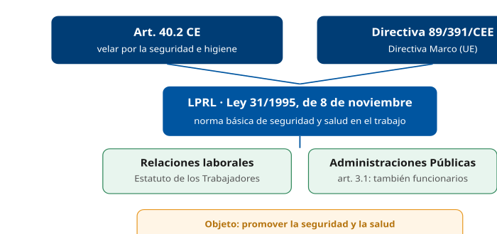
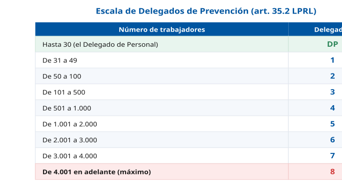
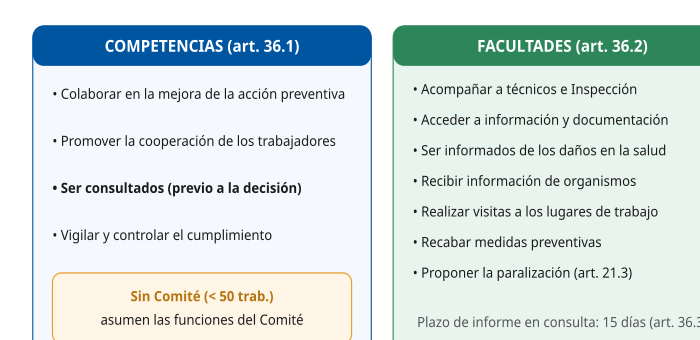
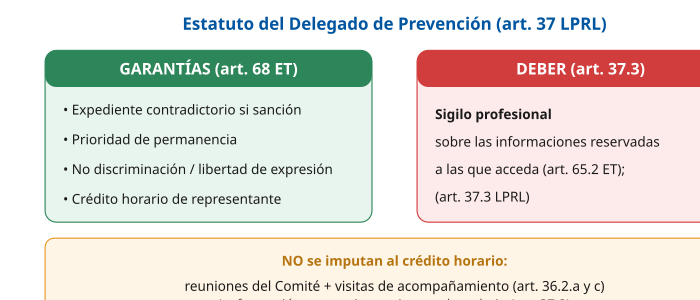
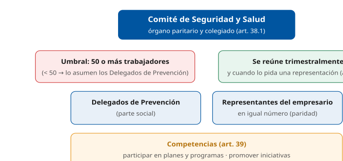
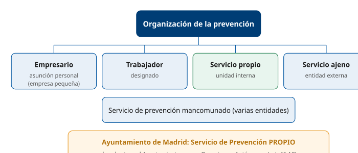
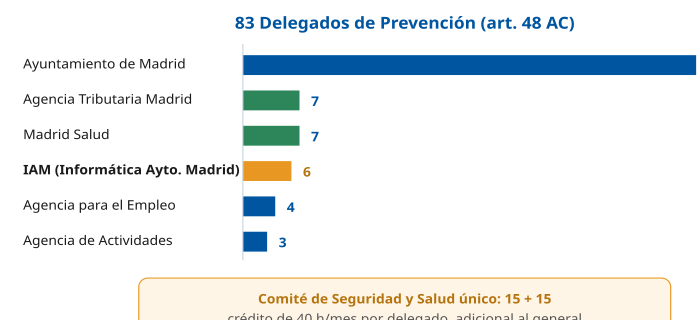

# Tema 9. Prevención de Riesgos Laborales y representación de los empleados públicos

**Bloque:** administrativo  
**Enunciado oficial** (BOAM n.º 10.032, de 23 de diciembre de 2025): Ley 31/1995, de 8 de noviembre de Prevención de Riesgos Laborales: Delegados/as de prevención. Comités de seguridad y salud. Especial referencia a la prevención de riesgos laborales del Acuerdo Convenio en vigor sobre condiciones de trabajo comunes al personal funcionario y laboral del Ayuntamiento de Madrid y de sus Organismos Autónomos. Representación de los empleados públicos.

Versión web: <https://ayuntamientomadrid.github.io/temario-tecnico-auxiliar/temas/tema-09.html> · PDF: [tema-09.pdf](tema-09.pdf) · Test: [../../../tests/administrativo/tema-09.md](../../../tests/administrativo/tema-09.md)

## Índice

- 1. Introducción: la LPRL, objeto, ámbito y fundamento
  - 1.1 La Ley 31/1995, de Prevención de Riesgos Laborales
  - 1.2 Fundamento constitucional y comunitario
  - 1.3 Objeto y ámbito de aplicación (arts. 1-3)
- 2. Principios de la acción preventiva, derechos y obligaciones
  - 2.1 El deber de protección y los derechos de los trabajadores (arts. 14-28)
  - 2.2 Los principios de la acción preventiva (art. 15)
  - 2.3 Obligaciones de los trabajadores (art. 29)
- 3. Los Delegados de Prevención: concepto y designación (art. 35)
  - 3.1 Concepto
  - 3.2 Designación
  - 3.3 La escala de designación (art. 35.2)
- 4. Delegados de Prevención: competencias y facultades (art. 36)
  - 4.1 Competencias (art. 36.1)
  - 4.2 Facultades (art. 36.2)
  - 4.3 El informe en la consulta
- 5. Delegados de Prevención: garantías y sigilo profesional (art. 37)
  - 5.1 Garantías
  - 5.2 Formación
  - 5.3 Sigilo profesional
- 6. El Comité de Seguridad y Salud (arts. 38-39)
  - 6.1 Concepto y constitución (art. 38)
  - 6.2 Composición paritaria
  - 6.3 Competencias y facultades (art. 39)
  - 6.4 Funcionamiento
- 7. Los servicios de prevención (arts. 30-32 LPRL y RD 39/1997)
  - 7.1 Modalidades de organización preventiva y cuándo procede cada una
  - 7.2 Los servicios de prevención en las Administraciones Públicas
- 8. La PRL en el Acuerdo-Convenio del Ayuntamiento de Madrid
  - 8.1 Naturaleza y ámbito del Acuerdo-Convenio
  - 8.2 El Capítulo IX: Salud laboral y Prevención de Riesgos Laborales (arts. 45-52)
  - 8.3 Delegados de Prevención y Comité de Seguridad y Salud en el Ayuntamiento (art. 48)
  - 8.4 El Plan de Prevención del Ayuntamiento
- 9. La representación de los empleados públicos: marco y órganos
  - 9.1 Doble marco normativo
  - 9.2 Órganos de representación del personal funcionario (art. 39 TREBEP)
  - 9.3 Órganos de representación del personal laboral (ET)
- 10. Competencias, garantías y derecho de reunión
  - 10.1 Funciones de los órganos de representación (art. 40 TREBEP)
  - 10.2 Garantías de la función representativa (art. 41 TREBEP)
  - 10.3 El derecho de reunión (art. 46 TREBEP)
- 11. La representación en el Ayuntamiento de Madrid
  - 11.1 La representación en el Ayuntamiento de Madrid

### Conceptos clave por sección

#### Datos clave

| Concepto | Dato | Referencia |
|----|----|----|
| Norma reguladora de la PRL | **Ley 31/1995, de 8 de noviembre** | LPRL |
| Origen comunitario | **Directiva Marco 89/391/CEE** | DM |
| Fundamento constitucional | **Art. 40.2 CE** (los poderes públicos velarán por la seguridad e higiene en el trabajo) | CE |
| Delegados de Prevención — quiénes los designan | **Por y entre los representantes del personal** | Art. 35.2 |
| Escala — hasta 30 trabajadores | El **Delegado de Personal** es el Delegado de Prevención | Art. 35.2 |
| Escala — de 31 a 49 | **1** Delegado de Prevención | Art. 35.2 |
| Escala — de 50 a 100 | **2** Delegados de Prevención | Art. 35.2 |
| Escala — de 4.001 en adelante | **8** Delegados de Prevención (máximo) | Art. 35.2 |
| Competencias de los Delegados | Colaborar, promover, **ser consultados** y vigilar | Art. 36.1 |
| Comité de Seguridad y Salud — umbral | Se constituye con **50 o más trabajadores** | Art. 38.2 |
| Comité de Seguridad y Salud — naturaleza | Órgano **paritario y colegiado** | Art. 38.1 |
| Comité de Seguridad y Salud — reuniones | **Trimestralmente** (y cuando lo pida una representación) | Art. 38.3 |
| Garantías de los Delegados de Prevención | Las del **art. 68 ET** + **sigilo profesional** | Art. 37 |
| Servicios de prevención — modalidades | Asunción por el empresario · trabajador designado · servicio propio · servicio ajeno · mancomunado | LPRL art. 30; RSP arts. 10 y 21 |
| Delegados de Prevención en el Ayto de Madrid | **83** en total · **IAM: 6** | AC art. 48 |
| Comité de Seguridad y Salud del Ayto | **Único y paritario: 15 + 15** | AC art. 48 |
| Crédito horario en el Ayto | **40 horas/mes** por Delegado de Prevención (adicional) | AC art. 48 |
| Plan de PRL del Ayto | Acuerdo de **26/11/2020** (BOAM 8783) | PLAN-PRL |
| Delegados de Personal (funcionarios) | **1** hasta 30 · **3** de 31 a 49 | TREBEP art. 39.2 |
| Junta de Personal (funcionarios) | Unidades con un censo mínimo de **50** funcionarios | TREBEP art. 39.3 |
| Derecho de reunión | Legitimados, entre otros, los empleados en número no inferior al **40 %** del colectivo convocado · reuniones **fuera de las horas de trabajo**, salvo acuerdo | TREBEP art. 46 |

#### Tabla comparativa — Representación general vs. representación preventiva

|  | Representación general | Representación preventiva (PRL) |
|----|----|----|
| Norma | **TREBEP** (funcionarios) / **ET** (laborales) | **LPRL** (arts. 34-40) |
| Órgano unipersonal | Delegado de Personal | **Delegado de Prevención** |
| Órgano colegiado | Junta de Personal / Comité de Empresa | **Comité de Seguridad y Salud** |
| Umbral del colegiado | **50** funcionarios/trabajadores | **50** trabajadores |
| Cómo se designan los Delegados de Prevención | — | **Por y entre** los representantes del personal (art. 35.2), salvo otros sistemas de designación (art. 35.4) |

#### Escala de los Delegados de Prevención (art. 35.2 LPRL)

| Trabajadores         | Delegados de Prevención            |
|----------------------|------------------------------------|
| Hasta 30             | El propio **Delegado de Personal** |
| De 31 a 49           | **1**                              |
| De 50 a 100          | 2                                  |
| De 101 a 500         | 3                                  |
| De 501 a 1.000       | 4                                  |
| De 1.001 a 2.000     | 5                                  |
| De 2.001 a 3.000     | 6                                  |
| De 3.001 a 4.000     | 7                                  |
| De 4.001 en adelante | **8**                              |

------------------------------------------------------------------------

## Contenido

------------------------------------------------------------------------

### Convenciones del documento

Este tema incluye cuatro tipos de **cajas** explicativas:

> **Dato clave.** Datos concretos de la norma: escalas, umbrales, plazos, porcentajes, crédito horario y órganos competentes.

> **Cita normativa.** Reproducción literal o paráfrasis cercana de un precepto de la Constitución, la LPRL, el RD 39/1997, el TREBEP, el ET o el Acuerdo-Convenio, con referencia al artículo.

> **Ejemplo de aplicación en el ayto.** Aplicación al Ayuntamiento de Madrid, su Acuerdo-Convenio y, en particular, al IAM (Informática del Ayuntamiento de Madrid).

> **Relación con otros temas.** Relación con otros temas del temario.

Las citas al articulado se expresan como `(art. X LPRL)`, `(art. X TREBEP)`, `(art. X ET)` o `(art. X Acuerdo-Convenio)`. El registro completo de fuentes está en la pestaña Fuentes.

------------------------------------------------------------------------

### 1. Introducción: la LPRL, objeto, ámbito y fundamento

#### 1.1 La Ley 31/1995, de Prevención de Riesgos Laborales

La **Ley 31/1995, de 8 de noviembre, de Prevención de Riesgos Laborales (LPRL)** es la norma básica del ordenamiento español en materia de seguridad y salud en el trabajo. Tiene por objeto **promover la seguridad y la salud de los trabajadores** mediante la aplicación de medidas y el desarrollo de las actividades necesarias para la **prevención de los riesgos derivados del trabajo** (art. 2.1 LPRL).

> **Cita normativa.** La LPRL establece *"los principios generales relativos a la prevención de los riesgos profesionales para la protección de la seguridad y de la salud, la eliminación o disminución de los riesgos derivados del trabajo, la información, la consulta, la participación equilibrada y la formación de los trabajadores en materia preventiva"* (art. 2.1 LPRL).

Las disposiciones de carácter laboral de la LPRL y de sus normas reglamentarias tienen en todo caso el carácter de **Derecho necesario mínimo indisponible**, pudiendo ser **mejoradas y desarrolladas en los convenios colectivos** (art. 2.2 LPRL).

#### 1.2 Fundamento constitucional y comunitario

La **Constitución Española** encomienda a los poderes públicos un mandato expreso.

> **Cita normativa.** *"Los poderes públicos... velarán por la seguridad e higiene en el trabajo"* (art. 40.2 CE). Este mandato, junto con el derecho al trabajo del artículo 35.1 CE, constituye el fundamento constitucional de la PRL.

El segundo pilar es **comunitario**: la LPRL transpone al Derecho español la **Directiva 89/391/CEE, de 12 de junio de 1989 (Directiva Marco)** relativa a la aplicación de las medidas para promover la mejora de la seguridad y de la salud de los trabajadores en el trabajo \[LPRL, exposición de motivos; DM89391\].

> **Dato clave.** La exposición de motivos de la LPRL señala tres referencias de origen: **art. 40.2 CE** (mandato constitucional) + **Directiva Marco 89/391/CEE** (origen comunitario) + **Convenio 155 de la OIT**, sobre seguridad y salud de los trabajadores y medio ambiente de trabajo (compromisos internacionales). La fecha de la Ley es **8 de noviembre de 1995**.

#### 1.3 Objeto y ámbito de aplicación (arts. 1-3)

La LPRL se aplica tanto en el ámbito de las relaciones laborales reguladas en el **Estatuto de los Trabajadores** como en el de las **relaciones de carácter administrativo o estatutario del personal al servicio de las Administraciones Públicas**, con las peculiaridades que, en este caso, se contemplan en la propia Ley o en sus normas de desarrollo (art. 3.1 LPRL).

> **Dato clave.** La LPRL **sí se aplica a las Administraciones Públicas** y a su personal funcionario y estatutario. No es de aplicación en aquellas actividades **cuyas particularidades lo impidan** en el ámbito de las funciones públicas de: **policía, seguridad y resguardo aduanero**; **servicios operativos de protección civil y peritaje forense** en los casos de grave riesgo, catástrofe y calamidad pública; y **Fuerzas Armadas y actividades militares de la Guardia Civil** (art. 3.2 LPRL).

> **Ejemplo de aplicación en el ayto.** El personal del Ayuntamiento de Madrid y de sus Organismos Autónomos —incluido el personal del **IAM**— está plenamente sujeto a la LPRL. Sobre esa base mínima, el **Acuerdo-Convenio 2019-2022** mejora y concreta los derechos de participación (ver sección 8). \[Relación con otros temas: Tema 5, derechos del empleado público.\]

------------------------------------------------------------------------

### 2. Principios de la acción preventiva, derechos y obligaciones

#### 2.1 El deber de protección y los derechos de los trabajadores (arts. 14-28)

La LPRL articula un **derecho de los trabajadores a una protección eficaz** en materia de seguridad y salud, que supone un **correlativo deber del empresario de protección** de los trabajadores frente a los riesgos laborales; este deber de protección constituye, igualmente, un **deber de las Administraciones públicas** respecto del personal a su servicio (art. 14.1 LPRL). El empresario debe garantizar la seguridad y la salud de los trabajadores a su servicio en **todos los aspectos relacionados con el trabajo**, y desarrollará una **acción permanente de seguimiento** de la actividad preventiva (art. 14.2 LPRL).

> **Cita normativa.** *"Los trabajadores tienen derecho a una protección eficaz en materia de seguridad y salud en el trabajo. El citado derecho supone la existencia de un correlativo deber del empresario de protección de los trabajadores frente a los riesgos laborales"* (art. 14.1 LPRL).

El derecho a la protección eficaz **no es un derecho único**, sino que se despliega en un **catálogo de derechos específicos** regulados en el Capítulo III de la Ley (arts. 14-28):

| Derecho del trabajador | Artículo LPRL | Contenido esencial |
|----|----|----|
| Información | art. 18 | Ser informado de los riesgos, de las medidas preventivas y de las medidas de emergencia |
| Consulta y participación | arts. 18 y 33-40 | Ser consultado y participar en las cuestiones que afecten a la seguridad y salud (a través de sus representantes) |
| Formación | art. 19 | Recibir formación teórica y práctica, suficiente y adecuada, en el momento de la contratación y ante cambios |
| Equipos de protección | arts. 17 y 18 | Disponer de equipos de trabajo adecuados y de equipos de protección individual (EPI) |
| Paralización ante riesgo grave e inminente | art. 21 | Interrumpir la actividad y abandonar el lugar de trabajo en caso de riesgo grave e inminente |
| Vigilancia de la salud | art. 22 | Vigilancia periódica de su estado de salud, **voluntaria** (con excepciones) y **confidencial** |
| Protección de trabajadores sensibles | art. 25 | Protección específica de quienes, por sus características personales o estado biológico conocido, sean especialmente sensibles |
| Protección de la maternidad | art. 26 | Adaptación de condiciones o cambio de puesto en embarazo, parto reciente y lactancia |
| Protección de menores | art. 27 | Evaluación específica de los puestos que vayan a ocupar trabajadores menores de dieciocho años |

> **Dato clave.** La **vigilancia de la salud** (art. 22) sólo puede llevarse a cabo cuando el trabajador **preste su consentimiento**. De este carácter voluntario sólo se exceptúan, **previo informe de los representantes de los trabajadores**, tres supuestos: (1) cuando sea imprescindible para evaluar los efectos de las condiciones de trabajo sobre la salud; (2) para verificar si el estado de salud del trabajador puede constituir un peligro para él, para los demás trabajadores o para otras personas relacionadas con la empresa; o (3) cuando así esté establecido en una disposición legal en relación con la protección de riesgos específicos y actividades de especial peligrosidad. Los resultados se comunican al trabajador; al empresario solo se le informa de las **conclusiones** en relación con la **aptitud** para el puesto o con la necesidad de introducir o mejorar las medidas de protección (art. 22.4).

> **Dato clave.** El derecho de **paralización por riesgo grave e inminente** (art. 21) tiene una doble vía: el trabajador puede **interrumpir su actividad y abandonar** el lugar de trabajo (art. 21.2); y, si el empresario no adopta las medidas necesarias, los **representantes legales**, por mayoría de sus miembros, pueden acordar la **paralización de la actividad**, acuerdo que se comunica de inmediato a la empresa y a la autoridad laboral, la cual en **veinticuatro horas** lo anulará o ratificará (art. 21.3). Los trabajadores o sus representantes no pueden sufrir perjuicio alguno, salvo mala fe o negligencia grave (art. 21.4).

#### 2.2 Los principios de la acción preventiva (art. 15)

El artículo 15.1 LPRL enuncia los **nueve principios generales** con arreglo a los cuales el empresario debe aplicar las medidas preventivas.

| Letra | Principio (texto del art. 15.1) |
|----|----|
| a\) | **Evitar los riesgos** |
| b\) | **Evaluar los riesgos que no se puedan evitar** |
| c\) | **Combatir los riesgos en su origen** |
| d\) | **Adaptar el trabajo a la persona**, en particular en lo que respecta a la concepción de los puestos de trabajo, así como a la elección de los equipos y los métodos de trabajo y de producción, con miras, en particular, a atenuar el trabajo monótono y repetitivo y a reducir los efectos del mismo en la salud |
| e\) | **Tener en cuenta la evolución de la técnica** |
| f\) | **Sustituir lo peligroso por lo que entrañe poco o ningún peligro** |
| g\) | **Planificar la prevención**, buscando un conjunto coherente que integre en ella la técnica, la organización del trabajo, las condiciones de trabajo, las relaciones sociales y la influencia de los factores ambientales en el trabajo |
| h\) | **Adoptar medidas que antepongan la protección colectiva a la individual** |
| i\) | **Dar las debidas instrucciones a los trabajadores** |

> **Dato clave.** Solo se evalúan los riesgos **que no se puedan evitar** (principio b), encadenado con el a). Y, conforme al artículo 17.2 LPRL, los equipos de protección individual deberán utilizarse cuando los riesgos no se puedan evitar o no puedan limitarse suficientemente por medios técnicos de protección colectiva o mediante medidas, métodos o procedimientos de organización del trabajo.

#### 2.3 Obligaciones de los trabajadores (art. 29)

El artículo 29.1 LPRL impone a **cada trabajador** la obligación de velar, según sus posibilidades y mediante el cumplimiento de las medidas de prevención, por su propia seguridad y salud y por la de aquellas otras personas a las que pueda afectar su actividad profesional. En particular, deben:

1.  **Usar adecuadamente** las máquinas, aparatos, herramientas, sustancias peligrosas, equipos de transporte y, en general, cualesquiera otros medios con los que desarrollen su actividad.
2.  **Utilizar correctamente los medios y equipos de protección** facilitados por el empresario, de acuerdo con las instrucciones recibidas de éste.
3.  **No poner fuera de funcionamiento** y utilizar correctamente los **dispositivos de seguridad** existentes.
4.  **Informar de inmediato** a su superior jerárquico directo, y a los trabajadores designados o, en su caso, al servicio de prevención, de cualquier situación que, a su juicio, entrañe, por motivos razonables, un riesgo.
5.  **Contribuir al cumplimiento** de las obligaciones establecidas por la autoridad competente.
6.  **Cooperar** con el empresario para que pueda garantizar unas condiciones de trabajo seguras.

> **Dato clave.** El incumplimiento por el trabajador de estas obligaciones tiene la consideración de **incumplimiento laboral** a los efectos del artículo 58.1 ET o **de falta**, en su caso, conforme a la normativa sobre **régimen disciplinario de los funcionarios públicos** o del personal estatutario (art. 29.3 LPRL).

> **Relación con otros temas.** El incumplimiento de estas obligaciones puede tener consecuencias disciplinarias dentro del régimen del empleado público (**Tema 5, TREBEP**).

------------------------------------------------------------------------

### 3. Los Delegados de Prevención: concepto y designación (art. 35)

#### 3.1 Concepto

> **Cita normativa.** *"Los Delegados de Prevención son los representantes de los trabajadores con funciones específicas en materia de prevención de riesgos en el trabajo"* (art. 35.1 LPRL).

En las empresas o centros de trabajo con **seis o más trabajadores**, la participación de éstos se canaliza a través de **sus representantes** y de la **representación especializada** regulada en el capítulo V de la LPRL (art. 34.1 LPRL).

#### 3.2 Designación

> **Cita normativa.** Los Delegados de Prevención serán **designados por y entre los representantes del personal**, en el ámbito de los órganos de representación previstos en las normas a que se refiere el artículo 34 (art. 35.2 LPRL).

> **Dato clave.** Con carácter general, los Delegados de Prevención **no se eligen directamente por los trabajadores**, sino que son **designados por y entre** los representantes del personal (Delegados de Personal / Comité de Empresa / Junta de Personal). Los convenios colectivos pueden establecer **otros sistemas de designación**, siempre que la facultad de designación corresponda a los representantes del personal o a los propios trabajadores; y en el ámbito de las Administraciones públicas también pueden establecerse otros sistemas de designación (art. 35.4 LPRL).

#### 3.3 La escala de designación (art. 35.2)

El número de Delegados de Prevención depende del número de trabajadores, según la siguiente escala:

| Trabajadores | Delegados de Prevención |
|----|----|
| Hasta 30 | El **Delegado de Personal** es el Delegado de Prevención |
| De 31 a 49 | **1** Delegado de Prevención |
| De 50 a 100 | 2 |
| De 101 a 500 | 3 |
| De 501 a 1.000 | 4 |
| De 1.001 a 2.000 | 5 |
| De 2.001 a 3.000 | 6 |
| De 3.001 a 4.000 | 7 |
| De 4.001 en adelante | **8** |

> **Dato clave.** **Hasta 30 trabajadores → el propio Delegado de Personal**; **31-49 → 1**, elegido por y entre los Delegados de Personal; **50-100 → 2**; y el **máximo es 8** (de 4.001 en adelante). A efectos del cómputo, los trabajadores vinculados por contratos de duración determinada superior a un año se computan como fijos de plantilla; los contratados por término de hasta un año, según los días trabajados en el período de un año anterior a la designación (cada 200 días trabajados o fracción = 1 trabajador más) (art. 35.3 LPRL).

------------------------------------------------------------------------

### 4. Delegados de Prevención: competencias y facultades (art. 36)

#### 4.1 Competencias (art. 36.1)

> **Cita normativa.** Son competencias de los Delegados de Prevención: **(a) colaborar** con la dirección de la empresa en la mejora de la acción preventiva; **(b) promover y fomentar la cooperación** de los trabajadores en la ejecución de la normativa sobre prevención de riesgos laborales; **(c) ser consultados** por el empresario, con carácter previo a su ejecución, acerca de las decisiones a que se refiere el artículo 33; **(d) ejercer una labor de vigilancia y control** sobre el cumplimiento de la normativa de PRL (art. 36.1 LPRL).

> **Dato clave.** Las cuatro competencias siguen la secuencia **«colaborar – promover – ser consultados – vigilar»**. En las empresas que no cuenten con Comité de Seguridad y Salud por no alcanzar el número mínimo de trabajadores (50), las competencias atribuidas al Comité **las ejercen los Delegados de Prevención**.

#### 4.2 Facultades (art. 36.2)

> **Cita normativa.** En el ejercicio de sus competencias, los Delegados de Prevención están facultados para: **(a) acompañar** a los técnicos en las evaluaciones de carácter preventivo y a los Inspectores de Trabajo y Seguridad Social en sus visitas y verificaciones; **(b) tener acceso a la información y documentación** relativa a las condiciones de trabajo que sean necesarias para el ejercicio de sus funciones; **(c) ser informados** por el empresario sobre los daños producidos en la salud de los trabajadores; **(d) recibir** del empresario las informaciones obtenidas por éste de las personas u órganos encargados de la prevención y de los organismos competentes; **(e) realizar visitas** a los lugares de trabajo para ejercer una labor de vigilancia y control; **(f) recabar** del empresario la adopción de medidas de carácter preventivo, pudiendo efectuar propuestas al empresario y al Comité de Seguridad y Salud; **(g) proponer** al órgano de representación de los trabajadores la adopción del acuerdo de paralización de actividades del artículo 21.3 (art. 36.2 LPRL).

> **Dato clave.** No confundir **competencias** (art. 36.1: colaborar, promover, ser consultados, vigilar) con **facultades** (art. 36.2: acompañar, acceder a información, ser informados, recibir información, realizar visitas, recabar medidas, proponer la paralización).

#### 4.3 El informe en la consulta

Los informes que deban emitir los Delegados de Prevención en la consulta deberán elaborarse en un **plazo de quince días**, o en el tiempo imprescindible cuando se trate de adoptar medidas dirigidas a prevenir riesgos inminentes. Transcurrido el plazo sin haberse emitido el informe, el empresario podrá poner en práctica su decisión (art. 36.3 LPRL). La decisión negativa del empresario a la adopción de las medidas propuestas por el Delegado de Prevención deberá ser **motivada** (art. 36.4 LPRL).

------------------------------------------------------------------------

### 5. Delegados de Prevención: garantías y sigilo profesional (art. 37)

#### 5.1 Garantías

> **Cita normativa.** Lo previsto en el **artículo 68 del Estatuto de los Trabajadores** en materia de garantías será de aplicación a los Delegados de Prevención en su condición de representantes de los trabajadores (art. 37.1 LPRL).

Estas garantías incluyen: la **apertura de expediente contradictorio** en el supuesto de sanciones por faltas graves o muy graves; la **prioridad de permanencia** en la empresa o centro de trabajo; **no ser despedido ni sancionado** durante el ejercicio de sus funciones ni dentro del año siguiente a la expiración de su mandato, ni discriminado en su promoción económica o profesional; la **libertad de expresión** en las materias concernientes a la esfera de su representación; y el **crédito de horas mensuales retribuidas** (art. 68 ET).

> **Dato clave.** El tiempo utilizado por los Delegados de Prevención para el desempeño de sus funciones se considera de ejercicio de funciones de representación a efectos del **crédito de horas mensuales retribuidas**. Ahora bien, se considera en todo caso **tiempo de trabajo efectivo, sin imputación** a dicho crédito, el de las **reuniones del Comité de Seguridad y Salud** y de cualesquiera otras convocadas por el empresario en materia de prevención, así como el de las **visitas** previstas en el artículo 36.2.a) y c) (art. 37.1 LPRL, párrafos segundo y tercero).

#### 5.2 Formación

El empresario debe proporcionar a los Delegados de Prevención los **medios** y la **formación** en materia preventiva que resulten necesarios para el ejercicio de sus funciones. El tiempo dedicado a la formación se considera **tiempo de trabajo** a todos los efectos y su coste no puede recaer sobre los Delegados de Prevención (art. 37.2 LPRL).

#### 5.3 Sigilo profesional

> **Cita normativa.** A los Delegados de Prevención les es de aplicación lo dispuesto en el apartado 2 del artículo 65 ET en cuanto al **sigilo profesional** debido respecto de las informaciones a que tuviesen acceso como consecuencia de su actuación en la empresa (art. 37.3 LPRL).

> **Dato clave.** Las dos «caras» del estatuto del Delegado de Prevención: **garantías** (protección frente a represalias, art. 68 ET) y **deberes** (sigilo profesional, art. 37.3). No puede ser sancionado por ejercer sus funciones, pero sí debe guardar reserva sobre la información reservada. Para los miembros del comité de empresa, el artículo 65.3 ET establece que el deber de sigilo subsiste incluso tras la expiración de su mandato.

------------------------------------------------------------------------

### 6. El Comité de Seguridad y Salud (arts. 38-39)

#### 6.1 Concepto y constitución (art. 38)

> **Cita normativa.** *"El Comité de Seguridad y Salud es el órgano paritario y colegiado de participación destinado a la consulta regular y periódica de las actuaciones de la empresa en materia de prevención de riesgos"* (art. 38.1 LPRL).

> **Dato clave.** El Comité de Seguridad y Salud se constituye en **todas las empresas o centros de trabajo que cuenten con 50 o más trabajadores** (art. 38.2 LPRL). Por **debajo de 50**, no hay Comité: sus competencias las ejercen los **Delegados de Prevención** (art. 36.1 LPRL).

#### 6.2 Composición paritaria

El Comité está formado por los **Delegados de Prevención**, de una parte, y por **el empresario y/o sus representantes en número igual al de los Delegados de Prevención**, de la otra (art. 38.2 LPRL). En sus reuniones participan, con **voz pero sin voto**, los Delegados Sindicales y los responsables técnicos de la prevención en la empresa no incluidos en su composición; en las mismas condiciones pueden participar trabajadores de la empresa con especial cualificación o información sobre las cuestiones que se debatan y técnicos en prevención ajenos a la empresa, siempre que lo solicite alguna de las representaciones en el Comité (art. 38.2 LPRL, párrafo tercero).

#### 6.3 Competencias y facultades (art. 39)

> **Cita normativa.** El Comité de Seguridad y Salud tendrá las competencias de **participar en la elaboración, puesta en práctica y evaluación de los planes y programas de prevención** de riesgos de la empresa y **promover iniciativas** sobre métodos y procedimientos para la efectiva prevención de los riesgos. Estará facultado para **conocer directamente** la situación relativa a la prevención en el centro de trabajo, **conocer los documentos e informes** relativos a las condiciones de trabajo, **conocer y analizar los daños** producidos en la salud o en la integridad física de los trabajadores y **conocer e informar la memoria y programación anual** de servicios de prevención (art. 39.1 y 39.2 LPRL).

#### 6.4 Funcionamiento

> **Dato clave.** El Comité de Seguridad y Salud se reúne **trimestralmente** y siempre que lo solicite alguna de las representaciones en el mismo, y adopta sus propias normas de funcionamiento (art. 38.3 LPRL). Las empresas que cuenten con varios centros de trabajo dotados de Comité pueden acordar con sus trabajadores la creación de un **Comité Intercentros**.

------------------------------------------------------------------------

### 7. Los servicios de prevención (arts. 30-32 LPRL y RD 39/1997)

El artículo 30.1 LPRL impone al empresario, en cumplimiento del deber de prevención, **designar uno o varios trabajadores**, **constituir un servicio de prevención** o **concertarlo con una entidad especializada ajena** a la empresa. Las modalidades y los supuestos en que procede cada una se desarrollan en el **Reglamento de los Servicios de Prevención (RD 39/1997, de 17 de enero)** (RSP).

#### 7.1 Modalidades de organización preventiva y cuándo procede cada una

> **Cita normativa.** Se entiende por servicio de prevención *"el conjunto de medios humanos y materiales necesarios para realizar las actividades preventivas a fin de garantizar la adecuada protección de la seguridad y la salud de los trabajadores, asesorando y asistiendo para ello al empresario, a los trabajadores y a sus representantes y a los órganos de representación especializados"* (art. 31.2 LPRL).

| Modalidad | En qué consiste | Cuándo procede / es obligatoria (arts. 10-16 y 21 RSP) |
|----|----|----|
| Asunción por el empresario | El propio empresario desarrolla personalmente la actividad de prevención | Empresas de **hasta 10 trabajadores** (o **hasta 25** con un único centro de trabajo), actividades **no incluidas en el anexo I**, el empresario desarrolla de forma habitual su actividad en el centro y tiene la capacidad necesaria. **Excepto** la vigilancia de la salud (art. 11) |
| Trabajador designado | Uno o varios trabajadores designados para ocuparse de la actividad preventiva | El empresario designará uno o varios trabajadores; **no es obligatoria** la designación si ha asumido personalmente la actividad o ha recurrido a un servicio de prevención propio o ajeno (art. 12) |
| Servicio de prevención propio (SPP) | Unidad organizativa específica cuyos integrantes dedican de forma exclusiva su actividad en la empresa a la finalidad del servicio (art. 15.1) | **Obligatorio**: empresas de **más de 500 trabajadores**; empresas de **entre 250 y 500** que desarrollen actividades del **anexo I**; o cuando lo decida la **autoridad laboral**, salvo que se opte por el concierto con una entidad especializada ajena (art. 14) |
| Servicio de prevención ajeno (SPA) | Servicio prestado por una entidad especializada que concierta con la empresa la realización de actividades de prevención (art. 10.2) | Cuando la designación de trabajadores sea insuficiente y no concurran los supuestos de SPP obligatorio; cuando, decidido por la autoridad laboral, no se opte por un SPP; o cuando se haya producido una asunción parcial de la actividad preventiva (art. 16.1) |
| Servicio de prevención mancomunado (SPM) | Servicio constituido entre varias empresas | Empresas que desarrollen simultáneamente actividades en un mismo centro de trabajo, edificio o centro comercial; o, por negociación colectiva o decisión de las empresas, del mismo sector productivo, grupo empresarial, polígono industrial o área geográfica limitada. Tiene la consideración de **servicio propio** de las empresas que lo constituyen (art. 21) |

> **Dato clave.** **Umbrales del servicio de prevención propio obligatorio** (art. 14 RSP): **más de 500 trabajadores**; **250-500** si se desarrollan actividades **del anexo I**; y por **decisión de la autoridad laboral**. El empresario puede asumir personalmente la actividad preventiva **con excepción de la vigilancia de la salud** (art. 11.1 RSP), que se lleva a cabo por **personal sanitario** con competencia técnica, formación y capacidad acreditada (art. 22.6 LPRL).

#### 7.2 Los servicios de prevención en las Administraciones Públicas

Para el establecimiento de los servicios de prevención en las Administraciones públicas se tiene en cuenta **su estructura organizativa** y la existencia, en su caso, de **ámbitos sectoriales y descentralizados** (art. 31.1 LPRL). En el ámbito de las Administraciones públicas, la organización de los recursos necesarios para el desarrollo de las actividades preventivas se realiza en los términos de su **normativa específica**; en su defecto, se aplica el RSP, y no son de aplicación a las Administraciones públicas las obligaciones en materia de **auditorías** de su capítulo V \[RSP, disp. adic. 4.ª\].

> **Ejemplo de aplicación en el ayto.** La organización de los recursos preventivos de la Administración municipal de Madrid se realiza en la **modalidad de servicio de prevención propio** (art. 46.2 AC). El **Servicio de Prevención** cuenta con las **cuatro especialidades o disciplinas preventivas** previstas en el artículo 34 del RD 39/1997 y se estructura en **equipos multidisciplinares** que actúan de forma integrada en el ámbito del **Servicio de Prevención Único**; todas las unidades que realizan funciones de salud laboral y/o prevención dependen funcionalmente de la **Subdirección General de Prevención y Riesgos Laborales** (art. 46.3 AC). Sus funciones se concretan en el Acuerdo-Convenio (sección 8).

------------------------------------------------------------------------

### 8. La PRL en el Acuerdo-Convenio del Ayuntamiento de Madrid

#### 8.1 Naturaleza y ámbito del Acuerdo-Convenio

El **Acuerdo-Convenio sobre Condiciones de Trabajo Comunes al Personal Funcionario y Laboral del Ayuntamiento de Madrid y de sus Organismos Autónomos** regula las condiciones de trabajo comunes para el personal funcionario y laboral del Ayuntamiento de Madrid y sus organismos autónomos, en las materias que han sido objeto de negociación conforme al TREBEP (art. 1 Acuerdo-Convenio). El texto **en vigor** es el del **periodo 2019-2022**, aprobado por **Acuerdo de 27 de diciembre de 2018 de la Junta de Gobierno de la Ciudad de Madrid** (BOAM núm. 8307, de 02/01/2019); agotada su vigencia sin denuncia expresa, se considera **tácitamente prorrogado por períodos anuales sucesivos** (art. 4.1 Acuerdo-Convenio).

> **Dato clave.** El Acuerdo-Convenio tiene una **doble naturaleza**: para el **personal funcionario** es un **Acuerdo** de los previstos en el TREBEP (art. 38), y para el **personal laboral** opera como **convenio colectivo**. La negociación de las condiciones de trabajo comunes al personal funcionario y laboral de cada entidad local corresponde a la **Mesa General de Negociación** (art. 36.3 TREBEP). Su ámbito incluye al Ayuntamiento y a sus Organismos Autónomos (entre ellos, el **IAM**).

#### 8.2 El Capítulo IX: Salud laboral y Prevención de Riesgos Laborales (arts. 45-52)

La PRL se regula en el **Capítulo IX** del Acuerdo-Convenio, «Salud laboral y Prevención de Riesgos Laborales», integrado por ocho artículos (45 a 52).

##### Art. 45 — Salud laboral

El Ayuntamiento se compromete a **fomentar una auténtica cultura de la prevención** que proscriba el cumplimiento «meramente formal o documental» de las obligaciones preventivas. El artículo reproduce, adaptados al ámbito municipal, el **catálogo de derechos** del trabajador (protección eficaz, información, formación, propuestas de mejora, protección de los especialmente sensibles, vigilancia de la salud y paralización ante riesgo grave e inminente —arts. 21 y 22 LPRL—) y sus **deberes** (uso correcto de medios y equipos, información inmediata de riesgos, integración en equipos de emergencia).

> **Dato clave.** Dos especialidades del artículo 45: (1) el personal que deba acudir a **reconocimientos médicos fuera de su jornada** (por practicarse en turno distinto) es **compensado** con cargo a su jornada por el tiempo invertido; y (2) si el informe médico recomienda **ejercicio físico**, el Ayuntamiento facilita la **entrada gratuita a las instalaciones deportivas municipales**.

##### Art. 46 — Servicio de Prevención

Define el Servicio de Prevención municipal y fija la **modalidad: servicio de prevención propio**. Establece su **estructura** (equipos multidisciplinares con las **cuatro especialidades** del art. 34 RD 39/1997, dependientes funcionalmente de la **Subdirección General de Prevención y Riesgos Laborales**), sus **funciones** (asesoramiento, diseño e implantación del Plan de Prevención, vigilancia de la salud y reconocimientos médicos, estudios epidemiológicos, publicación anual de índices de siniestralidad) y los **instrumentos de control**.

> **Dato clave.** El sistema de prevención del Ayuntamiento se somete **cada cuatro años** a control mediante **auditorías o evaluaciones**, sin perjuicio de su realización **cada dos años** en **actividades especialmente peligrosas** (radiaciones ionizantes, agentes tóxicos y muy tóxicos, productos químicos de alto riesgo, agentes biológicos de los grupos 3 y 4, etc.). Las evaluaciones iniciales de riesgos incluyen los **riesgos psicosociales**, y para la aprobación de la **revisión anual del Plan de Prevención**, en el **primer trimestre** del año, debe contarse con la participación de los delegados de prevención en el marco de la **Mesa General de Negociación**.

##### Art. 47 — Recursos económicos destinados a la PRL (financiación)

Cada **área de gobierno, distrito y organismo autónomo** planifica **a cargo de sus presupuestos** las actuaciones necesarias para las medidas correctoras indicadas por el Servicio de Prevención, la adquisición de equipos y ropa de trabajo, la formación específica habilitante y la elaboración e implantación de los planes de autoprotección.

> **Dato clave.** Se dota un **Fondo económico en cada ejercicio presupuestario**, y en el **primer trimestre** de cada ejercicio se determinan las actuaciones a realizar **teniendo en cuenta las sugerencias del Comité de Seguridad y Salud**.

##### Art. 48 — Representación del personal municipal

Se desarrolla en el apartado **8.3**: regula los **Delegados de Prevención** (83 en total), el **Comité de Seguridad y Salud único y paritario** (15+15), el **crédito horario de 40 h/mes** y la **formación** básica, cuya oferta tenderá a ampliarse hasta las 60 horas.

##### Art. 49 — Adaptaciones de puesto y movilidad por motivos de salud

Cuando un empleado, por motivos de salud que **no alcanzan los grados de invalidez**, no puede desempeñar adecuadamente su puesto, la Administración facilita primero la **adaptación del puesto** y, si resulta inviable, la **adscripción a otro puesto** adecuado, condicionada a que exista **puesto vacante, dotado presupuestariamente, equivalente** al de origen.

> **Dato clave.** Especialidades del artículo 49: (1) **protección de la madre y el feto durante el embarazo** → adaptación de las condiciones, del tiempo o del turno de trabajo o, si no es posible, **cambio temporal de funciones**, previo informe o recomendación del Servicio de Prevención; (2) si la adscripción a nuevo puesto es **definitiva**, el empleado debe **permanecer dos años** en él; y (3) el Servicio de Prevención elabora un **protocolo de acogida** para la incorporación de los nuevos trabajadores.

##### Art. 50 — Proyectos de construcción, modificaciones y mantenimiento de edificios

Los proyectos de construcción, modificaciones y mantenimiento de edificios e instalaciones en los centros de trabajo deben cumplir la normativa de PRL, de construcción y de protección contra incendios. Las **obras de remodelación** se ejecutan **preferentemente fuera de la jornada laboral**; si no es posible y pueden derivarse riesgos, se garantiza el **traslado provisional** del personal mientras perduren los riesgos.

> **Dato clave.** Se facilita a los Delegados de Prevención la **planificación anticipada, con al menos 15 días de antelación, de las obras y traslados** del personal. Además, en la medida de lo posible, se habilitan **espacios de descanso** adecuados y dignos.

##### Art. 51 — Planes de Autoprotección

En cumplimiento del **artículo 20 LPRL**, la Administración implanta **Planes de Autoprotección o Medidas de Emergencia** (lucha contra incendios, evacuación, primeros auxilios y otras medidas de seguridad, incluida la coordinación de actividades), designa al personal encargado y comprueba periódicamente su correcto funcionamiento con la periodicidad mínima que fije el propio Plan y, **al menos, una vez al año**.

##### Art. 52 — Medio Ambiente

Prevé una **política pública integrada de prevención de riesgos laborales y de protección del medio ambiente**: reducción del consumo energético y estudio de energías renovables, gestión de residuos y recogida selectiva, productos más respetuosos con el medio ambiente, mejor utilización de los recursos hídricos y campañas de sensibilización.

#### 8.3 Delegados de Prevención y Comité de Seguridad y Salud en el Ayuntamiento (art. 48)

> **Ejemplo de aplicación en el ayto.** El artículo 48 del Acuerdo-Convenio fija **83 Delegados de Prevención** en el conjunto del Ayuntamiento y sus Organismos Autónomos, repartidos así: **Ayuntamiento de Madrid 56 · Agencia para el Empleo 4 · Agencia Tributaria Madrid 7 · Informática del Ayuntamiento de Madrid (IAM) 6 · Madrid Salud 7 · Agencia de Actividades 3**.

> **Dato clave.** El Comité de Seguridad y Salud del Ayuntamiento de Madrid es el órgano **único, paritario y colegiado**: lo integran **15 Delegados de Prevención** (designados proporcionalmente entre quienes ostentan esa condición) y **15 representantes de la Administración**. La **presidencia** recae en la figura encargada de establecer la política general de prevención (o persona en quien delegue) y se nombra un/a secretario/a. Cada Delegado de Prevención dispone de un **crédito horario retribuido de 40 horas mensuales**, **complementario y adicional** al que pudiera corresponderle como representante unitario o sindical; el tiempo de las reuniones del Comité y de las visitas del artículo 36.2.a) y c) LPRL se considera **tiempo de trabajo efectivo** sin imputación a ese crédito (art. 48 Acuerdo-Convenio).

> **Dato clave.** Matiz municipal frente a la regla general de la LPRL: en el Ayuntamiento los Delegados de Prevención **no se designan necesariamente** entre los representantes del personal con presencia en los órganos de representación (Juntas de Personal / Comités de Empresa); pueden designarlos esos órganos, de entre sus miembros, o **las organizaciones sindicales** con presencia en ellos (art. 48.4). El Comité puede constituir **grupos de trabajo** y cuenta con una **Comisión Permanente** (art. 48.1). En sus reuniones pueden participar, **con voz pero sin voto**, hasta **dos asesores por organización sindical** representada y los responsables técnicos de prevención de la Administración.

> **Ejemplo de aplicación en el ayto.** Para un Técnico Auxiliar del **IAM**, esto significa que su organismo cuenta con **6 Delegados de Prevención** propios (de los 83 del total municipal) y que la participación en PRL se canaliza, en última instancia, a través del **Comité de Seguridad y Salud único** del Ayuntamiento. Durante la vigencia del Acuerdo-Convenio, la oferta de **formación básica** de los Delegados tenderá a ampliarse hasta las **60 horas**.

#### 8.4 El Plan de Prevención del Ayuntamiento

> **Dato clave.** El **Plan de Prevención de Riesgos Laborales del Ayuntamiento de Madrid y sus Organismos Autónomos** fue aprobado por **Acuerdo de 26 de noviembre de 2020 de la Junta de Gobierno de la Ciudad de Madrid** (BOAM núm. 8783, de 04/12/2020). Tiene como objeto la **integración de la prevención** en la estructura de gestión del Ayuntamiento y de sus organismos autónomos (política preventiva, estructura organizativa, responsabilidades, funciones, procedimientos y recursos) (art. 46.5 del Acuerdo-Convenio; Plan de Prevención de Riesgos Laborales del Ayuntamiento).

------------------------------------------------------------------------

### 9. La representación de los empleados públicos: marco y órganos

#### 9.1 Doble marco normativo

La representación de los empleados públicos se regula en **dos planos**:

- **TREBEP (RDLeg 5/2015)**: regula la representación **general** para la defensa de los intereses laborales y profesionales (arts. 31-46).
- **LPRL**: regula la representación **específica en materia preventiva** (arts. 34-40, ya vistos: Delegados de Prevención y Comité de Seguridad y Salud).

> **Relación con otros temas.** Los derechos colectivos del empleado público (libertad sindical, negociación colectiva, representación, reunión, huelga y planteamiento de conflictos) se estudian en el **Tema 5 (TREBEP)**. Aquí interesa su proyección en la organización de la representación.

#### 9.2 Órganos de representación del personal funcionario (art. 39 TREBEP)

> **Cita normativa.** *"Los órganos específicos de representación de los funcionarios son los Delegados de Personal y las Juntas de Personal"* (art. 39.1 TREBEP).

> **Dato clave.** En las unidades electorales donde el número de funcionarios sea **igual o superior a 6 e inferior a 50**, la representación corresponde a los **Delegados de Personal**: **1** hasta 30 funcionarios y **3** de 31 a 49, que ejercen su representación conjunta y mancomunadamente (art. 39.2). Las **Juntas de Personal** se constituyen en unidades electorales con un censo mínimo de **50** funcionarios (art. 39.3), con un número de miembros por tramos: de **5** (de 50 a 100 funcionarios) hasta un **máximo de 75** (art. 39.5).

#### 9.3 Órganos de representación del personal laboral (ET)

El personal laboral se rige por el **Estatuto de los Trabajadores**: **delegados de personal** en empresas o centros con **menos de cincuenta y más de diez** trabajadores (y, si así lo deciden éstos por mayoría, en los de seis a diez), en número de uno hasta treinta trabajadores y tres de treinta y uno a cuarenta y nueve (art. 62.1 ET); y **comité de empresa** en cada centro de trabajo cuyo censo sea de **cincuenta o más** trabajadores, con un número de miembros por tramos (arts. 63.1 y 66.1 ET).

> **Dato clave.** El umbral es **50**: por debajo, órganos unipersonales (Delegados de Personal); a partir de 50, órganos colegiados (Junta de Personal para funcionarios / Comité de Empresa para laborales). El mismo umbral de 50 rige para el **Comité de Seguridad y Salud** en PRL (art. 38.2 LPRL).

------------------------------------------------------------------------

### 10. Competencias, garantías y derecho de reunión

#### 10.1 Funciones de los órganos de representación (art. 40 TREBEP)

> **Cita normativa.** Las Juntas de Personal y los Delegados de Personal tendrán, entre otras, las funciones de: **recibir información** sobre la política de personal, la evolución de las retribuciones, la evolución probable del empleo y los programas de mejora del rendimiento; **emitir informe**, a solicitud de la Administración, sobre el traslado total o parcial de las instalaciones e implantación o revisión de sus sistemas de organización y métodos de trabajo; **ser informados** de todas las sanciones impuestas por faltas muy graves; tener conocimiento y **ser oídos** en el establecimiento de la jornada laboral y horario de trabajo, así como en el régimen de vacaciones y permisos; **vigilar el cumplimiento** de las normas vigentes en materia de condiciones de trabajo, **prevención de riesgos laborales**, Seguridad Social y empleo; y **colaborar** con la Administración en el mantenimiento e incremento de la productividad (art. 40.1 TREBEP).

#### 10.2 Garantías de la función representativa (art. 41 TREBEP)

> **Dato clave.** Las garantías incluyen: el acceso y libre circulación por las dependencias de su unidad electoral; la distribución libre de publicaciones profesionales y sindicales; la **audiencia en los expedientes disciplinarios** durante el mandato y el año inmediatamente posterior; un **crédito de horas mensuales** retribuidas por tramos (de **15** horas hasta 100 funcionarios a **40** horas de 751 en adelante); y **no ser trasladados ni sancionados** por causas relacionadas con el ejercicio de su mandato, durante su vigencia ni en el año siguiente a su extinción (art. 41.1). No pueden ser **discriminados** en su formación ni en su promoción por razón del desempeño de su representación (art. 41.2) y deben observar **sigilo profesional** en los asuntos de carácter reservado, aun después de expirar su mandato (art. 41.3). Los miembros de la misma candidatura pueden **acumular** los créditos horarios, previa comunicación al órgano que ostente la Jefatura de Personal (art. 41 TREBEP).

#### 10.3 El derecho de reunión (art. 46 TREBEP)

> **Cita normativa.** Están legitimados para **convocar una reunión**, además de las organizaciones sindicales, directamente o a través de los Delegados Sindicales: los **Delegados de Personal**, las **Juntas de Personal**, los **Comités de Empresa** y los **empleados públicos** de las Administraciones respectivas **en número no inferior al 40 por 100** del colectivo convocado (art. 46.1 TREBEP).

> **Dato clave.** Las reuniones en el centro de trabajo se autorizan **fuera de las horas de trabajo**, salvo acuerdo entre el órgano competente en materia de personal y quienes estén legitimados para convocarlas. La celebración de la reunión **no perjudicará la prestación de los servicios** y los convocantes son **responsables de su normal desarrollo** (art. 46.2 TREBEP).

------------------------------------------------------------------------

### 11. La representación en el Ayuntamiento de Madrid

#### 11.1 La representación en el Ayuntamiento de Madrid

> **Ejemplo de aplicación en el ayto.** En el Ayuntamiento de Madrid y sus organismos autónomos existen **órganos de representación unitaria** del personal funcionario (**Juntas de Personal**) y laboral (**Comités de Empresa**), y **organizaciones sindicales** con presencia en ellos; en el plano preventivo, la defensa de los intereses del personal en materia de PRL se lleva a efecto a través de los **83 Delegados de Prevención** y del **Comité de Seguridad y Salud único (15+15)** del artículo 48 del Acuerdo-Convenio.

> **Dato clave.** La **conexión** entre ambas representaciones: con carácter general, los Delegados de Prevención se designan **por y entre los representantes del personal** (art. 35.2 LPRL), pero la LPRL admite otros sistemas de designación en el ámbito de las Administraciones públicas (art. 35.4 LPRL). El Acuerdo-Convenio hace uso de esa posibilidad: los delegados de prevención municipales los designan los órganos de representación unitaria, de entre sus miembros, **o las organizaciones sindicales** con presencia en ellos (art. 48.4 AC), y disponen de un crédito específico de **40 h/mes**.

## Diagramas

D1 · El marco de la prevención de riesgos laborales

§ 1 — Introducción

Situar la LPRL bajo su fundamento constitucional (art. 40.2 CE) y su origen comunitario (Directiva Marco).

D2 · Los principios de la acción preventiva (art. 15)

§ 2 — Principios de la acción preventiva

Enumerar los nueve principios del art. 15.1 LPRL en su orden legal.

D3 · Escala de Delegados de Prevención (art. 35.2)

§ 3 — Delegados de Prevención: designación

Escala que relaciona el número de trabajadores con el de Delegados de Prevención.

D4 · Delegados de Prevención: competencias y facultades

§ 4 — Competencias y facultades (art. 36)

Separar las competencias (qué hacen) de las facultades (con qué medios).

D5 · Garantías y sigilo del Delegado de Prevención (art. 37)

§ 5 — Garantías y sigilo

Mostrar las dos caras del estatuto: protección (art. 68 ET) y deber de sigilo.

D6 · El Comité de Seguridad y Salud (arts. 38-39)

§ 6 — El Comité de Seguridad y Salud

Fijar el umbral de 50, la paridad, las reuniones trimestrales y las competencias.

D7 · Modalidades de servicio de prevención (arts. 30-31)

§ 7 — Los servicios de prevención

Mostrar las modalidades de organización preventiva y el caso del Ayuntamiento.

D8 · Capítulo IX del Acuerdo-Convenio (arts. 45-52)

§ 8 — La PRL en el Acuerdo-Convenio

Recorrer los ocho artículos del Capítulo IX del Acuerdo-Convenio 2019-2022.

D9 · Los 83 Delegados de Prevención del Ayto de Madrid

§ 8 — La PRL en el Acuerdo-Convenio

Visualizar el reparto del art. 48 entre el Ayuntamiento y sus Organismos Autónomos (el IAM, 6).

D10 · Representación: funcionarios vs. laborales (umbral 50)

§ 9 — Representación de los empleados públicos

Comparar los órganos de representación de funcionarios (TREBEP) y laborales (ET) con el umbral común de 50.

D11 · El derecho de reunión (art. 46 TREBEP)

§ 10 — Competencias, garantías y derecho de reunión

Quiénes pueden convocar una reunión y en qué horario se autoriza en el centro de trabajo (art. 46 TREBEP).

D12 · Mapa de integración del Tema 9

§ 11 — La representación en el Ayuntamiento de Madrid

Situar en un solo esquema la LPRL, la representación TREBEP/ET y el Acuerdo-Convenio.

## Casos prácticos

#### CASO PRÁCTICO 1 — ¿Cuántos Delegados de Prevención?

**Escenario**: Un centro de trabajo municipal cuenta con 85 trabajadores. La representación del personal quiere saber cuántos Delegados de Prevención corresponden, cómo se designan y si debe constituirse Comité de Seguridad y Salud.

**Cuestiones**:

1.  **(3 pts)** ¿Cuántos Delegados de Prevención corresponden a un centro de 85 trabajadores y conforme a qué precepto?
2.  **(3 pts)** ¿Cómo se designan los Delegados de Prevención?
3.  **(2 pts)** ¿Debe constituirse Comité de Seguridad y Salud? ¿Con qué composición?
4.  **(2 pts)** Si el centro tuviera 28 trabajadores, ¿quién sería el Delegado de Prevención?

**Solución orientativa**:

1.  **2 Delegados de Prevención**: el tramo de 50 a 100 trabajadores corresponde a 2 (art. 35.2 LPRL).
2.  **Por y entre los representantes del personal** (Delegados de Personal / Comité de Empresa / Junta de Personal), en el ámbito de los órganos de representación (art. 35.2 LPRL), salvo que los convenios colectivos establezcan otros sistemas de designación (art. 35.4 LPRL).
3.  **Sí**: al alcanzar 50 o más trabajadores se constituye el Comité de Seguridad y Salud (art. 38.2 LPRL), **paritario**: los 2 Delegados de Prevención + 2 representantes del empresario.
4.  Con 28 trabajadores (hasta 30), el **Delegado de Personal** sería, a su vez, el Delegado de Prevención (art. 35.2 LPRL).

**Criterios de evaluación**: aplicar correctamente la escala del artículo 35.2; explicar la designación por y entre los representantes del personal; identificar el umbral de 50 y la paridad del Comité.

------------------------------------------------------------------------

#### Preguntas tipo test sobre este caso

##### 1. En el supuesto planteado, ¿cuántos Delegados de Prevención corresponden al centro municipal de 85 trabajadores?

- a) Dos, por encontrarse en el tramo de 50 a 100 trabajadores de la escala del artículo 35.2 LPRL.
- b) Uno, por encontrarse en el tramo de 31 a 100 trabajadores de la escala del artículo 35.2 LPRL.
- c) Tres, por superar los 50 trabajadores que exige el artículo 38.2 LPRL para el Comité.

**Respuesta correcta:** a) · **Referencia:** Caso 1, cuestión 1 · art. 35.2 LPRL

La escala del artículo 35.2 LPRL asigna 2 Delegados de Prevención a los centros de 50 a 100 trabajadores; 3 corresponden al tramo de 101 a 500.

##### 2. Si la plantilla del centro aumentara hasta 101 trabajadores, el número de Delegados de Prevención pasaría a ser:

- a) Dos, porque el tramo de 50 a 100 se mantiene hasta los 500 trabajadores.
- b) Tres, que es lo que la escala asigna al tramo de 101 a 500 trabajadores.
- c) Cuatro, que es lo que la escala asigna a partir de 101 trabajadores.

**Respuesta correcta:** b) · **Referencia:** Caso 1, cuestión 1 · art. 35.2 LPRL

En la escala del artículo 35.2 LPRL el tramo de 101 a 500 trabajadores tiene 3 Delegados de Prevención; 4 corresponden al tramo de 501 a 1.000.

##### 3. Con carácter general, ¿cómo se designan los Delegados de Prevención del centro?

- a) Por elección directa de toda la plantilla, mediante sufragio en el propio centro de trabajo.
- b) Por el empresario, de entre los técnicos del servicio de prevención del organismo.
- c) Por y entre los representantes del personal, en el ámbito de los órganos de representación.

**Respuesta correcta:** c) · **Referencia:** Caso 1, cuestión 2 · art. 35.2 LPRL

Los Delegados de Prevención no los eligen directamente los trabajadores: los designan por y entre sí los representantes del personal (Delegados de Personal, Comité de Empresa o Junta de Personal) (art. 35.2 LPRL).

##### 4. La representación del personal pregunta si un convenio colectivo podría prever otro sistema de designación de los Delegados de Prevención. La respuesta correcta es:

- a) Sí, siempre que la facultad de designación corresponda a los representantes del personal o a los propios trabajadores.
- b) No, porque el sistema del artículo 35.2 LPRL es de Derecho necesario y no admite variación convencional.
- c) Sí, e incluso puede atribuir la designación al empresario si así se pacta con la representación del personal.

**Respuesta correcta:** a) · **Referencia:** Caso 1, cuestión 2 · art. 35.4 LPRL

El artículo 35.4 LPRL permite que los convenios colectivos establezcan otros sistemas de designación, siempre que la facultad de designar corresponda a los representantes del personal o a los propios trabajadores.

##### 5. ¿Debe constituirse en el centro de 85 trabajadores un Comité de Seguridad y Salud?

- a) No, porque solo es obligatorio a partir de 100 trabajadores, umbral que el centro no alcanza.
- b) No, porque en el ámbito público sus funciones las asume siempre el servicio de prevención.
- c) Sí, porque se constituye en todos los centros de trabajo que cuenten con 50 o más trabajadores.

**Respuesta correcta:** c) · **Referencia:** Caso 1, cuestión 3 · art. 38.2 LPRL

El artículo 38.2 LPRL obliga a constituir el Comité de Seguridad y Salud en las empresas o centros con 50 o más trabajadores; con 85 se supera ese umbral.

##### 6. ¿Cuál sería la composición del Comité de Seguridad y Salud de este centro?

- a) Los 2 Delegados de Prevención y 1 representante del empresario, que lo preside.
- b) Los 2 Delegados de Prevención y 2 representantes del empresario.
- c) Los 2 Delegados de Prevención, 2 Delegados de Personal y 2 representantes del empresario.

**Respuesta correcta:** b) · **Referencia:** Caso 1, cuestión 3 · art. 38.2 LPRL

El Comité es paritario: de una parte, los Delegados de Prevención; de otra, el empresario o sus representantes en número igual al de aquellos (art. 38.2 LPRL).

##### 7. Si el centro tuviera solo 28 trabajadores, ¿quién sería el Delegado de Prevención?

- a) El Delegado de Personal, que sería a su vez el Delegado de Prevención.
- b) Un trabajador elegido directamente por la plantilla para esa única función.
- c) El trabajador designado por el empresario para la actividad preventiva.

**Respuesta correcta:** a) · **Referencia:** Caso 1, cuestión 4 · art. 35.2 LPRL

En los centros de hasta 30 trabajadores, el Delegado de Personal es el Delegado de Prevención (art. 35.2 LPRL).

##### 8. En ese mismo centro de 28 trabajadores, ¿quién ejercería las competencias que la LPRL atribuye al Comité de Seguridad y Salud?

- a) El servicio de prevención, al no alcanzarse el mínimo de 50 trabajadores.
- b) Los Delegados de Prevención, al no alcanzarse el mínimo de 50 trabajadores.
- c) La Inspección de Trabajo y Seguridad Social, a petición de la plantilla.

**Respuesta correcta:** b) · **Referencia:** Caso 1, cuestión 4 · art. 36.1 LPRL

Por debajo de 50 trabajadores no hay Comité de Seguridad y Salud y sus competencias las ejercen los Delegados de Prevención.

##### 9. Si el centro tuviera 40 trabajadores, le correspondería:

- a) Dos Delegados de Prevención, elegidos por y entre los Delegados de Personal.
- b) Ningún Delegado de Prevención específico: lo sería el propio Delegado de Personal.
- c) Un Delegado de Prevención, elegido por y entre los Delegados de Personal.

**Respuesta correcta:** c) · **Referencia:** Caso 1, cuestión 1 · art. 35.2 LPRL

La escala del artículo 35.2 LPRL asigna 1 Delegado de Prevención al tramo de 31 a 49 trabajadores; la regla del Delegado de Personal opera solo hasta 30.

##### 10. Para calcular la plantilla del centro, los trabajadores con contrato de duración determinada superior a un año:

- a) Se computan como trabajadores fijos de plantilla.
- b) Se computan según los días trabajados en el año anterior.
- c) No se computan a efectos de la escala de designación.

**Respuesta correcta:** a) · **Referencia:** Caso 1, cuestión 1 · art. 35.3 LPRL

Conforme al artículo 35.3 LPRL, los contratados por más de un año cuentan como fijos; el cómputo por días trabajados (cada 200 días, un trabajador) se aplica a los contratados por término de hasta un año.

#### CASO PRÁCTICO 2 — Constitución y funcionamiento del Comité de Seguridad y Salud

**Escenario**: En un organismo con 120 trabajadores se constituye el Comité de Seguridad y Salud. Surgen dudas sobre su composición, periodicidad de reuniones y quién puede asistir.

**Cuestiones**:

1.  **(3 pts)** ¿Qué naturaleza tiene el Comité de Seguridad y Salud y cuántos miembros tendría aquí por cada parte?
2.  **(3 pts)** ¿Con qué periodicidad mínima se reúne y en qué otros supuestos?
3.  **(2 pts)** ¿Pueden asistir personas ajenas a su composición? ¿Con qué alcance?
4.  **(2 pts)** Cite dos competencias del Comité.

**Solución orientativa**:

1.  Es un órgano **paritario y colegiado** de participación (art. 38.1 LPRL). Con 120 trabajadores corresponden **3 Delegados de Prevención** (tramo 101-500, art. 35.2), de modo que la parte social tiene 3 miembros y la Administración otros **3** (paridad) (art. 38.2 LPRL).
2.  Se reúne **trimestralmente** y, además, siempre que lo solicite alguna de las representaciones (art. 38.3 LPRL).
3.  Sí: participan **con voz pero sin voto** los **Delegados Sindicales** y los **responsables técnicos de la prevención** en la empresa no incluidos en el Comité; en las mismas condiciones pueden participar trabajadores con especial cualificación o información sobre las cuestiones que se debatan y técnicos en prevención ajenos a la empresa, siempre que lo solicite alguna de las representaciones (art. 38.2 LPRL).
4.  Dos de las del artículo 39: **participar en la elaboración, puesta en práctica y evaluación de los planes y programas de prevención** y **promover iniciativas** de prevención; además, conocer la situación de PRL e informar la memoria anual.

**Criterios de evaluación**: definir la paridad; vincular el número de delegados con la escala; recordar la periodicidad trimestral; distinguir asistentes con voz pero sin voto; citar competencias del artículo 39.

------------------------------------------------------------------------

#### Preguntas tipo test sobre este caso

##### 1. En el organismo de 120 trabajadores, ¿qué naturaleza tiene el Comité de Seguridad y Salud que se constituye?

- a) Es un órgano unipersonal de vigilancia, que actúa por delegación de los Delegados de Prevención del organismo.
- b) Es un órgano paritario y colegiado de participación, destinado a la consulta regular y periódica en materia preventiva.
- c) Es un órgano técnico de dirección del servicio de prevención, integrado solo por personal de la Administración.

**Respuesta correcta:** b) · **Referencia:** Caso 2, cuestión 1 · art. 38.1 LPRL

El artículo 38.1 LPRL define el Comité como «el órgano paritario y colegiado de participación destinado a la consulta regular y periódica» de las actuaciones de la empresa en prevención.

##### 2. ¿Cuántos Delegados de Prevención integran la parte social del Comité en este organismo?

- a) Dos, por estar en el tramo de 50 a 120 trabajadores.
- b) Cuatro, por superar los 100 trabajadores de plantilla.
- c) Tres, por estar en el tramo de 101 a 500 trabajadores.

**Respuesta correcta:** c) · **Referencia:** Caso 2, cuestión 1 · art. 35.2 LPRL

Con 120 trabajadores se aplica el tramo de 101 a 500 de la escala del artículo 35.2 LPRL, que asigna 3 Delegados de Prevención.

##### 3. ¿Cuántos representantes corresponden a la Administración en ese Comité?

- a) Tres, en número igual al de los Delegados de Prevención.
- b) Dos, uno menos que la parte social para evitar empates.
- c) Uno, el titular del organismo, que preside el Comité.

**Respuesta correcta:** a) · **Referencia:** Caso 2, cuestión 1 · art. 38.2 LPRL

La paridad del artículo 38.2 LPRL exige que el empresario o sus representantes estén en número igual al de los Delegados de Prevención: 3 y 3.

##### 4. ¿Con qué periodicidad mínima debe reunirse el Comité de Seguridad y Salud del organismo?

- a) Mensualmente.
- b) Trimestralmente.
- c) Semestralmente.

**Respuesta correcta:** b) · **Referencia:** Caso 2, cuestión 2 · art. 38.3 LPRL

El artículo 38.3 LPRL fija la reunión ordinaria del Comité con carácter trimestral.

##### 5. Además de las reuniones ordinarias, el Comité debe reunirse:

- a) Siempre que lo solicite alguna de las representaciones en el Comité.
- b) Solo cuando lo solicite la Inspección de Trabajo y Seguridad Social.
- c) Solo cuando se produzca un accidente de trabajo grave en el organismo.

**Respuesta correcta:** a) · **Referencia:** Caso 2, cuestión 2 · art. 38.3 LPRL

El artículo 38.3 LPRL añade a las reuniones trimestrales las que solicite cualquiera de las dos representaciones.

##### 6. Los Delegados Sindicales del organismo que no forman parte del Comité quieren asistir a sus reuniones. Pueden hacerlo:

- a) Con voz y con voto.
- b) Solo como oyentes, sin voz ni voto.
- c) Con voz pero sin voto.

**Respuesta correcta:** c) · **Referencia:** Caso 2, cuestión 3 · art. 38.2 LPRL

El artículo 38.2 LPRL prevé que los Delegados Sindicales y los responsables técnicos de la prevención no incluidos en el Comité participen en sus reuniones con voz pero sin voto.

##### 7. La parte social quiere que asista a una reunión un técnico en prevención ajeno al organismo. ¿Es posible?

- a) No, porque solo pueden asistir los Delegados Sindicales y los responsables técnicos del organismo.
- b) Sí, con voz pero sin voto, siempre que lo solicite alguna de las representaciones en el Comité.
- c) Sí, con voz y voto, siempre que el Comité lo acuerde por unanimidad de sus miembros.

**Respuesta correcta:** b) · **Referencia:** Caso 2, cuestión 3 · art. 38.2 LPRL

El artículo 38.2 LPRL permite que participen, con voz pero sin voto, trabajadores especialmente cualificados y técnicos en prevención ajenos a la empresa si lo solicita alguna de las representaciones.

##### 8. ¿Cuál de las siguientes es una competencia del Comité de Seguridad y Salud del organismo?

- a) Imponer sanciones disciplinarias al personal que incumpla las medidas de prevención del organismo.
- b) Designar a los Delegados de Prevención de entre los trabajadores con mayor cualificación técnica.
- c) Participar en la elaboración, puesta en práctica y evaluación de los planes y programas de prevención.

**Respuesta correcta:** c) · **Referencia:** Caso 2, cuestión 4 · art. 39.1 LPRL

El artículo 39.1 LPRL atribuye al Comité participar en la elaboración, puesta en práctica y evaluación de los planes y programas de prevención y promover iniciativas preventivas.

##### 9. Respecto de la memoria y programación anual de los servicios de prevención, el Comité está facultado para:

- a) Conocerla e informarla.
- b) Elaborarla y aprobarla.
- c) Aprobarla y publicarla.

**Respuesta correcta:** a) · **Referencia:** Caso 2, cuestión 4 · art. 39.2 LPRL

Entre las facultades del artículo 39.2 LPRL está «conocer e informar la memoria y programación anual de servicios de prevención»; no le corresponde elaborarla ni aprobarla.

##### 10. ¿Quién establece las normas de funcionamiento del Comité de Seguridad y Salud del organismo?

- a) La Inspección de Trabajo, mediante resolución dirigida al organismo.
- b) El propio Comité, que adopta sus propias normas de funcionamiento.
- c) El servicio de prevención, en la programación anual de actividades.

**Respuesta correcta:** b) · **Referencia:** Caso 2, cuestión 2 · art. 38.3 LPRL

Conforme al artículo 38.3 LPRL, el Comité se reúne trimestralmente y adopta sus propias normas de funcionamiento.

#### CASO PRÁCTICO 3 — Garantías y sigilo del Delegado de Prevención

**Escenario**: Un Delegado de Prevención de un organismo municipal acompaña a la Inspección de Trabajo en una visita, acude a la reunión trimestral del Comité y, además, ha tenido acceso a información reservada sobre un proceso productivo. El organismo pretende descontarle del crédito horario el tiempo de la visita y de la reunión.

**Cuestiones**:

1.  **(3 pts)** ¿Procede descontar del crédito horario el tiempo de la reunión del Comité y de la visita de acompañamiento?
2.  **(3 pts)** ¿Qué garantías protegen al Delegado de Prevención frente a posibles represalias?
3.  **(2 pts)** ¿Qué deber asume respecto de la información reservada?
4.  **(2 pts)** ¿La formación preventiva del delegado es tiempo de trabajo?

**Solución orientativa**:

1.  **No procede**: el tiempo de las **reuniones del Comité** y de las **visitas** previstas en el artículo 36.2.a) y c) se considera tiempo de trabajo efectivo **sin imputación** al crédito horario (art. 37.1 LPRL).
2.  Las garantías del **artículo 68 ET** por remisión del artículo 37.1 LPRL: apertura de **expediente contradictorio** ante sanciones por faltas graves o muy graves, **prioridad de permanencia**, no ser despedido ni sancionado durante el ejercicio de sus funciones ni dentro del año siguiente a la expiración de su mandato, **no discriminación** en su promoción y libertad de expresión.
3.  El **deber de sigilo profesional** respecto de las informaciones a que tenga acceso como consecuencia de su actuación (art. 37.3 LPRL, que remite al art. 65.2 ET). La remisión del artículo 37.3 LPRL se limita al apartado 2 del artículo 65 ET; el apartado 3, según el cual el deber subsiste incluso tras la expiración del mandato, se refiere a los miembros del comité de empresa.
4.  **Sí**: la formación en materia preventiva se considera **tiempo de trabajo** a todos los efectos y la facilita el empresario (art. 37.2 LPRL).

**Criterios de evaluación**: aplicar la exclusión del crédito; enumerar garantías del artículo 68 ET; identificar el sigilo; reconocer la formación como tiempo de trabajo.

------------------------------------------------------------------------

#### Preguntas tipo test sobre este caso

##### 1. El organismo pretende descontar del crédito horario del Delegado de Prevención el tiempo de la reunión trimestral del Comité. ¿Procede?

- a) Sí, porque toda actividad de representación se imputa al crédito horario.
- b) Sí, aunque el delegado puede recuperar después ese tiempo dentro del mes.
- c) No, porque ese tiempo es de trabajo efectivo sin imputación al crédito horario.

**Respuesta correcta:** c) · **Referencia:** Caso 3, cuestión 1 · art. 37.1 LPRL

El artículo 37.1 LPRL considera en todo caso tiempo de trabajo efectivo, sin imputación al crédito, el de las reuniones del Comité de Seguridad y Salud.

##### 2. ¿Y el tiempo empleado en acompañar a la Inspección de Trabajo en su visita?

- a) Tampoco se imputa, porque es una visita de las previstas en el artículo 36.2.a) LPRL.
- b) Se imputa al crédito, porque la visita no es una reunión convocada por el empresario.
- c) Se imputa al crédito, salvo que la visita la haya solicitado el propio organismo.

**Respuesta correcta:** a) · **Referencia:** Caso 3, cuestión 1 · arts. 36.2.a) y 37.1 LPRL

Acompañar a los Inspectores de Trabajo es la facultad del artículo 36.2.a) LPRL, y el tiempo de esas visitas es de trabajo efectivo sin imputación al crédito (art. 37.1 LPRL).

##### 3. Fuera de esos supuestos, el tiempo que el Delegado de Prevención dedica al desempeño de sus funciones se considera:

- a) Tiempo de trabajo efectivo sin imputación al crédito, igual que las reuniones del Comité.
- b) Ejercicio de funciones de representación a efectos del crédito de horas retribuidas.
- c) Tiempo no retribuido, que debe dedicar fuera de su jornada ordinaria de trabajo.

**Respuesta correcta:** b) · **Referencia:** Caso 3, cuestión 1 · art. 37.1 LPRL

Como regla general, el artículo 37.1 LPRL computa ese tiempo en el crédito horario; solo las reuniones del Comité, las convocadas por el empresario en prevención y las visitas del artículo 36.2.a) y c) quedan fuera.

##### 4. ¿Qué garantías protegen al Delegado de Prevención frente a posibles represalias?

- a) Las del artículo 65.2 del Estatuto de los Trabajadores, por remisión del artículo 37.3 LPRL.
- b) Las que fije el Comité de Seguridad y Salud en sus normas de funcionamiento.
- c) Las del artículo 68 del Estatuto de los Trabajadores, por remisión del artículo 37.1 LPRL.

**Respuesta correcta:** c) · **Referencia:** Caso 3, cuestión 2 · art. 37.1 LPRL; art. 68 ET

El artículo 37.1 LPRL extiende a los Delegados de Prevención las garantías del artículo 68 ET; el artículo 65.2 ET, al que remite el 37.3, regula el sigilo profesional.

##### 5. El Delegado de Prevención no puede ser despedido ni sancionado durante el ejercicio de sus funciones ni:

- a) Dentro de los dos años siguientes a la expiración de su mandato.
- b) Dentro del año siguiente a la expiración de su mandato.
- c) Dentro de los seis meses siguientes a la expiración de su mandato.

**Respuesta correcta:** b) · **Referencia:** Caso 3, cuestión 2 · art. 68 ET

La garantía del artículo 68 ET, aplicable por el artículo 37.1 LPRL, se extiende durante el mandato y el año siguiente a su expiración.

##### 6. Si el organismo quisiera sancionar al delegado por una falta grave, debería:

- a) Abrir un expediente contradictorio antes de imponer la sanción.
- b) Obtener la autorización previa del Comité de Seguridad y Salud.
- c) Recabar el informe vinculante de la Inspección de Trabajo.

**Respuesta correcta:** a) · **Referencia:** Caso 3, cuestión 2 · art. 68 ET

Entre las garantías del artículo 68 ET está la apertura de expediente contradictorio ante sanciones por faltas graves o muy graves.

##### 7. ¿Cuál de las siguientes NO es una garantía del artículo 68 ET aplicable al Delegado de Prevención?

- a) La prioridad de permanencia en la empresa o centro de trabajo.
- b) La libertad de expresión en las materias propias de su representación.
- c) Acordar por sí solo la paralización de la actividad por riesgo grave.

**Respuesta correcta:** c) · **Referencia:** Caso 3, cuestión 2 · art. 68 ET; arts. 21.3 y 36.2.g) LPRL

La prioridad de permanencia y la libertad de expresión son garantías del artículo 68 ET; la paralización la acuerdan los representantes por mayoría (art. 21.3 LPRL), y el delegado solo puede proponerla (art. 36.2.g) LPRL).

##### 8. Respecto de la información reservada sobre el proceso productivo a la que ha tenido acceso, el delegado:

- a) Debe guardar sigilo profesional sobre ella.
- b) Puede difundirla libremente a la plantilla.
- c) Solo debe comunicarla al Comité de Empresa.

**Respuesta correcta:** a) · **Referencia:** Caso 3, cuestión 3 · art. 37.3 LPRL; art. 65.2 ET

El artículo 37.3 LPRL aplica a los Delegados de Prevención el deber de sigilo del artículo 65.2 ET respecto de la información a que accedan por su actuación.

##### 9. El delegado asiste a un curso de formación en materia preventiva. Ese tiempo:

- a) Se descuenta de su crédito de horas mensuales.
- b) Se considera tiempo de trabajo a todos los efectos.
- c) Debe dedicarlo fuera de su jornada de trabajo.

**Respuesta correcta:** b) · **Referencia:** Caso 3, cuestión 4 · art. 37.2 LPRL

El artículo 37.2 LPRL dispone que el tiempo de formación preventiva de los delegados es tiempo de trabajo a todos los efectos.

##### 10. ¿Quién soporta el coste de esa formación?

- a) El delegado y el organismo, a partes iguales.
- b) La organización sindical a la que pertenezca el delegado.
- c) El organismo, sin que pueda recaer sobre el delegado.

**Respuesta correcta:** c) · **Referencia:** Caso 3, cuestión 4 · art. 37.2 LPRL

Conforme al artículo 37.2 LPRL, el empresario proporciona la formación y su coste no puede recaer sobre los Delegados de Prevención.

#### CASO PRÁCTICO 4 — La PRL en el IAM (Acuerdo-Convenio)

**Escenario**: Una Técnica Auxiliar TIC del **IAM** quiere conocer cómo se organiza la PRL en su organismo conforme al Acuerdo-Convenio del Ayuntamiento de Madrid: cuántos delegados hay, cómo es el Comité, qué crédito tienen y dónde se integra todo.

**Cuestiones**:

1.  **(3 pts)** ¿Cuántos Delegados de Prevención tiene el IAM y cuántos hay en el conjunto del Ayuntamiento?
2.  **(3 pts)** ¿Cómo es el Comité de Seguridad y Salud del Ayuntamiento de Madrid?
3.  **(2 pts)** ¿Cuál es el crédito horario de cada Delegado de Prevención y qué naturaleza tiene?
4.  **(2 pts)** ¿Qué instrumento integra la prevención en el Ayuntamiento y de qué fecha es?

**Solución orientativa**:

1.  El IAM tiene **6 Delegados de Prevención**; en el conjunto del Ayuntamiento y sus Organismos Autónomos hay **83** (Ayuntamiento 56, Agencia para el Empleo 4, Agencia Tributaria 7, IAM 6, Madrid Salud 7, Agencia de Actividades 3) (art. 48 Acuerdo-Convenio).
2.  Es un Comité **único y paritario**: **15 Delegados de Prevención** (designados proporcionalmente) + **15 representantes de la Administración** (art. 48 Acuerdo-Convenio).
3.  **40 horas mensuales** retribuidas por delegado, **complementarias y adicionales** a las que pudieran corresponderle como representante unitario o sindical; el tiempo de reuniones del Comité y de las visitas del artículo 36.2.a) y c) LPRL es tiempo de trabajo efectivo sin imputación al crédito (art. 48.6 Acuerdo-Convenio).
4.  El **Plan de Prevención de Riesgos Laborales del Ayuntamiento de Madrid**, aprobado por **Acuerdo de 26 de noviembre de 2020** de la Junta de Gobierno (BOAM 8783) \[PLAN-PRL\].

**Criterios de evaluación**: manejar las cifras del artículo 48 (83 / IAM 6 / 15+15 / 40 h); identificar el carácter único del Comité; citar el Plan de PRL de 2020.

------------------------------------------------------------------------

#### Preguntas tipo test sobre este caso

##### 1. ¿Cuántos Delegados de Prevención tiene el IAM según el Acuerdo-Convenio?

- a) Seis.
- b) Tres.
- c) Siete.

**Respuesta correcta:** a) · **Referencia:** Caso 4, cuestión 1 · art. 48 Acuerdo-Convenio

El artículo 48 del Acuerdo-Convenio asigna 6 Delegados de Prevención al IAM; 7 corresponden a la Agencia Tributaria Madrid y a Madrid Salud.

##### 2. ¿Cuántos Delegados de Prevención hay en el conjunto del Ayuntamiento y sus Organismos Autónomos?

- a) 56.
- b) 83.
- c) 30.

**Respuesta correcta:** b) · **Referencia:** Caso 4, cuestión 1 · art. 48 Acuerdo-Convenio

El artículo 48 del Acuerdo-Convenio fija 83 Delegados de Prevención en total; 56 son los del Ayuntamiento sin sus Organismos Autónomos.

##### 3. Además del Ayuntamiento, ¿qué dos organismos cuentan con 7 Delegados de Prevención cada uno?

- a) La Agencia para el Empleo y el IAM.
- b) La Agencia de Actividades y Madrid Salud.
- c) La Agencia Tributaria Madrid y Madrid Salud.

**Respuesta correcta:** c) · **Referencia:** Caso 4, cuestión 1 · art. 48 Acuerdo-Convenio

Reparto del artículo 48: Ayuntamiento 56, Agencia para el Empleo 4, Agencia Tributaria 7, IAM 6, Madrid Salud 7 y Agencia de Actividades 3.

##### 4. ¿Cómo es el Comité de Seguridad y Salud del Ayuntamiento de Madrid?

- a) Único y paritario: 15 Delegados de Prevención y 15 representantes de la Administración.
- b) Uno por organismo autónomo, con tantos representantes de la Administración como delegados.
- c) Único y paritario: los 83 Delegados de Prevención y 83 representantes de la Administración.

**Respuesta correcta:** a) · **Referencia:** Caso 4, cuestión 2 · art. 48 Acuerdo-Convenio

El artículo 48 del Acuerdo-Convenio crea un Comité único y paritario de 15 + 15 para todo el Ayuntamiento y sus Organismos Autónomos.

##### 5. ¿Cómo se determinan los 15 Delegados de Prevención que forman parte de ese Comité?

- a) Los elige por sufragio directo todo el personal municipal en un proceso específico.
- b) Son fijos por organismo: los 6 del IAM y 9 del resto, a elección del Ayuntamiento.
- c) Se designan proporcionalmente entre quienes ostentan la condición de Delegado de Prevención.

**Respuesta correcta:** c) · **Referencia:** Caso 4, cuestión 2 · art. 48 Acuerdo-Convenio

Los 15 miembros de la parte social se designan proporcionalmente entre los Delegados de Prevención municipales (art. 48 Acuerdo-Convenio).

##### 6. ¿Cuál es el crédito horario de cada Delegado de Prevención del Ayuntamiento?

- a) 15 horas mensuales retribuidas.
- b) 40 horas mensuales retribuidas.
- c) 60 horas mensuales retribuidas.

**Respuesta correcta:** b) · **Referencia:** Caso 4, cuestión 3 · art. 48.6 Acuerdo-Convenio

El artículo 48.6 del Acuerdo-Convenio reconoce a cada Delegado de Prevención 40 horas mensuales retribuidas.

##### 7. La Técnica Auxiliar TIC pregunta si ese crédito se suma al que el delegado ya tenga como representante sindical. La respuesta es:

- a) Sí, es complementario y adicional al que le corresponda como representante unitario o sindical.
- b) No, absorbe el crédito que le corresponda como representante unitario o sindical.
- c) Solo si el delegado no forma parte de una Junta de Personal ni de un Comité de Empresa.

**Respuesta correcta:** a) · **Referencia:** Caso 4, cuestión 3 · art. 48.6 Acuerdo-Convenio

El crédito de 40 h/mes del artículo 48.6 del Acuerdo-Convenio es complementario y adicional al de representante unitario o sindical.

##### 8. Durante la vigencia del Acuerdo-Convenio, la oferta de formación básica de los Delegados de Prevención:

- a) Se limita a un máximo de 40 horas.
- b) Tenderá a ampliarse hasta las 60 horas.
- c) Se sustituye por el crédito horario.

**Respuesta correcta:** b) · **Referencia:** Caso 4, cuestión 3 · art. 48 Acuerdo-Convenio

El artículo 48 del Acuerdo-Convenio prevé que la oferta de formación básica de los delegados tienda a ampliarse hasta las 60 horas.

##### 9. ¿Qué instrumento integra la prevención en la estructura de gestión del Ayuntamiento y sus Organismos Autónomos?

- a) El Reglamento de los Servicios de Prevención (RD 39/1997, de 17 de enero).
- b) El Comité de Seguridad y Salud único del Ayuntamiento de Madrid.
- c) El Plan de Prevención de Riesgos Laborales del Ayuntamiento de Madrid.

**Respuesta correcta:** c) · **Referencia:** Caso 4, cuestión 4 · Plan de PRL; art. 46.5 Acuerdo-Convenio

El Plan de Prevención de Riesgos Laborales tiene por objeto integrar la prevención en la estructura de gestión del Ayuntamiento y de sus organismos autónomos.

##### 10. ¿Cuándo y por qué órgano se aprobó ese Plan?

- a) Por Acuerdo de la Junta de Gobierno de la Ciudad de Madrid de 26 de noviembre de 2020.
- b) Por Acuerdo de la Junta de Gobierno de la Ciudad de Madrid de 27 de diciembre de 2018.
- c) Por Acuerdo del Pleno del Ayuntamiento de Madrid de 26 de noviembre de 2020.

**Respuesta correcta:** a) · **Referencia:** Caso 4, cuestión 4 · Plan de PRL (BOAM 8783)

El Plan de PRL se aprobó por Acuerdo de 26 de noviembre de 2020 de la Junta de Gobierno (BOAM núm. 8783); la fecha de 27 de diciembre de 2018 corresponde al Acuerdo-Convenio.

#### CASO PRÁCTICO 5 — Representación del personal funcionario

**Escenario**: En una unidad electoral del Ayuntamiento prestan servicio 44 funcionarios. En otra, 220. Se plantea qué órgano de representación corresponde a cada una y qué funciones y garantías tienen.

**Cuestiones**:

1.  **(3 pts)** ¿Qué órgano de representación corresponde a la unidad de 44 funcionarios y a la de 220?
2.  **(3 pts)** ¿Cuántos Delegados de Personal hay en la unidad de 44 funcionarios?
3.  **(2 pts)** Cite dos funciones de las Juntas y Delegados de Personal.
4.  **(2 pts)** Cite dos garantías de la función representativa.

**Solución orientativa**:

1.  La unidad de **44** funcionarios (6 o más e inferior a 50) tiene **Delegados de Personal** (art. 39.2 TREBEP); la de **220** (censo mínimo de 50) tiene **Junta de Personal** (art. 39.3 TREBEP).
2.  **3 Delegados de Personal**: de 31 a 49 funcionarios corresponden 3 (art. 39.2 TREBEP).
3.  Dos del artículo 40.1 TREBEP: **recibir información** sobre la política de personal y **emitir informe**, a solicitud de la Administración, sobre el traslado total o parcial de las instalaciones e implantación o revisión de sus sistemas de organización y métodos de trabajo; también ser informados de las sanciones por faltas muy graves y vigilar el cumplimiento de las normas en materia de prevención de riesgos laborales.
4.  Dos del artículo 41 TREBEP: **no ser trasladados ni sancionados** por causas relacionadas con el ejercicio de su mandato y disponer de un **crédito de horas mensuales** retribuidas (acumulable entre los miembros de la misma candidatura, previa comunicación); además, el deber de sigilo.

**Criterios de evaluación**: aplicar el umbral 50; el tramo 31-49 → 3 delegados; citar funciones (art. 40) y garantías (art. 41).

------------------------------------------------------------------------

#### Preguntas tipo test sobre este caso

##### 1. ¿Qué órgano de representación corresponde a la unidad electoral de 44 funcionarios?

- a) Junta de Personal, por superar los 30 funcionarios de censo.
- b) Delegados de Personal, por tener entre 6 y 49 funcionarios.
- c) Comité de Empresa, por superar los 30 empleados de censo.

**Respuesta correcta:** b) · **Referencia:** Caso 5, cuestión 1 · art. 39.2 TREBEP

Conforme al artículo 39.2 TREBEP, en las unidades con 6 o más e inferior a 50 funcionarios la representación corresponde a los Delegados de Personal.

##### 2. ¿Y a la unidad electoral de 220 funcionarios?

- a) Delegados de Personal, en número de uno por cada 50 funcionarios.
- b) Un Comité de Empresa, por alcanzar el censo mínimo de 50 empleados.
- c) Una Junta de Personal, por alcanzar el censo mínimo de 50 funcionarios.

**Respuesta correcta:** c) · **Referencia:** Caso 5, cuestión 1 · art. 39.3 TREBEP

El artículo 39.3 TREBEP constituye Juntas de Personal en unidades con un censo mínimo de 50 funcionarios; el Comité de Empresa es el órgano del personal laboral.

##### 3. ¿Cuántos Delegados de Personal corresponden a la unidad de 44 funcionarios?

- a) Tres.
- b) Uno.
- c) Dos.

**Respuesta correcta:** a) · **Referencia:** Caso 5, cuestión 2 · art. 39.2 TREBEP

El artículo 39.2 TREBEP asigna 1 Delegado de Personal hasta 30 funcionarios y 3 de 31 a 49.

##### 4. ¿Cómo ejercen su representación esos Delegados de Personal?

- a) Individualmente, por turnos rotatorios.
- b) Conjunta y mancomunadamente.
- c) A través de un portavoz con voto de calidad.

**Respuesta correcta:** b) · **Referencia:** Caso 5, cuestión 2 · art. 39.2 TREBEP

El artículo 39.2 TREBEP dispone que los Delegados de Personal ejercen su representación de forma conjunta y mancomunada.

##### 5. Si la unidad de 44 funcionarios creciera hasta 50, pasaría a tener:

- a) Una Junta de Personal de 5 miembros.
- b) Cuatro Delegados de Personal.
- c) Una Junta de Personal de 3 miembros.

**Respuesta correcta:** a) · **Referencia:** Caso 5, cuestión 1 · art. 39.3 y 39.5 TREBEP

Con 50 funcionarios se alcanza el censo mínimo de la Junta de Personal (art. 39.3 TREBEP), que en el tramo de 50 a 100 tiene 5 miembros (art. 39.5 TREBEP).

##### 6. La Administración proyecta trasladar parte de las instalaciones de la unidad de 220 funcionarios. ¿Qué papel tiene la Junta de Personal?

- a) Autorizar el traslado mediante un informe previo y vinculante.
- b) Ninguno, porque el traslado es una potestad de organización.
- c) Emitir informe, a solicitud de la Administración, sobre el traslado.

**Respuesta correcta:** c) · **Referencia:** Caso 5, cuestión 3 · art. 40.1 TREBEP

El artículo 40.1 TREBEP atribuye a Juntas y Delegados de Personal emitir informe, a solicitud de la Administración, sobre el traslado total o parcial de las instalaciones.

##### 7. En materia disciplinaria, las Juntas y los Delegados de Personal tienen la función de:

- a) Resolver los recursos contra las sanciones por faltas leves.
- b) Ser informados de las sanciones impuestas por faltas muy graves.
- c) Proponer la sanción en los expedientes por faltas graves.

**Respuesta correcta:** b) · **Referencia:** Caso 5, cuestión 3 · art. 40.1 TREBEP

Entre las funciones del artículo 40.1 TREBEP está ser informados de todas las sanciones impuestas por faltas muy graves.

##### 8. ¿Qué garantía protege a los representantes frente a represalias por su actividad representativa?

- a) No poder ser objeto de ningún expediente disciplinario mientras dure su mandato.
- b) Elegir libremente su puesto de trabajo dentro de la unidad electoral representada.
- c) No ser trasladados ni sancionados por causas relacionadas con el ejercicio de su mandato.

**Respuesta correcta:** c) · **Referencia:** Caso 5, cuestión 4 · art. 41.1 TREBEP

El artículo 41.1 TREBEP garantiza no ser trasladados ni sancionados por causas relacionadas con el mandato, durante su vigencia ni en el año siguiente.

##### 9. Los Delegados de Personal de una misma candidatura quieren acumular sus créditos horarios. ¿Pueden hacerlo?

- a) Sí, previa comunicación al órgano que ostente la Jefatura de Personal.
- b) No, porque el crédito horario de cada representante es personal e intransferible.
- c) Sí, pero solo con autorización expresa de la Mesa General de Negociación.

**Respuesta correcta:** a) · **Referencia:** Caso 5, cuestión 4 · art. 41 TREBEP

El artículo 41 TREBEP permite acumular los créditos horarios entre miembros de la misma candidatura, previa comunicación a la Jefatura de Personal.

##### 10. Si los 220 empleados de la segunda unidad fueran personal laboral, su órgano de representación sería:

- a) Una Junta de Personal.
- b) Un Comité de Empresa.
- c) Delegados de Personal.

**Respuesta correcta:** b) · **Referencia:** Caso 5, cuestión 1 · arts. 63.1 ET y 39.3 TREBEP

El umbral es el mismo (50), pero para el personal laboral el órgano colegiado es el Comité de Empresa (art. 63.1 ET); la Junta de Personal es el de los funcionarios.

#### CASO PRÁCTICO 6 — Derecho de reunión e interacción de representaciones

**Escenario**: Un grupo de empleados del Ayuntamiento quiere convocar una reunión en el centro de trabajo. Representan al 45 % del colectivo convocado. Además, se plantea cómo se enlaza la representación general con la preventiva en el Ayuntamiento.

**Cuestiones**:

1.  **(3 pts)** ¿Están legitimados para convocar la reunión? ¿Qué otros sujetos lo están?
2.  **(2 pts)** ¿En qué horario se autorizan las reuniones en el centro de trabajo y quién responde de su normal desarrollo?
3.  **(3 pts)** ¿Cómo se designan los Delegados de Prevención en el Ayuntamiento de Madrid y en qué se separa de la regla general de la LPRL?
4.  **(2 pts)** ¿Pueden los convenios colectivos mejorar las disposiciones de la LPRL? Ponga un ejemplo del Acuerdo-Convenio.

**Solución orientativa**:

1.  **Sí**: están legitimados los empleados públicos en número **no inferior al 40 por 100** del colectivo convocado (aquí, el 45 %). También lo están las organizaciones sindicales, directamente o a través de los Delegados Sindicales, los Delegados de Personal, las Juntas de Personal y los Comités de Empresa (art. 46.1 TREBEP).
2.  Las reuniones en el centro de trabajo se autorizan **fuera de las horas de trabajo**, salvo acuerdo entre el órgano competente en materia de personal y quienes estén legitimados para convocarlas; la reunión no perjudicará la prestación de los servicios y los **convocantes** son responsables de su normal desarrollo (art. 46.2 TREBEP).
3.  Con carácter general, los Delegados de Prevención se designan **por y entre los representantes del personal** (art. 35.2 LPRL), aunque en las Administraciones públicas pueden establecerse otros sistemas de designación (art. 35.4 LPRL). En el Ayuntamiento **no se designan necesariamente** entre los representantes del personal: los designan los órganos de representación unitaria, de entre sus miembros, **o las organizaciones sindicales** con presencia en ellos (art. 48.4 Acuerdo-Convenio); en total, **83** Delegados de Prevención y un **Comité de Seguridad y Salud único** (art. 48 Acuerdo-Convenio).
4.  **Sí**: las disposiciones de carácter laboral de la LPRL tienen el carácter de Derecho necesario mínimo indisponible, **pudiendo ser mejoradas y desarrolladas en los convenios colectivos** (art. 2.2 LPRL). Ejemplo: el Acuerdo-Convenio reconoce a cada Delegado de Prevención un **crédito de 40 h/mes**, complementario y adicional al que pudiera corresponderle como representante unitario o sindical (art. 48.6 Acuerdo-Convenio).

**Criterios de evaluación**: aplicar el 40 % y los demás legitimados del artículo 46.1; el horario de las reuniones del artículo 46.2; explicar la designación de los Delegados de Prevención municipales (art. 48.4 AC); fundamentar la mejora convencional en el artículo 2.2 LPRL con un ejemplo concreto.

#### Preguntas tipo test sobre este caso

##### 1. Los empleados que representan el 45 % del colectivo convocado, ¿están legitimados para convocar la reunión?

- a) No, porque se exige al menos el 50 por 100 del colectivo.
- b) No, porque solo pueden convocar los órganos de representación.
- c) Sí, porque superan el 40 por 100 del colectivo convocado.

**Respuesta correcta:** c) · **Referencia:** Caso 6, cuestión 1 · art. 46.1 TREBEP

El artículo 46.1 TREBEP legitima a los empleados públicos en número no inferior al 40 por 100 del colectivo convocado; el 45 % cumple el requisito.

##### 2. Además de los propios empleados, ¿cuál de estos sujetos está legitimado para convocar una reunión?

- a) La Junta de Personal.
- b) El Comité de Seguridad y Salud.
- c) El Servicio de Prevención.

**Respuesta correcta:** a) · **Referencia:** Caso 6, cuestión 1 · art. 46.1 TREBEP

El artículo 46.1 TREBEP legitima a las organizaciones sindicales (directamente o a través de los Delegados Sindicales), a los Delegados de Personal, a las Juntas de Personal y a los Comités de Empresa.

##### 3. ¿En qué horario se autorizan las reuniones en el centro de trabajo?

- a) Dentro de la jornada, con un máximo de horas al mes fijado por el órgano competente en materia de personal.
- b) Fuera de las horas de trabajo, salvo acuerdo entre el órgano competente en materia de personal y los convocantes.
- c) En cualquier horario, siempre que los convocantes lo comuniquen con antelación a la Jefatura de Personal.

**Respuesta correcta:** b) · **Referencia:** Caso 6, cuestión 2 · art. 46.2 TREBEP

El artículo 46.2 TREBEP autoriza las reuniones en el centro fuera de las horas de trabajo, salvo acuerdo entre el órgano competente en personal y quienes estén legitimados para convocarlas.

##### 4. ¿Quién responde del normal desarrollo de la reunión?

- a) La Jefatura de Personal.
- b) La Junta de Personal.
- c) Los convocantes.

**Respuesta correcta:** c) · **Referencia:** Caso 6, cuestión 2 · art. 46.2 TREBEP

Conforme al artículo 46.2 TREBEP, la reunión no perjudicará la prestación de los servicios y los convocantes son responsables de su normal desarrollo.

##### 5. Con carácter general, según la LPRL, los Delegados de Prevención se designan:

- a) Por la Administración, a propuesta sindical.
- b) Por y entre los representantes del personal.
- c) Por sufragio directo de toda la plantilla.

**Respuesta correcta:** b) · **Referencia:** Caso 6, cuestión 3 · art. 35.2 LPRL

La regla general del artículo 35.2 LPRL es la designación por y entre los representantes del personal.

##### 6. ¿Qué precepto de la LPRL permite que el Ayuntamiento se aparte de esa regla general?

- a) El artículo 35.4, que admite otros sistemas de designación en las Administraciones públicas.
- b) El artículo 38.2, que permite al empresario designar a los miembros del Comité de Seguridad y Salud.
- c) El artículo 3.2, que excluye a las Administraciones públicas del régimen general de representación.

**Respuesta correcta:** a) · **Referencia:** Caso 6, cuestión 3 · art. 35.4 LPRL

El artículo 35.4 LPRL permite establecer otros sistemas de designación en el ámbito de las Administraciones públicas; el artículo 3.2 solo excluye ciertas funciones públicas (policía, protección civil, Fuerzas Armadas…).

##### 7. ¿Cómo se designan los Delegados de Prevención en el Ayuntamiento de Madrid?

- a) Los elige directamente el personal de cada organismo, sin necesidad de que sean representantes unitarios o sindicales.
- b) Los nombra la Subdirección General de Prevención y Riesgos Laborales, a propuesta de las Juntas de Personal de cada organismo.
- c) Los designan los órganos de representación unitaria, de entre sus miembros, o las organizaciones sindicales con presencia en ellos.

**Respuesta correcta:** c) · **Referencia:** Caso 6, cuestión 3 · art. 48.4 Acuerdo-Convenio

El artículo 48.4 del Acuerdo-Convenio atribuye la designación a los órganos de representación unitaria, de entre sus miembros, o a las organizaciones sindicales con presencia en ellos.

##### 8. En el conjunto del Ayuntamiento y sus Organismos Autónomos, la representación preventiva se articula en:

- a) 83 Delegados de Prevención y un Comité de Seguridad y Salud único.
- b) 83 Delegados de Prevención y un Comité de Seguridad y Salud por organismo.
- c) 56 Delegados de Prevención y un Comité de Seguridad y Salud único.

**Respuesta correcta:** a) · **Referencia:** Caso 6, cuestión 3 · art. 48 Acuerdo-Convenio

El artículo 48 del Acuerdo-Convenio fija 83 Delegados de Prevención (56 son solo los del Ayuntamiento) y un único Comité de Seguridad y Salud.

##### 9. ¿Pueden los convenios colectivos mejorar las disposiciones de carácter laboral de la LPRL?

- a) No, porque son Derecho necesario absoluto, que no admite ninguna variación convencional.
- b) Sí, porque son Derecho necesario mínimo indisponible, que puede mejorarse y desarrollarse.
- c) Solo en las empresas privadas, porque en las Administraciones públicas rige el TREBEP.

**Respuesta correcta:** b) · **Referencia:** Caso 6, cuestión 4 · art. 2.2 LPRL

El artículo 2.2 LPRL califica esas disposiciones como Derecho necesario mínimo indisponible, que puede ser mejorado y desarrollado en los convenios colectivos.

##### 10. ¿Qué previsión del Acuerdo-Convenio es un ejemplo de esa mejora convencional?

- a) La reunión trimestral del Comité de Seguridad y Salud, ampliable a petición de cualquiera de las representaciones.
- b) La designación de los Delegados de Prevención por y entre los representantes del personal de cada centro.
- c) El crédito de 40 horas mensuales de cada Delegado de Prevención, adicional al de representante unitario o sindical.

**Respuesta correcta:** c) · **Referencia:** Caso 6, cuestión 4 · art. 48.6 Acuerdo-Convenio

El crédito específico de 40 h/mes, complementario del de representante, es una mejora del Acuerdo-Convenio; la reunión trimestral y la designación por y entre representantes son reglas de la propia LPRL (arts. 38.3 y 35.2).

## Fuentes

------------------------------------------------------------------------

### Naturaleza de las fuentes en este tema

El Tema 9 combina **tres corpus normativos** que conviene no mezclar:

1.  La **[Ley 31/1995](https://www.boe.es/buscar/act.php?id=BOE-A-1995-24292), de 8 de noviembre, de Prevención de Riesgos Laborales (LPRL)**, en su redacción consolidada del BOE — núcleo del tema (Delegados de Prevención, arts. 35-37; Comité de Seguridad y Salud, arts. 38-39; servicios de prevención, arts. 30-32; derechos de consulta y participación, arts. 33-34).
2.  El **texto refundido de la Ley del Estatuto Básico del Empleado Público (TREBEP)**, aprobado por **[Real Decreto Legislativo 5/2015](https://www.boe.es/buscar/act.php?id=BOE-A-2015-11719), de 30 de octubre**, para la **representación de los empleados públicos** (Delegados y Juntas de Personal, derechos colectivos y negociación, arts. 31-46), completado con el **Estatuto de los Trabajadores (ET)** para el personal laboral (Delegados de Personal y Comités de Empresa, arts. 62-68 ET).
3.  El **Acuerdo-Convenio sobre Condiciones de Trabajo Comunes al Personal Funcionario y Laboral del Ayuntamiento de Madrid y de sus Organismos Autónomos para el periodo 2019-2022**, actualmente **en vigor** (prorrogado), en su **Capítulo IX «Salud Laboral y Prevención de Riesgos Laborales» (arts. 45-52)**.

------------------------------------------------------------------------

### Tier 1 — Fuentes primarias (cita directa)

| Ref | Título | Publicación / origen | Uso |
|----|----|----|----|
| \[LPRL\] | [Ley 31/1995](https://www.boe.es/buscar/act.php?id=BOE-A-1995-24292), de 8 de noviembre, de Prevención de Riesgos Laborales | BOE núm. 269 de 10/11/1995 (versión consolidada, BOE-A-1995-24292) | **Fuente nuclear**: objeto y ámbito (arts. 1-3), principios de la acción preventiva (art. 15), derechos y obligaciones (arts. 14-29), consulta y participación (arts. 33-34), Delegados de Prevención (arts. 35-37), Comité de Seguridad y Salud (arts. 38-39), servicios de prevención (arts. 30-32) |
| \[CE\] | [Constitución Española](https://www.boe.es/buscar/act.php?id=BOE-A-1978-31229) de 1978 | BOE núm. 311 de 29/12/1978 | Art. 40.2 (encomienda a los poderes públicos velar por la seguridad e higiene en el trabajo); art. 35.1 (derecho y deber de trabajar); arts. 28 y 37 (libertad sindical y negociación colectiva) |
| \[TREBEP\] | [Real Decreto Legislativo 5/2015](https://www.boe.es/buscar/act.php?id=BOE-A-2015-11719), de 30 de octubre, texto refundido de la Ley del Estatuto Básico del Empleado Público | BOE núm. 261 de 31/10/2015 (BOE-A-2015-11719) | Derechos colectivos (arts. 15 y 31), negociación colectiva y Mesas (arts. 33-38), órganos de representación: Delegados y Juntas de Personal (art. 39), funciones y garantías (arts. 40-41), duración del mandato (art. 42), derecho de reunión (art. 46) |
| \[ET\] | [Real Decreto Legislativo 2/2015](https://www.boe.es/buscar/act.php?id=BOE-A-2015-11430), de 23 de octubre, texto refundido de la Ley del Estatuto de los Trabajadores | BOE núm. 255 de 24/10/2015 | Representación del personal laboral: Delegados de Personal (art. 62), Comité de Empresa (arts. 63-66), garantías (art. 68) — al que remite el art. 37 LPRL |
| \[AC1922\] | Acuerdo-Convenio sobre Condiciones de Trabajo Comunes al Personal Funcionario y Laboral del Ayuntamiento de Madrid y de sus Organismos Autónomos 2019-2022 (en vigor) | Aprobado por Acuerdo de 27/12/2018 de la Junta de Gobierno de la Ciudad de Madrid · BOAM núm. 8307 de 02/01/2019 | **Capítulo IX (arts. 45-52)**: salud laboral, servicio de prevención, recursos económicos, representación del personal municipal (Delegados de Prevención y Comité de Seguridad y Salud), adaptaciones de puesto, edificios, planes de autoprotección y medio ambiente |
| \[PLAN-PRL\] | Plan de Prevención de Riesgos Laborales del Ayuntamiento de Madrid y sus Organismos Autónomos | Acuerdo de 26/11/2020 de la Junta de Gobierno de la Ciudad de Madrid · BOAM núm. 8783 de 04/12/2020 | Instrumento de integración de la prevención en el Ayuntamiento (estructura, responsabilidades, evaluación y planificación) |
| \[RSP\] | [Real Decreto 39/1997](https://www.boe.es/buscar/act.php?id=BOE-A-1997-1853), de 17 de enero, Reglamento de los Servicios de Prevención | BOE núm. 27 de 31/01/1997 (versión consolidada) | Modalidades de organización preventiva y cuándo procede cada una (arts. 10-16 y 21), y aplicación a las Administraciones públicas (disp. adic. 4.ª) |
| \[DM89391\] | [Directiva 89/391/CEE](https://eur-lex.europa.eu/legal-content/ES/TXT/?uri=CELEX:31989L0391) del Consejo, de 12 de junio de 1989 (Directiva Marco de seguridad y salud) | DOCE | Origen comunitario de la LPRL (transposición) |
| \[BOAM-10032\] | Temario oficial BOAM 10.032 (23-dic-2025) | BOAM | Enunciado oficial del Tema 9 |

#### Esquema de referencia para el contenido

- **LPRL**: `(art. X LPRL)` o `(art. X.Y LPRL)` — p. ej. `(art. 35.2 LPRL)`
- **Constitución**: `(art. 40.2 CE)`
- **TREBEP**: `(art. 39 TREBEP)`
- **Estatuto de los Trabajadores**: `(art. 62 ET)`
- **Acuerdo-Convenio Ayto Madrid**: `(art. 48 Acuerdo-Convenio)`

------------------------------------------------------------------------
