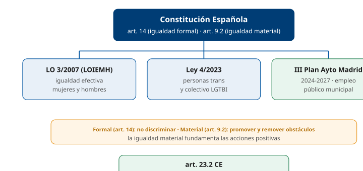
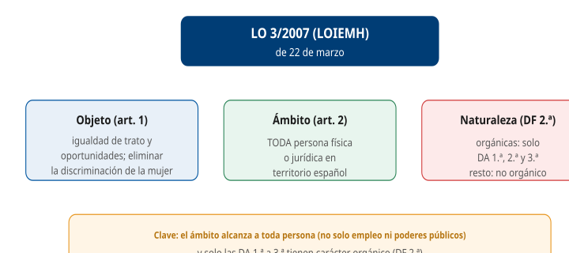
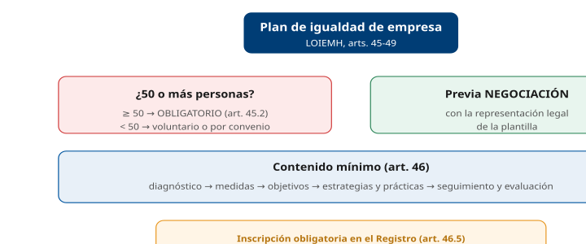
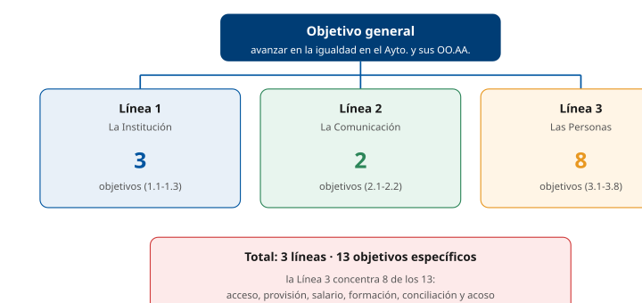
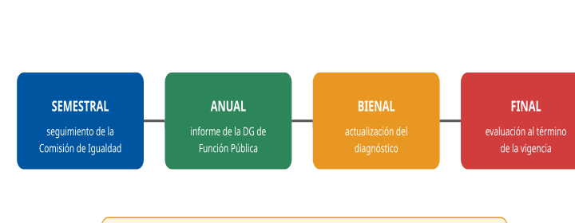
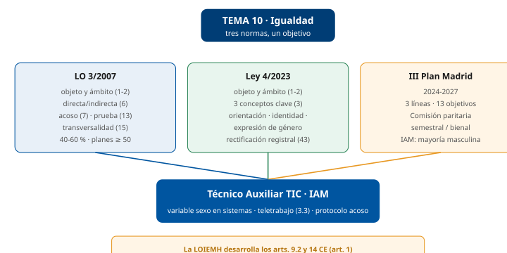

# Tema 10. Igualdad: LO 3/2007, Ley 4/2023 y III Plan del Ayuntamiento de Madrid

**Bloque:** administrativo  
**Enunciado oficial** (BOAM n.º 10.032, de 23 de diciembre de 2025): Ley Orgánica 3/2007, de 22 de marzo, para la igualdad efectiva de mujeres y hombres: objeto y ámbito de la ley. El principio de igualdad y la tutela contra la discriminación. Ley 4/2023, de 28 de febrero, para la igualdad real y efectiva de las personas trans y para la garantía de los derechos de las personas LGTBI: objeto, ámbito de aplicación y definiciones. El Plan de Igualdad entre mujeres y hombres del Ayuntamiento de Madrid y sus Organismos Autónomos en vigor: ámbito municipal; estructura; objetivo general; líneas de intervención y objetivos específicos.

Versión web: <https://ayuntamientomadrid.github.io/temario-tecnico-auxiliar/temas/tema-10.html> · PDF: [tema-10.pdf](tema-10.pdf) · Test: [../../../tests/administrativo/tema-10.md](../../../tests/administrativo/tema-10.md)

## Índice

- 1. Introducción: el marco normativo de la igualdad
  - 1.1 Fundamento constitucional
  - 1.2 Igualdad ante la ley e igualdad real y efectiva
  - 1.3 Evolución normativa
  - 1.4 Relación entre las tres normas del tema
- 2. La Ley Orgánica 3/2007 (LOIEMH): objeto y ámbito de aplicación
  - 2.1 Objeto (art. 1)
  - 2.2 Ámbito de aplicación (art. 2)
  - 2.3 Naturaleza de la ley (DF 2.ª)
- 3. El principio de igualdad de trato y la no discriminación (arts. 3-8)
  - 3.1 Igualdad de trato (art. 3)
  - 3.2 Discriminación directa e indirecta (art. 6)
  - 3.3 Acoso sexual y acoso por razón de sexo (art. 7)
  - 3.4 Discriminación por embarazo o maternidad (art. 8)
  - 3.5 Indemnidad frente a represalias (art. 9)
- 4. La tutela contra la discriminación (arts. 10-13)
  - 4.1 Consecuencias jurídicas (art. 10)
  - 4.2 Acciones positivas (art. 11)
  - 4.3 Tutela judicial y prueba (arts. 12-13)
- 5. Políticas públicas de igualdad y empleo público
  - 5.1 Transversalidad (art. 15)
  - 5.2 Instrumentos de las políticas de igualdad
  - 5.3 La igualdad en el empleo público (arts. 51-64)
- 6. Los planes de igualdad en las empresas (arts. 45-49)
  - 6.1 Obligatoriedad y umbral
  - 6.2 Contenido y registro
- 7. La Ley 4/2023: objeto, ámbito y definiciones
  - 7.1 Objeto (art. 1)
  - 7.2 Ámbito de aplicación (art. 2)
  - 7.3 Definiciones clave (art. 3)
- 8. La Ley 4/2023: deber de protección, tutela y medidas
  - 8.1 Deber de protección (art. 4)
  - 8.2 Tutela contra la discriminación (arts. 64-66)
  - 8.3 La rectificación registral de la mención al sexo (arts. 43 y 44)
  - 8.4 Medidas relevantes
- 9. El III Plan de Igualdad del Ayuntamiento de Madrid: naturaleza y estructura
  - 9.1 Naturaleza y base legal
  - 9.2 Elaboración: la Comisión de Igualdad
  - 9.3 Ámbito de aplicación
  - 9.4 Estructura del Plan
- 10. El III Plan: líneas de intervención, objetivos y seguimiento
  - 10.1 Las tres líneas y los trece objetivos específicos
  - 10.2 Seguimiento, evaluación y modificación
  - 10.3 Datos del diagnóstico
- 11. Conexiones entre las tres normas, el IAM/TIC y esquema resumen
  - 11.1 El puesto TIC del IAM bajo el marco de igualdad
  - 11.2 Esquema resumen y datos clave

### Conceptos clave por sección

#### Datos memorísticos de alto valor (DATO CLAVE)

| Concepto | Dato | Referencia |
|----|----|----|
| Norma de igualdad mujeres-hombres | **LO 3/2007, de 22 de marzo** (LOIEMH) | Encabezamiento |
| Carácter orgánico de la LOIEMH | Solo las **DA 1.ª, 2.ª y 3.ª**; el resto **no** tiene carácter orgánico | DF 2.ª |
| Objeto LOIEMH | Hacer efectivo el derecho de igualdad de trato y de oportunidades entre mujeres y hombres | Art. 1 |
| Ámbito LOIEMH | **Todas** las personas físicas y jurídicas en territorio español | Art. 2 |
| Discriminación directa | Trato menos favorable **en atención a su sexo** | Art. 6.1 |
| Discriminación indirecta | Disposición neutra que produce **desventaja particular** | Art. 6.2 |
| Acoso sexual | Comportamiento, verbal o físico, de **naturaleza sexual** | Art. 7.1 |
| Acoso por razón de sexo | Comportamiento **realizado en función del sexo** | Art. 7.2 |
| Acoso = discriminación | El acoso sexual y por razón de sexo **son discriminatorios** | Art. 7.3 |
| Indemnidad frente a represalias | Protección de quien reclama | Art. 9 |
| Prueba | La **persona demandada** prueba la ausencia de discriminación (no en procesos penales) | Art. 13 |
| Acciones positivas | Medidas en favor de las mujeres; **razonables y proporcionadas**, en tanto subsista la desigualdad | Art. 11 |
| Transversalidad (*mainstreaming*) | Integrar la igualdad en **todas** las políticas | Art. 15 |
| Informe de impacto de género | Proyectos de disposiciones de carácter general y planes sometidos al Consejo de Ministros | Art. 19 |
| Estadísticas desagregadas por sexo | Obligación de los poderes públicos | Art. 20 |
| **Presencia/composición equilibrada** | Ningún sexo **\> 60 %** ni **\< 40 %** | **DA 1.ª** (arts. 51.d y 53) |
| Protocolo de acoso en las AAPP | Negociado con la representación legal del personal | Art. 62 |
| Plan de Igualdad en la AGE | Lo aprueba el Gobierno al inicio de cada legislatura | Art. 64 |
| Planes de igualdad en empresas | Obligatorios desde **50** personas trabajadoras | Art. 45.2 |
| Norma trans/LGTBI | **Ley 4/2023, de 28 de febrero** | Encabezamiento |
| Tres conceptos clave Ley 4/2023 | Orientación sexual · identidad sexual · expresión de género | Art. 3 |
| Rectificación registral del sexo | **Sin informe médico o psicológico**; por sí mismas, mayores de 16 | Arts. 43-44 |
| Medidas LGTBI en empresas | Conjunto planificado de medidas en empresas de **más de 50** personas | Art. 15 + RD 1026/2024 |
| III Plan Ayto Madrid — base legal | DA 7.ª TREBEP (Ley 31/2022) | — |
| III Plan — vigencia | **1-ene-2024 a 31-dic-2027** | III Plan |
| III Plan — aprobación | JGCM **28-dic-2023** · BOAM 11-ene-2024 | BOAM 9547/70 |
| III Plan — estructura | **3 líneas · 13 objetivos específicos** | III Plan |
| III Plan — Comisión de Igualdad | Paritaria, preside la **DG de Función Pública** | III Plan |
| III Plan — seguimiento | **Al menos semestral** · informe **anual** · diagnóstico **bienal** | III Plan |

#### Las tres normas del tema de un vistazo

|  | LO 3/2007 (LOIEMH) | Ley 4/2023 (trans/LGTBI) | III Plan Ayto Madrid |
|----|----|----|----|
| Naturaleza | Ley orgánica (solo DA 1.ª-3.ª tienen carácter orgánico) | Ley estatal ordinaria | Plan para la Igualdad (DA 7.ª TREBEP) |
| Eje protegido | **Sexo** (mujeres/hombres) | Orientación e identidad sexual, expresión de género y características sexuales | Igualdad mujeres-hombres en la plantilla |
| Ámbito | Todo el territorio español | Todo el territorio nacional | Personal del Ayto. de Madrid y sus OO.AA. |
| Vigencia | Desde 2007 (consolidada) | Desde 2023 | 2024-2027 |
| Datos clave | Discriminación directa/indirecta; 40-60 % | Rectificación registral sin informe médico | 3 líneas / 13 objetivos |

#### Discriminación y acoso (LOIEMH) — distinciones que se confunden

| Figura | Definición sintética | Artículo |
|----|----|----|
| Discriminación **directa** | Trato menos favorable en atención al sexo | Art. 6.1 |
| Discriminación **indirecta** | Criterio aparentemente neutro → desventaja particular, salvo justificación objetiva | Art. 6.2 |
| **Acoso sexual** | Comportamiento de naturaleza **sexual** | Art. 7.1 |
| Acoso **por razón de sexo** | Comportamiento **realizado en función del sexo** | Art. 7.2 |
| Discriminación por **embarazo/maternidad** | Trato desfavorable por estas causas | Art. 8 |

------------------------------------------------------------------------

## Contenido

------------------------------------------------------------------------

### Convenciones del documento

Este tema incluye cuatro tipos de **cajas** para facilitar el estudio:

> **Dato clave.** Información de alta densidad memorística: porcentajes, umbrales, plazos, órganos competentes, artículos.

> **Cita normativa.** Reproducción literal o paráfrasis cercana de un precepto de la Constitución, de la LOIEMH, de la Ley 4/2023 o del TREBEP, con referencia al artículo.

> **Ejemplo de aplicación en el ayto.** Aplicación al entorno del Ayuntamiento de Madrid (III Plan de Igualdad) y, en particular, a un puesto de Técnico Auxiliar TIC del IAM.

> **Relación con otros temas.** Relación con otros temas del temario.

Las citas al articulado se expresan como `(art. X LOIEMH)`, `(art. X Ley 4/2023)` o `[IIIPLAN]`. El registro completo de fuentes está en la pestaña Fuentes.

------------------------------------------------------------------------

### 1. Introducción: el marco normativo de la igualdad

#### 1.1 Fundamento constitucional

La Constitución se refiere a la igualdad en cuatro preceptos básicos para este tema:

> **Cita normativa.** España se constituye en un Estado social y democrático de Derecho, que propugna como **valores superiores** de su ordenamiento jurídico la libertad, la justicia, la **igualdad** y el pluralismo político (art. 1.1 CE).

> **Cita normativa.** Corresponde a los poderes públicos **promover las condiciones** para que la libertad y la igualdad del individuo y de los grupos en que se integra sean **reales y efectivas**; remover los obstáculos que impidan o dificulten su plenitud y facilitar la participación de todos los ciudadanos en la vida política, económica, cultural y social (art. 9.2 CE).

> **Cita normativa.** Los españoles son **iguales ante la ley**, sin que pueda prevalecer discriminación alguna por razón de nacimiento, raza, **sexo**, religión, opinión o cualquier otra condición o circunstancia personal o social (art. 14 CE).

A ello se añade el **artículo 23.2 CE**, que reconoce el derecho a acceder en condiciones de igualdad a las **funciones y cargos públicos**, con los requisitos que señalen las leyes.

#### 1.2 Igualdad ante la ley e igualdad real y efectiva

- **Igualdad ante la ley** (art. 14 CE): los españoles son iguales ante la ley, sin que pueda prevalecer discriminación alguna por razón de sexo, entre otras circunstancias.
- **Igualdad real y efectiva** (art. 9.2 CE): corresponde a los poderes públicos **promover** las condiciones para que la igualdad sea real y efectiva y **remover los obstáculos** que impidan o dificulten su plenitud.

La LOIEMH se dicta «en el desarrollo de los artículos 9.2 y 14 de la Constitución» (art. 1.1 LOIEMH).

> **Dato clave.** La doctrina denomina **igualdad formal** a la del **artículo 14 CE** (igualdad ante la ley y prohibición de discriminación) e **igualdad material** a la del **artículo 9.2 CE** (mandato a los poderes públicos de promover la igualdad real y efectiva). Las acciones positivas del artículo 11 LOIEMH se adoptan «con el fin de hacer efectivo el derecho constitucional de la igualdad».

#### 1.3 Evolución normativa

La **LOIEMH (2007)** establece principios de actuación de los poderes públicos, regula derechos y deberes de las personas físicas y jurídicas, tanto públicas como privadas, y prevé medidas destinadas a eliminar y corregir en los sectores público y privado toda forma de discriminación por razón de sexo (art. 1.2 LOIEMH). La **Ley 4/2023** tiene por finalidad garantizar y promover el derecho a la igualdad real y efectiva de las **personas LGTBI** y de sus familias (art. 1.1 Ley 4/2023), frente a la discriminación por razón de **orientación e identidad sexual, expresión de género o características sexuales** (art. 4 Ley 4/2023).

#### 1.4 Relación entre las tres normas del tema

| Norma | Eje | Función en el tema |
|----|----|----|
| **LO 3/2007 (LOIEMH)** | Sexo (mujeres/hombres) | Igualdad de trato y de oportunidades entre mujeres y hombres |
| **Ley 4/2023** | Orientación e identidad sexual, expresión de género y características sexuales | Igualdad real y efectiva de las personas LGTBI y sus familias |
| **III Plan Ayto Madrid** | Igualdad de mujeres y hombres en la plantilla municipal | Plan para la Igualdad del Ayuntamiento y sus OO.AA. (DA 7.ª TREBEP) |

> **Relación con otros temas.** La igualdad ante la ley (art. 14 CE) y la cláusula del artículo 9.2 se estudian en el **Tema 1** (la Constitución).

------------------------------------------------------------------------

### 2. La Ley Orgánica 3/2007 (LOIEMH): objeto y ámbito de aplicación

#### 2.1 Objeto (art. 1)

> **Cita normativa.** Las mujeres y los hombres son iguales en dignidad humana, e iguales en derechos y deberes. Esta Ley tiene por objeto **hacer efectivo el derecho de igualdad de trato y de oportunidades entre mujeres y hombres**, en particular mediante la **eliminación de la discriminación de la mujer**, sea cual fuere su circunstancia o condición, en cualesquiera de los ámbitos de la vida y, singularmente, en las esferas política, civil, laboral, económica, social y cultural para, en el desarrollo de los artículos 9.2 y 14 de la Constitución, alcanzar una sociedad más democrática, más justa y más solidaria (art. 1.1 LOIEMH).

#### 2.2 Ámbito de aplicación (art. 2)

> **Cita normativa.** **Todas las personas** gozarán de los derechos derivados del principio de igualdad de trato y de la prohibición de discriminación por razón de sexo (art. 2.1 LOIEMH). Las obligaciones establecidas en esta Ley serán de aplicación a **toda persona, física o jurídica**, que se encuentre o actúe en territorio español, cualquiera que fuese su nacionalidad, domicilio o residencia (art. 2.2 LOIEMH).

> **Dato clave.** El ámbito de la LOIEMH alcanza a **toda persona física o jurídica** que se encuentre o actúe en territorio español. No se limita al empleo ni a la actuación de los poderes públicos.

#### 2.3 Naturaleza de la ley (DF 2.ª)

Las normas contenidas en las **disposiciones adicionales primera, segunda y tercera** tienen **carácter orgánico**; el resto de los preceptos contenidos en la Ley no tienen tal carácter (DF 2.ª LOIEMH). La disposición final primera fija el fundamento constitucional de cada bloque de preceptos; los no incluidos en ella son de aplicación a la **Administración General del Estado** (DF 1.ª.4 LOIEMH).

> **Dato clave.** Solo tienen **carácter orgánico** la **DA 1.ª** (presencia o composición equilibrada), la **DA 2.ª** (modificación de la Ley Orgánica de Régimen Electoral General) y la **DA 3.ª** (modificaciones de la Ley Orgánica del Poder Judicial). El resto de la ley **no tiene carácter orgánico** (DF 2.ª LOIEMH).

------------------------------------------------------------------------

### 3. El principio de igualdad de trato y la no discriminación (arts. 3-8)

#### 3.1 Igualdad de trato (art. 3)

El principio de igualdad de trato entre mujeres y hombres supone la **ausencia de toda discriminación, directa o indirecta, por razón de sexo**, y, especialmente, las derivadas de la maternidad, la asunción de obligaciones familiares y el estado civil (art. 3 LOIEMH).

La igualdad de trato y de oportunidades entre mujeres y hombres es un **principio informador del ordenamiento jurídico** y, como tal, se integrará y observará en la interpretación y aplicación de las normas jurídicas (art. 4 LOIEMH).

#### 3.2 Discriminación directa e indirecta (art. 6)

> **Cita normativa.** Se considera **discriminación directa por razón de sexo** la situación en que se encuentra una persona que sea, haya sido o pudiera ser tratada, en atención a su sexo, de manera **menos favorable** que otra en situación comparable (art. 6.1 LOIEMH).

> **Cita normativa.** Se considera **discriminación indirecta por razón de sexo** la situación en que una disposición, criterio o práctica **aparentemente neutros** pone a personas de un sexo en **desventaja particular** con respecto a personas del otro, salvo que dicha disposición, criterio o práctica puedan justificarse objetivamente en atención a una **finalidad legítima** y que los medios para alcanzar dicha finalidad sean **necesarios y adecuados** (art. 6.2 LOIEMH).

En cualquier caso, se considera discriminatoria toda **orden de discriminar**, directa o indirectamente, por razón de sexo (art. 6.3 LOIEMH).

> **Dato clave.** La clave para distinguirlas: la **directa** es el trato **menos favorable en atención al sexo**; la **indirecta** parte de una disposición, criterio o práctica **aparentemente neutros** que ponen a personas de un sexo en **desventaja particular**. Solo para la indirecta prevé el artículo 6.2 la **justificación objetiva** (finalidad legítima + medios necesarios y adecuados).

#### 3.3 Acoso sexual y acoso por razón de sexo (art. 7)

> **Cita normativa.** Sin perjuicio de lo establecido en el Código Penal, a los efectos de esta Ley constituye **acoso sexual** cualquier comportamiento, verbal o físico, de **naturaleza sexual** que tenga el propósito o produzca el efecto de atentar contra la dignidad de una persona, en particular cuando se crea un entorno intimidatorio, degradante u ofensivo (art. 7.1 LOIEMH).

> **Cita normativa.** Constituye **acoso por razón de sexo** cualquier comportamiento realizado **en función del sexo** de una persona, con el propósito o el efecto de atentar contra su dignidad y de crear un entorno intimidatorio, degradante u ofensivo (art. 7.2 LOIEMH).

> **Dato clave.** Diferencia clave: el **acoso sexual** es un comportamiento de **naturaleza sexual**; el **acoso por razón de sexo** es un comportamiento **realizado en función del sexo** de una persona (no necesariamente sexual). **Ambos** se consideran **en todo caso discriminatorios** (art. 7.3 LOIEMH), y el **condicionamiento** de un derecho o de una expectativa de derecho a la aceptación de una situación de acoso se considera también discriminación por razón de sexo (art. 7.4 LOIEMH).

#### 3.4 Discriminación por embarazo o maternidad (art. 8)

Constituye **discriminación directa** por razón de sexo todo trato desfavorable a las mujeres relacionado con el **embarazo o la maternidad** (art. 8 LOIEMH).

#### 3.5 Indemnidad frente a represalias (art. 9)

> **Cita normativa.** También se considerará discriminación por razón de sexo cualquier **trato adverso o efecto negativo** que se produzca en una persona como consecuencia de la presentación por su parte de **queja, reclamación, denuncia, demanda o recurso**, de cualquier tipo, destinados a impedir su discriminación y a exigir el cumplimiento efectivo del principio de igualdad de trato entre mujeres y hombres (art. 9 LOIEMH).

------------------------------------------------------------------------

### 4. La tutela contra la discriminación (arts. 10-13)

#### 4.1 Consecuencias jurídicas (art. 10)

Los actos y las cláusulas de los negocios jurídicos que constituyan o causen discriminación por razón de sexo se considerarán **nulos y sin efecto**, y darán lugar a **responsabilidad** a través de un sistema de **reparaciones o indemnizaciones** que sean reales, efectivas y proporcionadas al perjuicio sufrido, así como, en su caso, a través de un sistema eficaz y disuasorio de **sanciones** que prevenga la realización de conductas discriminatorias (art. 10 LOIEMH).

#### 4.2 Acciones positivas (art. 11)

> **Cita normativa.** Con el fin de hacer efectivo el derecho constitucional de la igualdad, los Poderes Públicos adoptarán **medidas específicas en favor de las mujeres** para corregir situaciones patentes de desigualdad de hecho respecto de los hombres. Tales medidas, que serán **aplicables en tanto subsistan** dichas situaciones, habrán de ser **razonables y proporcionadas** en relación con el objetivo perseguido en cada caso (art. 11.1 LOIEMH).

> **Dato clave.** Las acciones positivas se aplican **en tanto subsistan** las situaciones de desigualdad y han de ser **razonables y proporcionadas**. Las adoptan los poderes públicos (art. 11.1 LOIEMH) y también pueden adoptarlas las **personas físicas y jurídicas privadas** en los términos de la ley (art. 11.2 LOIEMH).

#### 4.3 Tutela judicial y prueba (arts. 12-13)

Cualquier persona podrá recabar de los tribunales la **tutela del derecho a la igualdad** entre mujeres y hombres, de acuerdo con lo establecido en el artículo 53.2 de la Constitución, **incluso tras la terminación de la relación** en la que supuestamente se ha producido la discriminación (art. 12.1 LOIEMH). La capacidad y legitimación para intervenir en los procesos civiles, sociales y contencioso-administrativos corresponden a las personas físicas y jurídicas con interés legítimo, determinadas en las leyes reguladoras de estos procesos (art. 12.2 LOIEMH), y la **persona acosada será la única legitimada** en los litigios sobre acoso sexual y acoso por razón de sexo (art. 12.3 LOIEMH).

> **Cita normativa.** De acuerdo con las Leyes procesales, en aquellos procedimientos en los que las alegaciones de la parte actora se fundamenten en actuaciones discriminatorias, por razón de sexo, **corresponderá a la persona demandada probar la ausencia de discriminación** en las medidas adoptadas y su proporcionalidad (art. 13.1 LOIEMH). Lo anterior **no será de aplicación a los procesos penales** (art. 13.2 LOIEMH).

> **Dato clave.** **Prueba (art. 13)**: cuando la parte actora alega actuaciones discriminatorias por razón de sexo, es la **persona demandada** quien debe probar la **ausencia de discriminación** en las medidas adoptadas y su **proporcionalidad**; el órgano judicial, a instancia de parte, podrá recabar informe o dictamen de los organismos públicos competentes. Excepción: los **procesos penales**.

------------------------------------------------------------------------

### 5. Políticas públicas de igualdad y empleo público

#### 5.1 Transversalidad (art. 15)

> **Cita normativa.** El principio de igualdad de trato y oportunidades entre mujeres y hombres informará, con carácter **transversal**, la actuación de **todos** los Poderes Públicos. Las Administraciones públicas lo integrarán, de forma activa, en la adopción y ejecución de sus disposiciones normativas, en la definición y presupuestación de políticas públicas en todos los ámbitos y en el desarrollo del conjunto de todas sus actividades (art. 15 LOIEMH).

> **Dato clave.** **Transversalidad (art. 15)** = el principio de igualdad informa la actuación de **todos** los poderes públicos y se integra en sus disposiciones, en la definición y presupuestación de **todas** las políticas públicas y en el conjunto de sus actividades.

#### 5.2 Instrumentos de las políticas de igualdad

- **Informe de impacto de género** (art. 19): los proyectos de **disposiciones de carácter general** y los planes de especial relevancia económica, social, cultural y artística que se sometan a la aprobación del **Consejo de Ministros** deberán incorporar un informe sobre su impacto por razón de género.
- **Estadísticas y estudios** (art. 20): los poderes públicos, en la elaboración de sus estudios y estadísticas, deberán, entre otras obligaciones, **incluir sistemáticamente la variable de sexo** en las estadísticas, encuestas y recogida de datos que lleven a cabo.

> **Ejemplo de aplicación en el ayto.** La obligación del artículo 20 (variable de sexo en estadísticas, encuestas y recogida de datos) tiene impacto directo en el **diseño de sistemas de información** del IAM. Las medidas **1.1.3** y **1.1.4** del III Plan prevén incluir la variable sexo en los documentos administrativos, formularios, solicitudes e impresos de personal, y en todas las encuestas, estudios, memorándums o estadísticas que realicen el Ayuntamiento y sus OO.AA. en su gestión interna.

#### 5.3 La igualdad en el empleo público (arts. 51-64)

Las Administraciones públicas, en el ámbito de sus respectivas competencias y en aplicación del principio de igualdad entre mujeres y hombres, deberán: remover los obstáculos que impliquen la pervivencia de cualquier tipo de discriminación en el acceso al empleo público y en el desarrollo de la carrera profesional; facilitar la **conciliación** de la vida personal, familiar y laboral, sin menoscabo de la promoción profesional; fomentar la **formación en igualdad**; promover la **presencia equilibrada** de mujeres y hombres en los órganos de selección y valoración; establecer medidas efectivas de protección frente al **acoso sexual y al acoso por razón de sexo**; establecer medidas efectivas para eliminar cualquier **discriminación retributiva**; y evaluar periódicamente la efectividad del principio de igualdad (art. 51 LOIEMH). El artículo 51 tiene carácter básico (DF 1.ª.2 LOIEMH).

> **Cita normativa.** Para la prevención del acoso sexual y del acoso por razón de sexo, las Administraciones públicas **negociarán** con la representación legal de las trabajadoras y trabajadores un **protocolo de actuación** que comprenderá, al menos: el compromiso de prevenir y no tolerar el acoso; la instrucción a todo el personal de su deber de respetar la dignidad de las personas y su derecho a la intimidad; el **tratamiento reservado de las denuncias**; y la **identificación de las personas responsables** de atender a quienes formulen una queja o denuncia (art. 62 LOIEMH).

> **Dato clave.** **Composición equilibrada**: las personas de cada sexo **no superen el 60 %** ni sean **menos del 40 %** \[LOIEMH, **DA 1.ª**\]. Todas las Administraciones públicas deben **promover** la presencia equilibrada en los órganos de selección y valoración (art. 51.d LOIEMH); en la **AGE**, todos los tribunales y órganos de selección responderán a ese principio, salvo por razones fundadas y objetivas, debidamente motivadas (art. 53 LOIEMH). Según el TREBEP, en la composición de los órganos de selección «se tenderá, asimismo, a la paridad entre mujer y hombre» (art. 60.1 TREBEP).

> **Cita normativa.** El **Gobierno** aprobará, **al inicio de cada legislatura**, un Plan para la Igualdad entre mujeres y hombres en la Administración General del Estado y en los organismos públicos vinculados o dependientes de ella. El Plan será objeto de negociación, y en su caso acuerdo, con la representación legal de los empleados públicos y su cumplimiento será **evaluado anualmente por el Consejo de Ministros** (art. 64 LOIEMH).

> **Cita normativa.** Las **Administraciones Públicas** aprobarán, **al inicio de cada legislatura**, un Plan para la Igualdad entre mujeres y hombres para sus respectivos ámbitos, a desarrollar en el **convenio colectivo o acuerdo de condiciones de trabajo** del personal funcionario que sea aplicable. Su cumplimiento será evaluado con carácter anual (DA 7.ª.2 TREBEP).

> **Relación con otros temas.** El derecho a la no discriminación del empleado público (art. 14.i TREBEP) y los permisos de conciliación (arts. 48-49 TREBEP) se estudian en el **Tema 5**.

------------------------------------------------------------------------

### 6. Los planes de igualdad en las empresas (arts. 45-49)

#### 6.1 Obligatoriedad y umbral

> **Cita normativa.** Las empresas están obligadas a respetar la igualdad de trato y de oportunidades en el ámbito laboral (art. 45.1 LOIEMH). En el caso de las empresas de **cincuenta o más trabajadores**, las medidas de igualdad deberán dirigirse a la elaboración y aplicación de un **plan de igualdad**, que deberá ser asimismo objeto de **negociación** en la forma que se determine en la legislación laboral (art. 45.2 LOIEMH).

> **Dato clave.** El umbral vigente de obligación del plan de igualdad de empresa es de **50 personas trabajadoras** (redacción del art. 45.2 dada por el **RD-ley 6/2019**, con plena efectividad desde el 7 de marzo de 2022). Por debajo del umbral, el plan es **voluntario**, previa consulta a la representación legal de los trabajadores (art. 45.5), salvo que lo establezca el **convenio colectivo** aplicable (art. 45.3) o lo acuerde la **autoridad laboral** en un procedimiento sancionador, en sustitución de las sanciones accesorias (art. 45.4).

#### 6.2 Contenido y registro

> **Cita normativa.** Los planes de igualdad de las empresas son un **conjunto ordenado de medidas**, adoptadas después de realizar un **diagnóstico de situación**, tendentes a alcanzar en la empresa la igualdad de trato y de oportunidades entre mujeres y hombres y a eliminar la discriminación por razón de sexo. Fijarán los concretos **objetivos** de igualdad a alcanzar, las **estrategias y prácticas** a adoptar para su consecución, así como el establecimiento de **sistemas eficaces de seguimiento y evaluación** de los objetivos fijados (art. 46.1 LOIEMH).

El diagnóstico contendrá al menos las materias del artículo 46.2: proceso de selección y contratación; clasificación profesional; formación; promoción profesional; condiciones de trabajo, incluida la auditoría salarial entre mujeres y hombres; ejercicio corresponsable de los derechos de la vida personal, familiar y laboral; infrarrepresentación femenina; retribuciones; y prevención del acoso sexual y por razón de sexo.

Se crea un **Registro de Planes de Igualdad de las Empresas**, como parte de los Registros de convenios y acuerdos colectivos de trabajo (art. 46.4 LOIEMH), y las empresas están obligadas a **inscribir** sus planes de igualdad en él (art. 46.5 LOIEMH).

------------------------------------------------------------------------

### 7. La Ley 4/2023: objeto, ámbito y definiciones

#### 7.1 Objeto (art. 1)

> **Cita normativa.** Esta Ley tiene por finalidad **garantizar y promover el derecho a la igualdad real y efectiva** de las personas lesbianas, gais, trans, bisexuales e intersexuales (LGTBI), así como de sus **familias** (art. 1.1 Ley 4/2023).

A estos efectos, la Ley establece los principios de actuación de los poderes públicos, regula derechos y deberes de las personas físicas y jurídicas, tanto públicas como privadas, y prevé medidas específicas destinadas a la prevención, corrección y eliminación, en los ámbitos público y privado, de toda forma de discriminación (art. 1.2 Ley 4/2023). Asimismo, regula el procedimiento y requisitos para la **rectificación registral relativa al sexo** y, en su caso, nombre de las personas (art. 1.3 Ley 4/2023).

#### 7.2 Ámbito de aplicación (art. 2)

> **Cita normativa.** Esta Ley será de aplicación a **toda persona física o jurídica, de carácter público o privado**, que resida, se encuentre o actúe en **territorio español**, cualquiera que fuera su nacionalidad, origen racial o étnico, religión, domicilio, residencia, edad, estado civil o situación administrativa, en los términos y con el alcance que se contemplan en esta ley y en el resto del ordenamiento jurídico (art. 2 Ley 4/2023).

En lo no regulado de manera específica en ella se aplica la **Ley 15/2022**, de 12 de julio, integral para la igualdad de trato y la no discriminación (DA 4.ª Ley 4/2023).

#### 7.3 Definiciones clave (art. 3)

> **Dato clave.** Tres conceptos que el artículo 3 define por separado: - **Orientación sexual**: atracción física, sexual o afectiva hacia una persona (art. 3.h). - **Identidad sexual**: vivencia interna e individual del sexo tal y como cada persona la siente y autodefine, pudiendo o no corresponder con el sexo asignado al nacer (art. 3.i). - **Expresión de género**: manifestación que cada persona hace de su identidad sexual (art. 3.j).

Otras definiciones del artículo 3:

- **Discriminación directa** (art. 3.a): situación en que una persona o grupo en que se integra sea, haya sido o pudiera ser tratada de manera menos favorable que otras en situación análoga o comparable por razón de orientación sexual e identidad sexual, expresión de género o características sexuales.
- **Discriminación indirecta** (art. 3.b): cuando una disposición, criterio o práctica aparentemente neutros ocasiona o puede ocasionar a una o varias personas una desventaja particular con respecto a otras por esas causas.
- **Acoso discriminatorio** (art. 3.d): cualquier conducta realizada por alguna de las causas de discriminación de la ley, con el objetivo o la consecuencia de atentar contra la dignidad de una persona o grupo y de crear un entorno intimidatorio, hostil, degradante, humillante u ofensivo.
- **Intersexualidad** (art. 3.g): condición de las personas nacidas con unas características biológicas, anatómicas o fisiológicas, una anatomía sexual, unos órganos reproductivos o un patrón cromosómico que no se corresponden con las nociones socialmente establecidas de los cuerpos masculinos o femeninos.
- **Persona trans** (art. 3.k): persona cuya identidad sexual **no se corresponde con el sexo asignado al nacer**.
- **LGTBIfobia** (art. 3.m): toda actitud, conducta o discurso de rechazo, repudio, prejuicio, discriminación o intolerancia hacia las personas LGTBI por el hecho de serlo, o ser percibidas como tales.

------------------------------------------------------------------------

### 8. La Ley 4/2023: deber de protección, tutela y medidas

#### 8.1 Deber de protección (art. 4)

Los poderes públicos, en el ámbito de sus competencias, desarrollarán todas las medidas necesarias para **reconocer, garantizar, proteger y promover** la igualdad de trato y no discriminación por razón de orientación e identidad sexual, expresión de género o características sexuales de las personas LGTBI y sus familias (art. 4 Ley 4/2023).

#### 8.2 Tutela contra la discriminación (arts. 64-66)

- **Nulidad**: las cláusulas de los contratos y negocios jurídicos que vulneren el derecho a la no discriminación por estas causas serán **nulas y se tendrán por no puestas** (art. 64 Ley 4/2023).
- **Legitimación**: sin perjuicio de la legitimación individual de las personas afectadas, están legitimadas, entre otras, las organizaciones sindicales y las asociaciones que tengan entre sus fines la defensa de los derechos de las personas LGTBI, siempre que cuenten con la **autorización expresa** de las personas afectadas (art. 65 Ley 4/2023).
- **Carga de la prueba**: cuando la parte actora o la persona interesada alegue discriminación por estas causas y aporte **indicios fundados** sobre su existencia, corresponderá a la parte demandada o a quien se impute la situación discriminatoria la aportación de una **justificación objetiva y razonable, suficientemente probada**, de las medidas adoptadas y de su proporcionalidad (art. 66.1 Ley 4/2023).

#### 8.3 La rectificación registral de la mención al sexo (arts. 43 y 44)

> **Dato clave.** Toda persona de nacionalidad española **mayor de dieciséis años** podrá solicitar **por sí misma** ante el Registro Civil la rectificación de la mención registral relativa al sexo (art. 43.1 Ley 4/2023); las personas **menores de dieciséis y mayores de catorce** podrán presentar la solicitud por sí mismas, **asistidas** en el procedimiento por sus **representantes legales** (art. 43.2). El ejercicio de este derecho en ningún caso podrá estar condicionado a la previa exhibición de **informe médico o psicológico**, ni a la previa modificación de la apariencia o función corporal a través de procedimientos médicos, quirúrgicos o de otra índole (art. 44.3). La solicitud se **ratifica** en una segunda comparecencia en el plazo máximo de **tres meses** (art. 44.8) y se resuelve en el plazo máximo de **un mes** desde ella (art. 44.9).

#### 8.4 Medidas relevantes

- **Empresas**: las de **más de cincuenta personas trabajadoras** deberán contar, en el plazo de doce meses desde la entrada en vigor de la ley, con un **conjunto planificado de medidas y recursos** para alcanzar la igualdad real y efectiva de las personas LGTBI, que incluya un **protocolo de actuación** para la atención del acoso o la violencia contra ellas (art. 15.1 Ley 4/2023). Su contenido y alcance se desarrollan en el **RD 1026/2024, de 8 de octubre**.
- **Administraciones públicas**: garantizarán los derechos reconocidos en la ley para el conjunto del personal a su servicio e implantarán medidas de igualdad LGTBI en el acceso al empleo público y la carrera profesional, previa negociación con las organizaciones sindicales (art. 11 Ley 4/2023); impartirán **formación** a su personal e incluirán en los programas de las **pruebas selectivas** conocimientos sobre igualdad de trato y no discriminación de las personas LGTBI (art. 12 Ley 4/2023).

------------------------------------------------------------------------

### 9. El III Plan de Igualdad del Ayuntamiento de Madrid: naturaleza y estructura

#### 9.1 Naturaleza y base legal

> **Ejemplo de aplicación en el ayto.** El **III Plan de Igualdad entre Mujeres y Hombres del Ayuntamiento de Madrid y sus Organismos Autónomos (2024-2027)** responde a la **DA 7.ª del TREBEP**, en la redacción dada por la **Ley 31/2022** de PGE para 2023, según la cual las Administraciones Públicas aprobarán, **al inicio de cada legislatura**, un Plan para la Igualdad entre mujeres y hombres para sus respectivos ámbitos.

Se aprobó por Acuerdo de la **Junta de Gobierno de la Ciudad de Madrid de 28 de diciembre de 2023** (BOAM nº 9547/70, de 11 de enero de 2024), tras las elecciones municipales del 28 de mayo de 2023. Aunque la vigencia del **II Plan (2022-2024)** no había finalizado, la modificación del TREBEP hizo necesario aprobar un nuevo Plan.

> **Dato clave.** El III Plan sustituyó al II Plan **antes de su vencimiento** por la **DA 7.ª TREBEP** (modificada por la Ley 31/2022): un Plan nuevo al inicio de cada legislatura.

#### 9.2 Elaboración: la Comisión de Igualdad

Fue elaborado y negociado en el seno de la **Comisión de Igualdad** del Ayuntamiento de Madrid y sus OO.AA. Conforme al artículo 5 de su Reglamento interno de funcionamiento, aprobado el 30 de marzo de 2021, esta Comisión:

- está **presidida** por la persona titular de la **Dirección General de Función Pública**;
- tiene **carácter paritario**;
- está compuesta por representantes de la Administración municipal (todas las áreas de gobierno y organismos autónomos) y por representantes de las organizaciones sindicales legitimadas para la negociación colectiva, en proporción a su implantación: **CSIF, UGT, CCOO, CITAM, CSIT, CPPM y UPM**.

#### 9.3 Ámbito de aplicación

- **Personal**: la totalidad del personal que tenga una relación contractual **laboral y/o estatutaria** con el Ayuntamiento de Madrid y sus OO.AA.
- **Territorial**: todos los **centros de trabajo** del Ayuntamiento y sus OO.AA.
- **Temporal**: **cuatro años**, del **1 de enero de 2024 al 31 de diciembre de 2027**, salvo que la legislatura de la actual Corporación finalice con anterioridad.

#### 9.4 Estructura del Plan

El Plan se ordena en: **objetivo general → diagnóstico** (como anexo) **→ líneas de intervención → objetivos específicos → medidas** (calendarizadas, con responsables e implicados) **→ modelo de evaluación con indicadores**. Todas las áreas de gobierno, OO.AA. y distritos tienen alguna responsabilidad en su implementación.

> **Dato clave.** **Objetivo general** del III Plan: *avanzar en la igualdad entre mujeres y hombres en el Ayuntamiento de Madrid y sus organismos autónomos.*

------------------------------------------------------------------------

### 10. El III Plan: líneas de intervención, objetivos y seguimiento

#### 10.1 Las tres líneas y los trece objetivos específicos

> **Dato clave.** El III Plan tiene **3 líneas de intervención** y **13 objetivos específicos** (3 + 2 + 8). La **Línea 3 (Las Personas)** concentra **8 de los 13** objetivos.

**Línea 1 — La Institución** (3 objetivos):

1.  **1.1** Incorporar el principio de igualdad en la gestión y la organización municipal.
2.  **1.2** Implementación, seguimiento, evaluación y difusión del Plan.
3.  **1.3** Alcanzar la paridad en la representación.

**Línea 2 — La Comunicación** (2 objetivos):

1.  **2.1** Utilizar un lenguaje inclusivo y no discriminatorio.
2.  **2.2** Eliminar el sexismo y los estereotipos de género.

**Línea 3 — Las Personas** (8 objetivos):

1.  **3.1** Fomentar la igualdad en el acceso al empleo y la promoción interna.
2.  **3.2** Suprimir el sexismo y la estereotipación.
3.  **3.3** Asegurar el acceso al **teletrabajo** en condiciones de igualdad entre mujeres y hombres.
4.  **3.4** Fomentar la igualdad en los procesos de provisión de puestos.
5.  **3.5** Promover la **igualdad salarial** cuando se detecten disparidades.
6.  **3.6** Asegurar la participación equilibrada de mujeres y hombres en las **acciones formativas**.
7.  **3.7** Propiciar la **conciliación** de los tiempos de vida.
8.  **3.8** Prevenir e intervenir en situaciones de especial protección: acoso sexual, por razón de sexo u orientación sexual e identidad y expresión de género, y violencia de género.

#### 10.2 Seguimiento, evaluación y modificación

- La **Comisión de Igualdad** realiza el seguimiento y coordinación del Plan mediante reuniones con periodicidad **al menos semestral** (medida 1.2.1).
- Las Áreas de Gobierno, Distritos y OO.AA. remiten a la **DG de Función Pública** un documento de seguimiento sobre el grado de realización de las medidas.
- La **DG de Función Pública** elabora un **informe anual** que presenta a la Comisión de Igualdad.
- El **diagnóstico** de situación se actualiza con periodicidad **bienal** (medida 1.2.3).
- Al concluir la vigencia se realiza una **evaluación final**.
- Las **modificaciones** se llevan a cabo en el seno de la Comisión, conforme a su Reglamento interno de funcionamiento.
- Se trata de un plan **transversal** que incorpora la igualdad de género a lo largo de su desarrollo, por lo que **no se requieren partidas económicas específicas**.

> **Dato clave.** Memoriza las periodicidades: seguimiento **al menos semestral** (Comisión) · **informe anual** (DG Función Pública) · **diagnóstico bienal** · **evaluación final** al término de la vigencia.

#### 10.3 Datos del diagnóstico

> **Ejemplo de aplicación en el ayto.** Datos del diagnóstico del III Plan: - El Ayuntamiento y sus OO.AA. cuentan con **27.893 efectivos**: **46,1 % mujeres** y **53,9 % hombres** (dentro del rango de equilibrio 40-60 %). - En los OO.AA. la proporción de mujeres supera a la de hombres en todos salvo en el **IAM**, **único OO.AA. con mayoría masculina**: **533 efectivos** (**43,2 % mujeres** / **56,8 % hombres**). - Mayor **feminización**: Diplomado/a en Trabajo Social (90 %) y Auxiliar Administrativo (87 %). - Mayor **masculinización**: categorías integradas en los cuerpos de Bomberos y Policía Municipal (en Policía, el 86 % son hombres). - En el personal **temporal**, el 61,7 % son mujeres. - Del total de medidas de **conciliación** solicitadas, el **66 %** corresponde a mujeres; la más solicitada es la **flexibilidad horaria** (62 % del total).

------------------------------------------------------------------------

### 11. Conexiones entre las tres normas, el IAM/TIC y esquema resumen

#### 11.1 El puesto TIC del IAM bajo el marco de igualdad

> **Ejemplo de aplicación en el ayto.** El **Técnico Auxiliar TIC del IAM** está sujeto al III Plan como empleado público municipal. Implicaciones concretas: - **Diseño de sistemas de información**: inclusión de la **variable sexo** en documentos, formularios y estadísticas (art. 20 LOIEMH; medidas 1.1.3 y 1.1.4 del Plan). - **Teletrabajo** en condiciones de igualdad entre mujeres y hombres (objetivo 3.3), aplicable a perfiles TIC. - **Protocolo de acoso**: tratamiento reservado de las denuncias e identificación de las personas responsables de atenderlas (art. 62 LOIEMH; objetivo 3.8 del Plan).

> **Relación con otros temas.** Conexión con el **Tema 5** (TREBEP, art. 14.i — no discriminación) y con el **Tema 9** (Acuerdo-Convenio del Ayto. de Madrid — protocolo de acoso).

#### 11.2 Esquema resumen y datos clave

> **Dato clave.** **LO 3/2007**: discriminación directa vs. indirecta; acoso sexual vs. por razón de sexo; prueba a cargo de la persona demandada (art. 13, salvo procesos penales); composición equilibrada **40-60 %** (DA 1.ª); planes de igualdad de empresa desde **50** personas trabajadoras; solo las **DA 1.ª a 3.ª** tienen carácter orgánico.

> **Dato clave.** **Ley 4/2023**: tres conceptos del artículo 3 (orientación sexual, identidad sexual, expresión de género); **rectificación registral sin informe médico o psicológico** (por sí mismas, mayores de 16); conjunto planificado de medidas LGTBI en empresas de **más de 50** personas trabajadoras (art. 15).

> **Dato clave.** **III Plan del Ayuntamiento de Madrid**: vigencia **2024-2027**; **3 líneas** / **13 objetivos**; Comisión de Igualdad **paritaria** (preside la DG de Función Pública) con seguimiento **al menos semestral** y diagnóstico **bienal**; el **IAM** es el único OO.AA. con mayoría masculina.

## Diagramas

D1 · El marco normativo de la igualdad

§ 1 — Introducción

Situar las tres normas del tema bajo el fundamento constitucional (igualdad formal y material).

D2 · LOIEMH: objeto, ámbito y naturaleza

§ 2 — LO 3/2007

Fijar el objeto (art. 1), el ámbito (art. 2) y los preceptos con carácter orgánico (DF 2.ª).

D3 · Discriminación y acoso (arts. 6-8)

§ 3 — Igualdad de trato

Distinguir discriminación directa/indirecta y acoso sexual/por razón de sexo.

D4 · La tutela: indemnidad y prueba

§ 4 — Tutela

Mostrar la indemnidad frente a represalias (art. 9) y la regla de prueba (art. 13).

D5 · Políticas públicas y empleo público

§ 5 — Políticas públicas

Resumir transversalidad, acciones positivas e instrumentos en el empleo público.

D6 · Planes de igualdad en las empresas (≥ 50)

§ 6 — Planes de empresa

Fijar el umbral de 50 personas, el contenido mínimo y el registro.

D7 · Ley 4/2023: los tres conceptos clave

§ 7 — Ley 4/2023

Separar orientación sexual, identidad sexual y expresión de género, que el art. 3 define por separado.

D8 · Ley 4/2023: rectificación registral y medidas

§ 8 — Ley 4/2023

Mostrar la rectificación registral (sin informe médico o psicológico) y las medidas sectoriales.

D9 · III Plan de Igualdad: ficha

§ 9 — III Plan

Resumir la ficha del Plan: base legal, aprobación, vigencia y Comisión.

D10 · III Plan: 3 líneas y 13 objetivos

§ 10 — III Plan

Visualizar las 3 líneas de intervención y el reparto de los 13 objetivos.

D11 · III Plan: seguimiento y evaluación

§ 10 — III Plan

Fijar las periodicidades del seguimiento (semestral, anual, bienal y final).

D12 · Mapa-resumen del Tema 10

§ 11 — Resumen

Integrar las tres normas y su aplicación al IAM/TIC en un solo mapa.

## Casos prácticos

#### CASO PRÁCTICO 1 — Discriminación directa o indirecta

**Escenario**: En un proceso de provisión de puestos TIC del IAM se detectan tres situaciones: (a) la convocatoria excluye expresamente a las mujeres de un puesto de operador de sistemas; (b) se exige, sin justificación funcional, una disponibilidad de 24 horas que de hecho descarta a quienes tienen cargas familiares, mayoritariamente mujeres; y (c) se deniega la incorporación a una candidata por estar embarazada.

**Cuestiones**:

1.  **(3 pts)** Clasifique cada situación (a, b, c) como discriminación directa o indirecta y cite el artículo.
2.  **(3 pts)** ¿Puede justificarse alguna de ellas? ¿Con qué requisitos?
3.  **(2 pts)** ¿Qué consecuencia jurídica tienen las cláusulas discriminatorias?
4.  **(2 pts)** ¿Qué precepto constitucional fundamenta la prohibición y cuál la promoción activa de la igualdad?

**Solución orientativa**:

1.  \(a\) **Discriminación directa** por razón de sexo: trato menos favorable explícito (art. 6.1 LOIEMH). (b) **Discriminación indirecta**: criterio aparentemente neutro que produce desventaja particular a un sexo (art. 6.2 LOIEMH). (c) **Discriminación directa** por embarazo/maternidad (art. 8 LOIEMH).
2.  Solo para la **indirecta** (b) prevé la ley la justificación objetiva: en atención a una **finalidad legítima** y siempre que los medios para alcanzarla sean **necesarios y adecuados** (art. 6.2 LOIEMH); el artículo 6.1 y el artículo 8 no prevén esa justificación para la directa (a) ni para la de embarazo (c).
3.  Son **nulas y sin efecto** y dan lugar a responsabilidad a través de un sistema de reparaciones o indemnizaciones reales, efectivas y proporcionadas al perjuicio sufrido y, en su caso, de un sistema eficaz y disuasorio de sanciones (art. 10 LOIEMH).
4.  La **prohibición** se funda en el **artículo 14 CE** (igualdad formal); la **promoción activa**, en el **artículo 9.2 CE** (igualdad material).

**Criterios de evaluación**: distinguir correctamente directa/indirecta; reconocer que solo la indirecta admite justificación objetiva; aplicar la nulidad del artículo 10; y conectar arts. 14 y 9.2 CE.

------------------------------------------------------------------------

#### Preguntas tipo test sobre este caso

##### 1. En el supuesto planteado, la convocatoria que excluye expresamente a las mujeres del puesto de operador de sistemas constituye:

- a) Discriminación directa por razón de sexo (art. 6.1 LOIEMH).
- b) Discriminación indirecta por razón de sexo (art. 6.2 LOIEMH).
- c) Una acción positiva admisible (art. 11.1 LOIEMH).

**Respuesta correcta:** a) · **Referencia:** Caso 1, cuestión 1 · art. 6.1 LOIEMH

Es un trato menos favorable explícito en atención al sexo, que es la definición de discriminación directa del artículo 6.1 LOIEMH.

##### 2. La exigencia, sin justificación funcional, de una disponibilidad de 24 horas que de hecho descarta a quienes tienen cargas familiares, mayoritariamente mujeres, es:

- a) Discriminación directa, porque el criterio menciona de forma expresa la situación familiar de las mujeres.
- b) Discriminación indirecta, porque un criterio aparentemente neutro pone a un sexo en desventaja particular.
- c) Una condición lícita del puesto, porque el requisito se aplica por igual a mujeres y a hombres.

**Respuesta correcta:** b) · **Referencia:** Caso 1, cuestión 1 · art. 6.2 LOIEMH

El artículo 6.2 LOIEMH define la discriminación indirecta como la que produce una disposición, criterio o práctica aparentemente neutros que pone a personas de un sexo en desventaja particular.

##### 3. La denegación de la incorporación a una candidata por estar embarazada constituye:

- a) Discriminación indirecta por razón de sexo.
- b) Un trato diferenciado por motivos de salud.
- c) Discriminación directa por razón de sexo.

**Respuesta correcta:** c) · **Referencia:** Caso 1, cuestión 1 · art. 8 LOIEMH

Conforme al artículo 8 LOIEMH, todo trato desfavorable a las mujeres relacionado con el embarazo o la maternidad es discriminación directa por razón de sexo.

##### 4. ¿Cuál de las tres situaciones podría llegar a justificarse objetivamente según la LOIEMH?

- a) Solo la (b), la exigencia de disponibilidad de 24 horas.
- b) La (a) y la (c), si se acreditan necesidades del servicio.
- c) Las tres, si la Administración persigue un fin legítimo.

**Respuesta correcta:** a) · **Referencia:** Caso 1, cuestión 2 · arts. 6.1, 6.2 y 8 LOIEMH

La justificación objetiva solo la prevé el artículo 6.2 para la discriminación indirecta; ni el 6.1 (directa) ni el 8 (embarazo) la contemplan.

##### 5. Para que el requisito de disponibilidad de 24 horas quedara justificado, sería necesario que:

- a) Lo autorizara previamente la Comisión de Igualdad del Ayuntamiento de Madrid y sus OO.AA.
- b) La desventaja afectara a menos del 40 % de las candidaturas presentadas de cualquiera de los sexos.
- c) Respondiera a una finalidad legítima y que los medios para alcanzarla fueran necesarios y adecuados.

**Respuesta correcta:** c) · **Referencia:** Caso 1, cuestión 2 · art. 6.2 LOIEMH

El artículo 6.2 LOIEMH exige, para justificar objetivamente una medida aparentemente neutra, una finalidad legítima y que los medios sean necesarios y adecuados.

##### 6. ¿Qué consecuencia jurídica tienen las cláusulas discriminatorias de la convocatoria?

- a) Son anulables a instancia de la persona perjudicada, que debe impugnarlas dentro del plazo de un año.
- b) Son nulas y sin efecto, y dan lugar a reparaciones o indemnizaciones reales, efectivas y proporcionadas.
- c) Son válidas mientras no se impugnen, aunque pueden dar lugar a una sanción disciplinaria al responsable.

**Respuesta correcta:** b) · **Referencia:** Caso 1, cuestión 3 · art. 10 LOIEMH

El artículo 10 LOIEMH declara nulos y sin efecto los actos y cláusulas discriminatorios y prevé reparaciones o indemnizaciones reales, efectivas y proporcionadas y, en su caso, sanciones eficaces y disuasorias.

##### 7. Si la exclusión de las mujeres se hubiera incluido en la convocatoria por instrucción expresa de un superior, esa instrucción:

- a) Se consideraría también discriminatoria, como orden de discriminar por razón de sexo.
- b) Eximiría de responsabilidad a quien redactó la convocatoria y solo respondería el superior.
- c) Solo sería discriminatoria si el superior la hubiera dado por escrito y de forma motivada.

**Respuesta correcta:** a) · **Referencia:** Caso 1, cuestión 1 · art. 6.3 LOIEMH

El artículo 6.3 LOIEMH considera discriminatoria, en cualquier caso, toda orden de discriminar, directa o indirectamente, por razón de sexo.

##### 8. ¿En qué precepto constitucional se funda la prohibición de estas discriminaciones?

- a) En el artículo 9.2 CE, que ordena remover los obstáculos.
- b) En el artículo 14 CE, que consagra la igualdad ante la ley.
- c) En el artículo 1.1 CE, que proclama la igualdad como valor.

**Respuesta correcta:** b) · **Referencia:** Caso 1, cuestión 4 · art. 14 CE

La prohibición de discriminación por razón de sexo procede del artículo 14 CE (igualdad formal); el artículo 9.2 CE es el que funda la promoción activa.

##### 9. ¿Y en cuál se funda la obligación de los poderes públicos de promover activamente la igualdad?

- a) En el artículo 14 CE (igualdad formal).
- b) En el artículo 23.2 CE (acceso a cargos).
- c) En el artículo 9.2 CE (igualdad material).

**Respuesta correcta:** c) · **Referencia:** Caso 1, cuestión 4 · art. 9.2 CE

El artículo 9.2 CE encomienda a los poderes públicos promover las condiciones para que la igualdad sea real y efectiva y remover los obstáculos; es la igualdad material.

##### 10. La LOIEMH, que el IAM debe aplicar en sus procesos de provisión, se dicta en desarrollo de:

- a) Los artículos 9.2 y 14 de la Constitución.
- b) Los artículos 14 y 23.2 de la Constitución.
- c) Los artículos 1.1 y 35 de la Constitución.

**Respuesta correcta:** a) · **Referencia:** Caso 1, cuestión 4 · art. 1.1 LOIEMH

El artículo 1.1 LOIEMH declara que la ley se dicta «en el desarrollo de los artículos 9.2 y 14 de la Constitución».

#### CASO PRÁCTICO 2 — Acoso sexual y acoso por razón de sexo

**Escenario**: En un departamento del IAM, un responsable (a) realiza reiterados comentarios y proposiciones de contenido sexual no deseado a una técnica; y, en otro caso, (b) ridiculiza sistemáticamente a un compañero por "no comportarse como un hombre", creando un entorno ofensivo. La víctima del primer caso teme que, si denuncia, la aparten de sus funciones.

**Cuestiones**:

1.  **(3 pts)** Califique cada conducta (a y b) y cite el artículo.
2.  **(2 pts)** ¿Tienen ambas la consideración de discriminación?
3.  **(3 pts)** ¿Qué instrumento debe tener la Administración para actuar y qué elementos lo integran?
4.  **(2 pts)** Si apartan a la denunciante de sus funciones por haber denunciado, ¿cómo se califica?

**Solución orientativa**:

1.  \(a\) **Acoso sexual**: comportamiento verbal o físico de **naturaleza sexual** que atenta contra la dignidad de la persona (art. 7.1 LOIEMH). (b) **Acoso por razón de sexo**: comportamiento **realizado en función del sexo** de una persona que atenta contra su dignidad y crea un entorno ofensivo (art. 7.2 LOIEMH).
2.  **Sí**: el acoso sexual y el acoso por razón de sexo se consideran en todo caso **discriminatorios** (art. 7.3 LOIEMH).
3.  Un **protocolo de actuación** negociado con la representación legal del personal (art. 62 LOIEMH), que comprenderá al menos: el compromiso de prevenir y no tolerar el acoso; la instrucción a todo el personal de su deber de respetar la dignidad y la intimidad; el **tratamiento reservado de las denuncias**; y la **identificación de las personas responsables** de atender las quejas o denuncias (conectado con el objetivo 3.8 del III Plan y el protocolo del Acuerdo-Convenio).
4.  Como **discriminación por razón de sexo** (art. 9 LOIEMH): se considera tal cualquier trato adverso o efecto negativo que se produzca como consecuencia de la presentación de una denuncia destinada a impedir la discriminación.

**Criterios de evaluación**: separar naturaleza sexual (7.1) de comportamiento en función del sexo (7.2); afirmar que ambos son discriminatorios (7.3); citar el protocolo (art. 62) y la indemnidad (art. 9).

------------------------------------------------------------------------

#### Preguntas tipo test sobre este caso

##### 1. Los reiterados comentarios y proposiciones de contenido sexual no deseado que el responsable dirige a la técnica constituyen:

- a) Acoso por razón de sexo (art. 7.2 LOIEMH).
- b) Acoso sexual (art. 7.1 LOIEMH).
- c) Discriminación indirecta (art. 6.2 LOIEMH).

**Respuesta correcta:** b) · **Referencia:** Caso 2, cuestión 1 · art. 7.1 LOIEMH

El artículo 7.1 LOIEMH define el acoso sexual como el comportamiento verbal o físico de naturaleza sexual que atenta contra la dignidad de la persona.

##### 2. Ridiculizar sistemáticamente a un compañero por «no comportarse como un hombre», creando un entorno ofensivo, es:

- a) Acoso sexual (art. 7.1 LOIEMH).
- b) Una falta de cortesía sin relevancia en la LOIEMH.
- c) Acoso por razón de sexo (art. 7.2 LOIEMH).

**Respuesta correcta:** c) · **Referencia:** Caso 2, cuestión 1 · art. 7.2 LOIEMH

Es un comportamiento realizado en función del sexo de la persona, no de naturaleza sexual, que atenta contra su dignidad y crea un entorno ofensivo (art. 7.2 LOIEMH).

##### 3. ¿Qué criterio permite distinguir las dos conductas del supuesto?

- a) En la primera el comportamiento es de naturaleza sexual; en la segunda se realiza en función del sexo de la persona.
- b) En la primera hay contacto físico; en la segunda, solo comentarios verbales dirigidos a la persona afectada.
- c) En la primera la víctima es una mujer; en la segunda, un hombre, lo que excluye que sea acoso sexual.

**Respuesta correcta:** a) · **Referencia:** Caso 2, cuestión 1 · art. 7.1 y 7.2 LOIEMH

El acoso sexual es un comportamiento de naturaleza sexual; el acoso por razón de sexo se realiza en función del sexo de la persona y no tiene por qué ser sexual. Ambos pueden ser verbales o físicos y afectar a cualquier sexo.

##### 4. ¿Tienen ambas conductas la consideración de discriminación?

- a) Solo el acoso sexual, por su naturaleza sexual.
- b) Sí, ambas se consideran en todo caso discriminatorias.
- c) Solo si existe condena penal firme previa.

**Respuesta correcta:** b) · **Referencia:** Caso 2, cuestión 2 · art. 7.3 LOIEMH

El artículo 7.3 LOIEMH considera en todo caso discriminatorios tanto el acoso sexual como el acoso por razón de sexo.

##### 5. ¿Qué instrumento debe tener la Administración para actuar frente a estas situaciones?

- a) Un protocolo de actuación negociado con la representación legal del personal.
- b) Un reglamento disciplinario aprobado unilateralmente por la Dirección del IAM.
- c) Un plan de igualdad inscrito en el Registro de Planes de Igualdad de las Empresas.

**Respuesta correcta:** a) · **Referencia:** Caso 2, cuestión 3 · art. 62 LOIEMH

El artículo 62 LOIEMH obliga a las Administraciones públicas a negociar con la representación legal del personal un protocolo de actuación frente al acoso sexual y por razón de sexo.

##### 6. La técnica pide que su denuncia no se conozca en el departamento. El protocolo debe garantizar:

- a) La publicidad de las denuncias en la intranet.
- b) La comunicación de la denuncia a toda la unidad.
- c) El tratamiento reservado de las denuncias.

**Respuesta correcta:** c) · **Referencia:** Caso 2, cuestión 3 · art. 62 LOIEMH

El tratamiento reservado de las denuncias es uno de los contenidos mínimos del protocolo del artículo 62 LOIEMH.

##### 7. ¿Cuál de los siguientes elementos NO forma parte del contenido mínimo del protocolo del artículo 62 LOIEMH?

- a) La identificación de las personas responsables de atender quejas o denuncias.
- b) La obligación de acudir a la vía penal antes de presentar la queja interna.
- c) La instrucción a todo el personal de su deber de respetar la dignidad e intimidad.

**Respuesta correcta:** b) · **Referencia:** Caso 2, cuestión 3 · art. 62 LOIEMH

El protocolo comprende, al menos, el compromiso de prevenir y no tolerar el acoso, la instrucción al personal sobre dignidad e intimidad, el tratamiento reservado de las denuncias y la identificación de responsables; no exige acudir antes a la vía penal.

##### 8. Si apartan a la técnica de sus funciones por haber denunciado, esa medida se califica como:

- a) Una decisión organizativa válida, si se adopta mientras se tramita el expediente.
- b) Acoso laboral ajeno a la LOIEMH, que se rige solo por la normativa de función pública.
- c) Discriminación por razón de sexo, por ser un trato adverso derivado de la denuncia.

**Respuesta correcta:** c) · **Referencia:** Caso 2, cuestión 4 · art. 9 LOIEMH

El artículo 9 LOIEMH considera discriminación por razón de sexo cualquier trato adverso o efecto negativo producido como consecuencia de una denuncia destinada a impedir la discriminación (garantía de indemnidad).

##### 9. En un litigio por el acoso sexual sufrido por la técnica, ¿quién está legitimado para intervenir?

- a) Únicamente la persona acosada.
- b) Cualquier compañero que haya presenciado los hechos.
- c) La Junta de Personal, sin necesidad de autorización.

**Respuesta correcta:** a) · **Referencia:** Caso 2, cuestión 2 · art. 12.3 LOIEMH

Conforme al artículo 12.3 LOIEMH, la persona acosada es la única legitimada en los litigios sobre acoso sexual y acoso por razón de sexo.

##### 10. ¿Con qué objetivo del III Plan de Igualdad del Ayuntamiento conecta el protocolo de acoso?

- a) Con el objetivo 3.2: suprimir el sexismo y la estereotipación en la plantilla municipal.
- b) Con el objetivo 3.8: prevenir e intervenir en situaciones de especial protección, como el acoso.
- c) Con el objetivo 1.3: alcanzar la paridad en la representación, dentro de la Línea 1.

**Respuesta correcta:** b) · **Referencia:** Caso 2, cuestión 3 · III Plan, objetivo 3.8

El objetivo 3.8 del III Plan es prevenir e intervenir en situaciones de especial protección: acoso sexual, por razón de sexo u orientación sexual e identidad y expresión de género, y violencia de género.

#### CASO PRÁCTICO 3 — Carga de la prueba

**Escenario**: Una funcionaria del IAM, tras reincorporarse de una excedencia por cuidado de hijos, es la única persona de su unidad a la que no se le renueva un complemento de productividad, pese a tener evaluaciones positivas. Alega que se trata de una actuación discriminatoria por razón de sexo y aporta el historial de evaluaciones, el patrón temporal (justo tras la excedencia) y el trato dado a sus compañeros varones.

**Cuestiones**:

1.  **(3 pts)** ¿Qué regla probatoria se aplica y en qué consiste?
2.  **(2 pts)** ¿Sobre quién recae la carga de la prueba?
3.  **(3 pts)** ¿En qué orden jurisdiccional NO operaría esta regla?
4.  **(2 pts)** ¿Está protegida la funcionaria si, además, sufre represalias por reclamar?

**Solución orientativa**:

1.  La regla del **artículo 13 LOIEMH**: cuando las alegaciones de la parte actora se fundamentan en actuaciones discriminatorias por razón de sexo, corresponde a la persona demandada probar la ausencia de discriminación.
2.  Recae sobre la **persona demandada** (la Administración), que debe probar la **ausencia de discriminación** en las medidas adoptadas y su **proporcionalidad** (art. 13.1 LOIEMH).
3.  **No** se aplica a los **procesos penales** (art. 13.2 LOIEMH).
4.  **Sí**: cualquier trato adverso o efecto negativo como consecuencia de su reclamación se considera también discriminación por razón de sexo (art. 9 LOIEMH).

**Criterios de evaluación**: explicar la regla del artículo 13; identificar a la persona demandada como obligada a probar; excluir los procesos penales; conectar con la indemnidad (art. 9).

------------------------------------------------------------------------

#### Preguntas tipo test sobre este caso

##### 1. ¿Qué regla probatoria se aplica a la reclamación de la funcionaria?

- a) La regla general: quien alega la discriminación debe probarla plenamente por sí misma.
- b) La del artículo 10 LOIEMH: el órgano judicial presume la discriminación sin admitir prueba.
- c) La del artículo 13 LOIEMH: la parte demandada debe probar la ausencia de discriminación.

**Respuesta correcta:** c) · **Referencia:** Caso 3, cuestión 1 · art. 13.1 LOIEMH

Cuando las alegaciones de la parte actora se fundamentan en actuaciones discriminatorias por razón de sexo, el artículo 13 LOIEMH traslada a la persona demandada la prueba de la ausencia de discriminación.

##### 2. En el supuesto, ¿sobre quién recae la carga de probar?

- a) Sobre la Administración, como parte demandada.
- b) Sobre la funcionaria, como parte demandante.
- c) Sobre la Junta de Personal de la unidad.

**Respuesta correcta:** a) · **Referencia:** Caso 3, cuestión 2 · art. 13.1 LOIEMH

La persona demandada, aquí la Administración, debe probar la ausencia de discriminación (art. 13.1 LOIEMH).

##### 3. ¿Qué tiene que acreditar la Administración para desvirtuar la reclamación?

- a) Que se respetó el procedimiento para asignar el complemento de productividad.
- b) La ausencia de discriminación en las medidas adoptadas y su proporcionalidad.
- c) Que alguna otra mujer de la unidad sí ha cobrado el complemento de productividad.

**Respuesta correcta:** b) · **Referencia:** Caso 3, cuestión 2 · art. 13.1 LOIEMH

El artículo 13.1 LOIEMH exige a la parte demandada probar la ausencia de discriminación en las medidas adoptadas y su proporcionalidad.

##### 4. ¿En qué orden jurisdiccional NO operaría esta regla probatoria?

- a) En el social.
- b) En el contencioso-administrativo.
- c) En el penal.

**Respuesta correcta:** c) · **Referencia:** Caso 3, cuestión 3 · art. 13.2 LOIEMH

El artículo 13.2 LOIEMH excluye expresamente los procesos penales de la regla de la carga de la prueba.

##### 5. Durante el proceso, el órgano judicial, a instancia de parte, puede además:

- a) Imponer de oficio una sanción disciplinaria al jefe de la unidad.
- b) Recabar informe o dictamen de los organismos públicos competentes.
- c) Ordenar a la Comisión de Igualdad que resuelva la reclamación.

**Respuesta correcta:** b) · **Referencia:** Caso 3, cuestión 1 · art. 13.1 LOIEMH

En el marco de la regla del artículo 13 LOIEMH, el órgano judicial, a instancia de parte, podrá recabar informe o dictamen de los organismos públicos competentes.

##### 6. Si la funcionaria sufriera represalias por haber reclamado, ¿estaría protegida?

- a) Sí: cualquier trato adverso derivado de su reclamación es también discriminación por razón de sexo.
- b) No, porque la protección solo alcanza a quien denuncia hechos de acoso sexual o por razón de sexo.
- c) Solo si la reclamación inicial termina con una sentencia firme que declare la discriminación.

**Respuesta correcta:** a) · **Referencia:** Caso 3, cuestión 4 · art. 9 LOIEMH

La garantía de indemnidad del artículo 9 LOIEMH protege frente a cualquier trato adverso derivado de una queja, reclamación, denuncia, demanda o recurso contra la discriminación.

##### 7. El trato desfavorable tras la excedencia por cuidado de hijos entra en el principio de igualdad de trato porque el artículo 3 LOIEMH incluye especialmente las discriminaciones derivadas de:

- a) La antigüedad, el grupo profesional y el tipo de relación de servicio.
- b) La ideología, la afiliación sindical y el lugar de residencia habitual.
- c) La maternidad, la asunción de obligaciones familiares y el estado civil.

**Respuesta correcta:** c) · **Referencia:** Caso 3, cuestión 1 · art. 3 LOIEMH

El artículo 3 LOIEMH define la igualdad de trato como ausencia de toda discriminación por razón de sexo y, especialmente, de las derivadas de la maternidad, la asunción de obligaciones familiares y el estado civil.

##### 8. Si la funcionaria dejara de prestar servicios en el IAM antes de acudir a los tribunales, podría:

- a) Recabar igualmente la tutela judicial, incluso tras terminar la relación.
- b) Recabar la tutela solo si su cese fue también discriminatorio.
- c) Recabar la tutela solo a través de la Comisión de Igualdad.

**Respuesta correcta:** a) · **Referencia:** Caso 3, cuestión 1 · art. 12.1 LOIEMH

El artículo 12.1 LOIEMH permite recabar la tutela del derecho a la igualdad incluso tras la terminación de la relación en la que se produjo la discriminación.

##### 9. Si se acreditara que la no renovación del complemento fue discriminatoria, ese acto sería:

- a) Anulable, con derecho únicamente a recuperar el complemento desde la sentencia.
- b) Nulo y sin efecto, con derecho a una reparación real, efectiva y proporcionada.
- c) Válido, aunque generaría una sanción a la persona que adoptó la decisión.

**Respuesta correcta:** b) · **Referencia:** Caso 3, cuestión 1 · art. 10 LOIEMH

El artículo 10 LOIEMH considera nulos y sin efecto los actos discriminatorios por razón de sexo y prevé reparaciones o indemnizaciones reales, efectivas y proporcionadas al perjuicio.

##### 10. La Dirección del IAM, como Administración pública, debe integrar de forma activa la igualdad de mujeres y hombres también al asignar complementos. Así lo exige el principio de:

- a) Acción positiva (art. 11 LOIEMH).
- b) Composición equilibrada (DA 1.ª LOIEMH).
- c) Transversalidad (art. 15 LOIEMH).

**Respuesta correcta:** c) · **Referencia:** Caso 3, cuestión 1 · art. 15 LOIEMH

Por el principio de transversalidad, las Administraciones públicas integran la igualdad de trato y oportunidades, de forma activa, en el desarrollo del conjunto de todas sus actividades (art. 15 LOIEMH).

#### CASO PRÁCTICO 4 — Presencia equilibrada en órganos de selección

**Escenario**: Se constituye el tribunal calificador de una oposición a Técnico Auxiliar TIC del Ayuntamiento de Madrid. La propuesta inicial está formada por 9 personas, de las que 7 son hombres y 2 mujeres. El servicio de personal advierte de un posible incumplimiento de la normativa de igualdad.

**Cuestiones**:

1.  **(3 pts)** ¿Qué regla de composición se incumple y dónde se define?
2.  **(2 pts)** Calcule los límites del 40-60 % para un órgano de 9 miembros y diga si la propuesta los respeta.
3.  **(3 pts)** ¿Con qué precepto del TREBEP se corresponde esta exigencia?
4.  **(2 pts)** ¿Puede exceptuarse la regla? ¿Cómo?

**Solución orientativa**:

1.  La **composición equilibrada**: las personas de cada sexo no superen el 60 % ni sean menos del 40 % \[LOIEMH, **DA 1.ª**\]; las Administraciones públicas deben promover la presencia equilibrada de mujeres y hombres en los órganos de selección y valoración (art. 51.d LOIEMH) (en la AGE la impone el art. 53).
2.  Para 9 miembros: el 40 % son 3,6 y el 60 % son 5,4; por tanto, cada sexo debe estar representado por **entre 4 y 5 personas** (redondeando dentro de la banda). La propuesta (7 hombres / 2 mujeres) **no respeta** el mínimo del 40 % de mujeres.
3.  Con el **artículo 60.1 del TREBEP**: los órganos de selección serán colegiados, su composición se ajustará a los principios de imparcialidad y profesionalidad y «se tenderá, asimismo, a la paridad entre mujer y hombre».
4.  En el Ayuntamiento la composición equilibrada es un mandato de promoción, no una regla rígida: las Administraciones públicas deben **promover** la presencia equilibrada en los órganos de selección (art. 51.d LOIEMH) y en su composición «se **tenderá**, asimismo, a la paridad entre mujer y hombre» (art. 60.1 TREBEP). Apartarse de ella solo sería admisible si se justifica y motiva en el expediente (por ejemplo, por no disponer de personas de un sexo con la profesionalidad exigida); si no hay razones que lo justifiquen, debe **recomponerse el tribunal**. La excepción expresa «por razones fundadas y objetivas, debidamente motivadas» del artículo 53 LOIEMH solo rige para la AGE.

**Criterios de evaluación**: citar DA 1.ª y art. 51.d LOIEMH y art. 60.1 TREBEP; aplicar correctamente la banda 40-60 %; distinguir el régimen del Ayuntamiento (art. 51.d LOIEMH y art. 60.1 TREBEP) de la excepción del artículo 53, propia de la AGE.

------------------------------------------------------------------------

#### Preguntas tipo test sobre este caso

##### 1. ¿Qué regla de composición incumple la propuesta inicial del tribunal?

- a) La composición equilibrada: que cada sexo no supere el 60 % ni baje del 40 %.
- b) La paridad estricta: que haya exactamente el mismo número de mujeres que de hombres.
- c) La cuota mínima: que en el tribunal haya al menos una persona de cada sexo.

**Respuesta correcta:** a) · **Referencia:** Caso 4, cuestión 1 · DA 1.ª LOIEMH

La DA 1.ª LOIEMH define la composición equilibrada como aquella en la que las personas de cada sexo no superan el 60 % ni son menos del 40 %.

##### 2. En un tribunal de 9 miembros, ¿cuál es el número mínimo de personas de cada sexo que exige la banda del 40 %?

- a) Tres, porque el 40 % de 9 es 3,6 y se redondea siempre a la baja.
- b) Cuatro, porque el 40 % de 9 es 3,6 y no se puede bajar de ese porcentaje.
- c) Dos, porque basta con que cada sexo alcance al menos el 20 %.

**Respuesta correcta:** b) · **Referencia:** Caso 4, cuestión 2 · DA 1.ª LOIEMH

El 40 % de 9 es 3,6; como no puede haber fracciones de persona y no se puede bajar del 40 %, el mínimo es 4.

##### 3. ¿Y el número máximo de personas de un mismo sexo que admite la banda del 60 %?

- a) Seis, porque el 60 % de 9 es 5,4 y se redondea siempre al alza.
- b) Siete, siempre que el otro sexo tenga al menos dos miembros.
- c) Cinco, porque el 60 % de 9 es 5,4 y no se puede superar ese porcentaje.

**Respuesta correcta:** c) · **Referencia:** Caso 4, cuestión 2 · DA 1.ª LOIEMH

El 60 % de 9 es 5,4; para no superar ese porcentaje, el máximo es 5 personas del mismo sexo.

##### 4. ¿Respeta la propuesta inicial (7 hombres y 2 mujeres) la banda del 40-60 %?

- a) No, porque las mujeres no alcanzan el mínimo del 40 %.
- b) Sí, porque basta con que haya una persona de cada sexo.
- c) Sí, porque los hombres no superan el 80 % del tribunal.

**Respuesta correcta:** a) · **Referencia:** Caso 4, cuestión 2 · DA 1.ª LOIEMH

Con 2 mujeres (22 %) no se llega al mínimo de 4 (40 %), y con 7 hombres se supera el máximo de 5 (60 %).

##### 5. ¿Cuál de estas composiciones del tribunal de 9 miembros respetaría la banda del 40-60 %?

- a) 6 hombres y 3 mujeres.
- b) 3 hombres y 6 mujeres.
- c) 5 hombres y 4 mujeres.

**Respuesta correcta:** c) · **Referencia:** Caso 4, cuestión 2 · DA 1.ª LOIEMH

Cada sexo debe tener entre 4 y 5 miembros; 6/3 y 3/6 dejan a un sexo por debajo del mínimo de 4.

##### 6. ¿Qué precepto obliga a todas las Administraciones públicas a promover la presencia equilibrada en los órganos de selección y valoración?

- a) El artículo 45.2 LOIEMH.
- b) El artículo 51.d) LOIEMH.
- c) El artículo 62 LOIEMH.

**Respuesta correcta:** b) · **Referencia:** Caso 4, cuestión 1 · art. 51.d) LOIEMH

El artículo 51.d) LOIEMH impone a las Administraciones públicas promover la presencia equilibrada de mujeres y hombres en los órganos de selección y valoración; el 45.2 regula los planes de igualdad de empresa y el 62, el protocolo de acoso.

##### 7. ¿Con qué precepto del TREBEP se corresponde esta exigencia?

- a) Con el artículo 60.1, según el cual en los órganos de selección se tenderá a la paridad entre mujer y hombre.
- b) Con el artículo 14.i), que reconoce a los empleados públicos el derecho a la no discriminación.
- c) Con la disposición adicional 7.ª, que obliga a aprobar un Plan de Igualdad en cada legislatura.

**Respuesta correcta:** a) · **Referencia:** Caso 4, cuestión 3 · art. 60.1 TREBEP

El artículo 60.1 TREBEP regula la composición de los órganos de selección y dispone que «se tenderá, asimismo, a la paridad entre mujer y hombre».

##### 8. Además de la tendencia a la paridad, el artículo 60.1 TREBEP exige que los órganos de selección:

- a) Sean unipersonales o colegiados, según el número de aspirantes de cada convocatoria.
- b) Sean colegiados y se ajusten a los principios de imparcialidad y profesionalidad.
- c) Sean colegiados y tengan mayoría de miembros propuestos por las organizaciones sindicales.

**Respuesta correcta:** b) · **Referencia:** Caso 4, cuestión 3 · art. 60.1 TREBEP

El artículo 60.1 TREBEP dispone que los órganos de selección serán colegiados y que su composición se ajustará a los principios de imparcialidad y profesionalidad.

##### 9. Si se tratara de un tribunal de la Administración General del Estado y no se encontraran cuatro mujeres con la cualificación necesaria, podría mantenerse una composición desequilibrada:

- a) Sin más trámite, porque la falta de candidatas lo justifica.
- b) Solo si lo acuerda por mayoría el propio tribunal al constituirse.
- c) Solo por razones fundadas y objetivas, debidamente motivadas.

**Respuesta correcta:** c) · **Referencia:** Caso 4, cuestión 4 · art. 53 LOIEMH

El artículo 53 LOIEMH, aplicable a la AGE, admite excepciones a la composición equilibrada solo por razones fundadas y objetivas, debidamente motivadas.

##### 10. Si no concurren razones que justifiquen apartarse de la composición equilibrada, ¿qué debe hacerse con la propuesta de tribunal?

- a) Recomponer el tribunal para ajustarlo a la composición equilibrada.
- b) Mantenerlo y dar cuenta a la Comisión de Igualdad en su informe anual.
- c) Mantenerlo, añadiendo dos mujeres como asesoras sin voto en las sesiones.

**Respuesta correcta:** a) · **Referencia:** Caso 4, cuestión 4 · art. 51.d) y DA 1.ª LOIEMH · art. 60.1 TREBEP

Las Administraciones públicas deben promover la presencia equilibrada en los órganos de selección (art. 51.d LOIEMH) y tender a la paridad (art. 60.1 TREBEP); sin razones que lo justifiquen, la propuesta debe recomponerse para respetar la banda del 40-60 %.

#### CASO PRÁCTICO 5 — Ley 4/2023, rectificación registral y sistemas de información

**Escenario**: Una persona empleada del IAM comunica que ha obtenido la rectificación registral de la mención relativa a su sexo. Solicita que se actualicen sus datos en las aplicaciones de personal, el directorio corporativo y las credenciales de acceso. Un compañero comenta que "para eso hace falta un informe médico".

**Cuestiones**:

1.  **(2,5 pts)** ¿Es cierto que se exige informe médico para la rectificación registral? Fundamente.
2.  **(2,5 pts)** ¿Qué trámites prevé la ley tras la solicitud y en qué plazos?
3.  **(2,5 pts)** Como Técnico TIC, ¿qué obligaciones de tratamiento de datos se derivan?
4.  **(2,5 pts)** ¿Cómo define el artículo 3 de la Ley 4/2023 la orientación sexual, la identidad sexual y la expresión de género?

**Solución orientativa**:

1.  **No es cierto**: el ejercicio del derecho a la rectificación registral en ningún caso podrá estar condicionado a la previa exhibición de **informe médico o psicológico**, ni a la previa modificación de la apariencia o función corporal (art. 44.3 Ley 4/2023). La pueden solicitar por sí mismas las personas de nacionalidad española mayores de **16 años** (art. 43.1 Ley 4/2023).
2.  Una comparecencia inicial ante la persona encargada del Registro Civil (art. 44.4); una segunda comparecencia para **ratificar** la solicitud en el plazo máximo de **tres meses** (art. 44.8); y la resolución en el plazo máximo de **un mes** desde esta (art. 44.9), recurrible en alzada ante la Dirección General de Seguridad Jurídica y Fe Pública (art. 44.10).
3.  Actualizar los datos en todos los sistemas garantizando la **confidencialidad** y la exactitud; en las estadísticas, encuestas y recogida de datos se sigue incluyendo sistemáticamente la **variable de sexo** (art. 20 LOIEMH), con el dato ya rectificado; evitar tratamientos que revelen el historial de rectificación.
4.  **Orientación sexual** (atracción física, sexual o afectiva hacia una persona), **identidad sexual** (vivencia interna e individual del sexo tal y como cada persona la siente y autodefine) y **expresión de género** (manifestación que cada persona hace de su identidad sexual) (art. 3.h Ley 4/2023, i y j): la ley define cada una por separado.

**Criterios de evaluación**: desmentir el requisito médico (art. 44.3); describir el procedimiento (art. 44); aplicar confidencialidad y exactitud en los sistemas; separar las tres categorías del artículo 3.

------------------------------------------------------------------------

#### Preguntas tipo test sobre este caso

##### 1. El compañero afirma que la rectificación registral exige informe médico. ¿Es cierto?

- a) Sí: basta un informe médico, sin necesidad de informe psicológico ni de otro tipo de acreditación.
- b) No: en ningún caso puede condicionarse a la previa exhibición de informe médico o psicológico.
- c) Sí: se exige informe médico o psicológico, salvo para quienes sean menores de dieciséis años.

**Respuesta correcta:** b) · **Referencia:** Caso 5, cuestión 1 · art. 44.3 Ley 4/2023

El artículo 44.3 de la Ley 4/2023 prohíbe condicionar la rectificación registral a la previa exhibición de informe médico o psicológico.

##### 2. Tampoco puede condicionarse el ejercicio de ese derecho a:

- a) La ratificación de la solicitud en una segunda comparecencia.
- b) La nacionalidad española de la persona que lo solicita.
- c) La previa modificación de la apariencia o función corporal.

**Respuesta correcta:** c) · **Referencia:** Caso 5, cuestión 1 · art. 44.3 Ley 4/2023

El artículo 44.3 excluye también exigir la previa modificación de la apariencia o función corporal; la segunda comparecencia (art. 44.8) y la nacionalidad española (art. 43.1) sí forman parte del régimen legal.

##### 3. ¿Quiénes pueden solicitar por sí mismas la rectificación registral, sin asistencia?

- a) Las personas de nacionalidad española mayores de dieciséis años.
- b) Las personas de nacionalidad española mayores de dieciocho años.
- c) Las personas residentes en España mayores de catorce años.

**Respuesta correcta:** a) · **Referencia:** Caso 5, cuestión 1 · art. 43.1 Ley 4/2023

El artículo 43.1 de la Ley 4/2023 permite solicitarla por sí misma a toda persona de nacionalidad española mayor de dieciséis años.

##### 4. Las personas menores de dieciséis y mayores de catorce años pueden presentar la solicitud:

- a) Solo a través de sus representantes legales, sin intervenir personalmente.
- b) Por sí mismas, asistidas en el procedimiento por sus representantes legales.
- c) Solo con autorización judicial previa y con un informe del Ministerio Fiscal.

**Respuesta correcta:** b) · **Referencia:** Caso 5, cuestión 1 · art. 43.2 Ley 4/2023

El artículo 43.2 de la Ley 4/2023 permite a los mayores de catorce y menores de dieciséis presentar la solicitud por sí mismos, asistidos por sus representantes legales.

##### 5. Tras la comparecencia inicial ante la persona encargada del Registro Civil, la solicitud debe ratificarse:

- a) En una segunda comparecencia, en el plazo máximo de tres meses.
- b) En una segunda comparecencia, en el plazo máximo de un mes.
- c) Por escrito, en el plazo máximo de seis meses.

**Respuesta correcta:** a) · **Referencia:** Caso 5, cuestión 2 · art. 44.4 y 44.8 Ley 4/2023

El artículo 44.8 de la Ley 4/2023 exige ratificar la solicitud en una segunda comparecencia en el plazo máximo de tres meses.

##### 6. ¿En qué plazo debe resolverse la solicitud?

- a) En el plazo máximo de tres meses desde la solicitud inicial.
- b) En el plazo máximo de seis meses desde la solicitud inicial.
- c) En el plazo máximo de un mes desde la segunda comparecencia.

**Respuesta correcta:** c) · **Referencia:** Caso 5, cuestión 2 · art. 44.9 Ley 4/2023

El artículo 44.9 de la Ley 4/2023 fija un plazo máximo de un mes para resolver, contado desde la comparecencia de ratificación.

##### 7. La resolución sobre la rectificación registral es recurrible:

- a) En reposición ante la misma persona encargada del Registro Civil.
- b) En alzada ante la Dirección General de Seguridad Jurídica y Fe Pública.
- c) Directamente ante el Juzgado de lo Contencioso-Administrativo.

**Respuesta correcta:** b) · **Referencia:** Caso 5, cuestión 2 · art. 44.10 Ley 4/2023

El artículo 44.10 de la Ley 4/2023 prevé recurso de alzada ante la Dirección General de Seguridad Jurídica y Fe Pública.

##### 8. Como Técnico TIC del IAM, ¿cómo debe tratar la petición de actualizar los datos de la persona?

- a) Actualizarlos solo en las aplicaciones de personal y mantener el dato anterior en el directorio corporativo.
- b) Actualizarlos en todos los sistemas y añadir un campo visible que indique que ha habido rectificación.
- c) Actualizarlos en todos los sistemas con confidencialidad y exactitud, sin revelar el historial de rectificación.

**Respuesta correcta:** c) · **Referencia:** Caso 5, cuestión 3 · Ley 4/2023; art. 20 LOIEMH

Tras la rectificación, los datos deben actualizarse en todos los sistemas garantizando su confidencialidad y exactitud, y deben evitarse los tratamientos que revelen el historial de rectificación.

##### 9. Según el artículo 3 de la Ley 4/2023, la vivencia interna e individual del sexo tal y como cada persona la siente y autodefine es:

- a) La identidad sexual.
- b) La orientación sexual.
- c) La expresión de género.

**Respuesta correcta:** a) · **Referencia:** Caso 5, cuestión 4 · art. 3.i) Ley 4/2023

El artículo 3.i) define la identidad sexual como la vivencia interna e individual del sexo tal y como cada persona la siente y autodefine.

##### 10. Y la manifestación que cada persona hace de su identidad sexual es:

- a) La orientación sexual.
- b) La expresión de género.
- c) La identidad sexual.

**Respuesta correcta:** b) · **Referencia:** Caso 5, cuestión 4 · art. 3.j) Ley 4/2023

El artículo 3.j) define la expresión de género como la manifestación que cada persona hace de su identidad sexual; la orientación sexual es la atracción física, sexual o afectiva hacia una persona (art. 3.h).

#### CASO PRÁCTICO 6 — Aplicación del III Plan al IAM

**Escenario**: La Dirección del IAM debe rendir cuentas del grado de cumplimiento del III Plan de Igualdad. Se plantean: (a) la implantación del teletrabajo en los equipos TIC; (b) la inclusión de la variable sexo en un nuevo aplicativo de gestión de personal; (c) la composición de la plantilla del IAM, con mayoría de hombres; y (d) los plazos en que debe informar a la Comisión de Igualdad.

**Cuestiones**:

1.  **(2,5 pts)** ¿A qué línea y objetivo del III Plan responde el teletrabajo en igualdad?
2.  **(2,5 pts)** ¿Qué norma estatal y qué medidas del Plan respaldan incluir la variable sexo en el aplicativo?
3.  **(2,5 pts)** ¿Por qué es relevante el dato de la plantilla del IAM en el diagnóstico?
4.  **(2,5 pts)** ¿Con qué periodicidades se realiza el seguimiento del Plan?

**Solución orientativa**:

1.  A la **Línea 3 (Las Personas)**, objetivo **3.3** (asegurar el acceso al teletrabajo en condiciones de igualdad entre mujeres y hombres) \[III Plan\].
2.  El **artículo 20 LOIEMH** (incluir sistemáticamente la variable de sexo en estadísticas, encuestas y recogida de datos) y las **medidas 1.1.3 y 1.1.4** del III Plan (incorporar la variable sexo en documentos, formularios y estadísticas).
3.  Porque el **IAM** es el **único organismo autónomo con mayoría masculina** (**533 efectivos**: 43,2 % mujeres / 56,8 % hombres), un dato que orienta las medidas de la Línea 3 (acceso, provisión, formación) \[III Plan, diagnóstico\].
4.  Reuniones de seguimiento de la Comisión de Igualdad **al menos semestrales**; **informe anual** de la DG de Función Pública; **diagnóstico bienal**; **evaluación final** al término de la vigencia \[III Plan\].

**Criterios de evaluación**: ubicar el teletrabajo en la Línea 3 / obj. 3.3; citar art. 20 LOIEMH + medidas 1.1.x; interpretar el dato del IAM; enumerar correctamente las periodicidades del seguimiento.

#### Preguntas tipo test sobre este caso

##### 1. ¿A qué línea y objetivo del III Plan de Igualdad responde la implantación del teletrabajo en los equipos TIC?

- a) A la Línea 1 (La Institución), objetivo 1.1: incorporar la igualdad en la gestión municipal.
- b) A la Línea 3 (Las Personas), objetivo 3.7: propiciar la conciliación de los tiempos de vida.
- c) A la Línea 3 (Las Personas), objetivo 3.3: asegurar el acceso al teletrabajo en igualdad.

**Respuesta correcta:** c) · **Referencia:** Caso 6, cuestión 1 · III Plan, objetivo 3.3

El objetivo 3.3 de la Línea 3 del III Plan es asegurar el acceso al teletrabajo en condiciones de igualdad entre mujeres y hombres.

##### 2. ¿Qué norma estatal respalda incluir la variable sexo en el nuevo aplicativo de gestión de personal?

- a) El artículo 20 LOIEMH, sobre estadísticas, encuestas y recogida de datos.
- b) El artículo 15 LOIEMH, sobre el informe de impacto de género de las normas.
- c) El artículo 3 de la Ley 4/2023, sobre las definiciones de identidad sexual.

**Respuesta correcta:** a) · **Referencia:** Caso 6, cuestión 2 · art. 20 LOIEMH

El artículo 20 LOIEMH obliga a los poderes públicos a incluir sistemáticamente la variable de sexo en sus estadísticas, encuestas y recogida de datos.

##### 3. ¿Qué medidas del III Plan prevén incorporar la variable sexo en documentos, formularios y estadísticas?

- a) Las medidas 1.2.1 y 1.2.3.
- b) Las medidas 1.1.3 y 1.1.4.
- c) Las medidas 3.3.1 y 3.3.2.

**Respuesta correcta:** b) · **Referencia:** Caso 6, cuestión 2 · III Plan, medidas 1.1.3 y 1.1.4

Las medidas 1.1.3 y 1.1.4 del III Plan incluyen la variable sexo en documentos, formularios e impresos de personal y en encuestas y estadísticas; las 1.2.1 y 1.2.3 se refieren al seguimiento y al diagnóstico.

##### 4. ¿Por qué es especialmente relevante en el diagnóstico el dato de la plantilla del IAM?

- a) Porque el IAM es el organismo autónomo con mayor número de efectivos municipales.
- b) Porque el IAM queda fuera del rango de equilibrio, con más del 70 % de hombres.
- c) Porque el IAM es el único organismo autónomo municipal con mayoría masculina.

**Respuesta correcta:** c) · **Referencia:** Caso 6, cuestión 3 · III Plan, diagnóstico

En los OO.AA. la proporción de mujeres supera a la de hombres en todos salvo en el IAM, único con mayoría masculina.

##### 5. Según el diagnóstico del III Plan, la plantilla del IAM se compone de:

- a) 533 efectivos: 56,8 % mujeres y 43,2 % hombres.
- b) 533 efectivos: 43,2 % mujeres y 56,8 % hombres.
- c) 533 efectivos: 46,1 % mujeres y 53,9 % hombres.

**Respuesta correcta:** b) · **Referencia:** Caso 6, cuestión 3 · III Plan, diagnóstico

El diagnóstico recoge 533 efectivos en el IAM (43,2 % mujeres y 56,8 % hombres); el 46,1 % / 53,9 % es el dato del conjunto del Ayuntamiento y sus OO.AA.

##### 6. Para actuar sobre ese desequilibrio en la provisión de puestos del IAM, el objetivo específico del Plan es:

- a) El 3.4: fomentar la igualdad en los procesos de provisión de puestos.
- b) El 1.3: alcanzar la paridad en la representación, de la Línea 1.
- c) El 2.1: utilizar un lenguaje inclusivo y no discriminatorio en la gestión.

**Respuesta correcta:** a) · **Referencia:** Caso 6, cuestión 3 · III Plan, objetivo 3.4

El dato de la plantilla del IAM orienta las medidas de la Línea 3 (acceso, provisión, formación); el objetivo 3.4 es fomentar la igualdad en los procesos de provisión de puestos.

##### 7. ¿Con qué periodicidad mínima se reúne la Comisión de Igualdad para el seguimiento del Plan?

- a) Al menos trimestralmente.
- b) Al menos una vez al año.
- c) Al menos semestralmente.

**Respuesta correcta:** c) · **Referencia:** Caso 6, cuestión 4 · III Plan, medida 1.2.1

La Comisión de Igualdad realiza el seguimiento del Plan mediante reuniones con periodicidad al menos semestral (medida 1.2.1).

##### 8. El IAM, como organismo autónomo, remite su documento de seguimiento sobre el grado de realización de las medidas a:

- a) La Dirección General de Función Pública.
- b) La Junta de Gobierno de la Ciudad de Madrid.
- c) El Comité de Seguridad y Salud municipal.

**Respuesta correcta:** a) · **Referencia:** Caso 6, cuestión 4 · III Plan, seguimiento

Las Áreas de Gobierno, Distritos y OO.AA. remiten a la DG de Función Pública un documento de seguimiento, y esta elabora el informe anual que presenta a la Comisión de Igualdad.

##### 9. ¿Con qué periodicidad se elabora el informe de la DG de Función Pública y se actualiza el diagnóstico?

- a) Informe semestral y diagnóstico anual.
- b) Informe anual y diagnóstico bienal.
- c) Informe bienal y diagnóstico cuatrienal.

**Respuesta correcta:** b) · **Referencia:** Caso 6, cuestión 4 · III Plan, medida 1.2.3

La DG de Función Pública elabora un informe anual y el diagnóstico de situación se actualiza cada dos años (medida 1.2.3).

##### 10. ¿Cuándo se realiza la evaluación final del III Plan?

- a) Cada año, junto con el informe de la DG de Función Pública.
- b) A los dos años, con la actualización del diagnóstico bienal.
- c) Al concluir su vigencia, prevista hasta el 31 de diciembre de 2027.

**Respuesta correcta:** c) · **Referencia:** Caso 6, cuestión 4 · III Plan, evaluación final

Al término de la vigencia del Plan (1 de enero de 2024 a 31 de diciembre de 2027) se realiza una evaluación final.

## Fuentes

------------------------------------------------------------------------

### Naturaleza de las fuentes en este tema

El Tema 10 combina **dos leyes estatales** y **un instrumento de planificación municipal**:

- la **[Ley Orgánica 3/2007](https://www.boe.es/buscar/act.php?id=BOE-A-2007-6115), de 22 de marzo, para la igualdad efectiva de mujeres y hombres (LOIEMH)**, en su versión consolidada del BOE;
- la **[Ley 4/2023](https://www.boe.es/buscar/act.php?id=BOE-A-2023-5366), de 28 de febrero, para la igualdad real y efectiva de las personas trans y para la garantía de los derechos de las personas LGTBI**, en su versión consolidada del BOE;
- el **III Plan de Igualdad entre Mujeres y Hombres del Ayuntamiento de Madrid y sus Organismos Autónomos (2024-2027)**, aprobado por Acuerdo de la Junta de Gobierno de la Ciudad de Madrid de 28 de diciembre de 2023 (BOAM nº 9547/70, de 11 de enero de 2024).

A diferencia de los temas puramente normativos, aquí **los datos del III Plan son volátiles** (cifras de plantilla, composición de la Comisión, fechas) y se han **verificado contra el documento oficial** publicado en el Portal de Transparencia del Ayuntamiento de Madrid.

------------------------------------------------------------------------

### Tier 1 — Fuentes primarias (cita directa)

| Ref | Título | Publicación / origen | Uso |
|----|----|----|----|
| \[LOIEMH\] | [Ley Orgánica 3/2007](https://www.boe.es/buscar/act.php?id=BOE-A-2007-6115), de 22 de marzo, para la igualdad efectiva de mujeres y hombres | BOE núm. 71 de 23/03/2007 (BOE-A-2007-6115, consolidada) | **Fuente nuclear (bloque 1)**: objeto y ámbito (arts. 1-2), igualdad y no discriminación (arts. 3-9), tutela y acciones positivas (arts. 10-13), políticas públicas (arts. 14-22), planes de empresa (arts. 45-49), empleo público (arts. 51-64), composición equilibrada (DA 1.ª) y naturaleza de la ley (DF 1.ª y 2.ª) |
| \[L4/2023\] | [Ley 4/2023](https://www.boe.es/buscar/act.php?id=BOE-A-2023-5366), de 28 de febrero, para la igualdad real y efectiva de las personas trans y para la garantía de los derechos de las personas LGTBI | BOE núm. 51 de 01/03/2023 (BOE-A-2023-5366, consolidada) | **Fuente nuclear (bloque 2)**: objeto (art. 1), ámbito (art. 2), definiciones (art. 3), deber de protección (art. 4), empleo público y empresas (arts. 11, 12 y 15), rectificación registral (arts. 43 y 44), tutela (arts. 64-66) |
| \[IIIPLAN\] | III Plan de Igualdad entre Mujeres y Hombres del Ayuntamiento de Madrid y sus Organismos Autónomos. 2024-2027 | Portal de Transparencia del Ayto. de Madrid · BOAM nº 9547/70 (11/01/2024) | **Fuente nuclear (bloque 3)**: naturaleza, ámbito, estructura, líneas/objetivos, seguimiento y datos del diagnóstico |
| \[CE\] | [Constitución Española](https://www.boe.es/buscar/act.php?id=BOE-A-1978-31229) de 1978 | BOE núm. 311 de 29/12/1978 | Arts. 1.1, 9.2, 10, 14 y 23.2 (igualdad formal y material, dignidad, acceso a funciones públicas) |
| \[TREBEP\] | [RDLeg 5/2015](https://www.boe.es/buscar/act.php?id=BOE-A-2015-11719), texto refundido de la Ley del Estatuto Básico del Empleado Público | BOE núm. 261 de 31/10/2015 | Art. 14.i (no discriminación); arts. 48-49 (permisos/conciliación); art. 60.1 (órganos de selección); **DA 7.ª** (planes de igualdad en las AAPP) |
| \[L31/2022\] | [Ley 31/2022](https://www.boe.es/buscar/act.php?id=BOE-A-2022-22128), de 23 de diciembre, de Presupuestos Generales del Estado para 2023 | BOE núm. 308 de 24/12/2022 | Modifica la DA 7.ª TREBEP (DF 24.ª.3): obliga a las AAPP a aprobar un Plan de Igualdad al inicio de cada legislatura |
| \[RD1026/2024\] | [Real Decreto 1026/2024](https://www.boe.es/buscar/act.php?id=BOE-A-2024-20402), de 8 de octubre, por el que se desarrolla el conjunto planificado de las medidas para la igualdad y no discriminación de las personas LGTBI en las empresas | BOE núm. 244 de 09/10/2024 (BOE-A-2024-20402) | Desarrollo del artículo 15 de la [Ley 4/2023](https://www.boe.es/buscar/act.php?id=BOE-A-2023-5366) (se cita, sin reproducir su articulado) |
| \[BOAM-10032\] | Temario oficial BOAM 10.032 (23-dic-2025) | BOAM 10.032 | Enunciado oficial del Tema 10 |

#### Esquema de referencia para el contenido

- **Articulado LOIEMH**: `(art. X LOIEMH)` o `(art. X.Y LOIEMH)` — p. ej. `(art. 6.2 LOIEMH)`
- **Ley trans/LGTBI**: `(art. X `[`Ley 4/2023`](https://www.boe.es/buscar/act.php?id=BOE-A-2023-5366)`)`
- **III Plan municipal**: `[IIIPLAN]` o `[IIIPLAN, Línea N / obj. N.N]`
- **Constitución**: `(art. 14 CE)`
- **Estatuto Básico**: `(art. 14.i TREBEP)` · `(DA 7.ª TREBEP)`

------------------------------------------------------------------------
