# Tema 11. Informática básica. Representación y comunicación de la información

**Bloque:** técnico  
**Enunciado oficial** (BOAM n.º 10.032, de 23 de diciembre de 2025): Informática básica. Representación y comunicación de la información: elementos constitutivos de un sistema de información. Características y funciones. Arquitectura de ordenadores. Componentes internos de los equipos microinformáticos.

Versión web: <https://ayuntamientomadrid.github.io/temario-tecnico-auxiliar/temas/tema-11.html> · PDF: [tema-11.pdf](tema-11.pdf) · Test: [../../../tests/tecnico/tema-11.md](../../../tests/tecnico/tema-11.md)

## Índice

- 1. Concepto de dato e información
  - 1.1. Definición de dato
  - 1.2. Definición de información
  - 1.3. Pirámide DIKW: dato, información, conocimiento, sabiduría
  - 1.4. Ciclo de vida del dato
  - 1.5. Calidad del dato
  - 1.6. Metadatos
  - 1.7. Tipos y clasificación de datos
- 2. Sistemas de información
  - 2.1. Definición y concepto
  - 2.2. Componentes básicos de un SI
  - 2.3. Características de un sistema de información
  - 2.4. Elementos funcionales
  - 2.5. Funciones principales del SI
  - 2.6. Tipos de sistemas de información
  - 2.7. SI empresariales transversales
  - 2.8. Herramientas complementarias
  - 2.9. Metodologías de implantación
- 3. Arquitectura de ordenadores
  - 3.1. Arquitectura Von Neumann
  - 3.2. Arquitectura Harvard
  - 3.3. Arquitectura Harvard modificada
- 4. Generaciones de ordenadores
  - 4.1. Primera generación (1940-1952) — Válvulas de vacío
  - 4.2. Segunda generación (1952-1964) — Transistores
  - 4.3. Tercera generación (1964-1970) — Circuitos integrados
  - 4.4. Cuarta generación (1971-1981) — Microprocesador
  - 4.5. Quinta generación (1981-1991) — IA, GUI, redes
  - 4.6. Sexta generación (1991 → actualidad) — Computación distribuida, cuántica, neuromórfica
- 5. Componentes internos de los equipos microinformáticos
  - 5.1. Buses
  - 5.2. El procesador (CPU)
  - 5.3. Unidad Central de Proceso — Componentes internos
  - 5.4. Ciclo de ejecución de instrucciones
  - 5.5. Modos de direccionamiento
- 6. Memoria
  - 6.1. Clasificaciones
  - 6.2. Memoria RAM
  - 6.3. Memoria ROM
  - 6.4. BIOS y UEFI
- 7. Medidas de capacidad de memoria
  - 7.1. IEC (binario) vs SI (decimal)
  - 7.2. Volúmenes reales
- 8. Sistemas de numeración
  - 8.1. Conversión entre bases
  - 8.2. Representación de números negativos: complemento a 2
  - 8.3. Representación en coma flotante: IEEE 754
- 9. Juegos de caracteres
  - 9.1. ASCII
  - 9.2. ASCII extendido
  - 9.3. Unicode y UTF-8
  - 9.4. UTF-16 y UTF-32
  - 9.5. BOM (Byte Order Mark)
  - 9.6. Normalización Unicode
  - 9.7. EBCDIC
  - 9.8. ISO/IEC 10646

## Contenido

Extensión~14.000 palabras · 12 diagramas · 25 preguntas de test

Tiempo estimado de estudio12-14 horas (primera vuelta completa, sin contar repasos)

### Convenciones del documento

Este tema incluye cuatro tipos de **cajas callout** para facilitar el estudio:

> **Dato clave.** Información de alta densidad memorística.

> **Ejercicio resuelto.** Problema + solución paso a paso. Útil para secciones con cálculos.

> **Ejemplo de aplicación en el ayto.** Aplicación real de la teoría al entorno municipal (SIMA, Padrón, sede electrónica, Portal del ciudadano).

> **Relación con otros temas.** Enlace conceptual a otros temas del temario oficial.

Los mnemónicos de instrucciones máquina se muestran en **castellano** (`SUMA A, B`). Los registros, estándares y productos se mantienen en su nomenclatura original (CP, MAR, FLAGS, DDR5...). Las fuentes se referencian con etiquetas breves tipo `[STALLINGS-COA, Cap. 2]` — el registro completo está en la pestaña Fuentes.

------------------------------------------------------------------------

### 1. Concepto de dato e información

#### 1.1. Definición de dato

Un **dato** es una representación simbólica (numérica, alfabética, alfanumérica) de un atributo o variable cuantitativa o cualitativa. Los datos describen hechos empíricos, sucesos y entidades. \[ISO-2382\]

Los datos constituyen la **mínima unidad semántica** y se corresponden con elementos primarios de información que, por sí solos, son **irrelevantes**: no contienen significado contextual ni orientan la toma de decisiones. Un dato aislado es un símbolo sin significado atribuido.

> **Ejemplo.** El valor "42" es un dato. Por si solo no aporta información útil: podría ser una edad, un peso, un número de aula, la respuesta a la vida.

#### 1.2. Definición de información

La **información** es el resultado de procesar, contextualizar y organizar datos, de modo que adquieren significado útil para el receptor y permiten la toma de decisiones. \[ISO-2382\]

> **Ejemplo.** "42 aprobados de 90 presentados" es información — aporta contexto (cuantificador "aprobados", población "de 90 presentados") y utilidad (permite calcular el 46,7% de aprobados).

La información debe cumplir dos requisitos fundamentales:

- **Integridad**: todos los datos necesarios están disponibles para que la información sea completa.
- **Inequivocidad**: no se generan dudas sobre su significado; una sola interpretación es posible.

Adicionalmente, para que la información sea útil debe ser: **relevante** (aporta valor para la decisión), **precisa** (coincide con la realidad), **completa** (no omite elementos necesarios) y **adecuada** (llega al usuario correcto en el momento correcto).

**Fórmula conceptual**:

    Información = Datos + Contexto (añadir valor) + Utilidad (disminuir la incertidumbre)

#### 1.3. Pirámide DIKW: dato, información, conocimiento, sabiduría

La clasificación tradicional en informática opera sobre dato e información, pero la literatura sobre gestión del conocimiento añade dos niveles superiores: **conocimiento** y **sabiduría**. El modelo resultante se conoce como **pirámide DIKW** (Data-Information-Knowledge-Wisdom), atribuida a Russell Ackoff (1989) y ampliamente adoptada por organismos como la ONU y la OCDE para documentar sus sistemas de gestión del conocimiento.

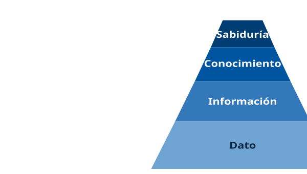

Los cuatro niveles responden a preguntas distintas:

1.  **Dato** — responde a *¿que hay?*: hechos brutos, sin procesar, sin juicio.
2.  **Información** — responde a *¿que es?*: datos contextualizados, con quien/cuando/donde.
3.  **Conocimiento** — responde a *¿como funciona?*: patrones, relaciones, correlaciones.
4.  **Sabiduría** — responde a *¿que hacemos?*: decisiones fundamentadas, principios de acción.

> **Ejemplo de aplicación en el ayto.** Aplicado al **Padrón Municipal**: el valor "3.450.000" es dato; "3.450.000 habitantes empadronados a 31-12-2025" es información; "la población crece al 0,8% anual y envejece" es conocimiento; "hay que reforzar los servicios sociales en distritos envejecidos" es sabiduría (decisión).

#### 1.4. Ciclo de vida del dato

Un dato no es un objeto estático: nace, se transforma, se almacena, se usa y en algún momento se archiva o elimina. El **ciclo de vida del dato** (Data Lifecycle Management, DLM) estructura estas etapas para garantizar gobernanza, trazabilidad y cumplimiento normativo.

Las **seis fases canónicas** del ciclo de vida son:

| Fase | Acción | Ejemplo Ayto Madrid |
|----|----|----|
| **1. Captura** | Adquisición desde la fuente | Alta en Padrón (formulario presencial o en línea) |
| **2. Almacenamiento** | Persistencia en sistema controlado | Base de datos corporativa (Oracle, PostgreSQL) |
| **3. Procesamiento** | Transformación, limpieza, cálculos | Cálculo del porcentaje de empadronados por distrito |
| **4. Uso** | Explotación por usuarios/aplicaciones | Portal del ciudadano, Informes estadísticos |
| **5. Publicación/Comunicación** | Distribución controlada | Open Data Madrid, boletines, web municipal |
| **6. Archivo o eliminación** | Retención legal o destrucción segura | Archivo histórico (5 años) o borrado RGPD |

El ciclo incluye puntos de control transversales: **seguridad** (cifrado, control acceso), **calidad** (validación, depuración), **metadatos** (descripción del dato) y **cumplimiento** (RGPD, LOPDGDD, ENS).

#### 1.5. Calidad del dato

Un dato técnicamente correcto pero de baja calidad puede generar información engañosa y decisiones incorrectas. Cuatro **dimensiones de calidad del dato** de uso habitual son:

- **Exactitud** (*accuracy*): el dato refleja fielmente la realidad. Un NIF erróneo en Padrón tiene exactitud cero.
- **Completitud** (*completeness*): no faltan atributos obligatorios. Un registro de ciudadano sin fecha de nacimiento está incompleto.
- **Consistencia** (*consistency*): el mismo dato tiene el mismo valor en todos los sistemas. Si en Padrón figura "Juan Perez" y en Tributos "J. Perez", hay inconsistencia.
- **Oportunidad o actualidad** (*timeliness*, *currentness*): el dato está actualizado en el momento en que se usa. Una dirección desactualizada provoca notificaciones no entregadas.

La norma que define un **modelo de calidad de datos** es **ISO/IEC 25012** (familia SQuaRE): recoge exactitud, completitud, consistencia y actualidad junto con otras características (credibilidad, accesibilidad, confidencialidad, precisión, trazabilidad…), hasta 15, agrupadas en inherentes y dependientes del sistema. La familia **ISO 8000** (*Data quality*) se centra en la calidad de los **datos maestros** y en su intercambio entre organizaciones.

> **Dato clave.** Cuatro dimensiones de calidad del dato muy utilizadas son: **exactitud, completitud, consistencia y oportunidad (actualidad)**. Figuran entre las 15 características del modelo de calidad de datos de [ISO/IEC 25012](https://www.iso.org/standard/35736.html); la familia [ISO 8000](https://www.iso.org/standard/50798.html) (*Data quality*) trata la calidad de los datos maestros y su intercambio.

#### 1.6. Metadatos

Los **metadatos** son "datos sobre los datos": describen el contexto, contenido y estructura de un dato. Sin metadatos, un conjunto de datos es una secuencia de números sin significado documentado. \[ISO-11179\]

Tres tipos principales:

- **Metadatos descriptivos**: identifican y describen el dato (título, autor, palabras clave). Ej: autor del dataset del Padrón, fecha de última actualización.
- **Metadatos estructurales**: describen como se organiza el dato (relaciones, campos, tipos). Ej: esquema de tabla SQL, definición XML/JSON Schema.
- **Metadatos administrativos**: gobiernan el uso, retención y acceso (permisos, copyright, fechas). Ej: nivel ENS, clasificación RGPD, retención legal.

> **Ejemplo de aplicación en el ayto.** En el portal **Open Data Madrid** (datos.madrid.es) cada dataset incluye metadatos estandarizados según **DCAT-AP-ES** — la adaptación española del *Data Catalog Vocabulary - Application Profile* europeo, vocabulario común que la Unión Europea exige para describir conjuntos de datos abiertos del sector público y permitir que sean catalogables e interoperables entre administraciones. Los metadatos cubren título, descripción, fecha de publicación, frecuencia de actualización, licencia (CC-BY 4.0), responsable del dato y formato (CSV, JSON, XML).

#### 1.7. Tipos y clasificación de datos

La clasificación de los datos en informática no responde a un único criterio. Las clasificaciones son complementarias, no excluyentes. La norma de referencia para tipos de datos independientes del lenguaje es [**ISO/IEC 11404**](https://www.iso.org/standard/39479.html) (*Language-independent datatypes*).

##### 1.7.1. Según su función en el sistema de información

| Tipo | Descripción | Origen/Destino |
|----|----|----|
| **Datos de entrada** | Se introducen en el sistema para su tratamiento | Usuarios o dispositivos de entrada (teclado, escáner, sensores) |
| **Datos intermedios** | Se generan durante el procesamiento | Memoria de trabajo, no visibles al usuario final |
| **Datos de salida** | Resultado final del procesamiento | Dispositivos de salida (pantalla, impresora, fichero) |

##### 1.7.2. Según su naturaleza

- **Datos numéricos**: representan cantidades, permiten operaciones matemáticas. Subtipos: enteros, reales, complejos.
- **Datos alfabéticos**: formados exclusivamente por letras.
- **Datos alfanuméricos**: combinan letras, números y otros caracteres (el caso más común en la práctica).
- **Datos lógicos/booleanos**: dos valores posibles (verdadero/falso, 1/0).
- **Datos multimedia**: imágenes, audio, vídeo.

##### 1.7.3. Según su variabilidad

- **Datos fijos o constantes**: su valor no cambia durante la ejecución (π, velocidad de la luz).
- **Datos variables**: pueden modificarse durante el proceso.

##### 1.7.4. Según su estructura

- **Datos estructurados**: tablas con esquema fijo (BBDD relacionales).
- **Datos semi-estructurados**: estructura parcial, autodescriptivos (XML, JSON).
- **Datos no estructurados**: sin esquema predefinido (documentos, emails, imágenes).

##### 1.7.5. Tipos de datos primitivos en programación

Los **tipos primitivos** son los tipos de datos elementales soportados nativamente por los lenguajes de programación. La norma **ISO/IEC 11404** los clasifica en cuatro grandes familias.

| Familia | Tipo | Tamaño típico | Rango / valores | Ejemplos en lenguajes |
|----|----|----|----|----|
| Enteros | byte / int8 | 1 byte (8 bits) | -128 a +127 (con signo) o 0-255 (sin signo) | Java byte, C int8_t |
| Enteros | short / int16 | 2 bytes (16 bits) | -32.768 a +32.767 | Java short, C int16_t |
| Enteros | int / int32 | 4 bytes (32 bits) | -2.147.483.648 a +2.147.483.647 | Java int, C int |
| Enteros | long / int64 | 8 bytes (64 bits) | aprox. ± 9,2 x 10^18 | Java long, C int64_t |
| Reales | float / single | 4 bytes (32 bits) | ± 3,4 x 10^38 (precisión aprox. 7 decimales) | C float, Java float |
| Reales | double | 8 bytes (64 bits) | ± 1,7 x 10^308 (precisión aprox. 15 decimales) | C double, Java double |
| Lógicos | boolean / bool | 1 bit lógico (1 byte físico) | true / false | Java boolean, Python bool |
| Carácter | char | 1-4 bytes (según codificación) | ASCII (1 byte), UTF-16 (2 bytes), UTF-8 (1-4 bytes) | C char, Java char (UTF-16) |

> **Dato clave.** Los reales se almacenan en formato **IEEE-754** (estándar internacional de coma flotante): 1 bit de signo + exponente sesgado + mantisa normalizada. **Float**: 1+8+23 bits = 32 bits. **Double**: 1+11+52 bits = 64 bits. Ver §8 (Sistemas de numeración) para el detalle del formato.

##### 1.7.6. Tipos de datos compuestos

Los **tipos compuestos** son construcciones del lenguaje que agrupan múltiples valores bajo una única entidad lógica. Permiten al programador trabajar con conjuntos de datos relacionados como si fueran un solo elemento, simplificando el diseño y el mantenimiento del software.

- Un **array** (también llamado *vector* o tabla) almacena una secuencia de elementos del mismo tipo, accesibles por su posición en la secuencia. Su tamaño puede ser fijo, definido en el momento de compilar el programa (como en C o Java), o variable, ajustándose dinámicamente durante la ejecución (como ocurre con `list` en Python o `ArrayList` en Java).
- Un **struct** o **registro** agrupa campos de tipos distintos bajo un nombre común — equivale a una fila de una tabla relacional o al tipo `record` de los lenguajes funcionales. Por ejemplo, un registro *Empleado* podría combinar un identificador numérico, un nombre alfanumérico y una fecha de alta.
- Un **union** comparte un mismo espacio de memoria entre varios campos posibles, de los cuales solo uno guarda un valor válido en cada momento. Es útil cuando se necesitan representaciones alternativas del mismo dato sin duplicar memoria.
- Una **enumeración** (`enum`) define un conjunto cerrado y finito de valores con nombre, como los días de la semana o los estados de un trámite. Internamente cada valor se almacena como un entero, pero el código gana legibilidad al usar el nombre simbólico.
- Una **cadena de caracteres** (`string`) es una secuencia de caracteres tratada como una unidad. En Java o Python las cadenas son inmutables: una vez creadas no pueden modificarse, y cada operación devuelve una cadena nueva. En C, en cambio, una cadena es un array de caracteres terminado en el carácter nulo `\0`, que sí admite modificación in situ.

##### 1.7.7. Tipos abstractos de datos (TAD)

Un **Tipo Abstracto de Datos** define un conjunto de valores y las operaciones que pueden realizarse sobre ellos, **independientemente de su implementación**. Los TAD canónicos en informática son:

| TAD | Estructura | Operaciones típicas | Política de acceso | Ejemplos de uso |
|----|----|----|----|----|
| **Pila (stack)** | LIFO (Last In, First Out) | push, pop, top, isEmpty | Acceso solo por la cima | Pila de llamadas a funciones, deshacer/rehacer |
| **Cola (queue)** | FIFO (First In, First Out) | enqueue, dequeue, front | Inserción por cola, extracción por cabeza | Buffer de impresora, planificación de procesos |
| **Lista** | Secuencia ordenada con acceso libre | insert, remove, get, size | Acceso a cualquier posición | Listas enlazadas, arrays dinámicos |
| **Conjunto (set)** | Colección sin duplicados, sin orden | add, remove, contains, union, intersection | Sin duplicados | Índices, eliminación de duplicados |
| **Mapa (dict)** | Pares clave-valor | put, get, remove, containsKey | Acceso por clave | Diccionarios, caché, índices |
| **Árbol** | Jerarquía padre-hijos | insert, search, delete, traverse | Recorridos: preorden, inorden, postorden | Sistema de ficheros, BD B-tree, AST de compiladores |
| **Grafo** | Nodos + aristas | addNode, addEdge, BFS, DFS, dijkstra | Recorridos por anchura/profundidad | Redes, mapas, dependencias |
| **Cola de prioridad** | Cola con orden por prioridad | insert, extractMax/Min | Extrae siempre el de mayor/menor prioridad | Planificación de procesos, A\*, Dijkstra |

> **Relación con otros temas.** Los TAD se desarrollan en profundidad en el **Tema 13** (Tipos abstractos y Estructuras de datos) y son la base teórica de las **bases de datos** (Tema 15) y de la planificación de procesos en los **sistemas operativos** (Tema 14).

##### 1.7.8. Tipos de datos en SQL

El estándar **SQL:2023** ([ISO/IEC 9075:2023](https://www.iso.org/standard/76583.html), que anula y sustituye a la edición de 2016) define el catálogo de tipos para bases de datos relacionales. Los principales:

| Categoría | Tipo SQL | Descripción |
|----|----|----|
| Numéricos exactos | INTEGER, SMALLINT, BIGINT | Enteros con signo |
| Numéricos exactos | NUMERIC(p,s), DECIMAL(p,s) | Decimal de precisión fija (precisión p, escala s) |
| Numéricos aproximados | FLOAT(n), REAL, DOUBLE PRECISION | Coma flotante IEEE-754 |
| Cadenas carácter | CHAR(n) | Cadena fija de longitud n |
| Cadenas carácter | VARCHAR(n) | Cadena variable hasta n caracteres |
| Cadenas carácter | TEXT / CLOB | Texto largo (Character Large Object) |
| Binarios | BINARY(n), VARBINARY(n) | Datos binarios fijos/variables |
| Binarios | BLOB | Binary Large Object (imágenes, ficheros) |
| Fecha y hora | DATE, TIME, TIMESTAMP, INTERVAL | Datos temporales con precisión configurable |
| Lógico | BOOLEAN | TRUE / FALSE / UNKNOWN (lógica trivaluada por NULL) |
| Colección | ARRAY, MULTISET | Tipos colección (extensiones SQL:1999) |
| Documento | JSON, XML | Tipos semi-estructurados (extensiones del estándar) |

##### 1.7.9. Tipado en lenguajes de programación

La forma en que un lenguaje gestiona los tipos define dos ejes de clasificación **independientes**:

- **Tipado estático vs dinámico** (cuando se verifica el tipo):

  - *Estático*: en tiempo de compilación. Java, C, C++, Rust, Go, TypeScript.
  - *Dinámico*: en tiempo de ejecución. Python, JavaScript, Ruby, PHP.

- **Tipado fuerte vs débil** (si hay conversiones implícitas):

  - *Fuerte*: prohíbe operaciones entre tipos incompatibles sin conversión explícita. Python, Java, Rust.
  - *Débil*: permite conversiones implícitas (`"5" + 3 = "53"` o `8` según lenguaje). C, JavaScript, PHP.

| Lenguaje   | Estático / Dinámico | Fuerte / Débil |
|------------|---------------------|----------------|
| Java       | Estático            | Fuerte         |
| Python     | Dinámico            | Fuerte         |
| JavaScript | Dinámico            | Débil          |
| C          | Estático            | Débil          |
| TypeScript | Estático            | Fuerte         |

> **Dato clave.** Los ejes "estático/dinámico" y "fuerte/débil" son **independientes**: Python es dinámico+fuerte, JavaScript es dinámico+débil, C es estático+débil, Java es estático+fuerte.

> **Relación con otros temas.** La clasificación de datos conecta con el Tema 15 (Sistemas de gestión de bases de datos) — modelo relacional frente a NoSQL — y con el Tema 14 (Sistemas operativos) — gestión de ficheros y dispositivos de E/S. Los tipos abstractos se desarrollan en el Tema 13 (Tipos abstractos y Estructuras de datos).

------------------------------------------------------------------------

### 2. Sistemas de información

#### 2.1. Definición y concepto

Un **sistema de información** (SI) es un conjunto de elementos (aplicaciones, maquinaria, usuarios, procedimientos) diseñado para el tratamiento de información, de manera que está quede disponible de forma eficiente para su uso posterior. \[ISO-2382\]

Los sistemas de información ayudan a administrar, recolectar, recuperar, procesar, almacenar y distribuir información relevante para los procesos de una organización, ya sea una empresa privada, una administración pública o una entidad del tercer sector.

> **Nota importante**: El término "sistema de información" **no es sinonimo** de "sistema informático". Un sistema de información no requiere necesariamente componentes informáticos, aunque en la práctica la mayoría los incorporan. Un archivador físico con fichas de papel es un sistema de información perfectamente válido. Los sistemas de información informatizados son un subconjunto del conjunto general.

#### 2.2. Componentes básicos de un SI

Los sistemas de información se componen de tres partes principales: **personas, procesos de negocio y tecnologías de la información**. Desglosados en siete componentes estructurales:

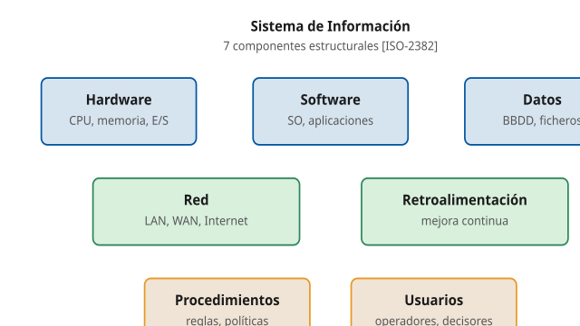

| Componente | Descripción |
|----|----|
| **Hardware** | Tecnología de almacenamiento, comunicaciones, entradas y salidas de datos. |
| **Software** | Aplicaciones destinadas a recoger, almacenar, procesar y analizar datos. |
| **Datos** | Porciones de información donde reside el valor del sistema. |
| **Procedimientos** | Políticas y reglas de negocio aplicables a los procesos de la organización. |
| **Usuarios** | Personas que interactúan con la información — componente decisivo para el exito. |
| **Red** | Infraestructura que permite compartir recursos entre dispositivos. |
| **Retroalimentación** | Base para la mejora continua del sistema. |

###### Detalle de cada componente

**1. Hardware** — soporte físico del SI. Se descompone en:

- *Equipos centrales*: servidores (rack, blade, torre), mainframes, estaciones de trabajo.
- *Equipos cliente*: ordenadores personales, portátiles, terminales ligeros, dispositivos móviles.
- *Almacenamiento*: discos HDD, SSD, NAS, SAN, librerias de cintas.
- *Dispositivos de entrada*: teclado, ratón, escáner, sensores IoT, lectores RFID, cámaras.
- *Dispositivos de salida*: monitores, impresoras, plotters, altavoces.
- *Equipos de red*: routers, switches, firewalls, puntos de acceso WiFi, balanceadores de carga.

**2. Software** — programas que operan sobre el hardware. Se clasifica habitualmente en cuatro capas:

- *Software de sistema*: sistema operativo (Windows Server, Linux, AIX), controladores (*drivers*), firmware.
- *Software de utilidad*: antivirus, herramientas de copia de seguridad, monitorización, sistemas de gestión de configuración.
- *Middleware*: servidores de aplicaciones (Tomcat, JBoss, IIS), brokers de mensajes (Kafka, RabbitMQ), buses de servicios (ESB), gestores de bases de datos (Oracle, PostgreSQL, SQL Server).
- *Software de aplicación*: ERP, CRM, ofimática, aplicaciones a medida del organismo.

**3. Datos** — el activo de mayor valor del SI. Se estructuran en:

- *Bases de datos transaccionales (OLTP)*: optimizadas para escritura, integridad ACID. Sustentan los TPS (registros, tributos).
- *Almacenes de datos analíticos (DWH/OLAP)*: optimizados para consulta, agregación histórica. Sustentan los DSS y EIS.
- *Data Lake / Data Lakehouse*: almacenes para datos en bruto, no estructurados, escalables.
- *Ficheros y documentos*: PDF, ofimática, multimedia, gestores documentales.
- *Metadatos*: catálogos de datos, diccionarios, esquemas (ver §1.6).

**4. Procedimientos** — reglas que rigen el uso del SI. Tipologia:

- *Manuales operativos*: paso a paso para operadores del SI.
- *Políticas de seguridad*: control de accesos, gestión de identidades, clasificación de la información (alineadas con el [Esquema Nacional de Seguridad — RD 311/2022](https://www.boe.es/eli/es/rd/2022/05/03/311) e [ISO/IEC 27001](https://www.iso.org/standard/27001)).
- *Procesos de negocio*: flujos modelados en BPMN (alta de empadronamiento, expedición de licencia).
- *Acuerdos de nivel de servicio (SLA)*: tiempos de respuesta, disponibilidad comprometida con el ciudadano.
- *Planes de continuidad y recuperación ante desastres (BCP/DRP)*: RPO y RTO acordados.

**5. Usuarios** — el componente humano. Se clasifican por rol:

- *Administradores del sistema*: operación, mantenimiento, seguridad. Personal TIC del organismo.
- *Usuarios funcionales / finales*: empleados que operan el SI para sus tareas diarias.
- *Usuarios externos*: ciudadanos, empresas, otras administraciones que consumen servicios vía sede electrónica o APIs.
- *Auditores*: revisan controles internos, cumplimiento RGPD/ENS.
- *Dirección ejecutiva*: consume cuadros de mando estratégicos.

**6. Red** — infraestructura de comunicaciones. Se categoriza por alcance y por tipo de uso:

- *Por alcance*: PAN (personal), LAN (local), CAN (campus), MAN (metropolitana), WAN (extensa, nacional o global).
- *Por uso*: intranet (red interna del organismo), extranet (acceso para socios y proveedores), Internet (acceso público).
- *Por topología lógica*: estrella, malla, anillo, árbol.
- *Servicios*: DNS, DHCP, correo, autenticación centralizada (LDAP/Active Directory), VPN.

**7. Retroalimentación (feedback)** — base de la mejora continua. Mecanismos:

- *Indicadores clave de rendimiento (KPI)*: medibles, comparables en el tiempo.
- *Encuestas de satisfacción al ciudadano y al usuario interno*.
- *Registros de incidencias y peticiones (ITSM)*: alimentan el plan de mejora.
- *Auditorías internas y externas*: detectan no conformidades y oportunidades.
- *Ciclo PDCA / Deming* (Plan-Do-Check-Act): marco metodológico de mejora iterativa.

> **Dato clave.** Los siete componentes pueden agruparse en tres bloques: **TI** (hardware, software, datos, red), **organización** (procedimientos, retroalimentación) y **personas** (usuarios). Esta visión tripartita es la usada en frameworks como **COBIT 2019** y en la gestión de servicios **ITIL v4** (las "cuatro dimensiones": organizaciones y personas, información y tecnología, partners y proveedores, flujos de valor y procesos).

#### 2.3. Características de un sistema de información

Para que un sistema de información sea considerado como tal, debe cumplir las siguientes **diez características**. La norma de referencia para la calidad de los productos software (y por extensión de los SI) es la [**ISO/IEC 25010:2023**](https://www.iso.org/standard/78176.html) (modelo de calidad SQuaRE — *Systems and software Quality Requirements and Evaluation*).

| \# | Característica | Cómo se mide | Norma de referencia |
|----|----|----|----|
| 1 | Disponibilidad | Uptime (%), MTBF, RTO, RPO | ISO/IEC 25010, ENS |
| 2 | Selección adecuada | Ratio precisión/recall, encuestas | ISO/IEC 25010 |
| 3 | Adaptabilidad | N.º perfiles soportados, accesibilidad | UNE-EN 301 549, WCAG 2.1 |
| 4 | Capacidad de relación | N.º referencias cruzadas, tasa de exito en búsqueda | DCAT-AP, ISO 11179 |
| 5 | Tiempo de respuesta | P50/P95/P99, productividad | ISO/IEC 25010 |
| 6 | Exactitud y calidad | Exactitud, completitud, consistencia, actualidad | ISO/IEC 25012 |
| 7 | Flexibilidad | Time-to-market de cambios, complejidad ciclomática | ISO/IEC 25010 |
| 8 | Fiabilidad | MTTR, tasa de fallos, defectos por mil líneas | ISO/IEC 25010 |
| 9 | Seguridad | Tríada CIA + trazabilidad + autenticidad | ISO 27001, ENS, RGPD |
| 10 | Copias de seguridad | RPO, frecuencia, prueba periódica de restauración | ISO/IEC 27040, ENS |

###### Detalle de cada característica

**1. Disponibilidad** — la información está accesible cuando se precise y a través del medio requerido. Se mide en porcentaje de tiempo activo (*uptime*): el SLA típico de "tres nueves" (99,9%) admite 8,76 horas de caída al año; "cinco nueves" (99,999%) solo 5,26 minutos. **MTBF** (Mean Time Between Failures) y **MTTR** (Mean Time To Repair) son las dos métricas operativas clave. **Ejemplo Ayto Madrid**: la Sede Electrónica debe estar disponible 24x7 — una caída durante el periodo voluntario de IBI tendría impacto económico y reputacional directo.

**2. Selección adecuada** — el SI entrega solo información relevante, evitando sobrecarga (*information overload*). Las herramientas de búsqueda y filtrado, los gestores documentales con etiquetado y los buscadores con relevancia (TF-IDF, BM25) materializan está característica. **Ejemplo Ayto Madrid**: el portal **datos.madrid.es** filtra los 600+ datasets por categoría, organismo, formato y licencia para que el ciudadano encuentre lo que busca sin recorrer todo el catálogo.

**3. Adaptación y personalización** — el SI se ajusta al perfil del usuario (idioma, rol, dispositivo, accesibilidad). La norma [**UNE-EN 301 549**](https://www.une.org/encuentra-tu-norma/busca-tu-norma/norma/?c=N0067945) y las [**WCAG 2.1**](https://www.w3.org/TR/WCAG21/) (*Web Content Accessibility Guidelines*) son obligatorias en webs de organismos públicos españoles según el [**Real Decreto 1112/2018**](https://www.boe.es/eli/es/rd/2018/09/07/1112). **Ejemplo Ayto Madrid**: la web municipal soporta múltiples idiomas y modo alto contraste, navegación por teclado y compatibilidad con lectores de pantalla (NVDA, JAWS, VoiceOver).

**4. Capacidad de relación** — el SI permite enlazar datos de fuentes distintas (*linked data*). El estándar **DCAT-AP** (Data Catalog Application Profile) define como describir datasets con relaciones explícitas. **Ejemplo Ayto Madrid**: el dataset de "tributos por distrito" puede cruzarse con el de "población empadronada por distrito" para obtener "tributo medio por habitante" — la relación es posible porque ambos comparten una clave común (código de distrito).

**5. Tiempos de respuesta adecuados** — el SI responde en plazos compatibles con el caso de uso. Los percentiles **P50/P95/P99** son la métrica estándar (P95 = 95% de las peticiones se sirven por debajo de ese tiempo). La **productividad** (*throughput*) mide peticiones por segundo. **Ejemplo Ayto Madrid**: una consulta del Padrón debe responder en menos de 2 segundos (P95) para no degradar la experiencia del operador en ventanilla.

**6. Exactitud y calidad** — los datos del SI son veraces y actualizados. Se evalúa con las **dimensiones de calidad del dato** (ver §1.5): exactitud, completitud, consistencia, oportunidad (actualidad). El modelo de calidad de datos de [**ISO/IEC 25012**](https://www.iso.org/standard/35736.html), la familia **ISO 8000** (datos maestros) y el cuerpo de conocimiento **DAMA-DMBOK** son los marcos de referencia. **Ejemplo Ayto Madrid**: la dirección postal en el Padrón debe coincidir exactamente con el callejero oficial; un error de calle invalida la notificación fehaciente.

**7. Flexibilidad** — el SI se adapta a nuevas necesidades sin reconstruirse. Se mide por el **time-to-market** de los cambios (cuánto tarda implementar una nueva normativa) y por la **complejidad ciclomática** del código. Arquitecturas modulares (microservicios, API-first) y desacoplamiento (event-driven, cola de mensajes) materializan la flexibilidad. **Ejemplo Ayto Madrid**: un cambio en la normativa de IBI debe poder reflejarse en el sistema en días, no en meses.

**8. Fiabilidad** — el SI funciona de forma correcta y continua. Se mide por el **MTTR** (tiempo medio de reparación), la tasa de fallos y los defectos por mil líneas de código. La fiabilidad incluye la **tolerancia a fallos**: redundancia de hardware, replicación de datos, balanceadores activo-activo. **Ejemplo Ayto Madrid**: el sistema de cita previa debe poder seguir operando aunque uno de los servidores caiga — la replicación en tiempo real de la base de datos es el mecanismo habitual.

**9. Seguridad** — la información está protegida frente a accesos no autorizados, modificaciones indebidas y pérdida. La **tríada CIA** (Confidencialidad, Integridad, Disponibilidad) se complementa con dos atributos adicionales en el modelo **AAA** (*Authentication, Authorization, Accounting*) y con la **trazabilidad** y la **autenticidad** del [**Esquema Nacional de Seguridad — RD 311/2022**](https://www.boe.es/eli/es/rd/2022/05/03/311). **Ejemplo Ayto Madrid**: el acceso al Padrón requiere autenticación fuerte (certificado digital o cl@ve), autorización según rol y registro de toda acción en logs auditables (trazabilidad).

**10. Copias de seguridad** — el SI dispone de copias periódicas que permiten recuperar la operación ante fallos, errores humanos o ciberataques. Las métricas son el **RPO** (*Recovery Point Objective*: cuántos datos se pueden perder) y el **RTO** (*Recovery Time Objective*: cuánto se puede tardar en restaurar). La norma [**ISO/IEC 27040**](https://www.iso.org/standard/80194.html) rige la seguridad del almacenamiento. **Ejemplo Ayto Madrid**: política de backups 3-2-1 — tres copias, en dos medios distintos, una de ellas externa (*off-site*) — con prueba mensual de restauración.

> **Dato clave.** La **tríada CIA** (Confidencialidad, Integridad, Disponibilidad) es el principio fundamental de seguridad de la información, recogido en [**ISO/IEC 27001**](https://www.iso.org/standard/27001) y en el [**Esquema Nacional de Seguridad — RD 311/2022**](https://www.boe.es/eli/es/rd/2022/05/03/311). El ENS extiende la tríada con dos dimensiones adicionales: **Trazabilidad** y **Autenticidad**.

> **Dato clave.** El modelo **ISO/IEC 25010:2023 (SQuaRE)** distingue nueve características de calidad del producto software: adecuación funcional, eficiencia de desempeño, compatibilidad, capacidad de interacción, **fiabilidad**, **seguridad**, mantenibilidad, **flexibilidad** y protección. Las negritas son las que coinciden con la lista de características del SI.

#### 2.4. Elementos funcionales

Un sistema de información estándar se estructura en los siguientes elementos:

- **Base de datos**: almacena toda la información requerida para la toma de decisiones. La información se organiza en registros específicos e identificables.
- **Transacciones**: elementos de interfaz que permiten al usuario consultar, agregar, modificar o eliminar registros.
- **Informes**: elementos mediante los cuáles el usuario obtiene registros o información estadística (contar, sumar) según criterios de búsqueda definidos.
- **Procesos**: elementos que, según una lógica predefinida, obtienen información de la base de datos y generan nuevos registros.
- **Usuario**: todas las personas que interactúan con el sistema, desde el nivel ejecutivo hasta el operativo.
- **Procedimientos administrativos**: reglas y políticas que rigen el comportamiento de los usuarios frente al sistema. Nunca un usuario tiene acceso directo a la base de datos; siempre a través de transacciones autorizadas.

**Módulos funcionales internos**:

| Módulo | Función |
|----|----|
| Definición del SI | Define la estructura de las bases de datos y formatos de documentos |
| Entrada | Dota al SI de elementos de entrada adecuados a la información |
| Análisis | Aplica algoritmos para procesar datos y obtener información |
| Búsqueda | Gestiona las fuentes para búsquedas coordinadas y sencillas |
| Difusión | Notificaciones de información relevante a los usuarios |
| Evaluación | Recopila estadísticas y opiniones para mejora del SI |

#### 2.5. Funciones principales del SI

La función principal de un SI es **ofrecer información relevante, eliminando datos superfluos**, filtrada y ordenada para búsquedas eficientes.

Se distinguen **cuatro funciones básicas** (regla nemotécnica: **EAPS** — Entrada, Almacenamiento, Procesamiento, Salida):

1.  **Entrada de información**: proceso mediante el cual el SI toma los datos a procesar. Las entradas pueden ser **manuales** (proporcionadas por el usuario) o **automáticas** (procedentes de otros sistemas mediante interfaces automáticas, APIs, EDI).

2.  **Almacenamiento de información**: capacidad del sistema para recordar la información guardada, tanto en memoria principal como en memoria secundaria. Es una de las funciones más importantes.

3.  **Procesamiento de información**: capacidad para efectuar cálculos según una secuencia de operaciones preestablecida. Permite la transformación de datos fuente en información útil para la toma de decisiones.

4.  **Salida de información**: capacidad para sacar la información procesada al exterior. La salida de un SI puede constituir la entrada a otro SI (integración).

#### 2.6. Tipos de sistemas de información

**Clasificación genérica** (Laudon, 2017):

- **Sistemas competitivos**: orientados a ventaja competitiva (ej. sistemas de precios dinámicos).
- **Sistemas cooperativos**: soportan trabajo colaborativo (ej. Microsoft Teams, Google Workspace).
- **Sistemas que modifican el estilo de operación del negocio**: transformación digital.

**Clasificación por nivel organizacional**:

Esta clasificación, originada en la literatura clásica de gestión empresarial (Anthony, 1965; Laudon & Laudon, 2017), parte de una idea sencilla: dentro de cualquier organización conviven **cuatro niveles de decisión** que necesitan información de naturaleza distinta.

- **Nivel operativo** — el día a día. Operarios y personal de ventanilla ejecutan transacciones individuales (alta de un empadronamiento, cobro de un tributo, registro de una incidencia). Necesitan datos en bruto, en tiempo real y en alto volumen.
- **Nivel de gestión** (también llamado **táctico**) — mandos medios que coordinan equipos y supervisan el funcionamiento de un servicio. Necesitan informes periódicos consolidados (semanales, mensuales) para detectar desviaciones y tomar decisiones rutinarias.
- **Nivel analítico** — analistas y técnicos que estudian escenarios y simulan alternativas para decisiones no rutinarias. Necesitan herramientas de exploración y modelado sobre datos históricos.
- **Nivel estratégico** — alta dirección que define objetivos y planifica a medio y largo plazo. Necesita información muy agregada, indicadores clave y cuadros de mando.

A cada nivel le corresponde un tipo de sistema de información, formando una pirámide: **a más altura, mayor agregación de los datos y menor volumen** (un alcalde no consulta cada transacción individual, sino indicadores resumen); **a menor altura, mayor volumen y menor agregación** (un funcionario de ventanilla maneja registros individuales en bruto).

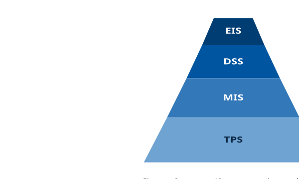

| Tipo | Sigla | Nivel | Función | Ejemplo |
|----|----|----|----|----|
| Sistema de Procesamiento de Transacciones | **TPS** | Operativo | Gestiona transacciones individuales en tiempo real | Alta en Padrón, cobro de tributo |
| Sistema de Información Gerencial | **MIS** | Gestión / Táctico | Informes periódicos consolidados para mandos medios | Informe mensual de ingresos por distrito |
| Sistema de Soporte a la Decisión | **DSS** | Analítico | Análisis y simulaciones para decisiones no rutinarias | Simulación de impacto de subida de IBI |
| Sistema de Información Ejecutiva | **EIS** | Estratégico | Cuadro de mando para dirección | Cuadro de mando del Alcalde |

> **Ejemplo de aplicación en el ayto.** La arquitectura de sistemas del Ayuntamiento de Madrid combina los cuatro niveles: el **Padrón Municipal** funciona como TPS (procesa altas/bajas en tiempo real), alimenta un MIS estadístico (informes demográficos mensuales), que a su vez nutre un DSS de **planificación urbana** (¿dónde construir un nuevo colegio?), cuyos resultados llegan al EIS del **Cuadro de Mando Integral municipal** que consulta el equipo de gobierno.

#### 2.7. SI empresariales transversales

Más allá de la clasificación por nivel, existen sistemas que atraviesan todos los niveles organizacionales:

- **ERP** (Enterprise Resource Planning): integra procesos de negocio (finanzas, RRHH, compras, producción, ventas) en un único sistema. Ejemplos: SAP S/4HANA, Oracle Fusión, Microsoft Dynamics 365. En el sector público: **Sorolla2** (SEC) o **GEISER**.
- **CRM** (Customer Relationship Management): gestiona la relación con clientes/ciudadanos. Ejemplos: Salesforce, HubSpot, Zoho. En el sector público: **CAU** (Centro de Atención al Usuario).
- **SCM** (Supply Chain Management): gestiona la cadena de suministro. Menos relevante en administración pública, salvo en logística de servicios municipales.
- **BPM** (Business Process Management): modela, automatiza y optimiza procesos de negocio.
- **BI** (Business Intelligence): analítica, cuadros de mando, reporting.
- **DWH** (Data Warehouse): almacén integrado de datos históricos para análisis (ver §2.8).

#### 2.8. Herramientas complementarias

- **Cuadro de Mando Integral (CMI / Balanced Scorecard / BSC)**: herramienta de control empresarial que permite establecer y monitorizar los objetivos de una empresa y sus áreas. Muestra de forma continuada el cumplimiento del plan estratégico, articulado en cuatro perspectivas: **financiera, clientes, procesos internos, aprendizaje**. \[Kaplan & Norton, 1992\]

- **Datawarehouse (DWH)**: base de datos corporativa que integra y depura información de una o más fuentes distintas, para luego procesarla permitiendo su análisis desde múltiples perspectivas (**OLAP** — On-Line Analytical Processing) y con grandes velocidades de respuesta. Alimenta a los DSS y EIS.

- **Data Lake**: repositorio de datos en bruto, sin esquema predefinido, escalable horizontalmente. Complementa al DWH permitiendo almacenar datos no estructurados (logs, imágenes, texto libre) para posterior análisis con Big Data.

- **Data Lakehouse**: arquitectura híbrida (Databricks, 2020) que combina las garantías transaccionales del DWH con la flexibilidad del Data Lake.

#### 2.9. Metodologías de implantación

Implantar un SI en una organización no es solo comprar software: requiere metodología. Las principales metodologías de implantación son:

- **Métrica v3** (MAP, 2001): metodología oficial de la Administración Pública española para el desarrollo de SI. Cubre planificación, desarrollo, mantenimiento. Referencia histórica aun vigente en muchos pliegos.
- **ITIL v4** (Axelos, 2019): gestión de servicios TI. Orientada a operación y mejora continua.
- **COBIT 2019** (ISACA): gobernanza de TI y cumplimiento regulatorio.
- **Metodologías ágiles** (Scrum, Kanban, SAFe): iteraciones cortas, entregas incrementales. Adoptadas progresivamente por el sector público.

> **Nota.** Las metodologías de desarrollo y gestión de servicios TI (Métrica v3, ITIL, COBIT, ágiles) son marcos transversales: no se desarrollan como tema independiente del programa, pero su terminología aparece en múltiples temas técnicos del bloque (administración del sistema operativo, seguridad, redes).

------------------------------------------------------------------------

### 3. Arquitectura de ordenadores

La arquitectura de ordenadores se define como el **conjunto de reglas, normas y procedimientos que especifican las interrelaciones entre los componentes lógicos y físicos** que forman parte de un sistema informático, así como las características que debe cumplir cada componente. \[STALLINGS-COA, Cap. 1\]

Es útil distinguir entre:

- **Arquitectura** (*Instruction Set Architecture*, ISA): la visión del programador — que instrucciones existen, que registros son visibles, como se direcciona memoria.
- **Organización**: la visión del ingeniero — como se implementa la ISA en el hardware, que buses hay, como está estructurada la caché.

Dos procesadores con la misma **arquitectura** (p.ej. Intel i9 y Intel i3) tienen organizaciones distintas pero son compatibles a nivel de código.

#### 3.1. Arquitectura Von Neumann

También conocida como **modelo de Von Neumann** o **arquitectura Princeton**. Propuesta por John von Neumann en el célebre **"First Draft of a Report on the EDVAC"** (1945), que sistematizó las ideas del equipo de Eckert y Mauchly (ENIAC, 1945) en un documento formal. El EDVAC (1949) fue la primera implementación del modelo. \[STALLINGS-COA, Cap. 2\]

**Componentes** (los cuatro elementos canónicos):

- **Unidad de proceso (CPU)**: contiene una Unidad Aritmético-Lógica (ALU), registros del procesador y una Unidad de Control (UC) con un registro de instrucciones y un contador de programa (CP).
- **Memoria**: almacena **tanto datos como instrucciones** en un único espacio de memoria. Esta es la característica definitoria.
- **Mecanismos de entrada/salida (E/S)**.
- **Buses** que conectan los elementos anteriores.

**Característica fundamental**: datos e instrucciones comparten la misma memoria y el mismo bus. Esto permite el concepto de **programa almacenado** — las instrucciones se pueden modificar como si fuesen datos (base de compiladores, ensambladores y sistemas operativos modernos).

> **Dato clave.** El **cuello de botella de Von Neumann** (Von Neumann bottleneck): no pueden darse simultáneamente una búsqueda de instrucciones y una operación de datos, ya que comparten un bus común. La velocidad de la CPU ha crecido mucho más rápido que la velocidad de la memoria principal, ampliando este cuello de botella. Las cachés y la segmentación lo mitigan parcialmente.

#### 3.2. Arquitectura Harvard

Debe su nombre al ordenador **Harvard Mark I** (Howard Aiken, 1944), anterior incluso a la formalización de Von Neumann. Contiene los mismos elementos que el modelo Von Neumann, pero con una **diferencia fundamental**: la memoria principal se divide en **memoria de instrucciones** y **memoria de datos**, cada una con su propio bus exclusivo. \[STALLINGS-COA, Cap. 2\]

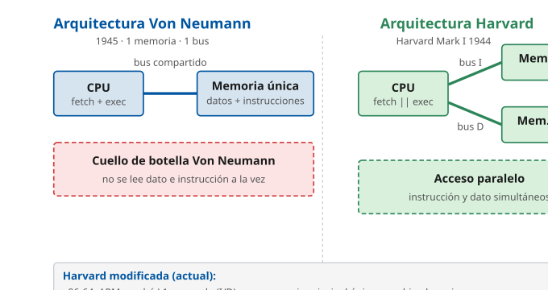

**Ventaja clave de Harvard**: al tener buses separados, se pueden simultanear operaciones sobre datos e instrucciones, eliminando el cuello de botella de Von Neumann y aumentando el rendimiento.

| Característica | Von Neumann | Harvard |
|----|----|----|
| Memoria | Única (datos + instrucciones) | Separada (datos / instrucciones) |
| Buses | Bus compartido | Buses independientes |
| Acceso simultáneo | No | Si |
| Cuello de botella | Si | No (o reducido) |
| Complejidad | Menor | Mayor |
| Aplicaciones típicas | PCs de propósito general | DSPs, microcontroladores (AVR, PIC) |

#### 3.3. Arquitectura Harvard modificada

En la actualidad, la mayoría de los procesadores de propósito general (x86-64, ARM Cortex-A) implementan una **arquitectura Harvard modificada**, que combina lo mejor de ambos mundos:

- La **memoria principal** es única (como Von Neumann), lo que permite que los contenidos de la memoria de instrucciones sean accedidos como si fuesen datos — posibilita cargar un programa desde disco para su ejecución, compilar y enlazar dinámicamente, etc.
- La **caché L1** está separada en dos: caché L1 de instrucciones (L1i) y caché L1 de datos (L1d). Esto proporciona la ventaja de paralelismo de Harvard en el nivel más cercano a la CPU, donde más importa.
- La **caché L2 y L3** vuelven a ser unificadas (datos + instrucciones).

Características de la Harvard modificada:

- La memoria de instrucciones y datos ocupan **diferente espacio lógico** en caché pero **mismo espacio físico** en RAM.
- Acceden a la CPU por **buses L1 distintos**, pero comparten bus en niveles inferiores.
- Pueden ser accedidas de **diferente manera** (la caché L1i solo se lee, la L1d se lee y escribe).

> **Dato clave.** Conviene recordar esta jerarquía: **Von Neumann** (memoria única, histórico) vs **Harvard** (memorias separadas, microcontroladores) vs **Harvard modificada** (PCs actuales, híbrido).

------------------------------------------------------------------------

### 4. Generaciones de ordenadores

Las generaciones se definen por tres aspectos principales: la **tecnología vigente** (componente electrónico principal), las **técnicas de programación** y el **impacto en la sociedad**. \[TANENBAUM-SO, Cap. 1\]

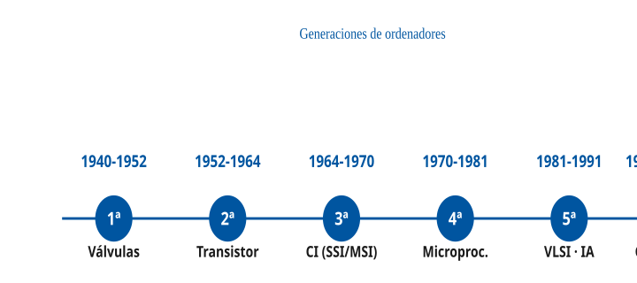

#### 4.1. Primera generación (1940-1952) — Válvulas de vacío

| Aspecto | Detalle |
|----|----|
| Tecnología | Relés electromagnéticos, válvulas y tubos de vacío |
| Memoria | Tarjetas y cintas perforadas, líneas de demora de mercurio, tambores magnéticos |
| Velocidad | Milisegundos |
| Tamaño | Ocupaban habitaciones enteras. ENIAC: 30 toneladas, 167 m² |
| Consumo | Decenas de kW (ENIAC: 150 kW) |
| Uso | Aplicaciones científicas y militares |
| Programación | Lenguaje máquina directo (interruptores manuales, cables) |
| Ejemplos | **ENIAC** (Eckert-Mauchly, 1945), **Mark I** (Harvard, 1944), **UNIVAC I** (1951), **Colossus** (Bletchley, 1943) |

#### 4.2. Segunda generación (1952-1964) — Transistores

| Aspecto | Detalle |
|----|----|
| Tecnología | **Transistor** sustituye a la válvula de vacío (invención: Bardeen, Brattain, Shockley, Bell Labs 1947 — Nobel 1956) |
| Memoria | Núcleos de ferrita, soportes magnéticos, tambores mejorados |
| Mejoras | Reducción de tamaño (1/10), consumo (1/100) y coste; aumento de fiabilidad (10x) |
| Uso | Se extienden a empresas y universidades (administración, gestión) |
| Programación | Lenguajes de alto nivel: **Fortran** (1957), **Cobol** (1959), **Algol** (1960) |
| Otros avances | Circuitos impresos sustituyen al cableado; primeros periféricos modernos |
| Ejemplos | **TRADIC** (Bell Labs 1954, primer ordenador con transistores), **IBM 1401** (1959), **IBM 7090** |

> **Ejemplo de aplicación en el ayto.** El primer ordenador que llegó a España fue un **IBM 650** adquirido por **RENFE en 1959** para gestión de reservas. Con 2.000 válvulas (era un híbrido tardío de 1ª gen), ocupaba una sala de 50 m². En la administración pública española, la mecanización masiva llegaría en los años 70 con ordenadores IBM de 3ª gen.

#### 4.3. Tercera generación (1964-1970) — Circuitos integrados

| Aspecto | Detalle |
|----|----|
| Tecnología | **Circuitos integrados** (Kilby 1958, Noyce 1959) — SSI (Small-Scale Integration, ~10 transistores/chip), luego MSI (Medium-Scale, hasta 1.000) |
| Memoria | Semiconductores (DRAM IBM 1966) y discos magnéticos mejorados |
| Mejoras | Miniaturización drástica, primeras minicomputadoras |
| Software | Sistemas operativos con **multiprogramación**, tiempo real, modo interactivo (time-sharing) |
| Programación | Aparece **BASIC** (Dartmouth, 1964) |
| Ejemplos | **IBM System/360** (1964, familia compatible de ordenadores), **PDP-11** (DEC, 1970), superordenador **CDC-6600** (Cray, 1964) |

#### 4.4. Cuarta generación (1971-1981) — Microprocesador

| Aspecto | Detalle |
|----|----|
| Tecnología | **LSI** (Large-Scale Integration) y **VLSI** (Very Large-Scale, \>10.000 transistores/chip) |
| Hito | En **1971** aparece el **Intel 4004**, primer microprocesador comercial: toda la CPU en un único chip (2.300 transistores, 4 bits, 740 kHz) |
| Conmutación | 10 nanosegundos |
| Almacenamiento | Disquete (Floppy Disk 8", luego 5,25", 3,5") |
| Uso | Primeros **ordenadores personales**: **Altair 8800** (1975), **Apple I** (1976), **IBM PC 5150** (1981) |
| Otros | Redes de ordenadores (Ethernet 1973, TCP/IP 1974), teleinformática |

#### 4.5. Quinta generación (1981-1991) — IA, GUI, redes

| Aspecto | Detalle |
|----|----|
| Tecnología | Componentes **VLSI** masivos y **ULSI** (Ultra Large-Scale) |
| Conmutación | 1 nanosegundo |
| Avances | Inteligencia Artificial (sistemas expertos: MYCIN, DENDRAL), redes neuronales primitivas |
| Programación | Lenguajes cercanos al natural (Prolog, Lisp para IA); OOP (C++ 1985, Smalltalk) |
| Interfaces | Sistemas operativos con **interfaces gráficas** (Xerox Star 1981, Apple Lisa 1983, Mac 1984, Windows 1.0 1985, X Window 1984) |
| Redes | Internet consolidada (ARPANET → NSFNET 1986), World Wide Web inventada (Tim Berners-Lee, CERN, 1989-1991) |
| Impacto | Expansión masiva de la microinformática a hogares y oficinas |

#### 4.6. Sexta generación (1991 → actualidad) — Computación distribuida, cuántica, neuromórfica

Aunque la literatura clásica cierra las generaciones con la 5ª, la mayoría de autores actuales reconocen una **sexta generación** que cubre el periodo 1991-actualidad, caracterizada por:

- **Multinúcleo y paralelismo masivo**: desde ~2005 todos los procesadores de propósito general son multinúcleo. GPUs con miles de núcleos (NVIDIA H100: 18.432 núcleos CUDA).
- **Computación en la nube**: AWS (2006), Azure (2010), Google Cloud (2011). Ordenadores virtualizados, escalables bajo demanda.
- **Dispositivos ubicuos**: smartphones (iPhone 2007), tablets, IoT, wearables. Más dispositivos conectados que humanos.
- **Inteligencia artificial moderna**: redes neuronales profundas (AlexNet 2012), transformers (2017), GPT (2018-2024), Claude, Gemini.
- **Computación cuántica**: primeros ordenadores cuánticos comerciales (IBM Q 2016, Google Sycamore 2019). Potencial disruptivo.
- **Computación neuromórfica**: chips inspirados en el cerebro (Intel Loihi 2017, IBM TrueNorth 2014). Muy eficientes energéticamente.

> **Relación con otros temas.** La computación en la nube y los modelos IaaS / PaaS / SaaS se amplían en el **Tema 31** (Paradigmas de computación distribuida y servicios en Cloud). La virtualización se aborda en el **Tema 28**.

------------------------------------------------------------------------

### 5. Componentes internos de los equipos microinformáticos

El hardware de un ordenador se estructura en tres subsistemas: \[STALLINGS-COA, Cap. 3\]

1.  **Unidad Central de Proceso (UCP/CPU)**
2.  **Memoria central**
3.  **Unidades de entrada/salida (periféricos)**

Todos ellos se comunican mediante **buses**.

#### 5.1. Buses

Un **bus** es un conjunto de circuitos que se encargan de la conexión y comunicación entre los diversos componentes del ordenador. La comunicación se realiza mediante líneas eléctricas paralelas (o en serie en buses modernos como PCIe). \[STALLINGS-COA, Cap. 3\]

**Tipos funcionales** (los **tres buses** clásicos):

| Tipo de bus | Direccionalidad | Función |
|----|----|----|
| **Bus de control** | Unidireccional (UC → componentes) | Transmite señales de la Unidad de Control interpretadas como órdenes |
| **Bus de direcciones** | Unidireccional (CPU → memoria) | Transporta las direcciones de memoria sobre las que se va a actuar (lectura/escritura) |
| **Bus de datos** | Bidireccional | Traslada datos hacia/desde la memoria y otros dispositivos |

**Parámetros de un bus**:

- **Anchura (bits)**: número de líneas paralelas. Un bus de datos de 64 bits transfiere 8 bytes por ciclo.
- **Frecuencia (MHz/GHz)**: número de ciclos por segundo.
- **Ancho de banda** (MB/s o GB/s) = anchura × frecuencia / 8.
- **Protocolo**: síncrono (reloj común) o asíncrono (handshake).

**Buses reales modernos**: PCIe 5.0 (32 GT/s por lane, hasta 128 GB/s bidireccional x16), USB 4 (40 Gbps), Thunderbolt 5 (80-120 Gbps).

#### 5.2. El procesador (CPU)

El procesador, también denominado **CPU** (*Central Processing Unit*), es el subsistema más importante del ordenador. Actúa como su cerebro, coordinando y supervisando el funcionamiento del sistema y procesando las instrucciones de los programas. \[STALLINGS-COA, Cap. 3\]

**Secuencia invariable de operación** (ciclo de instrucción, ver §5.4):

1.  Extraer de memoria una instrucción del programa en ejecución.
2.  Analizar (decodificar) dicha instrucción.
3.  Realizar las operaciones necesarias para su ejecución.
4.  Actualizar el estado y pasar a la siguiente instrucción.

Actualmente, la CPU está integrada en un **microprocesador** (chip), montado sobre la **placa base** en un zócalo (*socket*) específico (Intel LGA1851, AMD AM5) y acompañado de un **disipador** de calor y (habitualmente) **ventilador** o refrigeración líquida.

> **Nota**: Los términos UCP, CPU, microprocesador y procesador son equivalentes en la práctica, aunque técnicamente "microprocesador" se refiere al chip físico y "CPU" al concepto lógico.

##### 5.2.1. Tecnologías: CISC vs RISC

**CISC** (*Complex Instruction Set Computer*) \[INTEL-SDM\]

- Conjunto de instrucciones **amplio y complejo** (Intel x86-64 tiene ~1.500 instrucciones en 2024).
- Permite operaciones complejas entre operandos en memoria o registros.
- Dificulta el paralelismo entre instrucciones.
- Los sistemas CISC modernos convierten instrucciones complejas en **microoperaciones tipo RISC** (micro-ops, uops) internamente antes de ejecutarlas. Esta es la razón por la que x86 puede competir en rendimiento con RISC.
- Requiere **4 a 10 ciclos de reloj** por instrucción en promedio (con segmentación bajan a 1 uop/ciclo efectivo).
- Ejemplos: **Intel Core (x86-64), AMD Ryzen (x86-64), Motorola 68000** (histórico).

Ventajas CISC:

- Reduce la dificultad de crear compiladores (ya están maduros).
- Permite reducir el tamaño del código (instrucciones hacen más en menos bytes).
- Compatibilidad histórica (el ecosistema x86 es enorme).
- Facilita la depuración de errores (más instrucciones especializadas).

**RISC** (*Reduced Instruction Set Computer*) \[STALLINGS-COA, Cap. 15\]

- Conjunto de instrucciones **reducido y simple** (ARMv9 tiene ~400 instrucciones, RISC-V base tiene ~50).
- Instrucciones de **tamaño fijo** (4 bytes en ARM/RISC-V) en pocos formatos.
- Solo las instrucciones de **carga/almacenamiento** (LOAD/STORE) acceden a memoria — **arquitectura load-store**.
- Cada instrucción se ejecuta idealmente en **un solo ciclo de CPU** (con segmentación).
- Ejemplos: **ARM Cortex** (smartphones, Apple M), **MIPS** (routers, consolas antiguas), **SPARC** (servidores Sun/Oracle), **PowerPC** (Macs pre-2006, consolas), **RISC-V** (emergente, código abierto).

Ventajas RISC:

- CPU más rápida por ciclo (menos trabajo por instrucción).
- Favorece segmentación (pipelining) y paralelismo (superescalar).
- Menor consumo energético por operación (razón por la que domina en móviles).
- Diseño más simple — menos transistores dedicados a decodificar.

**Tabla comparativa**:

| Aspecto | CISC | RISC |
|----|----|----|
| Instrucciones | Complejas, tamaño variable | Simples, tamaño fijo |
| Ciclos por instrucción (IPC) | 4-10 (antes de uops) | 1 (nominal) |
| Acceso a memoria | Cualquier instrucción | Solo LOAD/STORE |
| Número de registros | Pocos (8-16) | Muchos (32+) |
| Paralelismo por segmentación | Difícil (requiere uops) | Favorable |
| Consumo | Mayor (por ciclo) | Menor |
| Uso típico | PCs de escritorio, servidores | Móviles, consolas, servidores ARM, embebidos |
| Ejemplos | Intel Core, AMD Ryzen | ARM Cortex-A, Apple M, AWS Graviton, RISC-V |

> **Dato clave.** El procesador x86-64 (el más común en PCs de escritorio) es **CISC**, pero internamente traduce instrucciones CISC a microinstrucciones RISC (uops) antes de ejecutarlas. Este proceso se llama **decodificación x86** y ocupa hardware significativo (~15 % de la superficie del chip, el *die*).

##### 5.2.2. Medidas de potencia de la CPU

- **FLOPS** (*Floating-Point Operations Per Second*): número de operaciones de coma flotante por segundo. Relevante para cálculo científico, IA, gráficos. Superordenador El Capitan (2024): 1,74 **ExaFLOPS** (10^18 FLOPS).
- **MIPS** (*Millions of Instructions Per Second*): millones de instrucciones por segundo. **Solo comparable entre CPUs con el mismo conjunto de instrucciones** (no se puede comparar MIPS de x86 con MIPS de ARM directamente).
- **IPC** (*Instructions Per Cycle*): cuántas instrucciones ejecuta la CPU en cada ciclo de reloj. Procesadores modernos pueden superar 4 IPC gracias al paralelismo superescalar.
- **Frecuencia** (GHz): ciclos de reloj por segundo. Un i9-14900K funciona a 5,8 GHz en turbo.
- **TDP** (*Thermal Design Power*, W): potencia térmica máxima. Proxy del consumo eléctrico.

##### 5.2.3. Multiprocesamiento, multinúcleo y multithreading

Tres conceptos que conviene no confundir:

- **Multiprocesamiento** (multi-CPU): un equipo con **más de una CPU física** (múltiples sockets). Típico en servidores de alta gama. Puede ser **SMP** (simétrico, CPUs iguales) o **NUMA** (no uniforme, cada CPU con su propia memoria).

- **Multinúcleo** (multi-core): un único circuito integrado con **más de una CPU lógica** dentro. No confundir con multiprocesamiento. Un Intel Core i9-14900K tiene 24 núcleos (8 de rendimiento, P, *performance*, + 16 de eficiencia, E, *efficiency*) en un solo chip.

- **Multithreading (HyperThreading / SMT)**: tecnología que permite **duplicar las unidades lógicas de cada núcleo**, permitiendo a un núcleo ejecutar **dos hilos simultáneos**. Patente original de Sun Microsystems (1994).

  - Intel lo denomina **HyperThreading Technology (HTT)** — lanzado en Pentium 4 (2002).
  - AMD lo denomina **SMT (Simultaneous Multi-Threading)** — en Zen desde 2017.
  - Ambas tecnologías son virtualmente idénticas en concepto. Aportan ~20-30% rendimiento adicional con ~5% más silicio.

> **Dato clave.** Un **Intel Core i9-14900K con 24 núcleos y HyperThreading** presenta al sistema operativo **32 hilos lógicos** (8 núcleos-P con HT×2 + 16 núcleos-E sin HT = 16 + 16 = 32). Los núcleos-E (de eficiencia) no tienen HT para ahorrar energía.

##### 5.2.4. Segmentación de instrucciones (*pipelining*)

La **segmentación** (*pipelining*) es la técnica fundamental para acelerar una CPU sin aumentar su frecuencia. Divide la ejecución de cada instrucción en **etapas** y permite que varias instrucciones se solapen en distintas etapas simultáneamente. Es análoga a una cadena de montaje industrial.

**Cauce segmentado (*pipeline*) RISC clásico de 5 etapas** (modelo MIPS, base de muchos libros de texto):

1.  **IF** (*Instruction Fetch*): busca la instrucción en memoria.
2.  **ID** (*Instruction Decode*): decodifica la instrucción y lee operandos de registros.
3.  **EX** (*Execute*): la ALU ejecuta la operación.
4.  **MEM** (*Memory Access*): lectura/escritura en memoria de datos (solo LOAD/STORE).
5.  **WB** (*Write Back*): escribe el resultado en el registro destino.

Sin segmentación, una instrucción ocupa 5 ciclos. Con segmentación, **en estado estacionario se completa una instrucción por ciclo** (IPC=1), porque las etapas están trabajando en instrucciones diferentes simultáneamente.

Los procesadores modernos tienen cauces mucho más profundos:

- Intel Core (Golden Cove, 2021): ~19 etapas.
- AMD Zen 4 (2022): ~19 etapas.
- ARM Cortex-X4 (2023): ~15 etapas.

**Riesgos del cauce** (*hazards*): situaciones que rompen la ejecución ideal de una instrucción por ciclo:

- **Hazard estructural**: dos instrucciones compiten por el mismo recurso hardware (ej. bus de memoria).
- **Hazard de datos**: una instrucción necesita el resultado de otra anterior que aun no ha terminado.
- **Hazard de control**: un salto (branch) obliga a descartar instrucciones ya buscadas que no se van a ejecutar.

Soluciones modernas:

- **Forwarding / bypassing**: cortocircuito interno para pasar resultados entre etapas sin esperar al WB.
- **Predicción de saltos** (*branch prediction*): la CPU "adivina" si un salto se tomará y empieza a buscar instrucciones desde el destino predicho. Aciertos \>95% en procesadores modernos.
- **Ejecución especulativa**: ejecuta instrucciones asumiendo una predicción de salto; si falla, descarta resultados.
- **Ejecución fuera de orden** (*out-of-order execution*): reordena instrucciones para aprovechar huecos del cauce.

> **Dato clave.** Las **vulnerabilidades Spectre y Meltdown** (2018) aprovechan precisamente la **ejecución especulativa**: los efectos de instrucciones especulativas no se deshacen del todo (quedan rastros en caché), permitiendo leer memoria protegida. Afectaron a casi todos los procesadores Intel, AMD y ARM posteriores a 1995.

##### 5.2.5. CPU superescalar

Una CPU **escalar** ejecuta una instrucción por ciclo en el mejor caso. Una CPU **superescalar** ejecuta **varias instrucciones por ciclo** replicando unidades funcionales (múltiples ALUs, múltiples unidades de punto flotante, etc.).

El procesador despacha instrucciones a las unidades disponibles en paralelo, respetando las dependencias de datos. Intel Golden Cove despacha hasta **6 instrucciones por ciclo**; Apple M3 hasta **8**.

> **Nota.** El paralelismo se manifiesta en dos niveles: a nivel de instrucción (ILP — segmentación, superescalar, ejecución fuera de orden, dentro de un mismo núcleo) y a nivel de hilo (TLP — multinúcleo, SMT/Hyper-Threading). Ambos coexisten en los procesadores modernos.

##### 5.2.6. Ley de Moore y su crisis

La **Ley de Moore** (Gordon Moore, Intel, 1965) observaba que el número de transistores en un chip se duplicaba cada ~18-24 meses a coste constante. Se cumplió con notable precisión desde 1965 hasta ~2015.

Desde ~2015 la ley se ha ralentizado: las dificultades físicas de miniaturizar por debajo de 5 nm (efectos cuánticos, fugas de corriente, disipación térmica) han frenado el ritmo. La industria ha respondido con:

- **Arquitecturas heterogéneas**: big.LITTLE (ARM), núcleos P-E (Intel), combinando núcleos rápidos con núcleos eficientes.
- **Chiplets**: divisiones del chip en múltiples dies interconectados (AMD EPYC/Ryzen, Intel Meteor Lake).
- **3D stacking**: apilar transistores en capas (3D V-Cache de AMD, memoria HBM).
- **Aceleradores especializados**: GPUs, NPUs (Neural Processing Units), TPUs para IA.

##### 5.2.7. Procesadores actuales (2024-2025)

Panorama actual del mercado de procesadores:

| Fabricante | Arquitectura | Familia | Mercado |
|----|----|----|----|
| **Intel** | x86-64 CISC | Core Ultra (Meteor/Lunar Lake), Xeon 6 | PCs escritorio/portátil, servidores |
| **AMD** | x86-64 CISC | Ryzen 9000, EPYC 9005 Turin | PCs escritorio/portátil, servidores |
| **Apple** | ARM64 RISC | Apple M4 (2024), M4 Pro/Max/Ultra | Mac, iPad, Visión Pro |
| **Qualcomm** | ARM64 RISC | Snapdragon 8 Gen 4, Snapdragon X Elite | Smartphones, portátiles Copilot+ |
| **NVIDIA** | ARM64 + GPU | Grace Hopper, Blackwell | Servidores IA, HPC |
| **AWS** | ARM64 RISC | Graviton 4 | Servidores en la nube de AWS |

------------------------------------------------------------------------

#### 5.3. Unidad Central de Proceso — Componentes internos

La CPU está formada por tres subsistemas principales: \[STALLINGS-COA, Cap. 12\]

1.  **Registros de acceso rápido**
2.  **Unidad de Control (UC)**
3.  **Unidad Aritmético-Lógica (ALU/UAL)**

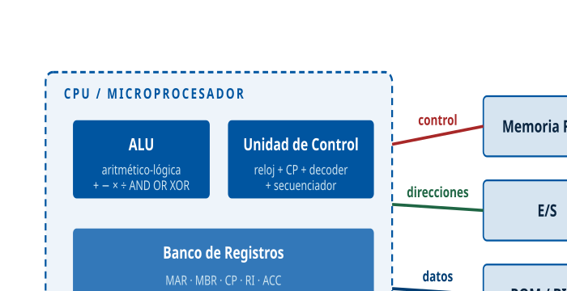

##### 5.3.1. Registros

Un **registro** es una pequeña zona de memoria de acceso muy rápido y directo por parte del procesador, que almacena un dato, instrucción o dirección de memoria. Característica: **mínima capacidad, máxima velocidad** (~0,3 ns de latencia).

**Tipos de registros**:

| Tipo | Nombre | Función |
|----|----|----|
| Datos | **Registros de datos** | Almacenan valores numéricos y caracteres |
| Datos | **Acumulador (ACC)** | Almacena temporalmente resultados aritméticos/lógicos intermedios para la ALU |
| Datos | **Registro de pila (SP, Stack Pointer)** | Mantiene la posición actual de la cima de la pila |
| Direcciones | **Registro índice (IX)** | Direcciona datos hacia/desde la RAM mediante un desplazamiento (*offset*) |
| Memoria | **MBR (Memory Buffer Register)** | Conectado al bus de datos. Lee/escribe datos del bus dirigidos a memoria o E/S |
| Memoria | **MAR (Memory Address Register)** | Contiene la dirección del dato a leer/escribir. Conectado al bus de direcciones |
| Instrucción | **CP (Contador de Programa)** | Dirección de la siguiente instrucción a ejecutar |
| Instrucción | **RI (Registro de Instrucción)** | Instrucción actualmente decodificada y en ejecución |
| General | **GPRs (General-Purpose Registers)** | Almacenan direcciones o datos generales — sin función específica |
| Específico | **SPRs (Special-Purpose Registers)** | Guardan datos del estado del sistema |
| Estado | **CCR / Registro de estado** | Códigos de condición de la última operación. Incluye el registro FLAGS |
| Punto flotante | **Registros FP / SIMD** | Números reales IEEE-754 y operaciones vectoriales (XMM, YMM, ZMM, NEON) |
| Constantes | **Registros constantes** | Valores de solo lectura: cero, uno, PI |

> **Dato clave.** **Capacidad de direccionamiento**: si el MAR tiene **n bits**, se pueden direccionar un máximo de **2^n palabras** de memoria. Con MAR de 32 bits se direccionan 4 GB (2^32 = 4.294.967.296 bytes); con MAR de 64 bits se direccionan 16 EB (límite teórico prácticamente inalcanzable).

##### 5.3.1.1. Registros FLAGS, EFLAGS y RFLAGS (x86)

El **registro FLAGS** es el registro de estado en la familia x86. Su evolución acompaña a la de la propia arquitectura:

| Registro   | Ancho   | Arquitectura             | Época                   |
|------------|---------|--------------------------|-------------------------|
| **FLAGS**  | 16 bits | 8086, 80286 (modo real)  | 1978-1985               |
| **EFLAGS** | 32 bits | 80386, 80486, Pentium    | 1985-presente (compat.) |
| **RFLAGS** | 64 bits | x86-64 (AMD64, Intel 64) | 2003-presente           |

Los tres son **retrocompatibles**: los bits bajos de RFLAGS son EFLAGS, y los bits bajos de EFLAGS son FLAGS. Los bits añadidos en cada ampliación se usan para características nuevas (virtualización, identificación CPUID, niveles de protección).

**Bits principales del registro FLAGS**:

| Bit | Nombre | Flag | Descripción |
|----|----|----|----|
| 0 | CF | Carry Flag | Acarreo en operaciones aritméticas |
| 2 | PF | Parity Flag | Paridad del resultado (1 si número par de bits 1) |
| 4 | AF | Auxiliary Flag | Acarreo auxiliar (para BCD) |
| 6 | ZF | Zero Flag | 1 si el resultado es cero |
| 7 | SF | Sign Flag | Signo del resultado (copia del bit más significativo) |
| 8 | TF | Trap Flag | Modo paso a paso (debug) |
| 9 | IF | Interrupt Flag | Habilita interrupciones enmascarables |
| 10 | DF | Direction Flag | Dirección de operaciones de string |
| 11 | OF | Overflow Flag | Desbordamiento en aritmética con signo |

**Ejemplo de uso** en un salto condicional:

    COMPARA A, B       ; resta A-B, actualiza ZF, SF, CF, OF
    SALTA_SI_IGUAL FIN ; salta a FIN si ZF=1 (eran iguales)

> **Relación con otros temas.** Los registros FLAGS de ARM se llaman **APSR** (Application Program Status Register) y los de RISC-V están distribuidos en CSRs (Control and Status Registers). El concepto es equivalente.

##### 5.3.2. Unidad de Control

La Unidad de Control es la **parte más importante del microprocesador** desde el punto de vista funcional. Controla el funcionamiento de todo el conjunto excepto las operaciones aritméticas (gestionadas por la ALU). \[STALLINGS-COA, Cap. 20\]

**Componentes**:

| Componente | Función |
|----|----|
| **Reloj** | Proporciona impulsos con frecuencia constante que marcan los ciclos básicos. Ej: Pentium IV a 2 GHz = 2.000 millones de pulsos/segundo. No equivale a instrucciones/segundo, ya que muchas requieren múltiples pulsos o el cauce segmentado entrega varias por ciclo |
| **Contador de Programa (CP)** | Registro que contiene la dirección de memoria de la siguiente instrucción a ejecutar. Al encender el ordenador toma un valor por defecto donde se encuentra la primera instrucción (vector de reset) |
| **Registro de Instrucción (RI)** | Contiene la instrucción en ejecución. Tiene dos partes: **código de operación** (que hacer) y **operandos** (sobre que hacerlo) |
| **Decodificador** | Extrae el código de operación del RI, lo analiza y lo comunica al controlador |
| **Controlador/Secuenciador** | Interpreta el código de operación y genera las **microórdenes** que actúan sobre el sistema en sincronía con el reloj |

##### 5.3.3. Unidad Aritmético-Lógica (ALU)

La ALU es el componente del procesador encargado de ejecutar las **operaciones elementales de tipo aritmético y lógico**. Se comunica con el sistema mediante el bus de datos. \[STALLINGS-COA, Cap. 9\]

**Componentes de la ALU**:

| Componente | Función |
|----|----|
| **Circuito Operacional (COP)** | Contiene los circuitos digitales para realizar las operaciones. Es el elemento más importante de la ALU |
| **Registros de Entrada (REN)** | Almacenan los operandos sobre los que se ejecuta la operación |
| **Acumulador** | Almacena los resultados finales. Conectado directamente al bus de datos para envío a memoria |
| **Registro de Estado** | Almacena información sobre condiciones de la última operación (FLAGS, §5.3.1.1) |

**Tipos de operaciones**:

1.  **Aritméticas sobre enteros**: suma, resta, multiplicación, división (incluyendo variantes con signo/sin signo).
2.  **Lógicas a nivel de bit**: AND, OR, NOT, XOR, NAND, NOR, XNOR.
3.  **Desplazamiento y rotación de bits**: desplazan bits a izquierda/derecha. Equivalencia aritmética: desplazar n posiciones a izquierda equivale a multiplicar por 2^n (si no hay desbordamiento).
4.  **Comparación**: resta sin guardar resultado, solo actualiza FLAGS.

Las operaciones de **coma flotante** (reales IEEE-754) y **vectoriales/SIMD** (SSE, AVX, NEON) suelen estar en unidades separadas (FPU, SIMD unit) pero conceptualmente forman parte del bloque ALU extendido.

**Tablas de verdad de operaciones lógicas** (2 entradas):

| A   | B   | AND | OR  | XOR | NAND | NOR | XNOR |
|-----|-----|-----|-----|-----|------|-----|------|
| 0   | 0   | 0   | 0   | 0   | 1    | 1   | 1    |
| 0   | 1   | 0   | 1   | 1   | 1    | 0   | 0    |
| 1   | 0   | 0   | 1   | 1   | 1    | 0   | 0    |
| 1   | 1   | 1   | 1   | 0   | 0    | 0   | 1    |

| A   | NOT A |
|-----|-------|
| 0   | 1     |
| 1   | 0     |

#### 5.4. Ciclo de ejecución de instrucciones

El **ciclo de instrucción** (*instruction cycle* o *fetch-execute cycle*) es el conjunto de acciones que realiza el ordenador para ejecutar cada instrucción. Se divide en dos fases principales: \[STALLINGS-COA, Cap. 12\]

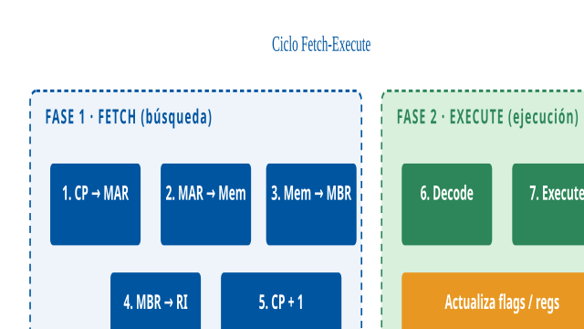

##### Fase 1: Búsqueda (FETCH)

La instrucción es localizada en memoria y transferida a la Unidad de Control. Pasos:

1.  La UC transfiere el contenido del **Contador de Programa (CP)** al **Registro de Dirección de Memoria (MAR)** a través del bus interno.
2.  El MAR emite la dirección al sistema de memoria a través del bus de direcciones.
3.  El sistema de memoria accede a la posición indicada y transfiere la instrucción al **Registro de Intercambio de Memoria (MBR)** a través del bus de datos.
4.  La instrucción se transfiere del MBR al **Registro de Instrucción (RI)**.
5.  El **Contador de Programa se incrementa** para apuntar a la siguiente instrucción secuencial (normalmente CP = CP + tamaño_instrucción).

##### Fase 2: Ejecución (EXECUTE)

1.  El **decodificador** interpreta la instrucción del RI, extrayendo el código de operación y los operandos.
2.  El **secuenciador** activa los circuitos necesarios (ej. la ALU en operaciones aritméticas, la unidad de memoria en LOAD/STORE).
3.  Se ejecuta la operación y se actualizan los registros FLAGS.
4.  En caso de instrucciones de **salto** (branch), el CP se carga con una nueva dirección en lugar del incremento secuencial.

##### Clasificación de instrucciones por número de operandos

| Tipo | Descripción | Ejemplo (castellano) |
|----|----|----|
| Sin operandos | Acciones de control sin datos explícitos | `FIN`, `NOP` |
| Un operando | Actúan sobre un dato o dirección | `SALTA 12345`, `INC A` |
| Dos operandos | Dos elementos; uno suele ser destino | `SUMA A, B` (A = A + B) |
| Tres operandos | Dos fuentes + un destino | `SUMA A, B, C` (C = A + B) |

Las arquitecturas **CISC** suelen soportar 0-2 operandos. Las **RISC modernas** típicamente usan **3 operandos** (dos fuentes y un destino explícito), lo que evita sobrescribir el contenido original.

> **Ejercicio resuelto.** **Problema**: una instrucción x86 `ADD EAX, EBX` (SUMA EAX, EBX en nuestra notación castellana) suma los valores de EAX y EBX y guarda el resultado en EAX. Si EAX=10 y EBX=5, ¿cuál es el contenido de EAX tras la ejecución y que flags se actualizan?
>
> **Solución**: EAX pasa a valer 15 (10+5). Los flags afectados son: ZF=0 (resultado no es cero), SF=0 (resultado positivo), CF=0 (sin acarreo), OF=0 (sin desbordamiento con signo), PF=1 (15 = 00001111, número par de bits 1 en los 8 bits bajos).

#### 5.5. Modos de direccionamiento

Los **modos de direccionamiento** son las diferentes formas de transformar el campo de operando de la instrucción en la **dirección efectiva** del operando real. \[STALLINGS-COA, Cap. 13\]

Se clasifican en:

- **Impropios** (operando fuera de memoria): implícito, inmediato.
- **Propios** (operando en memoria): directo, indirecto, relativo a base, relativo a índice.

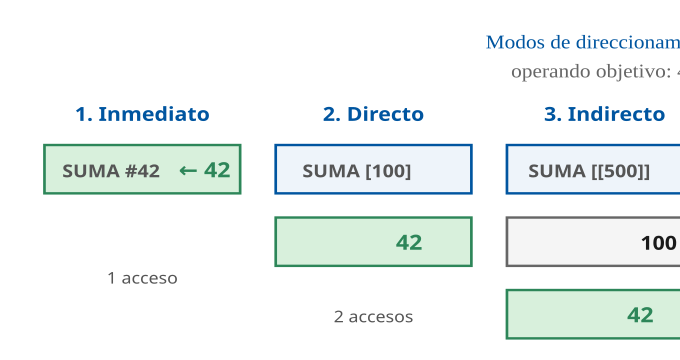

**Modos impropios** (operando explícito o en instrucción):

| Modo | Descripción | Ejemplo |
|----|----|----|
| **Implícito** (inherente) | El operando está implícito en la definición de la instrucción. Usado en acumuladores y pilas. | `INC` (incrementa acumulador), `PUSH A` (usa SP implicitamente) |
| **Inmediato** (literal) | El operando está incluido en la propia instrucción. Útil para inicializar registros con constantes. | `SUMA #42` (suma la constante 42) |

**Modos propios** (operando en memoria):

| Modo | Descripción | Fórmula |
|----|----|----|
| **Directo/Absoluto** | El campo de operando contiene la dirección donde está el dato. | DE = campo_operando |
| **Indirecto** | El campo contiene una dirección donde se encuentra la dirección efectiva del operando. Necesita un acceso extra a memoria. | DE = M\[campo_operando\] |
| **Relativo a registro base** | Dirección efectiva = contenido del registro base + desplazamiento. Permite códigos reentrantes y reubicables. | DE = BP + desplazamiento |
| **Relativo a registro índice** (indexado) | Dirección efectiva = dirección de memoria (en instrucción) + contenido del registro índice. Útil para arrays y bucles. | DE = dirección + IX |

##### 5.5.1. Modos adicionales en arquitecturas reales

Arquitecturas modernas añaden modos compuestos:

- **Pre-indexado**: `[BP+X]`, pre-calcula dirección antes de acceder.
- **Post-indexado**: `[BP], X`, accede a BP y luego incrementa BP por X (útil en recorrido de arrays).
- **Base-desplazamiento-escala** (x86): `[BP + IX*4 + 16]` — acceso a elemento de array de enteros de 32 bits con desplazamiento.
- **Relativo al PC**: desplazamiento desde el contador de programa (saltos relativos, típicos en ARM/RISC-V).

> **Dato clave.** En ARM la mayoría de instrucciones aritmético-lógicas operan solo sobre registros; para acceder a memoria se usan exclusivamente `LDR` (load) y `STR` (store) con modos relativo-base y relativo-índice. Es la **arquitectura load-store**, característica fundamental RISC.

------------------------------------------------------------------------

### 6. Memoria

#### 6.1. Clasificaciones

**Por ubicación**:

- **Memoria interna**: reside dentro o cerca de la CPU (registros, caché, RAM, ROM).
- **Memoria externa**: dispositivos de almacenamiento secundario (SSD, HDD, cinta, nube).

**Por volatilidad**:

- **Volátil**: se borra al perder alimentación eléctrica (RAM, registros, caché).
- **No volátil**: persiste tras apagar el equipo (ROM, Flash, SSD, HDD, cinta, optico).

**Por tipo de acceso**:

- **Acceso aleatorio (random)**: cualquier posición en el mismo tiempo (RAM, ROM, SSD).
- **Acceso secuencial**: hay que recorrer posiciones intermedias (cinta).
- **Acceso directo**: zonas accedidas directamente pero con posiciones internas secuenciales (HDD por cilindro/sector).

**Por jerarquía** (pirámide de memoria):

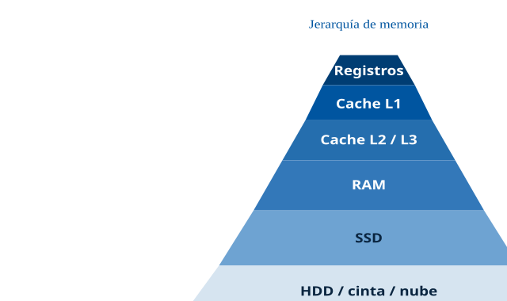

> **Dato clave.** **Regla fundamental**: a mayor velocidad, menor capacidad y mayor coste por byte. Cada nivel de la jerarquía es ~10-100× más lento y ~10-100× más grande que el anterior.

#### 6.2. Memoria RAM

La **memoria RAM** (*Random Access Memory*) es memoria principal de tipo **volátil**: su contenido se pierde al apagar el sistema. \[JEDEC-DDR\]

**Función**: almacenar temporalmente los datos e instrucciones que utiliza el procesador durante la ejecución de programas. Actúa como espacio de trabajo intermedio entre la CPU (muy rápida, poca capacidad) y la memoria secundaria (lenta, mucha capacidad).

**Característica principal**: **acceso aleatorio** — se puede leer/escribir en cualquier posición en el mismo tiempo, independientemente de su ubicación. Este es el **acceso aleatorio** que da nombre a la RAM.

##### 6.2.1. SRAM vs DRAM

Dos tecnologías fundamentales de RAM:

- **SRAM** (Static RAM): basada en biestables (6 transistores por bit). **Rápida** (~1-3 ns), **cara** (más transistores), **baja densidad**, no requiere refresco. Uso: **memoria caché** (L1, L2, L3) integrada en la CPU.
- **DRAM** (Dynamic RAM): basada en un condensador + un transistor por bit. **Lenta** (~50-100 ns), **barata**, **alta densidad**, **requiere refresco** periódico (cada ~64 ms) porque los condensadores pierden carga. Uso: **memoria principal** del ordenador.

> **Dato clave.** La **DRAM necesita refresco**: un circuito lee y reescribe cada celda cada pocos milisegundos para evitar que se pierda la información. Esto consume ancho de banda y energía. La SRAM no necesita refresco.

##### 6.2.2. Evolución de la memoria RAM

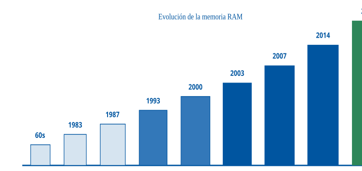

| Tecnología | Años | Descripción |
|----|----|----|
| **Núcleos de Ferrita** | 1950-1970 | Malla con núcleos magnéticos de ferrita en las intersecciones |
| **DIP** (Dual In-line Package) | 1960-70 | Basadas en transistores, chips encapsulados |
| **SIPP** (Single In-line Pin Package) | 1983 | Módulos de 30 pines. Uso en Intel 80286 |
| **SIMM** (Single In-line Memory Module) | 1987 | Contactos planos en lugar de pines, muesca de orientación. Uso en 80486. 30 o 72 contactos. 32 bits |
| **DIMM** (Dual In-line Memory Module) | 1993 | Chips en ambas caras. 168 contactos, 2 muescas. **64 bits** |
| **DDR DIMM** (Double Data Rate) | 2000 | Evolución DIMM con doble tasa de transferencia (flanco subida + bajada). 184 contactos |

##### 6.2.3. Tabla comparativa DDR

| Especificación | DDR | DDR2 | DDR3 | DDR4 | **DDR5** |
|----|----|----|----|----|----|
| **Año introducción** | 2000 | 2003 | 2007 | 2014 | 2021 |
| **Voltaje** | 2,5 V | 1,8 V | 1,5 V | 1,2 V | 1,1 V |
| **Frecuencia efectiva (MT/s)** | 200-400 | 400-1066 | 800-2133 | 2133-4800 | 4800-8400 |
| **Ancho de banda máximo** | 3,2 GB/s | 8,5 GB/s | 17 GB/s | 38,4 GB/s | **67,2 GB/s** |
| **Capacidad máxima por módulo** | 1 GB | 8 GB | 16 GB | 64 GB | **128 GB** |
| **Pines (DIMM)** | 184 | 240 | 240 | 288 | 288 |

> **Dato clave.** DDR2 y DDR3 tienen los **mismos 240 pines** pero son **física y eléctricamente incompatibles** (la muesca está en distinta posición, y el voltaje es distinto: 1,8 V vs 1,5 V). Análogamente, DDR4 y DDR5 tienen **los mismos 288 pines** pero son incompatibles (voltajes 1,2 V vs 1,1 V, topología distinta: DDR5 integra el PMIC en el módulo).

##### 6.2.4. Tipos especiales de RAM

| Tipo | Descripción | Uso |
|----|----|----|
| **RIMM** (Rambus In-line Memory Module) | Módulos Rambus con disipador integrado, 232 contactos | Memorias RDRAM (muerto comercialmente) |
| **FB-DIMM** (Fully Buffered DIMM) | Datos en serie, menos líneas, mayor velocidad | Servidores (obsoleto) |
| **GDDR** (Graphics DDR) | DDR optimizada para gráficas, integrada en la GPU | Tarjetas gráficas (GDDR6X actual) |
| **SO-DIMM** (Small Outline DIMM) | Versión compacta de DIMM (~50% más pequeña) | Portátiles, NUCs |
| **Micro-DIMM** | Más pequeño que SO-DIMM | Dispositivos ultracompactos (obsoleto) |
| **LPDDR** (Low-Power DDR) | DDR de bajo consumo, soldada a placa | Smartphones, tablets, ultraportátiles |
| **HBM** (High Bandwidth Memory) | DRAM apilada en 3D, buses muy anchos | GPUs HPC (NVIDIA H100: 3 TB/s) |

##### 6.2.5. RAM ECC vs No-ECC

- **No-ECC**: sin corrección de errores. Uso en PCs domésticos, tablets, portátiles.
- **ECC** (*Error Checking and Correction*): sistema de paridad para **detectar errores de 1 bit y corregirlos**. Detecta errores de 2 bits sin corregirlos. Uso en servidores, estaciones de trabajo profesionales. Requiere soporte de placa base y procesador. ~10% más caro, ~2-3% más lento.

##### 6.2.6. Parámetros de la memoria RAM

| Parámetro | Descripción |
|----|----|
| **Velocidad (MHz/MT/s)** | Millones de operaciones (transferencias) por segundo |
| **Ancho de banda (MB/s o GB/s)** | Máxima cantidad de datos transferida por segundo = velocidad × anchura bus / 8 |
| **Dual Channel / Quad Channel** | La CPU usa 2/4 canales simultáneos, doblando/cuadruplicando ancho de banda. Requiere módulos idénticos en las ranuras (*slots*) correctas |
| **Tiempo de acceso (ns)** | Tiempo que tarda la CPU en acceder a la memoria desde la petición hasta recibir el dato |
| **Latencia** | Retardo entre solicitud y respuesta |
| **Latencia CAS (CL)** | Ciclos de reloj desde la petición de lectura hasta la entrega de datos. **Cuánto menor, más rápida** |

##### 6.2.7. RAM-CMOS (BIOS/UEFI)

Memoria de entre **64 y 256 bytes** vinculada al reloj de tiempo real del sistema. Alimentada por la **pila de la placa base** (tecnología CMOS de bajo consumo).

Almacena la **configuración del firmware**: velocidad de buses, discos instalados, secuencia de arranque, contraseña, overclock, activación de dispositivos. La información es usada por el BIOS/UEFI durante el arranque.

Si los datos son incorrectos, se genera un error. Para restaurar valores de fábrica: cortar la alimentación de la pila durante ~30 segundos (jumper CLRTC o retirar pila).

> **Dato clave.** No confundir **RAM-CMOS** (memoria de configuración) con **BIOS/UEFI** (firmware en ROM): son entidades distintas, aunque la RAM-CMOS se configura desde la utilidad del BIOS/UEFI.

##### 6.2.8. Memoria virtual y paginación

La **memoria virtual** es un mecanismo que permite a un proceso usar más memoria de la físicamente disponible, combinando RAM con disco como "memoria secundaria virtual". \[TANENBAUM-SO, Cap. 3\]

Conceptos clave:

- **Página**: bloque de tamaño fijo de memoria virtual (típicamente 4 KB).
- **Marco de página**: bloque de tamaño fijo de memoria física, mismo tamaño que página.
- **Tabla de páginas**: estructura que asocia páginas virtuales a marcos físicos.
- **TLB** (Translation Lookaside Buffer): caché de la tabla de páginas dentro de la MMU (Memory Management Unit). Crítico para rendimiento.
- **Fallo de página**: cuando se accede a una página no residente en RAM, se produce una interrupción y el SO la carga desde disco.
- **Swap / fichero de paginación**: espacio en disco para páginas expulsadas de RAM.

La **MMU** (Memory Management Unit) es el hardware dentro de la CPU que traduce direcciones virtuales a físicas consultando la tabla de páginas (con caché en TLB).

> **Relación con otros temas.** La memoria virtual se trata en profundidad en el **Tema 14** (Sistemas operativos).

#### 6.3. Memoria ROM

La **memoria ROM** (*Read Only Memory*) es memoria principal de tipo **no volátil**: conserva la información almacenada al apagar el sistema.

**Función**: almacenar de forma permanente programas e instrucciones esenciales, como el **firmware**. Destaca la **BIOS/UEFI**, ubicada en la placa base, con las rutinas básicas de arranque e inicialización.

##### Tipos de memoria ROM

| Tipo | Descripción | Reprogramable |
|----|----|----|
| **ROM** (mask ROM) | Programada en fábrica, contenido inalterable. Obsoleta | No |
| **PROM** (Programmable ROM) | Programable una única vez por el usuario mediante un programador PROM. Depende de fusibles que se queman una sola vez | Una vez |
| **EPROM** (Erasable PROM) | Borrable mediante **exposición a luz ultravioleta** (ventana de cuarzo). Reprogramable eléctricamente | Si (UV + eléctrica) |
| **EEPROM** (Electrically EPROM) | Borrable y reprogramable **eléctricamente**, byte a byte. Permite sobreescritura sin extraer el chip | Si (eléctrica) |
| **Flash** | Variante de EEPROM. Borrado y escritura **en bloques** (no byte a byte). Ampliamente utilizada: pendrives, SSD, tarjetas SD, firmware actual | Si (por bloques) |

##### 6.3.1. NAND Flash vs NOR Flash

Dentro de Flash, dos subtipos con casos de uso distintos:

| Aspecto | NOR Flash | NAND Flash |
|----|----|----|
| Acceso | Aleatorio, byte a byte | Por bloques (páginas) |
| Lectura | Rápida | Lenta |
| Escritura | Lenta | Rápida |
| Densidad | Baja | **Alta** (10× NOR) |
| Coste/bit | Alto | **Bajo** |
| Durabilidad (ciclos de programación/borrado, P/E) | ~100.000 | Según el tipo de celda: de ~100.000 (SLC) a cientos (QLC) |
| Uso | Firmware, código ejecutable (BIOS) | **SSD, pendrives, móviles, SD** |

La **NAND Flash** domina el mercado de almacenamiento masivo por su densidad y coste. Se divide en sub-tecnologías según bits por celda; cuantos más bits guarda cada celda, más densidad y menos coste por GB, pero menos ciclos de programación/borrado (P/E) soporta (cifras orientativas, en orden de magnitud, de fabricante \[LEXAR-NAND\]; la resistencia real de cada unidad se declara en TBW o DWPD según la metodología JEDEC \[JEDEC-SSD\]):

- **SLC** (*Single-Level Cell*, 1 bit/celda): más rápida, duradera, cara. ~50.000-100.000 ciclos P/E.
- **MLC** (*Multi-Level Cell*, 2 bits/celda): balance. Obsoleta en consumo. ~3.000-10.000 ciclos P/E.
- **TLC** (*Triple-Level Cell*, 3 bits/celda): la dominante en los SSD de consumo y también muy usada en centros de datos, donde el controlador compensa su menor resistencia con nivelación de desgaste, caché SLC y sobreaprovisionamiento. ~1.000-3.000 ciclos P/E.
- **QLC** (*Quad-Level Cell*, 4 bits/celda): máxima densidad, mínima duración; adecuada para cargas de mucha lectura y archivado. ~100-1.000 ciclos P/E.

#### 6.4. BIOS y UEFI

Ambos son **firmware**: código almacenado en memoria no volátil en la placa base que contiene las instrucciones de control de los circuitos del equipo. \[UEFI-SPEC\]

**BIOS** (*Basic Input Output System*) — Creado en 1975:

- Al encender, inicializa, configura y comprueba el hardware (RAM, discos, placa base, GPU) mediante el **POST** (Power-On Self-Test).
- Selecciona el dispositivo de arranque y lanza el sistema operativo (carga el código de arranque del sector MBR del disco).
- Gestiona energía, temperatura, básico de E/S.

**UEFI** (*Unified Extensible Firmware Interface*) — Sucesor del BIOS, escrito en C:

- Desarrollado inicialmente por Intel como **EFI** (2005), transferido a la UEFI Forum en 2007.
- Realiza todo lo del BIOS + funciones adicionales (red, GUI, etc.).
- Es el firmware de los PC actuales: Windows 11 exige un equipo con firmware UEFI compatible con Secure Boot, y las distribuciones Linux actuales arrancan también en modo UEFI.

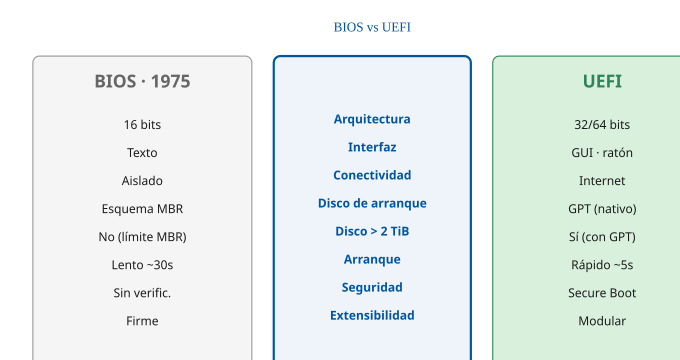

**Diferencias UEFI vs BIOS** (resumen en tabla):

| Aspecto | BIOS | UEFI |
|----|----|----|
| Interfaz | Consola MS-DOS, solo teclado | GUI moderna, ratón, animaciones |
| Conectividad | Sin internet | Puede conectarse a internet para actualizarse |
| Código | 16 bits (modo real) | 32 o 64 bits (modo protegido) |
| Arranque | Más lento (30 s) | Más rápido (5 s) |
| Seguridad | Sin verificación | **Secure Boot** (verifica la firma digital de los componentes de arranque) |
| TPM | No forma parte del firmware: es un chip o módulo aparte (o fTPM del procesador) | Tampoco forma parte de UEFI. Windows 11 exige TPM 2.0 como requisito adicional del equipo |
| Almacenamiento | Solo recursos específicos | Cualquier memoria no volátil, extensible |
| Disco de arranque | Arranca desde discos con esquema **MBR** | Arranca de forma nativa desde discos **GPT** (la especificación UEFI admite también MBR, pero Windows exige GPT para arrancar en modo UEFI) |
| CSM | Nativo | Compatibilidad con BIOS legacy |

**Firmware y esquema de particiones son cosas distintas.** BIOS y UEFI son *firmware*; MBR y GPT son *esquemas de particionado* del disco \[UEFI-SPEC\]. Los límites conocidos son del esquema, no del firmware: **MBR** admite 4 entradas de partición (4 primarias, o 3 primarias y una extendida con unidades lógicas) y direcciona hasta 2 TiB con sectores de 512 bytes; **GPT** usa direcciones de 64 bits (límite teórico de 2⁶⁴ sectores) y Windows lo implementa con hasta 128 particiones. Lo que sí depende del firmware es desde qué esquema puede arrancar: la BIOS tradicional arranca desde MBR y UEFI arranca de forma nativa desde GPT.

> **Dato clave.** **Secure Boot** verifica la firma digital de cada componente de arranque (controladores UEFI, cargador de arranque y sistema operativo) antes de ejecutarlo, de modo que solo arranca software de confianza. Reduce el riesgo de malware de arranque (*bootkits* y *rootkits*), aunque no lo elimina por completo. Windows 11 exige que el equipo sea **compatible** con Secure Boot (requisito de hardware), no que esté activado. Se puede desactivar en UEFI para arrancar Linux no firmado (aunque Linux moderno ya soporta Secure Boot con claves de Microsoft o Red Hat).

------------------------------------------------------------------------

### 7. Medidas de capacidad de memoria

| Unidad | Descripción | Equivalencia binaria | Equivalencia decimal (SI) |
|----|----|----|----|
| **Bit** | Dígito binario (0 o 1). Unidad mínima | — | — |
| **Nibble** | Grupo de 4 bits | 4 bits | 4 bits |
| **Byte (B)** | Grupo de 8 bits. Unidad más pequeña que representa un carácter | 8 bits | 8 bits |
| **Palabra (word)** | Grupo fijo de bits procesados como unidad (varía por arquitectura: 16, 32, 64 bits) | Variable | Variable |
| **Kilobyte (KB / KiB)** |  | 1.024 B = 2^10 | 1.000 B = 10^3 |
| **Megabyte (MB / MiB)** |  | 1.048.576 B = 2^20 | 10^6 B |
| **Gigabyte (GB / GiB)** |  | 2^30 B | 10^9 B |
| **Terabyte (TB / TiB)** |  | 2^40 B | 10^12 B |
| **Petabyte (PB / PiB)** |  | 2^50 B | 10^15 B |
| **Exabyte (EB / EiB)** |  | 2^60 B | 10^18 B |
| **Zettabyte (ZB / ZiB)** |  | 2^70 B | 10^21 B |
| **Yottabyte (YB / YiB)** |  | 2^80 B | 10^24 B |

#### 7.1. IEC (binario) vs SI (decimal)

Históricamente, la informática usa potencias de 2 (1024) para cuantificar memoria, pero el Sistema Internacional usa potencias de 10 (1000). Esto genera **ambigüedad** — ¿1 MB son 1.048.576 bytes o 1.000.000 bytes?

La **norma IEC 60027-2** (2000) introdujo nuevos prefijos **binarios** para evitar ambigüedad:

| Prefijo IEC (binario) | Símbolo | Valor | Prefijo SI (decimal) | Símbolo | Valor |
|----|----|----|----|----|----|
| Kibibyte | KiB | 2^10 (1.024) | Kilobyte | KB | 10^3 (1.000) |
| Mebibyte | MiB | 2^20 | Megabyte | MB | 10^6 |
| Gibibyte | GiB | 2^30 | Gigabyte | GB | 10^9 |
| Tebibyte | TiB | 2^40 | Terabyte | TB | 10^12 |

**Convenciones actuales**:

- **RAM**: siempre se mide en **potencias de 2** (16 GB RAM = 16 × 2^30 B = 17,18 GB decimales).
- **Discos duros y SSD**: los fabricantes usan **potencias de 10** (1 TB SSD = 10^12 B = 931 GiB binarios — por eso "falta" espacio).
- **Sistemas operativos**: Windows usa binario (muestra 931 GB en un disco de 1 TB), macOS y Linux usan decimal (muestran 1 TB correctamente).
- **Redes**: siempre **decimal** (100 Mbps = 10^8 bits/s).

> **Ejercicio resuelto.** **Problema**: Compras un SSD de **2 TB**. ¿Cuántos bytes tendrás disponibles realmente en un sistema Windows?
>
> **Solución**: El fabricante anuncia 2 TB = 2 × 10^12 bytes = 2.000.000.000.000 B. Windows los interpreta en binario: 2.000.000.000.000 / 2^40 ≈ 1,819 TiB. Windows mostrará **aproximadamente 1,82 TB** (aunque internamente son TiB). Es decir, "faltan" unos 181 GB por la diferencia binario/decimal. No es un engaño, es la diferencia de convenciones.

#### 7.2. Volúmenes reales

Algunas magnitudes de referencia para contextualizar:

- Biblia en texto: ~5 MB
- Foto de smartphone 2024 (48 MP): ~12 MB
- Película 4K 2h: ~60 GB
- Wikipedia en español (texto, 2024): ~80 GB
- Todos los libros publicados en España (2024): ~5 TB
- Datos generados diarios por usuario promedio: ~1,7 MB/s (todas las interacciones digitales)
- Datos generados diariamente a nivel mundial (2025): ~400 EB
- Estimación volumen total de datos en el mundo (2025): ~181 ZB (IDC)

------------------------------------------------------------------------

### 8. Sistemas de numeración

Un sistema de numeración es un conjunto de símbolos y reglas que permiten construir números válidos. \[STALLINGS-COA, Cap. 9\]

| Sistema | Base | Símbolos | Uso principal |
|----|----|----|----|
| **Decimal** | 10 | 0-9 | Uso humano cotidiano |
| **Binario** | 2 | 0, 1 | Uso interno de ordenadores y sistemas digitales |
| **Octal** | 8 | 0-7 | Representación compacta de binario (permisos Unix) |
| **Hexadecimal** | 16 | 0-9, A-F | Direcciones de memoria, colores, MAC, código máquina |

> **Dato clave.** El sistema **binario** es el utilizado por los ordenadores de forma interna para todos los procesos. Hexadecimal se usa como notación corta para binario (cada dígito hex = 4 bits).

#### 8.1. Conversión entre bases

**Decimal a binario** (divisiones sucesivas):

> **Ejercicio resuelto.** Convertir 25 decimal a binario:
>
>     25 ÷ 2 = 12 resto 1  ←
>     12 ÷ 2 = 6  resto 0  ← (leer de abajo a arriba)
>      6 ÷ 2 = 3  resto 0
>      3 ÷ 2 = 1  resto 1
>      1 ÷ 2 = 0  resto 1
>
> Resultado: **25₁₀ = 11001₂**
>
> Verificación: 1·16 + 1·8 + 0·4 + 0·2 + 1·1 = 25. Correcto.

**Binario a decimal** (suma ponderada):

> **Ejercicio resuelto.** Convertir 10110₂ a decimal:
>
> 10110₂ = 1·2⁴ + 0·2³ + 1·2² + 1·2¹ + 0·2⁰ = 16 + 0 + 4 + 2 + 0 = **22₁₀**

**Binario a hexadecimal** (agrupar en nibbles de 4 bits):

> **Ejercicio resuelto.** Convertir 11010111₂ a hexadecimal:
>
> 1101 0111 → D 7 → **D7₁₆**

**Hexadecimal a binario**: cada dígito hex se expande a 4 bits:

- 0→0000, 1→0001, 2→0010, ..., 9→1001, A→1010, B→1011, C→1100, D→1101, E→1110, F→1111.

#### 8.2. Representación de números negativos: complemento a 2

El ordenador no tiene un "signo menos"; solo tiene bits. Para representar números negativos se usa **complemento a 2** (el estándar prácticamente universal).

**Para obtener el complemento a 2 de un número binario**:

1.  Invertir todos los bits (complemento a 1).
2.  Sumar 1 al resultado.

> **Ejercicio resuelto.** Representar **-5** en binario de 8 bits usando complemento a 2:
>
> - 5 en binario 8 bits: 0000 0101
> - Complemento a 1 (invertir): 1111 1010
> - Sumar 1: 1111 1010 + 1 = **1111 1011**
>
> Por tanto, -5 en 8 bits (C2) = **11111011₂ = FB₁₆**. El bit más significativo a 1 indica negativo.

Con 8 bits en complemento a 2 se representa el rango **-128 a +127** (el 0 tiene una única representación, a diferencia de otras convenciones).

#### 8.3. Representación en coma flotante: IEEE 754

Para números reales (fraccionarios, muy grandes o muy pequeños) se usa el estándar **IEEE 754** (1985, revisado 2008, 2019). \[IEEE-754\]

Un número real se representa como:

    valor = (-1)^signo × mantisa × 2^exponente

**Formatos estándar**:

| Formato | Bits totales | Signo | Exponente | Mantisa | Rango aproximado |
|----|----|----|----|----|----|
| **Media precisión** (*half*, FP16) | 16 | 1 | 5 | 10 | ±65.504 |
| **Precisión simple** (*single*, FP32, float) | 32 | 1 | 8 | 23 | ±3,4×10^38 |
| **Precisión doble** (*double*, FP64) | 64 | 1 | 11 | 52 | ±1,8×10^308 |
| **Precisión cuádruple** (*quad*, FP128) | 128 | 1 | 15 | 112 | ±1,2×10^4932 |

**Valores especiales**: +0, -0, +∞, -∞, NaN (Not a Number).

> **Dato clave.** IEEE 754 de precisión simple (*single*, float de 32 bits): **1 bit signo + 8 bits exponente + 23 bits mantisa**. De precisión doble (*double*, 64 bits): **1 + 11 + 52**.

------------------------------------------------------------------------

### 9. Juegos de caracteres

#### 9.1. ASCII

**ASCII** (*American Standard Code for Information Interchange*): código de caracteres basado en el alfabeto latino. Creado en **1963** por el Comité Estadounidense de Estándares (ASA, luego ANSI). \[RFC-20\]

- Utiliza **7 bits** para representar caracteres.
- Define **33 caracteres no imprimibles** (control: NUL, SOH, BEL, BS, TAB, LF, CR, ESC, DEL...) + **95 caracteres imprimibles** (desde el espacio).
- En total: **128 caracteres** (2^7 = 128).
- Inicialmente usaba un bit adicional de paridad para detección de errores en transmisión.

**Caracteres ASCII notables**:

| Código | Carácter  | Nombre                          |
|--------|-----------|---------------------------------|
| 0      | NUL       | Null                            |
| 10     | LF        | Line Feed (salto de línea Unix) |
| 13     | CR        | Carriage Return (retorno carro) |
| 32     | (espacio) | Space                           |
| 48-57  | 0-9       | Dígitos                         |
| 65-90  | A-Z       | Mayúsculas                      |
| 97-122 | a-z       | Minúsculas                      |
| 127    | DEL       | Delete                          |

#### 9.2. ASCII extendido

Cualquier juego de caracteres de **8 bits** donde los códigos 32-126 coinciden con los caracteres imprimibles de ASCII. Los códigos 128-255 se usan para caracteres adicionales (acentos, caracteres especiales).

Codificaciones más comunes:

- **Codepage 437**: IBM PC / MS-DOS en inglés.
- **Codepage 850**: IBM PC / MS-DOS Europa occidental (incluye n, acentos).
- **ISO 8859-1** (Latin-1): Unix, Europa occidental.
- **Windows-1252**: variante Latin-1 de Microsoft, con algunas diferencias en caracteres 128-159.
- **ISO 8859-15** (Latin-9): versión actualizada de Latin-1 con soporte para € y otros.

Problema fundamental: no hay forma de combinar múltiples idiomas en un mismo documento.

#### 9.3. Unicode y UTF-8

**Unicode**: estándar de codificación diseñado para representar texto de **todos los lenguajes del mundo** en un único sistema. Nombre proviene de tres objetivos: **universalidad, uniformidad, unicidad**. \[UNICODE-STD\]

Específica un nombre e identificador numérico único (**code point**) para cada carácter. Trata caracteres alfabéticos, ideográficos y símbolos de forma equivalente.

- Versión actual: **Unicode 15.1** (2023).
- Define **149.186 caracteres** (2024) repartidos en **17 planos** de 65.536 caracteres cada uno.
- Cubre \>160 scripts (alfabetos) y además símbolos matemáticos, musicales, emojis.

**UTF-8** (*8-bit Unicode Transformation Format*): formato de codificación de longitud variable de **1 a 4 bytes por carácter**. Es la codificación **dominante en la web** (~98% de páginas en 2024).

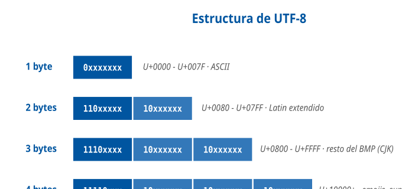

| Bytes | Caracteres cubiertos | Rango Unicode |
|----|----|----|
| 1 byte | US-ASCII (128 caracteres) | U+0000 - U+007F |
| 2 bytes | Latin extendido, griego, cirílico, hebreo, árabe (~1.920) | U+0080 - U+07FF |
| 3 bytes | Resto del plano básico multilingüe (BMP) desde U+0800, incluido CJK. Ojo: el BMP entero ocupa 1, 2 o 3 bytes según el rango | U+0800 - U+FFFF |
| 4 bytes | Planos suplementarios (matemáticos, históricos, emojis) | U+10000 - U+10FFFF |

**Ventajas de UTF-8**:

- **Compatible 100% con US-ASCII** (los primeros 128 caracteres son idénticos).
- **Eficiente en textos latinos** (1 byte por carácter ASCII, 2 para acentos).
- **Autosincronización**: puede identificarse el inicio de cada carácter desde cualquier byte. Si se pierde un byte, el siguiente se puede reconocer.
- **Sin solapamiento** entre bytes de diferentes caracteres.
- **Independiente del endianness** (no requiere BOM).

**Desventajas de UTF-8**:

- Caracteres CJK ocupan 3 bytes (vs 2 en UTF-16).
- Acceso directo a posiciones difícil (requiere recorrido secuencial por longitud variable).
- Mayor coste computacional en ordenación/indexación vs UTF-16/UTF-32.

#### 9.4. UTF-16 y UTF-32

- **UTF-16**: longitud variable 2 o 4 bytes. Usado internamente por Windows NT, Java, JavaScript. Los caracteres BMP se representan en 2 bytes, los suplementarios en 4 (pares sustitutos, *surrogate pairs*).
- **UTF-32**: longitud fija 4 bytes por carácter. Ventaja: acceso O(1) por índice. Desventaja: ocupa 4× más espacio. Raro en práctica.

#### 9.5. BOM (Byte Order Mark)

Carácter especial `U+FEFF` (ZERO WIDTH NO-BREAK SPACE) colocado al inicio de un fichero para indicar:

- **UTF-8**: `EF BB BF` — opcional, identifica codificación.
- **UTF-16 BE** (big endian): `FE FF`.
- **UTF-16 LE** (little endian): `FF FE`.
- **UTF-32 BE**: `00 00 FE FF`.

#### 9.6. Normalización Unicode

Un mismo carácter puede representarse de varias formas: "n" puede ser U+00F1 (un solo code point) o U+006E U+0303 (n + tilde combinante). Para comparar cadenas de forma consistente se usan **formas de normalización**:

| Forma | Nombre | Propósito |
|----|----|----|
| **NFC** | Canonical Composition | Forma compuesta (preferida en web) |
| **NFD** | Canonical Decomposition | Forma descompuesta |
| **NFKC** | Compatibility Composition | Compuesta con equivalencias de compatibilidad |
| **NFKD** | Compatibility Decomposition | Descompuesta con equivalencias |

#### 9.7. EBCDIC

**EBCDIC** (*Extended Binary Coded Decimal Interchange Code*): código de caracteres de **8 bits** desarrollado por **IBM** en 1963 para su System/360. Usado en sistemas **mainframe** IBM (z/OS).

- 1 byte por carácter = 256 combinaciones posibles.
- Existen **múltiples variantes** (code pages) según idioma/entorno (EBCDIC-37 inglés, EBCDIC-500 internacional, EBCDIC-284 español).
- **No es compatible con ASCII** — las letras A-Z no están en orden contiguo.

> **Dato clave.** EBCDIC es **incompatible** con ASCII: las letras no están ordenadas de forma contigua (A=193, B=194... pero I=201 y J=209 — hay huecos). Esta particularidad causa problemas en migraciones mainframe-PC.

#### 9.8. ISO/IEC 10646

Norma internacional **equivalente a Unicode** en términos de repertorio de caracteres, mantenida por ISO/IEC. Originalmente eran proyectos separados (ISO empezó en 1984, Unicode Consortium en 1987), pero en 1991 se fusionaron en un estándar unificado.

Formalmente, Unicode es una **implementación más rica** de ISO/IEC 10646 — incluye propiedades de caracteres, algoritmos de normalización, ordenación, etc.

> **Relación con otros temas.** La transmisión de información codificada sobre redes se trata en el **Tema 33** (Comunicaciones: medios y modos de transmisión) y la arquitectura de Internet, donde Unicode y UTF-8 son el estándar de facto, en el **Tema 35** (Internet: arquitectura, HTTP, HTTPS, SSL/TLS).

------------------------------------------------------------------------

## Diagramas

|     |                        |         |                   |
|-----|------------------------|---------|-------------------|
| ID  | Título                 | Sección | Tipo              |
| D1  | Pirámide DIKW          | § 1.3   | Pirámide          |
| D2  | Componentes SI         | § 2.2   | Bloques           |
| D3  | Pirámide tipos SI      | § 2.5   | Pirámide          |
| D4  | Von Neumann vs Harvard | § 3     | Comparativa       |
| D5  | Timeline generaciones  | § 4     | Timeline          |
| D6  | Bloques CPU            | § 5.3   | Arquitectura      |
| D7  | Ciclo Fetch-Execute    | § 5.4   | Diagrama de flujo |
| D8  | Modos direccionamiento | § 5.5   | Conceptual        |
| D9  | Jerarquía memoria      | § 6.1   | Pirámide          |
| D10 | Evolución RAM          | § 6.2   | Timeline          |
| D11 | BIOS vs UEFI           | § 6.4   | Comparativa       |
| D12 | Estructura UTF-8       | § 9.3   | Estructura        |

**Los 12 diagramas aparecen embebidos en las secciones correspondientes de la pestaña *Contenido***.

## Casos prácticos

El Ayuntamiento de Madrid moderniza el sistema de atención al ciudadano. Se requiere renovar los puestos de trabajo, el servidor central del Padrón Municipal y el portal web. Responda a las cuestiones siguientes aplicando los conceptos del Tema 11.

##### Especificaciones de los equipos nuevos:

|  |  |  |  |
|----|----|----|----|
| Puesto | CPU | RAM | Disco |
| Atención al ciudadano (100 puestos) | Intel Core i5-14400 (6P+4E, 16 hilos, 4,7 GHz) | 16 GB DDR5 | SSD 512 GB NVMe |
| Servidor Padrón | 2× AMD EPYC 9354 (32 núcleos, SMT, ECC) | 256 GB DDR5 ECC | 4× SSD 2 TB RAID-10 |

##### Cuestión 1 — El sistema del Padrón registra y actualiza de forma habitual altas, bajas y modificaciones de los datos padronales. Atendiendo a esta función operativa, clasifíquelo dentro de la tipología TPS/MIS/DSS/EIS y justifique.

2 pts

**TPS (Transaction Processing System)**. Justificación: en la función analizada (altas, bajas y modificaciones de los datos padronales) el sistema registra transacciones individuales, frecuentes y en tiempo real, que es lo que define a un TPS. Nivel organizacional: operativo. Otras funciones del mismo sistema (explotación estadística, informes) alimentan sistemas de otro tipo, como un MIS de estadística o un DSS urbanístico; por eso la clasificación se hace atendiendo a la función concreta.

##### Cuestión 2 — Calcule el número total de hilos lógicos en un servidor con 2 procesadores AMD EPYC 9354 (32 núcleos con SMT cada uno).

2 pts

Cada EPYC 9354 tiene 32 núcleos con SMT (2 hilos por núcleo) = 64 hilos por CPU. Con 2 CPUs = **128 hilos lógicos**. La multiplicación aplica SMT (AMD) equivalente a HyperThreading (Intel).

##### Cuestión 3 — Los puestos incorporan DDR5. ¿Son compatibles con las placas DDR4 existentes? Justifique.

2 pts

**NO son compatibles**. Aunque DDR4 y DDR5 tienen ambos **288 pines**, son física y eléctricamente incompatibles: DDR4 usa 1,2 V y DDR5 usa 1,1 V. La muesca está en distinta posición. Requiere placa base compatible con DDR5 (Intel 12th gen+, AMD AM5).

##### Cuestión 4 — ¿Por qué el servidor usa memoria ECC y los puestos de atención no?

2 pts

La memoria **ECC** (Error Checking and Correction) detecta y corrige errores de 1 bit y detecta (sin corregir) los de 2 bits. Crítico en servidores que gestionan datos de ciudadanos (Padrón) donde un error podría generar inconsistencias. Los puestos de usuario (No-ECC) no requieren este nivel de fiabilidad por su uso interactivo.

##### Cuestión 5 — Los SSDs son NAND Flash TLC. ¿Qué implica esto frente a SLC o MLC?

2 pts

**TLC (Triple-Level Cell, 3 bits/celda)**: es un compromiso entre densidad y coste, por un lado, y resistencia y rendimiento, por otro. Frente a SLC (1 bit) y MLC (2 bits) ofrece mayor densidad y menor coste por GB, a cambio de menor resistencia a la escritura (~1.000-3.000 ciclos de programación/borrado, frente a ~3.000-10.000 de MLC y ~50.000-100.000 de SLC, en orden de magnitud) y menor rendimiento de escritura sostenida. No es simplemente «peor»: es la tecnología dominante en los SSD de consumo, como los de los puestos, y también se usa en servidores y centros de datos, donde el controlador compensa su menor resistencia con nivelación de desgaste, caché SLC y sobreaprovisionamiento; lo que hay que comprobar es que la resistencia declarada (TBW o DWPD) cubra la carga de escritura prevista. Para máxima resistencia se usaría SLC; para máxima densidad (archivado), QLC.

Puntuación total: 10 puntos

#### Preguntas tipo test sobre este caso

##### 1. Atendiendo a su función de registro de altas, bajas y modificaciones de los datos padronales, ¿qué tipo de sistema de información es el Padrón y en qué nivel organizacional se sitúa?

- a) Un TPS, en el nivel operativo.
- b) Un MIS, en el nivel de gestión o táctico.
- c) Un DSS, en el nivel analítico.

**Respuesta correcta:** a) · **Referencia:** Caso 1, cuestión 1 · §2.6

En esa función el Padrón registra transacciones individuales (altas, bajas y modificaciones) en tiempo real: es un TPS, el tipo de sistema propio del nivel operativo.

##### 2. ¿Qué rasgo del Padrón justifica esa clasificación?

- a) Elabora informes periódicos consolidados que utilizan los mandos medios para supervisar el servicio.
- b) Procesa transacciones individuales de altas, bajas y modificaciones en tiempo real, en el nivel operativo.
- c) Ofrece un cuadro de mando con indicadores muy agregados para el equipo de gobierno municipal.

**Respuesta correcta:** b) · **Referencia:** Caso 1, cuestión 1 · §2.6

El TPS es el sistema del nivel operativo: maneja transacciones individuales, en tiempo real y en alto volumen. Los informes periódicos son propios del MIS y el cuadro de mando, del EIS.

##### 3. ¿Cuántos hilos lógicos presenta al sistema operativo el servidor del Padrón, con 2 procesadores AMD EPYC 9354 de 32 núcleos con SMT cada uno?

- a) 64 hilos lógicos.
- b) 256 hilos lógicos.
- c) 128 hilos lógicos.

**Respuesta correcta:** c) · **Referencia:** Caso 1, cuestión 2 · §5.2.3

Con SMT cada núcleo ejecuta 2 hilos: 32 núcleos × 2 = 64 hilos por procesador, y con 2 procesadores, 128 hilos lógicos.

##### 4. Los puestos de atención llevan un Intel Core i5-14400 con 6 núcleos P y 4 núcleos E, y la tabla indica 16 hilos. ¿Cómo se obtiene esa cifra?

- a) Cada núcleo P ejecuta 2 hilos con HyperThreading y cada núcleo E, 1 hilo: 6 × 2 + 4 = 16.
- b) Cada uno de los 10 núcleos ejecuta 2 hilos, menos 4 hilos reservados para el sistema: 10 × 2 − 4 = 16.
- c) Solo los núcleos E tienen HyperThreading y ejecutan 4 hilos cada uno, sin contar los núcleos P: 4 × 4 = 16.

**Respuesta correcta:** a) · **Referencia:** Caso 1, cuestión 2 · §5.2.3

Los núcleos de eficiencia (E) no tienen HyperThreading para ahorrar energía; solo los núcleos de rendimiento (P) ejecutan 2 hilos cada uno.

##### 5. El servidor del Padrón monta dos procesadores físicos en una placa con dos zócalos. Esta configuración es un ejemplo de:

- a) Multinúcleo.
- b) Multithreading.
- c) Multiprocesamiento.

**Respuesta correcta:** c) · **Referencia:** Caso 1, cuestión 2 · §5.2.3

Un equipo con más de una CPU física (varios zócalos) es multiprocesamiento; el multinúcleo es un único chip con varios núcleos y el multithreading duplica las unidades lógicas de cada núcleo.

##### 6. ¿Pueden instalarse los módulos DDR5 de los puestos nuevos en las placas base DDR4 existentes?

- a) Sí, porque ambos tipos utilizan módulos DIMM de 288 pines.
- b) No, porque DDR4 y DDR5 son física y eléctricamente incompatibles.
- c) Sí, siempre que se ajuste el voltaje de la placa desde la BIOS.

**Respuesta correcta:** b) · **Referencia:** Caso 1, cuestión 3 · §6.2.3

Aunque comparten 288 pines, DDR4 y DDR5 son incompatibles física y eléctricamente: hace falta una placa base compatible con DDR5.

##### 7. Un compañero sostiene que, al tener DDR4 y DDR5 los mismos pines, los módulos deberían encajar. ¿Qué diferencias desmienten su razonamiento?

- a) DDR4 funciona a 1,2 V y DDR5 a 1,1 V, y la muesca está en distinta posición.
- b) DDR4 funciona a 1,5 V y DDR5 a 1,2 V, y DDR5 tiene 240 pines en lugar de 288.
- c) DDR4 funciona a 1,1 V y DDR5 a 1,2 V, y DDR4 integra el PMIC en el propio módulo.

**Respuesta correcta:** a) · **Referencia:** Caso 1, cuestión 3 · §6.2.3

La tabla comparativa DDR asigna 1,2 V a DDR4 y 1,1 V a DDR5; además, la muesca cambia de posición y DDR5 integra el PMIC en el módulo.

##### 8. ¿Qué capacidad de corrección aporta la memoria ECC del servidor del Padrón?

- a) Detecta y corrige errores de 1 y de 2 bits, y detecta sin corregir los de 3 bits.
- b) Detecta y corrige errores de 1 bit, y detecta sin corregir los errores de 2 bits.
- c) Detecta errores de 1 bit sin corregirlos, y corrige los errores de 2 bits o más.

**Respuesta correcta:** b) · **Referencia:** Caso 1, cuestión 4 · §6.2.5

La memoria ECC detecta y corrige los errores de un bit y detecta, sin poder corregirlos, los de dos bits.

##### 9. ¿Por qué el servidor del Padrón usa memoria ECC y los puestos de atención no?

- a) Porque la memoria ECC es más rápida que la No-ECC y el servidor necesita el máximo rendimiento.
- b) Porque la ECC no requiere soporte de la placa base ni del procesador, a diferencia de la No-ECC.
- c) Porque en el servidor un error de memoria podría generar inconsistencias en los datos de los ciudadanos.

**Respuesta correcta:** c) · **Referencia:** Caso 1, cuestión 4 · §6.2.5

La ECC es crítica en servidores que gestionan datos de ciudadanos; es algo más cara y más lenta (~2-3 %) y exige soporte de placa base y procesador, mientras que los puestos de uso interactivo no necesitan ese nivel de fiabilidad.

##### 10. Los SSD de los equipos son NAND Flash TLC. ¿Qué implica esta tecnología frente a SLC o MLC?

- a) Almacena 3 bits por celda: más densidad y menor coste, pero menor durabilidad.
- b) Almacena 1 bit por celda: más velocidad y durabilidad, pero mayor coste.
- c) Almacena 4 bits por celda: máxima densidad, pero la mínima durabilidad.

**Respuesta correcta:** a) · **Referencia:** Caso 1, cuestión 5 · §6.3.1

TLC (Triple-Level Cell) guarda 3 bits por celda: gana densidad y abarata el coste frente a SLC (1 bit) y MLC (2 bits), a cambio de menor durabilidad; 4 bits por celda es QLC.

## Fuentes

#### Tier 1 — Primarias

|  |  |  |
|----|----|----|
| ID | Fuente | Año |
| ISO-2382 | ISO/IEC 2382 — IT Vocabulary | 2015 |
| ISO-11179 | Metadata Registries | 2015+ |
| ISO-8000 | Data Quality | 2009+ |
| ISO-25012 | ISO/IEC 25012 — Data quality model | 2008 |
| STALLINGS-COA | Computer Organization & Architecture (11e) | 2018 |
| TANENBAUM-SO | Structured Computer Organization (6e) | 2012 |
| PATTERSON-HENNESSY | Computer Organization & Design (6e) | 2020 |
| INTEL-SDM | Intel 64 and IA-32 Software Developer's Manual | 2024 |
| ARM-ARM | ARM Architecture Reference Manual (ARMv9-A) | 2024 |
| JEDEC-DDR | DDR4 JESD79-4 / DDR5 JESD79-5 | 2012/2020 |
| JEDEC-SSD | JEDEC JESD218 — Solid-State Drive Requirements and Endurance Test Method | 2010+ |
| IEEE-754 | Floating-Point Arithmetic | 2019 |
| UNICODE-STD | The Unicode Standard 15.1 | 2023 |
| ISO-10646 | Universal Coded Character Set | 2020 |
| [RFC-20](https://www.rfc-editor.org/rfc/rfc20) | ASCII for Network Interchange | 1969 |
| [RFC-3629](https://www.rfc-editor.org/rfc/rfc3629) | UTF-8, a transformation format of ISO 10646 | 2003 |
| UEFI-SPEC | UEFI Specification 2.10 | 2022 |
| ENS-RD311 | Esquema Nacional de Seguridad | 2022 |
| RGPD | [Reglamento (UE) 2016/679](https://eur-lex.europa.eu/legal-content/ES/TXT/?uri=CELEX:32016R0679) | 2016 |
| METRICA-V3 | Metodología MAP v3 AAPP | 2001 |

#### Tier 2 — Secundarias

- LAUDON-MIS (Management Information Systems, 17e)
- ACKOFF-DIKW (DIKW model, 1989)
- KAPLAN-BSC (Balanced Scorecard, HBR 1992)
- DATOS-MADRID (Portal Open Data Ayto Madrid)
- IDC-DATA-SPHERE (Global DataSphere 2025)
- LEXAR-NAND (Lexar Enterprise, «Comparing NAND Flash Technology: SLC, MLC, TLC, and QLC for Industrial Memory Applications», 2026)
