# Tema 12. Periféricos: conectividad y administración

**Bloque:** técnico  
**Enunciado oficial** (BOAM n.º 10.032, de 23 de diciembre de 2025): Periféricos: conectividad y administración. Elementos de impresión. Elementos de almacenamiento. Elementos de visualización y digitalización.

Versión web: <https://ayuntamientomadrid.github.io/temario-tecnico-auxiliar/temas/tema-12.html> · PDF: [tema-12.pdf](tema-12.pdf) · Test: [../../../tests/tecnico/tema-12.md](../../../tests/tecnico/tema-12.md)

## Índice

- 1. Tipología y clasificación de periféricos
  - 1.1. Qué es un periférico y su papel en el sistema de información
  - 1.2. Clasificación por función
  - 1.3. Periféricos locales, compartidos y en red
  - 1.4. El bus, el controlador y el puerto: cómo dialoga el periférico con el equipo
- 2. Conectividad
  - 2.1. Interfaces físicas: concepto de puerto e interfaz
  - 2.2. USB (Universal Serial Bus)
  - 2.3. HDMI y DisplayPort
  - 2.4. Thunderbolt y otros estándares
  - 2.5. Conectividad inalámbrica: Bluetooth y Wi-Fi
  - 2.6. Tecnologías inalámbricas emergentes
  - 2.7. Protocolos y controladores: drivers y compatibilidad
  - 2.8. Plug & Play y gestión automática de dispositivos
- 3. Administración de periféricos
  - 3.1. Configuración del sistema: instalación de dispositivos
  - 3.2. Paneles de control y utilidades
  - 3.3. Gestión y mantenimiento: actualización de controladores
  - 3.4. Diagnóstico y resolución de problemas
  - 3.5. Seguridad en dispositivos: control de accesos
  - 3.6. Protección frente a amenazas
- 4. Elementos de impresión
  - 4.1. Impresión convencional: tecnologías
  - 4.2. Tipos de consumibles
  - 4.3. Impresión en red y lenguajes de descripción de página
  - 4.4. Impresión 3D
- 5. Elementos de almacenamiento
  - 5.1. Tipos de dispositivos: magnéticos, ópticos y de estado sólido
  - 5.2. Tecnologías y formatos: interfaces y capacidades
  - 5.3. Sistemas de archivos
  - 5.4. Gestión del almacenamiento: particionado y formateo
  - 5.5. Copias de seguridad
  - 5.6. Sistemas de protección y redundancia (RAID)
- 6. Elementos de visualización y digitalización
  - 6.1. Tecnologías de digitalización
  - 6.2. Dispositivos de visualización: monitores, proyectores y pantallas táctiles
  - 6.3. Modelos de color
  - 6.4. Formatos y compresión de imágenes. Filtrado
  - 6.5. Norma Técnica de Interoperabilidad: requisitos de la imagen electrónica
  - 6.6. El proceso de digitalización certificada
  - 6.7. Conservación y disponibilidad. Normativa

### Conceptos clave para memorizar

| Concepto | Dato clave |
|----|----|
| Periférico | Dispositivo que se conecta a la unidad central para introducir, extraer, comunicar o almacenar datos |
| Clasificación funcional | Entrada, salida, entrada/salida (E/S), comunicación y almacenamiento |
| Puerto vs interfaz | El puerto es el conector físico; la interfaz es el conjunto de reglas físicas y lógicas de la conexión |
| Controlador (driver) | Software que traduce entre el sistema operativo y el hardware del periférico |
| Plug & Play (PnP) | El sistema detecta, identifica y configura el dispositivo automáticamente al conectarlo |
| USB | Bus serie universal; USB4 hasta 40 Gbps; USB-C es el conector reversible que soporta datos, vídeo y Power Delivery |
| USB Power Delivery | Entrega de energía por USB-C, hasta 240 W (USB PD 3.1) |
| HDMI / DisplayPort | Interfaces de vídeo y audio digital; DisplayPort admite MST (varias pantallas en cadena) |
| Thunderbolt | Interfaz de alto rendimiento sobre conector USB-C; TB4 garantiza 40 Gbps y hasta 2 pantallas 4K |
| Bluetooth | Inalámbrico de corto alcance (WPAN), banda 2,4 GHz; BLE optimiza el consumo |
| Wi-Fi | Red inalámbrica (WLAN) IEEE 802.11; Wi-Fi 6 (802.11ax), Wi-Fi 6E (6 GHz), Wi-Fi 7 (802.11be) |
| NFC | Comunicación de campo cercano (\<4 cm) a 13,56 MHz; pagos y emparejamiento |
| Láser vs inyección | Láser: tóner + fusión térmica, alta velocidad; inyección: gotas de tinta, mejor color fotográfico |
| PostScript / PCL | Lenguajes de descripción de página; PostScript (Adobe) es independiente del dispositivo |
| Impresión 3D | Fabricación aditiva capa a capa; FDM (filamento), SLA (resina), SLS (polvo sinterizado) |
| Magnético / óptico / SSD | HDD (platos), CD/DVD/Blu-ray (láser), SSD (memoria flash NAND, sin partes móviles) |
| Sistema de archivos | Estructura lógica que organiza datos en un soporte: FAT32, exFAT, NTFS, ext4, APFS |
| Partición | División lógica de un disco; esquemas MBR (máx. 2 TB) y GPT (moderno, sin ese límite) |
| RAID | Redundancia por combinación de discos: RAID 0 (rendimiento), 1 (espejo), 5 (paridad), 10 (espejo + banda) |
| Regla 3-2-1 | 3 copias, en 2 soportes distintos, 1 de ellas fuera de las instalaciones |
| Modelo de color | RGB (aditivo, pantalla), CMYK (sustractivo, impresión), CIELAB (independiente del dispositivo) |
| Resolución de escaneo | Se mide en ppp (píxeles por pulgada); la NTI exige ≥ 200 ppp para documentos en soporte papel |
| Compresión con/sin pérdida | Sin pérdida: PNG, TIFF, GIF; con pérdida: JPEG (fotografía), controlada por factor de calidad |
| NTI Digitalización | Norma Técnica de Interoperabilidad de Digitalización de Documentos (ENI, RD 4/2010) |
| Copia auténtica | Imagen electrónica firmada (con CSV o firma electrónica) con el mismo valor que el original |

## Contenido

### Convenciones del documento

Este tema incluye cuatro tipos de **cajas callout** para facilitar el estudio:

> **Dato clave.** Información de alta densidad memorística.

> **Ejercicio resuelto.** Problema + solución paso a paso (cálculo de capacidad, elección de RAID, dimensionado de una imagen digitalizada…).

> **Ejemplo de aplicación en el ayto.** Aplicación real de la teoría al entorno municipal (puesto de usuario, impresión en red, digitalización de expedientes, archivo electrónico).

> **Relación con otros temas.** Enlace conceptual a otros temas del temario oficial.

Los términos técnicos se mantienen en su nomenclatura habitual (driver, buffer, spooler, RAID, firmware…). Las fuentes se referencian con etiquetas breves tipo `[USB-IF]` o `[NTI-DIGIT]` — el registro completo está en la pestaña Fuentes. Las unidades de medida (Gbps, ppp, W) se glosan la primera vez que aparecen.

------------------------------------------------------------------------

### 1. Tipología y clasificación de periféricos

#### 1.1. Qué es un periférico y su papel en el sistema de información

Un **periférico** es todo dispositivo que se conecta a la unidad central de proceso (la placa base con su CPU y su memoria) para **introducir, extraer, comunicar o almacenar** información, quedando *fuera* del núcleo de cómputo pero al servicio de él \[ISO7498\]. El prefijo «peri-» (alrededor) describe bien su posición: son los elementos que rodean al procesador y le permiten relacionarse con el mundo exterior y con el usuario.

En el modelo clásico de un sistema informático se distinguen la **unidad central** (CPU, memoria principal y buses internos, tratados en el Tema 11) y las **unidades periféricas**. Sin periféricos, un ordenador sería incapaz de recibir órdenes, mostrar resultados o conservar datos de forma permanente: el teclado, la pantalla, la impresora, el disco y la tarjeta de red son las «manos, ojos y oídos» del sistema.

> **Relación con otros temas.** El **Tema 11** describe la arquitectura del ordenador y sus componentes internos (CPU, memoria, placa base, buses); este **Tema 12** se ocupa de todo lo que se conecta a esa arquitectura desde el exterior. Los buses de comunicación con periféricos y el modelo OSI que enmarca la conectividad se retoman en los temas de comunicaciones (**Tema 33** y **Tema 34**).

#### 1.2. Clasificación por función

La clasificación principal es la **funcional**, según la dirección del flujo de datos entre el periférico y la unidad central \[ISO7498\]:

- **Periféricos de entrada**: introducen datos en el sistema. Ejemplos: teclado, ratón, escáner, lector de código de barras, micrófono, webcam, lector de tarjetas, pantalla táctil (en su faceta de captura).
- **Periféricos de salida**: extraen o presentan información procesada. Ejemplos: monitor, impresora, proyector, altavoces, auriculares.
- **Periféricos de entrada/salida (E/S o mixtos)**: combinan ambas funciones. Ejemplos: pantalla táctil, impresora multifunción (imprime y escanea), tarjeta de red, módem, unidades de almacenamiento (leen y escriben).
- **Periféricos de comunicación**: conectan el equipo con otros sistemas o redes. Ejemplos: tarjeta de red (Ethernet o Wi-Fi), módem, router, adaptador Bluetooth.
- **Periféricos de almacenamiento**: conservan datos de forma persistente. Ejemplos: disco duro (HDD), unidad de estado sólido (SSD), memoria USB, grabadora óptica, NAS.

> **Dato clave.** Un mismo dispositivo puede pertenecer a varias categorías. La **pantalla táctil** y la **impresora multifunción** son de **entrada/salida**; una **unidad de almacenamiento** es de E/S (lee y escribe) y a la vez de almacenamiento. Para clasificarlo se atiende a la función que se destaque en cada caso.

Otras clasificaciones complementarias:

- **Por su ubicación**: internos (integrados en la caja o la placa: disco interno, tarjeta gráfica) o externos (conectados por un puerto: impresora, escáner).
- **Por su necesidad**: básicos o imprescindibles (teclado, monitor) y complementarios o auxiliares (escáner, webcam).

#### 1.3. Periféricos locales, compartidos y en red

- **Periférico local**: conectado directamente a un único equipo por un puerto físico (USB, HDMI).
- **Periférico compartido**: conectado a un equipo que lo comparte con otros a través de la red (una impresora conectada por USB a un PC que la publica).
- **Periférico en red**: dispone de su propia interfaz de red e IP, y es accesible por cualquier equipo autorizado sin depender de un PC intermediario. Las **impresoras de red** y los **NAS** (Network Attached Storage) son los ejemplos típicos.

> **Ejemplo de aplicación en el ayto.** En una oficina de atención al ciudadano de un distrito, cada puesto tiene periféricos **locales** (teclado, monitor, lector de DNI electrónico) y comparte periféricos **en red** (impresoras multifunción departamentales y escáneres de digitalización de expedientes). Este reparto reduce costes de consumibles y facilita la administración centralizada de colas de impresión.

#### 1.4. El bus, el controlador y el puerto: cómo dialoga el periférico con el equipo

Para que un periférico funcione intervienen cuatro elementos encadenados:

1.  **El puerto**: el conector físico (el «enchufe») donde se inserta el cable o el propio dispositivo.
2.  **La interfaz / bus**: el conjunto de líneas eléctricas y reglas de señalización que transportan los datos (USB, PCI Express, SATA). El bus puede ser **serie** (bit a bit por una o pocas líneas: USB, SATA) o **paralelo** (varios bits a la vez: los antiguos puertos LPT/IDE). Hoy predomina el **serie de alta velocidad**, porque evita los problemas de sincronización (*skew*) del paralelo a altas frecuencias.
3.  **El controlador de hardware (host controller)**: el circuito de la placa base que gestiona ese bus.
4.  **El controlador de software (driver)**: el programa que traduce las órdenes genéricas del sistema operativo al lenguaje concreto del dispositivo (§2.7).

> **Dato clave.** No confunda **puerto** (conector físico), **interfaz/bus** (reglas y líneas de transmisión) y **controlador**. Y dentro de «controlador» distinga el **host controller** (hardware) del **driver** (software).

------------------------------------------------------------------------

### 2. Conectividad

#### 2.1. Interfaces físicas: concepto de puerto e interfaz

Una **interfaz** define cómo se conectan físicamente y cómo se entienden lógicamente dos dispositivos: forma del conector, número de líneas, niveles de tensión, protocolo de señalización y velocidad. La evolución de las interfaces ha ido en una dirección clara: **de paralelo a serie, de específico a universal y de cableado a inalámbrico**, buscando más velocidad, menos cables y conexión en caliente (*hot-plug*).

#### 2.2. USB (Universal Serial Bus)

El **USB** \[USB-IF\] es el bus de conexión de periféricos más extendido. Es **serie**, admite **conexión en caliente** y **Plug & Play**, permite **alimentar** dispositivos por el propio cable y organiza los dispositivos en una topología en estrella (mediante concentradores o *hubs*), con un máximo teórico de 127 dispositivos por controlador.

Conviene separar dos ejes que a menudo se confunden: la **versión** (velocidad y protocolo) y el **conector** (forma física).

**Versiones (velocidad):**

| Versión | Nombre comercial | Velocidad máxima |
|----|----|----|
| USB 2.0 | Hi-Speed | 480 Mbps |
| USB 3.2 Gen 1 | SuperSpeed (5G) | 5 Gbps |
| USB 3.2 Gen 2 | SuperSpeed (10G) | 10 Gbps |
| USB 3.2 Gen 2×2 | SuperSpeed (20G) | 20 Gbps |
| USB4 | USB4 (basado en Thunderbolt 3) | 40 Gbps (hasta 80 Gbps en USB4 v2) |

**Conectores (forma física):** Tipo A (el rectangular clásico), Tipo B (impresoras), Mini y Micro (dispositivos antiguos) y, sobre todo, **USB-C (Tipo C)**: pequeño, **reversible** (da igual la orientación), y capaz de transportar **datos, vídeo (DisplayPort/HDMI en modo alternativo) y energía** por el mismo cable.

> **Dato clave.** **USB-C es un conector, no una velocidad.** Un puerto USB-C puede ser internamente USB 2.0 o USB4: por fuera son idénticos. No confunda «USB-C» (forma) con «USB4» (protocolo).

**USB Power Delivery (USB PD):** el estándar de entrega de energía sobre USB-C. Negocia dinámicamente la tensión y la corriente entre fuente y consumidor, alcanzando hasta **240 W** en USB PD 3.1, suficiente para cargar portátiles y monitores. Por eso un único cable USB-C puede sustituir al cargador propietario, al cable de vídeo y al de datos.

> **Ejercicio resuelto.** *¿Cuánto tarda, en el mejor caso teórico, en transferirse un archivo de 4 GB por un puerto USB 2.0 (480 Mbps) frente a uno USB 3.2 Gen 2 (10 Gbps)?* — Convertimos: 4 GB = 32 Gbit (4 × 8). USB 2.0: 32 Gbit ÷ 0,48 Gbps ≈ **66,7 s**. USB 3.2 Gen 2: 32 Gbit ÷ 10 Gbps ≈ **3,2 s**. La diferencia (más de 20×) explica por qué las copias masivas de expedientes exigen puertos modernos. *(En la práctica la velocidad real es menor por la sobrecarga del protocolo y el soporte.)*

#### 2.3. HDMI y DisplayPort

Son las dos grandes **interfaces de vídeo y audio digital** para conectar equipos a monitores, televisores y proyectores.

- **HDMI (High-Definition Multimedia Interface)** \[HDMI\]: dominante en el ámbito de consumo (televisores, consolas, proyectores). Transporta vídeo y audio digital por un mismo cable. HDMI 2.1 admite 4K a 120 Hz y 8K, e incluye canal de retorno de audio (eARC).
- **DisplayPort** \[VESA-DP\]: estándar abierto de VESA, más habitual en el ámbito profesional e informático. Su gran ventaja es **MST (Multi-Stream Transport)**: permite encadenar varios monitores en serie (*daisy-chain*) desde una sola salida. DisplayPort 2.1 alcanza anchos de banda muy altos (hasta 80 Gbps).

> **Dato clave.** Diferencie: **HDMI** = consumo/audiovisual, un monitor por puerto; **DisplayPort** = profesional, admite **varios monitores en cadena (MST)**. Ambos son digitales y llevan vídeo + audio. El antiguo **VGA** era analógico (ya en desuso) y el **DVI**, de transición.

#### 2.4. Thunderbolt y otros estándares

- **Thunderbolt** \[TB\]: interfaz de altísimo rendimiento desarrollada por Intel. Desde Thunderbolt 3 utiliza el **conector USB-C** y combina en un único cable **datos (PCIe), vídeo (DisplayPort) y energía**. **Thunderbolt 4** garantiza 40 Gbps, dos pantallas 4K o una 8K, y sirvió de base para el estándar **USB4**. Es la interfaz típica de las **estaciones de acoplamiento (docking stations)**: con un solo cable el portátil obtiene monitores, red, teclado, ratón y carga.
- **eSATA**: versión externa de la interfaz SATA de discos; hoy marginal frente a USB.
- **SAS (Serial Attached SCSI)**: interfaz de discos de servidor, de alta fiabilidad.
- **Puertos heredados**: serie (RS-232, COM) y paralelo (LPT/Centronics) para impresoras y equipos industriales antiguos; **PS/2** para teclado y ratón. Se mantienen por compatibilidad en algunos equipos, pero han sido desplazados por USB.

#### 2.5. Conectividad inalámbrica: Bluetooth y Wi-Fi

La conexión sin cables se apoya en dos grandes familias, que se diferencian por su **alcance** y su **propósito**:

- **Bluetooth** \[BT-SIG\]: red inalámbrica de **área personal (WPAN)**, de **corto alcance** (típicamente hasta 10 m en clase 2), en la banda de 2,4 GHz. Diseñada para conectar periféricos cercanos: teclado, ratón, auriculares, altavoces, impresoras. Forma redes *ad hoc* llamadas **piconets**. La variante **BLE (Bluetooth Low Energy)** minimiza el consumo, clave en dispositivos a pilas y en el Internet de las Cosas (IoT). Las versiones 5.x mejoran alcance y velocidad, y **LE Audio** moderniza el audio inalámbrico.
- **Wi-Fi** \[IEEE802.11\]: red inalámbrica de **área local (WLAN)**, definida por la familia de normas **IEEE 802.11**, pensada para dar acceso a la red y a Internet con mayor alcance y velocidad. Trabaja en las bandas de 2,4 GHz, 5 GHz y 6 GHz:

| Generación | Norma | Banda | Notas |
|----|----|----|----|
| Wi-Fi 4 | 802.11n | 2,4 / 5 GHz | Introduce MIMO |
| Wi-Fi 5 | 802.11ac | 5 GHz | Mayor velocidad, MU-MIMO |
| Wi-Fi 6 | 802.11ax | 2,4 / 5 GHz | Eficiencia en entornos densos (OFDMA) |
| Wi-Fi 6E | 802.11ax | \+ 6 GHz | Amplía a la banda de 6 GHz |
| Wi-Fi 7 | 802.11be | 2,4 / 5 / 6 GHz | Multi-Link Operation, canales de 320 MHz |

> **Dato clave.** **Bluetooth = WPAN, corto alcance, periféricos personales; Wi-Fi = WLAN, acceso a red, mayor alcance.** Ambos comparten la banda de 2,4 GHz (de ahí posibles interferencias). La seguridad Wi-Fi se cifra con **WPA2** y **WPA3** (este último obligatorio en entornos que exijan alta seguridad).

#### 2.6. Tecnologías inalámbricas emergentes

- **NFC (Near Field Communication)**: comunicación de campo cercano a 13,56 MHz y **muy corto alcance (\< 4 cm)**. Usos: pagos con móvil, validación de tarjetas de transporte, emparejamiento rápido de dispositivos.
- **UWB (Ultra-Wideband)**: banda ultraancha, ideal para **localización de precisión** (etiquetas, «buscar mi dispositivo», apertura de vehículos).
- **Thread y Matter**: protocolos del hogar/edificio inteligente. **Matter** es el estándar de interoperabilidad que unifica dispositivos IoT de distintos fabricantes; **Thread** es la red de malla de baja potencia sobre la que suele funcionar.
- **Zigbee y Z-Wave**: redes de malla de bajo consumo para domótica y sensores.

#### 2.7. Protocolos y controladores: drivers y compatibilidad

Un **controlador de dispositivo (driver)** \[MS-DEVMGR\] es el software que actúa de **traductor** entre el sistema operativo y el hardware concreto del periférico. El sistema operativo emite órdenes genéricas («imprime esta página», «lee este sector») y el driver las convierte en las señales específicas que ese modelo de impresora o disco entiende. Sin el driver adecuado, el dispositivo no funciona o lo hace en modo genérico limitado.

Tipos y conceptos clave:

- **Driver genérico vs específico**: el sistema incluye drivers genéricos (clase) que dan funcionalidad básica (una memoria USB como «dispositivo de almacenamiento masivo»); el driver del fabricante desbloquea todas las funciones.
- **Firmware**: software grabado en el propio periférico que controla su electrónica interna. Se actualiza para corregir fallos o añadir funciones.
- **Compatibilidad**: un driver se desarrolla para un sistema operativo y arquitectura concretos (Windows x64, Linux, macOS). La falta de driver para una versión de SO es causa frecuente de que un periférico antiguo deje de funcionar tras una actualización.
- **Firma de controladores (driver signing)**: los sistemas modernos exigen que los drivers estén **firmados digitalmente** por el fabricante, para garantizar su origen e integridad y evitar código malicioso en el núcleo del sistema.

> **Relación con otros temas.** La instalación, actualización y mantenimiento de los controladores como parte de la administración del sistema operativo se desarrolla en el **Tema 27** (Administración del sistema operativo y software de base). Los sistemas operativos concretos (Windows, Linux) que gestionan estos drivers son objeto del **Tema 14**.

#### 2.8. Plug & Play y gestión automática de dispositivos

**Plug & Play (PnP)** \[MS-DEVMGR\] es la capacidad del sistema para **detectar, identificar y configurar automáticamente** un dispositivo al conectarlo, sin intervención manual del usuario. El proceso típico es:

1.  **Detección**: al conectar el dispositivo, el bus (p. ej. USB) genera un evento y el sistema detecta el nuevo hardware.
2.  **Identificación**: el dispositivo comunica sus identificadores de fabricante y producto (VID/PID) y su clase.
3.  **Asignación de recursos**: el sistema le asigna los recursos necesarios (direcciones, interrupciones) evitando conflictos.
4.  **Carga del driver**: el sistema busca el driver adecuado —local, en Windows Update o en el repositorio de la distribución Linux— y lo carga.
5.  **Disponibilidad**: el dispositivo queda listo para usarse.

En Linux este cometido lo cumplen el subsistema **udev** y **sysfs**, que crean automáticamente los nodos de dispositivo y aplican reglas. En Windows lo hace el gestor **PnP** con el **Administrador de dispositivos**.

> **Dato clave.** Plug & Play = detección + identificación + configuración **automáticas**. No lo confunda con **hot-plug** (conexión y desconexión «en caliente», con el equipo encendido), aunque suelen ir juntos: USB es a la vez PnP y hot-plug.

------------------------------------------------------------------------

### 3. Administración de periféricos

#### 3.1. Configuración del sistema: instalación de dispositivos

Instalar un periférico consiste en conectarlo, dotar al sistema del **driver** correcto y **configurarlo** (parámetros, permisos, valores por defecto). Con PnP, muchos dispositivos quedan operativos al conectarlos; otros (impresoras de red, escáneres profesionales) requieren instalar software del fabricante y definir su dirección o cola.

- En **Windows**, la instalación se apoya en el **Administrador de dispositivos** y en **Windows Update**, que descarga controladores automáticamente \[MS-DEVMGR\].
- En **Linux**, la mayoría de drivers están incluidos en el propio **kernel** o se instalan como módulos; la impresión se gestiona con **CUPS** y el escaneo con **SANE** \[LINUX-UDEV\].

#### 3.2. Paneles de control y utilidades

Cada sistema ofrece herramientas para ver y administrar los periféricos:

| Función | Windows | Linux |
|----|----|----|
| Ver/gestionar hardware | Administrador de dispositivos | `lsusb`, `lspci`, `lshw`, sysfs |
| Configuración general | Configuración / Panel de control | Herramientas del entorno de escritorio |
| Impresión | Dispositivos e impresoras | CUPS (interfaz web `localhost:631`) |
| Escaneo | Software del fabricante / Fax y Escáner | SANE (`scanimage`, `simple-scan`) |
| Discos y particiones | Administración de discos | `fdisk`, `parted`, `gparted`, `lsblk` |

> **Ejemplo de aplicación en el ayto.** En un parque de cientos de equipos, la instalación no se hace máquina por máquina: se usan **directivas de grupo (GPO)** y herramientas de despliegue centralizado para instalar impresoras de red, distribuir drivers firmados y fijar la configuración (impresora por defecto del distrito, doble cara y blanco y negro para ahorrar consumibles). Así se garantiza homogeneidad y control.

#### 3.3. Gestión y mantenimiento: actualización de controladores

Mantener los drivers al día corrige fallos, mejora el rendimiento y **cierra vulnerabilidades de seguridad**. La actualización puede ser:

- **Automática**: mediante Windows Update o el gestor de paquetes de Linux.
- **Manual**: descargando el controlador del sitio del fabricante (necesario para hardware especializado o muy nuevo).

Buenas prácticas: usar solo **drivers firmados**, mantener un punto de restauración antes de cambios delicados y actualizar también el **firmware** de impresoras, escáneres y controladoras de disco cuando el fabricante publique correcciones.

> **Relación con otros temas.** El diagnóstico de incidencias del puesto de usuario y su resolución (incluida la asistencia remota) se tratan con detalle en el **Tema 29** (Control remoto de puesto de usuario y gestión de la resolución de incidencias).

#### 3.4. Diagnóstico y resolución de problemas

Un método ordenado ante un periférico que falla:

1.  **Comprobar lo físico**: cable, puerto, alimentación, LED de estado. Muchos fallos son un cable suelto o un puerto averiado.
2.  **Verificar el sistema**: ¿aparece el dispositivo en el Administrador de dispositivos o en `lsusb`? Un dispositivo desconocido o con un aviso indica problema de driver.
3.  **Revisar el driver**: reinstalar, actualizar o revertir (*rollback*) a la versión anterior si el problema surgió tras una actualización.
4.  **Consultar registros**: el visor de eventos de Windows o `dmesg`/journalctl en Linux muestran los mensajes del sistema al conectar el dispositivo.
5.  **Aislar**: probar el periférico en otro equipo (¿falla el dispositivo o el equipo?) y otro dispositivo en el mismo puerto.
6.  **Conflictos de recursos** o compatibilidad de versión de SO como últimas hipótesis.

> **Dato clave.** El diagnóstico va **de lo físico y sencillo a lo lógico y complejo**: primero cable y alimentación, después driver y sistema. Empezar reinstalando el sistema operativo ante un cable suelto es el error clásico.

#### 3.5. Seguridad en dispositivos: control de accesos

Los periféricos son una **vía de entrada y salida de datos** y, por tanto, un vector de riesgo. El control de accesos busca que **solo dispositivos y usuarios autorizados** interactúen con el sistema:

- **Control de puertos y dispositivos**: políticas que permiten o bloquean el uso de puertos USB y clases de dispositivos (por ejemplo, impedir memorias USB en puestos sensibles).
- **Autenticación de usuario** antes de usar recursos compartidos (impresión con liberación por tarjeta o PIN, *pull printing*).
- **Listas blancas de dispositivos**: solo se admiten los periféricos previamente autorizados por su identificador.

#### 3.6. Protección frente a amenazas

- **BadUSB y dispositivos maliciosos**: un USB puede simular ser un teclado y ejecutar comandos, o transportar malware. Mitigación: deshabilitar el autoarranque, controlar clases de dispositivo y usar antivirus con análisis de soportes extraíbles.
- **Fuga de información (DLP, Data Loss Prevention)**: soluciones que impiden copiar datos sensibles a soportes externos o los cifran automáticamente.
- **Cifrado de soportes**: **BitLocker** (Windows) y **LUKS** (Linux) cifran discos y memorias, de modo que un soporte perdido o robado sea ilegible \[MS-DEVMGR\]\[ENS\].
- **Borrado seguro**: al retirar un disco, se sobrescribe o destruye para que los datos no sean recuperables.

> **Ejemplo de aplicación en el ayto.** El **Esquema Nacional de Seguridad** \[ENS\] obliga a proteger los soportes de información que contienen datos personales de la ciudadanía. En la práctica: los portátiles municipales se cifran con BitLocker, las memorias USB no autorizadas se bloquean por política, y los discos de equipos que se dan de baja se someten a **borrado seguro** o destrucción física certificada antes de su retirada.

> **Relación con otros temas.** Los conceptos generales de seguridad de los sistemas de información (amenazas, criptografía, firma digital) se desarrollan en el **Tema 32**, y la protección de la confidencialidad y disponibilidad en el puesto de usuario en el **Tema 25**.

------------------------------------------------------------------------

### 4. Elementos de impresión

#### 4.1. Impresión convencional: tecnologías

Una **impresora** es un periférico de salida que plasma sobre un soporte físico (normalmente papel) la información generada por el equipo. Las tecnologías principales \[HP-PRINT\]:

- **Láser**: un haz láser dibuja la imagen sobre un tambor fotoconductor cargado eléctricamente; el **tóner** (polvo) se adhiere a las zonas marcadas y se **fija al papel por calor y presión** (fusor). Ventajas: alta **velocidad**, bajo coste por página y texto nítido. Ideal para volúmenes altos de documentos.
- **Inyección de tinta (inkjet)**: un cabezal proyecta **gotas microscópicas de tinta** líquida sobre el papel. Ventajas: excelente reproducción del color y de fotografías, equipos económicos. Inconvenientes: mayor coste por página y cabezales que pueden secarse.
- **Matricial (de impacto)**: una cabeza con agujas golpea una cinta entintada contra el papel. Obsoleta salvo donde se necesita **copia por presión** (papel autocopiativo, formularios continuos multicopia).
- **Térmica**: aplica calor sobre papel termosensible (tickets, etiquetas) o transfiere tinta de una cinta por calor (transferencia térmica).

> **Dato clave.** **Láser** = tóner + fusión por calor, rápida, para documentos; **inyección** = tinta líquida en gotas, mejor color/foto; **matricial** = impacto, única que hace copia por presión; **térmica** = calor sobre papel especial, tickets y etiquetas.

#### 4.2. Tipos de consumibles

- **Tóner**: cartucho de polvo para láser. Alto rendimiento (miles de páginas).
- **Cartuchos de tinta**: depósitos líquidos para inyección; los sistemas de **tanque recargable** reducen mucho el coste por página.
- **Cabezal de impresión**: en inyección puede ir integrado en el cartucho o ser una pieza permanente.
- **Papel y otros soportes**: distintos gramajes, tamaños (A4, A3), etiquetas, transparencias.
- **Tambor, fusor y cinta**: piezas de mantenimiento de las láser y matriciales.

El **coste por página (CPP)** y el **rendimiento del consumible** son los criterios económicos que guían la elección en un parque grande.

#### 4.3. Impresión en red y lenguajes de descripción de página

Una **impresora en red** dispone de su propia IP y es accesible por muchos equipos. Elementos clave:

- **Servidor de impresión y cola (spooler)**: recibe los trabajos, los pone en **cola** y los envía a la impresora en orden, liberando enseguida la aplicación del usuario. Gestiona prioridades, pausas y reintentos.
- **Protocolos de impresión**: **IPP (Internet Printing Protocol)**, el estándar moderno (base de AirPrint y de la impresión sin driver), y los antiguos LPD/LPR y puerto RAW 9100.
- **Lenguajes de descripción de página (PDL)**: describen la página de forma independiente del papel concreto. Los principales son **PostScript** (Adobe, independiente del dispositivo, potente en artes gráficas), **PCL** (HP, muy extendido en ofimática) y, cada vez más, **PDF** directo \[HP-PRINT\]\[ISO32000\].

> **Ejemplo de aplicación en el ayto.** En las dependencias municipales predominan **impresoras multifunción en red** con impresión segura por liberación (*pull printing*): el usuario envía el trabajo, la cola lo retiene y el documento solo se imprime cuando el usuario se identifica con su tarjeta en el equipo. Así se evita que documentos con datos personales queden olvidados en la bandeja y se reduce el desperdicio de papel y tóner.

#### 4.4. Impresión 3D

La **impresión 3D** o **fabricación aditiva** construye objetos físicos **capa a capa** a partir de un modelo digital \[ISO3664\]. Frente a la fabricación sustractiva (que quita material), la aditiva **añade** material solo donde hace falta. Tecnologías principales:

- **FDM (Modelado por Deposición Fundida)**: deposita **filamento termoplástico fundido** capa a capa. Es la más común y económica.
- **SLA (Estereolitografía)**: solidifica **resina líquida** con un láser o luz UV. Gran precisión y acabado.
- **SLS (Sinterizado Selectivo por Láser)**: un láser **sinteriza (funde parcialmente) polvo** (plástico o metal). Permite geometrías complejas sin soportes.

El flujo típico: modelo 3D (CAD) → **laminado (slicing)** en capas → generación de instrucciones (código G) → impresión. Aplicaciones en la Administración: prototipado, señalética, piezas de repuesto y accesibilidad (maquetas táctiles, reproducciones para museos municipales).

------------------------------------------------------------------------

### 5. Elementos de almacenamiento

#### 5.1. Tipos de dispositivos: magnéticos, ópticos y de estado sólido

El **almacenamiento secundario** conserva los datos de forma **persistente** (a diferencia de la memoria RAM, volátil). Se clasifica por la tecnología de grabación:

- **Magnéticos**: graban la información como polaridades magnéticas.
  - **Disco duro (HDD)**: platos rígidos que giran mientras un cabezal lee/escribe. Gran capacidad a bajo coste; más lento y sensible a golpes por tener partes móviles.
  - **Cinta magnética**: soporte secuencial de altísima capacidad y bajo coste, usado para **copias de seguridad y archivo a largo plazo** (LTO).
- **Ópticos**: leen y graban con un **láser** \[ISO9660\].
  - **CD** (~700 MB), **DVD** (4,7 GB una capa), **Blu-ray** (25-100 GB). En retroceso frente al almacenamiento en red y la nube.
- **Estado sólido (SSD)**: memoria **flash NAND**, **sin partes móviles**. Mucho más rápido, silencioso y resistente que un HDD; menor capacidad por euro. Se conecta por SATA o, para máximo rendimiento, por **NVMe sobre PCIe** (formato M.2).
- **Memorias flash extraíbles**: memorias USB (*pendrives*) y tarjetas SD/microSD, basadas también en flash NAND.

> **Dato clave.** **HDD** = magnético, partes móviles, mucha capacidad barata, más lento. **SSD** = flash, sin partes móviles, muy rápido, más caro por GB. El **SSD NVMe** (PCIe) es mucho más rápido que el **SSD SATA**. La **cinta** sigue siendo el rey del archivo masivo a largo plazo por su coste por TB.

#### 5.2. Tecnologías y formatos: interfaces y capacidades

Las **interfaces de almacenamiento** conectan el soporte con el equipo:

- **SATA**: interfaz estándar de discos internos (HDD y SSD 2,5"), hasta 6 Gbps.
- **NVMe (PCIe)**: protocolo de alto rendimiento para SSD, aprovecha el paralelismo de la memoria flash; velocidades de varios GB/s.
- **SAS**: interfaz de discos de servidor, fiable y con doble puerto.
- **USB**: para soportes externos.

Las **capacidades** se miden en múltiplos del byte. Conviene recordar la diferencia entre prefijos **decimales** (SI: 1 TB = 10¹² bytes, usados por los fabricantes) y **binarios** (1 TiB = 2⁴⁰ bytes, usados por muchos sistemas operativos): por eso un disco «de 1 TB» aparece como ~931 GiB en el sistema.

#### 5.3. Sistemas de archivos

Un **sistema de archivos (file system)** es la estructura lógica que **organiza los datos** en el soporte: cómo se nombran, se localizan (directorios) y se controla el espacio libre y los permisos \[APFS-NTFS\]. Los principales:

| Sistema de archivos | Ámbito | Notas |
|----|----|----|
| **FAT32** | Universal | Muy compatible; límite de **4 GB por archivo** |
| **exFAT** | Extraíbles | Sucesor de FAT32 sin el límite de 4 GB; ideal para USB/SD grandes |
| **NTFS** | Windows | Permisos, cifrado (EFS), *journaling*, cuotas |
| **ext4** | Linux | Sistema estándar de Linux, con *journaling* |
| **APFS** | macOS | Optimizado para SSD, instantáneas |
| **ISO 9660 / UDF** | Ópticos | Discos CD/DVD/Blu-ray |

> **Dato clave.** **FAT32** es el más compatible pero **no admite archivos mayores de 4 GB**; para soportes extraíbles grandes se usa **exFAT**. **NTFS** aporta **permisos y journaling** en Windows; **ext4** es el equivalente en Linux. El *journaling* (registro por diario) permite recuperar la coherencia del sistema tras un corte de energía.

#### 5.4. Gestión del almacenamiento: particionado y formateo

- **Particionar** es dividir un disco físico en varias unidades lógicas independientes. Dos esquemas de tabla de particiones:
  - **MBR (Master Boot Record)**: heredado; máximo **2 TB** y 4 particiones primarias.
  - **GPT (GUID Partition Table)** \[UEFI-GPT\]: moderno, asociado a **UEFI**, sin el límite de 2 TB y con muchas particiones. Es el estándar actual.
- **Formatear** es crear en la partición la estructura de un sistema de archivos concreto, dejándola lista para almacenar datos. El **formateo rápido** solo reinicia las tablas de asignación; el **formateo completo** además verifica el soporte.

> **Ejercicio resuelto.** *Una unidad de red del Ayuntamiento debe guardar imágenes TIFF de expedientes de hasta 6 GB por archivo y ser accesible desde equipos Windows y Linux. ¿Qué sistema de archivos NO serviría y por qué?* — **FAT32 no serviría**, porque no admite archivos de más de 4 GB. Servirían **exFAT** (extraíbles) o, en un servidor, **NTFS**/**ext4**. Para un recurso de red compartido lo habitual es un servidor con NTFS o ext4 y acceso por protocolo de red (SMB/NFS).

#### 5.5. Copias de seguridad

Una **copia de seguridad (backup)** es un duplicado de los datos que permite **restaurarlos** tras un borrado, avería, ataque (*ransomware*) o desastre. Tipos:

- **Completa (full)**: copia todos los datos. Restauración simple; ocupa y tarda más.
- **Incremental**: copia solo lo cambiado **desde la última copia** (completa o incremental). Rápida y ligera; para restaurar hace falta la completa y **toda** la cadena de incrementales.
- **Diferencial**: copia lo cambiado **desde la última copia completa**. Restauración con solo dos piezas (completa + última diferencial); ocupa más que la incremental.

Métricas de referencia: **RPO (Recovery Point Objective)**, cuántos datos se está dispuesto a perder (frecuencia de copia), y **RTO (Recovery Time Objective)**, en cuánto tiempo hay que restaurar el servicio.

> **Dato clave.** Regla **3-2-1**: mantener **3 copias** de los datos, en **2 tipos de soporte** distintos, con **1 copia fuera** de las instalaciones (*offsite*). Una copia que nunca se ha probado a restaurar no es una copia fiable: hay que **verificar las restauraciones** periódicamente.

> **Relación con otros temas.** Los sistemas de almacenamiento corporativos, su virtualización y las políticas y procedimientos de backup y recuperación (incluidos entornos físicos y virtuales) se desarrollan en el **Tema 26**.

#### 5.6. Sistemas de protección y redundancia (RAID)

**RAID (Redundant Array of Independent Disks)** combina varios discos para lograr **más rendimiento, más capacidad y/o tolerancia a fallos** \[SNIA-RAID\]. Los niveles más habituales:

| Nivel | Técnica | Tolerancia a fallo | Uso |
|----|----|----|----|
| **RAID 0** | *Striping* (reparto sin redundancia) | **Ninguna** | Máximo rendimiento; si falla un disco se pierde todo |
| **RAID 1** | *Mirroring* (espejo) | 1 disco | Copia idéntica; alta fiabilidad, mitad de capacidad útil |
| **RAID 5** | *Striping* + **paridad** distribuida | 1 disco | Buen equilibrio capacidad/seguridad; mínimo 3 discos |
| **RAID 6** | *Striping* + **doble paridad** | 2 discos | Como RAID 5 pero soporta 2 fallos; mínimo 4 discos |
| **RAID 10 (1+0)** | Espejo + reparto | 1 por espejo | Alto rendimiento y fiabilidad; mínimo 4 discos |

> **Dato clave.** **RAID 0 no es redundancia** (solo rendimiento; ningún disco de respaldo). **RAID 1** = espejo. **RAID 5** = paridad, tolera 1 fallo (mínimo 3 discos). **RAID 6** = doble paridad, tolera 2 fallos. Y, sobre todo: **RAID no es una copia de seguridad** — protege frente a la avería de un disco, no frente a un borrado, un cifrado por *ransomware* o un desastre. Se necesitan ambos: RAID **y** backup.

------------------------------------------------------------------------

### 6. Elementos de visualización y digitalización

#### 6.1. Tecnologías de digitalización

**Digitalizar** es convertir información del mundo físico (un documento en papel, una fotografía) en una **representación digital** que el ordenador pueda procesar y almacenar. El dispositivo típico es el **escáner**.

- **Funcionamiento**: una fuente de luz ilumina el documento y un **sensor** capta la luz reflejada, línea a línea, convirtiéndola en valores digitales (píxeles).
- **Tipos de sensor**: **CCD (Charge-Coupled Device)**, de mayor calidad y profundidad, y **CIS (Contact Image Sensor)**, más compacto y económico.
- **Tipos de escáner**: plano (superficie de cristal), de alimentación de hojas (ADF, para lotes de documentos), de tambor (artes gráficas) y de mano.
- **Resolución**: se mide en **ppp (puntos/píxeles por pulgada, dpi)**. A más ppp, más detalle y mayor tamaño de archivo.
- **Profundidad de color (bits por píxel)**: 1 bit (blanco y negro), 8 bits (256 grises), 24 bits (color verdadero).
- **OCR (Reconocimiento Óptico de Caracteres)**: software que convierte la imagen de un texto en **texto editable y buscable**. Es esencial para que un expediente escaneado sea localizable por su contenido.

> **Dato clave.** La **resolución** se mide en **ppp** y determina el detalle y el tamaño del archivo. El **OCR** transforma la imagen de un documento en texto seleccionable/buscable, pero **no cambia** que el fichero siga conteniendo la imagen; se suele generar un **PDF con capa de texto** (PDF buscable).

#### 6.2. Dispositivos de visualización: monitores, proyectores y pantallas táctiles

- **Monitores**: presentan la información en pantalla. Tecnologías:
  - **LCD/LED**: cristal líquido retroiluminado por LED. Es el estándar actual.
  - **OLED**: cada píxel emite su propia luz; negros perfectos y gran contraste.

Parámetros: **resolución** (Full HD 1920×1080, 4K UHD 3840×2160), **tamaño** (pulgadas), **tasa de refresco** (Hz), **tiempo de respuesta** (ms) y **relación de aspecto** (16:9).

- **Proyectores**: proyectan la imagen sobre una superficie ampliada. Tecnologías DLP y LCD; usados en salas de reuniones y formación.
- **Pantallas táctiles**: son de **entrada/salida** (muestran y captan el toque). Tecnologías:
  - **Resistiva**: dos capas que se tocan al presionar; funciona con cualquier objeto, menor precisión.
  - **Capacitiva**: detecta la conductividad del dedo; multitáctil, nítida (la de los móviles y quioscos modernos).

> **Ejemplo de aplicación en el ayto.** Los **quioscos de autoservicio** y las **pantallas de gestión de turnos** de las oficinas de atención a la ciudadanía usan pantallas **táctiles capacitivas**, robustas y multitáctiles. Su elección atiende también a criterios de **accesibilidad** (altura, contraste, tamaño de los elementos), tratados en el Tema 25.

#### 6.3. Modelos de color

Un **modelo de color** describe numéricamente los colores. Los que hay que conocer \[CIE\]:

- **RGB (Rojo, Verde, Azul)**: modelo **aditivo**. Parte del negro y **suma** luz de colores; al sumar los tres al máximo se obtiene blanco. Es el de **pantallas, cámaras y escáneres**.
- **CMYK (Cian, Magenta, Amarillo, Negro)**: modelo **sustractivo**. Parte del blanco del papel y **resta** luz con tintas; es el de la **impresión**. La K (negro) mejora la profundidad y ahorra tinta.
- **HSV / HSL**: describen el color por **tono, saturación y brillo/luminosidad**; más intuitivos para el diseño.
- **CIELAB (L·a·b)**: espacio **independiente del dispositivo** definido por la CIE, que abarca todos los colores perceptibles; se usa como referencia para convertir con fidelidad entre RGB y CMYK (gestión de color, perfiles ICC).

> **Dato clave.** **RGB = aditivo, luz, pantallas** (suma → blanco). **CMYK = sustractivo, tintas, impresión** (resta → negro). Por eso un color vivo en pantalla (RGB) puede verse más apagado impreso (CMYK): sus **gamas** no coinciden. **CIELAB** es el modelo de referencia independiente del dispositivo.

#### 6.4. Formatos y compresión de imágenes. Filtrado

Una imagen digital puede almacenarse como:

- **Mapa de bits (raster)**: matriz de píxeles. Al ampliarla pierde calidad (pixela). Formatos: JPEG, PNG, GIF, TIFF, BMP.
- **Vectorial**: descrita por fórmulas geométricas; escala sin pérdida. Formatos: SVG, EPS. Ideal para logotipos y planos.

La **compresión** reduce el tamaño del archivo \[ISO15948\]:

- **Sin pérdida (lossless)**: reconstruye la imagen **exacta**. Formatos **PNG, TIFF, GIF**. Para documentos, logotipos y archivo fiel.
- **Con pérdida (lossy)**: descarta información poco perceptible para reducir mucho el tamaño. Formato **JPEG**, controlado por un **factor de calidad**. Ideal para **fotografías**; desaconsejado para texto (aparecen artefactos alrededor de las letras).

| Formato | Compresión | Uso típico |
|----|----|----|
| **JPEG** | Con pérdida | Fotografía; factor de calidad ajustable |
| **PNG** | Sin pérdida | Gráficos, transparencia, capturas |
| **GIF** | Sin pérdida | Animaciones simples, 256 colores |
| **TIFF** | Sin pérdida (o sin comprimir) | Digitalización de alta calidad, archivo |
| **SVG** | Vectorial | Logotipos, iconos, diagramas |
| **PDF/A** | Documento | Archivo a largo plazo (ISO 19005) |

El **filtrado** aplica algoritmos a los píxeles para mejorar o transformar la imagen: **suavizado** (reduce ruido), **realce/nitidez** (resalta bordes), **umbralización** (binariza a blanco y negro, útil antes del OCR) y corrección de brillo/contraste. En digitalización, el filtrado previo mejora la legibilidad y el rendimiento del OCR.

> **Ejercicio resuelto.** *¿Cuánto ocupa, sin comprimir, una página A4 digitalizada a 300 ppp en color de 24 bits?* — Un A4 mide 8,27 × 11,69 pulgadas. A 300 ppp: 2.481 × 3.507 píxeles ≈ **8,7 millones de píxeles**. A 24 bits (3 bytes) por píxel: ≈ **26 MB sin comprimir**. Comprimida en JPEG de calidad media baja a ~1-2 MB, o en TIFF sin pérdida a varios MB. Esto explica por qué la NTI fija resoluciones mínimas razonables (200 ppp) y no exageradas: equilibrar fidelidad y tamaño de archivo.

#### 6.5. Norma Técnica de Interoperabilidad: requisitos de la imagen electrónica

La digitalización en la Administración no es libre: está regulada por el **Esquema Nacional de Interoperabilidad (ENI)**, aprobado por el **Real Decreto 4/2010** \[RD4-2010\], y desarrollado por la **Norma Técnica de Interoperabilidad (NTI) de Digitalización de Documentos** (Resolución de 19 de julio de 2011) \[NTI-DIGIT\]. Su finalidad: que un documento en papel se convierta en una **imagen electrónica** válida, íntegra y con garantías, capaz de sustituir al original en el expediente electrónico.

Requisitos que la NTI fija para la **imagen electrónica** \[NTI-DIGIT\]:

- **Fidelidad con el original**: la imagen debe ser un reflejo exacto del documento en papel.
- **Resolución mínima**: **200 píxeles por pulgada (ppp)** para documentos en soporte papel (tanto en blanco y negro, como en escala de grises o color, según el original).
- **Formatos admitidos**: los recogidos en la NTI de **Catálogo de estándares** (habitualmente **PDF, PDF/A, TIFF, JPEG, PNG**), priorizando los de archivo a largo plazo (PDF/A).
- **Metadatos mínimos obligatorios** de la imagen electrónica, que la describen y permiten su gestión y búsqueda.
- **Firma**: la imagen se **firma electrónicamente** (o se le asocia un **CSV, Código Seguro de Verificación**) para garantizar su **integridad y autenticidad**.

> **Dato clave.** La NTI de Digitalización exige una **resolución mínima de 200 ppp** para el papel, formatos del catálogo de estándares (PDF/A, TIFF…), **metadatos mínimos** y **firma electrónica o CSV** de la imagen. El objetivo es obtener una imagen electrónica **fiel, íntegra y auténtica**.

#### 6.6. El proceso de digitalización certificada

La **digitalización certificada** (o «copia auténtica de documentos en papel») produce una **imagen electrónica con el mismo valor que el original** en papel, de modo que este puede incluso destruirse conforme a la política de gestión documental. El proceso, según la NTI \[NTI-DIGIT\]\[NTI-COPIA\]\[L39-2015\]:

1.  **Captura de la imagen** con el escáner, respetando resolución y formato exigidos.
2.  **Optimización opcional** (enderezado, recorte, mejora de contraste, OCR) **sin alterar el contenido**.
3.  **Generación de metadatos** mínimos obligatorios.
4.  **Firma electrónica** de la imagen por el órgano o el funcionario habilitado (o sello electrónico de la Administración), o asignación de CSV.
5.  **Incorporación al expediente electrónico** y, en su caso, al **archivo electrónico**.

El resultado es una **copia auténtica** (art. 27 de la Ley 39/2015) \[L39-2015\], con plena validez jurídica.

> **Ejemplo de aplicación en el ayto.** En el registro y las oficinas de asistencia en materia de registro del Ayuntamiento, cuando un ciudadano presenta documentación en papel, se **digitaliza** conforme a la NTI: se escanea a ≥ 200 ppp, se genera un **PDF/A**, se le añaden metadatos y se **firma con el sello electrónico** del Ayuntamiento o se le asigna un **CSV**. La imagen resultante es una **copia auténtica** que se incorpora al expediente electrónico; el original en papel se devuelve al interesado. Así se cumple el principio de administración electrónica de la Ley 39/2015.

#### 6.7. Conservación y disponibilidad. Normativa

Digitalizar es solo el principio: los documentos electrónicos deben **conservarse** de forma que sigan siendo **accesibles, legibles e íntegros** a lo largo del tiempo, incluso durante décadas. Retos y respuestas:

- **Obsolescencia de formatos y soportes**: se combate usando **formatos de archivo a largo plazo** (**PDF/A**, ISO 19005) \[ISO32000\], normalizados y no propietarios, y migrando periódicamente los datos a soportes vigentes.
- **Integridad**: firmas electrónicas, sellos de tiempo y CSV que permiten verificar que el documento no se ha alterado; **resellado** de firmas antes de que caduquen sus certificados.
- **Disponibilidad y redundancia**: copias de seguridad (§5.5) y RAID (§5.6), con copias *offsite*, para que un desastre no destruya el archivo electrónico.
- **Marco normativo**: además del **ENI** \[RD4-2010\] y sus NTI \[NTI-DIGIT\], la **Ley 39/2015** \[L39-2015\] (documentos y copias auténticas, art. 26 y 27), el **Esquema Nacional de Seguridad** \[ENS\] (protección de la información) y el **RGPD/LOPDGDD** \[RGPD\] cuando la documentación contiene datos personales.

> **Relación con otros temas.** Los principios básicos del **Esquema Nacional de Interoperabilidad (ENI)** y del **Esquema Nacional de Seguridad (ENS)** se estudian de forma monográfica en el **Tema 39**. La digitalización de este tema es la aplicación práctica del ENI al ciclo de vida del documento electrónico.

> **Dato clave.** Para el **archivo a largo plazo** el formato de referencia es **PDF/A** (ISO 19005): normalizado, autocontenido y no dependiente de software propietario. La conservación exige, además del formato, **integridad** (firma/sello/CSV, resellado) y **disponibilidad** (backup y redundancia).

------------------------------------------------------------------------

*Fin del contenido teórico del Tema 12. Consulte el catálogo de diagramas (la pestaña Diagramas), el banco de preguntas (la pestaña [Test](../index.html#/examen/12)) y los casos prácticos (la pestaña Casos) para completar el estudio.*

## Diagramas

### Índice de diagramas

| ID | Título | Sección | Tipo |
|----|----|----|----|
| D1 | Clasificación funcional de los periféricos | §1.2 | Mapa |
| D2 | Del puerto al driver: la cadena de conexión | §1.4 | Flujo |
| D3 | Interfaces de vídeo: HDMI, DisplayPort y USB-C/Thunderbolt | §2.3-2.4 | Comparativa |
| D4 | Evolución de la velocidad USB | §2.2 | Barras |
| D5 | Inalámbricas: alcance frente a uso | §2.5-2.6 | Escala |
| D6 | El ciclo Plug & Play | §2.8 | Flujo |
| D7 | Tecnologías de impresión comparadas | §4.1 | Comparativa |
| D8 | Tipos de almacenamiento secundario | §5.1 | Estructura |
| D9 | Niveles RAID más frecuentes | §5.6 | Comparativa |
| D10 | La regla 3-2-1 de las copias de seguridad | §5.5 | Concepto |
| D11 | Modelos de color: RGB aditivo y CMYK sustractivo | §6.3 | Comparativa |
| D12 | Proceso de digitalización certificada (NTI) | §6.6 | Flujo |

------------------------------------------------------------------------

### D1 · Clasificación funcional de los periféricos

**Sección**: §1.2 — Clasificación por función **Propósito**: Fijar las cinco categorías funcionales con ejemplos.

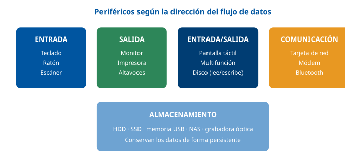

------------------------------------------------------------------------

### D2 · Del puerto al driver: la cadena de conexión

**Sección**: §1.4 — El bus, el controlador y el puerto **Propósito**: Distinguir puerto (físico), interfaz/bus, host controller (hardware) y driver (software).

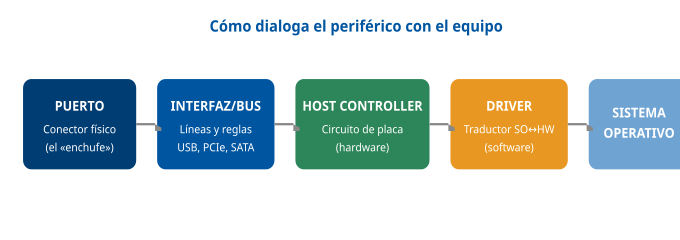

------------------------------------------------------------------------

### D3 · Interfaces de vídeo: HDMI, DisplayPort y USB-C/Thunderbolt

**Sección**: §2.3-2.4 — HDMI, DisplayPort y Thunderbolt **Propósito**: Comparar las tres grandes interfaces de vídeo digital.

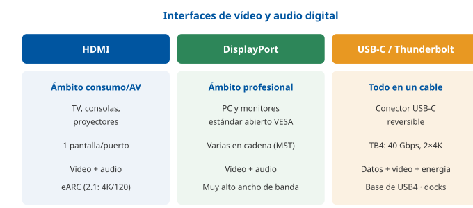

------------------------------------------------------------------------

### D4 · Evolución de la velocidad USB

**Sección**: §2.2 — USB **Propósito**: Visualizar el salto de velocidad entre versiones (escala logarítmica aproximada por altura).

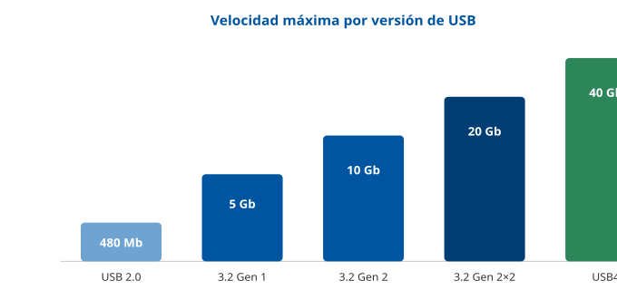

------------------------------------------------------------------------

### D5 · Inalámbricas: alcance frente a uso

**Sección**: §2.5-2.6 — Conectividad inalámbrica **Propósito**: Situar NFC, Bluetooth y Wi-Fi por alcance y propósito.

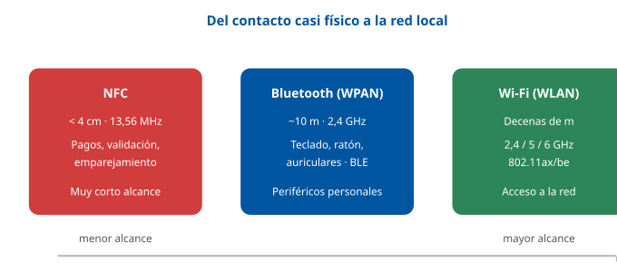

------------------------------------------------------------------------

### D6 · El ciclo Plug & Play

**Sección**: §2.8 — Plug & Play y gestión automática **Propósito**: Encadenar los cinco pasos de la configuración automática.

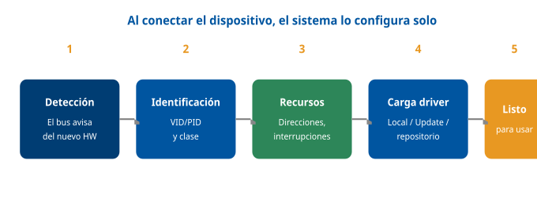

------------------------------------------------------------------------

### D7 · Tecnologías de impresión comparadas

**Sección**: §4.1 — Impresión convencional **Propósito**: Contrastar láser, inyección, matricial y térmica.

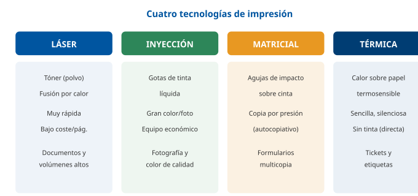

------------------------------------------------------------------------

### D8 · Tipos de almacenamiento secundario

**Sección**: §5.1 — Tipos de dispositivos **Propósito**: Agrupar los soportes por tecnología de grabación.

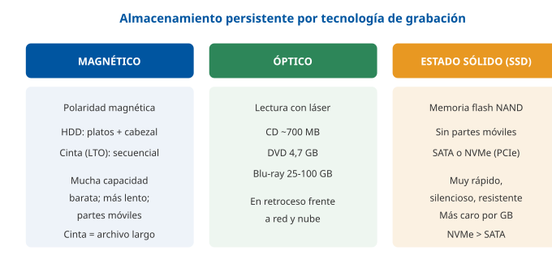

------------------------------------------------------------------------

### D9 · Niveles RAID más frecuentes

**Sección**: §5.6 — Sistemas de protección y redundancia **Propósito**: Comparar RAID 0/1/5/6/10 por técnica y tolerancia.

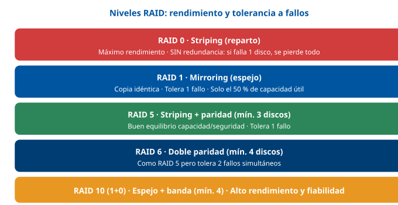

------------------------------------------------------------------------

### D10 · La regla 3-2-1 de las copias de seguridad

**Sección**: §5.5 — Copias de seguridad **Propósito**: Memorizar la regla 3-2-1.

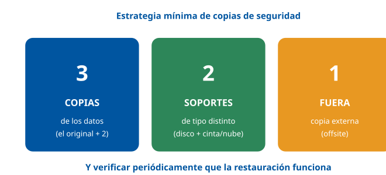

------------------------------------------------------------------------

### D11 · Modelos de color: RGB aditivo y CMYK sustractivo

**Sección**: §6.3 — Modelos de color **Propósito**: Oponer el modelo de pantalla al de impresión.

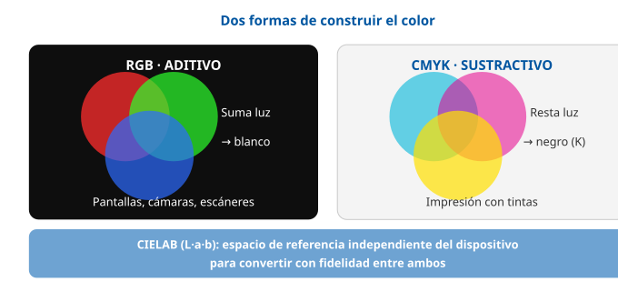

------------------------------------------------------------------------

### D12 · Proceso de digitalización certificada (NTI)

**Sección**: §6.6 — El proceso de digitalización certificada **Propósito**: Encadenar los pasos de la NTI hasta la copia auténtica.

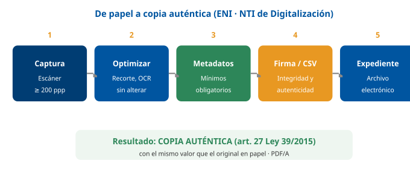

## Casos prácticos

Los tres casos recorren las cuatro partes del tema: el **Caso 1** trabaja la **conectividad y la administración** de un puesto de usuario (interfaces, drivers, Plug & Play y seguridad de dispositivos); el **Caso 2**, los **elementos de impresión** (elección de tecnología, impresión en red, consumibles y coste); y el **Caso 3**, el **almacenamiento y la digitalización** (RAID, copias de seguridad y digitalización certificada conforme a la NTI).

------------------------------------------------------------------------

### Caso 1 — Puesto de trabajo de una Oficina de Atención a la Ciudadanía

#### Enunciado

Se prepara el puesto de un empleado de una Oficina de Atención a la Ciudadanía de un distrito. El puesto debe llevar: un **portátil** que se conecta a una **estación de acoplamiento (docking)** mediante un solo cable, **dos monitores**, teclado y ratón inalámbricos, un **lector de DNI electrónico** y acceso a una **impresora multifunción en red** del departamento. Al conectar por primera vez el lector de DNI, Windows lo detecta pero aparece con un aviso en el Administrador de dispositivos y no funciona. Además, la política de seguridad municipal prohíbe el uso de memorias USB no autorizadas.

#### Cuestiones

**Cuestión 1 — Conectividad del docking (2 puntos).** ¿Qué interfaz permite que un solo cable lleve del portátil al docking datos, vídeo para los monitores y energía de carga? Justifique por qué es la idónea.

**Cuestión 2 — Multipantalla (2 puntos).** Se quieren conectar dos monitores desde el docking. ¿Qué interfaz de vídeo permite encadenar varios monitores en serie y con qué tecnología? Cite también la alternativa de consumo.

**Cuestión 3 — El lector de DNI que no funciona (3 puntos).** Interprete el aviso del Administrador de dispositivos y proponga los pasos de diagnóstico y resolución en orden correcto.

**Cuestión 4 — Seguridad de dispositivos (3 puntos).** Explique cómo se aplica la prohibición de memorias USB no autorizadas y otras dos medidas de protección de la información en el puesto exigibles por el Esquema Nacional de Seguridad.

#### Solución orientativa

- **C1**: La interfaz idónea es **Thunderbolt (sobre conector USB-C)**, o USB4 con USB Power Delivery: un único cable transporta **datos (PCIe), vídeo (DisplayPort) y energía** (hasta 240 W con USB PD 3.1), que es justo lo que hace una docking station. *(§2.2, §2.4)*
- **C2**: **DisplayPort** admite **MST (Multi-Stream Transport)**, que permite encadenar los dos monitores en serie (*daisy-chain*) desde una sola salida. La alternativa del ámbito de consumo sería **HDMI**, aunque normalmente requiere una salida por monitor. *(§2.3)*
- **C3**: El aviso indica un **problema de controlador (driver)**. Pasos: (1) comprobar lo físico (cable/puerto del lector); (2) verificar en el Administrador de dispositivos que aparece el dispositivo; (3) **instalar/actualizar el driver** del fabricante (el genérico puede no bastar), preferiblemente **firmado**; (4) si el fallo surgió tras una actualización, **revertir (rollback)**; (5) consultar el visor de eventos y, si procede, probar el lector en otro equipo para aislar. *(§3.4, §2.7)*
- **C4**: La prohibición de USB se implementa con **políticas de control de dispositivos/puertos** (por directiva de grupo, GPO) que bloquean las clases de almacenamiento extraíble no autorizadas, junto a **listas blancas** de dispositivos permitidos. Otras dos medidas del ENS: **cifrado del disco del portátil** con BitLocker (soporte perdido = ilegible) y **borrado seguro** del disco al dar de baja el equipo; también valen soluciones **DLP** y antivirus con análisis de extraíbles. *(§3.5, §3.6)*

#### Criterios de evaluación

| Criterio | Puntos |
|----|----|
| Identifica Thunderbolt/USB4 (USB-C) con datos+vídeo+energía y lo justifica | 2 |
| Explica DisplayPort con MST para multipantalla y cita HDMI como alternativa | 2 |
| Diagnóstico ordenado (físico→driver→rollback→aislar) del lector de DNI | 3 |
| Control de puertos USB (GPO/listas blancas) + 2 medidas del ENS (cifrado, borrado seguro/DLP) | 3 |

------------------------------------------------------------------------

#### Preguntas tipo test sobre este caso

##### 1. En el supuesto planteado, el portátil debe conectarse al docking con un solo cable que lleve datos, vídeo para los monitores y energía de carga. ¿Qué interfaz es la idónea?

- a) HDMI 2.1, que transporta por el mismo cable el vídeo, el audio digital y el canal de retorno eARC.
- b) Thunderbolt sobre conector USB-C (o USB4 con USB Power Delivery), que combina datos PCIe, vídeo DisplayPort y energía.
- c) eSATA, la versión externa de SATA, que conecta el portátil a los periféricos de la estación de acoplamiento.

**Respuesta correcta:** b) · **Referencia:** Caso 1, cuestión 1 · §2.4

Desde Thunderbolt 3 se usa el conector USB-C y un único cable combina datos (PCIe), vídeo (DisplayPort) y energía; es la interfaz típica de las docking stations.

##### 2. El técnico comprueba que el portátil tiene un puerto USB-C y da por hecho que servirá para el docking. ¿Qué debe tener en cuenta?

- a) Que USB-C es solo la forma del conector: por dentro el puerto puede ser USB 2.0 o USB4, y hay que comprobar el protocolo.
- b) Que todo puerto USB-C es internamente USB4, por lo que garantiza 40 Gbps y la salida de vídeo a los monitores.
- c) Que USB-C solo transporta datos y energía, de modo que el vídeo de los monitores exige un cable HDMI aparte.

**Respuesta correcta:** a) · **Referencia:** Caso 1, cuestión 1 · §2.2

El contenido advierte que USB-C es un conector, no una velocidad: un puerto USB-C puede ser USB 2.0 o USB4 y por fuera son idénticos.

##### 3. Para conectar los dos monitores del puesto desde una sola salida del docking, encadenándolos en serie, ¿qué interfaz y tecnología deben usarse?

- a) HDMI con eARC, que permite encadenar varios monitores desde una única salida del equipo.
- b) DVI con conexión en cadena, interfaz de transición que sustituyó a VGA en el entorno profesional.
- c) DisplayPort con MST (Multi-Stream Transport), que permite la conexión en cadena (daisy-chain).

**Respuesta correcta:** c) · **Referencia:** Caso 1, cuestión 2 · §2.3

La gran ventaja de DisplayPort es MST, que permite encadenar varios monitores en serie desde una sola salida.

##### 4. Si en lugar de DisplayPort se usara la alternativa propia del ámbito de consumo, HDMI, ¿qué implicaría para los dos monitores del puesto?

- a) Que normalmente haría falta una salida HDMI por cada monitor, porque HDMI no los encadena en serie.
- b) Que los monitores podrían encadenarse igual, ya que HDMI 2.1 incorpora la tecnología MST de VESA.
- c) Que la señal pasaría a ser analógica y necesitaría un convertidor para cada uno de los monitores.

**Respuesta correcta:** a) · **Referencia:** Caso 1, cuestión 2 · §2.3

El contenido resume: HDMI = consumo/audiovisual, un monitor por puerto; DisplayPort admite varios monitores en cadena (MST). HDMI es digital.

##### 5. Windows detecta el lector de DNI electrónico, pero aparece con un aviso en el Administrador de dispositivos y no funciona. ¿Cómo debe interpretarse ese aviso?

- a) Como una avería física del chip del DNI que se ha insertado.
- b) Como un problema de controlador (driver) del lector.
- c) Como una interferencia con el teclado y el ratón inalámbricos.

**Respuesta correcta:** b) · **Referencia:** Caso 1, cuestión 3 · §3.4

Un dispositivo detectado pero marcado con aviso en el Administrador de dispositivos indica un problema de controlador (driver).

##### 6. Ante el lector de DNI que no funciona, ¿por dónde debe empezar el diagnóstico del técnico?

- a) Por reinstalar el sistema operativo del portátil para descartar daños en el sistema.
- b) Por revertir el controlador del lector a la versión anterior que tuviera instalada.
- c) Por comprobar lo físico: el cable y el puerto en que está conectado el lector.

**Respuesta correcta:** c) · **Referencia:** Caso 1, cuestión 3 · §3.4

El diagnóstico va de lo físico y sencillo a lo lógico y complejo: primero cable y puerto; reinstalar el sistema ante un cable suelto es el error clásico.

##### 7. Windows ha cargado para el lector un controlador genérico, que no basta para que funcione. ¿Qué debe hacer el técnico?

- a) Instalar o actualizar el controlador del fabricante, preferiblemente firmado digitalmente.
- b) Mantener el controlador genérico, que es el que desbloquea todas las funciones del lector.
- c) Desactivar la exigencia de firma para poder instalar cualquier controlador que funcione.

**Respuesta correcta:** a) · **Referencia:** Caso 1, cuestión 3 · §2.7

El driver genérico da funcionalidad básica y el del fabricante desbloquea todas las funciones; la firma garantiza origen e integridad y evita código malicioso.

##### 8. Para aislar si el fallo está en el lector de DNI o en el propio portátil, ¿qué prueba corresponde al final del diagnóstico?

- a) Reinstalar el sistema operativo del portátil antes de probar el lector en otro sitio.
- b) Sustituir el docking por otro modelo, puesto que el lector depende de su firmware.
- c) Probar el lector en otro equipo y, si procede, otro dispositivo en el mismo puerto.

**Respuesta correcta:** c) · **Referencia:** Caso 1, cuestión 3 · §3.4

El paso «Aislar» consiste en probar el periférico en otro equipo (¿falla el dispositivo o el equipo?) y otro dispositivo en el mismo puerto.

##### 9. ¿Cómo se aplica en el puesto la prohibición municipal de usar memorias USB no autorizadas?

- a) Cifrando con BitLocker todas las memorias USB, de modo que cualquiera de ellas pueda usarse libremente en el puesto.
- b) Con políticas de control de dispositivos (GPO) que bloquean el almacenamiento extraíble no autorizado, junto a listas blancas.
- c) Desactivando Plug & Play en el portátil, para que ningún dispositivo USB se detecte al conectarlo al equipo.

**Respuesta correcta:** b) · **Referencia:** Caso 1, cuestión 4 · §3.5

Se aplica con políticas de control de dispositivos y puertos por directiva de grupo (GPO) que bloquean el almacenamiento extraíble no autorizado, junto a listas blancas.

##### 10. Además del bloqueo de memorias USB, ¿qué dos medidas de protección de la información exigibles por el Esquema Nacional de Seguridad propone la solución para el portátil?

- a) Cifrar su disco con BitLocker y someterlo a borrado seguro cuando el equipo se dé de baja.
- b) Montar un RAID 0 en el disco y aplicarle un formateo rápido cuando el equipo se dé de baja.
- c) Imprimir con liberación segura y conectar los dos monitores en cadena mediante DisplayPort.

**Respuesta correcta:** a) · **Referencia:** Caso 1, cuestión 4 · §3.6

Medidas del ENS: cifrado con BitLocker (soporte perdido = ilegible) y borrado seguro del disco al dar de baja el equipo.

### Caso 2 — Renovación del parque de impresión de un distrito

#### Enunciado

Un distrito quiere racionalizar su impresión. Hoy hay muchas impresoras de inyección pequeñas en cada mesa, con alto coste de tinta y documentos con datos personales que a veces quedan olvidados en las bandejas. Se plantea sustituirlas por **impresoras multifunción láser en red** compartidas. El volumen es alto (informes, notificaciones), predomina el **texto en blanco y negro** y ocasionalmente se imprimen **carteles en color**. También se emite un pequeño número de **formularios multicopia por presión** en la unidad de recaudación.

#### Cuestiones

**Cuestión 1 — Elección de tecnología (3 puntos).** Justifique por qué la impresión **láser** es la adecuada para el grueso del trabajo, e indique qué tecnología conviene mantener para los formularios multicopia y por qué.

**Cuestión 2 — Impresión en red (2 puntos).** Explique el papel del **spooler (cola de impresión)** y cite un protocolo de impresión moderno y un lenguaje de descripción de página.

**Cuestión 3 — Seguridad e impresión (2 puntos).** ¿Qué mecanismo evita que las notificaciones con datos personales queden olvidadas en la bandeja? Descríbalo.

**Cuestión 4 — Consumibles y coste (3 puntos).** Compare el consumible de una láser frente a una de inyección y explique con qué criterio económico se decide en un parque grande. Proponga dos medidas de configuración centralizada para ahorrar.

#### Solución orientativa

- **C1**: La **láser** ofrece **alta velocidad y bajo coste por página**, ideal para grandes volúmenes de texto en blanco y negro (informes, notificaciones); el tóner se fija por calor. Para los **formularios multicopia por presión** conviene mantener una **impresora matricial (de impacto)**, la única que genera **copia por presión** sobre papel autocopiativo. La inyección se reservaría, si acaso, a color fotográfico puntual. *(§4.1)*
- **C2**: El **spooler** recibe los trabajos, los pone en **cola** y los envía en orden a la impresora, liberando enseguida la aplicación del usuario y gestionando prioridades, pausas y reintentos. Protocolo moderno: **IPP** (Internet Printing Protocol); lenguaje de descripción de página: **PostScript** o **PCL** (también PDF directo). *(§4.3)*
- **C3**: La **impresión con liberación segura (pull printing)**: el trabajo se retiene en la cola y el documento **solo se imprime cuando el usuario se identifica** con su tarjeta o PIN en el equipo. Evita que documentos con datos personales queden a la vista. *(§4.3, §3.5)*
- **C4**: La láser usa **tóner** (cartucho de polvo de **alto rendimiento**, miles de páginas), frente a los **cartuchos de tinta** de la inyección, de menor rendimiento y mayor coste por página. La decisión se toma por **coste por página (CPP)** y rendimiento del consumible. Medidas de ahorro por configuración centralizada (GPO): **doble cara (dúplex) y blanco y negro por defecto**, y **cuotas/retención** de impresión. *(§4.2, §3.2)*

#### Criterios de evaluación

| Criterio | Puntos |
|----|----|
| Justifica la láser (velocidad/CPP) y mantiene matricial para copia por presión | 3 |
| Explica el spooler + cita IPP y PostScript/PCL | 2 |
| Describe correctamente el *pull printing* | 2 |
| Compara tóner vs tinta, criterio CPP y 2 medidas de ahorro centralizadas | 3 |

------------------------------------------------------------------------

#### Preguntas tipo test sobre este caso

##### 1. En el supuesto planteado, ¿por qué la impresión láser es la adecuada para el grueso del trabajo del distrito?

- a) Por su excelente reproducción del color y de las fotografías, idónea para los carteles del distrito.
- b) Porque es la única tecnología capaz de hacer copia por presión sobre los formularios multicopia.
- c) Por su alta velocidad y su bajo coste por página, idóneos para grandes volúmenes de texto en blanco y negro.

**Respuesta correcta:** c) · **Referencia:** Caso 2, cuestión 1 · §4.1

La láser ofrece alta velocidad y bajo coste por página, ideal para grandes volúmenes de texto en blanco y negro (informes, notificaciones).

##### 2. ¿Qué tecnología conviene mantener para los formularios multicopia por presión de la unidad de recaudación?

- a) La impresora térmica, que transfiere la tinta de una cinta por calor sobre el papel autocopiativo.
- b) La impresora matricial (de impacto), única que genera copia por presión sobre papel autocopiativo.
- c) La impresora láser en red, cuyo fusor ejerce la presión suficiente para obtener las copias.

**Respuesta correcta:** b) · **Referencia:** Caso 2, cuestión 1 · §4.1

Para los formularios multicopia conviene mantener una matricial (de impacto), «la única que genera copia por presión sobre papel autocopiativo».

##### 3. Tras la renovación del parque, ¿a qué se reservaría, si acaso, la impresión de inyección de tinta?

- a) Al color fotográfico puntual.
- b) A los formularios multicopia.
- c) A las notificaciones en blanco y negro.

**Respuesta correcta:** a) · **Referencia:** Caso 2, cuestión 1 · §4.1

Con láser para el volumen y matricial para el multicopia, la inyección de tinta queda, si acaso, para el color fotográfico puntual.

##### 4. Un empleado manda imprimir una notificación a la multifunción en red. ¿Qué hace el spooler?

- a) Traduce la página a un formato independiente del papel concreto, como hacen PostScript o PCL con cada trabajo.
- b) Recibe el trabajo, lo pone en cola y lo envía en orden a la impresora, liberando enseguida la aplicación del usuario.
- c) Asigna a la impresora una dirección IP propia para que cualquier equipo autorizado la use sin un PC intermediario.

**Respuesta correcta:** b) · **Referencia:** Caso 2, cuestión 2 · §4.3

El spooler recibe los trabajos, los pone en cola y los envía en orden a la impresora, liberando la aplicación y gestionando prioridades, pausas y reintentos.

##### 5. ¿Qué protocolo de impresión moderno debe citarse para las nuevas multifunción en red?

- a) LPD/LPR, el protocolo clásico de colas.
- b) El puerto RAW 9100 de la impresora.
- c) IPP (Internet Printing Protocol).

**Respuesta correcta:** c) · **Referencia:** Caso 2, cuestión 2 · §4.3

IPP es el estándar moderno (base de AirPrint y de la impresión sin driver); LPD/LPR y el puerto RAW 9100 son los antiguos.

##### 6. Para describir las páginas que enviarán los equipos a las multifunción, ¿qué ejemplos de lenguaje de descripción de página (PDL) son correctos?

- a) PostScript o PCL, además del PDF directo.
- b) IPP o LPD/LPR, además del RAW 9100.
- c) RGB o CMYK, además del modelo CIELAB.

**Respuesta correcta:** a) · **Referencia:** Caso 2, cuestión 2 · §4.3

Los principales PDL son PostScript, PCL y, cada vez más, PDF directo; IPP y LPD/LPR son protocolos y RGB/CMYK, modelos de color.

##### 7. ¿Qué mecanismo evita que las notificaciones con datos personales queden olvidadas en la bandeja de la multifunción?

- a) La impresión dúplex por defecto, fijada por GPO, que reduce a la mitad las hojas que salen a la bandeja de la impresora.
- b) El spooler, que envía cada trabajo a la impresora en el orden de llegada y lo borra en cuanto termina de imprimirlo.
- c) La impresión con liberación segura (pull printing): el documento solo se imprime cuando el usuario se identifica con tarjeta o PIN.

**Respuesta correcta:** c) · **Referencia:** Caso 2, cuestión 3 · §4.3, §3.5

Con la liberación segura el trabajo se retiene en la cola y solo se imprime cuando el usuario se identifica con su tarjeta o PIN en el equipo.

##### 8. Al comparar los consumibles de las nuevas láser con los de las impresoras de inyección de tinta actuales, ¿qué es correcto?

- a) La tinta líquida rinde miles de páginas por cartucho, mientras que el tóner debe sustituirse con más frecuencia.
- b) El tóner es un cartucho de polvo de alto rendimiento (miles de páginas); la tinta rinde menos y cuesta más por página.
- c) El tóner y la tinta tienen el mismo coste por página; solo cambia la forma en que se fijan sobre el papel.

**Respuesta correcta:** b) · **Referencia:** Caso 2, cuestión 4 · §4.2

La láser usa tóner (polvo, alto rendimiento, miles de páginas) frente a los cartuchos de tinta, de menor rendimiento y mayor coste por página.

##### 9. ¿Con qué criterio económico se decide la elección de impresoras en un parque grande como el del distrito?

- a) Con el coste por página (CPP) y el rendimiento del consumible.
- b) Con el precio de compra de cada equipo, sin tener en cuenta el consumible.
- c) Con la resolución en ppp que alcanza cada impresora del distrito.

**Respuesta correcta:** a) · **Referencia:** Caso 2, cuestión 4 · §4.2

El coste por página (CPP) y el rendimiento del consumible son los criterios económicos que guían la elección en un parque grande.

##### 10. ¿Qué dos medidas de configuración centralizada por GPO propone la solución para ahorrar consumibles en el distrito?

- a) Fijar por defecto la impresión en color y a la máxima resolución en ppp.
- b) Instalar a mano en cada puesto los drivers y la impresora por defecto.
- c) Fijar por defecto la impresión a doble cara (dúplex) y en blanco y negro.

**Respuesta correcta:** c) · **Referencia:** Caso 2, cuestión 4 · §3.2

Con directivas de grupo (GPO) se fija la configuración: doble cara y blanco y negro por defecto para ahorrar consumibles; la instalación no se hace máquina por máquina.

### Caso 3 — Almacenamiento y digitalización de expedientes

#### Enunciado

El servicio de archivo del Ayuntamiento debe **digitalizar expedientes en papel** y conservarlos en un **servidor con varios discos**. Requisitos: que la avería de un disco no detenga el servicio ni pierda datos; que exista una estrategia de **copias de seguridad** frente a borrados y *ransomware*; y que las imágenes digitalizadas tengan **validez jurídica** para poder devolver el papel al ciudadano. Algunos expedientes escaneados en color superan los **5 GB** por archivo.

#### Cuestiones

**Cuestión 1 — Redundancia de disco (2 puntos).** Proponga un nivel **RAID** adecuado para el servidor y explique qué protege y qué NO protege el RAID.

**Cuestión 2 — Copias de seguridad (3 puntos).** Diseñe una estrategia de copias conforme a la regla **3-2-1** y explique la diferencia entre copia **completa**, **incremental** y **diferencial**.

**Cuestión 3 — Sistema de archivos (2 puntos).** El recurso de red debe admitir archivos de más de 5 GB. ¿Qué sistema de archivos **no** serviría y cuáles sí? Justifique.

**Cuestión 4 — Digitalización certificada (3 puntos).** Enumere los pasos del proceso de **digitalización certificada** según la NTI y explique qué requisitos (resolución, formato, firma) convierten la imagen en **copia auténtica**.

#### Solución orientativa

- **C1**: Un nivel adecuado es **RAID 5** (striping con paridad, tolera 1 fallo, mínimo 3 discos) o **RAID 6/10** para mayor exigencia. El RAID **protege frente a la avería de un disco** (continuidad del servicio), pero **NO es una copia de seguridad**: no protege frente a un borrado accidental, un cifrado por *ransomware* ni un desastre. Se necesitan **RAID y backup**. *(§5.6)*
- **C2**: Estrategia **3-2-1**: **3 copias** (los datos de producción + 2), en **2 tipos de soporte** distintos (p. ej. disco en NAS + cinta o nube), con **1 copia fuera** de las instalaciones (*offsite*). Tipos: **completa** (todo; restauración simple, ocupa más), **incremental** (solo lo cambiado desde la última copia; ligera, pero restaurar exige la completa + toda la cadena), **diferencial** (lo cambiado desde la última completa; restauración con completa + última diferencial). Además, **verificar restauraciones** periódicamente. *(§5.5)*
- **C3**: **FAT32 no serviría**, porque no admite archivos de más de **4 GB** y los expedientes superan 5 GB. Sirven **exFAT** (para extraíbles) y, en un servidor, **NTFS** (Windows) o **ext4** (Linux), que además aportan permisos y *journaling*. Para un recurso de red compartido, lo habitual es NTFS/ext4 con acceso por SMB/NFS. *(§5.3)*
- **C4**: Pasos NTI: (1) **captura** con escáner a **≥ 200 ppp**; (2) **optimización/OCR** sin alterar el contenido; (3) **metadatos** mínimos obligatorios; (4) **firma electrónica o CSV** por el órgano/funcionario habilitado; (5) **incorporación** al expediente y al archivo electrónico. La imagen debe ser **fiel**, en un **formato del catálogo de estándares** (preferible **PDF/A** para archivo), con **metadatos** y **firma/CSV** que garanticen integridad y autenticidad. Así se obtiene una **copia auténtica** (art. 27 Ley 39/2015) que permite devolver el papel. *(§6.5, §6.6)*

#### Criterios de evaluación

| Criterio | Puntos |
|----|----|
| Propone RAID 5/6/10 y distingue «RAID protege avería de disco» de «RAID no es backup» | 2 |
| Diseña la estrategia 3-2-1 y distingue completa/incremental/diferencial | 3 |
| Descarta FAT32 (límite 4 GB) y propone NTFS/ext4/exFAT justificando | 2 |
| Enumera el proceso NTI (≥200 ppp, PDF/A, metadatos, firma/CSV) y lo liga a copia auténtica | 3 |

------------------------------------------------------------------------

*Estos tres casos cubren los ejes del tema aplicados al Ayuntamiento de Madrid. Las soluciones son orientativas: lo que se trabaja es el razonamiento y la correcta aplicación de los conceptos, no la literalidad.*

#### Preguntas tipo test sobre este caso

##### 1. En el supuesto planteado, ¿qué nivel RAID NO cumpliría el requisito de que la avería de un disco no detenga el servicio ni pierda datos?

- a) RAID 5, porque usa paridad distribuida.
- b) RAID 0, porque reparte los datos sin redundancia.
- c) RAID 6, porque usa doble paridad.

**Respuesta correcta:** b) · **Referencia:** Caso 3, cuestión 1 · §5.6

RAID 0 no tiene tolerancia a fallos (si falla un disco se pierde todo); RAID 5 tolera 1 fallo y RAID 6, 2 fallos.

##### 2. Un empleado del archivo borra por error una carpeta de expedientes del servidor, que tiene RAID 6. ¿Qué es correcto?

- a) El RAID 6 recupera la carpeta de forma automática, porque tolera la avería de dos discos.
- b) La carpeta sigue en los bloques de doble paridad y se recupera reconstruyendo el conjunto.
- c) El RAID no protege frente al borrado: la carpeta debe restaurarse desde la copia de seguridad.

**Respuesta correcta:** c) · **Referencia:** Caso 3, cuestión 1 · §5.6

El RAID protege frente a la avería de un disco, pero NO es una copia de seguridad: no protege frente a un borrado accidental, un ransomware ni un desastre.

##### 3. ¿Cuál de estos diseños de copias cumple la regla 3-2-1 para el archivo?

- a) Datos de producción en el servidor, una copia en un NAS y otra en cinta o en la nube fuera de las instalaciones.
- b) Datos de producción en el servidor y dos copias en cinta guardadas en el propio servicio de archivo municipal.
- c) Datos de producción en el servidor y dos copias en otros dos volúmenes del mismo conjunto RAID del servidor.

**Respuesta correcta:** a) · **Referencia:** Caso 3, cuestión 2 · §5.5

Regla 3-2-1: 3 copias (producción + 2), en 2 tipos de soporte distintos (p. ej. NAS + cinta o nube), con 1 copia fuera de las instalaciones.

##### 4. El archivo hace una copia completa el domingo e incrementales el resto de días. Si un ransomware cifra el servidor el viernes, ¿qué se necesita para restaurar?

- a) Solo la última copia incremental, que ya contiene todos los cambios de la semana.
- b) La copia completa del domingo y únicamente la última incremental realizada.
- c) La copia completa del domingo y toda la cadena de incrementales posteriores.

**Respuesta correcta:** c) · **Referencia:** Caso 3, cuestión 2 · §5.5

La incremental copia solo lo cambiado desde la última copia; para restaurar hace falta la completa y toda la cadena de incrementales.

##### 5. Si en lugar de incrementales el archivo hiciera copias diferenciales diarias, ¿qué se necesitaría para restaurar?

- a) Solo la última diferencial realizada.
- b) La copia completa y la última diferencial.
- c) La completa y la primera diferencial.

**Respuesta correcta:** b) · **Referencia:** Caso 3, cuestión 2 · §5.5

La diferencial copia lo cambiado desde la última completa; la restauración se hace con solo dos piezas: completa + última diferencial.

##### 6. ¿Por qué FAT32 no serviría para el recurso de red que guarda los expedientes escaneados de más de 5 GB?

- a) Porque no admite archivos mayores de 4 GB.
- b) Porque no puede leerse desde equipos Linux.
- c) Porque no admite más de 4 particiones.

**Respuesta correcta:** a) · **Referencia:** Caso 3, cuestión 3 · §5.3

FAT32 es muy compatible pero tiene un límite de 4 GB por archivo, y los expedientes superan los 5 GB; el límite de 4 particiones primarias es de MBR.

##### 7. ¿Qué sistema de archivos es el habitual para el recurso de red compartido del servidor de archivo?

- a) exFAT, el sucesor de FAT32 pensado para los servidores de ficheros.
- b) NTFS o ext4, que aportan permisos y journaling, con acceso por SMB/NFS.
- c) ISO 9660 o UDF, por ser los formatos de archivo a largo plazo.

**Respuesta correcta:** b) · **Referencia:** Caso 3, cuestión 3 · §5.3, §5.4

Para un recurso de red compartido lo habitual es NTFS/ext4 con acceso por SMB/NFS; exFAT es para extraíbles e ISO 9660/UDF, para ópticos.

##### 8. Al configurar el escáner del archivo para la digitalización certificada, ¿qué ajuste cumple la NTI?

- a) Capturar a 100 ppp en escala de grises, suficiente para que funcione el OCR.
- b) Capturar a 150 ppp en color, para reducir el tamaño de los expedientes.
- c) Capturar a 200 ppp o más y guardar en PDF/A, formato preferible para el archivo.

**Respuesta correcta:** c) · **Referencia:** Caso 3, cuestión 4 · §6.5

La NTI exige una resolución mínima de 200 ppp para el papel y formatos del catálogo de estándares, priorizando PDF/A para el archivo a largo plazo.

##### 9. ¿Cuál es el orden correcto del proceso de digitalización certificada según la NTI?

- a) Captura, optimización/OCR, metadatos, firma o CSV e incorporación al expediente.
- b) Captura, firma o CSV, optimización/OCR, metadatos e incorporación al expediente.
- c) Metadatos, captura, firma o CSV, optimización/OCR e incorporación al expediente.

**Respuesta correcta:** a) · **Referencia:** Caso 3, cuestión 4 · §6.6

Pasos NTI: (1) captura; (2) optimización/OCR sin alterar el contenido; (3) metadatos mínimos; (4) firma electrónica o CSV; (5) incorporación al expediente y al archivo.

##### 10. ¿Qué permite, en el supuesto, devolver el expediente en papel al ciudadano?

- a) Que la imagen pase por OCR y se guarde como PDF buscable en el servidor del archivo.
- b) Que la imagen, con metadatos y firma o CSV, sea una copia auténtica (art. 27 Ley 39/2015).
- c) Que la imagen se almacene en un RAID 6 con una copia de seguridad fuera del edificio.

**Respuesta correcta:** b) · **Referencia:** Caso 3, cuestión 4 · §6.5, §6.6

Con metadatos y firma/CSV que garantizan integridad y autenticidad se obtiene una copia auténtica (art. 27 Ley 39/2015), que permite devolver el papel.

## Fuentes

### Tier 1 — Normas y especificaciones oficiales

| ID | Referencia |
|----|----|
| `[USB-IF]` | USB Implementers Forum. *USB Specifications* (USB 2.0, USB 3.2, USB4, USB Type-C, USB Power Delivery). usb.org. Define el bus serie universal y el conector USB-C. |
| `[HDMI]` | HDMI Licensing Administrator. *HDMI Specification* (2.0, 2.1). Interfaz multimedia de alta definición. |
| `[VESA-DP]` | VESA. *DisplayPort Standard* (1.4, 2.1). Interfaz de vídeo digital; Multi-Stream Transport (MST). |
| `[TB]` | Intel. *Thunderbolt 3/4 Specification* (sobre conector USB-C, base de USB4). |
| `[IEEE802.11]` | IEEE 802.11. *Wireless LAN Medium Access Control (MAC) and Physical Layer (PHY) Specifications*. Familia Wi-Fi (802.11n/ac/ax/be). |
| `[BT-SIG]` | Bluetooth SIG. *Bluetooth Core Specification* (5.x, LE Audio). Red inalámbrica de área personal (WPAN). |
| `[ISO7498]` | ISO/IEC 7498-1. *Modelo de Referencia OSI*. Marco de las capas de comunicación de un periférico. |
| `[ISO9660]` | ISO 9660 / UDF (ISO 13346). Sistemas de ficheros de soportes ópticos (CD/DVD/Blu-ray). |
| `[UEFI-GPT]` | UEFI Forum. *UEFI Specification* — GUID Partition Table (GPT). Esquema de particionado moderno. |
| `[ISO15948]` | ISO/IEC 15948 (PNG) e ISO/IEC 10918 (JPEG). Formatos de codificación y compresión de imagen. |
| `[CIE]` | CIE (Commission Internationale de l'Éclairage). *CIE 1931 XYZ y CIELAB (L·a·b)*. Espacios de color independientes del dispositivo. |
| `[SNIA-RAID]` | SNIA / estándar RAID (Common RAID Disk Data Format). Niveles RAID 0/1/5/6/10 y redundancia. |
| `[ISO32000]` | ISO 32000 (PDF) e ISO 19005 (PDF/A). Formato de documento portátil y su perfil de archivo a largo plazo. |
| `[ISO3664]` | ISO/IEC TR y guías de fabricación aditiva (ISO/ASTM 52900). Terminología de impresión 3D (FDM, SLA, SLS). |

### Tier 2 — Documentación de producto y fabricante

| ID | Referencia |
|----|----|
| `[MS-DEVMGR]` | Microsoft. *Device Manager, Plug and Play, Windows Update for drivers, BitLocker*. learn.microsoft.com. |
| `[LINUX-UDEV]` | Kernel Linux. *udev, sysfs, lsusb, lspci, CUPS, SANE*. Gestión de dispositivos e impresión/escaneo en Linux. |
| `[HP-PRINT]` | HP / fabricantes. *Tecnologías de impresión láser e inyección, PCL, PostScript, consumibles*. |
| `[APFS-NTFS]` | Documentación de sistemas de ficheros: Microsoft *NTFS/exFAT*, Apple *APFS*, kernel Linux *ext4*. |

### Tier 3 — Marco normativo del puesto (Ayuntamiento de Madrid)

| ID | Referencia |
|----|----|
| `[RD4-2010]` | [Real Decreto 4/2010](https://www.boe.es/buscar/act.php?id=BOE-A-2010-1331), por el que se regula el **Esquema Nacional de Interoperabilidad (ENI)**. |
| `[NTI-DIGIT]` | Resolución de 19 de julio de 2011 (SEAP): **[Norma Técnica de Interoperabilidad de Digitalización de Documentos](https://www.boe.es/buscar/act.php?id=BOE-A-2011-13168)**. Requisitos de la imagen electrónica y el proceso de digitalización. |
| `[NTI-COPIA]` | Resolución de 19 de julio de 2011: **[NTI de Procedimientos de copiado auténtico y conversión](https://www.boe.es/buscar/act.php?id=BOE-A-2011-13172)**. Copia auténtica e imagen electrónica firmada. |
| `[L39-2015]` | [Ley 39/2015](https://www.boe.es/buscar/act.php?id=BOE-A-2015-10565) del Procedimiento Administrativo Común: art. 26 (documentos administrativos electrónicos), art. 27 (copias auténticas). |
| `[ENS]` | [Real Decreto 311/2022](https://www.boe.es/buscar/act.php?id=BOE-A-2022-7191), **Esquema Nacional de Seguridad** — protección de soportes, control de acceso y cifrado. |
| `[RGPD]` | [Reglamento (UE) 2016/679](https://eur-lex.europa.eu/legal-content/ES/TXT/?uri=CELEX:32016R0679) (RGPD) y [LO 3/2018](https://www.boe.es/buscar/act.php?id=BOE-A-2018-16673) (LOPDGDD) — protección de datos en soportes y periféricos. |
| `[BOAM10032]` | BOAM 10.032 (23-dic-2025). Bases específicas TIC C1 Ayto. Madrid — temario oficial. |

------------------------------------------------------------------------

*Las referencias Tier 1 son la base técnica del contenido; Tier 2 ilustra su materialización en Windows/Linux y en productos reales; Tier 3 enmarca el cumplimiento aplicable al Ayuntamiento de Madrid, en especial el bloque de digitalización (ENI y NTI).*
