# Tema 13. La gestión de los datos

**Bloque:** técnico  
**Enunciado oficial** (BOAM n.º 10.032, de 23 de diciembre de 2025): Tipos abstractos y Estructuras de datos. Organizaciones de ficheros. Algoritmos. Formatos de información y ficheros.

Versión web: <https://ayuntamientomadrid.github.io/temario-tecnico-auxiliar/temas/tema-13.html> · PDF: [tema-13.pdf](tema-13.pdf) · Test: [../../../tests/tecnico/tema-13.md](../../../tests/tecnico/tema-13.md)

## Índice

- 1. Tipos Abstractos de Datos (TAD)
  - 1.1. Concepto de tipo de dato y de tipo abstracto de dato
  - 1.2. Principios: abstracción, encapsulamiento, ocultación y modularidad
  - 1.3. Características de un TAD: valores, operaciones y comportamiento
  - 1.4. TAD frente a estructura de datos frente a implementación
  - 1.5. Especificación de un TAD y correspondencia con las bibliotecas
- 2. Estructuras de datos
  - 2.1. Clasificación de las estructuras de datos
  - 2.2. Tablas (arrays)
  - 2.3. Listas enlazadas
  - 2.4. Pilas y colas
  - 2.5. Diccionarios, conjuntos y tablas hash
  - 2.6. Árboles
  - 2.7. Grafos
- 3. Organización de ficheros
  - 3.1. Conceptos básicos: fichero, registro, campo y clave
  - 3.2. Organización secuencial y secuencial indexada
  - 3.3. Organización directa (hashing)
  - 3.4. Índices: densos, dispersos y multinivel
  - 3.5. Sistemas de ficheros más extendidos
  - 3.6. Mecanismos de tolerancia a fallos
- 4. Algoritmos
  - 4.1. Concepto y propiedades de un algoritmo
  - 4.2. Complejidad algorítmica y notación asintótica
  - 4.3. Recursividad
  - 4.4. Algoritmos de ordenación
  - 4.5. Algoritmos de búsqueda
- 5. Formatos de información y ficheros
  - 5.1. Codificación e interpretación de la información
  - 5.2. Juegos de caracteres y representación numérica
  - 5.3. Formatos habituales: extensiones y naturaleza
  - 5.4. Números mágicos (magic numbers)
  - 5.5. Seguridad de la información: esquemas de permisos
- Resumen final

### Conceptos clave para memorizar

| Concepto | Dato clave |
|----|----|
| TAD | Modelo que define datos por sus **operaciones**, no por su implementación |
| Encapsulamiento | Une datos y operaciones; la **ocultación** esconde la representación interna |
| Pila (LIFO) | Último en entrar, primero en salir — `push`/`pop` |
| Cola (FIFO) | Primero en entrar, primero en salir — `enqueue`/`dequeue` |
| Array | Acceso directo O(1); inserción/borrado O(n) |
| Lista enlazada | Inserción/borrado O(1) con puntero; acceso O(n) |
| Tabla hash | Acceso medio O(1); colisiones por encadenamiento o direccionamiento abierto |
| ABB equilibrado | Búsqueda/inserción/borrado O(log n) — AVL, rojo-negro |
| B+árbol | Índice estándar de BBDD y ficheros; nodos con muchas claves, hojas enlazadas |
| Recorridos árbol binario | Preorden (R-I-D), inorden (I-R-D), postorden (I-D-R) |
| BFS / DFS | Recorrido de grafos en anchura (cola) / profundidad (pila o recursión) |
| Quicksort | O(n log n) medio, O(n²) peor; in-place, no estable |
| Mergesort | O(n log n) garantizado; estable; requiere memoria O(n) |
| Búsqueda binaria | O(log n); requiere datos **ordenados** |
| Org. secuencial indexada | ISAM/VSAM: datos secuenciales + índice para acceso directo |
| Journaling | Registro de transacciones del sistema de ficheros para recuperación |
| RAID 5 | Datos + paridad distribuida; tolera fallo de 1 disco |
| RAID 1 | Espejo; RAID 0 striping sin redundancia; RAID 10 espejo + striping |
| Permisos POSIX | `rwx` para usuario/grupo/otros; octal `chmod 750` |
| Magic number | Bytes iniciales que identifican el formato (p. ej. `%PDF`, `PK` ZIP) |
| Endianness | Orden de bytes: big-endian (red) vs little-endian (x86) |

## Contenido

### Convenciones del documento

Este tema incluye cuatro tipos de **cajas callout** para facilitar el estudio:

> **Dato clave.** Información de alta densidad memorística.

> **Ejercicio resuelto.** Problema + solución paso a paso. Útil para secciones con cálculos de complejidad o trazas de algoritmos.

> **Ejemplo de aplicación en el ayto.** Aplicación real de la teoría al entorno municipal (Padrón, censo, callejero, gestión de expedientes, sede electrónica).

> **Relación con otros temas.** Enlace conceptual a otros temas del temario oficial.

El pseudocódigo se muestra en castellano. Las fuentes se referencian con etiquetas breves tipo `[CLRS, cap. 12]` — el registro completo está en la pestaña Fuentes.

**Notación empleada en el tema.** Antes de empezar conviene tener presentes los símbolos que se repiten a lo largo del documento. Las complejidades se expresan con notación asintótica (O, Ω, Θ), que se define en detalle en la §4.2 pero se utiliza ya en las tablas de la §2:

| Símbolo | Significado | Dónde aparece |
|----|----|----|
| `O(g)`, `Ω(g)`, `Θ(g)` | **Notación asintótica**: coste de un algoritmo según el tamaño de la entrada `n`. `O(1)` = constante (no crece con `n`); `O(n)` = lineal; `O(log n)` = logarítmica; `O(n log n)` = cuasilineal; `O(n²)` = cuadrática. Cuanto más a la izquierda en esa lista, más eficiente | Tablas de complejidad de §2 y §3; definición formal en §4.2 |
| `←` | **Asignación** en pseudocódigo: `x ← y` significa "`x` toma el valor de `y`". Se usa la flecha (en vez de `=`) para distinguir la asignación de la **igualdad** matemática | Pseudocódigo de §2 y §4 |
| `=` | **Igualdad** (comparación o axioma), no asignación | Axiomas de §1.3; condiciones de §4 |
| `⌊x⌋` | **Parte entera por defecto** (función *suelo*, en inglés *floor*): el mayor entero ≤ `x`. Ej.: `⌊3,7⌋ = 3`. Los símbolos son corchetes sin la barra superior, no la letra "L" | §2.5, §2.6.4 |
| `⌈x⌉` | **Parte entera por exceso** (función *techo*, *ceil*): el menor entero ≥ `x`. Ej.: `⌈3,2⌉ = 4` | §4.5.2 |
| `mod` | **Resto** de la división entera. Ej.: `17 mod 5 = 2` | §2.5 (funciones hash) |
| *axiomas* | **Ecuaciones** que definen el comportamiento de un TAD sin fijar su implementación (especificación algebraica) | §1.3 |

Estas convenciones de notación son comunes a todos los temas técnicos del temario; se recogen también, con ejemplos resueltos, en la guía transversal **«Cómo estudiar estos temarios»**.

------------------------------------------------------------------------

### 1. Tipos Abstractos de Datos (TAD)

#### 1.1. Concepto de tipo de dato y de tipo abstracto de dato

Un **tipo de dato** es la combinación de un **dominio de valores** y un **conjunto de operaciones** aplicables sobre esos valores. Por ejemplo, el tipo `entero` define el dominio de los números enteros representables en la máquina y operaciones como la suma, la resta, la multiplicación o la comparación. El tipo determina, además, cuánta memoria ocupa cada valor y cómo se codifica en binario. \[ISO-11404\]

Los lenguajes de programación ofrecen **tipos primitivos** (predefinidos: entero, real, carácter, booleano) y mecanismos para construir **tipos compuestos** a partir de ellos (registros, arrays, etc.). Cuando un programador necesita un tipo que el lenguaje no ofrece —por ejemplo, una *agenda* o una *cola de espera*—, lo define él mismo. Si esa definición se hace **describiendo solo el comportamiento** y ocultando la representación interna, se obtiene un **Tipo Abstracto de Datos**.

Un **Tipo Abstracto de Datos (TAD)** es un modelo matemático que define un tipo de dato **por su comportamiento** —las operaciones que admite y la semántica de esas operaciones— **con independencia de su implementación concreta**. El término "abstracto" indica que el usuario del TAD conoce *qué* hace cada operación, pero no necesita conocer *cómo* está implementada internamente. \[AHU\]\[LISKOV-GUTTAG\]

> **Dato clave.** Un TAD se define por **qué operaciones ofrece** y **qué hacen**, no por cómo se almacenan los datos. La estructura de datos es la *implementación* del TAD; el TAD es la *especificación*.

La distinción esencial entre los tres niveles de abstracción es:

- **TAD (especificación)**: el "contrato". Define los valores y las operaciones con su semántica. Es independiente del lenguaje. Ejemplo: el TAD *Pila* ofrece `apilar`, `desapilar`, `cima` y `esVacía`, con la regla LIFO.
- **Estructura de datos (implementación lógica)**: la organización concreta de la representación que materializa el TAD. Ejemplo: una *Pila* puede implementarse con un array o con una lista enlazada.
- **Implementación física (código)**: el programa concreto en un lenguaje que codifica la estructura. Ejemplo: `class Pila` en Java apoyada en un `ArrayList`.

La gran ventaja de razonar con TAD es la **independencia representación-uso**: el código que usa el TAD (el *cliente*) solo depende del contrato; el código que lo implementa (el *proveedor*) puede cambiar libremente la representación interna mientras respete ese contrato. Esto es la base de la mantenibilidad del software.

#### 1.2. Principios: abstracción, encapsulamiento, ocultación y modularidad

Los TAD se sustentan en cuatro principios fundamentales de la ingeniería del software, formalizados a partir de los trabajos de Parnas (1972) y Liskov \[LISKOV-GUTTAG\]:

**a) Abstracción.** Consiste en concentrarse en *qué* hace un componente e ignorar *cómo* lo hace. La **abstracción de datos** permite razonar sobre un tipo en términos de sus operaciones, ocultando los detalles de representación. Reduce la complejidad cognitiva: el programador que usa una `Cola` piensa en "encolar" y "desencolar", no en punteros ni desplazamientos de memoria. La abstracción es el principio rector del que derivan los otros tres.

**b) Encapsulamiento.** Reúne en una sola unidad (módulo, clase) **los datos y las operaciones** que actúan sobre ellos. El encapsulamiento agrupa la representación interna y los métodos que la manipulan, estableciendo una frontera clara entre el interior y el exterior del TAD. Es el mecanismo que hace posible la abstracción.

**c) Ocultación de la información (information hiding).** Es la consecuencia práctica del encapsulamiento: la representación interna **no es accesible** desde el exterior; solo se expone la **interfaz pública** (las operaciones). Esto permite cambiar la implementación sin afectar al código que usa el TAD, siempre que se respete el contrato. Concepto introducido formalmente por D. Parnas y central en el diseño modular.

Una violación típica de la ocultación es que un módulo externo dependa de *cómo* está almacenado un dato —por ejemplo, que asuma que una lista es un array y acceda por índice—: si mañana se cambia la implementación a una lista enlazada, ese código se rompe. Respetando la ocultación (usando solo las operaciones públicas), el cambio de implementación es transparente.

> **Ejemplo de aplicación en el ayto.** El padrón municipal puede modelarse como un TAD *Diccionario* que asocia cada DNI/NIE a los datos del habitante, con operaciones `alta`, `baja`, `consultar` y `modificar`. El personal de atención usa esas operaciones sin saber si por debajo hay una tabla hash, un B+árbol o una tabla SQL: la **ocultación** permite que el equipo técnico migre de una implementación a otra (por rendimiento o por cambio de gestor de BBDD) sin alterar los procedimientos administrativos ni la formación del personal.

**d) Modularidad.** Es la descomposición de un sistema en **módulos** independientes, cada uno con una responsabilidad bien definida y una interfaz clara. Los TAD son la base de la modularidad: cada TAD es un módulo reutilizable. Las dos propiedades deseables son la **alta cohesión** (cada módulo hace una cosa y la hace bien) y el **bajo acoplamiento** (los módulos dependen lo mínimo unos de otros). Un sistema muy acoplado es frágil: un cambio en un módulo se propaga a muchos otros.

La relación entre los cuatro principios es jerárquica: la **abstracción** decide qué es esencial; el **encapsulamiento** agrupa datos y operaciones para lograrla; la **ocultación** protege la representación; y la **modularidad** es el resultado a escala de sistema. Memorizar este encadenamiento ayuda a no confundirlos.

> **Dato clave.** **Abstracción** (qué, no cómo) → **encapsulamiento** (agrupa datos+operaciones) → **ocultación** (la representación es privada; solo la interfaz es pública) → **modularidad** (alta cohesión, bajo acoplamiento). No confundir encapsulamiento (agrupar) con ocultación (esconder).

> **Relación con otros temas.** Estos cuatro principios son también el fundamento de la **Programación Orientada a Objetos** (Tema 20: objetos, clases, herencia, encapsulación). Un TAD se corresponde de forma natural con una *clase*; la ocultación, con los modificadores de acceso (`private`/`public`); y la reutilización, con la herencia y la composición.

#### 1.3. Características de un TAD: valores, operaciones y comportamiento

La especificación completa de un TAD comprende tres elementos \[AHU\]\[KNUTH-V1\]:

**1) Valores (dominio).** El conjunto de valores que puede tomar un elemento del tipo. Para el TAD *Booleano*, el dominio es `{verdadero, falso}`; para una *Pila de enteros*, el dominio son todas las secuencias finitas de enteros.

**2) Operaciones (interfaz).** El conjunto de operaciones aplicables, con su **signatura** (tipos de los parámetros y del resultado). Se clasifican habitualmente en:

- **Constructoras**: crean valores del tipo (p. ej. `crearPila`, `apilar`).
- **Modificadoras (mutadoras)**: alteran el estado de un valor existente (p. ej. `desapilar`).
- **Observadoras (consultoras)**: devuelven información sin modificar el estado (p. ej. `cima`, `esVacía`, `tamaño`).
- **Destructoras**: liberan el valor (relevante en lenguajes con gestión manual de memoria).

**3) Comportamiento (semántica/axiomas).** Las reglas que rigen el resultado de combinar operaciones. Se expresan mediante **especificación algebraica**: ecuaciones (axiomas) que relacionan las operaciones. Para el TAD *Pila*:

    esVacía(crearPila)        = verdadero
    esVacía(apilar(p, e))     = falso
    cima(apilar(p, e))        = e
    desapilar(apilar(p, e))   = p

Estos axiomas definen el comportamiento LIFO **sin mencionar ninguna implementación**: capturan que apilar y desapilar son inversas, y que la cima es siempre el último elemento apilado. \[AHU\]

Para el TAD *Cola* (FIFO) los axiomas reflejan que se extrae por el extremo opuesto al que se inserta:

    esVacía(crearCola)        = verdadero
    esVacía(encolar(c, e))    = falso
    frente(encolar(c, e))     = e            si esVacía(c)
    frente(encolar(c, e))     = frente(c)    si no esVacía(c)
    desencolar(encolar(c, e)) = c            si esVacía(c)
    desencolar(encolar(c, e)) = encolar(desencolar(c), e)  si no esVacía(c)

La diferencia con la pila es reveladora: en la cola, `frente` y `desencolar` "viajan" hasta el elemento **más antiguo**, mientras que en la pila `cima` y `desapilar` actúan sobre el **más reciente**. Los axiomas capturan esa semántica de forma exacta y verificable.

> **Dato clave.** Las tres patas de un TAD son **valores, operaciones y comportamiento**. El comportamiento se formaliza con **axiomas** (especificación algebraica), no con código. Pila = LIFO; Cola = FIFO.

#### 1.4. TAD frente a estructura de datos frente a implementación

| Nivel | Qué define | Ejemplo (Pila) |
|----|----|----|
| **TAD** | Especificación: valores + operaciones + axiomas | LIFO: `apilar`, `desapilar`, `cima`, `esVacía` |
| **Estructura de datos** | Organización lógica de la representación | Array dinámico **o** lista enlazada |
| **Implementación** | Código concreto en un lenguaje | `class Pila` en Java con un `ArrayList` interno |

Un mismo TAD admite **múltiples estructuras de datos**, y cada estructura admite **múltiples implementaciones**. La elección se hace según las **operaciones más frecuentes** y los requisitos de eficiencia (ver §2 y §4). Por ejemplo, una pila sobre array es más compacta en memoria; una pila sobre lista enlazada nunca se queda "sin sitio" mientras haya memoria. Ninguna es "mejor" en abstracto: depende del uso.

#### 1.5. Especificación de un TAD y correspondencia con las bibliotecas

Existen dos enfoques de especificación \[AHU\]\[LISKOV-GUTTAG\]:

- **Especificación informal**: descripción en lenguaje natural de cada operación (precondiciones, postcondiciones, efecto). Es legible pero ambigua.
- **Especificación algebraica (formal)**: define el TAD mediante una *signatura* (nombres y tipos de las operaciones) y un conjunto de *axiomas* ecuacionales, como en los ejemplos anteriores. Es precisa y verificable, pero más costosa de elaborar.

En la práctica profesional, los lenguajes modernos materializan los TAD a través de **interfaces** o **tipos genéricos** de sus bibliotecas estándar. Conocer esta correspondencia es clave para elegir la estructura adecuada:

| TAD | Java \[ORACLE-JCF\] | C++ STL \[CPPREFERENCE\] | Python \[PYTHON-DOCS\] |
|----|----|----|----|
| Lista | `List` (`ArrayList`, `LinkedList`) | `vector`, `list` | `list` |
| Pila | `Deque`/`Stack` | `stack` | `list` / `collections.deque` |
| Cola | `Queue` (`ArrayDeque`) | `queue` | `collections.deque` |
| Diccionario | `Map` (`HashMap`, `TreeMap`) | `map`, `unordered_map` | `dict` |
| Conjunto | `Set` (`HashSet`, `TreeSet`) | `set`, `unordered_set` | `set` |
| Cola de prioridad | `PriorityQueue` | `priority_queue` | `heapq` |

Obsérvese que un mismo TAD ofrece varias implementaciones de biblioteca: `HashMap` (tabla hash, orden no garantizado, O(1) medio) frente a `TreeMap` (árbol rojo-negro, claves ordenadas, O(log n)). La elección de una u otra es una decisión de diseño basada en las operaciones dominantes.

------------------------------------------------------------------------

### 2. Estructuras de datos

#### 2.1. Clasificación de las estructuras de datos

Las estructuras de datos pueden clasificarse según varios criterios \[SEDGEWICK\]\[WIRTH\]:

- **Por su composición**:
  - **Primitivas (simples)**: tipos básicos del lenguaje (entero, real, carácter, booleano).
  - **Compuestas (estructuradas)**: agrupan elementos (arrays, registros, listas, árboles, grafos).
- **Por la relación entre elementos**:
  - **Lineales**: cada elemento tiene un único sucesor y un único predecesor (arrays, listas, pilas, colas).
  - **No lineales**: un elemento puede relacionarse con varios (árboles, grafos).
- **Por su tamaño en el tiempo**:
  - **Estáticas**: tamaño fijo, fijado en tiempo de compilación (array).
  - **Dinámicas**: crecen y decrecen en ejecución (lista enlazada, árbol, grafo).
- **Por su ubicación**:
  - **Internas (en memoria)**: residen en la RAM mientras se ejecuta el programa (§2).
  - **Externas (en disco)**: residen en ficheros y sobreviven a la ejecución (§3).

> **Dato clave.** Lineal = un sucesor por elemento (array, lista, pila, cola). No lineal = varios sucesores (árbol, grafo). Estática = tamaño fijo (array). Dinámica = tamaño variable (lista enlazada, árbol). La elección entre estática/dinámica condiciona el uso de memoria y la flexibilidad.

#### 2.2. Tablas (arrays)

Una **tabla** o **array** es una colección de elementos del **mismo tipo**, almacenados en **posiciones de memoria contiguas** y accesibles mediante uno o varios **índices**. \[WIRTH\]

Propiedades:

- **Acceso directo O(1)**: la dirección de cualquier elemento se calcula con una fórmula aritmética, sin recorrer la estructura.
- **Inserción/borrado O(n)** en el interior: hay que desplazar los elementos posteriores para mantener la contigüidad.
- **Tamaño fijo** en su forma estática: debe conocerse al crearlo. Los *arrays dinámicos* (p. ej. `ArrayList`, `vector`) lo amplían automáticamente.

**Fórmula de direccionamiento** (array unidimensional, base `B`, tamaño de elemento `T`, índice base 0):

    dirección(A[i]) = B + i × T

Para un **array bidimensional** `A[F][C]` almacenado por **filas** (*row-major*, como C, C++ y Java):

    dirección(A[i][j]) = B + (i × C + j) × T

Y almacenado por **columnas** (*column-major*, como Fortran o MATLAB):

    dirección(A[i][j]) = B + (j × F + i) × T

> **Ejercicio resuelto.** Array `int A[100]` que empieza en la dirección 2000, con `int` de 4 bytes. ¿Dirección de `A[20]`? `dirección = 2000 + 20 × 4 = 2080`. Y en una matriz `int M[10][5]` (row-major) que empieza en 5000, ¿dónde está `M[3][2]`? `dirección = 5000 + (3 × 5 + 2) × 4 = 5000 + 17 × 4 = 5068`.

**Array dinámico y coste amortizado.** Un array dinámico mantiene una *capacidad* mayor que su *tamaño*. Cuando se llena, reserva un bloque nuevo (típicamente del **doble** de capacidad) y copia los elementos. Aunque esa copia es O(n), ocurre rara vez: repartido entre todas las inserciones, el coste **amortizado** de añadir al final es **O(1)**. Esta es la razón por la que `ArrayList`/`vector` son tan usados pese a ser arrays por debajo.

> **Ejemplo de aplicación en el ayto.** El callejero municipal puede representarse como una tabla indexada por código de vía: el acceso a los datos de una calle a partir de su código es directo (O(1)), sin recorrer todo el callejero. Si en cambio se buscara por nombre de calle (no por índice), haría falta una estructura asociativa (§2.5) o un índice ordenado (§2.6).

#### 2.3. Listas enlazadas

Una **lista enlazada** es una secuencia de **nodos**, donde cada nodo contiene un **dato** y uno o más **punteros (enlaces)** al siguiente (y, en su caso, al anterior). A diferencia del array, los nodos **no son contiguos** en memoria: se enlazan mediante punteros. \[KNUTH-V1\]

Variantes:

- **Lista simplemente enlazada**: cada nodo apunta solo al siguiente. El último apunta a `nulo`.
- **Lista doblemente enlazada**: cada nodo apunta al siguiente y al anterior; permite recorrido en ambos sentidos y borrado de un nodo en O(1) sin recorrer.
- **Lista circular**: el último nodo apunta al primero (puede ser simple o doble).

Inserción al inicio de una lista simple (O(1)):

    insertarInicio(lista, valor):
        nuevo ← crearNodo(valor)
        nuevo.siguiente ← lista.cabeza
        lista.cabeza ← nuevo

**Comparación array vs lista enlazada:**

| Operación | Array | Lista enlazada |
|----|----|----|
| Acceso por posición | **O(1)** | O(n) |
| Inserción/borrado al inicio | O(n) | **O(1)** |
| Inserción/borrado en posición conocida | O(n) | **O(1)** (con puntero al nodo) |
| Búsqueda de un valor | O(n) | O(n) |
| Memoria | Compacta | Mayor (un puntero por nodo) |
| Localidad de caché | **Alta** (contiguo) | Baja (nodos dispersos) |

> **Dato clave.** Array = acceso O(1) pero inserción/borrado caros. Lista enlazada = inserción/borrado O(1) (con puntero) pero acceso O(n) y mayor consumo de memoria. La elección depende de qué operación domina: muchos accesos aleatorios → array; muchas inserciones/borrados → lista.

#### 2.4. Pilas y colas

**Pila (stack, LIFO — Last In, First Out).** Solo se accede por un extremo, la *cima*. Operaciones: `apilar` (push), `desapilar` (pop), `cima` (top/peek) y `esVacía`. Todas son **O(1)**. Aplicaciones: gestión de llamadas a funciones (pila de ejecución), evaluación de expresiones, mecanismo deshacer/rehacer, recorrido DFS de grafos y árboles, conversión y evaluación de notación polaca. \[KNUTH-V1\]

    apilar(pila, e):  pila.elementos[++pila.tope] ← e
    desapilar(pila):  devolver pila.elementos[pila.tope--]

**Cola (queue, FIFO — First In, First Out).** Se inserta por un extremo (*final*) y se extrae por el otro (*frente*). Operaciones: `encolar` (enqueue), `desencolar` (dequeue), `frente` (front) y `esVacía`. Aplicaciones: gestión de tareas y trabajos, buffers de comunicación, recorrido BFS, colas de impresión. \[KNUTH-V1\]

Variantes de cola:

- **Cola circular**: sobre un array de tamaño fijo, reutiliza posiciones liberadas usando índices módulo N; evita el "desplazamiento" que tendría una cola lineal sobre array.
- **Cola de prioridad**: cada elemento tiene una prioridad; se desencola siempre el de **mayor prioridad**, no el más antiguo. Se implementa eficientemente con un **montículo** (heap, §2.6.4): inserción y extracción en O(log n).
- **Doble cola (deque)**: permite insertar y extraer por **ambos** extremos; generaliza pila y cola.

**Notación polaca inversa (postfija).** Es una forma de escribir expresiones aritméticas en la que el **operador se coloca después de sus operandos**: en lugar de `3 + 4` (notación *infija*, la habitual), se escribe `3 4 +`. Su ventaja es que **no necesita paréntesis ni reglas de precedencia**, lo que la hace ideal para que una máquina evalúe expresiones con una **pila**: los operandos se van apilando y, cada vez que aparece un operador, se desapilan los dos últimos valores, se opera y se apila el resultado. Así, `3 + 4 × 5` (infija) equivale a `3 4 5 × +` (postfija).

> **Ejercicio resuelto.** Evaluación de la expresión en notación polaca inversa (postfija) `3 4 + 5 ×` con una **pila** (recuérdese: el operador actúa sobre los dos operandos que lo preceden): se apila 3, se apila 4; al leer `+` se desapilan 4 y 3, se suma y se apila 7; se apila 5; al leer `×` se desapilan 5 y 7, se multiplica y se apila 35. Resultado: **35**. Este es el mecanismo que usan las calculadoras y los compiladores para evaluar expresiones.

> **Ejemplo de aplicación en el ayto.** El sistema de **cita previa** de una oficina de atención al ciudadano es una **cola FIFO**: se atiende en el orden de llegada. Si se introduce prioridad para personas con discapacidad o mayores de cierta edad, pasa a ser una **cola de prioridad**, en la que un recién llegado prioritario se atiende antes que otros que esperaban.

> **Relación con otros temas.** La pila de ejecución y la gestión de llamadas a procedimientos/funciones se desarrollan en el Tema 18 (Lenguajes de programación: procedimientos, funciones, parámetros y recursividad).

#### 2.5. Diccionarios, conjuntos y tablas hash

**Conjunto (set).** Colección **sin duplicados** y sin orden definido. Operaciones: `añadir`, `eliminar`, `pertenece`, además de las operaciones de teoría de conjuntos (unión, intersección, diferencia).

**Diccionario (mapa, tabla asociativa).** Colección de pares **clave → valor** con claves únicas. Operaciones: `insertar(clave, valor)`, `buscar(clave)`, `eliminar(clave)`. Es uno de los TAD más utilizados en programación real.

Ambos se implementan con eficiencia mediante **tablas hash** (acceso O(1) medio, sin orden) o mediante **árboles de búsqueda equilibrados** (§2.6, O(log n), con orden).

**Tabla hash (hash table).** Estructura que asocia claves a posiciones de un array mediante una **función hash** `h(clave)` que produce un índice. En el caso medio, el acceso es **O(1)**. \[CLRS, cap. 11\]\[KNUTH-V3\]

- **Función hash**: debe distribuir las claves de forma **uniforme** y ser rápida de calcular. Ejemplos clásicos:
  - **Método de la división**: `h(k) = k mod m` (se recomienda que `m` sea primo, no potencia de 2).
  - **Método de la multiplicación**: `h(k) = ⌊m · (k·A mod 1)⌋`, con `0 < A < 1` (los símbolos `⌊ ⌋` indican **parte entera**, no la letra "L"; ver Convenciones).
- **Colisión**: dos claves distintas producen el mismo índice. Es **inevitable** (principio del palomar: más claves posibles que posiciones). Estrategias de resolución:
  - **Encadenamiento separado (separate chaining)**: cada posición de la tabla guarda una **lista enlazada** con todas las claves que colisionan allí.
  - **Direccionamiento abierto (open addressing)**: ante una colisión se busca otra posición libre mediante *sondeo*: lineal (`h+1, h+2…`), cuadrático (`h+1², h+2²…`) o doble hash.
- **Factor de carga** `α = n/m` (elementos almacenados / posiciones de la tabla). Cuanto mayor es α, más colisiones; cuando supera un umbral (típicamente 0,75), se hace **rehashing**: se crea una tabla mayor y se reubican todas las claves.

> **Ejercicio resuelto.** Tabla hash de tamaño `m = 7` con `h(k) = k mod 7`, insertando 50, 700, 76, 85, 92, 73 por encadenamiento: 50 mod 7 = 1; 700 mod 7 = 0; 76 mod 7 = 6; 85 mod 7 = 1 (**colisión** con 50 → se encadena en la posición 1); 92 mod 7 = 1 (otra colisión en la posición 1); 73 mod 7 = 3. La posición 1 acaba con la lista \[50, 85, 92\]. Factor de carga α = 6/7 ≈ 0,86 → procede rehashing.

> **Dato clave.** Tabla hash: acceso medio **O(1)**, peor caso **O(n)** (si todas las claves colisionan en la misma posición). Resolución de colisiones: **encadenamiento** (listas por posición) o **direccionamiento abierto** (sondeo de posiciones libres). El **factor de carga** α = n/m gobierna el rendimiento.

> **Ejemplo de aplicación en el ayto.** La búsqueda de un habitante por su DNI en el padrón es un caso típico de **diccionario** implementado con tabla hash: `h(DNI)` localiza casi instantáneamente el registro, sin recorrer los ~3,3 millones de empadronados. Por eso las comprobaciones de "¿existe este DNI?" en la sede electrónica son inmediatas.

#### 2.6. Árboles

Un **árbol** es una estructura **no lineal y jerárquica** formada por **nodos**, con un nodo especial llamado **raíz** y relaciones padre-hijo, **sin ciclos**. \[CLRS, cap. 12\]\[KNUTH-V1\]

**Terminología:**

- **Raíz**: nodo sin padre. **Hoja (terminal)**: nodo sin hijos. **Nodo interno**: tiene al menos un hijo.
- **Grado** de un nodo: número de hijos. **Grado del árbol**: máximo grado de sus nodos.
- **Profundidad (nivel)** de un nodo: distancia (nº de aristas) a la raíz. **Altura** del árbol: profundidad máxima.
- **Subárbol**: árbol formado por un nodo y todos sus descendientes. **Bosque**: conjunto de árboles disjuntos.

##### 2.6.1. Árboles binarios y recorridos

Un **árbol binario** es aquel en que cada nodo tiene **a lo sumo dos hijos** (izquierdo y derecho). Un árbol binario de altura `h` tiene como máximo `2^(h+1) − 1` nodos (árbol *lleno*). \[CLRS, cap. 12\]

**Recorridos en profundidad** (definidos recursivamente sobre cada subárbol):

- **Preorden** (Raíz – Izquierdo – Derecho): visita la raíz antes que los subárboles. Útil para copiar un árbol o serializarlo.
- **Inorden** (Izquierdo – Raíz – Derecho): en un ABB, devuelve los elementos **ordenados**.
- **Postorden** (Izquierdo – Derecho – Raíz): visita la raíz al final. Útil para liberar/borrar el árbol o evaluar expresiones.

**Recorrido por niveles (en anchura, BFS)**: visita los nodos nivel a nivel, de izquierda a derecha; se implementa con una **cola**.

    inorden(nodo):
        si nodo ≠ nulo:
            inorden(nodo.izquierdo)
            visitar(nodo)
            inorden(nodo.derecho)

> **Ejercicio resuelto.** Árbol con raíz **F**; hijos de F: **B** (izq.) y **G** (der.); hijos de B: **A** y **D**; hijos de D: **C** y **E**; G tiene hijo derecho **I**; I tiene hijo izquierdo **H**. - **Preorden** (R-I-D): F, B, A, D, C, E, G, I, H. - **Inorden** (I-R-D): A, B, C, D, E, F, G, H, I → al ser ABB, sale **ordenado**. - **Postorden** (I-D-R): A, C, E, D, B, H, I, G, F. - **Por niveles**: F, B, G, A, D, I, C, E, H. Truco: en **preorden** la primera letra es la raíz; en **postorden**, la última.

> **Dato clave.** Los tres recorridos en profundidad se distinguen por **cuándo se visita la raíz**: pre (antes), in (en medio), post (después). El **inorden de un ABB produce la secuencia ordenada**. El recorrido por niveles usa una **cola**.

##### 2.6.2. Árboles binarios de búsqueda (ABB) y equilibrado

Un **Árbol Binario de Búsqueda (ABB / BST)** cumple, para cada nodo, que **todas las claves del subárbol izquierdo son menores** y **todas las del derecho, mayores**. Esto permite búsqueda, inserción y borrado en **O(altura)**. \[CLRS, cap. 12\]

- Si el árbol está **equilibrado**, la altura es O(log n) y las operaciones son **O(log n)**.
- Si **degenera** (al insertar datos ya ordenados, cada nodo cuelga del anterior), se convierte en una lista y las operaciones pasan a **O(n)**. Este es el peligro de un ABB sin equilibrado.

Para garantizar el equilibrio existen los **árboles autoequilibrados** \[CLRS, cap. 13\]:

- **AVL** (Adelson-Velsky y Landis, 1962): mantiene, para cada nodo, una diferencia de altura entre subárboles (*factor de equilibrio*) de a lo sumo 1; ante un desequilibrio, se reequilibra con **rotaciones** (simples o dobles). Ofrece búsquedas muy rápidas por su equilibrio estricto.
- **Rojo-negro (red-black)**: equilibrio más relajado (el camino más largo es a lo sumo el doble del más corto) pero con inserciones/borrados más baratos; es el que usan muchas bibliotecas (`TreeMap` de Java, `std::map` de C++).

> **Ejercicio resuelto.** Rotación AVL. Si insertamos 10, 20, 30 en ese orden en un ABB, el árbol degenera a la derecha (10→20→30), con factor de equilibrio −2 en la raíz. Una **rotación simple a la izquierda** sobre el 10 sube el 20 a la raíz, con 10 a la izquierda y 30 a la derecha: el árbol queda equilibrado (altura 1 en vez de 2). Las rotaciones cuestan O(1) y restauran el equilibrio tras cada inserción.

##### 2.6.3. Árboles multicamino: B-árbol y B+árbol

Un **árbol multicamino** permite que cada nodo tenga **más de dos hijos**. Los más importantes para ficheros y bases de datos son los **B-árboles** \[CLRS, cap. 18\]\[FOLK-FILESTRUCT\]:

- **B-árbol de orden m**: cada nodo contiene hasta `m−1` claves y hasta `m` hijos; está siempre **equilibrado** (todas las hojas a la misma profundidad). Su diseño minimiza los accesos a disco al almacenar **muchas claves por nodo** (idealmente, un nodo = un bloque de disco): con pocos niveles se indexan millones de registros.
- **B+árbol**: variante en la que **todas las claves de datos están en las hojas**, y estas se enlazan entre sí formando una lista ordenada; los nodos internos solo contienen claves-guía para dirigir la búsqueda. Es la estructura de índice **estándar** en sistemas de ficheros (NTFS, ext4) y en la práctica totalidad de SGBD para índices SQL.

> **Ejercicio resuelto.** Un B+árbol de orden 100 (hasta 99 claves por nodo) que indexa 1.000.000 de registros tiene altura ≈ 3: con la raíz en memoria, localizar cualquier registro cuesta solo **2-3 accesos a disco**. Un ABB binario sobre los mismos datos tendría altura ≈ 20 (log₂ de un millón) → 20 accesos. De ahí que las BBDD usen B+árboles y no árboles binarios.

> **Dato clave.** El **B+árbol** es el índice por excelencia de bases de datos y sistemas de ficheros: equilibrado, optimizado para disco (muchas claves por nodo → pocos niveles) y con las **hojas enlazadas** para recorridos por rango eficientes. No confundir con el árbol binario.

> **Relación con otros temas.** El uso de B+árboles como índice de bases de datos se trata en el Tema 17 (Diseño de bases de datos: diseño físico, índices). Su empleo como organización de ficheros indexada se desarrolla en la §3.4 de este tema.

##### 2.6.4. Montículos (heaps)

Un **montículo (heap)** es un árbol binario **casi completo** (todos los niveles llenos salvo quizá el último, que se rellena de izquierda a derecha) que cumple la *propiedad de montículo*: en un **max-heap**, cada nodo es mayor o igual que sus hijos (la raíz es el **máximo**); en un **min-heap**, cada nodo es menor o igual que sus hijos (la raíz es el **mínimo**). \[CLRS, cap. 6\]

- Se almacena eficientemente en un **array** (sin punteros): para el nodo en la posición `i`, sus hijos están en las posiciones `2i+1` y `2i+2`, y su padre en `⌊(i−1)/2⌋` (los símbolos `⌊ ⌋` son la **parte entera por defecto** —*floor*—, no la letra "L": p. ej. `⌊(4−1)/2⌋ = ⌊1,5⌋ = 1`; ver Convenciones).
- Inserción y extracción del máximo/mínimo en **O(log n)** (reordenación "hacia arriba" o "hacia abajo").
- Es la base de la **cola de prioridad** y del algoritmo de ordenación **heapsort** (§4.4.2).

> **Ejercicio resuelto.** El array `[16, 14, 10, 8, 7]` es un max-heap válido: el hijo de 16 (pos 0) son 14 (pos 1) y 10 (pos 2); los hijos de 14 son 8 (pos 3) y 7 (pos 4). Todos los padres son ≥ que sus hijos. Extraer el máximo (16) y reorganizar deja un heap con 14 en la raíz.

#### 2.7. Grafos

Un **grafo** `G = (V, E)` es un conjunto de **vértices (nodos)** `V` y un conjunto de **aristas (enlaces)** `E` que conectan pares de vértices. Es la estructura no lineal más general: un árbol es un caso particular de grafo (conexo y sin ciclos). \[CLRS, cap. 20\]\[SEDGEWICK\]

Clasificación:

- **Dirigido (dígrafo)**: las aristas tienen sentido (A→B ≠ B→A). **No dirigido**: las aristas son bidireccionales.
- **Ponderado**: cada arista tiene un peso/coste (distancia, tiempo, capacidad). **No ponderado**: todas las aristas equivalen.
- **Conexo**: existe camino entre cualquier par de vértices. **Cíclico/acíclico**: contiene o no ciclos (un DAG es un grafo dirigido acíclico).

**Representación** \[CLRS, cap. 20\]:

- **Matriz de adyacencia**: matriz `V×V` donde `M[i][j]=1` (o el peso) si hay arista de `i` a `j`. Consulta de arista en O(1), pero ocupa **O(V²)** → eficiente para grafos **densos**.
- **Lista de adyacencia**: por cada vértice, una lista de sus vecinos. Ocupa **O(V+E)** → eficiente para grafos **dispersos** (la mayoría de los reales).

**Recorridos**:

- **BFS (búsqueda en anchura)**: explora por niveles desde un origen usando una **cola**; encuentra el camino más corto en **número de aristas**. Coste O(V+E).
- **DFS (búsqueda en profundidad)**: explora lo más hondo posible antes de retroceder, usando una **pila** o recursión. O(V+E). Base de la detección de ciclos, las componentes conexas y el orden topológico.

Para grafos **ponderados**, el camino de coste mínimo se obtiene con algoritmos como **Dijkstra** (pesos no negativos) o **Bellman-Ford** (admite pesos negativos).

> **Ejercicio resuelto.** BFS desde A en el grafo no dirigido con aristas A-B, A-C, B-D, C-D, D-E: la cola visita A; encola B, C; visita B, encola D; visita C (D ya encolado); visita D, encola E; visita E. Orden BFS: **A, B, C, D, E**. La distancia (en aristas) de A a E es 3.

> **Ejemplo de aplicación en el ayto.** La red de calles de Madrid es un **grafo ponderado**: los cruces son vértices y los tramos de calle, aristas con peso (longitud o tiempo). Calcular la ruta óptima de un vehículo de servicios municipales (recogida de residuos, emergencias) es un problema de **camino mínimo** (Dijkstra) sobre ese grafo.

> **Dato clave.** Matriz de adyacencia → grafos densos, O(V²), consulta de arista O(1). Lista de adyacencia → grafos dispersos, O(V+E). **BFS usa cola** (camino más corto en aristas); **DFS usa pila/recursión**. Dijkstra = camino mínimo con pesos no negativos.

------------------------------------------------------------------------

### 3. Organización de ficheros

#### 3.1. Conceptos básicos: fichero, registro, campo y clave

Cuando los datos deben **persistir** más allá de la ejecución de un programa, se almacenan en **ficheros** sobre memoria secundaria (disco). Las estructuras de §2 son *internas* (en RAM); las de esta sección son *externas* (en disco), y su diseño está dominado por un hecho físico: **un acceso a disco es órdenes de magnitud más lento que un acceso a memoria** (milisegundos frente a nanosegundos en un disco mecánico). Por ello, el objetivo central de la organización de ficheros es **minimizar el número de accesos a disco**. \[FOLK-FILESTRUCT\]\[SILBERSCHATZ-OS\]

Terminología:

- **Fichero (archivo)**: colección de información relacionada almacenada como unidad y referenciada por un nombre.
- **Registro**: conjunto de datos relativos a una misma entidad (p. ej. un habitante del padrón).
- **Campo**: cada uno de los datos elementales de un registro (DNI, nombre, dirección).
- **Clave**: campo (o combinación de campos) que identifica unívocamente un registro (**clave primaria**) o que sirve para localizarlo (**clave de búsqueda**).

Los registros pueden ser de **longitud fija** (todos ocupan lo mismo; la posición del registro *n* se calcula directamente: `inicio + n × longitud`) o de **longitud variable** (ahorran espacio cuando los campos varían, pero exigen delimitadores o indicadores de longitud y dificultan el acceso directo).

#### 3.2. Organización secuencial y secuencial indexada

**Organización secuencial.** Los registros se almacenan **uno tras otro**, físicamente contiguos, en el orden en que se graban o según el valor de una clave. \[FOLK-FILESTRUCT\]

- **Acceso**: para leer el registro *n* hay que recorrer los anteriores → acceso **secuencial**, O(n).
- **Ventaja**: óptima para procesar **todo** el fichero de una pasada (nóminas, facturación masiva, listados completos) y para soportes secuenciales (cinta).
- **Inconveniente**: la consulta o modificación de un registro concreto es lenta; las altas obligan a reescribir el fichero o a usar un *fichero de maniobra* y una fusión periódica.

**Organización secuencial indexada (ISAM/VSAM).** Combina un fichero de datos ordenado por clave con uno o varios **índices** que permiten el **acceso directo** además del secuencial. \[FOLK-FILESTRUCT\]\[TANENBAUM-MOS\]

- El índice asocia valores de clave con la **posición** (dirección o bloque) del registro.
- **ISAM** (Indexed Sequential Access Method) e **VSAM** (Virtual Storage Access Method) son las implementaciones clásicas de entorno mainframe.
- Hoy, el índice suele ser un **B+árbol** (§2.6.3), que mantiene el equilibrio ante altas y bajas sin reorganizaciones costosas.

**Indexación y encadenamiento** son los dos mecanismos básicos para localizar registros:

- **Indexación**: una estructura auxiliar (índice) traduce clave → posición.
- **Encadenamiento**: cada registro contiene un **puntero** al siguiente de su misma categoría, formando listas internas (p. ej. todos los habitantes de un mismo distrito encadenados entre sí), lo que permite recorrer una categoría sin índice.

#### 3.3. Organización directa (hashing)

En la **organización directa** la posición de un registro se **calcula a partir de su clave** mediante una **función de dispersión (hash)** `h(clave) → dirección`, sin necesidad de índice. \[FOLK-FILESTRUCT\]\[KNUTH-V3\]

- **Acceso prácticamente O(1)**: se calcula la dirección y se accede directamente al bloque que contiene el registro.
- **Colisiones**: como en las tablas hash internas (§2.5), dos claves pueden producir la misma dirección; se resuelven con **zonas de desbordamiento (overflow)** o con encadenamiento de bloques.
- **Inconveniente**: no conserva el orden de las claves, por lo que el procesamiento secuencial ordenado y las consultas por rango son ineficientes.

> **Dato clave.** Tres organizaciones clásicas: **secuencial** (recorrido O(n), ideal para proceso masivo), **indexada** (índice → acceso directo Y secuencial; el índice suele ser un B+árbol), **directa/hash** (dirección calculada, acceso O(1), pero no mantiene orden ni admite consultas por rango eficientes).

#### 3.4. Índices: densos, dispersos y multinivel

Un **índice** es una estructura auxiliar que acelera la búsqueda sin recorrer todo el fichero. Tipos \[SILBERSCHATZ-OS\]\[FOLK-FILESTRUCT\]:

- **Índice denso**: una entrada por **cada** registro del fichero. Búsqueda muy rápida, pero el índice es grande.
- **Índice disperso (sparse)**: una entrada por **cada bloque** (no por registro). Más pequeño; requiere que los datos estén ordenados por la clave del índice.
- **Índice multinivel**: un índice sobre el índice (índice de índices), hasta reducir el nivel superior a un solo bloque. Esta jerarquía es, precisamente, la estructura de un **B+árbol**.

> **Ejemplo de aplicación en el ayto.** El fichero del **padrón** (~3,3 millones de registros) se organiza con un índice **B+árbol** sobre el DNI/NIE: localizar a un habitante exige solo 3-4 accesos a disco (la altura del árbol), en lugar de recorrer millones de registros. Un segundo índice (secundario) por distrito permite, además, listar a los habitantes de un distrito sin recorrer todo el fichero; y otro por código de vía soporta el callejero. Cada índice acelera un tipo de consulta a costa de espacio y de un pequeño coste de mantenimiento en altas/bajas.

#### 3.5. Sistemas de ficheros más extendidos

El **sistema de ficheros** es la parte del sistema operativo que organiza y gestiona los ficheros sobre el dispositivo de almacenamiento: estructura de directorios, asignación de espacio, metadatos y control de acceso. \[SILBERSCHATZ-OS\]

**Métodos de asignación de espacio en disco** (cómo se reparten los bloques de un fichero) \[SILBERSCHATZ-OS\]:

- **Asignación contigua**: el fichero ocupa bloques consecutivos. Acceso directo y secuencial muy rápido, pero sufre **fragmentación externa** y dificulta el crecimiento del fichero.
- **Asignación enlazada (encadenada)**: cada bloque apunta al siguiente (modelo de la **FAT**). Sin fragmentación externa, pero el acceso directo al bloque *n* exige recorrer la cadena (O(n)) y un puntero dañado corta el fichero.
- **Asignación indexada**: un **bloque índice** (o **inodo** en Unix, registro en la **MFT** de NTFS) guarda los punteros a todos los bloques del fichero. Combina acceso directo con flexibilidad de crecimiento; es el modelo de ext4, NTFS y APFS. Para ficheros grandes se usan índices multinivel (punteros directos, indirectos simples, dobles y triples).

**Estructura de directorios.** El directorio es, en sí mismo, una estructura que asocia **nombre de fichero → metadatos/localización**. Puede ser de un solo nivel, de dos niveles (por usuario) o, lo habitual, **jerárquico en árbol** (carpetas y subcarpetas), permitiendo además **enlaces** (duros y simbólicos) que crean grafos acíclicos.

| Sistema | Entorno | Características destacadas |
|----|----|----|
| **FAT32** | Histórico / USB | Sencillo y universalmente compatible; límite de **4 GB por fichero** y 2 TB por volumen. Tabla de asignación (FAT) |
| **exFAT** | USB y tarjetas grandes | Sucesor de FAT32 sin el límite de 4 GB; sin journaling \[MS-EXFAT\] |
| **NTFS** | Windows | **Journaling** (\$LogFile), ACL (permisos), compresión, cifrado (EFS), enlaces; estructura central MFT (Master File Table) \[MS-NTFS\] |
| **ext4** | Linux | **Journaling** (jbd2), *extents* (rangos contiguos), gran capacidad, retrocompatible con ext2/3 \[EXT4-DOC\] |
| **XFS** | Linux (servidores) | Alto rendimiento con ficheros grandes y E/S paralela |
| **APFS** | macOS / iOS | **Copy-on-write**, *snapshots*, clones, cifrado nativo \[APFS-REF\] |
| **ZFS** | Servidores / NAS | Copy-on-write, *checksums* de integridad de extremo a extremo, *pools*, snapshots, RAID-Z |

> **Relación con otros temas.** La administración del sistema de ficheros como parte del sistema operativo se trata en el Tema 14 (Sistemas operativos: características y elementos constitutivos; Windows, Unix/Linux) y en el Tema 27 (Administración del sistema operativo y software de base). Los sistemas de almacenamiento y su virtualización, en el Tema 26.

#### 3.6. Mecanismos de tolerancia a fallos

La **tolerancia a fallos** persigue que el sistema de almacenamiento siga funcionando y conserve la integridad de los datos ante errores de software o de hardware \[SILBERSCHATZ-OS\]\[PATTERSON-RAID\]:

**a) Journaling (registro por diario).** Antes de modificar los datos definitivos, el sistema de ficheros anota la operación prevista en un **diario (log)**. Si el sistema se interrumpe a mitad (corte de luz), al reiniciar **rehace o deshace** las operaciones pendientes a partir del diario, evitando dejar el sistema de ficheros en un estado inconsistente. Lo usan NTFS, ext4 (jbd2) y XFS.

**b) Copy-on-write (COW).** En lugar de sobrescribir un bloque existente, se escribe una **copia nueva** y solo cuando ha terminado con éxito se actualiza el puntero para que apunte a ella. Así nunca existe un estado intermedio corrupto. Lo usan APFS y ZFS, y habilita *snapshots* casi instantáneos.

**c) Checksums (sumas de verificación).** Códigos calculados a partir de los datos que permiten **detectar** (y, con redundancia, corregir) la corrupción silenciosa. ZFS verifica cada bloque con su checksum y, si tiene redundancia, lo repara automáticamente.

**d) RAID (Redundant Array of Independent Disks).** Combina varios discos físicos en una unidad lógica para mejorar el rendimiento y/o la tolerancia a fallos \[PATTERSON-RAID\]\[SNIA-RAID\]:

| Nivel | Técnica | Tolerancia a fallos | Capacidad útil | Mín. discos |
|----|----|----|----|----|
| **RAID 0** | *Striping* (reparto sin redundancia) | **Ninguna** (un fallo pierde todo) | 100% | 2 |
| **RAID 1** | *Mirroring* (espejo) | Tolera fallo de **1** disco | 50% | 2 |
| **RAID 5** | Striping + **paridad distribuida** | Tolera fallo de **1** disco | (n−1)/n | 3 |
| **RAID 6** | Striping + **doble paridad** | Tolera fallo de **2** discos | (n−2)/n | 4 |
| **RAID 10 (1+0)** | Espejo + striping | Tolera 1 disco por cada espejo | 50% | 4 |

> **Ejercicio resuelto.** Cuatro discos de 4 TB en **RAID 5**: la capacidad útil es `(n−1)/n × total = 3/4 × 16 TB = 12 TB` (un disco equivalente se dedica a paridad). Tolera el fallo de **un** disco: con los tres restantes y la paridad se reconstruyen los datos del disco caído. En **RAID 6** con esos cuatro discos, la capacidad útil baja a 8 TB pero tolera **dos** fallos simultáneos.

> **Dato clave.** **RAID 0** = rendimiento, sin redundancia. **RAID 1** = espejo (tolera 1 fallo, 50% capacidad). **RAID 5** = paridad distribuida (tolera 1 fallo, mín. 3 discos). **RAID 6** = doble paridad (tolera 2 fallos, mín. 4). **RAID 10** = espejo + striping. **El RAID no sustituye a la copia de seguridad** (no protege de borrados, ransomware ni desastres).

> **Relación con otros temas.** Las políticas y procedimientos de copia de seguridad (backup) y recuperación, así como la virtualización del almacenamiento, se desarrollan en el Tema 26.

------------------------------------------------------------------------

### 4. Algoritmos

#### 4.1. Concepto y propiedades de un algoritmo

Un **algoritmo** es una secuencia **finita y ordenada** de pasos no ambiguos que, partiendo de unos datos de entrada, resuelve un problema y produce una salida en un tiempo finito. \[CLRS, cap. 1\]\[KNUTH-V1\]

Propiedades que debe cumplir todo algoritmo \[KNUTH-V1\]:

- **Finitud**: termina tras un número finito de pasos.
- **Definición (precisión)**: cada paso está definido sin ambigüedad.
- **Entrada**: cero o más datos de entrada.
- **Salida**: uno o más resultados.
- **Efectividad**: cada operación es básica y realizable en tiempo finito con recursos reales.

Un **programa** es la implementación de un algoritmo en un lenguaje concreto. El algoritmo es la idea independiente del lenguaje; el programa, su materialización ejecutable.

> **Dato clave.** Las cinco propiedades de un algoritmo (Knuth): **finitud, definición, entrada, salida y efectividad**. Lo que distingue un algoritmo de un proceso cualquiera es que **termina** y que cada paso es **preciso y efectivo**.

#### 4.2. Complejidad algorítmica y notación asintótica

La **complejidad** mide los recursos que consume un algoritmo en función del **tamaño de la entrada** `n`: complejidad **temporal** (tiempo, ~número de operaciones elementales) y **espacial** (memoria adicional). Se estudia el comportamiento **asintótico** (cuando `n` crece), porque es lo que determina la escalabilidad. \[CLRS, cap. 3\]

Notación asintótica:

- **O grande (cota superior)**: `f(n) = O(g(n))` si `f` no crece **más** rápido que `g`. Es la más usada (acota el peor caso).
- **Omega Ω (cota inferior)**: `f(n) = Ω(g(n))` si `f` crece **al menos** como `g`.
- **Theta Θ (cota ajustada)**: `f(n) = Θ(g(n))` si crece **exactamente** como `g` (Ω y O coinciden).

Se distingue además **caso mejor, medio y peor**. El análisis suele centrarse en el **peor caso** (garantía) y en el **caso medio** (rendimiento esperado). Las constantes y los términos de menor orden se desprecian: `3n² + 5n + 2` es `O(n²)`.

**Jerarquía de complejidades** (de mejor a peor):

    O(1) < O(log n) < O(n) < O(n log n) < O(n²) < O(n³) < O(2ⁿ) < O(n!)
    constante  logarítmica  lineal  cuasilineal  cuadrática  cúbica  exponencial  factorial

> **Ejercicio resuelto.** ¿Cuántas operaciones para `n = 1.000.000`? Un algoritmo O(n) hace ~10⁶ operaciones (instantáneo). Uno O(n²) hace ~10¹² (minutos). Uno O(2ⁿ) es **inabordable** ya con n = 60. Por eso pasar de un O(n²) a un O(n log n) no es un detalle: es la diferencia entre que un proceso sea viable o no.

> **Dato clave.** **O(1)** constante, **O(log n)** logarítmica (búsqueda binaria), **O(n)** lineal (búsqueda secuencial), **O(n log n)** cuasilineal (mergesort, quicksort, heapsort), **O(n²)** cuadrática (burbuja, inserción, selección).

#### 4.3. Recursividad

Un algoritmo o función es **recursivo** cuando se **define en términos de sí mismo**, resolviendo el problema reduciéndolo a una versión más pequeña del mismo problema. \[CLRS, cap. 4\]\[WIRTH\]

Todo algoritmo recursivo necesita:

- **Caso base**: la situación más simple, que se resuelve directamente y **detiene** la recursión.
- **Caso recursivo**: la llamada a sí mismo con un problema más pequeño que **converge** hacia el caso base.

Cada llamada recursiva apila un *marco de activación* (parámetros, variables locales, dirección de retorno) en la **pila de ejecución** (§2.4); una recursión sin caso base o que no converge provoca **desbordamiento de pila (stack overflow)**.

|  | Recursividad | Iteración |
|----|----|----|
| Legibilidad (problemas naturalmente recursivos) | **Alta** | Menor |
| Coste en memoria | Mayor (pila de llamadas) | Menor |
| Riesgo típico | Stack overflow | Bucle infinito |
| Ejemplos naturales | Factorial, Fibonacci, Torres de Hanói, recorridos de árbol | Sumatorios, recorridos lineales |

> **Ejercicio resuelto.** Factorial recursivo: `factorial(0) = 1` (caso base); `factorial(n) = n × factorial(n−1)` (caso recursivo). Para `factorial(3)`: se apilan las llamadas 3, 2, 1, 0; al llegar al caso base (0→1) se "deshace" la pila multiplicando: `1×1=1`, `2×1=2`, `3×2=6`. Resultado **6**, con 4 marcos en la pila como máximo.

> **Relación con otros temas.** La implementación de funciones recursivas, el paso de parámetros y la pila de ejecución se tratan en el Tema 18 (Lenguajes de programación: bucles y recursividad; procedimientos, funciones y parámetros).

#### 4.4. Algoritmos de ordenación

Ordenar es disponer los elementos según un criterio (clave). Es uno de los problemas más estudiados por su frecuencia y porque **habilita búsquedas eficientes** (la búsqueda binaria exige datos ordenados). \[KNUTH-V3\]\[CLRS, cap. 2-8\]

Conceptos clave:

- **Estabilidad**: un algoritmo es **estable** si conserva el orden relativo de los elementos con clave igual (importante cuando se ordena por varios criterios sucesivos).
- **In-place (in situ)**: ordena usando memoria adicional O(1), sin estructura auxiliar grande.

##### 4.4.1. Algoritmos cuadráticos — O(n²)

- **Burbuja (bubble sort)**: compara pares **adyacentes** y los intercambia si están desordenados; repite pasadas hasta que no haya intercambios. Simple pero ineficiente. **Estable**.
- **Selección (selection sort)**: en cada pasada **selecciona el mínimo** del resto y lo coloca en su posición definitiva. Hace pocos intercambios (n−1), pero siempre O(n²) comparaciones. **No estable**.
- **Inserción (insertion sort)**: toma cada elemento y lo **inserta** en su lugar dentro de la parte ya ordenada a su izquierda. **Estable**; es muy eficiente con datos **casi ordenados** o conjuntos pequeños (de ahí que se use como base de algoritmos híbridos).

&nbsp;

    inserción(A):
        para i desde 1 hasta n−1:
            clave ← A[i]; j ← i−1
            mientras j ≥ 0 y A[j] > clave:
                A[j+1] ← A[j]; j ← j−1
            A[j+1] ← clave

> **Ejercicio resuelto.** Inserción sobre `[5, 2, 4, 1]`: i=1 inserta 2 → `[2,5,4,1]`; i=2 inserta 4 → `[2,4,5,1]`; i=3 inserta 1 → `[1,2,4,5]`. Tres pasadas, vector ordenado.

##### 4.4.2. Algoritmos eficientes — O(n log n)

- **Mergesort (ordenación por mezcla)**: aplica *divide y vencerás* — divide el vector por la mitad, ordena recursivamente cada mitad y las **mezcla** en orden. **O(n log n) garantizado** en todos los casos y **estable**, pero requiere memoria auxiliar **O(n)** para la mezcla. Ideal para ordenación **externa** (ficheros que no caben en memoria). \[CLRS, cap. 2\]
- **Quicksort (ordenación rápida)**: elige un **pivote**, *particiona* el vector en menores y mayores que el pivote, y ordena recursivamente cada parte. **O(n log n) en el caso medio**, pero **O(n²) en el peor** (pivote sistemáticamente mal elegido, p. ej. vector ya ordenado con pivote extremo); es **in-place** y, en la práctica, el más rápido. **No estable**. \[CLRS, cap. 7\]
- **Heapsort (ordenación por montículo)**: construye un *max-heap* (§2.6.4) y **extrae** repetidamente el máximo, colocándolo al final. **O(n log n) garantizado** e **in-place**, pero **no estable**. \[CLRS, cap. 6\]

> **Ejercicio resuelto.** Quicksort sobre `[3, 6, 1, 8, 2]` con pivote = último (2): se particiona en menores que 2 → `[1]`, y mayores → `[3, 6, 8]`, quedando `[1] 2 [3,6,8]`. Se repite recursivamente sobre `[3,6,8]`. La elección del pivote determina el equilibrio de las particiones y, con ello, el rendimiento.

> **Ejercicio resuelto.** Fase de **mezcla** de mergesort con `[2, 5]` y `[1, 4]`: se comparan los frentes — 1\<2 → sale 1; 2\<4 → sale 2; 4\<5 → sale 4; queda 5 → sale 5. Resultado `[1, 2, 4, 5]`. La mezcla de dos listas ordenadas de tamaño total `n` cuesta O(n); aplicada en log n niveles, da el O(n log n) global.

Mergesort y quicksort son ejemplos del paradigma **divide y vencerás** (dividir el problema, resolver las partes recursivamente y combinar). Otros paradigmas de diseño de algoritmos relevantes para el nivel C1 son: los algoritmos **voraces (greedy)**, que toman en cada paso la opción localmente óptima (p. ej. Dijkstra, Huffman); la **programación dinámica**, que resuelve subproblemas solapados guardando resultados intermedios; y la **vuelta atrás (backtracking)**, que explora sistemáticamente el espacio de soluciones deshaciendo decisiones fallidas.

##### 4.4.3. Algoritmos no comparativos — O(n)

No comparan claves entre sí, sino que usan su **valor** como índice; solo aplicables a dominios acotados de enteros o claves discretas \[KNUTH-V3\]\[CLRS, cap. 8\]:

- **Counting sort (por conteo)**: cuenta las apariciones de cada valor posible y reconstruye el vector. **O(n+k)** con `k` = rango de valores. Estable.
- **Radix sort (por dígitos)**: ordena dígito a dígito (o byte a byte), de menos a más significativo, usando un orden estable en cada pasada. **O(d·(n+k))** con `d` = número de dígitos.

##### 4.4.4. Comparativa de algoritmos de ordenación

| Algoritmo     | Caso medio     | Peor caso      | Memoria  | Estable |
|---------------|----------------|----------------|----------|---------|
| Burbuja       | O(n²)          | O(n²)          | O(1)     | Sí      |
| Selección     | O(n²)          | O(n²)          | O(1)     | No      |
| Inserción     | O(n²)          | O(n²)          | O(1)     | Sí      |
| **Mergesort** | **O(n log n)** | **O(n log n)** | O(n)     | Sí      |
| **Quicksort** | **O(n log n)** | O(n²)          | O(log n) | No      |
| **Heapsort**  | **O(n log n)** | **O(n log n)** | O(1)     | No      |
| Counting sort | O(n+k)         | O(n+k)         | O(n+k)   | Sí      |

> **Dato clave.** Los **tres** algoritmos de ordenación eficientes son **mergesort, quicksort y heapsort** (O(n log n) de media). Quicksort degrada a **O(n²)** en el peor caso; mergesort y heapsort garantizan O(n log n). **Mergesort** es estable pero gasta O(n) de memoria; **heapsort** es in-place pero no estable; **quicksort** es in-place y el más rápido en la práctica. El límite teórico de la ordenación **por comparación** es Ω(n log n).

#### 4.5. Algoritmos de búsqueda

Localizar un elemento (o confirmar su ausencia) dentro de una colección. \[KNUTH-V3\]\[CLRS\]

##### 4.5.1. Búsqueda secuencial (lineal)

Recorre los elementos **uno a uno** hasta encontrar el buscado o agotar la colección. No requiere orden previo. **O(n)** en el peor caso y en el caso medio (n/2). Es la única opción sobre datos **no ordenados** o sobre estructuras de acceso secuencial (listas enlazadas, ficheros secuenciales).

##### 4.5.2. Búsqueda binaria (dicotómica)

Sobre una colección **ordenada** y de **acceso directo** (array): compara con el elemento **central**; si no coincide, descarta la mitad en la que el buscado no puede estar y repite sobre la otra mitad. Cada paso **divide a la mitad** el espacio de búsqueda → **O(log n)**. \[KNUTH-V3\]

    binaria(A, x):
        izq ← 0; der ← n−1
        mientras izq ≤ der:
            med ← (izq + der) / 2
            si A[med] = x: devolver med
            si A[med] < x: izq ← med + 1
            si no:          der ← med − 1
        devolver "no encontrado"

> **Ejercicio resuelto.** Buscar en un vector ordenado de 1.000.000 de elementos: la búsqueda secuencial necesita hasta 1.000.000 de comparaciones; la binaria, a lo sumo ⌈log₂(1.000.000)⌉ = **20**. De ahí la importancia de mantener los datos ordenados o indexados.

> **Dato clave.** La **búsqueda binaria es O(log n)** pero **exige que los datos estén ordenados** y en una estructura de acceso directo (array). Si no lo están, hay que ordenarlos antes (O(n log n)) o recurrir a la búsqueda secuencial (O(n)).

##### 4.5.3. Búsqueda por interpolación

Mejora de la binaria para datos ordenados **y uniformemente distribuidos**: en lugar de ir siempre al centro, **estima** la posición probable del elemento mediante interpolación lineal (como se busca en una guía: un apellido por "A" se busca al principio; por "Z", al final). Caso medio **O(log log n)**; peor caso O(n) si la distribución es muy irregular. \[KNUTH-V3\]

##### 4.5.4. Búsqueda por hashing

Calcula la posición directamente con una función hash (§2.5, §3.3): acceso medio **O(1)**. Es la más rápida, pero no mantiene orden, no admite consultas por rango y depende de una buena función hash y de una gestión de colisiones eficiente.

> **Ejemplo de aplicación en el ayto.** Para validar en tiempo real si un DNI ya consta en el padrón se usa **búsqueda por hashing** (O(1)). Para listar los empadronados de una calle **ordenados por número de portal**, conviene un índice **ordenado** (B+árbol) recorrido secuencialmente. La estructura de datos se elige según la operación dominante: igualdad exacta → hash; rango/orden → árbol.

------------------------------------------------------------------------

### 5. Formatos de información y ficheros

#### 5.1. Codificación e interpretación de la información

Toda la información en un ordenador se almacena en **binario** (secuencias de bits). El **formato** de un fichero es el **convenio** que determina cómo se codifican esos bits y, por tanto, **cómo deben interpretarse**. Sin conocer el formato, una secuencia de bytes carece de significado: los mismos bytes pueden ser un número, un carácter o un píxel. \[SILBERSCHATZ-OS\]

Distinción fundamental:

- **Ficheros de texto**: los bytes representan **caracteres** según un juego de caracteres (§5.2). Son legibles con cualquier editor de texto. Las líneas se separan con caracteres de control: **LF** (`\n`, 0x0A) en Unix/Linux; **CR+LF** (`\r\n`, 0x0D 0x0A) en Windows.
- **Ficheros binarios**: los bytes representan datos en su **codificación interna** (números, imágenes, audio, instrucciones máquina). No son legibles como texto; requieren un programa que conozca su estructura.

**Endianness (orden de bytes).** Cuando un dato ocupa varios bytes (p. ej. un entero de 32 bits = 4 bytes), hay dos convenios para ordenarlos en memoria o en el fichero:

- **Big-endian**: el byte **más** significativo primero. Es el orden de red (*network byte order*).
- **Little-endian**: el byte **menos** significativo primero. Lo usan los procesadores x86/x64.

> **Dato clave.** El mismo conjunto de bytes significa cosas distintas según el formato. **Texto** = bytes → caracteres (editable, separadores de línea LF o CR+LF). **Binario** = bytes → codificación interna (requiere su programa). **Endianness**: big-endian (red), little-endian (x86).

#### 5.2. Juegos de caracteres y representación numérica

**Juegos de caracteres** (cómo se codifican los textos):

- **ASCII**: 7 bits, **128 caracteres** (33 de control + 95 imprimibles del inglés). Estándar de 1963. \[RFC-20\]
- **ISO-8859 (Latin-1 y familia)**: 8 bits, **256 caracteres**; añade vocales acentuadas, la ñ y símbolos para idiomas europeos occidentales. \[ISO-8859\]
- **Unicode**: repertorio universal que asigna un *code point* único a cada carácter de (prácticamente) todas las lenguas y símbolos. Se codifica con \[UNICODE-STD\]:
  - **UTF-8**: longitud **variable** (1 a 4 bytes), **compatible con ASCII** (los 128 primeros caracteres son idénticos), estándar de facto en la web y en la mayoría de sistemas.
  - **UTF-16** (2 o 4 bytes) y **UTF-32** (4 bytes fijos).

> **Ejercicio resuelto.** Codificación UTF-8 de la letra "ñ" (code point U+00F1). Como U+00F1 está entre U+0080 y U+07FF, se codifica en **2 bytes** con el patrón `110xxxxx 10xxxxxx`. F1 = 0000 1111 0001 → bits significativos `00011110001` → bytes `11000011 10110001` = **C3 B1** en hexadecimal. Por eso "ñ" ocupa 2 bytes en UTF-8 y un solo carácter ASCII ocupa 1. (Este es el origen de los problemas de "mojibake" cuando un texto UTF-8 se lee como ISO-8859.)

**Representación numérica:**

- **Enteros**: binario natural; los negativos, habitualmente en **complemento a dos** (permite sumar y restar con el mismo circuito).
- **Reales**: norma **IEEE 754** — coma flotante en **precisión simple (32 bits)** y **doble (64 bits)**, descompuesta en **signo, exponente y mantisa**. Explica por qué `0,1 + 0,2 ≠ 0,3` exacto en muchos lenguajes: algunos decimales no tienen representación binaria finita. \[IEEE-754\]

> **Relación con otros temas.** Los juegos de caracteres (ASCII, Unicode, UTF-8) y los sistemas de numeración se introducen en el Tema 11 (Representación y comunicación de la información). Aquí se aplican a la **interpretación de los formatos de fichero**.

#### 5.3. Formatos habituales: extensiones y naturaleza

La **extensión** del nombre (`.pdf`, `.jpg`) es una **convención** que sugiere el formato y permite al sistema operativo asociar un programa por defecto, pero **no garantiza** el contenido real (puede renombrarse). El tipo real se determina por la **estructura interna** y el **número mágico** (§5.4). Categorías habituales:

| Categoría | Ejemplos | Naturaleza |
|----|----|----|
| **Texto plano** | `.txt`, `.csv`, `.md`, `.json`, `.xml` | Caracteres; legible, portable, diff-able |
| **Documento** | `.pdf`, `.docx`, `.odt`, `.xlsx` | Estructurado; suele ser XML+binario comprimido |
| **Imagen** | `.jpg`, `.png`, `.gif`, `.svg`, `.tiff` | Mapa de bits (raster) o vectorial (SVG) |
| **Audio / vídeo** | `.mp3`, `.wav`, `.mp4`, `.mkv` | Binario, normalmente comprimido (códecs) |
| **Comprimido / contenedor** | `.zip`, `.gz`, `.7z`, `.tar` | Reducción de tamaño y/o agrupación de ficheros |
| **Ejecutable** | `.exe`, `.elf`, `.bin` | Instrucciones máquina |

**Compresión**:

- **Sin pérdida (lossless)**: se recupera el original **exacto** (ZIP, PNG, FLAC, GZIP). Obligada para texto, datos y documentos. Técnicas básicas: **RLE (run-length encoding)**, que sustituye repeticiones por (valor, número); y la **codificación de Huffman**, que asigna códigos más cortos a los símbolos más frecuentes (es un algoritmo voraz, §4.4). GZIP combina LZ77 + Huffman. \[RFC-1952\]
- **Con pérdida (lossy)**: descarta información imperceptible para reducir mucho el tamaño (JPEG, MP3, MP4). Adecuada para multimedia, inaceptable para datos o documentos administrativos.

**Integridad de los datos.** Para detectar alteraciones (accidentales o maliciosas) se usan **funciones de resumen (hash)** que producen una huella de tamaño fijo:

- **Sumas de verificación simples (checksums, CRC)**: detectan errores de transmisión o almacenamiento, pero no resisten manipulación intencionada.
- **Funciones hash criptográficas (SHA-256, SHA-3)**: cualquier cambio en el fichero altera radicalmente la huella; se usan para verificar la integridad de descargas, firmas y evidencias. MD5 y SHA-1 se consideran **obsoletas** por colisiones demostradas.

> **Relación con otros temas.** Las funciones hash criptográficas, la firma digital y los protocolos seguros se desarrollan en el Tema 32 (Seguridad de los sistemas de información: técnicas criptográficas y mecanismos de firma digital).

> **Ejemplo de aplicación en el ayto.** La normativa de la Administración —el Esquema Nacional de Interoperabilidad \[ENI-RD4-2010\] y la Norma Técnica de Catálogo de estándares \[NTI-FORMATOS\]— obliga a usar **formatos abiertos y estándar** para garantizar la conservación y el acceso a largo plazo: **PDF/A** para documentos de archivo (autocontenido, sin dependencias externas), **ODF** para ofimática y **XML/JSON/CSV** para datos. El portal de datos abiertos del Ayuntamiento de Madrid \[DATOS-MADRID\] publica en CSV, JSON y XML precisamente por interoperabilidad y reutilización.

#### 5.4. Números mágicos (magic numbers)

Un **número mágico** es una secuencia de **bytes al inicio** de un fichero que **identifica su formato** con independencia de la extensión. Las herramientas (como el comando `file` de Unix, basado en `libmagic` \[LIBMAGIC\]) lo usan para reconocer el tipo real de un fichero. Ejemplos:

| Formato                | Número mágico (bytes iniciales)      |
|------------------------|--------------------------------------|
| PDF                    | `25 50 44 46` → `%PDF` \[ISO-32000\] |
| ZIP / docx / odt       | `50 4B` → `PK`                       |
| PNG                    | `89 50 4E 47` → `‰PNG`               |
| JPEG                   | `FF D8 FF`                           |
| GZIP                   | `1F 8B` \[RFC-1952\]                 |
| ELF (ejecutable Linux) | `7F 45 4C 46` → \``·ELF`             |
| Clase Java             | `CA FE BA BE`                        |

> **Dato clave.** La **extensión** es solo una convención del nombre; el **número mágico** (primeros bytes) identifica el formato real. Por eso renombrar un `.exe` a `.txt` no cambia lo que es, y por eso los antivirus y los servidores web inspeccionan los bytes iniciales, no la extensión.

#### 5.5. Seguridad de la información: esquemas de permisos

El **control de acceso** restringe **quién** puede **leer, escribir o ejecutar** cada fichero; es la base de la confidencialidad e integridad de la información y un requisito del Esquema Nacional de Seguridad. \[ENS-RD311\]\[SILBERSCHATZ-OS\]

##### 5.5.1. Permisos POSIX (Unix/Linux)

El modelo POSIX define **tres permisos** —**lectura (r)**, **escritura (w)** y **ejecución (x)**— sobre **tres clases** de usuario: **propietario (user)**, **grupo (group)** y **otros (others)**. \[POSIX\]

- Notación simbólica: `rwxr-x---` (propietario rwx, grupo r-x, otros nada).
- Notación **octal**: cada terna es un dígito (r=4, w=2, x=1). `rwxr-x---` = **750**.
- **Bits especiales**: **setuid** (un ejecutable corre con los permisos de su propietario, no de quien lo lanza), **setgid** (con los del grupo), **sticky bit** (en un directorio, solo el dueño de un fichero puede borrarlo; típico de `/tmp`).

> **Ejercicio resuelto.** `chmod 640 expediente.txt`: 6 = `rw-` (propietario lee y escribe), 4 = `r--` (grupo solo lee), 0 = `---` (otros, nada). Es el permiso típico de un documento confidencial que el equipo (grupo) puede consultar pero no modificar, y que el resto de usuarios no ve. Para un script ejecutable por su dueño y el grupo: `chmod 750`.

##### 5.5.2. Listas de control de acceso (ACL) y modelo NTFS

Los permisos POSIX básicos son limitados (un solo propietario, un solo grupo). Las **ACL (Access Control List)** permiten reglas **por usuario o grupo concretos** sobre cada objeto. **NTFS** (Windows) implementa un modelo ACL rico \[MS-NTFS\]:

- Permisos granulares (control total, modificar, leer y ejecutar, escribir, listar…).
- **Herencia** automática desde la carpeta padre a su contenido.
- Reglas de **denegación explícita** que **prevalecen** sobre las de permiso (si a un usuario se le permite por un grupo pero se le deniega explícitamente, gana la denegación).

##### 5.5.3. Cifrado de ficheros

Cuando el control de acceso no basta —por ejemplo, ante el robo físico del disco, que evita el sistema operativo— se **cifra** la información \[ENS-RD311\]:

- **A nivel de fichero**: EFS en NTFS.
- **A nivel de volumen/disco completo**: BitLocker (Windows), LUKS/dm-crypt (Linux), FileVault (macOS).

> **Dato clave.** Permisos **POSIX**: r(4)/w(2)/x(1) sobre user/group/others → octal (p. ej. `chmod 750`). Bits especiales: **setuid, setgid, sticky**. **ACL/NTFS**: permisos por usuario concreto, con **herencia** y **denegación explícita que prevalece**. Cuando el control de acceso del SO no protege (robo del disco) → **cifrado** (EFS / BitLocker / LUKS / FileVault).

> **Relación con otros temas.** Las técnicas criptográficas, la seguridad lógica y la tríada CIA (Confidencialidad, Integridad, Disponibilidad) se desarrollan en el Tema 32 (Seguridad de los sistemas de información). El marco normativo (ENS e ENI) se trata en el Tema 39 (Esquema Nacional de Seguridad y Esquema Nacional de Interoperabilidad).

------------------------------------------------------------------------

### Resumen final

Este tema recorre la **abstracción y el tratamiento de los datos** en cinco planos encadenados:

1.  **TAD** — el *qué*: especificación de un tipo por sus **valores, operaciones y comportamiento** (axiomas), sustentada en cuatro principios: abstracción, encapsulamiento, ocultación de información y modularidad.
2.  **Estructuras de datos** — el *cómo en memoria*: lineales (array, lista, pila, cola), asociativas (tabla hash, diccionario, conjunto) y no lineales (árboles binarios, ABB, AVL, B+árbol, montículos, grafos), cada una con su perfil de complejidad.
3.  **Organización de ficheros** — el *cómo en disco*: secuencial, indexada (B+árbol) y directa (hash), sobre sistemas de ficheros reales (FAT32, exFAT, NTFS, ext4, APFS, ZFS) con mecanismos de tolerancia a fallos (journaling, copy-on-write, checksums, RAID).
4.  **Algoritmos** — el *procesamiento*: complejidad asintótica (O, Ω, Θ), recursividad, ordenación (cuadráticos frente a los O(n log n): mergesort, quicksort, heapsort) y búsqueda (secuencial, binaria, interpolación, hashing).
5.  **Formatos y seguridad** — la *interpretación y protección*: codificación binaria, juegos de caracteres (ASCII, UTF-8), formatos y números mágicos, y control de acceso (permisos POSIX, ACL/NTFS, cifrado).

La idea transversal del nivel C1: **cada estructura, organización de fichero y algoritmo se elige según la operación dominante y su coste** (acceso, inserción, orden, rango); y toda decisión técnica sobre datos del sector público debe respetar la normativa de **interoperabilidad** (ENI: formatos abiertos) y de **seguridad** (ENS: control de acceso y cifrado) de la Administración.

## Diagramas

### Índice de diagramas

| ID | Título | Sección | Tipo |
|----|----|----|----|
| D1 | Niveles de abstracción: TAD → Estructura → Implementación | §1.4 | Capas |
| D2 | Pila (LIFO) vs Cola (FIFO) | §2.4 | Comparativa |
| D3 | Lista enlazada simple y doble | §2.3 | Estructura |
| D4 | Tabla hash con colisiones (encadenamiento) | §2.5 | Estructura |
| D5 | Árbol binario y recorridos | §2.6.1 | Árbol |
| D6 | ABB y rotación AVL | §2.6.2 | Árbol |
| D7 | B+árbol como índice | §2.6.3 | Árbol |
| D8 | Montículo (heap) y su array | §2.6.4 | Estructura |
| D9 | Grafo: matriz vs lista de adyacencia | §2.7 | Comparativa |
| D10 | Organizaciones de fichero | §3 | Comparativa |
| D11 | Niveles RAID (0/1/5) | §3.6 | Comparativa |
| D12 | Jerarquía de complejidad O(n) | §4.2 | Gráfica |

------------------------------------------------------------------------

### D1 · Niveles de abstracción: TAD → Estructura → Implementación

**Sección**: §1.4 — TAD frente a estructura de datos frente a implementación **Propósito**: Mostrar que un mismo TAD admite varias estructuras y cada estructura, varias implementaciones.

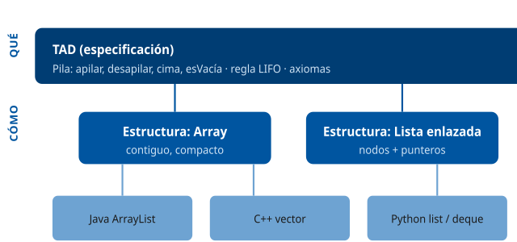

------------------------------------------------------------------------

### D2 · Pila (LIFO) vs Cola (FIFO)

**Sección**: §2.4 — Pilas y colas **Propósito**: Contrastar el acceso por un solo extremo (pila) frente a los dos extremos opuestos (cola).

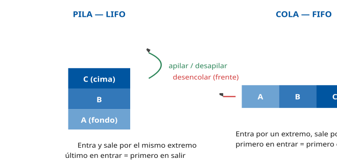

------------------------------------------------------------------------

### D3 · Lista enlazada simple y doble

**Sección**: §2.3 — Listas enlazadas **Propósito**: Visualizar los nodos con puntero al siguiente (simple) y a ambos lados (doble).

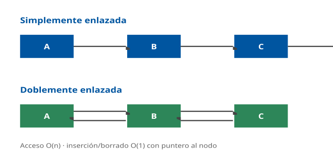

------------------------------------------------------------------------

### D4 · Tabla hash con colisiones (encadenamiento)

**Sección**: §2.5 — Tablas hash **Propósito**: Mostrar la función hash, el array de cubetas y la resolución de colisiones por encadenamiento.

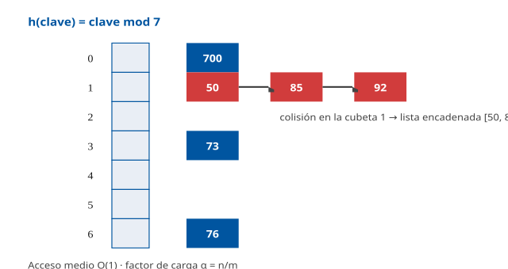

------------------------------------------------------------------------

### D5 · Árbol binario y recorridos

**Sección**: §2.6.1 — Árboles binarios y recorridos **Propósito**: Un árbol binario de búsqueda con los tres recorridos en profundidad.

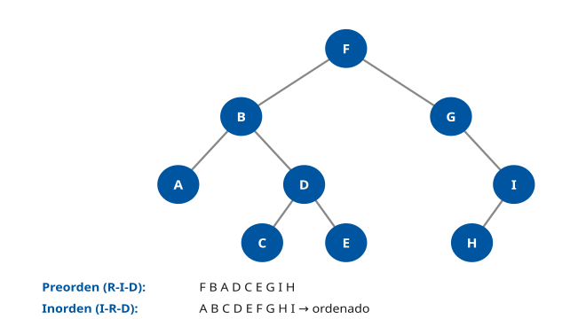

------------------------------------------------------------------------

### D6 · ABB y rotación AVL

**Sección**: §2.6.2 — Árboles binarios de búsqueda y equilibrado **Propósito**: Mostrar cómo un ABB degenerado se reequilibra con una rotación simple.

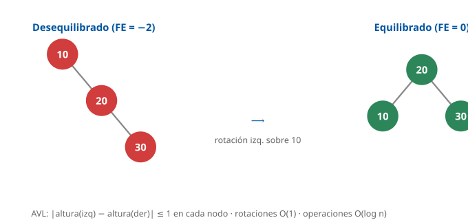

------------------------------------------------------------------------

### D7 · B+árbol como índice

**Sección**: §2.6.3 — Árboles multicamino **Propósito**: Visualizar nodos internos guía y hojas enlazadas con los datos.

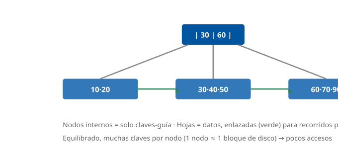

------------------------------------------------------------------------

### D8 · Montículo (heap) y su array

**Sección**: §2.6.4 — Montículos **Propósito**: Relacionar el árbol del max-heap con su representación en array (hijos en 2i+1, 2i+2).

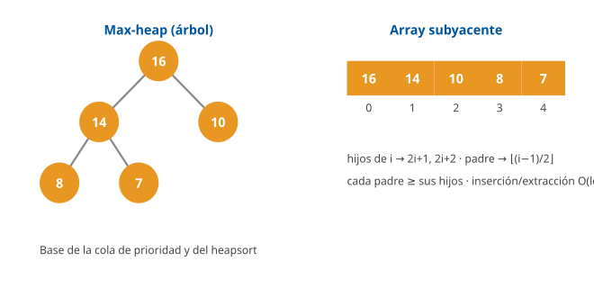

------------------------------------------------------------------------

### D9 · Grafo: matriz vs lista de adyacencia

**Sección**: §2.7 — Grafos **Propósito**: Mostrar las dos representaciones de un mismo grafo y su coste espacial.

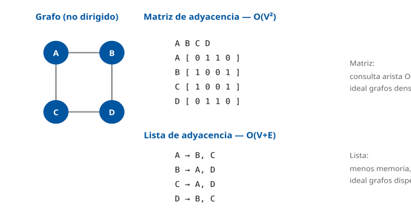

------------------------------------------------------------------------

### D10 · Organizaciones de fichero

**Sección**: §3 — Organización de ficheros **Propósito**: Contrastar secuencial, indexada y directa (hash).

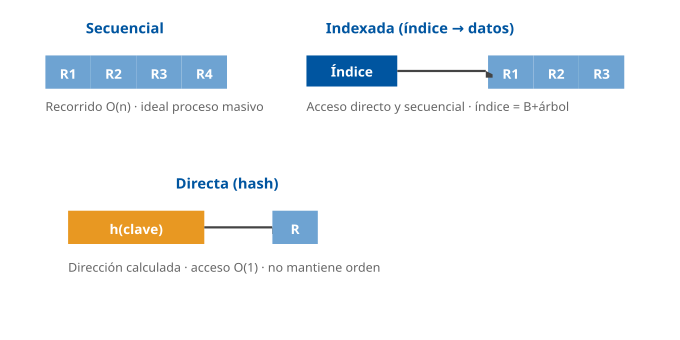

------------------------------------------------------------------------

### D11 · Niveles RAID (0/1/5)

**Sección**: §3.6 — Mecanismos de tolerancia a fallos **Propósito**: Visualizar el reparto de datos y la redundancia en RAID 0, 1 y 5.

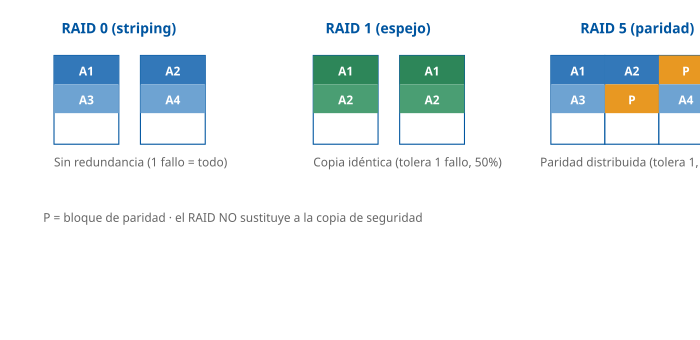

------------------------------------------------------------------------

### D12 · Jerarquía de complejidad O(n)

**Sección**: §4.2 — Complejidad algorítmica **Propósito**: Comparar visualmente el crecimiento de las cotas de complejidad más comunes.

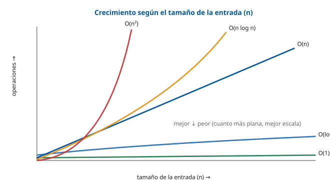

## Casos prácticos

### Caso 1 — El fichero del Padrón Municipal de Habitantes

#### Enunciado

El Padrón Municipal del Ayuntamiento de Madrid registra a unos **3,3 millones de habitantes**. Cada registro contiene, entre otros campos: DNI/NIE (clave primaria), nombre y apellidos, fecha de nacimiento, código de vía (calle), número, distrito y fecha de alta. El sistema debe soportar tres operaciones frecuentes:

1.  Consultar los datos de un habitante a partir de su **DNI/NIE**.
2.  Listar a todos los habitantes de un **distrito**.
3.  Validar en tiempo real, durante un alta, si un **DNI ya existe**.

Como técnico TIC, debe proponer la organización de datos más adecuada y justificarla.

#### Cuestiones

**Cuestión 1 — Organización del fichero (3 puntos).** Proponga la organización de fichero más adecuada para la operación 1 (consulta por DNI) y justifique por qué no bastaría una organización secuencial.

**Cuestión 2 — Índices (3 puntos).** Explique qué índice o índices crearía para soportar eficientemente las operaciones 1 y 2, indicando la estructura de datos concreta y su complejidad.

**Cuestión 3 — Validación de duplicados (2 puntos).** Para la operación 3 (validar si un DNI ya existe en tiempo real), ¿qué estructura de datos elegiría y por qué? Indique su complejidad media.

**Cuestión 4 — Compromiso (2 puntos).** El mantenimiento de varios índices tiene un coste. ¿En qué operaciones se nota ese coste y cómo lo justificaría ante un responsable?

#### Solución orientativa

- **C1**: organización **secuencial indexada** (o directa sobre un SGBD). La secuencial pura obligaría a recorrer hasta 3,3 M de registros (O(n)) por cada consulta; con un índice, el acceso por DNI es directo. *(§3.2, §3.4)*
- **C2**: un índice **primario B+árbol sobre DNI/NIE** (acceso O(log n), 3-4 accesos a disco) y un **índice secundario sobre distrito** que permita listar un distrito sin recorrer todo el fichero. Las hojas enlazadas del B+árbol facilitan además recorridos por rango. *(§2.6.3, §3.4)*
- **C3**: una **tabla hash** (o el propio índice único sobre DNI): comprobar la existencia de una clave es **O(1)** de media, idóneo para validación en tiempo real durante el alta. *(§2.5, §4.5.4)*
- **C4**: el coste se nota en las **altas, bajas y modificaciones**, porque cada índice debe actualizarse. Se justifica porque las **consultas** (mucho más frecuentes que las altas) se aceleran de O(n) a O(log n) u O(1); el equilibrio favorece claramente el uso de índices.

#### Criterios de evaluación

| Aspecto | Puntos |
|----|----|
| Identifica la organización indexada y descarta la secuencial con argumento de complejidad | 3 |
| Propone B+árbol e índice secundario por distrito, con complejidad correcta | 3 |
| Elige tabla hash / acceso O(1) para la validación en tiempo real | 2 |
| Razona el compromiso consulta vs mantenimiento de índices | 2 |

------------------------------------------------------------------------

#### Preguntas tipo test sobre este caso

##### 1. Para la consulta de un habitante por su DNI/NIE en el fichero del Padrón (unos 3,3 millones de registros), ¿qué organización de fichero es la más adecuada?

- a) Secuencial indexada, con un índice que permita el acceso directo por DNI/NIE.
- b) Secuencial pura, con los registros grabados por orden de fecha de alta.
- c) Enlazada, con cada registro apuntando al siguiente de su mismo distrito.

**Respuesta correcta:** a) · **Referencia:** Caso 1, cuestión 1 · §3.2

La organización secuencial indexada combina el fichero de datos con índices que permiten el acceso directo por clave además del secuencial.

##### 2. ¿Por qué no bastaría una organización secuencial pura para esa consulta?

- a) Porque no admite registros de longitud variable como el nombre y los apellidos del habitante.
- b) Porque obligaría a recorrer hasta 3,3 millones de registros en cada consulta, con coste O(n).
- c) Porque solo puede utilizarse sobre soportes de cinta y no sobre discos ni sobre SSD.

**Respuesta correcta:** b) · **Referencia:** Caso 1, cuestión 1 · §3.2

En un fichero secuencial, para leer un registro concreto hay que recorrer los anteriores: el acceso es O(n), lento para consultas individuales.

##### 3. ¿Qué índice crearía sobre el DNI/NIE y con qué complejidad de acceso?

- a) Un árbol binario de búsqueda sin equilibrar, con acceso O(1).
- b) Un montículo (heap) sobre el DNI/NIE, con acceso O(n log n).
- c) Un índice primario B+árbol, con acceso O(log n).

**Respuesta correcta:** c) · **Referencia:** Caso 1, cuestión 2 · §2.6.3, §3.4

El B+árbol es el índice estándar de ficheros y bases de datos: equilibrado, con muchas claves por nodo y acceso O(log n).

##### 4. ¿Cuántos accesos a disco necesita, aproximadamente, localizar a un habitante con ese índice?

- a) 3-4 accesos, la altura del árbol.
- b) Unos 20 accesos, como un árbol binario.
- c) Hasta 3,3 millones, uno por registro.

**Respuesta correcta:** a) · **Referencia:** Caso 1, cuestión 2 · §3.4

Al almacenar muchas claves por nodo, el B+árbol tiene pocos niveles: con 3,3 millones de registros basta con 3-4 accesos a disco.

##### 5. Para la operación 2 (listar a todos los habitantes de un distrito), conviene:

- a) Recorrer el fichero completo ordenado por DNI/NIE y filtrar por distrito.
- b) Una tabla hash sobre el DNI/NIE, que localiza cada registro en O(1).
- c) Un índice secundario sobre el distrito, para no recorrer todo el fichero.

**Respuesta correcta:** c) · **Referencia:** Caso 1, cuestión 2 · §3.4

Un índice secundario por distrito permite listar los habitantes de un distrito sin recorrer los 3,3 millones de registros; el índice por DNI no sirve para esa consulta.

##### 6. ¿Qué característica del B+árbol facilita los recorridos por rango?

- a) Que sus nodos internos guardan los registros completos y no solo claves-guía.
- b) Que sus hojas, donde están todas las claves, están enlazadas en una lista ordenada.
- c) Que calcula la posición de cada clave con una función hash que mantiene el orden.

**Respuesta correcta:** b) · **Referencia:** Caso 1, cuestión 2 · §2.6.3

En el B+árbol todas las claves de datos están en las hojas, enlazadas formando una lista ordenada; los nodos internos solo tienen claves-guía.

##### 7. Para validar en tiempo real, durante un alta, si un DNI ya existe, ¿qué estructura elegiría?

- a) Una tabla hash (o el índice único sobre DNI), con coste medio O(1).
- b) Una búsqueda secuencial sobre el fichero, con coste medio O(n/2).
- c) Una lista enlazada ordenada por DNI, con coste medio O(log n).

**Respuesta correcta:** a) · **Referencia:** Caso 1, cuestión 3 · §2.5, §4.5.4

Comprobar si una clave existe en una tabla hash cuesta O(1) de media, idóneo para una validación inmediata durante el alta.

##### 8. Ese coste O(1) es el del caso medio. ¿Qué coste tendría la comprobación en el peor caso, si todas las claves colisionaran en la misma posición?

- a) O(log n).
- b) O(n).
- c) O(n²).

**Respuesta correcta:** b) · **Referencia:** Caso 1, cuestión 3 · §2.5

En una tabla hash el acceso medio es O(1), pero si todas las claves colisionan en la misma posición la búsqueda degenera a O(n).

##### 9. ¿En qué operaciones se nota el coste de mantener varios índices sobre el Padrón?

- a) En las consultas por DNI/NIE, porque deben consultarse todos los índices.
- b) En los listados por distrito, porque el índice secundario se recalcula entero.
- c) En las altas, bajas y modificaciones, porque cada índice debe actualizarse.

**Respuesta correcta:** c) · **Referencia:** Caso 1, cuestión 4 · §3.4

Cada índice acelera un tipo de consulta a costa de espacio y de un coste de mantenimiento en altas, bajas y modificaciones.

##### 10. ¿Cómo justificaría ese coste ante un responsable?

- a) Las consultas, mucho más frecuentes que las altas, pasan de O(n) a O(log n) u O(1).
- b) Los índices reducen el espacio total que ocupa el fichero del Padrón en el disco.
- c) Los índices evitan tener que actualizar el fichero de datos cuando se producen altas.

**Respuesta correcta:** a) · **Referencia:** Caso 1, cuestión 4 · §3.4

El balance favorece los índices: penalizan algo las altas, pero aceleran las consultas, que son mucho más frecuentes; además ocupan espacio adicional, no lo reducen.

### Caso 2 — Procesamiento del censo electoral

#### Enunciado

Con motivo de unas elecciones municipales, el Ayuntamiento debe procesar el **censo electoral** de un distrito (unos 200.000 electores) almacenado en un fichero. Se necesita: (a) **ordenar** el censo por apellidos para imprimir las listas de las mesas; (b) **buscar** rápidamente a un elector concreto durante la jornada; (c) estimar el **coste** de cada operación para dimensionar el sistema.

#### Cuestiones

**Cuestión 1 — Algoritmo de ordenación (3 puntos).** El censo no cabe cómodamente en memoria y se exige que electores con el mismo primer apellido conserven su orden por segundo apellido (introducido en una pasada previa). ¿Qué algoritmo de ordenación elegiría y por qué? Indique su complejidad.

**Cuestión 2 — Estabilidad (2 puntos).** Explique qué es la **estabilidad** de un algoritmo de ordenación y por qué es relevante en este caso.

**Cuestión 3 — Búsqueda en la jornada (3 puntos).** Una vez ordenado e impreso el censo, durante la jornada se debe localizar a un elector por su posición alfabética. ¿Qué algoritmo de búsqueda aplica y qué requisito impone? Compare su coste con la búsqueda secuencial para 200.000 electores.

**Cuestión 4 — Complejidad (2 puntos).** Si un proceso auxiliar fuese O(n²), ¿sería viable con 200.000 registros? Justifique con una estimación del orden de operaciones.

#### Solución orientativa

- **C1**: **mergesort**. Es O(n log n) **garantizado**, **estable** (conserva el orden por segundo apellido) y apto para **ordenación externa** (datos que no caben en memoria), ya que se basa en mezclar bloques ordenados. Quicksort, aunque rápido, no es estable y degrada a O(n²) en el peor caso. *(§4.4.2)*
- **C2**: un algoritmo es **estable** si conserva el orden relativo de los elementos con clave igual. Aquí, al ordenar por primer apellido, dos electores con el mismo primer apellido deben mantener el orden por segundo apellido fijado antes: solo un algoritmo estable lo garantiza. *(§4.4)*
- **C3**: **búsqueda binaria**, O(log n), que **exige que el censo esté ordenado**. Para 200.000 electores: la binaria necesita a lo sumo ⌈log₂(200.000)⌉ ≈ **18** comparaciones, frente a hasta 200.000 de la secuencial. *(§4.5.2)*
- **C4**: un proceso O(n²) con n = 200.000 implicaría del orden de **4 × 10¹⁰ operaciones**. Con la referencia del ejercicio resuelto de §4.2 (10¹² operaciones ≈ minutos), serían del orden de **segundos**: viable para una ejecución puntual con operaciones sencillas en memoria. Pero no escala: el coste crece con el cuadrado de n (10 veces más registros, 100 veces más tiempo) y se dispara si el proceso se repite muchas veces o si cada operación es costosa (p. ej., un acceso a disco). Por eso conviene rediseñarlo a O(n log n), unos 3,5 × 10⁶ operaciones. *(§4.2)*

#### Criterios de evaluación

| Aspecto | Puntos |
|----|----|
| Elige mergesort y justifica (estable, garantizado, externo) | 3 |
| Define correctamente la estabilidad y su relevancia | 2 |
| Aplica búsqueda binaria, exige orden y compara costes numéricamente | 3 |
| Estima el orden de operaciones de O(n²) y razona su viabilidad y su escalabilidad | 2 |

------------------------------------------------------------------------

#### Preguntas tipo test sobre este caso

##### 1. El censo de 200.000 electores no cabe cómodamente en memoria y hay que conservar el orden previo por segundo apellido. ¿Qué algoritmo de ordenación elegiría?

- a) Quicksort.
- b) Mergesort.
- c) Heapsort.

**Respuesta correcta:** b) · **Referencia:** Caso 2, cuestión 1 · §4.4.2

Mergesort es O(n log n) garantizado, estable y apto para ordenación externa, porque se basa en mezclar bloques ya ordenados.

##### 2. ¿Qué propiedades justifican esa elección?

- a) Es in situ, no necesita memoria adicional y es el más rápido en la práctica.
- b) Es O(n) en todos los casos porque usa el valor de la clave como índice.
- c) Es O(n log n) garantizado, estable y apto para ordenación externa.

**Respuesta correcta:** c) · **Referencia:** Caso 2, cuestión 1 · §4.4.2

Mergesort garantiza O(n log n), es estable y se usa para ficheros que no caben en memoria; ser in situ y el más rápido en la práctica describe a quicksort, y el O(n) sin comparar claves, a los algoritmos no comparativos.

##### 3. ¿Por qué se descarta quicksort en este caso, aunque sea rápido?

- a) Porque no es estable y degrada a O(n²) en el peor caso.
- b) Porque es estable pero necesita memoria auxiliar O(n).
- c) Porque solo ordena claves numéricas de rango acotado.

**Respuesta correcta:** a) · **Referencia:** Caso 2, cuestión 1 · §4.4.2

Quicksort es O(n log n) de media pero O(n²) en el peor caso, y no es estable: no garantiza conservar el orden por segundo apellido.

##### 4. Heapsort también garantiza O(n log n). ¿Por qué no sirve aquí?

- a) Porque necesita memoria auxiliar O(n).
- b) Porque no es estable.
- c) Porque degrada a O(n²) en el peor caso.

**Respuesta correcta:** b) · **Referencia:** Caso 2, cuestión 1 · §4.4.2, §4.4.4

Heapsort es O(n log n) garantizado e in situ, pero no es estable, así que no conservaría el orden previo por segundo apellido.

##### 5. ¿Qué inconveniente tiene mergesort que conviene tener en cuenta al dimensionar el sistema?

- a) Requiere memoria auxiliar O(n) para la fase de mezcla.
- b) No es estable cuando hay apellidos repetidos en el censo.
- c) Degrada a O(n²) si el censo ya viene casi ordenado.

**Respuesta correcta:** a) · **Referencia:** Caso 2, cuestión 4 · §4.4.2

Mergesort es estable y garantiza O(n log n) en todos los casos, pero gasta memoria auxiliar O(n) para mezclar.

##### 6. ¿Qué significa que un algoritmo de ordenación sea estable?

- a) Que su tiempo de ejecución no varía con el orden inicial de los datos.
- b) Que ordena sin necesitar memoria adicional a la del propio vector.
- c) Que conserva el orden relativo de los elementos con clave igual.

**Respuesta correcta:** c) · **Referencia:** Caso 2, cuestión 2 · §4.4

Un algoritmo es estable si conserva el orden relativo de los elementos con clave igual; ordenar sin memoria adicional es ser in situ.

##### 7. ¿Por qué es relevante la estabilidad al ordenar el censo por primer apellido?

- a) Porque sin ella el algoritmo no podría ordenar a los electores que tienen dos apellidos compuestos.
- b) Porque los electores con igual primer apellido deben mantener el orden por segundo apellido ya fijado.
- c) Porque un algoritmo estable ordena el censo en O(n), más rápido que uno que no lo es.

**Respuesta correcta:** b) · **Referencia:** Caso 2, cuestión 2 · §4.4

Al ordenar por varios criterios sucesivos, solo un algoritmo estable garantiza que, a igual primer apellido, se conserve el orden por segundo apellido de la pasada anterior.

##### 8. Durante la jornada electoral hay que localizar a un elector por su posición alfabética. ¿Qué algoritmo de búsqueda se aplica y qué requisito impone?

- a) Búsqueda secuencial, O(log n), que exige que el censo esté ordenado.
- b) Búsqueda binaria, O(n), que no exige ningún orden previo del censo.
- c) Búsqueda binaria, O(log n), que exige que el censo esté ordenado.

**Respuesta correcta:** c) · **Referencia:** Caso 2, cuestión 3 · §4.5.2

La búsqueda binaria divide a la mitad el espacio de búsqueda en cada paso (O(log n)), pero exige datos ordenados; la secuencial es O(n) y no requiere orden.

##### 9. Para 200.000 electores, ¿cuántas comparaciones necesita como máximo la búsqueda binaria, frente a la secuencial?

- a) Unas 18, frente a hasta 200.000 de la secuencial.
- b) Unas 100.000, frente a hasta 200.000 de la secuencial.
- c) Unas 448, frente a hasta 200.000 de la secuencial.

**Respuesta correcta:** a) · **Referencia:** Caso 2, cuestión 3 · §4.5.2

La binaria necesita a lo sumo ⌈log₂(200.000)⌉ = 18 comparaciones (2¹⁸ = 262.144); la secuencial puede necesitar recorrer los 200.000.

##### 10. Si un proceso auxiliar fuese O(n²), ¿de qué orden sería el número de operaciones con n = 200.000?

- a) Del orden de 4 × 10⁵ operaciones.
- b) Del orden de 4 × 10¹⁰ operaciones.
- c) Del orden de 3,5 × 10⁶ operaciones.

**Respuesta correcta:** b) · **Referencia:** Caso 2, cuestión 4 · §4.2

n² = (2 × 10⁵)² = 4 × 10¹⁰; 4 × 10⁵ sería 2n, y unos 3,5 × 10⁶ corresponden a n log₂ n.

### Caso 3 — Gestión documental segura en la sede electrónica

#### Enunciado

La sede electrónica del Ayuntamiento custodia los **expedientes administrativos** de los ciudadanos: resoluciones, certificados y documentación aportada. Se exige: garantizar el **formato adecuado** para la conservación a largo plazo, **controlar el acceso** según el rol, **detectar manipulaciones** de los documentos y **tolerar fallos de hardware** sin pérdida de datos.

#### Cuestiones

**Cuestión 1 — Formato de conservación (3 puntos).** ¿Qué formato de fichero exigiría para los documentos de archivo y por qué? Cite la normativa aplicable a la Administración.

**Cuestión 2 — Control de acceso (3 puntos).** Describa cómo restringiría el acceso a un expediente para que solo el funcionario instructor pueda modificarlo, su unidad pueda consultarlo y el resto no tenga acceso. Indique el esquema de permisos.

**Cuestión 3 — Integridad (2 puntos).** ¿Qué mecanismo emplearía para detectar si un documento ha sido alterado tras su firma? Distinga entre un checksum simple y una función hash criptográfica.

**Cuestión 4 — Tolerancia a fallos (2 puntos).** Proponga una configuración de almacenamiento que permita seguir operando ante el fallo de un disco, y aclare si ello sustituye a la copia de seguridad.

#### Solución orientativa

- **C1**: **PDF/A** para los documentos de archivo (autocontenido, sin dependencias externas, pensado para conservación). La obligación de formatos abiertos y estándar proviene del **Esquema Nacional de Interoperabilidad** (RD 4/2010) y la Norma Técnica de Catálogo de estándares. *(§5.3 \[ENI-RD4-2010\])*
- **C2**: con permisos tipo **POSIX/ACL**: el instructor (propietario) `rw-`, su unidad (grupo) `r--`, otros `---` → equivalente a `chmod 640`. En un entorno Windows/NTFS se usarían **ACL** con permiso de modificación para el instructor, lectura para el grupo de la unidad y **denegación** (o ausencia de permiso) para el resto; la denegación explícita prevalece. *(§5.5.1, §5.5.2)*
- **C3**: una **función hash criptográfica** (SHA-256): cualquier alteración del documento cambia radicalmente su huella, lo que permite detectar manipulaciones (un checksum/CRC simple solo detecta errores accidentales, no manipulación intencionada; MD5/SHA-1 están obsoletos). *(§5.3 integridad; ampliación en Tema 32)*
- **C4**: un **RAID** con redundancia, p. ej. **RAID 5** (paridad distribuida, tolera el fallo de 1 disco) o RAID 1/10. **No sustituye** a la copia de seguridad: el RAID protege de fallos de disco, pero no de borrados, ransomware ni desastres; se necesita backup adicional. *(§3.6)*

#### Criterios de evaluación

| Aspecto | Puntos |
|----|----|
| Exige PDF/A y cita el ENI / formatos abiertos | 3 |
| Define el esquema de permisos (640 / ACL con denegación) coherente con el rol | 3 |
| Propone hash criptográfico y distingue de checksum simple | 2 |
| Propone RAID con redundancia y aclara que no sustituye al backup | 2 |

------------------------------------------------------------------------

### Nota pedagógica

Estos tres casos integran de forma transversal las cinco partes del tema: el Caso 1 enlaza **estructuras de datos** (§2) con **organización de ficheros** (§3); el Caso 2, los **algoritmos** de ordenación y búsqueda con su **complejidad** (§4); y el Caso 3, los **formatos** y la **seguridad** de la información (§5) con la tolerancia a fallos (§3.6). Todos se sitúan en supuestos reales del Ayuntamiento de Madrid (Padrón, censo electoral, sede electrónica), coherentes con la parte práctica del examen del Grupo II.

#### Preguntas tipo test sobre este caso

##### 1. ¿Qué formato de fichero exigiría para los documentos de archivo de la sede electrónica?

- a) DOCX.
- b) JPEG.
- c) PDF/A.

**Respuesta correcta:** c) · **Referencia:** Caso 3, cuestión 1 · §5.3

PDF/A es el formato para documentos de archivo: autocontenido, sin dependencias externas y pensado para la conservación a largo plazo.

##### 2. ¿De qué normativa procede la obligación de usar formatos abiertos y estándar en la Administración?

- a) Del Esquema Nacional de Interoperabilidad (RD 4/2010) y la Norma Técnica de Catálogo de estándares.
- b) Del Esquema Nacional de Seguridad y de la norma técnica de control de acceso a los ficheros.
- c) Del Reglamento de los Servicios de Prevención y de la norma técnica de digitalización.

**Respuesta correcta:** a) · **Referencia:** Caso 3, cuestión 1 · §5.3 [ENI-RD4-2010]

El Esquema Nacional de Interoperabilidad y la Norma Técnica de Catálogo de estándares obligan a usar formatos abiertos y estándar para la conservación y el acceso a largo plazo.

##### 3. Solo el funcionario instructor debe poder modificar el expediente, su unidad consultarlo y el resto no tener acceso. ¿Qué permiso POSIX lo implementa?

- a) chmod 750.
- b) chmod 640.
- c) chmod 664.

**Respuesta correcta:** b) · **Referencia:** Caso 3, cuestión 2 · §5.5.1

640 equivale a rw- para el propietario, r-- para el grupo y --- para otros; 750 da ejecución y 664 permite escribir al grupo y leer a otros.

##### 4. Con ese esquema, ¿qué pueden hacer los miembros de la unidad del instructor?

- a) Leer y modificar el expediente.
- b) Ni leer ni modificar el expediente.
- c) Leer el expediente, pero no modificarlo.

**Respuesta correcta:** c) · **Referencia:** Caso 3, cuestión 2 · §5.5.1

El dígito 4 del grupo equivale a r--: solo lectura.

##### 5. En un entorno Windows/NTFS, un usuario de otra unidad tiene permiso de lectura a través de un grupo, pero también una denegación explícita sobre el expediente. ¿Qué ocurre?

- a) Puede leerlo, porque el permiso del grupo prevalece sobre la denegación.
- b) No puede acceder, porque la denegación explícita prevalece sobre el permiso.
- c) Puede leerlo, porque en NTFS se aplica el permiso concedido en primer lugar.

**Respuesta correcta:** b) · **Referencia:** Caso 3, cuestión 2 · §5.5.2

En el modelo ACL de NTFS, las reglas de denegación explícita prevalecen sobre las de permiso.

##### 6. ¿Qué mecanismo emplearía para detectar si un documento se ha alterado tras su firma?

- a) Una función hash criptográfica, como SHA-256.
- b) Una suma de verificación simple, como un CRC.
- c) Un algoritmo de compresión sin pérdida, como GZIP.

**Respuesta correcta:** a) · **Referencia:** Caso 3, cuestión 3 · §5.3

Con una función hash criptográfica cualquier alteración del documento cambia radicalmente su huella, lo que permite detectar manipulaciones.

##### 7. ¿Por qué no basta con un checksum o CRC simple para esta finalidad?

- a) Porque no detecta los errores de transmisión ni de almacenamiento del documento.
- b) Porque solo puede calcularse sobre ficheros de texto plano y no sobre PDF/A.
- c) Porque detecta errores accidentales, pero no resiste una manipulación intencionada.

**Respuesta correcta:** c) · **Referencia:** Caso 3, cuestión 3 · §5.3

Los checksums y CRC detectan errores de transmisión o almacenamiento, pero no resisten la manipulación intencionada.

##### 8. Un proveedor propone calcular las huellas de los documentos con MD5. ¿Es adecuado?

- a) No, porque MD5 se considera obsoleta por colisiones demostradas.
- b) Sí, porque MD5 es una función hash criptográfica como SHA-256.
- c) Sí, siempre que se combine con un CRC sobre el mismo documento.

**Respuesta correcta:** a) · **Referencia:** Caso 3, cuestión 3 · §5.3

MD5 y SHA-1 se consideran obsoletas por colisiones demostradas; para integridad se usan SHA-256 o SHA-3.

##### 9. ¿Qué configuración de almacenamiento permite seguir operando ante el fallo de un disco?

- a) RAID 0, con reparto de datos, que tolera el fallo de un disco.
- b) RAID 5, con paridad distribuida, que tolera el fallo de un disco.
- c) Un único disco con journaling, que tolera el fallo de ese disco.

**Respuesta correcta:** b) · **Referencia:** Caso 3, cuestión 4 · §3.6

RAID 5 reparte los datos con paridad distribuida y tolera el fallo de un disco; RAID 0 no tiene redundancia y el journaling protege la consistencia, no frente a la pérdida del disco.

##### 10. ¿Sustituye ese RAID a la copia de seguridad de los expedientes?

- a) Sí, porque con la paridad se pueden reconstruir siempre todos los datos perdidos.
- b) Sí, siempre que se use RAID 6, que tolera el fallo simultáneo de dos discos.
- c) No, porque protege del fallo de disco, pero no de borrados, ransomware ni desastres.

**Respuesta correcta:** c) · **Referencia:** Caso 3, cuestión 4 · §3.6

El RAID protege de fallos de disco, pero no de borrados, ransomware ni desastres: hace falta, además, copia de seguridad.

## Fuentes

### Fuentes Tier 1 (primarias)

#### Algoritmos, estructuras de datos y TAD

| ID | Título | Autor / Origen | Edición / Año | Secciones usadas | Referencia |
|----|----|----|----|----|----|
| CLRS | Introduction to Algorithms | Cormen, Leiserson, Rivest, Stein | 4.ª ed., MIT Press, 2022 | Complejidad asintótica (cap. 3), ordenación (cap. 2, 6-8), tablas hash (cap. 11), ABB (cap. 12), rojo-negro (cap. 13), B-árboles (cap. 18), grafos BFS/DFS (cap. 20), montículos (cap. 6) | ISBN 978-0262046305 |
| KNUTH-V1 | The Art of Computer Programming, Vol. 1: Fundamental Algorithms | Donald E. Knuth | 3.ª ed., Addison-Wesley, 1997 | TAD, pilas, colas, listas enlazadas, árboles (§2.2-2.3) | ISBN 978-0201896831 |
| KNUTH-V3 | The Art of Computer Programming, Vol. 3: Sorting and Searching | Donald E. Knuth | 2.ª ed., Addison-Wesley, 1998 | Ordenación interna/externa, búsqueda secuencial/binaria/interpolación, hashing (§6.1-6.4) | ISBN 978-0201896855 |
| SEDGEWICK | Algorithms | Robert Sedgewick, Kevin Wayne | 4.ª ed., Addison-Wesley, 2011 | Estructuras de datos, ordenación, búsqueda, grafos, tablas de símbolos | ISBN 978-0321573513 |
| AHU | Data Structures and Algorithms | Aho, Hopcroft, Ullman | Addison-Wesley, 1983 | Definición formal de TAD, especificación algebraica | ISBN 978-0201000238 |
| WIRTH | Algorithms + Data Structures = Programs | Niklaus Wirth | Prentice-Hall, 1976 | Relación estructura de datos ↔ algoritmo, registros, ficheros | ISBN 978-0130224187 |
| LISKOV-GUTTAG | Program Development in Java: Abstraction, Specification, and OO Design | Barbara Liskov, John Guttag | Addison-Wesley, 2000 | Abstracción de datos, encapsulamiento, ocultación de información, especificación de TAD | ISBN 978-0201657685 |
| SKIENA | The Algorithm Design Manual | Steven Skiena | 3.ª ed., Springer, 2020 | Catálogo de estructuras y algoritmos, criterios de elección | ISBN 978-3030542559 |

#### Organización de ficheros y sistemas de ficheros

| ID | Título | Autor / Origen | Edición / Año | Secciones usadas | Referencia |
|----|----|----|----|----|----|
| SILBERSCHATZ-OS | Operating System Concepts | Silberschatz, Galvin, Gagne | 10.ª ed., Wiley, 2018 | Interfaz y estructura del sistema de ficheros, métodos de asignación (contigua, enlazada, indexada), directorios, journaling (cap. 13-15) | ISBN 978-1118063330 |
| TANENBAUM-MOS | Modern Operating Systems | Andrew Tanenbaum, Herbert Bos | 4.ª ed., Pearson, 2014 | Sistemas de ficheros, organización física, FAT, índices (cap. 4) | ISBN 978-0133591620 |
| FOLK-FILESTRUCT | File Structures: An Object-Oriented Approach with C++ | Folk, Zoellick, Riccardi | 3.ª ed., Addison-Wesley, 1998 | Organización secuencial, indexada (ISAM), directa/hashing, B-árbol y B+árbol como índice | ISBN 978-0201874013 |
| PATTERSON-RAID | A Case for Redundant Arrays of Inexpensive Disks (RAID) | Patterson, Gibson, Katz | ACM SIGMOD, 1988 | Definición original de los niveles RAID 1-5 | doi.org/10.1145/50202.50214 |
| SNIA-RAID | Common RAID Disk Data Format (DDF) | SNIA | v2.0, 2009 | Estandarización de niveles y formatos RAID | snia.org |
| MS-NTFS | NTFS File System / NTFS ACLs | Microsoft Learn | 2024 | NTFS, journaling (USN/\$LogFile), permisos ACL, herencia | learn.microsoft.com/windows-server/storage/file-server/ntfs-overview |
| MS-EXFAT | exFAT file system specification | Microsoft | 1.00, 2019 | Estructura exFAT, tabla de asignación | learn.microsoft.com/windows/win32/fileio/exfat-specification |
| EXT4-DOC | ext4 Data Structures and Algorithms | Kernel.org (documentación oficial) | 2024 | Estructura ext4, extents, journaling (jbd2), inodos | kernel.org/doc/html/latest/filesystems/ext4 |
| APFS-REF | Apple File System Reference | Apple Inc. | 2020 | APFS: copy-on-write, snapshots, clones | developer.apple.com/support/downloads/Apple-File-System-Reference.pdf |

#### Codificación, formatos y permisos

| ID | Título | Autor / Origen | Edición / Año | Secciones usadas | Referencia |
|----|----|----|----|----|----|
| POSIX | IEEE Std 1003.1 (POSIX.1-2017) — Base Specifications | IEEE / The Open Group | 2018 (Issue 7) | Modelo de permisos de fichero (rwx, ugo), bits especiales (setuid/setgid/sticky), API de ficheros | pubs.opengroup.org/onlinepubs/9699919799 |
| UNICODE-STD | The Unicode Standard, Versión 15.1 | Unicode Consortium | 2023 | UTF-8/16/32, code points, BOM, normalización | unicode.org/versions/Unicode15.1.0 |
| IEEE-754 | IEEE Standard for Floating-Point Arithmetic | IEEE | 754-2019 | Representación de reales en coma flotante (simple/doble precisión) | IEEE Std 754-2019 |
| [RFC-20](https://www.rfc-editor.org/rfc/rfc20) | ASCII format for Network Interchange | IETF | 1969 (estándar histórico) | Tabla ASCII 7 bits, caracteres de control | rfc-editor.org/rfc/rfc20 |
| ISO-8859 | ISO/IEC 8859-1 (Latin-1) y familia | ISO/IEC | 1998 | Juegos de caracteres de 8 bits | iso.org/standard/28245.html |
| ISO-11404 | ISO/IEC 11404 — General-Purpose Datatypes (GPD) | ISO/IEC | 2007 | Tipos de datos independientes de lenguaje: primitivos, agregados | iso.org/standard/39479.html |
| ISO-9075 | ISO/IEC 9075 — SQL:2016 | ISO/IEC | 2016, rev. 2023 | Catálogo de tipos de datos SQL (referencia cruzada con BBDD) | iso.org/standard/63555.html |
| LIBMAGIC | file(1) / libmagic — magic number database | The Open Group / proyecto file | 2024 | Identificación de formatos por número mágico | man7.org/linux/man-pages/man5/magic.5.html |
| [RFC-1952](https://www.rfc-editor.org/rfc/rfc1952) | GZIP file format specification | IETF | 1996 | Ejemplo de formato comprimido y su cabecera mágica | rfc-editor.org/rfc/rfc1952 |
| ISO-32000 | ISO 32000-1 — PDF | ISO | 2008 | Ejemplo de formato de documento y su cabecera `%PDF` | iso.org/standard/51502.html |

#### Normativa aplicable (sector público)

| ID | Título | Origen | Año | Uso |  |
|----|----|----|----|----|----|
| ENS-RD311 | Esquema Nacional de Seguridad ([Real Decreto 311/2022](https://www.boe.es/buscar/act.php?id=BOE-A-2022-7191)) | BOE | 2022 | Tríada CIA, control de acceso y cifrado de la información (§5.5) | boe.es/buscar/doc.php?id=BOE-A-2022-7191 |
| ENI-RD4-2010 | Esquema Nacional de Interoperabilidad ([Real Decreto 4/2010](https://www.boe.es/buscar/act.php?id=BOE-A-2010-1331)) | BOE | 2010 | Formatos abiertos y conservación de la información en la AAPP (§5.3) | boe.es/eli/es/rd/2010/01/08/4 |
| NTI-FORMATOS | [Norma Técnica de Interoperabilidad de Catálogo de estándares](https://www.boe.es/buscar/act.php?id=BOE-A-2012-13501) | SGAD | 2012, act. | Formatos admitidos en la Administración (PDF/A, ODF, etc.) | administracionelectronica.gob.es |

------------------------------------------------------------------------

### Fuentes Tier 2 (secundarias — contraste y referencia rápida)

| ID | Título | Origen | Uso |  |
|----|----|----|----|----|
| CPPREFERENCE | cppreference.com — Containers library | Comunidad C++ | Comportamiento de contenedores estándar (vector, list, map, unordered_map) |  |
| ORACLE-JCF | Java Collections Framework — Oracle Docs | Oracle | Correspondencia TAD ↔ implementación (List, Set, Map, Queue, Deque) |  |
| PYTHON-DOCS | Python Data Structures — docs.python.org | PSF | Ejemplos didácticos de listas, diccionarios, conjuntos |  |
| DATOS-MADRID | Portal de datos abiertos del Ayuntamiento de Madrid | Ayto. Madrid | Contexto real de ficheros y formatos para los casos prácticos (Padrón, censo, callejero) | datos.madrid.es |
| SEDE-MADRID | Sede electrónica del Ayuntamiento de Madrid | Ayto. Madrid | Contexto de gestión documental y formatos en la Administración municipal | sede.madrid.es |

------------------------------------------------------------------------
