# Tema 14. Los sistemas operativos

**Bloque:** técnico  
**Enunciado oficial** (BOAM n.º 10.032, de 23 de diciembre de 2025): Sistemas operativos. Características y elementos constitutivos. Sistemas Windows. Sistemas Unix y Linux. Sistemas operativos para dispositivos móviles.

Versión web: <https://ayuntamientomadrid.github.io/temario-tecnico-auxiliar/temas/tema-14.html> · PDF: [tema-14.pdf](tema-14.pdf) · Test: [../../../tests/tecnico/tema-14.md](../../../tests/tecnico/tema-14.md)

## Índice

- 1. Concepto y características del sistema operativo
  - 1.1. Definición y funciones
  - 1.2. Características
  - 1.3. Arquitecturas del sistema operativo
  - 1.4. Tipologías de sistemas operativos
  - 1.5. Generaciones y evolución
- 2. Componentes y elementos constitutivos
  - 2.1. Gestor de procesos
  - 2.2. Gestor de memoria
  - 2.3. Gestor de entrada/salida y recursos hardware
  - 2.4. Gestor de ficheros
  - 2.5. Seguridad y actualizaciones
  - 2.6. Interfaz de usuario
- 3. Sistemas Windows
  - 3.1. Evolución e historia
  - 3.2. El núcleo (arquitectura NT)
  - 3.3. PowerShell y línea de comandos
  - 3.4. Sistema de ficheros
  - 3.5. Interfaz gráfica
  - 3.6. Seguridad y actualizaciones
  - 3.7. Procesos, servicios y arranque
  - 3.8. Ediciones y distribución
- 4. Sistemas Unix y Linux
  - 4.1. Historia de UNIX y el estándar POSIX
  - 4.2. El kernel Linux
  - 4.3. La shell y la línea de comandos
  - 4.4. Sistemas de ficheros y jerarquía (FHS)
  - 4.5. Interfaces gráficas
  - 4.6. Seguridad y actualizaciones
  - 4.7. Distribuciones y software libre
- 5. Sistemas operativos para dispositivos móviles
  - 5.1. Factores diferenciadores
  - 5.2. Android
  - 5.3. iOS
  - 5.4. Comparativa y gestión de dispositivos móviles (MDM)
- Resumen final

### Conceptos clave para memorizar

| Concepto | Dato clave |
|----|----|
| Sistema operativo | Software que gestiona el hardware y ofrece servicios a las aplicaciones (máquina extendida + gestor de recursos) |
| Modo núcleo / modo usuario | El SO se ejecuta en modo privilegiado (kernel); las apps, en modo restringido (usuario) |
| Llamada al sistema (syscall) | Mecanismo por el que una app solicita un servicio al núcleo |
| Microkernel vs monolítico | Microkernel: núcleo mínimo, servicios en espacio de usuario; monolítico: todo en el núcleo |
| Proceso vs hilo | Proceso = programa en ejecución con su espacio de memoria; hilo = flujo dentro de un proceso, comparte memoria |
| Estados de un proceso | Nuevo, listo, en ejecución, bloqueado, terminado |
| Planificador (scheduler) | Decide qué proceso usa la CPU (round-robin, prioridades, SJF) |
| Interbloqueo (deadlock) | Procesos bloqueados esperándose mutuamente (condiciones de Coffman) |
| Memoria virtual | Abstracción que da a cada proceso un espacio mayor que la RAM física, usando disco (swap) |
| Paginación | División de memoria en páginas/marcos de tamaño fijo; la MMU traduce direcciones |
| Núcleo Windows NT | Arquitectura híbrida; modo núcleo/usuario; HAL aísla el hardware |
| POSIX | Norma IEEE 1003 de portabilidad entre sistemas tipo Unix |
| Kernel Linux | Monolítico modular (módulos cargables); creado por Linus Torvalds (1991) |
| Shell | Intérprete de comandos (Bash en Linux, PowerShell en Windows) |
| FHS | Estándar de jerarquía de ficheros de Linux (/bin, /etc, /home, /var…) |
| Android / iOS | Android sobre kernel Linux; iOS sobre Darwin (Unix/BSD); ambos con sandboxing y permisos por app |
| MDM | Mobile Device Management: gestión centralizada de dispositivos móviles corporativos |

## Contenido

### Convenciones del documento

Este tema incluye cuatro tipos de **cajas callout** para facilitar el estudio:

> **Dato clave.** Información de alta densidad memorística.

> **Ejercicio resuelto.** Problema + solución paso a paso (planificación, memoria, comandos).

> **Ejemplo de aplicación en el ayto.** Aplicación real de la teoría al entorno municipal (parque informático, sede electrónica, puestos de usuario, servidores).

> **Relación con otros temas.** Enlace conceptual a otros temas del temario oficial.

Los comandos y términos técnicos se mantienen en su nomenclatura original (kernel, shell, syscall, PowerShell…). Las fuentes se referencian con etiquetas breves tipo `[SILBERSCHATZ-OS, cap. 3]` — el registro completo está en la pestaña Fuentes.

------------------------------------------------------------------------

### 1. Concepto y características del sistema operativo

#### 1.1. Definición y funciones

Un **sistema operativo (SO)** es el conjunto de programas que **gestiona los recursos del hardware** y ofrece a las aplicaciones y a los usuarios una **interfaz** cómoda y segura para utilizarlos. Es la capa de software situada entre el hardware y las aplicaciones, y el primer programa que toma el control tras el arranque. \[SILBERSCHATZ-OS, cap. 1\]

Se describe desde dos puntos de vista complementarios \[TANENBAUM-MOS, cap. 1\]:

- **Máquina extendida (vista descendente)**: el SO oculta la complejidad del hardware y ofrece una "máquina virtual" más sencilla de programar. El programador escribe "abrir fichero", y no maneja sectores, cabezales ni controladores de disco.
- **Gestor de recursos (vista ascendente)**: el SO administra y reparte de forma ordenada los recursos (CPU, memoria, dispositivos) entre los procesos que compiten por ellos, evitando conflictos y garantizando un uso eficiente y justo.

Funciones principales del SO:

- **Gestión de procesos** (CPU): crear, planificar, sincronizar y terminar procesos.
- **Gestión de memoria**: asignar, proteger y liberar la memoria de cada proceso.
- **Gestión de entrada/salida**: controlar los dispositivos a través de los *drivers*.
- **Gestión de ficheros**: organizar la información persistente en disco (ver Tema 13).
- **Seguridad y protección**: autenticar a los usuarios y controlar el acceso a los recursos.
- **Interfaz de usuario**: ofrecer una línea de comandos (CLI) o un entorno gráfico (GUI).
- **Gestión de la comunicación y la red**: ofrecer servicios de red y comunicación entre procesos.

> **Dato clave.** El SO es **máquina extendida** (oculta el hardware, lo hace fácil de usar) y **gestor de recursos** (reparte CPU, memoria y dispositivos). Se sitúa entre las aplicaciones y el hardware.

**Modo núcleo y modo usuario.** El procesador distingue dos niveles de privilegio. En **modo núcleo (kernel)** se ejecuta el SO con acceso total al hardware y a todas las instrucciones. En **modo usuario**, restringido, se ejecutan las aplicaciones, que no pueden ejecutar instrucciones privilegiadas ni acceder directamente al hardware. Cuando una aplicación necesita un servicio del SO (leer un fichero, reservar memoria, crear un proceso) realiza una **llamada al sistema (system call o syscall)**, que provoca un cambio **controlado** a modo núcleo a través de una interrupción software (trap). Al terminar el servicio, el control vuelve a modo usuario. \[STALLINGS-OS\]

Este aislamiento es la base de la **protección**: una aplicación defectuosa o maliciosa no puede acceder directamente al hardware ni a la memoria de otro proceso ni del propio núcleo. El conjunto de syscalls forma la **API del sistema** (en POSIX: `open`, `read`, `write`, `fork`, `exec`…; en Windows, la Win32/Native API).

> **Dato clave.** La **llamada al sistema (syscall)** es el único mecanismo por el que una aplicación (modo usuario) solicita un servicio al núcleo (modo núcleo). El cambio de modo lo provoca un *trap* (interrupción software), no la propia aplicación directamente.

> **Relación con otros temas.** El modo de funcionamiento del procesador, los niveles de privilegio y los registros que los soportan se tratan en el Tema 11 (Arquitectura de ordenadores; componentes internos). La administración y el mantenimiento del SO ya instalado, en el Tema 27.

#### 1.2. Características

- **Multitarea (multiprogramación)**: el SO mantiene varios procesos en memoria y alterna la CPU entre ellos, dando la sensación de simultaneidad incluso con una sola CPU. Puede ser **cooperativa** (cada proceso cede la CPU voluntariamente; un proceso colgado bloquea el sistema) o **apropiativa/preemptiva** (el SO retira la CPU mediante interrupciones del reloj; es la habitual en los SO modernos).
- **Multiusuario**: varios usuarios pueden trabajar a la vez (en sistemas servidor o de tiempo compartido), con sus permisos, ficheros y recursos separados y protegidos entre sí.
- **Multiproceso (multiprocesamiento)**: el SO aprovecha **varias CPU o núcleos físicos** para ejecutar procesos realmente **en paralelo** (SMP, multiprocesamiento simétrico).
- **Multihilo (multithreading)**: un mismo proceso ejecuta varios **hilos** concurrentes que comparten su memoria, lo que permite, por ejemplo, que una aplicación responda a la interfaz mientras calcula en segundo plano.

> **Dato clave.** No confundir: **multitarea** (varios procesos alternándose, aunque haya 1 sola CPU), **multiproceso** (varias CPU/núcleos físicos ejecutando en paralelo) y **multihilo** (varios hilos dentro de un mismo proceso compartiendo memoria). **Apropiativa** = el SO retira la CPU; **cooperativa** = el proceso la cede.

#### 1.3. Arquitecturas del sistema operativo

La organización interna del núcleo admite varios modelos \[TANENBAUM-MOS, cap. 1\]\[SILBERSCHATZ-OS, cap. 2\]:

- **Monolítica**: todo el SO (gestión de procesos, memoria, ficheros, drivers) se ejecuta en modo núcleo como un único gran programa con llamadas internas directas. Es **rápido**, pero difícil de mantener y poco robusto: un fallo en un driver puede caer todo el sistema. **Linux** es monolítico, aunque **modular** (carga y descarga módulos en caliente).
- **Microkernel (micronúcleo)**: el núcleo se reduce al mínimo imprescindible (planificación de CPU, gestión básica de memoria y comunicación entre procesos); el resto de servicios (ficheros, drivers, pila de red) se ejecutan en **modo usuario** como procesos independientes que se comunican por **paso de mensajes**. Más **robusto y seguro** (un servicio que falle no tumba el núcleo y puede reiniciarse), pero con más **sobrecarga** por la mensajería. Ejemplos: **MINIX**, **QNX**.
- **Híbrida**: combina un núcleo amplio (por rendimiento) con cierta modularidad y servicios en espacio de usuario. **Windows NT** y **macOS (XNU)** son híbridos.
- **Por capas**: el SO se estructura en niveles, cada uno apoyado solo en el inferior (modelo clásico THE de Dijkstra). Facilita el diseño, pero la rigidez de las capas penaliza el rendimiento.
- **Exokernel / máquinas virtuales**: enfoques que exponen el hardware de forma más directa o que ejecutan varios SO sobre un **hipervisor** (base de la virtualización).

> **Dato clave.** **Monolítico** (todo en el núcleo: Linux) vs **microkernel** (núcleo mínimo, servicios en modo usuario por mensajes: MINIX, QNX) vs **híbrido** (Windows NT, macOS). El microkernel es más robusto/seguro pero más lento por el paso de mensajes; el monolítico es más rápido pero menos aislado.

#### 1.4. Tipologías de sistemas operativos

Según el tipo de procesamiento y uso \[STALLINGS-OS\]:

- **Por lotes (batch)**: ejecutan trabajos en serie sin interacción del usuario (históricos, procesos masivos).
- **De tiempo compartido (multiusuario interactivo)**: reparten la CPU entre usuarios interactivos mediante turnos cortos.
- **De tiempo real (RTOS)**: garantizan tiempos de respuesta **acotados**. **Estrictos (hard)**: el incumplimiento es crítico (control industrial, aviónica, frenado ABS). **Flexibles (soft)**: toleran pequeños retrasos (multimedia, streaming).
- **Distribuidos**: gestionan un conjunto de máquinas en red como si fueran un único sistema.
- **Empotrados (embedded)**: integrados en dispositivos específicos (routers, electrodomésticos, dispositivos IoT, automóviles), con recursos muy limitados.

#### 1.5. Generaciones y evolución

- **1.ª generación (1945-1955)**: sin SO; programación directa en lenguaje máquina mediante paneles y tarjetas perforadas.
- **2.ª generación (1955-1965)**: sistemas **por lotes** con monitores residentes que encadenaban trabajos.
- **3.ª generación (1965-1980)**: **multiprogramación** y **tiempo compartido** (CTSS, MULTICS). Nace **UNIX** (1969, Thompson y Ritchie en Bell Labs).
- **4.ª generación (1980-…)**: ordenadores personales; SO con **interfaz gráfica** (MS-DOS 1981, Apple Macintosh 1984, Windows). Aparece **Linux** (1991, Linus Torvalds).
- **Actualidad**: SO **móviles** (iOS 2007, Android 2008), **virtualización**, **contenedores** (Docker, Kubernetes) y **computación en la nube**.

> **Relación con otros temas.** La virtualización de sistemas y de puestos de usuario se desarrolla en el Tema 28; los paradigmas de computación distribuida y los servicios en la nube (IaaS/PaaS/SaaS), en el Tema 31.

------------------------------------------------------------------------

### 2. Componentes y elementos constitutivos

#### 2.1. Gestor de procesos

Un **proceso** es un **programa en ejecución**, con su propio espacio de memoria (código, datos, pila y montículo), sus registros y su estado. El SO representa cada proceso mediante un **PCB (Process Control Block / Bloque de Control de Proceso)**, una estructura que guarda su identificador (PID), su estado, el contenido de sus registros, la información de planificación, de memoria y de los ficheros abiertos. \[SILBERSCHATZ-OS, cap. 3\]

Un **hilo (thread)** es un flujo de ejecución **dentro** de un proceso. Los hilos de un mismo proceso **comparten** su memoria y recursos, pero cada uno tiene su **propia pila y su contador de programa**. Crear un hilo es mucho más ligero que crear un proceso, y la comunicación entre hilos es inmediata (memoria compartida).

> **Dato clave.** **Proceso** = programa en ejecución con espacio de memoria propio y aislado, descrito por su **PCB**. **Hilo** = flujo dentro de un proceso que comparte su memoria. Crear/cambiar un hilo es más barato que crear/cambiar un proceso.

**Estados de un proceso** \[SILBERSCHATZ-OS, cap. 3\]:

- **Nuevo**: se está creando.
- **Listo (ready)**: preparado, esperando en la cola que el planificador le asigne la CPU.
- **En ejecución (running)**: usando la CPU (solo uno por núcleo a la vez).
- **Bloqueado/En espera (waiting)**: esperando un evento (fin de una E/S, un recurso, una señal).
- **Terminado (terminated)**: ha finalizado.

Transiciones clave: el planificador despacha un proceso de *listo* a *en ejecución*; una interrupción de reloj lo expulsa de *en ejecución* a *listo*; una solicitud de E/S lo pasa a *bloqueado*; al completarse la E/S vuelve a *listo*. El **cambio de contexto (context switch)** —guardar el PCB del proceso saliente y cargar el del entrante— tiene un coste que conviene minimizar.

**Planificación de la CPU (scheduling).** El **planificador (scheduler)** decide qué proceso de la cola de listos usa la CPU; el **despachador (dispatcher)** realiza el cambio de contexto. Algoritmos clásicos \[SILBERSCHATZ-OS, cap. 5\]:

- **FCFS (First Come First Served)**: por orden de llegada (no apropiativo). Simple, pero penaliza a los procesos cortos que llegan tras uno largo (**efecto convoy**).
- **SJF (Shortest Job First)**: primero el trabajo de **ráfaga más corta**. Óptimo en tiempo de espera medio, pero requiere estimar la duración; su versión apropiativa es **SRTF**.
- **Round-Robin (turno rotatorio)**: cada proceso recibe un **quantum** de tiempo fijo; al agotarlo, pasa al final de la cola de listos. Es la base del **tiempo compartido**. Un quantum muy pequeño dispara los cambios de contexto; uno muy grande lo acerca a FCFS.
- **Por prioridades**: se ejecuta el de mayor prioridad. Riesgo de **inanición (starvation)** de los de baja prioridad, mitigado con **envejecimiento (aging)** (subir la prioridad con el tiempo de espera).
- **Colas multinivel con realimentación**: varias colas con distinta prioridad y quantum; los procesos migran entre colas según su comportamiento. Es el modelo de los SO reales.

> **Ejercicio resuelto.** Round-Robin con quantum = 4 y tres procesos que llegan a la vez con ráfagas P1=8, P2=4, P3=9: el reparto es P1(4) → P2(4) → P3(4) → P1(4) → P3(4) → P3(1). P2 termina en t=8, P1 en t=16, P3 en t=21. Ningún proceso monopoliza la CPU: ese es el objetivo del turno rotatorio frente a FCFS.

**Comparativa de algoritmos de planificación:**

| Algoritmo | Apropiativo | Criterio | Ventaja | Inconveniente |
|----|----|----|----|----|
| FCFS | No | Orden de llegada | Simple, justo | Efecto convoy |
| SJF / SRTF | No / Sí | Ráfaga más corta | Mínimo tiempo de espera medio | Hay que estimar la ráfaga; inanición de los largos |
| Round-Robin | Sí | Quantum por turnos | Buen tiempo de respuesta interactivo | Muchos cambios de contexto si el quantum es bajo |
| Prioridades | Sí/No | Prioridad | Atiende lo urgente | Inanición (mitigada con aging) |
| Multinivel realimentada | Sí | Varias colas | Se adapta al comportamiento | Compleja de afinar |

Conviene distinguir **tres niveles de planificador**: el **planificador a largo plazo** (admisión de trabajos al sistema), el **de medio plazo** (suspende/reanuda procesos intercambiándolos a disco, *swapping*) y el **de corto plazo** (el *dispatcher*, que elige el proceso de la cola de listos en cada turno; es el que ejecutan los algoritmos anteriores). Métricas que se buscan optimizar: **uso de CPU**, **productividad (throughput)**, **tiempo de retorno**, **tiempo de espera** y **tiempo de respuesta**.

**Concurrencia y sincronización.** Cuando varios procesos o hilos acceden simultáneamente a recursos compartidos pueden producirse **condiciones de carrera** (el resultado depende del orden de ejecución). El SO ofrece mecanismos de sincronización para proteger las **secciones críticas**: **semáforos** (contadores con operaciones `wait`/`signal`), **mutex** (exclusión mutua binaria), **monitores** y **variables de condición**. Problemas clásicos: productor-consumidor, lectores-escritores y la cena de los filósofos. \[SILBERSCHATZ-OS, cap. 6\]

**Interbloqueo (deadlock).** Situación en la que un conjunto de procesos queda bloqueado **indefinidamente**, cada uno esperando un recurso que retiene otro del conjunto. Requiere las **cuatro condiciones de Coffman** simultáneamente: **exclusión mutua**, **retención y espera** (hold and wait), **no apropiación** y **espera circular**. Estrategias: **prevención** (negar alguna condición), **evitación** (algoritmo del banquero de Dijkstra, que solo concede recursos si el estado resultante es seguro), **detección y recuperación**, o **ignorarlo** (algoritmo del avestruz) y reiniciar, opción habitual en SO de propósito general. \[TANENBAUM-MOS, cap. 6\]

> **Dato clave.** Las **4 condiciones de Coffman** del interbloqueo: exclusión mutua, retención y espera, no apropiación y espera circular. **Romper cualquiera** de ellas evita el deadlock. El **algoritmo del banquero** (Dijkstra) es de **evitación**. No confundir interbloqueo (deadlock) con inanición (starvation, esperar indefinidamente por baja prioridad).

#### 2.2. Gestor de memoria

El gestor de memoria asigna memoria a los procesos, la protege para que ninguno invada la de otro, y permite que muchos convivan aunque no quepan todos en la RAM. \[SILBERSCHATZ-OS, cap. 9-10\]

- **Memoria real (física)**: el proceso usa direcciones físicas directas. Técnicas históricas de **particiones fijas y variables**, que sufren **fragmentación** interna (espacio desperdiciado dentro de una partición) y externa (huecos libres no contiguos).
- **Memoria virtual**: cada proceso "ve" un espacio de direcciones **lógico** propio y mayor que la RAM física. La **MMU (Memory Management Unit)**, hardware del procesador, traduce en cada acceso la dirección lógica a física. Las partes no usadas se mantienen en disco (**swap / área de intercambio**) y se cargan **bajo demanda**. Ventajas: ejecutar programas mayores que la RAM, aislar y proteger los espacios de cada proceso, y compartir páginas comunes.

Dos técnicas de organización del espacio:

- **Paginación**: divide la memoria **lógica** en **páginas** y la **física** en **marcos (frames)** del **mismo tamaño** (típicamente 4 KB). Una **tabla de páginas** por proceso mapea cada página a su marco. Elimina la fragmentación externa (cualquier página va en cualquier marco). La **TLB (Translation Lookaside Buffer)** es una caché de traducciones que acelera el acceso.
- **Segmentación**: divide la memoria en **segmentos** de **tamaño variable** según la lógica del programa (código, datos, pila), lo que respeta la visión del programador, pero reintroduce fragmentación externa. Suele combinarse con paginación (segmentación paginada).

Cuando se accede a una página que no está en RAM se produce un **fallo de página (page fault)**: el SO la trae de disco y, si no hay marcos libres, elige una **víctima** a expulsar con un algoritmo de **reemplazo**: **óptimo** (teórico), **LRU (Least Recently Used)**, **FIFO** (sufre la anomalía de Belady) o aproximaciones (segunda oportunidad/reloj). Un exceso de fallos por falta de RAM provoca **hiperpaginación (thrashing)**: el sistema pasa más tiempo intercambiando páginas que ejecutando, y el rendimiento se desploma; se controla con el modelo del **conjunto de trabajo (working set)**.

> **Dato clave.** **Memoria virtual** = espacio lógico mayor que la RAM, con la **MMU** traduciendo direcciones y el disco (swap) como respaldo. **Paginación** = bloques de **tamaño fijo** (página↔marco), sin fragmentación externa; **segmentación** = bloques de **tamaño variable** según la lógica del programa. **Fallo de página** = la página solicitada no está en RAM. **Thrashing** = degradación por exceso de fallos al faltar memoria.

> **Ejercicio resuelto.** Con páginas de **4 KB** (4.096 bytes), la dirección lógica se divide en **número de página** (bits altos) y **desplazamiento** (12 bits bajos, porque 2¹² = 4.096). Para la dirección lógica 9.000: página = 9.000 / 4.096 = **2**, desplazamiento = 9.000 mod 4.096 = **808**. Si la tabla de páginas indica que la página 2 está en el marco 5, la dirección física es 5 × 4.096 + 808 = **21.288**. La MMU hace este cálculo en cada acceso, acelerado por la TLB.

**Paginación frente a segmentación:**

| Aspecto | Paginación | Segmentación |
|----|----|----|
| Tamaño de bloque | Fijo (página = marco) | Variable (según la lógica) |
| Fragmentación | Interna (poca) | Externa |
| Visión del programador | Lineal, transparente | Lógica (código, datos, pila) |
| Traducción | Nº página + desplazamiento | Nº segmento + desplazamiento (con base y límite) |

> **Relación con otros temas.** La jerarquía de memoria física (registros, caché, RAM, ROM) sobre la que se apoya esta gestión, y la propia MMU, se introducen en el Tema 11.

#### 2.3. Gestor de entrada/salida y recursos hardware

El SO controla todos los dispositivos a través de los **controladores (drivers)**, módulos de software específicos que traducen las órdenes genéricas del SO al protocolo concreto de cada dispositivo, ofreciendo al resto del sistema una interfaz uniforme. \[SILBERSCHATZ-OS, cap. 12\]\[TANENBAUM-MOS, cap. 5\]

Mecanismos clave:

- **Interrupciones**: el dispositivo **avisa** a la CPU cuando termina una operación, en lugar de que la CPU pregunte continuamente (**polling**, espera activa que desperdicia ciclos). La CPU atiende la interrupción ejecutando su **rutina de servicio (ISR)**.
- **DMA (Direct Memory Access)**: un controlador especializado transfiere bloques de datos entre el dispositivo y la memoria **sin** intervención continua de la CPU, que solo es avisada al terminar. Imprescindible para discos y red de alta velocidad.
- **Spooling**: para dispositivos compartidos y lentos (impresoras), el SO almacena los trabajos en una **cola en disco** y los sirve en orden, permitiendo que las aplicaciones no esperen.
- **Buffering y caché de disco**: amortiguan la diferencia de velocidad entre la CPU y los dispositivos, y reducen los accesos físicos.

#### 2.4. Gestor de ficheros

El SO organiza la información persistente en **ficheros** y **directorios** sobre el almacenamiento, gestionando la asignación de espacio, los metadatos, el montaje de volúmenes y los permisos. Es uno de los componentes esenciales del SO, pero se desarrolla en profundidad en otro tema.

> **Relación con otros temas.** La organización de ficheros, los sistemas de ficheros (FAT, NTFS, ext4…), los métodos de asignación (contigua, enlazada, indexada con inodos) y los esquemas de permisos se desarrollan en el Tema 13 (Organización de ficheros; seguridad de la información).

#### 2.5. Seguridad y actualizaciones

El SO es responsable de la **protección** (mecanismos internos: aislamiento de procesos, control de acceso a los recursos) y participa en la **seguridad** frente a amenazas externas. Elementos esenciales:

- **Autenticación** de usuarios: contraseña, biometría, token, doble factor.
- **Autorización / control de acceso**: permisos, ACL, roles; principio de **mínimo privilegio**.
- **Registro y auditoría (logging)**: trazas de los accesos y eventos del sistema.
- **Cifrado**: de ficheros y de disco completo.
- **Actualizaciones de seguridad (parcheado)**: corrección periódica de vulnerabilidades; el SO sin parchear es la principal vía de ataque.

En el sector público, el **Esquema Nacional de Seguridad** y las **guías CCN-STIC** del Centro Criptológico Nacional definen el **bastionado (hardening)** obligatorio de los sistemas operativos. \[ENS-RD311\]\[CCN-STIC\]

> **Relación con otros temas.** Los conceptos de seguridad de los sistemas de información (amenazas, criptografía, firma digital) se desarrollan en el Tema 32; la administración, actualización y mantenimiento del SO ya en explotación, en el Tema 27.

#### 2.6. Interfaz de usuario

El SO ofrece dos formas de interacción:

- **CLI (Command Line Interface)**: intérprete de comandos (**shell**). Potente, automatizable mediante *scripts*, ligera y reproducible; preferida en servidores y administración. Ejemplos: **Bash** (Linux), **PowerShell** (Windows).
- **GUI (Graphical User Interface)**: entorno gráfico con ventanas, iconos, menús y puntero (paradigma WIMP). Más accesible e intuitiva para el usuario final.

> **Dato clave.** **CLI** (línea de comandos: potente, scriptable, ligera, servidores) vs **GUI** (gráfica: accesible, usuario final). La **shell** es el intérprete de comandos: **Bash** en Linux, **PowerShell** (orientada a objetos) en Windows.

------------------------------------------------------------------------

### 3. Sistemas Windows

#### 3.1. Evolución e historia

Microsoft Windows pasó de ser un **entorno gráfico sobre MS-DOS** (Windows 1.0 en 1985; la serie 3.x) a un **sistema operativo completo**. Dos linajes confluyeron: la línea **doméstica** (95, 98, ME), aún apoyada en DOS, y la línea profesional **NT** (Windows NT, 1993), un SO nuevo de 32 bits con núcleo propio. Ambas se unificaron en **Windows XP** (2001). Hitos posteriores: **7** (2009), **8** (2012), **10** (2015) y **11** (2021). En el lado servidor, **Windows Server** (2003, 2008, 2012, 2016, 2019, 2022) es la base de la infraestructura corporativa, con **Active Directory** como pieza central. \[WININTERNALS\]

#### 3.2. El núcleo (arquitectura NT)

Windows moderno se basa en el núcleo **NT**, de arquitectura **híbrida**: un núcleo amplio por rendimiento, pero con servicios modulares. Distingue **modo núcleo** —que contiene el **Executive** (gestores de procesos, memoria, E/S, seguridad), el **Kernel** (planificación y sincronización de bajo nivel), los **drivers** y la **HAL**— y **modo usuario** —procesos del sistema, subsistemas de entorno (Win32), servicios y aplicaciones—. La **HAL (Hardware Abstraction Layer)** aísla el núcleo de las particularidades del hardware concreto, lo que facilita la portabilidad entre plataformas. La configuración del sistema se centraliza en el **Registro de Windows** (base de datos jerárquica). \[WININTERNALS\]

> **Dato clave.** El núcleo de Windows (**NT**) es **híbrido**; separa modo núcleo (Executive, Kernel, HAL, drivers) y modo usuario (subsistemas, servicios, apps). La **HAL** abstrae el hardware. La configuración vive en el **Registro**. No es un microkernel puro ni un monolítico puro.

#### 3.3. PowerShell y línea de comandos

Windows ofrece la consola clásica (`cmd`) y, sobre todo, **PowerShell**: una shell y lenguaje de *scripting* orientado a **objetos** (no a texto plano como las shells Unix), construido sobre .NET. Sus comandos son **cmdlets** con la forma `Verbo-Nombre` (`Get-Process`, `Set-Service`, `Get-ChildItem`), y al encadenarlos por tubería se pasan **objetos** (con sus propiedades), no cadenas de texto. Es la herramienta estándar de automatización y administración de Windows, también en servidores. \[MS-PWSH\]

#### 3.4. Sistema de ficheros

El sistema de ficheros nativo es **NTFS** (journaling, ACL granulares, compresión, cifrado **EFS**, cuotas, enlaces, instantáneas). Para escenarios de gran volumen y resiliencia existe **ReFS (Resilient File System)**, con integridad por checksums. **FAT32/exFAT** se reservan para compatibilidad y soportes extraíbles. \[MS-NTFS\]

> **Relación con otros temas.** El detalle interno de NTFS, ext4 y demás sistemas de ficheros, el journaling y los permisos/ACL se desarrolla en el Tema 13.

#### 3.5. Interfaz gráfica

Windows **integra de forma nativa** su entorno gráfico (escritorio, menú Inicio, barra de tareas, explorador de archivos), gestionado por subsistemas del propio SO. A diferencia de Linux, la GUI **no es separable ni opcional**: forma parte indisociable del sistema (salvo ediciones específicas como Server Core, orientadas a línea de comandos).

#### 3.6. Seguridad y actualizaciones

- **UAC (User Account Control)**: solicita confirmación explícita para las acciones que requieren privilegios de administrador, aplicando el mínimo privilegio.
- **Microsoft Defender**: antivirus y antimalware integrado.
- **BitLocker**: cifrado de disco completo (apoyado en el chip **TPM**).
- **Windows Update**: distribución de parches; en entornos corporativos se centraliza con **WSUS** o **Microsoft Intune**.
- **Active Directory (AD)**: servicio de **directorio** que centraliza, en un **dominio**, la autenticación (protocolo **Kerberos**), los usuarios, los equipos y las **políticas de grupo (GPO)** que aplican configuración y seguridad de forma uniforme a miles de puestos. \[MS-AD\]\[MS-WINSEC\]

> **Ejemplo de aplicación en el ayto.** El parque de puestos de trabajo del Ayuntamiento se administra típicamente con un **dominio Active Directory**: la autenticación de cada empleado, los permisos sobre las carpetas compartidas y la configuración de seguridad (bloqueo de pantalla, cifrado BitLocker, ventana de actualizaciones, restricción de software) se aplican de forma centralizada mediante **GPO**, siguiendo las guías **CCN-STIC** de bastionado.

#### 3.7. Procesos, servicios y arranque

Windows ejecuta **procesos** (`.exe`) y, en segundo plano, **servicios** (procesos sin interfaz que arrancan con el sistema: spooler de impresión, actualizaciones, etc.), gestionados por el **Administrador de Control de Servicios**. El arranque moderno parte de **UEFI** → cargador `bootmgr`/`winload` → núcleo NT → sesión de usuario. Herramientas de administración: Administrador de tareas, `services.msc`, el **Registro** (`regedit`) y el **Visor de eventos** para la auditoría.

> **Relación con otros temas.** El firmware **UEFI** y el arranque seguro (Secure Boot) sobre el que se apoya este proceso se tratan en el Tema 11.

#### 3.8. Ediciones y distribución

Windows se ofrece en **ediciones** según el uso: **Home, Pro y Enterprise** (cliente), y **Windows Server** en ediciones Standard y Datacenter. Es **software propietario** con licencia de pago (por equipo, o por usuario/dispositivo mediante CAL en servidor). La edición **Server Core** prescinde de la GUI completa para reducir recursos y superficie de ataque en servidores.

------------------------------------------------------------------------

### 4. Sistemas Unix y Linux

#### 4.1. Historia de UNIX y el estándar POSIX

**UNIX** nació en 1969 en los **Bell Labs** (Ken Thompson, Dennis Ritchie). Su reescritura en lenguaje **C** (1973) lo hizo **portable** entre máquinas, algo decisivo para su difusión en universidades y empresas. De UNIX derivan dos grandes familias: **System V** (AT&T) y **BSD** (Berkeley). Ante la proliferación de "Unix" incompatibles surgió el estándar **POSIX** (IEEE 1003), que normaliza la **API del sistema**, la **shell** y las **utilidades**, garantizando que el software portátil funcione en cualquier sistema conforme. \[POSIX\]

**GNU y Linux.** En 1983, Richard Stallman inicia el proyecto **GNU** ("GNU's Not Unix"), un sistema Unix **libre** con la licencia **GPL**, del que solo faltaba un núcleo maduro. En **1991, Linus Torvalds** publica el **núcleo Linux**. La combinación del núcleo Linux con las herramientas GNU dio lugar a **GNU/Linux**, un sistema operativo libre y completo. \[LOVE-LKD\]\[GPL\]

> **Dato clave.** **UNIX**: 1969, Bell Labs (Thompson y Ritchie), reescrito en **C** en 1973 (lo hizo portable). **POSIX**: norma **IEEE 1003** de portabilidad entre sistemas Unix. **Linux**: Linus Torvalds publica el **núcleo** en **1991**; combinado con las herramientas **GNU** (Stallman, licencia GPL) forma **GNU/Linux**. Linux, en rigor, es solo el **núcleo**.

#### 4.2. El kernel Linux

El núcleo de Linux es **monolítico pero modular**: todos los servicios principales (procesos, memoria, red, sistemas de ficheros) se ejecutan en modo núcleo por rendimiento, pero pueden cargarse y descargarse **módulos** en caliente (drivers, sistemas de ficheros) sin reiniciar. Una pieza clave es el **VFS (Virtual File System)**, que ofrece una **interfaz común** a los muy distintos sistemas de ficheros (ext4, XFS, Btrfs, NFS), de modo que las aplicaciones los usan de forma uniforme. El arranque y la gestión de servicios modernos se apoyan en **systemd** (el `init` actual de la mayoría de distribuciones). \[LOVE-LKD\]\[KERNEL-DOC\]

> **Dato clave.** El kernel Linux es **monolítico modular**: núcleo único en modo privilegiado, con **módulos cargables en caliente**. El **VFS** ofrece una interfaz única para ext4, XFS, etc. El gestor de arranque y servicios habitual es **systemd**.

#### 4.3. La shell y la línea de comandos

La **shell** es el intérprete de comandos; la más extendida es **Bash** (Bourne Again SHell). Sobre los principios de Unix —"**todo es un fichero**", y "programas pequeños que hacen una cosa bien y se combinan"— se construye una administración muy potente mediante **tuberías (pipes `|`)**, **redirecciones** (`>`, `<`) y *scripts*. \[GNU-BASH\]

> **Ejercicio resuelto.** El comando `ps aux | grep apache | wc -l` encadena tres programas con tuberías: `ps aux` lista todos los procesos, `grep apache` filtra los que contienen "apache" y `wc -l` cuenta las líneas resultantes → número de procesos de Apache en ejecución. Esta composición de herramientas simples es la esencia de la filosofía Unix.

Comandos habituales de administración: `ls`, `cd`, `cp`, `mv`, `rm` (ficheros); `chmod`, `chown` (permisos); `ps`, `top`, `kill` (procesos); `df`, `du`, `mount` (almacenamiento); `apt`/`dnf` (paquetes); `systemctl` (servicios); `man` (ayuda).

**Arranque y servicios con systemd.** El primer proceso del sistema (PID 1) es **systemd**, que sustituyó al `init` tradicional de System V (con sus *runlevels* 0-6). systemd gestiona los servicios como **units** y agrupa estados en **targets** (p. ej. `multi-user.target` ≈ modo consola multiusuario, `graphical.target` ≈ con entorno gráfico). Se administra con `systemctl start/stop/enable/status <servicio>` y los registros con `journalctl`.

> **Dato clave.** En Linux moderno el proceso **PID 1** es **systemd** (sustituye al `init` System V y sus *runlevels*). Gestiona servicios (*units*) y estados del sistema (*targets*); se controla con `systemctl`. La shell sigue la filosofía "todo es un fichero" y compone programas con tuberías.

#### 4.4. Sistemas de ficheros y jerarquía (FHS)

Linux usa principalmente **ext4** (con journaling), y también **XFS** (alto rendimiento en servidores) y **Btrfs/ZFS** (copy-on-write, snapshots, checksums). La organización de directorios sigue el **FHS (Filesystem Hierarchy Standard)**, con una **raíz única `/`** de la que cuelga todo (no hay letras de unidad: los discos se **montan** en directorios):

- `/` raíz · `/bin`, `/usr/bin` binarios · `/etc` configuración · `/home` carpetas de usuarios · `/var` datos variables (logs, colas) · `/tmp` temporales · `/dev` dispositivos · `/proc` y `/sys` información del kernel en tiempo real · `/mnt`, `/media` puntos de montaje · `/boot` arranque. \[FHS\]

> **Dato clave.** En Linux todo cuelga de una **raíz única `/`** (sin letras de unidad C:, D:…); los discos y particiones se **montan** en directorios. El **FHS** estandariza la jerarquía: `/etc` (configuración), `/home` (usuarios), `/var` (logs y datos variables), `/bin` (binarios), `/dev` (dispositivos), `/proc` (kernel).

#### 4.5. Interfaces gráficas

A diferencia de Windows, la GUI de Linux es **modular y opcional**: se compone de un **servidor gráfico** (**X11/X.Org** o el más moderno **Wayland**) más un **entorno de escritorio** (GNOME, KDE Plasma, XFCE…). Un servidor puede funcionar perfectamente **sin entorno gráfico** (solo CLI), lo que ahorra recursos y reduce la superficie de ataque. \[WAYLAND-DOC\]

#### 4.6. Seguridad y actualizaciones

- **Modelo de permisos POSIX** (usuario/grupo/otros, `rwx`) y **ACL**; el superusuario es **root** (UID 0).
- **sudo**: ejecuta comandos puntuales con privilegios elevados de forma **controlada y auditada**, en lugar de trabajar permanentemente como root (principio de mínimo privilegio).
- **MAC (Control de Acceso Obligatorio)**: **SELinux** (Red Hat) y **AppArmor** (Debian/Ubuntu) refuerzan el control de acceso por encima de los permisos discrecionales.
- **Gestores de paquetes**: actualizan el sistema desde **repositorios firmados**: **APT/dpkg** (Debian/Ubuntu) y **DNF/RPM** (Red Hat/Fedora). Centralizan la instalación y el parcheado.

> **Relación con otros temas.** El detalle del esquema de permisos POSIX (`rwx`, notación octal, bits setuid/setgid/sticky) y las ACL se desarrolla en el Tema 13 (seguridad de la información).

#### 4.7. Distribuciones y software libre

Una **distribución** empaqueta el kernel Linux, las herramientas GNU, un gestor de paquetes, un instalador y software seleccionado, con su propia política de versiones y soporte. Familias principales: **Debian** (y su derivada **Ubuntu**, con APT), **Red Hat/RHEL** (y **Fedora/Rocky/Alma**, con RPM/DNF), **SUSE** y **Arch**. El **software libre** (GPL y licencias afines) garantiza las cuatro libertades —usar, estudiar, modificar y distribuir— y encaja con el principio de **estándares abiertos** y reutilización del sector público. \[GPL\]\[ENI-RD4-2010\]

> **Ejemplo de aplicación en el ayto.** En los servidores de la Administración es habitual emplear distribuciones **Linux empresariales** (Debian, Ubuntu Server, RHEL) por su estabilidad, seguridad, ausencia de coste de licencia y alineamiento con la política de **fuentes abiertas** del sector público. Conviven con servidores Windows según la aplicación y el proveedor del software.

------------------------------------------------------------------------

### 5. Sistemas operativos para dispositivos móviles

#### 5.1. Factores diferenciadores

Los SO móviles se diseñan bajo restricciones específicas frente a los de escritorio \[TANENBAUM-MOS, cap. 10\]:

- **Energía**: la duración de la batería es crítica; el SO gestiona de forma agresiva la suspensión de aplicaciones, el escalado de frecuencia y el consumo.
- **Recursos limitados**: menos RAM y CPU que un equipo de escritorio; gestión de memoria muy ajustada, con cierre automático de apps en segundo plano cuando falta memoria.
- **Interfaz táctil** y **sensores** integrados (GPS, acelerómetro, giroscopio, cámara, NFC, lector de huella/rostro).
- **Conectividad** permanente (datos móviles, Wi-Fi, Bluetooth) y modelo centralizado de **tienda de aplicaciones (app store)**.
- **Seguridad por aislamiento (sandboxing)**: cada aplicación se ejecuta **aislada**, con acceso solo a sus propios datos y a los **permisos** que el usuario le concede explícitamente.

> **Dato clave.** Los dos grandes SO móviles: **Android** (Google, basado en el **kernel Linux**) e **iOS** (Apple, basado en **Darwin/Unix-BSD**). Ambos aíslan cada app en un **sandbox** y aplican **permisos por aplicación**; priorizan la **energía** y operan con recursos limitados.

#### 5.2. Android

**Android** (Google, 2008) se construye sobre el **kernel Linux**. Su arquitectura por capas, de abajo arriba, comprende: el **kernel Linux** (drivers, gestión de procesos, memoria y energía); la **HAL** y las **bibliotecas nativas** (C/C++); el entorno de ejecución **ART (Android Runtime)**, que ejecuta las apps; el **framework de aplicaciones** (servicios del sistema: actividades, notificaciones, localización); y las **aplicaciones**. Cada app se ejecuta **aislada**, con su propio **UID** de Linux, y desde Android 6 los **permisos** sensibles (ubicación, cámara, micrófono, contactos) se conceden **en tiempo de ejecución** y son revocables. El refuerzo de seguridad obligatorio se realiza con **SELinux**. Es de **código abierto** (**AOSP**) y lo adaptan numerosos fabricantes. \[AOSP\]\[ANDROID-SEC\]

#### 5.3. iOS

**iOS** (Apple, 2007) se basa en **Darwin**, el núcleo Unix de Apple, cuyo corazón es **XNU** (híbrido: micronúcleo **Mach** + componentes **BSD**), compartido con macOS. Es un sistema **cerrado/propietario**, con control estricto del hardware y de la única vía de instalación, el **App Store**. Su seguridad se apoya en el **sandboxing** de cada app, el **cifrado** del dispositivo por defecto, el **arranque seguro** encadenado y el **Secure Enclave**, un coprocesador aislado que custodia las claves y los datos biométricos (Touch ID / Face ID). \[APPLE-PSEC\]\[APPLE-DARWIN\]

> **Dato clave.** **Android**: kernel **Linux**, abierto (AOSP), cada app con **UID** propio en sandbox, permisos **en tiempo de ejecución**, MAC con **SELinux**. **iOS**: núcleo **Darwin/XNU** (Mach + BSD), **cerrado/propietario**, sandboxing, **Secure Enclave** para credenciales y biometría. Ambos derivan de Unix por vías distintas.

#### 5.4. Comparativa y gestión de dispositivos móviles (MDM)

| Aspecto | Android | iOS |
|----|----|----|
| Base | Kernel Linux | Darwin/XNU (Mach + BSD) |
| Modelo | Abierto (AOSP), multifabricante | Cerrado, solo hardware Apple |
| Apps | Google Play + tiendas alternativas | Solo App Store |
| Permisos | En tiempo de ejecución, revocables | En tiempo de ejecución |
| Seguridad reforzada | SELinux, sandbox por UID | Sandbox, Secure Enclave, arranque seguro |

En el entorno corporativo, los móviles y tabletas se administran de forma centralizada con soluciones **MDM (Mobile Device Management)** / EMM: inscripción de dispositivos, aplicación de políticas de seguridad (cifrado obligatorio, PIN, restricciones), distribución de aplicaciones, separación del **perfil corporativo** del personal y **borrado remoto**.

> **Ejemplo de aplicación en el ayto.** Los dispositivos móviles corporativos del Ayuntamiento (tabletas de inspección de la vía pública, móviles de servicios) se gestionan con una plataforma **MDM**: permite forzar el cifrado y el bloqueo, distribuir y actualizar las apps municipales, separar lo corporativo de lo personal y **borrar remotamente** un terminal perdido o robado para proteger los datos, en cumplimiento del ENS y de la normativa de protección de datos.

------------------------------------------------------------------------

### Resumen final

Este tema describe el **sistema operativo** como la capa que convierte el hardware en una máquina utilizable, segura y compartida, en cinco planos:

1.  **Concepto y características** — el SO como **máquina extendida** y **gestor de recursos**, con la separación **modo núcleo/usuario** y la **syscall** como frontera; multitarea/multiproceso/multihilo; **arquitecturas** (monolítica, microkernel, híbrida, capas) y **tipologías** (lotes, tiempo compartido, tiempo real, distribuido, empotrado).
2.  **Componentes** — gestor de **procesos** (PCB, estados, planificación, concurrencia, interbloqueo de Coffman), de **memoria** (virtual, paginación, segmentación, fallo de página, thrashing), de **E/S** (drivers, interrupciones, DMA, spooling), de **ficheros**, **seguridad** e **interfaz** (CLI/GUI).
3.  **Windows** — núcleo **NT híbrido**, HAL, Registro, **PowerShell**, **NTFS**, **Active Directory** y un ecosistema **propietario** centralizado.
4.  **Unix/Linux** — **UNIX/POSIX**, kernel **monolítico modular** con VFS y systemd, shell **Bash**, **FHS** con raíz única, **sudo**/SELinux y software **libre** en múltiples distribuciones.
5.  **Móviles** — **Android** (sobre kernel Linux, abierto) e **iOS** (sobre Darwin/Unix, cerrado), con **sandboxing**, permisos por aplicación, **Secure Enclave** y gestión corporativa **MDM**.

La idea transversal para el C1: el SO **media entre las aplicaciones y el hardware**, repartiendo CPU, memoria y dispositivos con **eficiencia, aislamiento y seguridad**; y en la Administración, su configuración debe ajustarse a los requisitos de **seguridad (ENS, guías CCN-STIC)** y al uso de **estándares abiertos (ENI)**.

## Diagramas

### Índice de diagramas

| ID | Título | Sección | Tipo |
|----|----|----|----|
| D1 | El SO como capa: hardware, núcleo y aplicaciones | §1.1 | Capas |
| D2 | Modo usuario vs modo núcleo y la syscall | §1.1 | Flujo |
| D3 | Estados de un proceso | §2.1 | Transiciones |
| D4 | Planificación Round-Robin (diagrama de Gantt) | §2.1 | Gantt |
| D5 | Proceso vs hilo | §2.1 | Estructura |
| D6 | Las 4 condiciones de Coffman (interbloqueo) | §2.1 | Conceptual |
| D7 | Memoria virtual: paginación y MMU | §2.2 | Estructura |
| D8 | Arquitecturas del núcleo: monolítico, microkernel, híbrido | §1.3 | Comparativa |
| D9 | Arquitectura del núcleo Windows NT | §3.2 | Capas |
| D10 | Jerarquía de ficheros de Linux (FHS) | §4.4 | Árbol |
| D11 | Arquitectura de Android | §5.2 | Capas |
| D12 | Android vs iOS | §5.4 | Comparativa |

------------------------------------------------------------------------

### D1 · El SO como capa: hardware, núcleo y aplicaciones

**Sección**: §1.1 — Definición y funciones **Propósito**: Situar el SO entre el hardware y las aplicaciones.

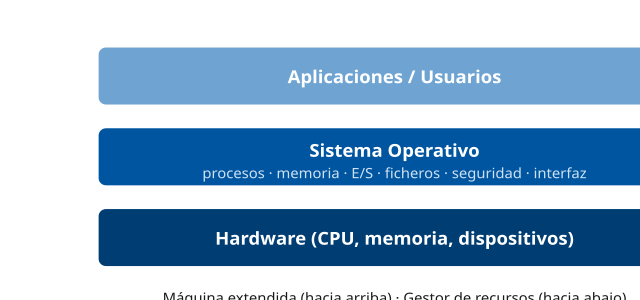

------------------------------------------------------------------------

### D2 · Modo usuario vs modo núcleo y la syscall

**Sección**: §1.1 — Modo núcleo y modo usuario **Propósito**: Mostrar el cambio controlado a modo núcleo mediante la llamada al sistema.

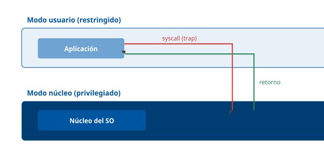

------------------------------------------------------------------------

### D3 · Estados de un proceso

**Sección**: §2.1 — Gestor de procesos **Propósito**: Diagrama de transiciones entre los estados de un proceso.

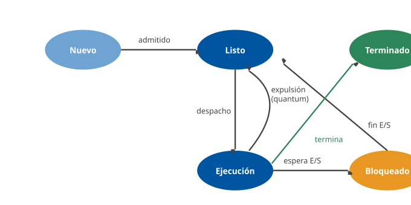

------------------------------------------------------------------------

### D4 · Planificación Round-Robin (diagrama de Gantt)

**Sección**: §2.1 — Planificación de la CPU **Propósito**: Visualizar el reparto por turnos (quantum = 4) del ejercicio resuelto.

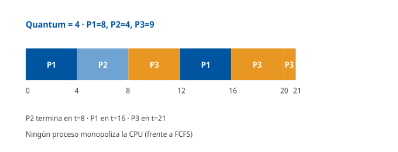

------------------------------------------------------------------------

### D5 · Proceso vs hilo

**Sección**: §2.1 — Gestor de procesos **Propósito**: Mostrar que los hilos comparten la memoria del proceso pero tienen su propia pila.

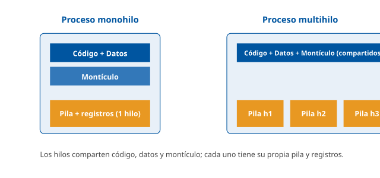

------------------------------------------------------------------------

### D6 · Las 4 condiciones de Coffman (interbloqueo)

**Sección**: §2.1 — Interbloqueo **Propósito**: Recordar las cuatro condiciones necesarias y el grafo de espera circular.

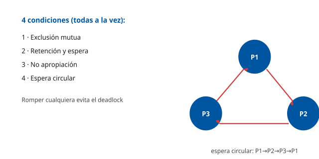

------------------------------------------------------------------------

### D7 · Memoria virtual: paginación y MMU

**Sección**: §2.2 — Gestor de memoria **Propósito**: Mostrar la traducción de dirección lógica a física mediante la tabla de páginas.

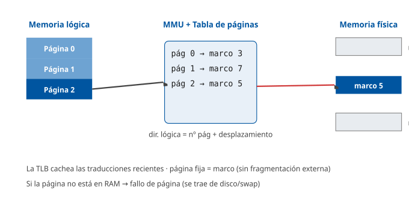

------------------------------------------------------------------------

### D8 · Arquitecturas del núcleo

**Sección**: §1.3 — Arquitecturas del sistema operativo **Propósito**: Contrastar monolítico, microkernel e híbrido por lo que va en modo núcleo.

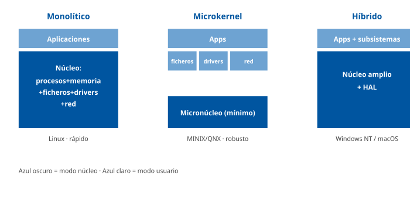

------------------------------------------------------------------------

### D9 · Arquitectura del núcleo Windows NT

**Sección**: §3.2 — El núcleo **Propósito**: Capas de modo usuario y modo núcleo, con la HAL.

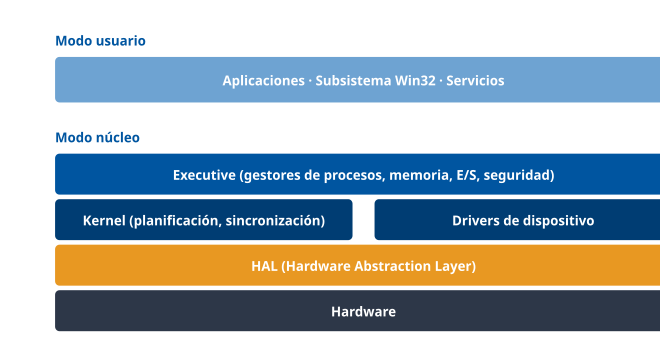

------------------------------------------------------------------------

### D10 · Jerarquía de ficheros de Linux (FHS)

**Sección**: §4.4 — Sistemas de ficheros y jerarquía **Propósito**: Mostrar la raíz única y los directorios principales del FHS.

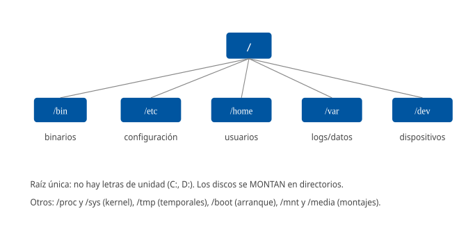

------------------------------------------------------------------------

### D11 · Arquitectura de Android

**Sección**: §5.2 — Android **Propósito**: Capas desde el kernel Linux hasta las aplicaciones.

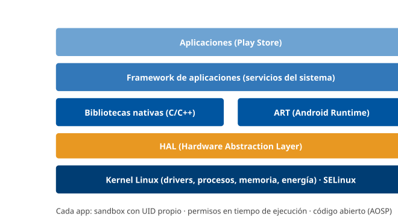

------------------------------------------------------------------------

### D12 · Android vs iOS

**Sección**: §5.4 — Comparativa **Propósito**: Contraste de base, modelo y seguridad de los dos SO móviles.

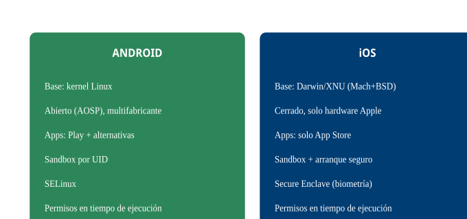

## Casos prácticos

### Caso 1 — Gestión del parque de puestos de trabajo (Windows)

#### Enunciado

El Ayuntamiento dispone de varios miles de puestos de trabajo con **Windows**. Se requiere: autenticar a cada empleado de forma centralizada, aplicar de manera uniforme la configuración de seguridad (bloqueo de pantalla, cifrado de disco, ventana de actualizaciones), restringir los privilegios de administrador local y mantener el sistema parcheado. Como técnico TIC, debe proponer la arquitectura de gestión.

#### Cuestiones

**Cuestión 1 — Autenticación y gestión centralizada (3 puntos).** ¿Qué servicio de Windows usaría para centralizar la autenticación y la administración de los puestos, y qué protocolo de autenticación emplea?

**Cuestión 2 — Configuración uniforme (3 puntos).** ¿Mediante qué mecanismo aplicaría la misma política de seguridad (bloqueo, cifrado, restricciones) a todos los puestos del dominio?

**Cuestión 3 — Privilegios y actualizaciones (2 puntos).** ¿Cómo limitaría que los usuarios instalen software o cambien la configuración del sistema, y cómo distribuiría los parches de seguridad de forma controlada?

**Cuestión 4 — Cifrado (2 puntos).** Para proteger los datos ante el robo físico de un portátil, ¿qué tecnología de Windows aplicaría y de qué se apoya?

#### Solución orientativa

- **C1**: **Active Directory** (AD), que centraliza usuarios, equipos y autenticación mediante el protocolo **Kerberos**, organizando los recursos en un **dominio**. *(§3.6)*
- **C2**: **políticas de grupo (GPO)** aplicadas desde AD: imponen de forma centralizada el bloqueo de pantalla, el cifrado, las restricciones de software y la ventana de actualizaciones a todos los puestos del dominio, conforme a las guías **CCN-STIC**. *(§3.6)*
- **C3**: aplicando el **mínimo privilegio** (los usuarios sin derechos de administrador local; **UAC** activo) y centralizando el parcheado con **WSUS** o **Intune** para aprobar y distribuir las actualizaciones de forma controlada. *(§2.5, §3.6)*
- **C4**: **BitLocker** (cifrado de disco completo), apoyado en el chip **TPM**: aunque roben el portátil, sin las credenciales el disco es ilegible. *(§3.6)*

#### Criterios de evaluación

| Aspecto | Puntos |
|----|----|
| Identifica Active Directory y el protocolo Kerberos | 3 |
| Propone GPO para la configuración uniforme | 3 |
| Aplica mínimo privilegio/UAC y parcheado centralizado (WSUS/Intune) | 2 |
| Propone BitLocker apoyado en TPM | 2 |

------------------------------------------------------------------------

#### Preguntas tipo test sobre este caso

##### 1. En el supuesto planteado, ¿qué servicio de Windows centraliza la autenticación y la administración de los miles de puestos, y con qué protocolo autentica a los empleados?

- a) WSUS, que registra usuarios y equipos en un dominio y autentica mediante el chip TPM.
- b) El Registro de Windows, que guarda los usuarios de cada puesto y autentica mediante UAC.
- c) Active Directory, que organiza usuarios y equipos en un dominio y autentica mediante Kerberos.

**Respuesta correcta:** c) · **Referencia:** Caso 1, cuestión 1 · §3.6

Active Directory es el servicio de directorio que centraliza en un dominio la autenticación, los usuarios y los equipos; el protocolo de autenticación que emplea es Kerberos.

##### 2. El técnico quiere imponer a la vez el bloqueo de pantalla, el cifrado y las restricciones de software en todos los puestos del dominio. ¿Qué mecanismo emplea?

- a) Las políticas de grupo (GPO), definidas en Active Directory y aplicadas a todos los equipos.
- b) La edición del Registro con regedit en cada puesto, replicando a mano la misma configuración.
- c) El Administrador de Control de Servicios, que propaga la configuración como un servicio más.

**Respuesta correcta:** a) · **Referencia:** Caso 1, cuestión 2 · §3.6

Las GPO se aplican desde Active Directory y llevan la misma configuración y seguridad de forma uniforme a miles de puestos, sin tocar equipo por equipo.

##### 3. La configuración de seguridad que se distribuya por GPO a los puestos del Ayuntamiento, como sistemas del sector público, debe ajustarse a:

- a) El estándar POSIX (IEEE 1003), que fija la configuración segura de los puestos Windows.
- b) Las guías CCN-STIC del Centro Criptológico Nacional, que definen el bastionado obligatorio.
- c) La jerarquía FHS, que establece qué directorios del puesto deben quedar protegidos.

**Respuesta correcta:** b) · **Referencia:** Caso 1, cuestión 2 · §2.5, §3.6

En el sector público, el ENS y las guías CCN-STIC del Centro Criptológico Nacional definen el bastionado (hardening) de los sistemas operativos. POSIX y FHS son estándares de Unix/Linux.

##### 4. Para impedir que los empleados instalen software o cambien la configuración del sistema, ¿qué medida es la adecuada?

- a) Retirar a los usuarios los derechos de administrador local y mantener UAC activo (mínimo privilegio).
- b) Conceder a todos derechos de administrador local y confiar en el antivirus Defender para frenarlos.
- c) Desactivar UAC para que los avisos no interrumpan y registrar después los cambios en el Visor de eventos.

**Respuesta correcta:** a) · **Referencia:** Caso 1, cuestión 3 · §2.5, §3.6

El principio de mínimo privilegio concede a cada usuario solo los permisos imprescindibles: sin administrador local y con UAC exigiendo confirmación para las acciones privilegiadas.

##### 5. Un empleado intenta modificar una opción del sistema y aparece una ventana que pide confirmación con credenciales de administrador. ¿Qué componente actúa?

- a) Microsoft Defender, que bloquea la acción por considerarla un posible malware.
- b) BitLocker, que exige las credenciales antes de permitir acceder al disco cifrado.
- c) UAC (User Account Control), que pide confirmación para las acciones privilegiadas.

**Respuesta correcta:** c) · **Referencia:** Caso 1, cuestión 3 · §3.6

UAC solicita confirmación explícita para las acciones que requieren privilegios de administrador, aplicando el mínimo privilegio.

##### 6. ¿Cómo distribuiría el técnico los parches de seguridad a todo el parque de forma controlada?

- a) Dejando que cada usuario ejecute Windows Update cuando lo considere oportuno.
- b) Centralizando el parcheado con WSUS o Intune, que aprueban y distribuyen las actualizaciones.
- c) Instalando los parches con el gestor de paquetes APT desde repositorios firmados.

**Respuesta correcta:** b) · **Referencia:** Caso 1, cuestión 3 · §3.6

En entornos corporativos Windows Update se centraliza con WSUS o Microsoft Intune, que permiten aprobar y distribuir las actualizaciones; APT es el gestor de paquetes de Debian/Ubuntu.

##### 7. Un responsable propone aplazar indefinidamente los parches del parque para evitar incidencias tras las actualizaciones. ¿Qué objeción técnica procede?

- a) Que un sistema operativo sin parchear es la principal vía de ataque contra los puestos.
- b) Que los parches solo añaden funciones nuevas y nunca corrigen vulnerabilidades del sistema.
- c) Que, con BitLocker activo en los puestos, aplazar el parcheado no tiene ningún efecto.

**Respuesta correcta:** a) · **Referencia:** Caso 1, cuestión 3 · §2.5

Las actualizaciones de seguridad corrigen periódicamente vulnerabilidades; un SO sin parchear es la principal vía de ataque, con o sin cifrado de disco.

##### 8. La ventana de actualizaciones de los puestos (cuándo se instalan los parches) debe ser la misma en todo el dominio. ¿Dónde se configura de forma centralizada?

- a) En el Registro de cada puesto, que el usuario ajusta desde regedit.
- b) En el TPM de cada portátil, que fija la hora de instalación de parches.
- c) En una política de grupo (GPO) aplicada desde Active Directory.

**Respuesta correcta:** c) · **Referencia:** Caso 1, cuestiones 2 y 3 · §3.6

La ventana de actualizaciones forma parte de la configuración de seguridad que las GPO imponen de forma centralizada a todos los puestos del dominio.

##### 9. Para que los datos de un portátil robado no puedan leerse, ¿qué tecnología de Windows aplicaría el técnico?

- a) ReFS, que protege la integridad de los datos del disco mediante checksums.
- b) BitLocker, que cifra el disco completo del portátil.
- c) Microsoft Defender, que impide abrir los ficheros desde otro equipo.

**Respuesta correcta:** b) · **Referencia:** Caso 1, cuestión 4 · §3.6

BitLocker es el cifrado de disco completo integrado en Windows: aunque roben el portátil, sin las credenciales el disco es ilegible.

##### 10. ¿En qué componente del portátil se apoya BitLocker para proteger el cifrado del disco?

- a) En el chip TPM del equipo.
- b) En el Secure Enclave del procesador.
- c) En la HAL del núcleo NT.

**Respuesta correcta:** a) · **Referencia:** Caso 1, cuestión 4 · §3.6

BitLocker se apoya en el chip TPM. El Secure Enclave es el coprocesador de iOS y la HAL es la capa que abstrae el hardware en el núcleo NT.

### Caso 2 — Diagnóstico de un servidor Linux de la sede electrónica

#### Enunciado

Un servidor **Linux** que aloja un servicio de la sede electrónica responde con lentitud. El técnico debe diagnosticar si el problema es de **procesos** (CPU), de **memoria** o de un **servicio** caído, usando la línea de comandos, y conocer los conceptos del SO implicados.

#### Cuestiones

**Cuestión 1 — Procesos y CPU (3 puntos).** ¿Qué comando usaría para ver en tiempo real los procesos que más CPU consumen? Si un proceso monopoliza la CPU, ¿qué concepto de planificación explica que los demás se ralenticen, y cómo reparte la CPU un SO de tiempo compartido?

**Cuestión 2 — Memoria (3 puntos).** El servidor tiene poca RAM libre y mucho uso de *swap*. Explique qué es la memoria virtual y qué fenómeno degrada el rendimiento cuando hay demasiados fallos de página por falta de RAM.

**Cuestión 3 — Servicios (2 puntos).** ¿Qué componente gestiona el arranque y los servicios en Linux moderno (PID 1) y con qué comando comprobaría y reiniciaría el servicio web?

**Cuestión 4 — Permisos (2 puntos).** El técnico necesita ejecutar una acción administrativa puntual sin trabajar permanentemente como root. ¿Qué comando emplea y qué principio de seguridad respeta?

#### Solución orientativa

- **C1**: `top` (o `htop`/`ps aux --sort=-%cpu`) muestra los procesos por consumo de CPU. Si uno la monopoliza, los demás esperan en la cola de listos; un SO de **tiempo compartido** reparte la CPU por turnos con **Round-Robin** (quantum), evitando que un proceso la acapare. *(§2.1)*
- **C2**: la **memoria virtual** da a cada proceso un espacio lógico mayor que la RAM, usando disco (**swap**) como respaldo; cuando faltan marcos y se disparan los **fallos de página**, el sistema entra en **hiperpaginación (thrashing)** y el rendimiento se desploma. La solución suele ser ampliar RAM o reducir la carga. *(§2.2)*
- **C3**: **systemd** (PID 1) gestiona los servicios; se comprueba con `systemctl status apache2` y se reinicia con `systemctl restart apache2`; los registros, con `journalctl`. *(§4.3)*
- **C4**: **`sudo`**, que ejecuta la orden con privilegios elevados de forma controlada y auditada, respetando el **mínimo privilegio** (no trabajar siempre como root). *(§4.6)*

#### Criterios de evaluación

| Aspecto | Puntos |
|----|----|
| Usa top/ps y explica el reparto de CPU (Round-Robin, tiempo compartido) | 3 |
| Define memoria virtual y el thrashing por fallos de página | 3 |
| Identifica systemd y los comandos systemctl/journalctl | 2 |
| Propone sudo y el principio de mínimo privilegio | 2 |

------------------------------------------------------------------------

#### Preguntas tipo test sobre este caso

##### 1. Para ver en tiempo real qué procesos del servidor consumen más CPU, el técnico ejecuta:

- a) df, que muestra los procesos ordenados por uso de CPU.
- b) journalctl, que lista en directo el consumo de cada proceso.
- c) top (o htop, o ps aux --sort=-%cpu).

**Respuesta correcta:** c) · **Referencia:** Caso 2, cuestión 1 · §2.1, §4.3

top (o htop/ps) muestra los procesos por consumo de CPU; df informa del espacio en disco y journalctl consulta los registros de systemd.

##### 2. Un proceso monopoliza la CPU. Los demás procesos, que están preparados para ejecutarse y solo les falta la CPU, ¿en qué estado se encuentran?

- a) Listo (ready), esperando en la cola de listos.
- b) Bloqueado, esperando el fin de una E/S.
- c) Nuevo, pendiente de que se cree su PCB.

**Respuesta correcta:** a) · **Referencia:** Caso 2, cuestión 1 · §2.1

Un proceso preparado que espera a que el planificador le asigne la CPU está en estado listo; el estado bloqueado corresponde a la espera de un evento como el fin de una E/S.

##### 3. ¿Cómo reparte la CPU un sistema operativo de tiempo compartido para que ningún proceso la acapare?

- a) Por orden de llegada (FCFS): cada proceso usa la CPU hasta terminar.
- b) Por turnos con Round-Robin: cada proceso recibe un quantum y vuelve al final de la cola.
- c) Por la ráfaga más corta (SJF): primero se atienden siempre los trabajos breves.

**Respuesta correcta:** b) · **Referencia:** Caso 2, cuestión 1 · §2.1

Round-Robin asigna a cada proceso un quantum de tiempo fijo y, al agotarlo, lo pasa al final de la cola de listos; es la base del tiempo compartido.

##### 4. El servidor tiene poca RAM libre y mucho uso de swap. ¿Qué es la memoria virtual que está utilizando?

- a) Un espacio lógico por proceso mayor que la RAM, con el disco (swap) como respaldo.
- b) Una ampliación física de la RAM que se obtiene usando la caché del procesador.
- c) Un modo en que cada proceso usa directamente direcciones físicas de la RAM.

**Respuesta correcta:** a) · **Referencia:** Caso 2, cuestión 2 · §2.2

La memoria virtual da a cada proceso un espacio de direcciones lógico propio y mayor que la RAM; la MMU traduce las direcciones y las partes no usadas quedan en disco (swap).

##### 5. Los indicadores del servidor muestran muchísimos fallos de página. ¿Qué significa cada uno?

- a) Que una página tiene un error de escritura y el SO debe reparar el disco.
- b) Que la MMU no puede traducir la dirección y el proceso se termina.
- c) Que la página solicitada no está en RAM y el SO debe traerla de disco.

**Respuesta correcta:** c) · **Referencia:** Caso 2, cuestión 2 · §2.2

Un fallo de página se produce al acceder a una página que no está en RAM: el SO la trae de disco y, si no hay marcos libres, expulsa una víctima.

##### 6. Con tan poca RAM, el servidor pasa más tiempo intercambiando páginas con el disco que ejecutando procesos. ¿Cómo se llama este fenómeno?

- a) Interbloqueo (deadlock).
- b) Hiperpaginación (thrashing).
- c) Inanición (starvation).

**Respuesta correcta:** b) · **Referencia:** Caso 2, cuestión 2 · §2.2

Un exceso de fallos de página por falta de RAM provoca hiperpaginación: el sistema intercambia páginas en lugar de ejecutar y el rendimiento se desploma.

##### 7. Diagnosticada la hiperpaginación en el servidor de la sede, ¿qué medida la resuelve?

- a) Reducir el quantum de Round-Robin para que los procesos roten más rápido.
- b) Cambiar el planificador a FCFS para eliminar los cambios de contexto.
- c) Ampliar la RAM del servidor o reducir la carga que soporta.

**Respuesta correcta:** c) · **Referencia:** Caso 2, cuestión 2 · §2.2

La hiperpaginación nace de la falta de memoria física, no de la planificación de la CPU: se corrige dando más RAM o reduciendo la carga.

##### 8. ¿Qué componente es el proceso PID 1 del servidor y gestiona el arranque y los servicios?

- a) systemd, que sustituyó al init tradicional de System V.
- b) El init de System V, con sus runlevels de 0 a 6.
- c) El VFS, que arranca los servicios del sistema.

**Respuesta correcta:** a) · **Referencia:** Caso 2, cuestión 3 · §4.2, §4.3

En Linux moderno el primer proceso (PID 1) es systemd, que sustituyó al init de System V y gestiona los servicios como units.

##### 9. ¿Con qué órdenes comprueba y reinicia el técnico el servicio web Apache y consulta después sus registros?

- a) services.msc para reiniciarlo y el Visor de eventos para los registros.
- b) systemctl status/restart apache2 y, para los registros, journalctl.
- c) kill apache2 para reiniciarlo y df para consultar los registros.

**Respuesta correcta:** b) · **Referencia:** Caso 2, cuestión 3 · §4.3

systemd se administra con systemctl (start, stop, enable, status, restart) y sus registros se consultan con journalctl; services.msc y el Visor de eventos son herramientas de Windows.

##### 10. Para una acción administrativa puntual sin trabajar permanentemente como root, ¿qué emplea el técnico y qué principio respeta?

- a) El comando su para abrir una sesión de root, conforme a la defensa en profundidad.
- b) Un chmod 777 sobre el fichero afectado, conforme al principio de mínimo privilegio.
- c) El comando sudo, controlado y auditado, conforme al principio de mínimo privilegio.

**Respuesta correcta:** c) · **Referencia:** Caso 2, cuestión 4 · §4.6

sudo ejecuta órdenes puntuales con privilegios elevados de forma controlada y auditada, en lugar de trabajar siempre como root: es el mínimo privilegio.

### Caso 3 — Dispositivos móviles corporativos

#### Enunciado

El Ayuntamiento dota a los inspectores de la vía pública de **tabletas y móviles** (Android e iOS) con aplicaciones municipales que manejan datos de ciudadanos. Se exige proteger la información, controlar las apps instaladas y poder actuar si se pierde un dispositivo.

#### Cuestiones

**Cuestión 1 — Aislamiento de apps (2 puntos).** Explique el mecanismo por el que, tanto en Android como en iOS, una app no puede acceder a los datos de otra, y cómo se controla su acceso a recursos sensibles.

**Cuestión 2 — Diferencias de plataforma (3 puntos).** Indique en qué núcleo se basa cada uno (Android e iOS) y una diferencia clave en su modelo de distribución de aplicaciones.

**Cuestión 3 — Gestión centralizada (3 puntos).** ¿Qué tipo de solución usaría para administrar de forma centralizada el cifrado, las políticas, la distribución de apps y el borrado remoto de los dispositivos?

**Cuestión 4 — Pérdida de un dispositivo (2 puntos).** Un inspector pierde una tableta con datos de ciudadanos. ¿Qué medida técnica permite proteger la información, y qué normativa lo exige?

#### Solución orientativa

- **C1**: el **sandboxing** aísla cada aplicación (en Android, con un **UID** Linux propio; en iOS, con el sandbox del sistema), de modo que solo accede a sus datos; el acceso a recursos sensibles (cámara, ubicación, contactos) se concede mediante **permisos por app**, en Android revocables en tiempo de ejecución. *(§5.1, §5.2, §5.3)*
- **C2**: **Android** se basa en el **kernel Linux** y es abierto (AOSP), con apps de Play Store y tiendas alternativas; **iOS** se basa en **Darwin/XNU** (Unix) y es cerrado, con apps **solo** del App Store. *(§5.2, §5.3, §5.4)*
- **C3**: una solución **MDM (Mobile Device Management)**: inscribe los dispositivos y aplica de forma centralizada el cifrado, el PIN, las restricciones, la distribución de las apps municipales y la separación del perfil corporativo. *(§5.4)*
- **C4**: el **borrado remoto** desde la plataforma MDM (además del cifrado del dispositivo) protege los datos del ciudadano; lo exigen el **ENS** y la normativa de **protección de datos**. *(§5.4 \[ENS-RD311\])*

#### Criterios de evaluación

| Aspecto                                                         | Puntos |
|-----------------------------------------------------------------|--------|
| Explica el sandboxing y los permisos por app                    | 2      |
| Indica los núcleos (Linux/Darwin) y la diferencia de tiendas    | 3      |
| Propone una solución MDM con sus funciones                      | 3      |
| Propone borrado remoto + cifrado y cita ENS/protección de datos | 2      |

------------------------------------------------------------------------

### Nota pedagógica

Los tres casos recorren los SO en el entorno real del Ayuntamiento: el **Caso 1** aplica **Windows** y su gestión centralizada (AD, GPO, BitLocker); el **Caso 2**, los **componentes del SO** (procesos, planificación, memoria virtual, servicios) sobre **Linux** y su línea de comandos; y el **Caso 3**, los **sistemas móviles** (Android/iOS, sandboxing, MDM). Todos enlazan con los requisitos de **seguridad (ENS, CCN-STIC)** del sector público y con la parte práctica del examen del Grupo II.

#### Preguntas tipo test sobre este caso

##### 1. ¿Qué mecanismo impide, tanto en Android como en iOS, que la app municipal de inspección lea los datos de otra aplicación del terminal?

- a) El Secure Enclave, que guarda por separado los datos de cada aplicación.
- b) La HAL, que reparte el almacenamiento entre las aplicaciones instaladas.
- c) El sandboxing, que aísla cada app con acceso solo a sus propios datos.

**Respuesta correcta:** c) · **Referencia:** Caso 3, cuestión 1 · §5.1

El sandboxing ejecuta cada aplicación aislada, con acceso solo a sus propios datos y a los permisos concedidos. El Secure Enclave custodia claves y biometría.

##### 2. En las tabletas Android, ¿cómo se materializa ese aislamiento de cada aplicación?

- a) Todas las apps comparten un mismo usuario y se separan solo por permisos.
- b) Cada app se ejecuta con su propio UID de Linux.
- c) Cada app arranca su propio núcleo Linux independiente.

**Respuesta correcta:** b) · **Referencia:** Caso 3, cuestión 1 · §5.2

En Android cada app se ejecuta aislada con su propio UID de Linux, reforzada además por SELinux.

##### 3. La app de inspección necesita la cámara y la ubicación. En Android, ¿cómo obtiene acceso a esos recursos sensibles?

- a) Mediante permisos por app concedidos en tiempo de ejecución y revocables.
- b) Mediante un permiso global del sistema que vale para todas las apps.
- c) Mediante la instalación, tras la cual el permiso ya no puede revocarse.

**Respuesta correcta:** a) · **Referencia:** Caso 3, cuestión 1 · §5.2

Desde Android 6 los permisos sensibles (ubicación, cámara, micrófono, contactos) se conceden a cada app en tiempo de ejecución y son revocables.

##### 4. ¿En qué núcleo se basa cada sistema operativo de los terminales de los inspectores?

- a) Android en Darwin/XNU e iOS en el kernel Linux.
- b) Android en el kernel Linux e iOS en Darwin/XNU (Unix).
- c) Ambos en el microkernel MINIX, adaptado por cada fabricante.

**Respuesta correcta:** b) · **Referencia:** Caso 3, cuestión 2 · §5.2, §5.3

Android se construye sobre el kernel Linux; iOS se basa en Darwin, cuyo núcleo es XNU (Mach + BSD).

##### 5. El servicio quiere publicar la app municipal en los terminales. ¿Qué diferencia de distribución de aplicaciones debe tener en cuenta?

- a) Que Android solo admite Google Play e iOS admite tiendas alternativas.
- b) Que ambas plataformas admiten tiendas alternativas sin restricciones.
- c) Que Android admite Google Play y tiendas alternativas; iOS, solo el App Store.

**Respuesta correcta:** c) · **Referencia:** Caso 3, cuestión 2 · §5.4

Android es abierto y admite Google Play y tiendas alternativas; iOS es cerrado y su única vía de instalación es el App Store.

##### 6. Si el Ayuntamiento quiere comprar tabletas a varios fabricantes distintos, ¿qué plataforma lo permite y por qué?

- a) Android, porque es abierto (AOSP) y lo adaptan numerosos fabricantes.
- b) iOS, porque Apple licencia su sistema a otros fabricantes de tabletas.
- c) Cualquiera de las dos, porque ambas se distribuyen como código AOSP.

**Respuesta correcta:** a) · **Referencia:** Caso 3, cuestión 2 · §5.2, §5.4

Android es de código abierto (AOSP) y multifabricante; iOS es cerrado y funciona solo en hardware de Apple.

##### 7. Para administrar de forma centralizada el cifrado, el PIN, las restricciones y la distribución de las apps municipales en todos los terminales, el técnico propone:

- a) Una consola WSUS que apruebe las apps y las políticas de los móviles.
- b) Una solución MDM (Mobile Device Management) en la que se inscriben los dispositivos.
- c) El Secure Enclave de cada terminal, configurado uno a uno por el técnico.

**Respuesta correcta:** b) · **Referencia:** Caso 3, cuestión 3 · §5.4

Las soluciones MDM/EMM inscriben los dispositivos y aplican de forma centralizada políticas (cifrado, PIN, restricciones), distribución de apps y borrado remoto.

##### 8. Algunos inspectores usan la tableta también para fines personales. ¿Qué función del MDM permite proteger los datos municipales sin invadir lo personal?

- a) El borrado remoto periódico de todos los datos del terminal.
- b) La revocación de todos los permisos de las apps personales.
- c) La separación del perfil corporativo respecto del personal.

**Respuesta correcta:** c) · **Referencia:** Caso 3, cuestión 3 · §5.4

Entre las funciones del MDM está separar el perfil corporativo del personal, de modo que las políticas y los datos municipales quedan aislados de lo privado.

##### 9. Un inspector pierde una tableta con datos de ciudadanos. ¿Qué medida técnica protege la información?

- a) El borrado remoto del terminal desde la plataforma MDM, además del cifrado.
- b) La desinstalación de la app municipal desde Google Play cuando aparezca.
- c) El cambio de la contraseña del inspector en el dominio Active Directory.

**Respuesta correcta:** a) · **Referencia:** Caso 3, cuestión 4 · §5.4

La plataforma MDM permite borrar remotamente un terminal perdido o robado; junto con el cifrado del dispositivo, protege los datos del ciudadano.

##### 10. ¿Qué normativa exige proteger los datos de los ciudadanos de los terminales perdidos?

- a) La licencia GPL y el estándar POSIX.
- b) El ENS y la normativa de protección de datos.
- c) El ENI únicamente, por ser datos públicos.

**Respuesta correcta:** b) · **Referencia:** Caso 3, cuestión 4 · §5.4 [ENS-RD311]

La gestión de los terminales corporativos y el borrado remoto responden al Esquema Nacional de Seguridad y a la normativa de protección de datos.

## Fuentes

### Fuentes Tier 1 (primarias)

#### Teoría general de sistemas operativos

| ID | Título | Autor / Origen | Edición / Año | Secciones usadas | Referencia |
|----|----|----|----|----|----|
| SILBERSCHATZ-OS | Operating System Concepts | Silberschatz, Galvin, Gagne | 10.ª ed., Wiley, 2018 | Estructura del SO, procesos e hilos, planificación, sincronización, interbloqueo, memoria, memoria virtual, E/S, sistemas de ficheros (cap. 1-15) | ISBN 978-1118063330 |
| TANENBAUM-MOS | Modern Operating Systems | Andrew Tanenbaum, Herbert Bos | 4.ª ed., Pearson, 2014 | Procesos e hilos, gestión de memoria, E/S, interbloqueos, casos Windows/Linux/Android (cap. 1-11) | ISBN 978-0133591620 |
| STALLINGS-OS | Operating Systems: Internals and Design Principles | William Stallings | 9.ª ed., Pearson, 2017 | Arquitectura, planificación, concurrencia, memoria virtual, seguridad | ISBN 978-0134670959 |
| POSIX | IEEE Std 1003.1 (POSIX.1-2017) — Base Specifications | IEEE / The Open Group | 2018 (Issue 7) | Norma de portabilidad Unix: API de sistema, shell, utilidades, hilos POSIX | pubs.opengroup.org/onlinepubs/9699919799 |

#### Windows

| ID | Título | Autor / Origen | Edición / Año | Secciones usadas | Referencia |
|----|----|----|----|----|----|
| WININTERNALS | Windows Internals, Part 1 | Russinovich, Solomon, Ionescu, Yosifovich | 7.ª ed., Microsoft Press, 2017 | Arquitectura NT, modo núcleo/usuario, procesos, HAL, registro | ISBN 978-0735684188 |
| MS-NTFS | NTFS / ReFS overview | Microsoft Learn | 2024 | Sistemas de ficheros de Windows, MFT, journaling, ACL | learn.microsoft.com/windows-server/storage |
| MS-PWSH | PowerShell Documentation | Microsoft Learn | 2024 | Shell y automatización de Windows | learn.microsoft.com/powershell |
| MS-WINSEC | Windows security (UAC, Defender, BitLocker, Windows Update) | Microsoft Learn | 2024 | Seguridad y actualizaciones de Windows | learn.microsoft.com/windows/security |
| MS-AD | Active Directory Domain Services | Microsoft Learn | 2024 | Directorio, autenticación Kerberos, GPO | learn.microsoft.com/windows-server/identity |

#### Unix / Linux

| ID | Título | Autor / Origen | Edición / Año | Secciones usadas | Referencia |
|----|----|----|----|----|----|
| LOVE-LKD | Linux Kernel Development | Robert Love | 3.ª ed., Addison-Wesley, 2010 | Arquitectura del kernel Linux, módulos, planificador, gestión de memoria | ISBN 978-0672329463 |
| BOVET-CESATI | Understanding the Linux Kernel | Bovet, Cesati | 3.ª ed., O'Reilly, 2005 | Internals del kernel, procesos, memoria, VFS | ISBN 978-0596005658 |
| KERNEL-DOC | The Linux Kernel documentation | kernel.org | 2024 | Módulos cargables, subsistemas, sistemas de ficheros | kernel.org/doc/html/latest |
| FHS | Filesystem Hierarchy Standard 3.0 | Linux Foundation | 2015 | Jerarquía de directorios de Linux (/bin, /etc, /var…) | refspecs.linuxfoundation.org/FHS_3.0 |
| GNU-BASH | GNU Bash Reference Manual | Free Software Foundation | 2024 | Shell Bash, scripting | gnu.org/software/bash/manual |
| GPL | GNU General Public License v3 | Free Software Foundation | 2007 | Modelo de licencia del software libre | gnu.org/licenses/gpl-3.0 |

#### Sistemas móviles

| ID | Título | Autor / Origen | Edición / Año | Secciones usadas | Referencia |
|----|----|----|----|----|----|
| AOSP | Android Open Source Project — Architecture | Google | 2024 | Arquitectura Android (kernel Linux, ART, framework), modelo de permisos | source.android.com/docs/core/architecture |
| ANDROID-SEC | Android Security Model / Application Sandbox | Google | 2024 | Sandboxing, permisos en tiempo de ejecución, SELinux en Android | source.android.com/docs/security |
| APPLE-PSEC | Apple Platform Security Guide | Apple Inc. | 2024 | Arquitectura iOS, Secure Enclave, sandboxing, cifrado | support.apple.com/guide/security |
| APPLE-DARWIN | Darwin / XNU Kernel | Apple Inc. (open source) | 2024 | Base Unix/BSD de iOS y macOS (XNU = Mach + BSD) | opensource.apple.com |

#### Normativa aplicable (sector público)

| ID | Título | Origen | Año | Uso |  |
|----|----|----|----|----|----|
| ENS-RD311 | Esquema Nacional de Seguridad ([Real Decreto 311/2022](https://www.boe.es/buscar/act.php?id=BOE-A-2022-7191)) | BOE | 2022 | Requisitos de seguridad, control de acceso y actualización de los sistemas (§2.5, §3.6, §4.6) | boe.es/buscar/doc.php?id=BOE-A-2022-7191 |
| CCN-STIC | Guías CCN-STIC de seguridad (series 500/600 Windows, Linux, móviles) | CCN-CERT | vigentes | Bastionado (hardening) de sistemas operativos en la AAPP | ccn-cert.cni.es |
| ENI-RD4-2010 | Esquema Nacional de Interoperabilidad ([Real Decreto 4/2010](https://www.boe.es/buscar/act.php?id=BOE-A-2010-1331)) | BOE | 2010 | Uso de estándares abiertos (relevante para software libre, §4.7) | boe.es/eli/es/rd/2010/01/08/4 |

------------------------------------------------------------------------

### Fuentes Tier 2 (secundarias — contraste y referencia rápida)

| ID | Título | Origen | Uso |  |
|----|----|----|----|----|
| DEBIAN-DOC | Debian Reference / Ubuntu Docs | Debian / Canonical | Distribuciones, gestores de paquetes (APT) |  |
| RHEL-DOC | Red Hat Enterprise Linux Documentation | Red Hat | Distribución empresarial, RPM/DNF, SELinux |  |
| WAYLAND-DOC | Wayland / X.Org documentation | freedesktop.org | Servidores gráficos de Linux |  |
| DATOS-MADRID | Portal de datos abiertos y sede del Ayuntamiento de Madrid | Ayto. Madrid | Contexto real (parque informático municipal) para los casos prácticos | datos.madrid.es |

------------------------------------------------------------------------
