# Tema 15. Bases de datos y SGBD

**Bloque:** técnico  
**Enunciado oficial** (BOAM n.º 10.032, de 23 de diciembre de 2025): Sistemas de gestión de bases de datos relacionales, orientados a objetos y NoSQL: características y componentes. Administración de bases de datos.

Versión web: <https://ayuntamientomadrid.github.io/temario-tecnico-auxiliar/temas/tema-15.html> · PDF: [tema-15.pdf](tema-15.pdf) · Test: [../../../tests/tecnico/tema-15.md](../../../tests/tecnico/tema-15.md)

## Índice

- 1. Concepto de base de datos y SGBD
  - 1.1. De los ficheros a las bases de datos
  - 1.2. Base de datos y Sistema de Gestión de Bases de Datos
  - 1.3. Funciones del SGBD
  - 1.4. Componentes del SGBD
  - 1.5. Lenguajes de bases de datos
  - 1.6. Roles de usuario
- 2. Características: transaccionalidad y concurrencia
  - 2.1. Transacción y propiedades ACID
  - 2.2. Concurrencia: problemas y control
  - 2.3. Niveles de aislamiento
  - 2.4. Recuperación ante fallos
- 3. Modelo ANSI/SPARC (arquitectura de tres esquemas)
- 4. Tipologías de SGBD
  - 4.1. SGBD jerárquicos
  - 4.2. SGBD en red (CODASYL)
  - 4.3. SGBD relacionales
  - 4.4. SGBD orientados a objetos y objeto-relacionales
  - 4.5. SGBD NoSQL
  - 4.6. SGBD multidimensionales y analítica de datos
- 5. Administración de bases de datos
  - 5.1. Administración de usuarios y seguridad
  - 5.2. Administración del almacenamiento
  - 5.3. SGBD distribuidos
  - 5.4. Disponibilidad y alta disponibilidad
  - 5.5. Copias de seguridad y recuperación
  - 5.6. Gobernanza del dato
  - 5.7. Rendimiento: diagnóstico y resolución de incidencias
  - 5.8. SGBD en la nube (DBaaS)
- Resumen final

### Conceptos clave para memorizar

| Concepto | Dato clave |
|----|----|
| SGBD (DBMS) | Software que gestiona el acceso concurrente, seguro e íntegro a una base de datos |
| Diccionario de datos | Metadatos: descripción de la estructura de la BD (catálogo del sistema) |
| DDL / DML / DCL / TCL | Definición / Manipulación / Control de acceso / Control de transacciones |
| Transacción | Unidad lógica de trabajo, indivisible (todo o nada) |
| ACID | Atomicidad, Consistencia, Aislamiento, Durabilidad (ACID) |
| Concurrencia | Varios usuarios a la vez; se controla con bloqueos o MVCC |
| ANSI/SPARC | Arquitectura de 3 esquemas: interno, conceptual, externo (vistas) |
| Independencia de datos | Cambiar un nivel sin afectar a los superiores (física y lógica) |
| Modelo relacional | Codd (1970): datos en tablas (relaciones) con claves; base de SQL |
| Clave primaria / ajena | Identifica unívocamente / referencia a otra tabla (integridad referencial) |
| SQL | Lenguaje estándar (ISO 9075) de definición y consulta relacional |
| NoSQL | No relacional: clave-valor, documental, columnar, grafos; escala horizontal |
| Teorema CAP | Solo 2 de 3: Consistencia, Disponibilidad, tolerancia a Particiones |
| BASE | Alternativa a ACID en NoSQL: disponibilidad sobre consistencia inmediata |
| OLTP vs OLAP | Transaccional (operaciones diarias) vs analítico (consultas masivas, data warehouse) |
| Sharding / replicación | Repartir datos / copiarlos para escalar y dar disponibilidad |
| GRANT / REVOKE | Conceder / retirar privilegios a usuarios y roles |
| Backup + PITR | Copia de seguridad y recuperación a un punto en el tiempo (con el log) |
| DBaaS | Base de datos como servicio en la nube |

## Contenido

### Convenciones del documento

Este tema incluye cuatro tipos de **cajas callout** para facilitar el estudio:

> **Dato clave.** Información de alta densidad memorística.

> **Ejercicio resuelto.** Problema + solución paso a paso (transacciones, concurrencia, SQL de administración).

> **Ejemplo de aplicación en el ayto.** Aplicación real de la teoría al entorno municipal (Padrón, tributos, expedientes, datos abiertos).

> **Relación con otros temas.** Enlace conceptual a otros temas del temario oficial.

Los términos técnicos se mantienen en su nomenclatura original (SGBD, ACID, NoSQL, sharding…). Las fuentes se referencian con etiquetas breves tipo `[ELMASRI, cap. 21]` — el registro completo está en la pestaña Fuentes.

------------------------------------------------------------------------

### 1. Concepto de base de datos y SGBD

#### 1.1. De los ficheros a las bases de datos

Antes de las bases de datos, las aplicaciones almacenaban su información en **ficheros propios**, lo que provocaba graves problemas \[ELMASRI, cap. 1\]:

- **Redundancia e inconsistencia**: el mismo dato (p. ej. el domicilio de un ciudadano) se repetía en varios ficheros y podía quedar desactualizado en unos y no en otros.
- **Dificultad de acceso** y dependencia: cada consulta nueva exigía programar a medida; los programas dependían del formato físico de los ficheros.
- **Problemas de integridad, concurrencia y seguridad**: difícil garantizar reglas, accesos simultáneos y permisos.

La **base de datos** resuelve esto con una **colección estructurada, integrada y compartida** de datos, con redundancia controlada, y un software que la gobierna: el SGBD.

#### 1.2. Base de datos y Sistema de Gestión de Bases de Datos

Una **base de datos (BD)** es un conjunto de datos **relacionados** entre sí, organizados y almacenados de forma persistente, que modela una parcela del mundo real y se comparte entre múltiples usuarios y aplicaciones. \[DATE\]

Un **Sistema de Gestión de Bases de Datos (SGBD / DBMS)** es el software que **crea, gestiona y controla** el acceso a la base de datos, actuando de intermediario entre los usuarios/aplicaciones y los datos físicos. Garantiza el acceso **concurrente, seguro, íntegro y eficiente**. \[ELMASRI, cap. 1\]\[SILBERSCHATZ-DB, cap. 1\]

> **Dato clave.** La **base de datos** es el conjunto de datos; el **SGBD (DBMS)** es el *software* que la gestiona. No confundirlos: Oracle, PostgreSQL o MySQL son SGBD; el padrón almacenado es la base de datos.

#### 1.3. Funciones del SGBD

Las funciones esenciales de un SGBD son \[DATE\]\[CONNOLLY-BEGG\]:

- **Definición de datos**: describir la estructura (tablas, tipos, restricciones) mediante el **DDL**.
- **Manipulación de datos**: insertar, consultar, modificar y borrar mediante el **DML**.
- **Control**: garantizar **integridad** (reglas y restricciones), **seguridad** (permisos), **concurrencia** (accesos simultáneos) y **recuperación** ante fallos.
- **Diccionario de datos (catálogo)**: almacena los **metadatos** —la descripción de la propia estructura de la base de datos (qué tablas, columnas, tipos, restricciones, usuarios existen)—. Es la "base de datos sobre la base de datos".

> **Dato clave.** El **diccionario de datos** (o catálogo del sistema) contiene los **metadatos**: la descripción de la estructura de la BD. El SGBD lo consulta para resolver cada operación.

#### 1.4. Componentes del SGBD

Internamente, un SGBD se organiza en módulos \[SILBERSCHATZ-DB, cap. 1\]:

- **Procesador de consultas**: interpreta y **optimiza** las sentencias (genera un *plan de ejecución* eficiente) y las ejecuta.
- **Gestor de transacciones**: garantiza las propiedades **ACID** y el control de concurrencia.
- **Gestor de almacenamiento (motor)**: gestiona los datos en disco, los **índices**, el buffer en memoria y el acceso físico.
- **Gestor del diccionario**: administra los metadatos.

> **Relación con otros temas.** El gestor de almacenamiento se apoya en las **estructuras de datos y la organización de ficheros** (índices B+árbol, organización directa/hash) que se desarrollan en el Tema 13.

#### 1.5. Lenguajes de bases de datos

El estándar **SQL** integra varios sublenguajes \[ISO-9075\]:

- **DDL (Data Definition Language)**: define la estructura — `CREATE`, `ALTER`, `DROP`.
- **DML (Data Manipulation Language)**: manipula los datos — `SELECT`, `INSERT`, `UPDATE`, `DELETE`.
- **DCL (Data Control Language)**: controla el acceso — `GRANT`, `REVOKE`.
- **TCL (Transaction Control Language)**: gestiona las transacciones — `COMMIT`, `ROLLBACK`, `SAVEPOINT`.

> **Dato clave.** **DDL** define (CREATE/ALTER/DROP), **DML** manipula (SELECT/INSERT/UPDATE/DELETE), **DCL** controla el acceso (GRANT/REVOKE), **TCL** gestiona transacciones (COMMIT/ROLLBACK).

> **Relación con otros temas.** El lenguaje SQL en profundidad (estándar ANSI, procedimientos almacenados, disparadores) se desarrolla en el Tema 19.

#### 1.6. Roles de usuario

- **Administrador de la base de datos (DBA)**: define la estructura física, gestiona usuarios y permisos, copias de seguridad, rendimiento y disponibilidad.
- **Diseñador**: modela los datos (conceptual, lógico, físico).
- **Programador de aplicaciones**: desarrolla los programas que acceden a la BD.
- **Usuario final**: consulta y actualiza datos a través de las aplicaciones.

------------------------------------------------------------------------

### 2. Características: transaccionalidad y concurrencia

#### 2.1. Transacción y propiedades ACID

Una **transacción** es una **unidad lógica de trabajo** formada por una o varias operaciones que deben ejecutarse como un **todo indivisible**: o se completan todas, o no se aplica ninguna. El ejemplo canónico es una transferencia bancaria (restar de una cuenta y sumar en otra). \[SILBERSCHATZ-DB, cap. 17\]

Toda transacción debe cumplir las propiedades **ACID** \[ACID-HAERDER\]:

- **Atomicidad (Atomicity)**: "todo o nada". Si falla cualquier paso, se deshacen (rollback) todos.
- **Consistencia (Consistency)**: la transacción lleva la BD de un estado válido a otro válido, respetando todas las reglas de integridad.
- **Aislamiento (Isolation)**: el resultado de transacciones concurrentes es como si se hubieran ejecutado en serie; una no ve los estados intermedios de otra.
- **Durabilidad (Durability)**: una vez confirmada (commit), el cambio persiste aunque falle el sistema (gracias al log).

> **Dato clave.** **ACID**: **A**tomicidad (todo o nada), **C**onsistencia (estados válidos), a**I**slamiento (como si fueran en serie), **D**urabilidad (persiste tras el commit). `COMMIT` confirma; `ROLLBACK` deshace.

> **Ejercicio resuelto.** Una transferencia de 100 € de la cuenta A a la B son dos operaciones: `UPDATE A SET saldo=saldo-100` y `UPDATE B SET saldo=saldo+100`. Si tras la primera el sistema cae, la **atomicidad** garantiza el `ROLLBACK` automático al reiniciar: no puede quedar dinero "desaparecido". Solo cuando ambas tienen éxito se hace `COMMIT`.

#### 2.2. Concurrencia: problemas y control

Cuando varias transacciones se ejecutan **a la vez** sobre los mismos datos pueden producirse anomalías si no se controlan \[ELMASRI, cap. 21\]:

- **Lectura sucia (dirty read)**: una transacción lee datos que otra ha modificado pero aún no ha confirmado (y que luego podría deshacer).
- **Lectura no repetible (non-repeatable read)**: una transacción lee el mismo dato dos veces y obtiene valores distintos porque otra lo modificó en medio.
- **Lectura fantasma (phantom read)**: una consulta repetida devuelve filas nuevas que otra transacción insertó.
- **Actualización perdida (lost update)**: dos transacciones actualizan el mismo dato y una sobrescribe a la otra.

Mecanismos de **control de concurrencia**:

- **Bloqueos (locking)**: una transacción bloquea los datos que usa (compartido para lectura, exclusivo para escritura); el protocolo **2PL (bloqueo en dos fases)** garantiza la seriabilidad. Riesgo: **interbloqueo** entre transacciones.
- **MVCC (control de concurrencia multiversión)**: el SGBD mantiene **varias versiones** de cada dato, de modo que los lectores no bloquean a los escritores ni viceversa (lo usan PostgreSQL y Oracle). \[POSTGRES-DOC\]

> **Dato clave.** Anomalías de concurrencia: **lectura sucia** (lee no confirmado), **no repetible** (mismo dato cambia entre lecturas), **fantasma** (aparecen filas nuevas). Control con **bloqueos (2PL)** o **MVCC** (multiversión, lectores no bloquean a escritores).

#### 2.3. Niveles de aislamiento

El estándar SQL define cuatro **niveles de aislamiento**, que equilibran consistencia y rendimiento \[ISO-9075\]:

| Nivel                | Lectura sucia | No repetible | Fantasma |
|----------------------|---------------|--------------|----------|
| **Read Uncommitted** | Posible       | Posible      | Posible  |
| **Read Committed**   | Evitada       | Posible      | Posible  |
| **Repeatable Read**  | Evitada       | Evitada      | Posible  |
| **Serializable**     | Evitada       | Evitada      | Evitada  |

Cuanto mayor el aislamiento, más consistencia pero menos concurrencia (rendimiento). El nivel por defecto suele ser **Read Committed** (Oracle, PostgreSQL).

#### 2.4. Recuperación ante fallos

El SGBD garantiza la **durabilidad** y la **atomicidad** ante caídas mediante un **registro de transacciones (log)**: antes de aplicar cambios, anota en el log lo que va a hacer (técnica **WAL, Write-Ahead Logging**). Tras un fallo, usa el log para **rehacer (redo)** las transacciones confirmadas y **deshacer (undo)** las no confirmadas. Los **checkpoints** (puntos de control) acotan cuánto log hay que recorrer. \[SILBERSCHATZ-DB, cap. 19\]

> **Relación con otros temas.** El registro por diario (journaling) y los mecanismos de tolerancia a fallos del almacenamiento (RAID) que sustentan esta durabilidad se tratan en el Tema 13.

------------------------------------------------------------------------

### 3. Modelo ANSI/SPARC (arquitectura de tres esquemas)

Para lograr la **independencia de datos**, la arquitectura **ANSI/SPARC** (1975) define **tres niveles de abstracción** \[ANSI-SPARC\]\[DATE\]:

- **Nivel interno (físico)**: cómo se almacenan realmente los datos (ficheros, índices, organización física). Es el "cómo".
- **Nivel conceptual (lógico)**: la estructura global de toda la base de datos (entidades, relaciones, restricciones), independiente del almacenamiento. Es el "qué".
- **Nivel externo (vistas)**: las distintas **vistas** parciales que cada grupo de usuarios ve de la base de datos, adaptadas a sus necesidades y permisos.

La gran ventaja es la **independencia de datos**:

- **Independencia física**: se puede cambiar el almacenamiento (añadir un índice, mover ficheros) sin afectar al nivel conceptual ni a las aplicaciones.
- **Independencia lógica**: se puede cambiar el esquema conceptual (añadir una tabla o columna) sin afectar a las vistas externas existentes.

> **Dato clave.** **ANSI/SPARC** = 3 esquemas: **interno** (físico, cómo se almacena), **conceptual** (lógico global, qué datos), **externo** (vistas por usuario). Permite la **independencia de datos**: física (cambiar almacenamiento sin tocar la lógica) y lógica (cambiar la lógica sin tocar las vistas).

> **Ejemplo de aplicación en el ayto.** En la base de datos del Padrón, el nivel **conceptual** define las entidades (habitante, vía, distrito); el nivel **externo** ofrece a la oficina de estadística una vista agregada por distrito y al personal de atención una vista del habitante individual; el nivel **interno** decide los índices y el almacenamiento físico. Añadir un índice por código postal (nivel interno) no obliga a cambiar ninguna aplicación: eso es la independencia física.

------------------------------------------------------------------------

### 4. Tipologías de SGBD

#### 4.1. SGBD jerárquicos

Los datos se organizan en una **estructura de árbol** (relaciones padre-hijo 1:N). Históricos (IBM IMS). Rápidos para consultas que siguen la jerarquía, pero rígidos: una relación N:M es difícil de modelar y la navegación es por punteros. \[ELMASRI, cap. 2\]

#### 4.2. SGBD en red (CODASYL)

Generalizan el modelo jerárquico permitiendo que un hijo tenga **varios padres** (grafo). Más flexibles, pero la programación sigue siendo **navegacional** (el programador recorre punteros), compleja de mantener.

#### 4.3. SGBD relacionales

Propuestos por **E. F. Codd (1970)**, son el modelo **dominante**. Los datos se organizan en **tablas (relaciones)** formadas por **filas (tuplas)** y **columnas (atributos)**. Conceptos clave \[CODD-1970\]\[DATE\]:

- **Clave primaria**: atributo(s) que identifican unívocamente cada fila.
- **Clave ajena (foránea)**: atributo que referencia la clave primaria de otra tabla, estableciendo la **integridad referencial**.
- **Álgebra relacional**: operaciones formales (selección, proyección, unión, **join**) que fundamentan las consultas.
- **SQL** es el lenguaje estándar para definirlas y consultarlas.

Ofrecen integridad, independencia de datos y un lenguaje declarativo potente. Ejemplos: **Oracle, PostgreSQL, MySQL, SQL Server, Db2**.

**Reglas de integridad** del modelo relacional \[DATE\]:

- **Integridad de entidad**: la clave primaria no puede ser nula ni repetirse.
- **Integridad referencial**: toda clave ajena debe corresponder a una clave primaria existente en la tabla referenciada (o ser nula). Impide "referencias huérfanas" (p. ej. un recibo asociado a un contribuyente que no existe).
- **Restricciones de dominio**: cada atributo solo admite valores de su tipo y de las reglas definidas (`CHECK`, `NOT NULL`, `UNIQUE`).

**Operaciones del álgebra relacional** (fundamento formal de las consultas): **selección** (σ, filtra filas por una condición), **proyección** (π, elige columnas), **unión/intersección/diferencia** (entre tablas compatibles), **producto cartesiano** y, sobre todo, la **reunión (join)**, que combina filas de dos tablas según una condición (la más usada es el *inner join* por igualdad de claves; existen *left/right/full outer join* para conservar filas sin pareja).

> **Dato clave.** El **modelo relacional** (Codd, 1970) organiza los datos en **tablas** con **clave primaria** (identifica, no nula ni repetida → integridad de entidad) y **clave ajena** (referencia a otra tabla → integridad referencial). El **join** combina tablas por sus claves. Es el modelo dominante y la base de **SQL**.

> **Relación con otros temas.** El **diseño** de bases de datos relacionales (modelo lógico, **normalización**) se desarrolla en el Tema 17; el **modelo conceptual** entidad-relación, en el Tema 16.

#### 4.4. SGBD orientados a objetos y objeto-relacionales

- **Orientados a objetos (OODBMS)**: almacenan **objetos** (con atributos y métodos), integrándose de forma natural con los lenguajes OO; útiles para datos complejos (CAD, multimedia), pero poco extendidos.
- **Objeto-relacionales (ORDBMS)**: extienden el modelo relacional con **tipos complejos**, herencia y objetos, manteniendo SQL. Es el enfoque adoptado por Oracle y PostgreSQL (SQL:1999+). \[ISO-9075-OR\]

> **Relación con otros temas.** Los conceptos de objeto, clase, herencia y método en que se apoyan estos SGBD se desarrollan en el Tema 20 (Programación orientada a objetos).

#### 4.5. SGBD NoSQL

Los **NoSQL** ("Not only SQL") renuncian al modelo relacional estricto para ganar **escalabilidad horizontal** y flexibilidad de esquema, en respuesta al **big data** y las aplicaciones web masivas. Tipos principales \[SADALAGE-FOWLER\]:

- **Clave-valor**: pares clave→valor, acceso ultrarrápido (Redis, DynamoDB).
- **Documental**: documentos JSON/BSON flexibles (MongoDB).
- **Columnar (familias de columnas)**: optimizados para grandes volúmenes y escritura (Cassandra, HBase).
- **De grafos**: nodos y relaciones, ideales para redes y recomendaciones (Neo4j).

Muchos NoSQL siguen el modelo **BASE** (Basically Available, Soft state, Eventual consistency) en lugar de ACID, priorizando la **disponibilidad** y la **consistencia eventual** sobre la consistencia inmediata.

**Teorema CAP (Brewer)**: un sistema distribuido solo puede garantizar **dos** de estas tres propiedades a la vez: **Consistencia**, **Disponibilidad** (Availability) y **tolerancia a Particiones** (Partition tolerance). Como las particiones de red son inevitables en un sistema distribuido, en la práctica se elige entre **consistencia** y **disponibilidad** ante una partición. \[CAP-BREWER\]

**Resumen de los tipos NoSQL:**

| Tipo | Modelo de datos | Casos de uso típicos | Ejemplo |
|----|----|----|----|
| Clave-valor | Pares clave → valor | Caché, sesiones, acceso ultrarrápido | Redis, DynamoDB |
| Documental | Documentos JSON/BSON | Catálogos, perfiles, esquema flexible | MongoDB |
| Columnar | Familias de columnas | Big data, mucha escritura, series temporales | Cassandra, HBase |
| Grafos | Nodos y relaciones | Redes sociales, recomendaciones, rutas | Neo4j |

**Relacional vs NoSQL:** el relacional aporta esquema rígido, **ACID** e integridad fuerte (ideal para datos estructurados y transacciones, como tributos o nóminas); el NoSQL aporta **esquema flexible** y **escalado horizontal** (ideal para grandes volúmenes, datos semiestructurados y alta disponibilidad). No son excluyentes: muchas organizaciones combinan ambos (persistencia políglota).

> **Dato clave.** **NoSQL** = no relacional, escala horizontal: **clave-valor** (Redis), **documental** (MongoDB), **columnar** (Cassandra), **grafos** (Neo4j). Muchos siguen **BASE** (consistencia eventual) en vez de ACID. **Teorema CAP**: solo 2 de 3 — **C**onsistencia, **A**vailability (disponibilidad), **P**artición. Relacional = integridad fuerte (ACID); NoSQL = flexibilidad y escala.

#### 4.6. SGBD multidimensionales y analítica de datos

Frente al procesamiento **OLTP (transaccional)** —muchas operaciones cortas del día a día (altas, consultas puntuales)—, el procesamiento **OLAP (analítico)** está orientado a **consultas masivas** para el análisis y la toma de decisiones. \[KIMBALL-DW\]\[INMON-DW\]

- Un **data warehouse (almacén de datos)** consolida datos históricos de varias fuentes para el análisis, separándolo de los sistemas operacionales.
- Los **SGBD multidimensionales / OLAP** organizan los datos en **cubos** con dimensiones (tiempo, territorio, concepto) que permiten agregaciones rápidas (*drill-down*, *roll-up*). El **modelo en estrella** (una tabla de hechos rodeada de dimensiones) es el diseño típico.

> **Dato clave.** **OLTP** = transaccional, operaciones cortas del día a día (el Padrón en funcionamiento). **OLAP** = analítico, consultas masivas sobre datos históricos (cuadros de mando). El **data warehouse** consolida datos para análisis; se modela en **cubos** y **estrella**.

> **Ejemplo de aplicación en el ayto.** La gestión diaria del Padrón y de los tributos es **OLTP**. Para analizar la evolución demográfica por distrito y año, o cruzar recaudación con población, se construye un **data warehouse** con datos consolidados y se explota con herramientas **OLAP** (cuadros de mando del Ayuntamiento).

------------------------------------------------------------------------

### 5. Administración de bases de datos

La **administración** (a cargo del **DBA**) abarca todo el ciclo de vida operativo de la base de datos. \[CONNOLLY-BEGG\]\[ORACLE-DBA\]

#### 5.1. Administración de usuarios y seguridad

El SGBD controla **quién** puede hacer **qué** sobre cada objeto, mediante **privilegios** concedidos a usuarios y **roles** (agrupaciones de privilegios). Se gestionan con **DCL**: `GRANT` concede y `REVOKE` retira. Aplica el principio de **mínimo privilegio**. Además, los datos personales obligan a cumplir el **RGPD/LOPDGDD** (minimización, control de acceso, cifrado, registro de accesos). \[ISO-9075\]\[RGPD\]

> **Ejercicio resuelto.** `GRANT SELECT ON padron TO rol_atencion;` concede solo **lectura** del padrón al rol de atención al ciudadano; `REVOKE UPDATE ON padron FROM rol_atencion;` garantiza que ese rol no pueda modificar. Conceder por **roles** (no usuario a usuario) simplifica la gestión de miles de empleados.

#### 5.2. Administración del almacenamiento

El DBA organiza el almacenamiento físico: **tablespaces** (espacios lógicos sobre ficheros), **índices** (para acelerar las consultas, normalmente B+árbol), y el **particionado** de tablas grandes (por rango de fechas, por territorio) para mejorar el rendimiento y el mantenimiento.

> **Relación con otros temas.** Los índices (B+árbol), la organización de ficheros y los sistemas de almacenamiento subyacentes se tratan en el Tema 13; el almacenamiento y su virtualización, en el Tema 26.

#### 5.3. SGBD distribuidos

Una base de datos **distribuida** reparte los datos entre varios nodos/servidores \[ELMASRI, cap. 23\]:

- **Fragmentación**: dividir una tabla horizontal (por filas) o verticalmente (por columnas).
- **Replicación**: mantener **copias** de los datos en varios nodos (mejora disponibilidad y lectura, complica la consistencia).
- **Sharding**: repartir (particionar) los datos entre nodos según una clave, para **escalar horizontalmente** (típico en NoSQL).

#### 5.4. Disponibilidad y alta disponibilidad

La **alta disponibilidad (HA)** busca que el servicio siga operativo ante fallos: **clústeres** de servidores, **replicación** primario-secundario y **conmutación por error (failover)** automática a un nodo de respaldo. Se mide en porcentaje de disponibilidad (p. ej. el "99,99 %"). \[ORACLE-DBA\]

#### 5.5. Copias de seguridad y recuperación

El DBA define la política de **backup**:

- **Completo (full)**: copia toda la base de datos.
- **Incremental / diferencial**: copia solo lo cambiado desde la última copia, ahorrando espacio y tiempo.
- **Recuperación a un punto en el tiempo (PITR, Point-In-Time Recovery)**: combinando una copia con el **log de transacciones** se restaura la BD al instante exacto anterior a un incidente. \[POSTGRES-DOC\]

> **Dato clave.** Tipos de copia: **completa** (todo), **incremental/diferencial** (solo lo cambiado). El **PITR** (recuperación a un punto en el tiempo) usa la copia + el **log** para volver al instante previo a un error. El backup es exigencia del **ENS**.

#### 5.6. Gobernanza del dato

La **gobernanza** establece las políticas y responsabilidades sobre el dato como activo corporativo: **calidad** (exactitud, completitud), **metadatos**, **ciclo de vida** (retención y borrado), **clasificación** y **protección de datos personales** (RGPD/LOPDGDD). Define roles como el *data steward* y garantiza el cumplimiento normativo. \[RGPD\]\[LOPDGDD\]

#### 5.7. Rendimiento: diagnóstico y resolución de incidencias

El **tuning** (ajuste de rendimiento) parte de analizar las consultas lentas con el **plan de ejecución** (`EXPLAIN`), que muestra cómo el optimizador resuelve la consulta. Las palancas habituales: **crear índices** adecuados, **reescribir consultas** ineficientes, **actualizar estadísticas** del optimizador, ajustar la **memoria/buffer** y revisar bloqueos e interbloqueos. \[SILBERSCHATZ-DB\]

> **Ejemplo de aplicación en el ayto.** Si la consulta de un ciudadano por DNI en el Padrón tarda demasiado, el DBA revisa el **plan de ejecución**: si detecta un *full table scan* (recorrido completo de millones de filas), crea un **índice** sobre el DNI, que reduce la búsqueda a O(log n). Es la aplicación directa de los índices del Tema 13 a la administración real.

#### 5.8. SGBD en la nube (DBaaS)

La **base de datos como servicio (DBaaS)** ofrece SGBD gestionados en la nube (Amazon RDS/Aurora, Azure SQL, Google Cloud SQL):

- **Ventajas**: el proveedor gestiona la infraestructura, las copias, los parches y el escalado; pago por uso; alta disponibilidad y escalado elásticos.
- **Inconvenientes/gobierno**: dependencia del proveedor (*vendor lock-in*), **ubicación de los datos** y cumplimiento (RGPD: datos en la UE), seguridad compartida y costes variables. En el sector público, la decisión debe respetar el **ENS**, el RGPD y los requisitos de soberanía del dato.

> **Relación con otros temas.** Los modelos de servicio en la nube (IaaS/PaaS/SaaS) y sus implicaciones se desarrollan en el Tema 31; la seguridad de la información y el cifrado, en el Tema 32.

------------------------------------------------------------------------

### Resumen final

Este tema describe los **sistemas de gestión de bases de datos** en tres grandes planos:

1.  **Concepto y características** — el **SGBD** como software que gestiona el acceso concurrente, seguro e íntegro a la **base de datos**; sus funciones (DDL/DML/DCL/TCL), su **diccionario de datos** y sus componentes; las **transacciones ACID**, el control de **concurrencia** (bloqueos, MVCC, niveles de aislamiento) y la **recuperación** (log, WAL); y la arquitectura **ANSI/SPARC** de tres esquemas con su **independencia de datos**.
2.  **Tipologías** — jerárquicos y en red (históricos), **relacionales** (Codd, dominantes, base de SQL), **objeto-relacionales**, **NoSQL** (clave-valor, documental, columnar, grafos; CAP, BASE) y **multidimensionales/OLAP** (data warehouse).
3.  **Administración** — usuarios y seguridad (GRANT/REVOKE, RGPD), almacenamiento (tablespaces, índices, particionado), **distribución** (fragmentación, replicación, sharding), **alta disponibilidad**, **copias de seguridad** (full/incremental, PITR), **gobernanza**, **rendimiento** (índices, plan de ejecución) y **nube (DBaaS)**.

La idea transversal para el C1: el SGBD **protege la integridad y la coherencia de la información compartida** mediante transacciones y control de concurrencia; y su administración en la Administración pública debe garantizar **disponibilidad, copias de seguridad y cumplimiento** del **RGPD/LOPDGDD** y del **ENS**.

## Diagramas

### Índice de diagramas

| ID | Título | Sección | Tipo |
|----|----|----|----|
| D1 | De los ficheros a la base de datos | §1.1 | Comparativa |
| D2 | Componentes de un SGBD | §1.4 | Bloques |
| D3 | Propiedades ACID | §2.1 | Conceptual |
| D4 | Arquitectura ANSI/SPARC (3 esquemas) | §3 | Capas |
| D5 | Niveles de aislamiento | §2.3 | Tabla |
| D6 | Modelo relacional: claves y join | §4.3 | Estructura |
| D7 | Tipologías de SGBD | §4 | Mapa |
| D8 | Tipos de bases de datos NoSQL | §4.5 | Comparativa |
| D9 | Teorema CAP | §4.5 | Triángulo |
| D10 | OLTP vs OLAP y data warehouse | §4.6 | Comparativa |
| D11 | Distribución: fragmentación, replicación, sharding | §5.3 | Conceptual |
| D12 | Copias de seguridad y PITR | §5.5 | Línea de tiempo |

------------------------------------------------------------------------

### D1 · De los ficheros a la base de datos

**Sección**: §1.1 — De los ficheros a las bases de datos **Propósito**: Contrastar la redundancia del enfoque de ficheros con la BD integrada.

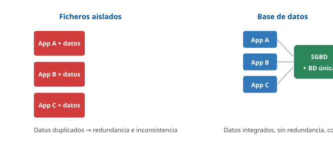

------------------------------------------------------------------------

### D2 · Componentes de un SGBD

**Sección**: §1.4 — Componentes del SGBD **Propósito**: Mostrar los módulos internos entre los usuarios y los datos.

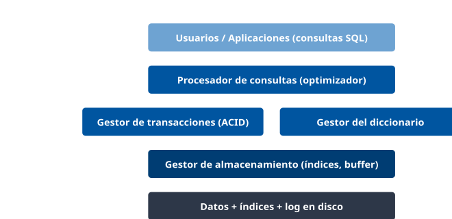

------------------------------------------------------------------------

### D3 · Propiedades ACID

**Sección**: §2.1 — Transacción y propiedades ACID **Propósito**: Recordar las cuatro propiedades de una transacción.

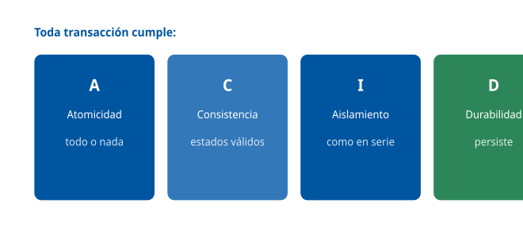

------------------------------------------------------------------------

### D4 · Arquitectura ANSI/SPARC

**Sección**: §3 — Modelo ANSI/SPARC **Propósito**: Los tres niveles de abstracción y la independencia de datos.

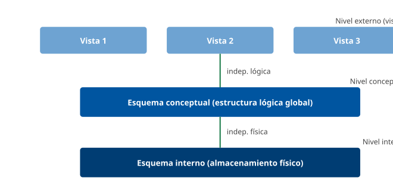

------------------------------------------------------------------------

### D5 · Niveles de aislamiento

**Sección**: §2.3 — Niveles de aislamiento **Propósito**: Qué anomalía evita cada nivel del estándar SQL.

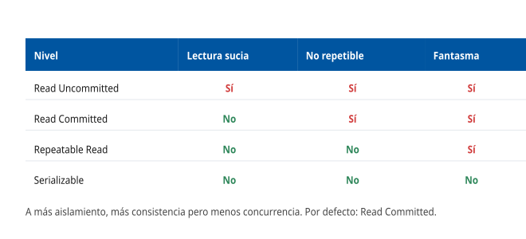

------------------------------------------------------------------------

### D6 · Modelo relacional: claves y join

**Sección**: §4.3 — SGBD relacionales **Propósito**: Mostrar clave primaria, clave ajena e integridad referencial.

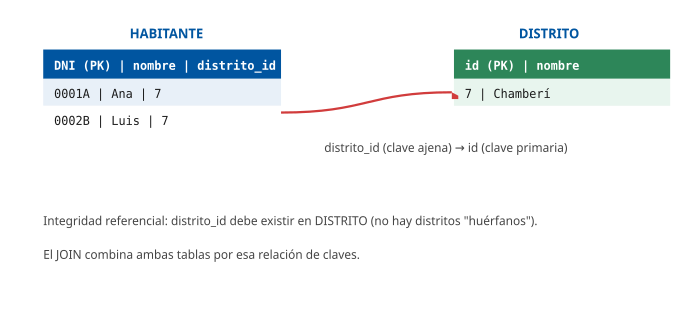

------------------------------------------------------------------------

### D7 · Tipologías de SGBD

**Sección**: §4 — Tipologías de SGBD **Propósito**: Mapa de los modelos de SGBD.

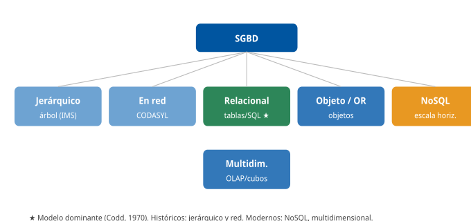

------------------------------------------------------------------------

### D8 · Tipos de bases de datos NoSQL

**Sección**: §4.5 — SGBD NoSQL **Propósito**: Los cuatro tipos de NoSQL con su modelo y ejemplo.

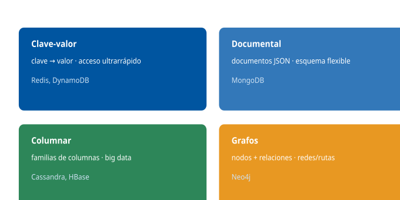

------------------------------------------------------------------------

### D9 · Teorema CAP

**Sección**: §4.5 — Teorema CAP **Propósito**: Solo dos de las tres propiedades a la vez.

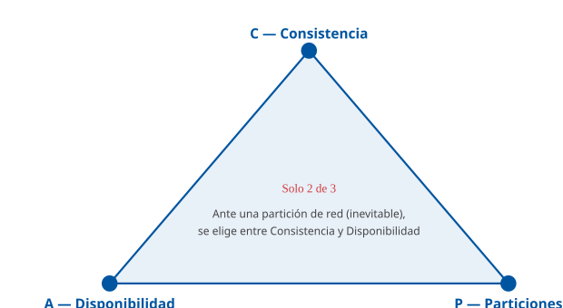

------------------------------------------------------------------------

### D10 · OLTP vs OLAP y data warehouse

**Sección**: §4.6 — SGBD multidimensionales **Propósito**: Distinguir procesamiento transaccional del analítico.

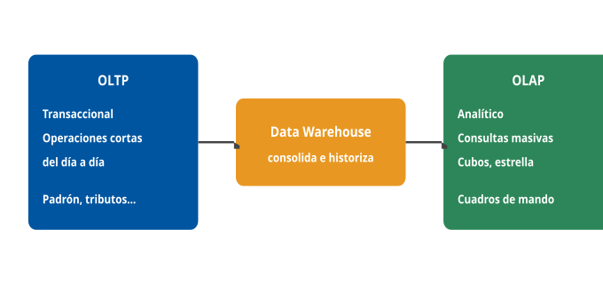

------------------------------------------------------------------------

### D11 · Distribución: fragmentación, replicación, sharding

**Sección**: §5.3 — SGBD distribuidos **Propósito**: Las tres técnicas de distribución de datos.

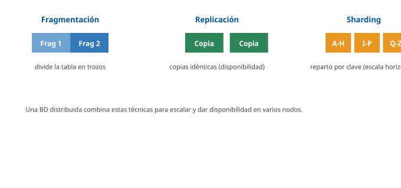

------------------------------------------------------------------------

### D12 · Copias de seguridad y PITR

**Sección**: §5.5 — Copias de seguridad y recuperación **Propósito**: Cómo la copia + el log permiten recuperar a un punto en el tiempo.

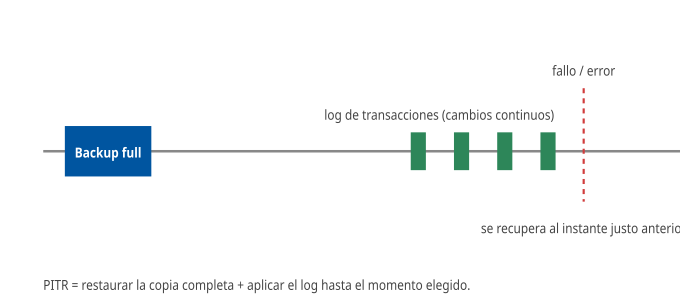

## Casos prácticos

### Caso 1 — Integridad y concurrencia en la base de datos del Padrón

#### Enunciado

La base de datos del Padrón Municipal registra a los habitantes (tabla HABITANTE) y los distritos (tabla DISTRITO). Varios empleados realizan altas, bajas y cambios de domicilio **a la vez**. Se ha detectado que, en algún caso, un cambio quedó a medias y que dos empleados modificaron el mismo registro pisándose. Como técnico, debe garantizar la coherencia de los datos.

#### Cuestiones

**Cuestión 1 — Integridad referencial (3 puntos).** Cada habitante tiene un campo `distrito_id`. ¿Qué mecanismo del modelo relacional impide que un habitante quede asignado a un distrito inexistente, y cómo se llaman las claves implicadas?

**Cuestión 2 — Transacciones (3 puntos).** Un cambio de domicilio implica actualizar varias tablas. Si el sistema cae a mitad, ¿qué propiedad garantiza que no quede "a medias" y mediante qué sentencias se confirma o se deshace?

**Cuestión 3 — Concurrencia (2 puntos).** Dos empleados modifican el mismo registro a la vez y uno sobrescribe al otro. ¿Cómo se llama esa anomalía y qué dos técnicas usa el SGBD para controlar la concurrencia?

**Cuestión 4 — Durabilidad (2 puntos).** Una vez confirmada un alta, ¿qué garantiza que no se pierda aunque el servidor se apague justo después, y gracias a qué elemento?

#### Solución orientativa

- **C1**: la **integridad referencial**: `distrito_id` es una **clave ajena (foránea)** que debe corresponder a la **clave primaria** `id` de DISTRITO; el SGBD rechaza un habitante con un distrito inexistente. *(§4.3)*
- **C2**: la **atomicidad** ("todo o nada"): las actualizaciones se agrupan en una **transacción**; si algo falla, `ROLLBACK` deshace todo; si todo va bien, `COMMIT` confirma. *(§2.1)*
- **C3**: es una **actualización perdida (lost update)**; el SGBD la controla con **bloqueos** (2PL) o con **MVCC** (multiversión). *(§2.2)*
- **C4**: la **durabilidad**: tras el `COMMIT`, el cambio persiste pese a un corte, gracias al **log de transacciones** (write-ahead logging). *(§2.1, §2.4)*

#### Criterios de evaluación

| Aspecto                                                          | Puntos |
|------------------------------------------------------------------|--------|
| Identifica la integridad referencial y las claves primaria/ajena | 3      |
| Explica la atomicidad y el uso de COMMIT/ROLLBACK                | 3      |
| Reconoce la actualización perdida y cita bloqueos/MVCC           | 2      |
| Explica la durabilidad apoyada en el log                         | 2      |

------------------------------------------------------------------------

#### Preguntas tipo test sobre este caso

##### 1. En el supuesto planteado, ¿qué mecanismo del modelo relacional impide que un habitante quede asignado a un distrito que no existe en la tabla DISTRITO?

- a) La integridad de entidad.
- b) La integridad referencial.
- c) La restricción de dominio CHECK.

**Respuesta correcta:** b) · **Referencia:** Caso 1, cuestión 1 · §4.3

La integridad referencial exige que toda clave ajena corresponda a una clave primaria existente en la tabla referenciada (o sea nula), lo que impide referencias huérfanas.

##### 2. ¿Qué papel desempeñan las columnas implicadas en esa relación entre HABITANTE y DISTRITO?

- a) distrito_id es la clave primaria de HABITANTE y referencia la clave ajena id de DISTRITO.
- b) id es una clave ajena de DISTRITO que referencia la clave primaria distrito_id de HABITANTE.
- c) distrito_id es una clave ajena de HABITANTE que referencia la clave primaria id de DISTRITO.

**Respuesta correcta:** c) · **Referencia:** Caso 1, cuestión 1 · §4.3

La clave ajena es el atributo que referencia la clave primaria de otra tabla: aquí, distrito_id (en HABITANTE) apunta a id (en DISTRITO).

##### 3. Un empleado intenta dar de alta a un habitante con un distrito_id que no figura en la tabla DISTRITO. Con la integridad referencial definida, ¿qué hace el SGBD?

- a) Rechaza la operación, porque la clave ajena no corresponde a ninguna clave primaria existente.
- b) Acepta el alta y crea automáticamente el distrito con ese identificador en la tabla DISTRITO.
- c) Acepta el alta y deja la referencia pendiente hasta que alguien cree después el distrito.

**Respuesta correcta:** a) · **Referencia:** Caso 1, cuestión 1 · §4.3

La integridad referencial impide las referencias huérfanas: el SGBD no admite una clave ajena que no corresponda a una clave primaria existente.

##### 4. Un cambio de domicilio actualiza varias tablas y el sistema cae a mitad. ¿Qué propiedad garantiza que el cambio no quede «a medias»?

- a) El aislamiento, que impide que otros vean los estados intermedios.
- b) La durabilidad, que conserva lo ya escrito pese al corte.
- c) La atomicidad («todo o nada»).

**Respuesta correcta:** c) · **Referencia:** Caso 1, cuestión 2 · §2.1

La atomicidad obliga a que las operaciones de una transacción se completen todas o no se aplique ninguna: si falla un paso, se deshacen todos.

##### 5. ¿Con qué sentencias, y de qué sublenguaje de SQL, se confirma o se deshace la transacción del cambio de domicilio?

- a) COMMIT y ROLLBACK, del TCL.
- b) GRANT y REVOKE, del DCL.
- c) INSERT y DELETE, del DML.

**Respuesta correcta:** a) · **Referencia:** Caso 1, cuestión 2 · §1.5, §2.1

El TCL gestiona las transacciones: COMMIT confirma los cambios y ROLLBACK los deshace. GRANT y REVOKE controlan el acceso (DCL).

##### 6. Al reiniciar tras la caída, el SGBD encuentra en el log el cambio de domicilio, que no llegó a confirmarse. ¿Qué hace con él?

- a) Lo rehace (redo) para completar las tablas que faltaban.
- b) Lo deshace (undo), porque la transacción no se confirmó.
- c) Lo conserva tal cual hasta que el empleado lo termine.

**Respuesta correcta:** b) · **Referencia:** Caso 1, cuestión 2 · §2.4

Tras un fallo, el SGBD usa el log para rehacer las transacciones confirmadas y deshacer las no confirmadas; así se preserva la atomicidad.

##### 7. Dos empleados modifican a la vez el mismo registro de un habitante y uno sobrescribe el cambio del otro. ¿Cómo se llama esta anomalía?

- a) Lectura sucia (dirty read).
- b) Lectura fantasma (phantom read).
- c) Actualización perdida (lost update).

**Respuesta correcta:** c) · **Referencia:** Caso 1, cuestión 3 · §2.2

Hay actualización perdida cuando dos transacciones actualizan el mismo dato y una sobrescribe a la otra; la lectura sucia consiste en leer datos aún no confirmados.

##### 8. ¿Qué dos técnicas emplea el SGBD para controlar este tipo de concurrencia?

- a) Los bloqueos (protocolo 2PL) y el control multiversión (MVCC).
- b) El Write-Ahead Logging (WAL) y los puntos de control (checkpoints).
- c) Los índices B+árbol y el particionado de tablas por rango.

**Respuesta correcta:** a) · **Referencia:** Caso 1, cuestión 3 · §2.2

El control de concurrencia se hace con bloqueos (el 2PL garantiza la seriabilidad) o con MVCC, que mantiene varias versiones de cada dato. WAL y checkpoints sirven a la recuperación.

##### 9. Una vez confirmada un alta en el Padrón, el servidor se apaga justo después. ¿Qué propiedad garantiza que el alta no se pierda y gracias a qué elemento?

- a) La consistencia, gracias al diccionario de datos.
- b) La durabilidad, gracias al log de transacciones (WAL).
- c) El aislamiento, gracias al control multiversión.

**Respuesta correcta:** b) · **Referencia:** Caso 1, cuestión 4 · §2.1, §2.4

La durabilidad asegura que, tras el COMMIT, el cambio persiste aunque falle el sistema; se apoya en el log, donde el SGBD anota lo que va a hacer antes de aplicarlo.

##### 10. Al arrancar de nuevo el servidor, ¿qué hace el SGBD con esa alta que ya estaba confirmada?

- a) La rehace (redo) a partir del log, si sus cambios no habían llegado a los datos.
- b) La deshace (undo), porque el apagón la interrumpió antes de escribirse.
- c) La descarta y obliga al empleado a repetir el alta del habitante.

**Respuesta correcta:** a) · **Referencia:** Caso 1, cuestión 4 · §2.4

Con el log, el SGBD rehace las transacciones confirmadas y deshace solo las no confirmadas; un alta confirmada no se pierde.

### Caso 2 — Administración y rendimiento de la base de datos de tributos

#### Enunciado

La base de datos de tributos (IBI, tasas) responde con lentitud al consultar un recibo por NIF, y se necesita reforzar la seguridad de acceso y la política de copias. Como administrador (DBA), debe diagnosticar y proponer medidas.

#### Cuestiones

**Cuestión 1 — Rendimiento (3 puntos).** La consulta de un recibo por NIF tarda demasiado. ¿Qué herramienta usaría para ver cómo el SGBD resuelve la consulta y qué medida aplicaría si detecta un recorrido completo de la tabla?

**Cuestión 2 — Seguridad de acceso (3 puntos).** El personal de atención solo debe poder consultar (no modificar) los recibos. ¿Mediante qué sublenguaje y sentencias lo configuraría, y por qué conviene usar roles?

**Cuestión 3 — Copias de seguridad (2 puntos).** Defina una política de copias que permita restaurar la base de datos al instante exacto anterior a un borrado accidental. ¿Cómo se llama esa capacidad y qué necesita?

**Cuestión 4 — Protección de datos (2 puntos).** Los recibos contienen datos personales. ¿Qué normativa obliga a controlar el acceso, registrar los accesos y proteger la información?

#### Solución orientativa

- **C1**: el **plan de ejecución** (`EXPLAIN`) muestra cómo se resuelve la consulta; si hace un **recorrido completo de tabla** (full table scan), se **crea un índice** sobre el NIF, que reduce la búsqueda a O(log n). *(§5.7, §5.2)*
- **C2**: con **DCL**: `GRANT SELECT ON recibos TO rol_atencion;` (solo lectura) y nunca `GRANT UPDATE`; conviene usar **roles** porque asignar privilegios a un rol y el rol a los empleados simplifica la gestión de miles de usuarios y aplica el mínimo privilegio. *(§5.1)*
- **C3**: la **recuperación a un punto en el tiempo (PITR)**: combina una **copia de seguridad** con el **log de transacciones** para restaurar al instante justo anterior al borrado. *(§5.5)*
- **C4**: el **RGPD** y la **LOPDGDD** (y el **ENS**) obligan a controlar y registrar los accesos, minimizar y proteger los datos personales. *(§5.1, §5.6 \[RGPD\]\[LOPDGDD\])*

#### Criterios de evaluación

| Aspecto                                            | Puntos |
|----------------------------------------------------|--------|
| Usa el plan de ejecución y propone crear un índice | 3      |
| Configura DCL (GRANT SELECT) y justifica los roles | 3      |
| Propone PITR (copia + log)                         | 2      |
| Cita RGPD/LOPDGDD/ENS para los datos personales    | 2      |

------------------------------------------------------------------------

#### Preguntas tipo test sobre este caso

##### 1. En el supuesto planteado, la consulta de un recibo por NIF tarda demasiado. ¿Qué herramienta usa el DBA para ver cómo resuelve el SGBD esa consulta?

- a) El plan de ejecución (EXPLAIN).
- b) El diccionario de datos del sistema.
- c) El log de transacciones (WAL).

**Respuesta correcta:** a) · **Referencia:** Caso 2, cuestión 1 · §5.7

El plan de ejecución (EXPLAIN) muestra cómo el optimizador resuelve la consulta y es el punto de partida del ajuste de rendimiento.

##### 2. El plan revela un recorrido completo de la tabla de recibos (full table scan). ¿Qué medida aplica el DBA?

- a) Elevar el nivel de aislamiento de la sesión a Serializable.
- b) Crear un índice sobre la columna NIF.
- c) Hacer una copia completa (full) de la tabla.

**Respuesta correcta:** b) · **Referencia:** Caso 2, cuestión 1 · §5.2, §5.7

La palanca habitual ante un recorrido completo es crear un índice adecuado sobre la columna de búsqueda; el aislamiento y las copias no aceleran la consulta.

##### 3. Con el índice sobre el NIF, ¿cómo cambia el coste de localizar un recibo?

- a) Pasa a crecer con el cuadrado del número de filas, O(n²).
- b) Sigue siendo proporcional al número de filas, O(n).
- c) Se reduce a un orden logarítmico, O(log n).

**Respuesta correcta:** c) · **Referencia:** Caso 2, cuestión 1 · §5.7

El índice (normalmente un B+árbol) evita recorrer millones de filas y reduce la búsqueda a O(log n); el recorrido completo es el que crece con n.

##### 4. El personal de atención solo debe poder consultar los recibos. ¿Con qué sublenguaje y sentencia lo configura el DBA?

- a) Con el DML: SELECT * FROM recibos WHERE rol = 'atencion';
- b) Con el DCL: GRANT SELECT ON recibos TO rol_atencion;
- c) Con el DDL: ALTER TABLE recibos READ ONLY FOR rol_atencion;

**Respuesta correcta:** b) · **Referencia:** Caso 2, cuestión 2 · §1.5, §5.1

Los privilegios se gestionan con el DCL: GRANT SELECT concede solo lectura sobre la tabla al rol indicado.

##### 5. Si el rol de atención tuviera concedido por error el permiso de modificación, ¿qué sentencia se lo retira?

- a) REVOKE UPDATE ON recibos FROM rol_atencion;
- b) ROLLBACK UPDATE ON recibos FROM rol_atencion;
- c) DELETE UPDATE ON recibos FROM rol_atencion;

**Respuesta correcta:** a) · **Referencia:** Caso 2, cuestión 2 · §5.1

En el DCL, GRANT concede privilegios y REVOKE los retira; ROLLBACK deshace transacciones y DELETE borra filas.

##### 6. ¿Por qué conviene conceder estos privilegios a un rol y no a cada empleado de atención por separado?

- a) Porque el rol cifra los recibos y evita registrar los accesos de cada empleado.
- b) Porque el rol permite modificar recibos sin necesidad de ninguna sentencia GRANT.
- c) Porque el rol simplifica la gestión de miles de usuarios y aplica el mínimo privilegio.

**Respuesta correcta:** c) · **Referencia:** Caso 2, cuestión 2 · §5.1

Los roles agrupan privilegios: se conceden una vez al rol y el rol se asigna a los empleados, lo que simplifica la gestión y ajusta cada perfil al mínimo privilegio.

##### 7. Se quiere poder restaurar la base de datos de tributos al instante exacto anterior a un borrado accidental. ¿Cómo se llama esa capacidad?

- a) Recuperación a un punto en el tiempo (PITR).
- b) Conmutación por error (failover).
- c) Copia incremental desde la última copia.

**Respuesta correcta:** a) · **Referencia:** Caso 2, cuestión 3 · §5.5

La recuperación a un punto en el tiempo (PITR) restaura la base de datos al instante exacto anterior a un incidente; el failover conmuta a otro nodo ante un fallo.

##### 8. Además de una copia de seguridad, ¿qué necesita el DBA para aplicar esa recuperación al instante previo al borrado?

- a) El diccionario de datos con los metadatos.
- b) Una réplica en otro nodo con failover.
- c) El log de transacciones.

**Respuesta correcta:** c) · **Referencia:** Caso 2, cuestión 3 · §5.5

El PITR combina una copia de seguridad con el log de transacciones, que permite reaplicar los cambios hasta el instante elegido.

##### 9. Los recibos contienen datos personales. ¿Qué normativa obliga a controlar y registrar los accesos y a proteger esa información?

- a) Únicamente el ENI, por tratarse de interoperabilidad.
- b) El RGPD y la LOPDGDD, además del ENS.
- c) El estándar SQL (ISO/IEC 9075) y ANSI/SPARC.

**Respuesta correcta:** b) · **Referencia:** Caso 2, cuestión 4 · §5.1, §5.6

Los datos personales obligan a cumplir el RGPD y la LOPDGDD (y, en el sector público, el ENS): minimización, control de acceso, cifrado y registro de accesos.

##### 10. ¿Qué medida forma parte de las obligaciones sobre los datos personales de los recibos?

- a) Dar acceso de lectura a toda la plantilla para favorecer la transparencia.
- b) Conservar todos los datos de forma indefinida por si se necesitan.
- c) Registrar los accesos y minimizar los datos personales tratados.

**Respuesta correcta:** c) · **Referencia:** Caso 2, cuestión 4 · §5.1, §5.6

El RGPD/LOPDGDD exige minimización, control de acceso, cifrado y registro de accesos; además, la gobernanza fija un ciclo de vida con retención y borrado.

### Caso 3 — Elección de tecnología para los datos abiertos y la analítica

#### Enunciado

El Ayuntamiento quiere: (a) mantener su gestión transaccional (Padrón, tributos) con garantías de integridad; (b) construir un sistema de **análisis** de la evolución demográfica y la recaudación por distrito y año; y (c) valorar publicar parte de los datos en una base de datos en la **nube**. Debe asesorar sobre la tecnología.

#### Cuestiones

**Cuestión 1 — Gestión transaccional (2 puntos).** Para la gestión diaria con máxima integridad, ¿qué tipo de SGBD y qué tipo de procesamiento son los adecuados?

**Cuestión 2 — Analítica (3 puntos).** Para analizar la evolución por distrito y año cruzando varias fuentes, ¿qué infraestructura y qué tipo de procesamiento usaría, y cómo se llama el modelo de diseño típico?

**Cuestión 3 — NoSQL y CAP (3 puntos).** Si se optara por una base de datos distribuida NoSQL para un servicio web masivo, explique el compromiso que impone el **teorema CAP** y qué modelo (frente a ACID) suelen seguir estos sistemas.

**Cuestión 4 — Nube (2 puntos).** Antes de contratar una base de datos en la nube (DBaaS) con datos de ciudadanos, ¿qué dos cautelas debe valorar la Administración?

#### Solución orientativa

- **C1**: un **SGBD relacional** (Oracle, PostgreSQL…) con procesamiento **OLTP**, que garantiza integridad y **ACID** para las operaciones transaccionales del día a día. *(§4.3, §4.6)*
- **C2**: un **data warehouse** alimentado desde las fuentes operacionales, explotado con procesamiento **OLAP** (cubos); el diseño típico es el **modelo en estrella** (tabla de hechos rodeada de dimensiones: tiempo, distrito, concepto). *(§4.6)*
- **C3**: el **teorema CAP** establece que, ante una **partición** de red (inevitable en un sistema distribuido), hay que elegir entre **consistencia** y **disponibilidad**; estos sistemas suelen seguir el modelo **BASE** (consistencia eventual) en lugar de ACID. *(§4.5)*
- **C4**: la **ubicación de los datos** y el cumplimiento del **RGPD** (datos en la UE, soberanía del dato) y del **ENS**, y el riesgo de **dependencia del proveedor (vendor lock-in)**. *(§5.8)*

#### Criterios de evaluación

| Aspecto                                                 | Puntos |
|---------------------------------------------------------|--------|
| Propone SGBD relacional + OLTP con ACID para la gestión | 2      |
| Propone data warehouse + OLAP + modelo en estrella      | 3      |
| Explica el compromiso CAP y el modelo BASE              | 3      |
| Cita ubicación de datos/RGPD-ENS y vendor lock-in       | 2      |

------------------------------------------------------------------------

### Nota pedagógica

Los tres casos integran las tres partes del tema sobre supuestos reales del Ayuntamiento: el **Caso 1**, las **características** (integridad, transacciones ACID, concurrencia) sobre el Padrón; el **Caso 2**, la **administración** (rendimiento e índices, seguridad DCL, copias/PITR, RGPD) sobre los tributos; y el **Caso 3**, las **tipologías** (relacional/OLTP, OLAP/data warehouse, NoSQL/CAP) y la **nube** para datos abiertos y analítica. Todos enlazan con el cumplimiento del **RGPD/LOPDGDD** y del **ENS**.

#### Preguntas tipo test sobre este caso

##### 1. En el supuesto planteado, para la gestión diaria del Padrón y los tributos con máxima integridad, ¿qué tipo de SGBD y de procesamiento son los adecuados?

- a) Un SGBD documental NoSQL con procesamiento OLAP.
- b) Un SGBD relacional con procesamiento OLTP.
- c) Un SGBD multidimensional con cubos OLAP.

**Respuesta correcta:** b) · **Referencia:** Caso 3, cuestión 1 · §4.3, §4.6

La gestión del día a día son operaciones transaccionales cortas (OLTP) y requiere la integridad y las garantías ACID de un SGBD relacional.

##### 2. ¿Qué aporta el SGBD relacional a la gestión de los tributos frente a un NoSQL?

- a) Esquema flexible y escalado horizontal.
- b) Disponibilidad con consistencia eventual.
- c) Esquema rígido, ACID e integridad fuerte.

**Respuesta correcta:** c) · **Referencia:** Caso 3, cuestión 1 · §4.5

El relacional aporta esquema rígido, ACID e integridad fuerte, ideal para transacciones como tributos o nóminas; el esquema flexible y la consistencia eventual son propios de NoSQL.

##### 3. Para analizar la evolución demográfica y la recaudación por distrito y año cruzando varias fuentes, ¿qué infraestructura propone el técnico?

- a) Un data warehouse alimentado desde las fuentes operacionales.
- b) Lanzar las consultas masivas sobre la base de datos OLTP del Padrón.
- c) Una base de datos NoSQL de grafos con los recibos y los habitantes.

**Respuesta correcta:** a) · **Referencia:** Caso 3, cuestión 2 · §4.6

El data warehouse consolida datos históricos de varias fuentes para el análisis y lo separa de los sistemas operacionales.

##### 4. ¿Con qué tipo de procesamiento se explota ese almacén para los cuadros de mando?

- a) OLTP, con muchas operaciones transaccionales cortas.
- b) OLAP, con cubos y agregaciones (drill-down, roll-up).
- c) TCL, con transacciones confirmadas mediante COMMIT.

**Respuesta correcta:** b) · **Referencia:** Caso 3, cuestión 2 · §4.6

El procesamiento OLAP está orientado a consultas masivas para el análisis y organiza los datos en cubos que permiten agregaciones rápidas.

##### 5. ¿Cómo se llama el modelo de diseño típico de ese almacén de datos?

- a) Modelo jerárquico, en árbol padre-hijo.
- b) Modelo en red, según CODASYL.
- c) Modelo en estrella.

**Respuesta correcta:** c) · **Referencia:** Caso 3, cuestión 2 · §4.6

El diseño típico de un data warehouse es el modelo en estrella: una tabla de hechos rodeada de dimensiones. Los modelos jerárquico y en red son tipologías históricas de SGBD.

##### 6. En ese modelo en estrella, ¿qué papel tienen «distrito» y «año»?

- a) Son dimensiones que rodean la tabla de hechos.
- b) Son tablas de hechos situadas en el centro.
- c) Son vistas del nivel externo ANSI/SPARC.

**Respuesta correcta:** a) · **Referencia:** Caso 3, cuestión 2 · §4.6

En el modelo en estrella, la tabla de hechos se rodea de dimensiones como el tiempo, el distrito o el concepto, por las que se agregan los datos.

##### 7. Si se optara por una base de datos NoSQL distribuida para un servicio web masivo, ¿qué compromiso impone el teorema CAP?

- a) Que hay que renunciar a la tolerancia a particiones para tener consistencia y disponibilidad.
- b) Que ante una partición de red hay que elegir entre consistencia y disponibilidad.
- c) Que un sistema distribuido puede garantizar a la vez las tres propiedades.

**Respuesta correcta:** b) · **Referencia:** Caso 3, cuestión 3 · §4.5

El teorema CAP permite garantizar solo dos de las tres propiedades; como las particiones son inevitables en un sistema distribuido, se elige entre consistencia y disponibilidad.

##### 8. ¿Qué modelo suelen seguir esos sistemas NoSQL en lugar de ACID?

- a) El modelo ANSI/SPARC de tres esquemas.
- b) El protocolo de bloqueo en dos fases (2PL).
- c) El modelo BASE, con consistencia eventual.

**Respuesta correcta:** c) · **Referencia:** Caso 3, cuestión 3 · §4.5

Muchos NoSQL siguen el modelo BASE (Basically Available, Soft state, Eventual consistency), que prioriza la disponibilidad y la consistencia eventual.

##### 9. Antes de contratar una base de datos en la nube (DBaaS) con datos de ciudadanos, ¿qué cautela debe valorar la Administración?

- a) La ubicación de los datos y el cumplimiento del RGPD y del ENS.
- b) Que el proveedor no realiza copias de seguridad ni aplica parches.
- c) Que el DBaaS no permite escalar ni ofrecer alta disponibilidad.

**Respuesta correcta:** a) · **Referencia:** Caso 3, cuestión 4 · §5.8

En el DBaaS el proveedor gestiona copias, parches y escalado; el riesgo de gobierno está en dónde residen los datos (RGPD, datos en la UE, soberanía) y en el ENS.

##### 10. La otra cautela es el riesgo de que el Ayuntamiento quede atado a un único proveedor de nube. ¿Cómo se denomina?

- a) Conmutación por error (failover).
- b) Dependencia del proveedor (vendor lock-in).
- c) Reparto por clave entre nodos (sharding).

**Respuesta correcta:** b) · **Referencia:** Caso 3, cuestión 4 · §5.8

La dependencia del proveedor (vendor lock-in) es uno de los inconvenientes de gobierno del DBaaS; failover y sharding son técnicas de disponibilidad y escalado.

## Fuentes

### Fuentes Tier 1 (primarias)

#### Teoría general de bases de datos

| ID | Título | Autor / Origen | Edición / Año | Secciones usadas | Referencia |
|----|----|----|----|----|----|
| ELMASRI | Fundamentals of Database Systems | Elmasri, Navathe | 7.ª ed., Pearson, 2016 | Concepto de SGBD, modelo relacional, transacciones, concurrencia, recuperación, BD distribuidas, NoSQL, almacenamiento (cap. 1-25) | ISBN 978-0133970777 |
| SILBERSCHATZ-DB | Database System Concepts | Silberschatz, Korth, Sudarshan | 7.ª ed., McGraw-Hill, 2019 | Arquitectura, transacciones ACID, control de concurrencia, recuperación, BD distribuidas, big data (cap. 1-23) | ISBN 978-0078022159 |
| DATE | An Introduction to Database Systems | C. J. Date | 8.ª ed., Addison-Wesley, 2003 | Modelo relacional, integridad, álgebra relacional, independencia de datos | ISBN 978-0321197849 |
| CONNOLLY-BEGG | Database Systems: A Practical Approach | Connolly, Begg | 6.ª ed., Pearson, 2014 | Ciclo de vida, administración, distribución, data warehouse | ISBN 978-0132943260 |
| CODD-1970 | A Relational Model of Data for Large Shared Data Banks | Edgar F. Codd | Communications of the ACM, 1970 | Fundamento del modelo relacional | doi.org/10.1145/362384.362685 |

#### Estándares y arquitectura

| ID | Título | Origen | Año | Secciones usadas | Referencia |
|----|----|----|----|----|----|
| ANSI-SPARC | ANSI/X3/SPARC Three-Schema Architecture | ANSI/SPARC Study Group | 1975 | Arquitectura de tres esquemas: interno, conceptual, externo | ANSI/X3/SPARC DBMS Framework |
| ISO-9075 | ISO/IEC 9075 — SQL:2016 (Database language SQL) | ISO/IEC | 2016, rev. 2023 | DDL, DML, DCL, TCL; tipos; niveles de aislamiento | iso.org/standard/63555.html |
| ISO-9075-OR | ISO/IEC 9075-2 — SQL objeto-relacional | ISO/IEC | 2016 | Tipos estructurados y características objeto-relacionales (SQL:1999+) | iso.org/standard/63556.html |
| ACID-HAERDER | Principles of Transaction-Oriented Database Recovery (definición ACID) | Härder, Reuter | ACM Computing Surveys, 1983 | Origen formal de las propiedades ACID | doi.org/10.1145/289.291 |

#### NoSQL, distribución y analítica

| ID | Título | Autor / Origen | Año | Secciones usadas | Referencia |
|----|----|----|----|----|----|
| CAP-BREWER | CAP Theorem (Towards Robust Distributed Systems) | Eric Brewer | 2000 (conjetura); Gilbert-Lynch demostración 2002 | Teorema CAP (consistencia, disponibilidad, particiones) | doi.org/10.1145/564585.564601 |
| SADALAGE-FOWLER | NoSQL Distilled | Sadalage, Fowler | Addison-Wesley, 2012 | Tipos de NoSQL (clave-valor, documental, columnar, grafos), BASE, agregados | ISBN 978-0321826626 |
| MONGODB-DOC | MongoDB Manual | MongoDB Inc. | 2024 | Modelo documental, sharding, réplica set | mongodb.com/docs |
| KIMBALL-DW | The Data Warehouse Toolkit | Ralph Kimball, Margy Ross | 3.ª ed., Wiley, 2013 | Data warehouse, modelo dimensional, OLAP, estrella/copo de nieve | ISBN 978-1118530801 |
| INMON-DW | Building the Data Warehouse | Bill Inmon | 4.ª ed., Wiley, 2005 | Definición de data warehouse corporativo (OLTP vs OLAP) | ISBN 978-0764599446 |

#### Productos de referencia (documentación oficial)

| ID | Título | Origen | Uso |  |
|----|----|----|----|----|
| ORACLE-DBA | Oracle Database Administrator's Guide | Oracle | Administración: usuarios, tablespaces, RMAN, RAC, alta disponibilidad | docs.oracle.com |
| POSTGRES-DOC | PostgreSQL Documentation | PostgreSQL Global Dev. Group | MVCC, roles/privilegios, PITR, particionado, replicación | postgresql.org/docs |
| MYSQL-DOC | MySQL Reference Manual | Oracle | InnoDB, replicación, backup | dev.mysql.com/doc |

#### Normativa aplicable (sector público)

| ID | Título | Origen | Año | Uso |  |
|----|----|----|----|----|----|
| RGPD | [Reglamento (UE) 2016/679](https://eur-lex.europa.eu/legal-content/ES/TXT/?uri=CELEX:32016R0679) — Protección de Datos | DOUE | 2016 (aplicación 2018) | Tratamiento de datos personales en BD: minimización, seguridad, derechos | eur-lex.europa.eu/eli/reg/2016/679 |
| LOPDGDD | [Ley Orgánica 3/2018](https://www.boe.es/buscar/act.php?id=BOE-A-2018-16673) de Protección de Datos y garantía de derechos digitales | BOE | 2018 | Desarrollo nacional del RGPD | boe.es/eli/es/lo/2018/12/05/3 |
| ENS-RD311 | Esquema Nacional de Seguridad ([Real Decreto 311/2022](https://www.boe.es/buscar/act.php?id=BOE-A-2022-7191)) | BOE | 2022 | Seguridad, control de acceso, copias de seguridad de los sistemas de información | boe.es/buscar/doc.php?id=BOE-A-2022-7191 |

------------------------------------------------------------------------

### Fuentes Tier 2 (secundarias — contraste y referencia rápida)

| ID | Título | Origen | Uso |  |
|----|----|----|----|----|
| DB-ENGINES | DB-Engines Ranking | solid IT | Popularidad y clasificación de SGBD por tipo |  |
| MARTIN-DDIA | Designing Data-Intensive Applications | Martin Kleppmann (O'Reilly, 2017) | Replicación, particionado, consistencia (contraste) |  |
| DATOS-MADRID | Portal de datos abiertos del Ayuntamiento de Madrid | Ayto. Madrid | Contexto real (Padrón, censo, callejero, tributos) para los casos | datos.madrid.es |

------------------------------------------------------------------------
