# Tema 16. Modelo conceptual de datos

**Bloque:** técnico  
**Enunciado oficial** (BOAM n.º 10.032, de 23 de diciembre de 2025): Modelo conceptual de datos. Entidades, atributos y relaciones. Reglas de modelización. Diagramas de flujo de datos. Reglas de construcción. Descomposición en niveles. Flujogramas.

Versión web: <https://ayuntamientomadrid.github.io/temario-tecnico-auxiliar/temas/tema-16.html> · PDF: [tema-16.pdf](tema-16.pdf) · Test: [../../../tests/tecnico/tema-16.md](../../../tests/tecnico/tema-16.md)

## Índice

- 1. Modelo conceptual de datos
  - 1.1. Concepto de modelo, dato y modelo de datos
  - 1.2. Niveles de abstracción: la arquitectura ANSI/SPARC
  - 1.3. Independencia de datos
  - 1.4. El modelo de dominio y el modelo conceptual de datos
  - 1.5. Técnicas y tipos de modelado: estático, dinámico y funcional
- 2. Entidades, atributos y relaciones
  - 2.1. Origen y propósito
  - 2.2. Entidades
  - 2.3. Atributos
  - 2.4. Relaciones: grado, cardinalidad y participación
- 3. Reglas de modelización
  - 3.1. Reglas de modelización y construcción del diagrama E-R
  - 3.2. Técnicas de descomposición: generalización/especialización, agregación y asociación
  - 3.3. Notaciones: Chen, pata de gallo y UML
  - 3.4. Del modelo E-R al modelo relacional
- 4. Diagramas de flujo de datos
  - 4.1. Componentes del DFD
  - 4.2. Diccionario de datos y especificación de procesos
  - 4.3. Notaciones: Yourdon/DeMarco frente a Gane/Sarson
- 5. Reglas de construcción
- 6. Descomposición en niveles
- 7. Flujogramas
  - 7.1. Concepto y propósito del flujograma
  - 7.2. Símbolos normalizados (ISO 5807 / ANSI)
  - 7.3. Estructuras básicas: secuencia, selección e iteración
  - 7.4. Reglas de construcción del flujograma
  - 7.5. Ordinograma, organigrama y pseudocódigo
  - 7.6. UML: panorama de los tipos de diagramas
- 8. Modelado dinámico: el diagrama de transición de estados (DTE)
  - 8.1. Estados, transiciones, eventos, condiciones y acciones
  - 8.2. Reglas de construcción del DTE
  - 8.3. Equivalencia con las máquinas de estados y UML
- Resumen integrador

### Conceptos clave del tema

| Concepto                                        | Dónde se trata |
|-------------------------------------------------|----------------|
| Arquitectura ANSI/SPARC (3 esquemas)            | §1.2           |
| Independencia física y lógica de datos          | §1.3           |
| Entidad, atributo, relación                     | §2.2-§2.4      |
| Grado y cardinalidad (1:1, 1:N, N:M)            | §2.4           |
| Participación total/parcial                     | §2.4           |
| Generalización/especialización, agregación      | §3.2           |
| Notación pata de gallo (crow's foot)            | §3.3           |
| Diagrama de transición de estados (DTE)         | §8             |
| Procesos, flujos, almacenes, entidades externas | §4.1           |
| Diagrama de contexto y explosión por niveles    | §6             |
| Equilibrado (balanceo) de DFD                   | §6             |
| Diccionario de datos                            | §4.2           |
| Símbolos ISO 5807 (terminal, proceso, decisión) | §7.2           |
| Secuencia, selección, iteración (Böhm-Jacopini) | §7.3           |
| Diagramas UML (estructura vs comportamiento)    | §7.6           |

## Contenido

### Convenciones del documento

Este tema incluye cuatro tipos de **cajas callout** para facilitar el estudio:

> **Dato clave.** Información de alta densidad memorística.

> **Ejercicio resuelto.** Problema + solución paso a paso (modelado de un E-R, niveles de un DFD, traza de un flujograma).

> **Ejemplo de aplicación en el ayto.** Aplicación real de la teoría al entorno municipal (Padrón, callejero, tributos, sede electrónica).

> **Relación con otros temas.** Enlace conceptual a otros temas del temario oficial.

Las fuentes se referencian con etiquetas breves tipo `[CHEN]` o `[ELMASRI, cap. 3]` — el registro completo está en la pestaña Fuentes. Este tema combina **notación clásica** (la tradicional en oposiciones, alineada con MÉTRICA v3) y **UML** (estándar moderno), señalando la equivalencia entre ambas en cada técnica.

------------------------------------------------------------------------

### 1. Modelo conceptual de datos

#### 1.1. Concepto de modelo, dato y modelo de datos

Un **dato** es la representación simbólica (numérica, alfabética, etc.) de un atributo de una entidad del mundo real; carece de significado por sí solo hasta que se procesa e interpreta como **información**. Un **sistema de información (SI)** capta, almacena, procesa y distribuye esa información para apoyar la toma de decisiones de una organización. \[METRICA3\]

Un **modelo** es una representación abstracta y simplificada de una parcela de la realidad (el *universo del discurso* o dominio), que retiene los aspectos relevantes para un propósito y descarta el resto. Modelar es, por tanto, **abstraer**: decidir qué es esencial y cómo representarlo. \[PRESSMAN\]

Un **modelo de datos** es un conjunto de **conceptos, reglas y notación** que permiten describir la estructura de una base de datos: los datos, sus relaciones, su semántica y las restricciones de integridad. \[ELMASRI, cap. 2\] Según el nivel de abstracción, se distinguen tres categorías:

- **Modelos conceptuales (de alto nivel o semánticos)**: próximos a cómo percibe los datos el usuario; independientes de cualquier gestor. El **modelo Entidad-Relación** es el más representativo.
- **Modelos lógicos (de implementación o representativos)**: próximos a cómo organiza los datos el SGBD. El **modelo relacional** es el dominante (ver Tema 17).
- **Modelos físicos (de bajo nivel)**: describen *cómo* se almacenan los datos en el soporte (ficheros, índices, bloques).

> **Dato clave.** **Modelo conceptual** = independiente del SGBD, cercano al usuario (E-R). **Modelo lógico** = dependiente del tipo de SGBD, cercano al diseñador (relacional). **Modelo físico** = dependiente del producto y del soporte (almacenamiento). No confundir los tres niveles.

> **Relación con otros temas.** El **modelo conceptual de datos** (este tema) precede al **diseño lógico y físico y la normalización** (Tema 17), y se materializa en algún tipo de **SGBD** (Tema 15). El modelo de datos es el puente entre el análisis de requisitos y la base de datos operativa.

#### 1.2. Niveles de abstracción: la arquitectura ANSI/SPARC

En 1975, el comité **ANSI/X3/SPARC** propuso una arquitectura de **tres esquemas** para separar la visión que cada agente tiene de los datos y conseguir **independencia de datos**. \[ANSI-SPARC\] Es la base teórica de todo el modelado:

1.  **Nivel externo (o de vistas)**: describe la parte de la base de datos que interesa a **cada grupo de usuarios**. Puede haber muchos esquemas externos (vistas), uno por perfil. Oculta el resto de los datos.
2.  **Nivel conceptual (o lógico global)**: describe **toda** la estructura de la base de datos para la comunidad de usuarios: entidades, atributos, relaciones y restricciones. Es **único** y no contiene detalles de almacenamiento. Aquí vive el **modelo conceptual de datos**.
3.  **Nivel interno (o físico)**: describe **cómo** se almacenan físicamente los datos: estructuras de ficheros, índices, rutas de acceso, ubicación en el soporte. Es **único**.

> **Dato clave.** ANSI/SPARC: **externo (vistas, varios)** → **conceptual (global, único)** → **interno (físico, único)**. La correspondencia entre esquemas se llama *mapping*. Hay que retener cuántos esquemas hay de cada tipo: **varios externos, un conceptual, un interno**.

#### 1.3. Independencia de datos

La arquitectura de tres esquemas hace posible la **independencia de datos**: la capacidad de modificar el esquema de un nivel sin tener que alterar el del nivel superior. \[DATE\] Hay dos tipos:

- **Independencia física**: se puede cambiar el **esquema interno** (reorganizar ficheros, añadir un índice, cambiar de disco) sin modificar el esquema conceptual ni las aplicaciones. Es la más fácil de lograr.
- **Independencia lógica**: se puede cambiar el **esquema conceptual** (añadir una entidad o un atributo) sin modificar los esquemas externos ni reescribir las aplicaciones que no usan ese cambio. Es más difícil, porque las vistas dependen del esquema conceptual.

> **Dato clave.** **Física** = aísla el conceptual de cambios en el almacenamiento. **Lógica** = aísla las vistas/aplicaciones de cambios en el esquema conceptual. La independencia lógica es la **más difícil** de conseguir.

#### 1.4. El modelo de dominio y el modelo conceptual de datos

El **modelo de dominio** (o modelo del *universo del discurso*) captura los conceptos del negocio y sus relaciones tal como existen en la realidad, **antes** de pensar en la solución informática. El **modelo conceptual de datos** es la formalización de ese dominio en términos de **entidades, atributos y relaciones**, usando una técnica como el E-R. \[CHEN\]

Sus características fundamentales son:

- **Independencia tecnológica**: no presupone ningún SGBD ni lenguaje.
- **Expresividad semántica**: refleja el significado del negocio, no detalles técnicos.
- **Validable por el usuario**: un experto del dominio (no informático) debe poder entenderlo y confirmarlo.
- **Estable**: cambia solo si cambia el negocio, no si cambia la tecnología.

> **Ejemplo de aplicación en el ayto.** El modelo de dominio del **Padrón Municipal de Habitantes** identifica conceptos como *Habitante*, *Vivienda*, *Vía* (calle del callejero), *Distrito* y *Barrio*, y relaciones como «un habitante *está empadronado en* una vivienda» o «una vía *pertenece a* un distrito». Esto se decide con los técnicos de Estadística del Ayuntamiento, **sin** hablar todavía de tablas ni de Oracle: es modelado conceptual puro.

#### 1.5. Técnicas y tipos de modelado: estático, dinámico y funcional

Un sistema de información se describe desde **tres perspectivas complementarias**, cada una con su técnica de diagramado. Esta clasificación (heredada del análisis estructurado y de OMT) vertebra todo el tema: \[RUMBAUGH\]\[YOURDON\]

| Perspectiva | Pregunta que responde | Técnica clásica | Equivalente UML |
|----|----|----|----|
| **Estática (datos)** | ¿Qué datos hay y cómo se relacionan? | Modelo Entidad-Relación (E-R) | Diagrama de clases |
| **Dinámica (comportamiento)** | ¿Cómo cambia de estado el sistema ante los eventos? | Diagrama de Transición de Estados (DTE) | Diagrama de estados |
| **Funcional (procesos)** | ¿Qué transformaciones sufren los datos al fluir? | Diagrama de Flujo de Datos (DFD) | Diagrama de actividad |

> **Dato clave.** Memoriza la terna: **estático → E-R**, **dinámico → DTE**, **funcional → DFD**. El enunciado oficial del tema recorre exactamente estas tres vistas más los **flujogramas** (que detallan la lógica de un proceso).

------------------------------------------------------------------------

### 2. Entidades, atributos y relaciones

#### 2.1. Origen y propósito

El **modelo Entidad-Relación** fue propuesto por **Peter Chen en 1976** como una vista unificada de los datos, independiente de su implementación. \[CHEN\] Es el estándar *de facto* para el **diseño conceptual** de bases de datos: representa la realidad mediante tres construcciones básicas —**entidades**, **atributos** y **relaciones (interrelaciones)**— y un diagrama legible llamado **diagrama entidad-relación (DER)**.

#### 2.2. Entidades

Una **entidad** es un objeto del mundo real, concreto o abstracto, con existencia propia y distinguible de los demás, sobre el que se quiere almacenar información. \[ELMASRI, cap. 3\] Hay que distinguir:

- **Tipo de entidad** (o entidad, en sentido genérico): la *plantilla* o categoría, p. ej. `HABITANTE`. En el diagrama es un **rectángulo**.
- **Ocurrencia** (o instancia, ejemplar): un elemento concreto de ese tipo, p. ej. el habitante con DNI 50.123.456-X. Las ocurrencias **no** se dibujan; pueblan la base de datos.

Según su dependencia de existencia, las entidades se clasifican en:

- **Entidad fuerte (regular)**: tiene existencia propia y un identificador (clave) formado por sus propios atributos. P. ej. `HABITANTE`.
- **Entidad débil**: su existencia depende de otra entidad (la *propietaria* o *fuerte*) y **no** puede identificarse solo con sus atributos; necesita la clave de la entidad fuerte más un **discriminante** (clave parcial). En el diagrama es un **rectángulo doble**. P. ej. `VOLUMEN_EXPEDIENTE` depende de `EXPEDIENTE`.

> **Dato clave.** **Entidad fuerte**: se identifica sola (rectángulo simple). **Entidad débil**: depende de otra y se identifica con la clave ajena + un discriminante propio (rectángulo doble; la relación que la liga es una *relación identificadora*, en rombo doble).

#### 2.3. Atributos

Un **atributo** es una propiedad o característica de una entidad (o de una relación) que interesa almacenar. \[CHEN\] En notación de Chen se dibuja como una **elipse** unida a su entidad. El conjunto de valores válidos de un atributo es su **dominio** (p. ej. el dominio de *sexo* es {H, M}). \[ISO11404\] Tipos de atributos:

- **Simple (atómico)** vs **compuesto**: el compuesto se descompone en partes con significado propio. P. ej. `domicilio` = (vía, número, planta, puerta, código postal).
- **Monovaluado** vs **multivaluado**: el multivaluado puede tomar varios valores para una misma ocurrencia. P. ej. `teléfono` (varios). Se dibuja con **elipse doble**.
- **Almacenado** vs **derivado (calculado)**: el derivado se obtiene de otros. P. ej. `edad` se deriva de `fecha_nacimiento`. Se dibuja con **elipse de línea discontinua**.
- **Identificador (clave)**: atributo o conjunto de atributos cuyo valor identifica unívocamente cada ocurrencia. Se **subraya**. Puede haber varias claves candidatas; se elige una **clave primaria**.

> **Dato clave.** Representación en Chen: atributo = elipse; **clave = subrayado**; **multivaluado = elipse doble**; **derivado = elipse discontinua**; **compuesto = elipse con elipses hijas**.

> **Ejemplo de aplicación en el ayto.** En `HABITANTE`, el atributo identificador es el **DNI/NIE** (subrayado); `nombre_completo` es **compuesto** (nombre + apellidos); `teléfono_contacto` puede ser **multivaluado**; y `edad` es **derivada** de la fecha de nacimiento (no se almacena, se calcula).

#### 2.4. Relaciones: grado, cardinalidad y participación

Una **relación (interrelación)** es una asociación con significado entre dos o más entidades. \[CHEN\] En notación de Chen se dibuja como un **rombo** que une las entidades participantes. Una relación también puede tener atributos propios (p. ej. `fecha` en la relación `EMPADRONADO_EN`). Tres propiedades caracterizan una relación:

**a) Grado**: número de tipos de entidad que participan.

- **Unaria (recursiva)**: una entidad se relaciona consigo misma. P. ej. `EMPLEADO supervisa a EMPLEADO`.
- **Binaria**: dos entidades (el caso más frecuente).
- **Ternaria**: tres entidades. P. ej. `PROVEEDOR – PROYECTO – PIEZA`.

**b) Cardinalidad (razón de cardinalidad)**: número máximo de ocurrencias de una entidad que pueden asociarse a una ocurrencia de la otra. En relaciones binarias:

- **Uno a uno (1:1)**: cada ocurrencia de A se asocia con una de B y viceversa.
- **Uno a muchos (1:N)**: una ocurrencia de A se asocia con varias de B, pero cada B con una sola A.
- **Muchos a muchos (N:M)**: una ocurrencia de A se asocia con varias de B y viceversa.

**c) Participación (cardinalidad mínima)**: indica si la participación de una entidad en la relación es obligatoria u opcional.

- **Total (obligatoria)**: toda ocurrencia de la entidad debe participar en la relación (mínimo 1). Se dibuja con **línea doble** en Chen.
- **Parcial (opcional)**: alguna ocurrencia puede no participar (mínimo 0).

La notación **(mín, máx)** combina ambas: junto a cada entidad se anota el par cardinalidad mínima y máxima de sus ocurrencias en la relación. P. ej. `(1,1)` o `(0,N)`.

> **Dato clave.** No confundir **cardinalidad máxima** (1:1, 1:N, N:M → *cuántas* como tope) con **participación o cardinalidad mínima** (total/parcial → *si es obligatoria*). La notación (mín, máx) reúne las dos. Cuidado: la posición de la etiqueta (mín,máx) varía entre escuelas (Chen la pone *cruzada*, MÉTRICA la pone *del lado de la entidad*).

> **Ejercicio resuelto.** *Modela: «Un distrito tiene muchos barrios; cada barrio pertenece a un único distrito; todo barrio pertenece obligatoriamente a un distrito y todo distrito tiene al menos un barrio».* Entidades: `DISTRITO`, `BARRIO`. Relación: `CONTIENE` (rombo). Cardinalidad: **1:N** (un distrito, muchos barrios). Participación: **total en ambos lados** (todo barrio tiene distrito → total en BARRIO; todo distrito tiene ≥1 barrio → total en DISTRITO). En notación (mín,máx): DISTRITO `(1,N)`, BARRIO `(1,1)`.

### 3. Reglas de modelización

#### 3.1. Reglas de modelización y construcción del diagrama E-R

Construir un buen modelo E-R sigue un proceso y unas reglas heurísticas: \[ELMASRI, cap. 3\]\[METRICA3\]

1.  **Identificar las entidades** a partir de los sustantivos relevantes del dominio (objetos sobre los que se guarda información). Descartar los que sean realmente atributos.
2.  **Identificar las relaciones** a partir de los verbos que conectan entidades.
3.  **Asignar los atributos** a la entidad o relación a la que pertenecen; elegir el **identificador** de cada entidad.
4.  **Determinar grado, cardinalidad y participación** de cada relación.
5.  **Detectar entidades débiles** y sus relaciones identificadoras.
6.  **Aplicar generalización/especialización** cuando haya entidades con atributos comunes y específicos.
7.  **Revisar y validar** con el usuario; eliminar redundancias.

Reglas de buena construcción (errores típicos a evitar):

- Un **atributo no debe modelarse como entidad** salvo que tenga atributos propios o participe en relaciones (p. ej. `color` es atributo, pero `MARCA` con sus propios datos es entidad).
- Evitar **relaciones redundantes** (una relación deducible de otras dos).
- Un atributo que solo tiene sentido para la combinación de dos entidades pertenece a la **relación**, no a una entidad.
- Nombrar entidades en **singular** y relaciones con un **verbo**.

#### 3.2. Técnicas de descomposición: generalización/especialización, agregación y asociación

El **modelo E-R extendido (EER)** añade construcciones semánticas para casos complejos: \[ELMASRI, cap. 4\]

- **Generalización / Especialización (jerarquía «es-un», is-a)**: una entidad **supertipo** agrupa atributos comunes y varias entidades **subtipo** añaden atributos específicos. *Especializar* es el proceso descendente (de lo general a lo particular); *generalizar*, el ascendente. P. ej. supertipo `PERSONAL`, subtipos `FUNCIONARIO` y `LABORAL`. Restricciones:
  - **Disyunción**: *disjunta* (un ejemplar pertenece a un solo subtipo) vs *solapada* (puede pertenecer a varios).
  - **Completitud**: *total* (todo ejemplar del supertipo está en algún subtipo) vs *parcial*.
- **Agregación**: trata una **relación** como si fuera una entidad de nivel superior para poder relacionarla con otra entidad (relación de relaciones). P. ej. la relación `TRABAJA_EN(EMPLEADO, PROYECTO)` se agrega para relacionarla con `MAQUINARIA`.
- **Asociación**: vínculo «parte-de» (composición/agregación en sentido UML) entre un todo y sus partes.

> **Dato clave.** **Generalización/especialización** = jerarquía *es-un* (herencia de atributos del supertipo). Atención a las dos parejas de restricciones: **disjunta/solapada** y **total/parcial**. La **agregación** del EER es «tratar una relación como entidad»; no confundir con la agregación de UML.

> **Relación con otros temas.** La jerarquía de generalización/especialización del EER es el antecedente directo de la **herencia** en la **Programación Orientada a Objetos** (Tema 20). Un supertipo E-R ↔ una superclase; un subtipo ↔ una subclase que hereda y extiende.

#### 3.3. Notaciones: Chen, pata de gallo y UML

La misma semántica E-R se dibuja con notaciones distintas; conviene reconocerlas todas: \[SILBERSCHATZ\]\[MARTIN\]

- **Chen (1976)**: entidades en rectángulo, atributos en elipse, relaciones en rombo. Muy expresiva pero ocupa mucho espacio. La cardinalidad se anota con `1`, `N`, `M` sobre las líneas.
- **Pata de gallo (crow's foot, Information Engineering de Martin)**: entidades en rectángulo con sus atributos dentro; las relaciones son líneas cuyos **extremos** codifican la cardinalidad con símbolos (una raya = uno; «pata de gallo» = muchos; círculo = opcional/cero). Es la más usada en herramientas CASE.
- **UML (diagrama de clases)**: las entidades son **clases** (rectángulo con compartimentos), las relaciones son **asociaciones** con **multiplicidad** `1`, `0..1`, `1..`*,* . La generalización usa el triángulo de herencia. \[UML\]

| Concepto E-R | Chen | Pata de gallo | UML |
|----|----|----|----|
| Entidad | Rectángulo | Rectángulo con campos | Clase |
| Atributo | Elipse | Línea dentro del rectángulo | Atributo de clase |
| Relación | Rombo | Línea con extremos | Asociación |
| Cardinalidad N:M | `N`…`M` sobre líneas | doble pata de gallo | *…* |
| Generalización | Triángulo/«ISA» | — | Triángulo de herencia |

> **Dato clave.** En **pata de gallo**, los símbolos se leen *junto a la entidad del extremo*: «\|\|» = uno y solo uno; «o\<» = cero o muchos; «\|\<» = uno o muchos. Es la notación que generan casi todas las herramientas (ERwin, MySQL Workbench…). UML usa **multiplicidad** numérica (`0..1`, `1..*`).

#### 3.4. Del modelo E-R al modelo relacional

El modelo conceptual E-R se **transforma** en un modelo lógico relacional siguiendo reglas mecánicas (este paso pertenece al diseño lógico, Tema 17, pero conviene conocerlo): \[ELMASRI, cap. 9\]\[CODD\]

- Cada **entidad** → una **tabla (relación)**; sus atributos → columnas; su identificador → **clave primaria**.
- Relación **1:N** → la clave de la entidad del lado «1» se propaga como **clave ajena** a la tabla del lado «N».
- Relación **N:M** → se crea una **tabla intermedia** cuya clave primaria es la combinación de las claves de ambas entidades (más los atributos propios de la relación).
- Relación **1:1** → la clave ajena se coloca en cualquiera de las dos tablas (preferiblemente en la de participación total).
- Atributo **multivaluado** → tabla aparte con la clave de la entidad + el valor.
- **Entidad débil** → tabla con la clave de la entidad fuerte + su discriminante como clave primaria compuesta.

> **Relación con otros temas.** Esta transformación es la entrada del **Tema 17 (Diseño lógico y físico, modelo relacional y normalización)**. El resultado se refina con las **formas normales** para eliminar redundancias y anomalías. El SQL que crea esas tablas es el **Tema 19**.

------------------------------------------------------------------------

### 4. Diagramas de flujo de datos

#### 4.1. Componentes del DFD

El **diagrama de flujo de datos (DFD)** modela el sistema como una **red de procesos** que transforman datos, mostrando *qué* hace el sistema con la información (no *cómo* ni *cuándo*). Es la herramienta central del **análisis estructurado** de DeMarco, Yourdon y Gane/Sarson. \[DEMARCO\]\[YOURDON\] Tiene **cuatro** elementos:

1.  **Proceso (función, burbuja)**: transforma flujos de datos de entrada en flujos de salida. Se dibuja como **círculo** (Yourdon/DeMarco) o **rectángulo redondeado** (Gane/Sarson). Se numera (1, 2, 3…). El nombre es un **verbo + objeto** («Validar solicitud»).
2.  **Flujo de datos**: dato en movimiento entre componentes. Se dibuja como una **flecha** etiquetada con el nombre del dato.
3.  **Almacén de datos (data store)**: dato en reposo (un fichero, una tabla, un archivo). Se dibuja como **dos líneas paralelas** (Yourdon) o un rectángulo abierto (Gane/Sarson). Se numera con D1, D2…
4.  **Entidad externa (origen/destino, terminador)**: persona, organización u otro sistema, **externo** al ámbito modelado, que produce o consume datos. Se dibuja como un **rectángulo**.

> **Dato clave.** Los **cuatro** componentes del DFD: **proceso** (transforma), **flujo** (dato en movimiento), **almacén** (dato en reposo) y **entidad externa** (frontera del sistema). El DFD modela *función*, **no** secuencia temporal ni decisiones (eso es el flujograma).

#### 4.2. Diccionario de datos y especificación de procesos

El DFD se acompaña de dos artefactos que completan el modelo funcional: \[DEMARCO\]

- **Diccionario de datos (DD)**: repositorio que **define** rigurosamente cada flujo, almacén y dato elemental del DFD, usando una notación de composición:
  - `=` (se compone de), `+` (y/concatenación), `{ }` (iteración/repetición), `[ | ]` (selección/alternativa), `( )` (opcional).
  - P. ej.: `solicitud = nº_registro + fecha + datos_solicitante + [presencial | telemática]`.
- **Especificación de procesos (mini-spec o P-SPEC)**: describe la **lógica** de cada proceso **primitivo** (los que ya no se descomponen), mediante **pseudocódigo**, **tablas de decisión** o **lenguaje estructurado**. Aquí es donde el modelado funcional enlaza con los **flujogramas**.

> **Dato clave.** El **diccionario de datos** define los datos (con `= + { } [ ] ( )`); la **mini-spec** define la lógica de los procesos primitivos. Juntos, DFD + DD + mini-specs forman el **modelo de procesos** completo del análisis estructurado.

#### 4.3. Notaciones: Yourdon/DeMarco frente a Gane/Sarson

| Componente | Yourdon / DeMarco | Gane / Sarson |
|----|----|----|
| Proceso | Círculo (burbuja) | Rectángulo de esquinas redondeadas |
| Flujo de datos | Flecha curva | Flecha recta |
| Almacén | Dos líneas paralelas abiertas | Rectángulo abierto por la derecha |
| Entidad externa | Rectángulo | Rectángulo (a veces con sombra) |

Ambas notaciones son **semánticamente equivalentes**; la elección es de estilo o de la herramienta CASE. En UML, el papel del DFD lo cubre parcialmente el **diagrama de actividad** (flujo de acciones y objetos). \[UML\]

> **Relación con otros temas.** El DFD describe *qué* hace el sistema con los datos; las estructuras de esos datos en reposo (los almacenes) se diseñan con el **modelo E-R** (§2) y acaban en un **SGBD** (Tema 15). DFD (procesos) y E-R (datos) son las dos caras del análisis estructurado.

------------------------------------------------------------------------

### 5. Reglas de construcción

El análisis estructurado fija reglas estrictas de buena formación: \[DEMARCO\]\[GANE-SARSON\]

- **Conservación de datos**: un proceso no puede generar de la nada datos de salida que no se deriven de sus entradas, ni «tragarse» entradas sin producir salida.
- **Un flujo siempre toca al menos un proceso**: están **prohibidos** los flujos directos entre dos almacenes, entre dos entidades externas, o entre una entidad externa y un almacén. Todo dato debe pasar por un proceso.
- **Procesos con entrada y salida**: un proceso solo con entradas es un *sumidero* erróneo («agujero negro»); solo con salidas, una *fuente* imposible («milagro»).
- **Nombres significativos**: procesos con verbo; flujos y almacenes con sustantivo.
- **Numeración jerárquica** de los procesos para soportar la descomposición.

> **Dato clave.** Reglas «negativas» del DFD: **no** hay flujo directo almacén↔almacén, entidad↔entidad, ni entidad↔almacén; **siempre** media un proceso. Y todo proceso debe tener **al menos una entrada y una salida** (ni «agujero negro» ni «milagro»).

### 6. Descomposición en niveles

Un sistema real no cabe en un solo diagrama. El DFD se construye **por niveles**, mediante **descomposición funcional descendente** (top-down), explotando cada proceso en un diagrama más detallado: \[DEMARCO\]\[YOURDON\]

- **Nivel 0 — Diagrama de contexto**: un **único proceso** (la «burbuja 0») que representa **todo el sistema**, rodeado de las **entidades externas** y los flujos que cruzan la frontera. No tiene almacenes visibles. Define el **alcance** del sistema.
- **Nivel 1 — Diagrama de sistema**: explota el proceso 0 en los **procesos principales** (1, 2, 3…), mostrando ya los almacenes internos.
- **Niveles 2, 3… — Explosión**: cada proceso `n` se descompone en subprocesos `n.1`, `n.2`… hasta llegar a procesos **elementales** (primitivas funcionales) que ya no se descomponen y se describen con una *mini-spec*.

La regla que garantiza la coherencia entre niveles es el **equilibrado (balanceo)**: los flujos de entrada y salida de un proceso deben **coincidir** con los flujos que cruzan la frontera de su diagrama hijo (explosión). Si un proceso recibe `A` y produce `B`, su diagrama de descomposición debe tener exactamente `A` entrando y `B` saliendo.

> **Dato clave.** **Diagrama de contexto = nivel 0 = una sola burbuja + entidades externas, sin almacenes.** La descomposición numera `1` → `1.1`, `1.2`… El **equilibrado/balanceo** exige que los flujos del proceso padre = flujos frontera del diagrama hijo. Un proceso que ya no se descompone es una **primitiva funcional**.

> **Ejercicio resuelto.** *Sitúa por niveles el sistema de «Gestión de tributos municipales».* **Nivel 0 (contexto)**: burbuja «0 · Gestión de tributos» con entidades externas `CONTRIBUYENTE`, `ENTIDAD_BANCARIA` y `PADRÓN` (otro sistema). Flujos: «declaración», «recibo», «cobro». **Nivel 1**: procesos «1 Liquidar tributo», «2 Emitir recibo», «3 Registrar cobro», con almacenes `D1 Liquidaciones`, `D2 Cobros`. **Nivel 2**: «1 Liquidar tributo» se explota en «1.1 Calcular base imponible», «1.2 Aplicar tipo», «1.3 Generar liquidación». Se comprueba el **equilibrado**: los flujos que entran/salen de «1» en el nivel 1 son los mismos que cruzan la frontera del diagrama 1.x.

### 7. Flujogramas

#### 7.1. Concepto y propósito del flujograma

Un **flujograma** (diagrama de flujo, *flowchart*) es la representación gráfica de la **secuencia lógica de pasos** de un proceso o algoritmo, mostrando el **orden de ejecución** y las **decisiones**. A diferencia del DFD (que muestra *transformaciones* de datos sin orden temporal), el flujograma sí refleja la **secuencia y el control** del flujo. \[ISO5807\] Se usa para documentar algoritmos, procedimientos administrativos y la lógica de los procesos primitivos de un DFD.

> **Dato clave.** **DFD ≠ flujograma.** El DFD modela el **flujo de datos** (qué se transforma) sin secuencia temporal; el **flujograma** modela el **flujo de control** (en qué orden, con qué decisiones).

#### 7.2. Símbolos normalizados (ISO 5807 / ANSI)

La norma **ISO 5807:1985** (heredera de ANSI X3.5) normaliza los símbolos del flujograma: \[ISO5807\]\[ANSI-X3.5\]

| Símbolo | Forma | Significado |
|----|----|----|
| **Terminal** | Óvalo / rectángulo redondeado | Inicio y fin del proceso |
| **Proceso** | Rectángulo | Operación o acción (asignación, cálculo) |
| **Decisión** | Rombo | Bifurcación según una condición (sí/no) |
| **Entrada/Salida** | Romboide (paralelogramo) | Lectura o escritura de datos |
| **Subrutina** | Rectángulo con doble borde lateral | Llamada a un proceso predefinido |
| **Conector** | Círculo pequeño | Une partes del diagrama (misma página) |
| **Conector de página** | Pentágono | Une partes en distinta página |
| **Línea de flujo** | Flecha | Sentido del flujo (por defecto, arriba→abajo, izq→der) |

> **Dato clave.** Memoriza los tres símbolos básicos: **óvalo = inicio/fin (terminal)**, **rectángulo = proceso**, **rombo = decisión**. El **romboide/paralelogramo = entrada/salida**. El rombo es el único con **varias salidas** (las ramas de la condición).

#### 7.3. Estructuras básicas: secuencia, selección e iteración

El **teorema de Böhm-Jacopini (1966)** demuestra que cualquier algoritmo puede expresarse combinando **solo tres estructuras de control**, sin saltos incondicionales (*goto*). Es el fundamento de la **programación estructurada**: \[BOHM-JACOPINI\]

1.  **Secuencia**: una acción tras otra, en orden.
2.  **Selección (condicional)**: se elige una rama u otra según una condición (`si-entonces-si_no`; en el flujograma, un **rombo**). Variante múltiple: `según` (switch/case).
3.  **Iteración (bucle)**: se repite un bloque mientras se cumple una condición. Dos formas:

- **Mientras** (`while`): la condición se evalúa **antes** (puede no ejecutarse ninguna vez).
- **Repetir-hasta** (`do-until`): la condición se evalúa **después** (se ejecuta al menos una vez).

> **Dato clave.** Las **tres** estructuras de la programación estructurada (Böhm-Jacopini): **secuencia, selección e iteración**. La diferencia clave de los bucles: **mientras** comprueba *antes* (0 o más veces); **repetir-hasta** comprueba *después* (1 o más veces). Programación estructurada = **sin `goto`**.

> **Relación con otros temas.** Estas estructuras de control (condicionales, bucles, recursividad) son el núcleo del **Tema 18 (Lenguajes de programación)**. El flujograma es la representación gráfica de lo que en el Tema 18 se escribe como código.

#### 7.4. Reglas de construcción del flujograma

- **Un único inicio y, preferiblemente, un único fin** (terminales).
- El flujo va, por convención, de **arriba abajo** y de **izquierda a derecha**; las flechas explicitan cualquier otro sentido.
- De un símbolo de **proceso** sale **una sola** línea; de un **rombo (decisión)** salen **dos o más** (etiquetadas con la condición: «Sí»/«No»).
- Las líneas de flujo **no deben cruzarse** si puede evitarse; usar **conectores** para saltos.
- Cada camino debe conducir finalmente a un **terminal de fin** (no debe haber caminos «perdidos»).
- Evitar `goto`/saltos arbitrarios: ceñirse a las tres estructuras básicas (flujograma **estructurado**).

> **Ejercicio resuelto.** *Flujograma de «validar si un habitante es mayor de edad».* `Inicio` (óvalo) → `Leer fecha_nacimiento` (romboide E/S) → `Calcular edad` (rectángulo) → `¿edad ≥ 18?` (rombo): rama **Sí** → `Mostrar "Mayor de edad"`; rama **No** → `Mostrar "Menor de edad"`; ambas → `Fin` (óvalo). Es una **selección** simple con un solo punto de fin.

#### 7.5. Ordinograma, organigrama y pseudocódigo

En la tradición española conviene distinguir términos próximos: \[METRICA3\]

- **Organigrama (de proceso / del sistema)**: diagrama de **alto nivel** que muestra los grandes módulos o unidades y su relación (no el detalle del algoritmo). *No confundir* con el organigrama de una organización (estructura jerárquica de cargos).
- **Ordinograma (flujograma de detalle)**: el diagrama de flujo **detallado** de la lógica de un programa, con las estructuras de control. Es el flujograma «de programación» propiamente dicho.
- **Pseudocódigo**: descripción textual del algoritmo en lenguaje estructurado (cercano al lenguaje natural pero con `si/mientras/para`), equivalente al ordinograma pero sin dibujo. Es la alternativa de la **mini-spec** del DFD.

> **Dato clave.** **Organigrama** = visión de **conjunto/módulos** (qué partes hay). **Ordinograma** = **detalle** del algoritmo (cómo funciona por dentro). El **pseudocódigo** es la versión textual del ordinograma.

#### 7.6. UML: panorama de los tipos de diagramas

El **Lenguaje Unificado de Modelado (UML)**, estandarizado por la OMG, unifica las técnicas anteriores en una notación única orientada a objetos. UML 2.5 define **14 tipos de diagramas** en dos grandes familias: \[UML\]\[FOWLER\]

- **Diagramas de estructura** (vista estática): **clases**, objetos, componentes, despliegue, paquetes, estructura compuesta, perfiles. El **diagrama de clases** es el equivalente moderno del **E-R**.
- **Diagramas de comportamiento** (vista dinámica): **casos de uso**, **actividad**, **estados (máquina de estados)**, **secuencia**, comunicación, tiempos, visión global de interacción.
  - El **diagrama de estados** equivale al **DTE** (§8).
  - El **diagrama de actividad** cubre el papel del **flujograma** y, en parte, del **DFD** (incluye flujos de control y de objetos, decisiones, bifurcaciones y *swimlanes*).
  - El **diagrama de casos de uso** captura los requisitos funcionales (actores y casos de uso), sin equivalente clásico directo.

| Técnica clásica  | Vista                     | Equivalente UML       |
|------------------|---------------------------|-----------------------|
| Modelo E-R       | Estática / datos          | Diagrama de clases    |
| DTE              | Dinámica / comportamiento | Diagrama de estados   |
| DFD / flujograma | Funcional / control       | Diagrama de actividad |

> **Dato clave.** UML 2.5 = **14 diagramas** en dos familias: **estructura** (estáticos; el de **clases** es el rey) y **comportamiento** (dinámicos; **casos de uso, actividad, estados, secuencia**). Equivalencias: **E-R ↔ clases**, **DTE ↔ estados**, **flujograma/DFD ↔ actividad**.

> **Relación con otros temas.** UML, los **patrones de diseño** y la modelización orientada a objetos se desarrollan en el **Tema 20 (Diseño y programación orientada a objetos)**. Este tema cubre el modelado *conceptual y funcional*; el Tema 20, el modelado *orientado a objetos* y su implementación.

------------------------------------------------------------------------

### 8. Modelado dinámico: el diagrama de transición de estados (DTE)

> **Material complementario.** El enunciado oficial de este tema no nombra este apartado. Se mantiene porque completa el panorama de técnicas de modelado junto al modelo estático y al funcional, pero lo exigible es lo que enumera el título del tema.

#### 8.1. Estados, transiciones, eventos, condiciones y acciones

El **modelado dinámico** describe el **comportamiento** del sistema a lo largo del tiempo: cómo reacciona ante los **eventos** y cómo va cambiando de **estado**. La técnica clásica es el **diagrama de transición de estados (DTE)**, una máquina de estados finita. \[YOURDON\]\[RUMBAUGH\] Sus elementos:

- **Estado**: situación estable en la que se encuentra un objeto o el sistema durante un intervalo, esperando un evento. Se dibuja como un **rectángulo redondeado**. Hay un **estado inicial** (círculo relleno) y, opcionalmente, **estados finales** (círculo con borde).
- **Transición**: paso de un estado a otro. Se dibuja como una **flecha** etiquetada.
- **Evento (suceso)**: estímulo que dispara una transición (la llegada de un dato, una acción del usuario, el vencimiento de un plazo).
- **Condición (guarda)**: predicado que debe cumplirse para que la transición ocurra. Se escribe entre corchetes `[condición]`.
- **Acción**: operación que se ejecuta al producirse la transición (o al entrar/salir de un estado).

La etiqueta de una transición sigue el patrón **`evento [condición] / acción`**.

> **Ejemplo de aplicación en el ayto.** El ciclo de vida de un **expediente administrativo** en la sede electrónica es un DTE natural: estados `INICIADO` → `EN_TRAMITACIÓN` → `PENDIENTE_SUBSANACIÓN` → `RESUELTO` → `NOTIFICADO` → `ARCHIVADO`. El evento «presentar alegación» con condición `[plazo abierto]` dispara la transición a `EN_TRAMITACIÓN`; la acción asociada es «registrar entrada».

#### 8.2. Reglas de construcción del DTE

- Todo diagrama tiene **un único estado inicial** y puede tener varios finales.
- Cada **transición** parte de un estado y llega a un estado (posiblemente el mismo: *autotransición*).
- Una transición se etiqueta con el **evento** que la dispara; sin evento no hay cambio de estado.
- Los estados deben ser **mutuamente excluyentes**: el sistema está en uno y solo uno en cada instante.
- No deben existir **estados inalcanzables** (sin transición de entrada) ni **callejones sin salida** no deseados (estados sin salida que no sean finales).

> **Dato clave.** En un DTE/máquina de estados: **un estado inicial**, **estados mutuamente excluyentes**, **transiciones disparadas por eventos**. Etiqueta de transición: `evento [guarda] / acción`. Las autotransiciones (vuelven al mismo estado) son válidas.

#### 8.3. Equivalencia con las máquinas de estados y UML

El DTE clásico equivale a una **máquina de estados finita**. UML lo recoge y amplía en el **diagrama de estados (state machine diagram)**, que añade: estados compuestos (anidados), regiones concurrentes, acciones de entrada/salida (`entry/`, `exit/`), actividades internas (`do/`) y pseudoestados (histórico, unión, decisión). \[UML\]\[FOWLER\]

> **Relación con otros temas.** Las máquinas de estados son también la base de muchos **algoritmos** (Tema 13) y del análisis léxico de **lenguajes** (Tema 18). Un autómata finito determinista es, formalmente, un DTE sin acciones.

------------------------------------------------------------------------

### Resumen integrador

El Tema 16 recorre el **modelado conceptual y funcional** de un sistema de información en tres vistas complementarias —**estática** (E-R: entidades, atributos, relaciones, cardinalidades, jerarquías), **dinámica** (DTE: estados y transiciones) y **funcional** (DFD: procesos, flujos, almacenes y entidades externas, con descomposición por niveles y equilibrado)— más los **flujogramas** que detallan la lógica de control (símbolos ISO 5807; secuencia, selección e iteración de Böhm-Jacopini). Todo ello se enmarca en la **arquitectura ANSI/SPARC** (independencia de datos) y se cierra con **UML** como síntesis moderna (clases ↔ E-R, estados ↔ DTE, actividad ↔ DFD/flujograma). El modelo conceptual es el puente entre el análisis de requisitos y el **diseño lógico relacional** (Tema 17) sobre un **SGBD** (Tema 15).

## Diagramas

### Índice de diagramas

| ID  | Título                                              | Sección | Tipo        |
|-----|-----------------------------------------------------|---------|-------------|
| D1  | Tres niveles de modelo de datos                     | §1.1    | Capas       |
| D2  | Arquitectura ANSI/SPARC (tres esquemas)             | §1.2    | Capas       |
| D3  | Independencia de datos: física y lógica             | §1.3    | Conceptual  |
| D4  | Las tres vistas del modelado                        | §1.5    | Mapa        |
| D5  | Notación de Chen: entidad, atributo y relación      | §2.3    | Estructura  |
| D6  | Cardinalidades 1:1, 1:N y N:M                       | §2.4    | Comparativa |
| D7  | Generalización / especialización (jerarquía es-un)  | §3.2    | Jerarquía   |
| D8  | Tres notaciones E-R: Chen, pata de gallo y UML      | §3.3    | Comparativa |
| D9  | Diagrama de transición de estados (expediente)      | §8.1    | Estados     |
| D10 | Componentes del DFD                                 | §4.1    | Bloques     |
| D11 | Descomposición del DFD por niveles + equilibrado    | §6      | Niveles     |
| D12 | Flujograma: símbolos ISO 5807 y estructuras básicas | §7.2    | Símbolos    |

------------------------------------------------------------------------

### D1 · Tres niveles de modelo de datos

**Sección**: §1.1 — Modelo conceptual, lógico y físico · **Propósito**: Situar el modelo conceptual de datos respecto al lógico y al físico, y su grado de dependencia del SGBD.

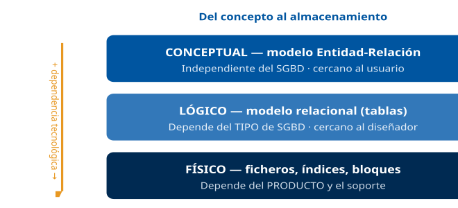

------------------------------------------------------------------------

### D2 · Arquitectura ANSI/SPARC (tres esquemas)

**Sección**: §1.2 — Niveles externo, conceptual e interno · **Propósito**: Mostrar los tres esquemas y su cardinalidad (varios externos, un conceptual, un interno).

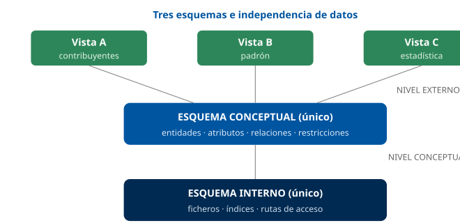

------------------------------------------------------------------------

### D3 · Independencia de datos: física y lógica

**Sección**: §1.3 — Los dos tipos de independencia · **Propósito**: Visualizar qué nivel aísla cada tipo de independencia.

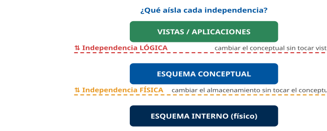

------------------------------------------------------------------------

### D4 · Las tres vistas del modelado

**Sección**: §1.5 — Estático, dinámico y funcional · **Propósito**: Asociar cada perspectiva con su técnica clásica y su equivalente UML.

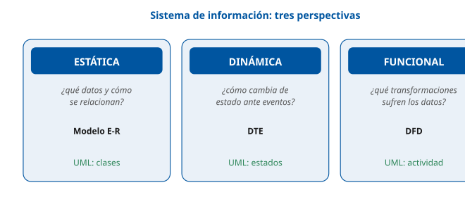

------------------------------------------------------------------------

### D5 · Notación de Chen: entidad, atributo y relación

**Sección**: §2.3 — Iconografía del E-R · **Propósito**: Recoger la simbología de Chen, incluida la de los tipos de atributo.

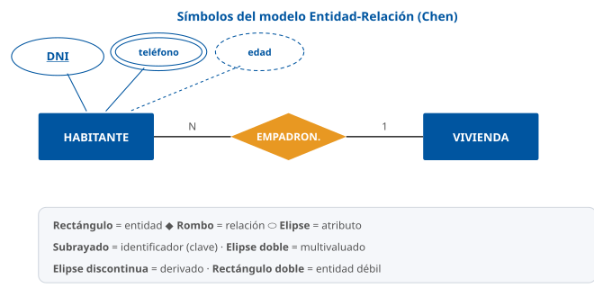

------------------------------------------------------------------------

### D6 · Cardinalidades 1:1, 1:N y N:M

**Sección**: §2.4 — Razón de cardinalidad · **Propósito**: Distinguir los tres tipos de cardinalidad máxima en relaciones binarias.

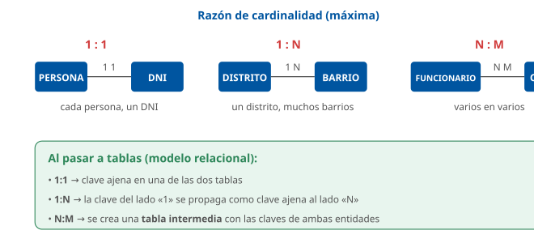

------------------------------------------------------------------------

### D7 · Generalización / especialización (jerarquía es-un)

**Sección**: §3.2 — EER · **Propósito**: Mostrar el supertipo, los subtipos y las restricciones (disjunta/solapada, total/parcial).

------------------------------------------------------------------------

### D8 · Tres notaciones E-R: Chen, pata de gallo y UML

**Sección**: §3.3 — Notaciones equivalentes · **Propósito**: Comparar cómo cada notación dibuja la misma relación 1:N.

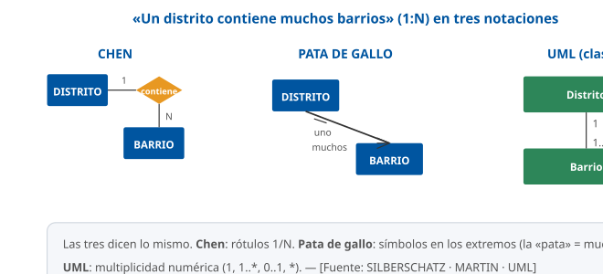

------------------------------------------------------------------------

### D9 · Diagrama de transición de estados (expediente)

**Sección**: §8.1 — Modelado dinámico · **Propósito**: Ilustrar estados, transiciones y eventos con el ciclo de vida de un expediente.

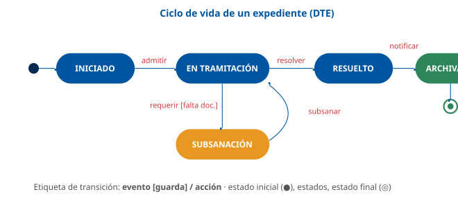

------------------------------------------------------------------------

### D10 · Componentes del DFD

**Sección**: §4.1 — Los cuatro elementos · **Propósito**: Fijar los cuatro componentes del DFD y su simbología (Yourdon).

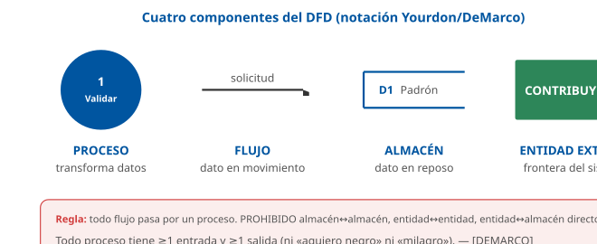

------------------------------------------------------------------------

### D11 · Descomposición del DFD por niveles + equilibrado

**Sección**: §6 — Niveles y balanceo · **Propósito**: Mostrar contexto (nivel 0), nivel 1 y explosión, y la regla de equilibrado.

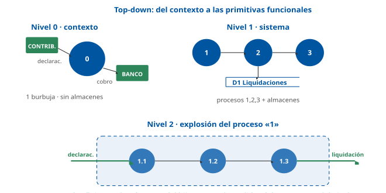

------------------------------------------------------------------------

### D12 · Flujograma: símbolos ISO 5807 y estructuras básicas

**Sección**: §7.2 — Símbolos y control · **Propósito**: Recoger los símbolos normalizados y las tres estructuras de la programación estructurada.

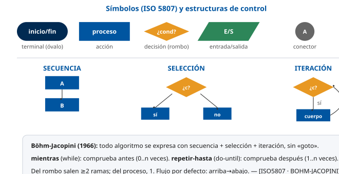

## Casos prácticos

Tres casos aplicados al Ayuntamiento de Madrid. Cada caso suma **10 puntos** e integra las tres vistas del modelado (estática, funcional y dinámica) más los flujogramas, en línea con la parte práctica del examen del Grupo II.

------------------------------------------------------------------------

### Caso 1 — Modelo conceptual (E-R) del Padrón Municipal de Habitantes

#### Enunciado

El Servicio de Estadística del Ayuntamiento de Madrid encarga el **modelo conceptual de datos** del Padrón Municipal. Del análisis de requisitos se extrae:

- Cada **habitante** se identifica por su **DNI/NIE**, y se registran nombre, apellidos, fecha de nacimiento, sexo y uno o varios teléfonos de contacto.
- Cada habitante está **empadronado en una vivienda**, y en una vivienda pueden estar empadronados varios habitantes. Todo habitante debe estar empadronado en una vivienda; una vivienda puede no tener a nadie empadronado.
- Cada **vivienda** se identifica por la combinación de su **vía** y un número/planta/puerta, y pertenece a un **distrito**.
- El **distrito** se identifica por un código y tiene un nombre. Un distrito agrupa muchas viviendas.

#### Cuestiones

1.  **(3 puntos)** Identifica las **entidades** y sus **atributos**, señalando el identificador (clave) de cada una y clasificando los atributos especiales (compuesto, multivaluado, derivado) que detectes.
2.  **(3 puntos)** Define las **relaciones** entre las entidades, indicando **grado** y **cardinalidad máxima** (1:1, 1:N, N:M).
3.  **(2 puntos)** Especifica la **participación** (total/parcial) de cada entidad en la relación «empadronamiento», justificándola con el enunciado.
4.  **(2 puntos)** Indica cómo quedaría la transformación de la relación «empadronamiento» al **modelo relacional** (tablas y claves ajenas).

#### Solución orientativa

1.  **Entidades y atributos**:

- `HABITANTE` (clave: *DNI/NIE*); `nombre_completo` (compuesto: nombre + apellidos); `fecha_nacimiento`; `sexo`; `teléfono` (multivaluado); `edad` sería un atributo **derivado** de `fecha_nacimiento` (no se almacena).
- `VIVIENDA`: clave compuesta por la vía + número + planta + puerta, todos ellos atributos propios de la vivienda, así que es una **entidad fuerte**. Solo sería **entidad débil** si se modelase además la vía como entidad aparte (un callejero con su propia clave), que el enunciado no pide.
- `DISTRITO` (clave: *código_distrito*); `nombre`.

1.  **Relaciones**:

- `EMPADRONADO_EN` (HABITANTE–VIVIENDA): binaria, **1:N** (una vivienda, muchos habitantes; cada habitante, una vivienda). Atributo de la relación: `fecha_alta`.
- `PERTENECE` (VIVIENDA–DISTRITO): binaria, **1:N** (un distrito, muchas viviendas).

1.  **Participación** en `EMPADRONADO_EN`: HABITANTE participa de forma **total** («todo habitante debe estar empadronado»); VIVIENDA, **parcial** («una vivienda puede no tener a nadie»). En notación (mín,máx): HABITANTE (1,1), VIVIENDA (0,N).
2.  **Transformación**: al ser **1:N**, la clave de VIVIENDA (lado «1») se propaga como **clave ajena** a la tabla `HABITANTE` (lado «N»), junto con `fecha_alta`. No se crea tabla intermedia (eso solo en N:M).

#### Criterios de evaluación

- Distinguir atributo derivado (`edad`) y multivaluado (`teléfono`): hasta 1 punto.
- Cardinalidades correctas (1:N en ambas relaciones): hasta 1,5 puntos.
- Participación total/parcial bien justificada: hasta 2 puntos.
- Transformación 1:N con clave ajena en el lado «N» (no tabla intermedia): hasta 2 puntos.

------------------------------------------------------------------------

#### Preguntas tipo test sobre este caso

##### 1. En el modelo conceptual del Padrón, ¿cuál es el identificador de HABITANTE y cómo se representa en notación de Chen?

- a) El nombre_completo, con una elipse doble.
- b) El DNI/NIE, con una elipse discontinua.
- c) El DNI/NIE, con su elipse subrayada.

**Respuesta correcta:** c) · **Referencia:** Caso 1, cuestión 1 · §2.3

El identificador (clave) es el atributo cuyo valor distingue cada ocurrencia —aquí, el DNI/NIE— y en Chen se subraya. La elipse doble es del multivaluado y la discontinua, del derivado.

##### 2. Cada habitante puede facilitar uno o varios teléfonos de contacto. ¿Cómo se clasifica el atributo teléfono?

- a) Como compuesto, dibujado con elipses hijas.
- b) Como multivaluado, dibujado con elipse doble.
- c) Como derivado, dibujado con elipse discontinua.

**Respuesta correcta:** b) · **Referencia:** Caso 1, cuestión 1 · §2.3

Un atributo multivaluado puede tomar varios valores para una misma ocurrencia, como los varios teléfonos de un habitante; en Chen se dibuja con elipse doble.

##### 3. El Servicio de Estadística quiere conocer también la edad de cada habitante. ¿Cómo debe tratarse en el modelo?

- a) Como atributo derivado de fecha_nacimiento, que se calcula y no se almacena.
- b) Como atributo almacenado, que se guarda junto a la fecha de nacimiento.
- c) Como atributo multivaluado, porque su valor va cambiando cada año.

**Respuesta correcta:** a) · **Referencia:** Caso 1, cuestión 1 · §2.3

La edad se obtiene a partir de la fecha de nacimiento: es un atributo derivado (calculado), que no se almacena.

##### 4. El nombre y los apellidos del habitante se agrupan en el atributo nombre_completo. ¿De qué tipo de atributo se trata?

- a) Multivaluado, porque admite varios valores para el mismo habitante.
- b) Compuesto, porque se descompone en partes con significado propio.
- c) Identificador, porque distingue a cada habitante de los demás.

**Respuesta correcta:** b) · **Referencia:** Caso 1, cuestión 1 · §2.3

Un atributo compuesto se descompone en partes con significado propio, como nombre y apellidos; el identificador del habitante es el DNI/NIE.

##### 5. ¿Qué cardinalidad máxima tiene la relación EMPADRONADO_EN entre HABITANTE y VIVIENDA?

- a) N:M: un habitante puede estar empadronado en varias viviendas a la vez.
- b) 1:1: cada vivienda tiene empadronado un único habitante y viceversa.
- c) 1:N: una vivienda tiene muchos habitantes y cada habitante, una sola vivienda.

**Respuesta correcta:** c) · **Referencia:** Caso 1, cuestión 2 · §2.4

Cada habitante está empadronado en una vivienda y en una vivienda pueden estarlo varios habitantes: una ocurrencia de VIVIENDA se asocia con varias de HABITANTE, y cada HABITANTE con una sola VIVIENDA.

##### 6. ¿Cómo se caracteriza la relación PERTENECE entre VIVIENDA y DISTRITO?

- a) Binaria y 1:N: un distrito agrupa muchas viviendas.
- b) Binaria y N:M: una vivienda está en varios distritos.
- c) Ternaria y 1:N, pues también interviene HABITANTE.

**Respuesta correcta:** a) · **Referencia:** Caso 1, cuestión 2 · §2.4

Participan dos tipos de entidad (grado binario) y cada vivienda pertenece a un distrito, mientras que un distrito agrupa muchas viviendas: 1:N.

##### 7. «Todo habitante debe estar empadronado en una vivienda; una vivienda puede no tener a nadie empadronado». ¿Qué participación tiene cada entidad en EMPADRONADO_EN?

- a) HABITANTE, parcial; VIVIENDA, total.
- b) Total en ambas entidades.
- c) HABITANTE, total; VIVIENDA, parcial.

**Respuesta correcta:** c) · **Referencia:** Caso 1, cuestión 3 · §2.4

La participación es total cuando toda ocurrencia debe participar (mínimo 1), como el habitante; es parcial cuando alguna puede no hacerlo (mínimo 0), como la vivienda vacía.

##### 8. La fecha de alta en el padrón solo tiene sentido para la pareja habitante-vivienda. ¿Dónde se coloca en el modelo E-R?

- a) Como atributo de la entidad VIVIENDA.
- b) Como atributo de la relación EMPADRONADO_EN.
- c) Como una entidad propia, FECHA_ALTA.

**Respuesta correcta:** b) · **Referencia:** Caso 1, cuestión 2 · §2.4, §3.1

Un atributo que solo tiene sentido para la combinación de dos entidades pertenece a la relación; las relaciones pueden tener atributos propios.

##### 9. Al pasar EMPADRONADO_EN al modelo relacional, ¿cómo se transforma?

- a) La clave de VIVIENDA pasa como clave ajena a la tabla HABITANTE, junto con fecha_alta.
- b) La clave de HABITANTE pasa como clave ajena a la tabla VIVIENDA, junto con fecha_alta.
- c) Se crea la tabla HABITANTE_VIVIENDA con las claves de ambas y la fecha_alta.

**Respuesta correcta:** a) · **Referencia:** Caso 1, cuestión 4 · §3.4

En una relación 1:N, la clave de la entidad del lado «1» (VIVIENDA) se propaga como clave ajena a la tabla del lado «N» (HABITANTE).

##### 10. Un compañero propone crear una tabla intermedia EMPADRONAMIENTO para esa relación. ¿Qué le responde el técnico?

- a) Que es obligatoria, porque la relación tiene un atributo propio.
- b) Que es obligatoria, porque VIVIENDA tiene participación parcial.
- c) Que no hace falta: la tabla intermedia es propia de las relaciones N:M.

**Respuesta correcta:** c) · **Referencia:** Caso 1, cuestión 4 · §3.4

La tabla intermedia, con la combinación de las claves de ambas entidades, es la regla de transformación de las relaciones N:M; en una 1:N basta propagar la clave ajena al lado «N».

### Caso 2 — Diagrama de flujo de datos (DFD) de la gestión de una tasa municipal

#### Enunciado

La Agencia Tributaria de Madrid quiere modelar, mediante **análisis estructurado**, el sistema de **gestión de la tasa de paso de vehículos (vado)**. Se sabe que:

- El **contribuyente** presenta una **solicitud** (presencial o telemática). El sistema **valida** los datos y, si son correctos, **liquida** la tasa calculando la base imponible y aplicando el tipo. La **liquidación** se guarda y se envía un **recibo** al contribuyente.
- Cuando el contribuyente paga en una **entidad bancaria**, esta comunica el **cobro**, que el sistema **registra**, marcando la liquidación como pagada.
- Existen dos almacenes: `D1 Liquidaciones` y `D2 Cobros`.

#### Cuestiones

1.  **(2 puntos)** Dibuja (o describe) el **diagrama de contexto (nivel 0)**: el proceso único, las entidades externas y los flujos de frontera.
2.  **(3 puntos)** Descompón el sistema en un **DFD de nivel 1** con los procesos principales y los almacenes.
3.  **(2 puntos)** Enuncia **dos reglas de construcción** del DFD y verifica que tu diagrama las cumple.
4.  **(3 puntos)** Explica la regla de **equilibrado (balanceo)** y cómo la aplicarías al explotar el proceso «Liquidar tasa» en un nivel 2.

#### Solución orientativa

1.  **Contexto (nivel 0)**: una sola burbuja «0 · Gestión de la tasa de vado», con entidades externas `CONTRIBUYENTE` y `ENTIDAD_BANCARIA`. Flujos frontera: `solicitud` y `recibo` (con el contribuyente), `cobro` (con el banco). Sin almacenes visibles.
2.  **Nivel 1**: procesos «1 Validar solicitud», «2 Liquidar tasa», «3 Registrar cobro». Almacenes `D1 Liquidaciones` (escrito por 2, leído por 3) y `D2 Cobros` (escrito por 3). Flujos internos: `solicitud_válida` (1→2), `liquidación` (2→D1 y 2→recibo), `datos_cobro` (3→D2).
3.  **Reglas** (dos cualesquiera): (a) todo flujo pasa por un proceso → no hay flujo directo banco↔almacén; (b) todo proceso tiene ≥1 entrada y ≥1 salida → ni «agujero negro» ni «milagro». El diagrama las cumple.
4.  **Equilibrado**: al explotar «2 Liquidar tasa» en «2.1 Calcular base», «2.2 Aplicar tipo», «2.3 Generar liquidación», los flujos que cruzan la frontera del diagrama hijo deben ser **exactamente** los del proceso «2» en el nivel 1: entra `solicitud_válida`, salen `liquidación` (a D1) y `recibo`. Si en el hijo apareciera un flujo de entrada/salida nuevo no presente en el padre, el DFD estaría **desequilibrado**.

#### Criterios de evaluación

- Diagrama de contexto con una sola burbuja y sin almacenes: hasta 2 puntos.
- Nivel 1 coherente (procesos verbo+objeto, almacenes numerados): hasta 3 puntos.
- Reglas correctamente enunciadas y verificadas: hasta 2 puntos.
- Equilibrado bien explicado (flujos padre = flujos frontera del hijo): hasta 3 puntos.

------------------------------------------------------------------------

#### Preguntas tipo test sobre este caso

##### 1. En el diagrama de contexto (nivel 0) del sistema de la tasa de vado, ¿qué se representa?

- a) Una sola burbuja para todo el sistema, sin almacenes visibles.
- b) Los tres procesos principales y los almacenes D1 y D2.
- c) Una sola burbuja, con los almacenes D1 y D2 a su lado.

**Respuesta correcta:** a) · **Referencia:** Caso 2, cuestión 1 · §6

El nivel 0 tiene un único proceso que representa todo el sistema, rodeado de las entidades externas y los flujos de frontera, y no muestra almacenes.

##### 2. ¿Qué entidades externas aparecen en ese diagrama de contexto?

- a) CONTRIBUYENTE, ENTIDAD_BANCARIA y D1 Liquidaciones.
- b) Solo CONTRIBUYENTE; el banco es un almacén de cobros.
- c) CONTRIBUYENTE y ENTIDAD_BANCARIA.

**Respuesta correcta:** c) · **Referencia:** Caso 2, cuestión 1 · §4.1

Las entidades externas son personas, organizaciones u otros sistemas que producen o consumen datos: el contribuyente y el banco. D1 es un almacén interno.

##### 3. ¿Cuáles son los flujos que cruzan la frontera del sistema en el diagrama de contexto?

- a) Solicitud_válida y liquidación, entre los procesos 1 y 2.
- b) Solicitud y recibo, con el contribuyente; cobro, con el banco.
- c) Datos_cobro hacia D2 y liquidación hacia D1.

**Respuesta correcta:** b) · **Referencia:** Caso 2, cuestión 1 · §6

Los flujos de frontera conectan el sistema con sus entidades externas; solicitud_válida, liquidación o datos_cobro son flujos internos que solo aparecen al descomponer.

##### 4. En el DFD de nivel 1, ¿qué nombres de procesos siguen las reglas de construcción?

- a) «1 Validar solicitud», «2 Liquidar tasa» y «3 Registrar cobro».
- b) «1 Solicitud», «2 Liquidación» y «3 Cobro».
- c) «D1 Validar solicitud», «D2 Liquidar tasa» y «D3 Registrar cobro».

**Respuesta correcta:** a) · **Referencia:** Caso 2, cuestión 2 · §4.1, §5

Los procesos se numeran (1, 2, 3…) y se nombran con verbo + objeto; los sustantivos son para flujos y almacenes, y la numeración D1, D2… es la de los almacenes.

##### 5. En el nivel 1, ¿qué procesos escriben y leen el almacén D1 Liquidaciones?

- a) Lo escribe «1 Validar solicitud» y lo lee «2 Liquidar tasa».
- b) Lo escribe «2 Liquidar tasa» y lo lee «3 Registrar cobro».
- c) Lo escribe la ENTIDAD_BANCARIA y lo lee «3 Registrar cobro».

**Respuesta correcta:** b) · **Referencia:** Caso 2, cuestión 2 · §4.1

La liquidación calculada se guarda en D1 y el registro del cobro la consulta para marcarla como pagada; una entidad externa nunca escribe directamente en un almacén.

##### 6. Un analista propone que la entidad bancaria grabe el cobro directamente en el almacén D2 Cobros. ¿Es correcto?

- a) Sí: el banco es una entidad de confianza y puede escribir en el almacén.
- b) Sí, siempre que el almacén esté numerado como D2 en el diagrama.
- c) No: entre una entidad externa y un almacén siempre debe mediar un proceso.

**Respuesta correcta:** c) · **Referencia:** Caso 2, cuestión 3 · §5

Están prohibidos los flujos directos entre una entidad externa y un almacén: todo dato debe pasar por un proceso, aquí «3 Registrar cobro».

##### 7. Si «3 Registrar cobro» recibiera el cobro del banco pero no generase ninguna salida, ¿qué error de modelado tendría?

- a) Un «agujero negro», porque solo tiene flujos de entrada.
- b) Un «milagro», porque no deriva sus salidas de las entradas.
- c) Un desequilibrio entre el nivel 1 y el diagrama de contexto.

**Respuesta correcta:** a) · **Referencia:** Caso 2, cuestión 3 · §5

Todo proceso debe tener al menos una entrada y una salida: solo con entradas es un «agujero negro»; solo con salidas, un «milagro».

##### 8. ¿Refleja el DFD del vado el orden temporal en que se valida, se liquida y se cobra?

- a) Sí: la numeración 1, 2, 3 indica el orden de ejecución de los procesos.
- b) No: el DFD modela qué se transforma, no la secuencia ni las decisiones.
- c) Sí: cada flecha del DFD indica qué proceso se ejecuta a continuación.

**Respuesta correcta:** b) · **Referencia:** Caso 2, cuestión 2 · §4.1, §7.1

El DFD modela función, no secuencia temporal ni decisiones; eso es propio del flujograma. La numeración sirve para la descomposición jerárquica.

##### 9. Al explotar «2 Liquidar tasa» en 2.1, 2.2 y 2.3, ¿qué flujos deben cruzar la frontera del diagrama hijo?

- a) Entra la solicitud del contribuyente y sale el cobro hacia D2.
- b) Los del padre más los nuevos que hagan falta para detallar el cálculo.
- c) Entra solicitud_válida y salen la liquidación (a D1) y el recibo.

**Respuesta correcta:** c) · **Referencia:** Caso 2, cuestión 4 · §6

Por el equilibrado (balanceo), los flujos de entrada y salida del proceso padre deben coincidir exactamente con los que cruzan la frontera de su diagrama hijo.

##### 10. En la explosión de «2 Liquidar tasa» aparece una salida nueva que no tenía el proceso 2 en el nivel 1. ¿Qué ocurre?

- a) Es correcto, porque los niveles inferiores añaden detalle.
- b) El DFD queda desequilibrado: incumple la regla de balanceo.
- c) Es correcto si el subproceso es una primitiva funcional.

**Respuesta correcta:** b) · **Referencia:** Caso 2, cuestión 4 · §6

El balanceo exige que el hijo tenga exactamente los flujos de entrada y salida del padre; un flujo nuevo en la frontera rompe la coherencia entre niveles.

### Caso 3 — Modelado dinámico (DTE) y flujograma del trámite de una licencia en la sede electrónica

#### Enunciado

La sede electrónica del Ayuntamiento gestiona el ciclo de vida de una **licencia urbanística**. El comportamiento es:

- La licencia nace **INICIADA** al presentarse la solicitud. Si se **admite**, pasa a **EN TRAMITACIÓN**.
- Durante la tramitación, si faltan documentos, se **requiere subsanación** (estado **SUBSANACIÓN**); cuando el ciudadano **subsana** dentro de plazo, vuelve a **EN TRAMITACIÓN**.
- Tras el informe técnico, la licencia se **RESUELVE** (concedida o denegada) y, al **notificarse**, queda **ARCHIVADA** (estado final).

Además, el proceso «**comprobar plazo de subsanación**» debe documentarse como **flujograma**: se lee la fecha límite; si la fecha actual es posterior, se declara la solicitud **caducada**; en caso contrario, se admite la documentación subsanada.

#### Cuestiones

1.  **(3 puntos)** Construye el **diagrama de transición de estados (DTE)**: estados, transiciones y los **eventos** que las disparan; señala el estado inicial y el final.
2.  **(2 puntos)** Etiqueta al menos una transición con el patrón **`evento [condición] / acción`**.
3.  **(3 puntos)** Dibuja el **flujograma** del proceso «comprobar plazo de subsanación» usando los símbolos normalizados (terminal, E/S, proceso, decisión).
4.  **(2 puntos)** Indica qué **estructura de control** (secuencia, selección o iteración) emplea ese flujograma y por qué.

#### Solución orientativa

1.  **DTE**: estados `INICIADA` → `EN TRAMITACIÓN` → (`SUBSANACIÓN`) → `RESUELTA` → `ARCHIVADA`. Estado inicial: pseudoestado inicial → `INICIADA`. Estado final: `ARCHIVADA`. Eventos: `admitir`, `requerir`, `subsanar`, `resolver`, `notificar`.
2.  **Transición etiquetada**: `requerir [falta documentación] / registrar requerimiento` (de EN TRAMITACIÓN a SUBSANACIÓN); o `subsanar [dentro de plazo] / aceptar documentación` (de SUBSANACIÓN a EN TRAMITACIÓN).
3.  **Flujograma**: `Inicio` (óvalo) → `Leer fecha_límite y fecha_actual` (romboide E/S) → `¿fecha_actual > fecha_límite?` (rombo): rama **Sí** → `Marcar solicitud CADUCADA` (rectángulo); rama **No** → `Admitir documentación subsanada` (rectángulo); ambas ramas → `Fin` (óvalo).
4.  **Estructura de control**: es una **selección** (condicional simple `si-entonces-si_no`), representada por el único rombo con dos ramas excluyentes. No hay repetición (no es iteración) ni mera sucesión (no es solo secuencia).

#### Criterios de evaluación

- DTE con estado inicial único, estados excluyentes y eventos en las transiciones: hasta 3 puntos.
- Etiqueta `evento [condición] / acción` correcta: hasta 2 puntos.
- Flujograma con símbolos normalizados correctos (óvalo/romboide/rombo/rectángulo) y un solo fin: hasta 3 puntos.
- Identificación de la selección como estructura de control: hasta 2 puntos.

#### Preguntas tipo test sobre este caso

##### 1. En el DTE de la licencia urbanística, ¿cuál es el estado inicial y cuál el estado final?

- a) Inicial: EN TRAMITACIÓN (tras la admisión); final: RESUELTA.
- b) Inicial: INICIADA (desde el pseudoestado inicial); final: ARCHIVADA.
- c) Inicial: INICIADA (al presentarse); final: RESUELTA.

**Respuesta correcta:** b) · **Referencia:** Caso 3, cuestión 1 · §8.1

La licencia nace INICIADA al presentarse la solicitud y, tras la notificación, queda ARCHIVADA como estado final; RESUELTA todavía tiene una transición de salida.

##### 2. Durante la tramitación se detecta que falta documentación. ¿Qué evento lleva la licencia de EN TRAMITACIÓN a SUBSANACIÓN?

- a) Requerir.
- b) Subsanar.
- c) Resolver.

**Respuesta correcta:** a) · **Referencia:** Caso 3, cuestión 1 · §8.1

El evento es el estímulo que dispara la transición: al requerir la documentación que falta, la licencia pasa a SUBSANACIÓN; subsanar es el evento de vuelta.

##### 3. ¿Qué etiqueta sigue el patrón correcto para la transición de SUBSANACIÓN a EN TRAMITACIÓN?

- a) aceptar documentación [subsanar] / dentro de plazo
- b) dentro de plazo / subsanar [aceptar documentación]
- c) subsanar [dentro de plazo] / aceptar documentación

**Respuesta correcta:** c) · **Referencia:** Caso 3, cuestión 2 · §8.1

La etiqueta de una transición sigue el patrón evento [condición] / acción: el evento (subsanar), la guarda entre corchetes y, tras la barra, la acción.

##### 4. En la etiqueta «requerir [falta documentación] / registrar requerimiento», ¿qué es «falta documentación»?

- a) El evento que dispara la transición.
- b) La acción que se ejecuta al transitar.
- c) La condición (guarda) que debe cumplirse.

**Respuesta correcta:** c) · **Referencia:** Caso 3, cuestión 2 · §8.1

La condición o guarda es el predicado que debe cumplirse para que la transición ocurra y se escribe entre corchetes.

##### 5. ¿Puede la licencia estar a la vez en EN TRAMITACIÓN y en SUBSANACIÓN?

- a) No: en un DTE los estados son mutuamente excluyentes.
- b) Sí, si ambos estados comparten el mismo evento de salida.
- c) Sí, porque un DTE admite varios estados iniciales.

**Respuesta correcta:** a) · **Referencia:** Caso 3, cuestión 1 · §8.2

Los estados deben ser mutuamente excluyentes: el sistema está en uno y solo uno en cada instante; además, el DTE tiene un único estado inicial.

##### 6. En el flujograma «comprobar plazo de subsanación», ¿con qué símbolo se representa «Leer fecha_límite y fecha_actual»?

- a) Con un rectángulo, de proceso u operación.
- b) Con un romboide (paralelogramo), de entrada/salida.
- c) Con un rombo, símbolo de las decisiones.

**Respuesta correcta:** b) · **Referencia:** Caso 3, cuestión 3 · §7.2

La lectura o escritura de datos se representa con el romboide (paralelogramo); el rectángulo es para las operaciones y el rombo para las decisiones.

##### 7. ¿Con qué símbolo se representa la pregunta «¿fecha_actual > fecha_límite?»?

- a) Con un rombo, del que salen las ramas Sí y No.
- b) Con un romboide, del que salen los datos leídos.
- c) Con un rectángulo con doble borde lateral.

**Respuesta correcta:** a) · **Referencia:** Caso 3, cuestión 3 · §7.2, §7.4

La bifurcación según una condición se representa con un rombo, el único símbolo del que salen dos o más líneas etiquetadas; el doble borde lateral indica una subrutina.

##### 8. Si la fecha actual es posterior a la fecha límite, ¿qué hace el flujograma?

- a) Sigue la rama No y admite la documentación subsanada.
- b) Vuelve a leer las fechas hasta que estén dentro de plazo.
- c) Sigue la rama Sí y marca la solicitud como CADUCADA.

**Respuesta correcta:** c) · **Referencia:** Caso 3, cuestión 3

Si la fecha actual es posterior a la límite, el plazo ha vencido: la rama Sí lleva al proceso que declara la solicitud caducada; en caso contrario se admite la documentación.

##### 9. ¿Cómo debe terminar el flujograma después de las dos ramas?

- a) Cada rama acaba en un rombo de cierre propio.
- b) Ambas ramas confluyen en un único terminal de fin (óvalo).
- c) La rama de caducidad puede quedar sin terminal de fin.

**Respuesta correcta:** b) · **Referencia:** Caso 3, cuestión 3 · §7.2, §7.4

El flujograma tiene un único inicio y, preferiblemente, un único fin, representado con el terminal (óvalo); ningún camino puede quedar «perdido».

##### 10. ¿Qué estructura de control emplea el flujograma «comprobar plazo de subsanación»?

- a) Selección (si-entonces-si_no), con un solo rombo y dos ramas excluyentes.
- b) Iteración (mientras), porque repite la comprobación hasta que haya plazo.
- c) Secuencia, porque las acciones se ejecutan una tras otra sin bifurcarse.

**Respuesta correcta:** a) · **Referencia:** Caso 3, cuestión 4 · §7.3

La selección elige una rama u otra según una condición (en el flujograma, un rombo); aquí no hay repetición ni una mera sucesión de pasos.

## Fuentes

### Cómo se citan las fuentes en este tema

Cada afirmación técnica del contenido va acompañada de una **etiqueta breve** entre corchetes, p. ej. `[CHEN]` o `[ELMASRI, cap. 3]`. El registro completo de cada etiqueta está en este documento. Las fuentes se agrupan en tres niveles:

- **Tier 1 — Canónicas**: obras y normas de referencia mundial sobre las que se construye el contenido. Todo dato relevante cita al menos una.
- **Tier 2 — Complementarias**: manuales y especificaciones que amplían o ilustran.
- **Tier 3 — Contexto (no citadas inline)**: material de apoyo y verificación, no usado como cita directa.

------------------------------------------------------------------------

### Tier 1 — Fuentes canónicas

| ID | Referencia |
|----|----|
| `[CHEN]` | Chen, P. P. (1976). *The Entity-Relationship Model — Toward a Unified View of Data*. ACM Transactions on Database Systems, 1(1), 9-36. Artículo fundacional del modelo entidad-relación. |
| `[ELMASRI]` | Elmasri, R. & Navathe, S. B. *Fundamentals of Database Systems* (7ª ed.). Pearson. Caps. 3-4 (modelo E-R y E-R extendido/EER), cap. 9 (paso a relacional). |
| `[DATE]` | Date, C. J. *An Introduction to Database Systems* (8ª ed.). Addison-Wesley. Niveles de abstracción, independencia de datos. |
| `[SILBERSCHATZ]` | Silberschatz, A., Korth, H. F. & Sudarshan, S. *Database System Concepts* (7ª ed.). McGraw-Hill. Cap. 6 (modelo E-R), notaciones. |
| `[ANSI-SPARC]` | ANSI/X3/SPARC Study Group on Data Base Management Systems (1975). *Interim Report*. Arquitectura de tres esquemas (externo, conceptual, interno). |
| `[CODD]` | Codd, E. F. (1970). *A Relational Model of Data for Large Shared Data Banks*. CACM 13(6). Modelo relacional (destino de la transformación del E-R). |
| `[DEMARCO]` | DeMarco, T. (1979). *Structured Analysis and System Specification*. Yourdon Press. Diagramas de flujo de datos (DFD), descomposición por niveles, diccionario de datos. |
| `[GANE-SARSON]` | Gane, C. & Sarson, T. (1979). *Structured Systems Analysis: Tools and Techniques*. Prentice-Hall. Notación alternativa de DFD (rectángulos redondeados). |
| `[YOURDON]` | Yourdon, E. (1989). *Modern Structured Analysis*. Yourdon Press. Análisis estructurado moderno, modelo esencial, DTE. |
| `[ISO5807]` | ISO 5807:1985. *Information processing — Documentation symbols and conventions for data, program and system flowcharts, program network charts and system resources charts*. Símbolos normalizados de diagramas de flujo. |
| `[BOHM-JACOPINI]` | Böhm, C. & Jacopini, G. (1966). *Flow Diagrams, Turing Machines and Languages with Only Two Formation Rules*. CACM 9(5). Teorema de la programación estructurada (secuencia, selección, iteración). |
| `[UML]` | Object Management Group (OMG). *Unified Modeling Language (UML) Specification*, v2.5.1 (2017). Diagramas de estructura y de comportamiento. |
| `[METRICA3]` | Ministerio de Administraciones Públicas (España). *MÉTRICA versión 3*. Metodología de planificación, desarrollo y mantenimiento de sistemas de información. Técnicas: Modelo E-R, Diagrama de Flujo de Datos, Diagrama de Transición de Estados, Diccionario de Datos. |
| `[ISO11404]` | ISO/IEC 11404:2007. *General-Purpose Datatypes (GPD)*. Tipos de datos independientes del lenguaje (dominios de atributos). |

------------------------------------------------------------------------

### Tier 2 — Fuentes complementarias

| ID | Referencia |
|----|----|
| `[FOWLER]` | Fowler, M. *UML Distilled* (3ª ed.). Addison-Wesley. Síntesis práctica de los diagramas UML. |
| `[PRESSMAN]` | Pressman, R. S. *Ingeniería del Software: un enfoque práctico* (7ª ed.). McGraw-Hill. Modelado de análisis (datos, flujo, comportamiento). |
| `[RUMBAUGH]` | Rumbaugh, J. et al. (1991). *Object-Modeling Technique (OMT)*. Precursor de UML; modelado de objetos, dinámico y funcional. |
| `[BACHMAN]` | Bachman, C. W. (1969). *Data Structure Diagrams*. Diagramas de Bachman, antecedente del E-R. |
| `[MARTIN]` | Martin, J. *Information Engineering*. Notación "pata de gallo" (crow's foot) para cardinalidades. |
| `[ANSI-X3.5]` | ANSI X3.5-1970. *Flowchart Symbols and Their Usage in Information Processing*. Antecedente estadounidense de ISO 5807. |

------------------------------------------------------------------------

### Tier 3 — Contexto y verificación (no citadas inline)

| ID | Referencia |
|----|----|
| `[BOAM10032]` | Convocatoria oficial del proceso selectivo (BOAM 10.032, 23-dic-2025). Define el enunciado del Tema 16 y la estructura del examen. |
| `[NTI]` | Esquema Nacional de Interoperabilidad ([RD 4/2010](https://www.boe.es/buscar/act.php?id=BOE-A-2010-1331)) y sus Normas Técnicas. Contexto de modelado de datos en la Administración. |
| `[PORTAL-DATOS-MADRID]` | Portal de Datos Abiertos del Ayuntamiento de Madrid (datos.madrid.es). Ejemplos de conjuntos de datos municipales (Padrón, callejero, censo). |

------------------------------------------------------------------------

### Nota sobre las dos grandes familias de notación

El temario mezcla **notación clásica** (Chen para E-R; DeMarco/Yourdon y Gane/Sarson para DFD; ISO 5807 para flujogramas) con **UML** (último epígrafe). Este material presenta **ambas a la par**: la notación clásica es la que tradicionalmente piden los exámenes de oposición españoles (alineada con MÉTRICA v3), y UML se añade como equivalencia moderna y estándar de la industria, indicando en cada técnica su correspondencia (E-R ↔ diagrama de clases; DTE ↔ diagrama de estados; flujograma ↔ diagrama de actividad).
