# Tema 17. Diseño de bases de datos y normalización

**Bloque:** técnico  
**Enunciado oficial** (BOAM n.º 10.032, de 23 de diciembre de 2025): Diseño de bases de datos. Diseño lógico y físico. El modelo lógico relacional. Normalización.

Versión web: <https://ayuntamientomadrid.github.io/temario-tecnico-auxiliar/temas/tema-17.html> · PDF: [tema-17.pdf](tema-17.pdf) · Test: [../../../tests/tecnico/tema-17.md](../../../tests/tecnico/tema-17.md)

## Índice

- 1. Diseño de bases de datos
  - 1.1. Qué es diseñar una base de datos y por qué importa
  - 1.2. Los tres niveles de diseño y el ciclo de vida
  - 1.3. Objetivos del diseño
  - 1.4. Diseño conceptual: el modelo entidad-relación (E-R)
- 2. Diseño lógico y físico
  - 2.1. Diseño lógico
  - 2.2. Transformación de entidades y relaciones al modelo relacional
  - 2.3. Eliminación de redundancias
  - 2.4. Integridad de entidad e integridad referencial
  - 2.5. Lenguajes de definición y manipulación (DDL, DML, DCL, TCL)
  - 2.6. Diseño físico
  - 2.7. Estructuras de datos y de almacenamiento
  - 2.8. Índices
  - 2.9. Rendimiento y optimización
- 3. El modelo lógico relacional
  - 3.1. Conceptos básicos
  - 3.2. Claves: candidata, primaria, alternativa, superclave y ajena
  - 3.3. Reglas de integridad del modelo relacional
  - 3.4. Álgebra relacional
  - 3.5. Cálculo relacional
- 4. Normalización
  - 4.1. Normalización: objetivos, redundancia y anomalías
  - 4.2. Dependencias funcionales y axiomas de Armstrong
  - 4.3. Primera Forma Normal (1FN)
  - 4.4. Segunda Forma Normal (2FN)
  - 4.5. Tercera Forma Normal (3FN)
  - 4.6. Forma Normal de Boyce-Codd (BCNF)
  - 4.7. Formas normales superiores (4FN y 5FN)
  - 4.8. Desnormalización controlada
  - 4.9. Buenas prácticas y errores típicos de diseño

### Conceptos clave para memorizar

| Concepto | Dato clave |
|----|----|
| Diseño de BD | Proceso en 3 niveles: conceptual → lógico → físico |
| Modelo conceptual | Independiente del SGBD; el más usado es el entidad-relación (Chen, 1976) |
| Modelo lógico | Adaptado al tipo de SGBD (relacional); aún independiente del producto |
| Modelo físico | Cómo se almacena realmente: ficheros, índices, particiones (producto concreto) |
| Independencia de datos | Cambiar un nivel sin afectar a los superiores (física y lógica) |
| Relación | Tabla: conjunto de tuplas (filas) sobre un esquema de atributos (columnas) |
| Dominio | Conjunto de valores válidos de un atributo |
| Grado / Cardinalidad | Nº de atributos (columnas) / nº de tuplas (filas) de una relación |
| Clave candidata | Conjunto mínimo de atributos que identifica unívocamente una tupla |
| Clave primaria | Clave candidata elegida; no admite nulos (integridad de entidad) |
| Clave ajena (foránea) | Atributo que referencia la clave primaria de otra tabla (integridad referencial) |
| Integridad de entidad | La clave primaria no puede ser nula ni duplicada |
| Integridad referencial | Toda clave ajena apunta a una fila existente o es nula |
| Álgebra relacional | Lenguaje procedimental: σ (selección), π (proyección), ⋈ (join), ∪, −, ×, ÷ |
| Cálculo relacional | Lenguaje declarativo (qué, no cómo); de tuplas y de dominios |
| Dependencia funcional | X → Y: el valor de X determina el de Y |
| Axiomas de Armstrong | Reflexividad, aumento y transitividad (reglas de inferencia de DF) |
| Anomalías | Problemas de inserción, borrado y actualización por mal diseño |
| 1FN | Atributos atómicos: sin grupos repetitivos ni valores multivaluados |
| 2FN | 1FN + sin dependencias parciales de la clave (atributos dependen de TODA la clave) |
| 3FN | 2FN + sin dependencias transitivas entre atributos no clave |
| BCNF | Todo determinante es clave candidata (3FN reforzada) |
| Desnormalización | Introducir redundancia controlada a propósito para ganar rendimiento |
| Índice | Estructura auxiliar (B-tree, hash, bitmap) que acelera las búsquedas |
| Plan de ejecución | Ruta que elige el optimizador para resolver una consulta |

## Contenido

### Convenciones del documento

Este tema incluye cuatro tipos de **cajas callout** para facilitar el estudio:

> **Dato clave.** Información de alta densidad memorística.

> **Ejercicio resuelto.** Problema + solución paso a paso (transformación E-R, normalización, álgebra relacional).

> **Ejemplo de aplicación en el ayto.** Aplicación real de la teoría al entorno municipal (Padrón, tributos, expedientes, multas, callejero).

> **Relación con otros temas.** Enlace conceptual a otros temas del temario oficial.

Los términos técnicos se mantienen en su nomenclatura habitual (clave primaria, join, dependencia funcional, índice B-tree…). Las fuentes se referencian con etiquetas breves tipo `[CODD70]` o `[ELMASRI, cap. 14]` — el registro completo está en la pestaña Fuentes. Los símbolos del álgebra relacional (σ, π, ⋈, ∪, −, ×, ÷) se glosan la primera vez que aparecen.

------------------------------------------------------------------------

### 1. Diseño de bases de datos

#### 1.1. Qué es diseñar una base de datos y por qué importa

**Diseñar una base de datos** es decidir qué datos se van a almacenar, cómo se estructuran y cómo se relacionan entre sí, de forma que la información sea **correcta, no redundante, fácil de consultar y eficiente** \[ELMASRI, cap. 3\]. No es un paso decorativo: la estructura que se elija condiciona durante años la integridad de los datos, el rendimiento de las consultas y el coste de mantener el sistema. Un mal diseño se paga con datos duplicados, incoherencias, consultas lentas y modificaciones que rompen la aplicación.

El diseño parte de un **análisis de requisitos**: qué información necesita gestionar la organización y qué operaciones realizará con ella. En el Ayuntamiento, esos requisitos provienen de los procedimientos administrativos: dar de alta a un habitante en el Padrón, liquidar un tributo, tramitar un expediente o registrar una multa. El diseñador traduce esas necesidades en una **estructura de datos** que el SGBD podrá implementar.

> **Dato clave.** El diseño de una base de datos persigue cuatro metas que aparecen una y otra vez en el temario: **integridad** (datos correctos), **mínima redundancia** (no repetir información sin control), **rendimiento** (acceso rápido) e **independencia de datos** (poder cambiar el almacenamiento sin reescribir las aplicaciones).

> **Relación con otros temas.** El **Tema 15** trata el SGBD y su administración; el **Tema 16**, el modelo conceptual de datos (entidades, atributos y relaciones); el **Tema 19**, el lenguaje SQL con el que se materializa este diseño. Este Tema 17 es el puente: convierte el modelo conceptual del T16 en un esquema relacional implementable y bien normalizado.

#### 1.2. Los tres niveles de diseño y el ciclo de vida

El diseño de bases de datos se organiza en **tres niveles sucesivos**, cada uno más concreto que el anterior \[ELMASRI, cap. 3; DATE, cap. 2\]:

1.  **Diseño conceptual**: produce un modelo de alto nivel, **independiente de cualquier SGBD**, que describe la realidad del problema en términos de entidades, atributos y relaciones. El resultado típico es un **diagrama entidad-relación (E-R)**.
2.  **Diseño lógico**: transforma el modelo conceptual en el modelo de datos del **tipo de SGBD elegido** (en nuestro caso, el **relacional**: tablas, columnas, claves), pero todavía **sin atarse a un producto concreto**. Aquí se aplica la **normalización**.
3.  **Diseño físico**: decide **cómo se almacenan realmente** los datos en el SGBD concreto (Oracle, PostgreSQL, SQL Server…): ficheros, tablespaces, índices, particiones y parámetros de rendimiento.

Esta separación en niveles es la base de la **independencia de datos**: se puede cambiar el nivel físico (añadir un índice, mover un fichero) sin tocar el nivel lógico, y cambiar el nivel lógico (añadir una columna) afectando lo mínimo a las aplicaciones \[DATE, cap. 2\].

> **Dato clave.** Regla mnemotécnica del orden: **C-L-F** (Conceptual → Lógico → Físico). El conceptual es **independiente del SGBD**; el lógico depende del **tipo** de modelo (relacional); el físico depende del **producto** concreto.

El ciclo de vida de la base de datos no termina con el diseño inicial: incluye implementación, carga de datos, explotación, mantenimiento (ajustes de rendimiento, nuevos requisitos) y, eventualmente, migración o retirada.

Para fijar la idea, el **mismo dominio visto en los tres niveles**:

| Nivel | Cómo se expresa «un habitante vive en un distrito» |
|----|----|
| **Conceptual** | Entidades HABITANTE y DISTRITO unidas por la relación «reside en» (N:1). Diagrama E-R, sin tipos ni tablas. |
| **Lógico** | Tablas `HABITANTE(dni PK, nombre, cod_distrito FK)` y `DISTRITO(cod_distrito PK, nombre)`, normalizadas en 3FN. Independiente del producto. |
| **Físico** | Tablas en un tablespace, índice B-tree sobre `cod_distrito`, `dni` como `CHAR(9)`, particionado si procede. Específico de PostgreSQL/Oracle/etc. |

Esta correspondencia entronca con la **arquitectura ANSI/SPARC de tres esquemas** (interno, conceptual y externo), que formaliza la **independencia de datos** y se trata en el Tema 15: el diseño físico se corresponde con el esquema interno; el lógico, con el conceptual de ANSI/SPARC; y las vistas de usuario, con los esquemas externos.

#### 1.3. Objetivos del diseño

Un buen diseño relacional busca \[ELMASRI, cap. 14; DATE, cap. 12\]:

- **Integridad**: los datos cumplen las reglas del dominio (un DNI tiene un formato, una fecha de nacimiento no puede ser futura, un habitante pertenece a un distrito existente).
- **Mínima redundancia controlada**: cada hecho se almacena, idealmente, **una sola vez**. La redundancia no controlada provoca inconsistencias y anomalías (§4.1).
- **Rendimiento**: las operaciones más frecuentes deben resolverse con el menor coste posible (de ahí los índices y, a veces, la desnormalización controlada).
- **Independencia de datos** física y lógica.
- **Facilidad de mantenimiento y comprensión**: un esquema claro, con nombres significativos y restricciones declaradas, reduce errores.

Estos objetivos a veces **entran en conflicto**: la normalización elimina redundancia pero puede penalizar el rendimiento de ciertas consultas; la desnormalización mejora el rendimiento pero reintroduce redundancia. El diseño es, en buena medida, el arte de equilibrar estas fuerzas.

La **independencia de datos** merece detalle porque es objetivo y consecuencia del diseño en niveles:

- **Independencia física**: se puede cambiar el **almacenamiento** (añadir un índice, reorganizar ficheros, particionar) **sin** modificar el esquema lógico ni las aplicaciones. Es la más fácil de conseguir.
- **Independencia lógica**: se puede cambiar el **esquema lógico** (añadir una columna o una tabla) afectando lo mínimo a las aplicaciones, normalmente gracias a las **vistas**. Es más difícil, porque las aplicaciones dependen de la estructura lógica que consultan.

#### 1.4. Diseño conceptual: el modelo entidad-relación (E-R)

El modelo **entidad-relación**, propuesto por Peter Chen en 1976 \[CHEN76\], es el lenguaje más extendido para el diseño conceptual. Sus elementos básicos son:

- **Entidad**: objeto del mundo real con existencia propia sobre el que se guardan datos (HABITANTE, DISTRITO, TRIBUTO, EXPEDIENTE). Se representa con un **rectángulo**.
- **Atributo**: propiedad de una entidad (nombre, DNI, fecha_alta). Se representa con una **elipse**. Pueden ser simples o compuestos, monovaluados o multivaluados, y derivados.
- **Relación (interrelación)**: asociación entre entidades (un HABITANTE *reside en* un DISTRITO). Se representa con un **rombo**.
- **Cardinalidad** de una relación: cuántas ocurrencias de una entidad se asocian con la otra. Las tres clásicas son **1:1**, **1:N** y **N:M**.
- **Clave** de la entidad: atributo o conjunto que identifica unívocamente cada ocurrencia (el DNI identifica a un habitante).

Dos propiedades más de las relaciones:

- **Grado de la relación**: número de entidades que participan. **Binaria** (lo normal, dos entidades), **ternaria** (tres) o **reflexiva/recursiva** (una entidad consigo misma: un EMPLEADO «es jefe de» otro EMPLEADO).
- **Participación**: **total (obligatoria)** si toda ocurrencia de la entidad debe participar en la relación (todo habitante debe residir en un distrito), o **parcial (opcional)** si puede no hacerlo. La participación total se traduce en el modelo lógico en una clave ajena `NOT NULL`.

Los **atributos** se clasifican además en: **simples** vs **compuestos** (la dirección), **monovaluados** vs **multivaluados** (teléfonos), **almacenados** vs **derivados** (la edad a partir de la fecha de nacimiento) y **clave** (identificadores).

El modelo **E-R extendido (EER)** añade generalización/especialización (jerarquías «es-un»), agregación y entidades débiles. Una **entidad débil** no tiene clave propia y depende de otra (p. ej., LÍNEA_DE_LIQUIDACIÓN depende de LIQUIDACIÓN).

> **Relación con otros temas.** El modelo entidad-relación se desarrolla a fondo en el **Tema 16** (modelo conceptual de datos, reglas de modelización, diagramas de flujo). Aquí se recuerda lo imprescindible para poder **transformarlo** en tablas (§2.2).

> **Ejemplo de aplicación en el ayto.** Un esquema conceptual del Padrón podría tener las entidades **HABITANTE** (DNI, nombre, fecha_nacimiento), **DISTRITO** (código, nombre) y **VÍA** (código de vía, nombre del callejero), con relaciones «HABITANTE reside en VÍA» (N:1) y «VÍA pertenece a DISTRITO» (N:1). Madrid tiene 21 distritos, lo que da una idea de las cardinalidades reales.

### 2. Diseño lógico y físico

#### 2.1. Diseño lógico

El **diseño lógico** convierte el esquema conceptual en el modelo de datos del SGBD elegido. Como el estándar de hecho es el **modelo relacional**, el diseño lógico consiste en obtener el **conjunto de tablas (relaciones)** con sus columnas, claves primarias y claves ajenas, y después **normalizarlas** (§4.1 y siguientes). El resultado es un **esquema relacional** correcto e independiente del producto.

Las tareas del diseño lógico son, en orden \[ELMASRI, cap. 9\]:

1.  **Transformar** entidades y relaciones del modelo E-R en tablas (§2.2).
2.  **Eliminar redundancias** y verificar que el esquema soporta las consultas requeridas (§2.3).
3.  **Declarar las restricciones de integridad**: clave primaria, claves ajenas, unicidad, dominios y reglas de negocio (§2.4).
4.  **Normalizar** hasta el grado adecuado (típicamente 3FN o BCNF) y decidir, si procede, una desnormalización controlada (§4.8).

#### 2.2. Transformación de entidades y relaciones al modelo relacional

Las **reglas de transformación** del modelo E-R al relacional son las siguientes \[ELMASRI, cap. 9; SILBER, cap. 6\]:

- **Cada entidad fuerte → una tabla**. Sus atributos simples son columnas; su clave pasa a ser **clave primaria**.
- **Atributo compuesto** → se descompone en sus componentes simples (la dirección se parte en vía, número, código postal).
- **Atributo multivaluado** → genera **una tabla aparte** cuya clave combina la clave de la entidad y el propio atributo (los teléfonos de un habitante).
- **Relación 1:N** → la clave de la entidad del lado «1» se propaga como **clave ajena** en la tabla del lado «N». No se crea tabla nueva. (HABITANTE.distrito ← DISTRITO.codigo.)
- **Relación N:M** → se crea **una tabla intermedia** cuya clave primaria es la combinación de las claves de ambas entidades, más los atributos propios de la relación. (Un EXPEDIENTE puede tener varios INTERESADOS y un interesado figura en varios expedientes → tabla EXPEDIENTE_INTERESADO.)
- **Relación 1:1** → se propaga la clave de una entidad como clave ajena (con restricción de unicidad) en la otra, o se fusionan ambas si su existencia es dependiente.
- **Jerarquía (generalización/especialización)** → varias estrategias: una tabla por toda la jerarquía, una tabla por subclase, o una tabla por cada clase con claves compartidas.
- **Entidad débil** → tabla cuya clave primaria incluye la clave de la entidad fuerte de la que depende.

> **Ejercicio resuelto.** *Transformar la relación N:M «un HABITANTE puede ser titular de varios TRIBUTOS y un tributo puede tener varios titulares».* Solución: se crean las tablas `HABITANTE(dni PK, nombre)` y `TRIBUTO(id PK, concepto, importe)`, y una **tabla intermedia** `TITULARIDAD(dni, id_tributo, porcentaje, PK(dni, id_tributo))` con dos **claves ajenas**: `dni → HABITANTE.dni` e `id_tributo → TRIBUTO.id`. El atributo `porcentaje` (cuota de titularidad) es propio de la relación y vive en la tabla intermedia, no en las entidades.

> **Dato clave.** Regla rápida: **1:N propaga clave** (no crea tabla); **N:M crea tabla intermedia** (con clave compuesta y dos claves ajenas). Es un error frecuente intentar resolver una N:M sin tabla puente.

Cuadro-resumen de las reglas de transformación, que conviene tener memorizado:

| Elemento E-R | Resultado en el modelo relacional |
|----|----|
| Entidad fuerte | Una tabla; su clave → clave primaria |
| Entidad débil | Una tabla; clave primaria = clave de la fuerte + discriminante propio |
| Atributo simple | Columna |
| Atributo compuesto | Se descompone en columnas simples |
| Atributo multivaluado | Tabla aparte con clave (clave entidad + valor) |
| Atributo derivado | No se almacena (se calcula) o se desnormaliza si interesa |
| Relación 1:1 | Clave ajena (con `UNIQUE`) en una de las dos tablas, o fusión |
| Relación 1:N | Clave ajena en la tabla del lado «N» |
| Relación N:M | Tabla intermedia con clave compuesta + 2 claves ajenas |
| Generalización | Una tabla por jerarquía / por subclase / por clase |

El caso de la **relación 1:1** tiene un matiz: se propaga la clave hacia el lado de **participación obligatoria** (para evitar nulos). Si ambos lados son opcionales, se elige el que minimice los nulos; si la dependencia es total, suele fusionarse en una sola tabla.

> **Ejercicio resuelto.** *Transformar una jerarquía: EMPLEADO_MUNICIPAL se especializa en FUNCIONARIO y LABORAL.* Estrategia «una tabla por subclase»: `EMPLEADO(id PK, nombre, fecha_alta)`, `FUNCIONARIO(id PK→EMPLEADO, cuerpo, grupo)` y `LABORAL(id PK→EMPLEADO, categoria, convenio)`. La clave de cada subclase es a la vez **clave primaria y clave ajena** hacia la superclase. Alternativa «una sola tabla»: `EMPLEADO(id, nombre, tipo, cuerpo, grupo, categoria, convenio)` con muchos nulos pero sin joins. La elección depende de cuántos atributos específicos haya y de la frecuencia de consulta conjunta.

#### 2.3. Eliminación de redundancias

Tras la transformación, el esquema puede contener **redundancias**: datos derivables o repetidos que conviene eliminar para evitar inconsistencias \[ELMASRI, cap. 14\]. Ejemplos:

- **Datos derivados** almacenados que pueden recalcularse (la edad si ya guardamos la fecha de nacimiento; el importe total si guardamos las líneas).
- **Dependencias redundantes** entre tablas que duplican información (guardar el nombre del distrito en HABITANTE además del código que apunta a DISTRITO).
- **Atributos transitivos** que la normalización detecta y separa (§4.5).

La herramienta sistemática para eliminar redundancia perjudicial es la **normalización** (§4.1). No obstante, cierta redundancia se conserva **deliberadamente** (clave ajena = redundancia controlada que da integridad referencial) y, a veces, se reintroduce de forma consciente con la **desnormalización** (§4.8).

#### 2.4. Integridad de entidad e integridad referencial

El modelo relacional impone **dos reglas de integridad fundamentales** \[CODD70; DATE, cap. 9\]:

- **Integridad de entidad**: ningún atributo que forme parte de la **clave primaria** puede tomar valor **nulo**. Razón: la clave primaria identifica la fila; si fuese nula, no podría identificarla.
- **Integridad referencial**: el valor de una **clave ajena** debe **coincidir con un valor existente** de la clave primaria referenciada **o ser totalmente nulo** (si la columna lo admite). Garantiza que no haya «referencias colgantes» (un habitante asignado a un distrito que no existe).

Cuando se borra o modifica la fila referenciada, el SGBD aplica una **política referencial** definida en el diseño:

| Política | Comportamiento al borrar/actualizar la fila padre |
|----|----|
| `NO ACTION` / `RESTRICT` | Rechaza la operación si hay filas hijas que la referencian |
| `CASCADE` | Propaga el borrado/actualización a las filas hijas |
| `SET NULL` | Pone a nulo la clave ajena en las filas hijas |
| `SET DEFAULT` | Pone el valor por defecto en la clave ajena |

Además existen las **restricciones de dominio** (un atributo solo admite valores de su dominio: un CP es numérico de 5 dígitos), de **unicidad** (`UNIQUE`), de **obligatoriedad** (`NOT NULL`) y las **reglas de negocio** (`CHECK`, disparadores).

> **Ejemplo de aplicación en el ayto.** En la base del Padrón, `HABITANTE.distrito` es una clave ajena hacia `DISTRITO.codigo` con política `RESTRICT`: no se puede borrar un distrito mientras tenga habitantes asignados. En cambio, en una tabla de tramitación, al anular un expediente puede interesar `CASCADE` sobre sus documentos asociados.

> **Relación con otros temas.** La integridad y la trazabilidad de los datos en la Administración están además sujetas al **ENS** (RD 311/2022) y al **RGPD** (exactitud y minimización de datos), tratados en los **Temas 32 y 39**.

#### 2.5. Lenguajes de definición y manipulación (DDL, DML, DCL, TCL)

El lenguaje **SQL** (norma ISO/IEC 9075 \[ISO9075\]) se organiza en cuatro sublenguajes que es obligatorio distinguir:

| Sublenguaje | Significado | Sentencias típicas | Para qué |
|----|----|----|----|
| **DDL** | *Data Definition Language* | `CREATE`, `ALTER`, `DROP`, `TRUNCATE` | Definir y modificar la **estructura** (tablas, índices, vistas, restricciones) |
| **DML** | *Data Manipulation Language* | `SELECT`, `INSERT`, `UPDATE`, `DELETE` | Consultar y modificar los **datos** |
| **DCL** | *Data Control Language* | `GRANT`, `REVOKE` | Controlar **permisos** y privilegios |
| **TCL** | *Transaction Control Language* | `COMMIT`, `ROLLBACK`, `SAVEPOINT` | Controlar las **transacciones** |

El **DDL** es la herramienta del diseño físico y lógico: con `CREATE TABLE` se declaran columnas, tipos, clave primaria, claves ajenas y restricciones `CHECK`. Ejemplo:

    CREATE TABLE DISTRITO (
      codigo   SMALLINT     PRIMARY KEY,
      nombre   VARCHAR(60)  NOT NULL UNIQUE
    );

    CREATE TABLE HABITANTE (
      dni            CHAR(9)     PRIMARY KEY,
      nombre         VARCHAR(80) NOT NULL,
      fecha_nac      DATE        NOT NULL CHECK (fecha_nac <= CURRENT_DATE),
      distrito       SMALLINT    NOT NULL,
      CONSTRAINT fk_distrito FOREIGN KEY (distrito)
        REFERENCES DISTRITO (codigo) ON DELETE RESTRICT
    );

> **Dato clave.** No confundir: **DDL = estructura**, **DML = datos**, **DCL = permisos**, **TCL = transacciones**. `TRUNCATE` es DDL (vacía la tabla y suele ser irreversible y rápida), mientras que `DELETE` es DML (borra filas, transaccional, con `WHERE`).

Además de las tablas, el DDL define **otros objetos del esquema** que pertenecen al diseño:

- **Vistas (`CREATE VIEW`)**: tablas virtuales definidas por una consulta. Aportan **independencia lógica** (la aplicación ve la vista aunque cambie la tabla subyacente), seguridad (exponer solo ciertas columnas/filas) y simplificación de consultas complejas. La **vista materializada** sí almacena el resultado (§2.9).
- **Secuencias / autonuméricos**: generadores de claves primarias artificiales (subrogadas).
- **Restricciones**: pueden ser **declarativas** (`PRIMARY KEY`, `FOREIGN KEY`, `UNIQUE`, `NOT NULL`, `CHECK` — el SGBD las impone automáticamente, es lo preferible) o **procedimentales** (disparadores/*triggers* que ejecutan código ante eventos, para reglas que no caben en una restricción declarativa).

> **Dato clave.** Una **clave subrogada (surrogate)** es un identificador artificial (autonumérico) sin significado de negocio; una **clave natural** usa datos reales (DNI). La subrogada da estabilidad (no cambia) y eficiencia; la natural evita una columna extra pero puede cambiar y propagar el cambio por las claves ajenas.

> **Relación con otros temas.** El estándar SQL, los procedimientos almacenados y los disparadores se desarrollan en el **Tema 19** (lenguajes de interrogación de bases de datos).

#### 2.6. Diseño físico

El **diseño físico** es la última etapa: traduce el esquema lógico normalizado a las **estructuras de almacenamiento y acceso** del SGBD concreto, optimizando para las cargas de trabajo reales \[RAMAKRISHNAN, cap. 8; ELMASRI, cap. 16\]. Sus decisiones típicas:

- Elegir **tipos de datos físicos** y tamaños (no es lo mismo `CHAR(9)` que `VARCHAR(9)`).
- Definir **índices** sobre las columnas más consultadas (§2.8).
- Decidir **particionamiento** de tablas grandes (§2.9).
- Configurar **tablespaces, ficheros y bloques/páginas** (§2.7).
- Considerar **desnormalización** puntual para consultas críticas (§4.8).

El diseño físico depende del **producto** y de la **carga**: una base de datos transaccional (OLTP) con muchas escrituras se diseña distinto que una analítica (OLAP) con consultas masivas de lectura.

Una decisión física de primer orden es la **elección de tipos de datos**, que afecta a espacio, integridad y rendimiento:

| Familia | Ejemplos | Uso en el Ayuntamiento |
|----|----|----|
| Numéricos exactos | `INTEGER`, `DECIMAL/NUMERIC` | Códigos, importes tributarios (siempre `DECIMAL`, nunca `FLOAT`, para dinero) |
| Numéricos aproximados | `REAL`, `FLOAT` | Mediciones, no para importes |
| Cadenas | `CHAR(n)`, `VARCHAR(n)` | DNI (`CHAR(9)`), nombres (`VARCHAR`) |
| Fecha/hora | `DATE`, `TIMESTAMP` | Fecha de alta, fecha de denuncia |
| Booleano | `BOOLEAN` | Marcas (sí/no) |
| Grandes objetos | `BLOB`, `CLOB`/`TEXT` | Documentos del expediente, PDF escaneados |
| Estructurados | `JSON`, `XML` | Datos semiestructurados, interoperabilidad |

Elegir `CHAR(9)` para un DNI de longitud fija ahorra y valida; usar `DECIMAL` (no `FLOAT`) para importes evita errores de redondeo en la recaudación.

#### 2.7. Estructuras de datos y de almacenamiento

A nivel físico, los datos se guardan en **ficheros** que el SGBD organiza en unidades lógicas y físicas \[ORA-CONCEPTS; PG-DOC\]:

- **Tablespace** (espacio de tablas): contenedor lógico que agrupa objetos y los mapea a uno o varios ficheros del sistema operativo.
- **Página o bloque**: unidad mínima de lectura/escritura en disco (típicamente 4, 8 o 16 KB). El SGBD lee y escribe páginas completas, no filas sueltas; por eso el tamaño de fila y el de página influyen en el rendimiento.
- **Extensión (extent)**: conjunto contiguo de páginas que se asigna de una vez.
- **Registro/fila (tuple/row)**: la representación física de una tupla dentro de una página.

Las **organizaciones de fichero** clásicas (que se estudian con más detalle en estructuras de datos) son: **heap** (montón, sin orden), **secuencial ordenada**, **por dispersión (hash)** y **indexada**. La elección condiciona el coste de las operaciones:

| Organización | Inserción | Búsqueda por igualdad | Búsqueda por rango |
|----|----|----|----|
| **Heap (montón)** | Muy rápida (al final) | Lenta (recorrido completo) | Lenta |
| **Secuencial ordenada** | Costosa (reordenar) | Rápida (búsqueda binaria) | Rápida |
| **Hash** | Rápida | Muy rápida | No soportada |
| **Indexada (B+tree)** | Media (mantener índice) | Rápida | Rápida |

En un SGBD relacional típico, los datos se guardan en un *heap* (o en una tabla organizada por índice) y el rendimiento de acceso se consigue con **índices** (§2.8) montados encima, no cambiando la organización base.

> **Relación con otros temas.** Las organizaciones de ficheros, los árboles B/B+ y las funciones de dispersión (hash) se tratan en el **Tema 13** (estructuras de datos y organizaciones de ficheros). El almacenamiento y su virtualización, en el **Tema 26**.

#### 2.8. Índices

Un **índice** es una **estructura auxiliar** que acelera la localización de filas a costa de espacio extra y de un coste de mantenimiento en cada escritura \[RAMAKRISHNAN, cap. 8; SILBER, cap. 14\]. Es la herramienta de rendimiento más importante del diseño físico.

Tipos principales:

| Tipo de índice | Estructura | Bueno para | Limitaciones |
|----|----|----|----|
| **B-tree / B+tree** | Árbol equilibrado ordenado | Búsquedas por igualdad **y por rango** (`BETWEEN`, `<`, `>`), orden | Es el índice por defecto |
| **Hash** | Tabla de dispersión | Búsquedas por **igualdad** exacta | No sirve para rangos ni orden |
| **Bitmap** | Mapas de bits por valor | Columnas de **baja cardinalidad** (sexo, distrito) en entornos OLAP | Penaliza escrituras concurrentes |
| **Texto completo / GIN/GiST** | Invertido | Búsqueda en texto, datos geoespaciales | Específicos |

Otra clasificación clave:

- **Índice agrupado (clustered)**: determina el **orden físico** de las filas en disco. Solo puede haber **uno por tabla**. En muchos SGBD coincide con la clave primaria.
- **Índice no agrupado (non-clustered / secundario)**: estructura separada con punteros a las filas. Puede haber **varios por tabla**.
- **Índice único**: además de acelerar, impone unicidad (lo usan `PRIMARY KEY` y `UNIQUE`).
- **Índice compuesto**: sobre varias columnas; el **orden de las columnas importa** (se aprovecha por prefijo izquierdo).

> **Dato clave.** Los índices **aceleran las lecturas** (`SELECT … WHERE`) pero **penalizan las escrituras** (`INSERT`/`UPDATE`/`DELETE`), porque hay que mantenerlos, y ocupan espacio. Indexar de más es un error de diseño tan grave como no indexar. El **B-tree** sirve para igualdad y rango; el **hash**, solo para igualdad.

> **Ejemplo de aplicación en el ayto.** En la tabla de multas de tráfico (millones de filas), un índice B-tree sobre `matricula` acelera las consultas por vehículo; un índice sobre `fecha_denuncia` permite filtrar por rango temporal; y un índice **bitmap** sobre `distrito` (solo 21 valores) es eficiente en informes analíticos. Pero cada índice ralentiza la carga masiva nocturna de nuevas denuncias.

**Por qué el B+tree es el rey.** La variante **B+tree** es la estructura por defecto en casi todos los SGBD relacionales \[RAMAKRISHNAN, cap. 10\]. Es un árbol **multinivel y equilibrado** en el que: (a) todas las hojas están a la **misma profundidad** (búsqueda con coste logarítmico y predecible); (b) las claves de los **nodos internos** solo sirven de guía y los **datos/punteros reales** están en las **hojas**; (c) las hojas están **enlazadas entre sí** en una lista, lo que permite **recorridos por rango** muy eficientes (leer una hoja y saltar a la siguiente). Gracias al alto factor de ramificación, un árbol de 3-4 niveles indexa millones de filas con muy pocas lecturas de disco. Esto explica por qué el B+tree sirve igual de bien para igualdad (`=`) que para rango (`BETWEEN`, `<`, `>`, `ORDER BY`), algo que el hash no puede hacer.

**Selectividad y cuándo merece la pena un índice.** La **selectividad** de una columna mide cuántos valores distintos tiene respecto al total de filas. Una columna muy selectiva (DNI: casi todos los valores distintos) es **ideal** para indexar, porque el índice descarta casi todas las filas. Una columna poco selectiva (sexo: 2-3 valores) apenas filtra y un índice B-tree sobre ella rara vez compensa —ahí encaja mejor el **bitmap** en entornos analíticos. Regla práctica: el optimizador solo usará el índice si estima que recupera **un porcentaje pequeño** de la tabla; si va a leer gran parte de ella, prefiere un *full scan* secuencial.

**Índice compuesto y prefijo izquierdo.** En un índice sobre `(distrito, fecha_alta)`, el SGBD lo aprovecha para filtrar por `distrito`, o por `distrito` **y** `fecha_alta`, pero **no** para filtrar solo por `fecha_alta` (regla del **prefijo izquierdo**). De ahí que el **orden de las columnas** en un índice compuesto sea una decisión de diseño.

**Índice cubridor (covering index).** Si un índice contiene **todas las columnas** que una consulta necesita, el SGBD responde **leyendo solo el índice**, sin acceder a la tabla (*index-only scan*). Es una técnica de optimización potente para consultas muy frecuentes.

> **Dato clave.** El **B+tree** mantiene todas las hojas al mismo nivel (equilibrado) y enlazadas, por eso sirve para igualdad **y** rango. Un índice solo compensa sobre columnas **selectivas** y para consultas que recuperan **pocas** filas. En un índice compuesto rige el **prefijo izquierdo**: `(A, B)` sirve para `A` y para `A,B`, pero no para `B` solo.

#### 2.9. Rendimiento y optimización

El **optimizador de consultas** del SGBD decide **cómo ejecutar** cada sentencia SQL: qué índices usar, en qué orden hacer los joins y qué algoritmo aplicar. Su decisión se materializa en un **plan de ejecución** \[SILBER, cap. 16; ORA-CONCEPTS\].

- **Plan de ejecución**: árbol de operaciones físicas (recorrido de tabla completo *full scan*, acceso por índice *index seek/scan*, *nested loop join*, *hash join*, *merge join*, ordenaciones…). Se inspecciona con `EXPLAIN` (PostgreSQL/MySQL) o `EXPLAIN PLAN` (Oracle) \[PG-DOC; MS-SQL-INDEX\].
- **Optimización basada en costes (CBO)**: el optimizador estima el coste de cada plan usando **estadísticas** (número de filas, distribución de valores, cardinalidad) y elige el más barato. Mantener las estadísticas actualizadas es esencial.
- **Particionamiento**: dividir una tabla grande en fragmentos por un criterio —**por rango** (fechas), **por lista** (distrito), **por hash**— para que las consultas accedan solo a la partición relevante (*partition pruning*) y para facilitar el mantenimiento.
- **Clustering**: agrupar físicamente filas relacionadas (p. ej., por el índice agrupado) para reducir lecturas de disco.
- **Desnormalización controlada** (§4.8) y **vistas materializadas**: precalcular resultados costosos.

> **Dato clave.** El **plan de ejecución** es el «cómo» que elige el **optimizador** para resolver el «qué» de la consulta SQL. Un *full table scan* sobre una tabla enorme suele ser síntoma de un índice ausente; pero en tablas pequeñas puede ser lo más rápido. Las **estadísticas** son la materia prima del optimizador de costes.

> **Ejemplo de aplicación en el ayto.** La tabla histórica de liquidaciones tributarias, particionada **por año**, permite que una consulta del ejercicio actual lea solo la partición del año en curso en lugar de recorrer 20 años de datos: es *partition pruning*. Para el cuadro de mando anual, una **vista materializada** con los totales por distrito evita recalcular agregados pesados en cada acceso.

**Algoritmos de join.** Cuando una consulta combina dos tablas, el optimizador elige entre tres algoritmos físicos según el tamaño de las tablas y los índices disponibles \[SILBER, cap. 15\]:

| Algoritmo | Cómo funciona | Cuándo gana |
|----|----|----|
| **Nested loop join** | Por cada fila de la tabla externa, busca coincidencias en la interna (idealmente por índice) | Una tabla pequeña y la otra con índice por la columna de join |
| **Hash join** | Construye una tabla hash con la tabla menor y sondea con la mayor | Tablas grandes sin índice útil, join por igualdad |
| **Sort-merge join** | Ordena ambas tablas por la columna de join y las recorre en paralelo | Tablas ya ordenadas o cuando se necesita orden en la salida |

**Recorridos de acceso.** El plan de ejecución combina estos joins con accesos: *full table scan* (recorrer toda la tabla), *index seek/range scan* (acceso dirigido por índice) y *index-only scan* (solo el índice cubridor). Leer el plan con `EXPLAIN` y detectar *full scans* indeseados o ausencia de índices es una de las tareas habituales del técnico que administra el rendimiento.

**Mantenimiento del rendimiento.** El plan óptimo de hoy puede dejar de serlo cuando la tabla crece o cambia su distribución de datos. Por eso el técnico debe: **recalcular las estadísticas** periódicamente (`ANALYZE` en PostgreSQL, `DBMS_STATS` en Oracle, `UPDATE STATISTICS` en SQL Server), **reconstruir o reorganizar índices** fragmentados (`REINDEX`) y revisar los planes de las consultas críticas. A veces el optimizador **ignora** un índice a propósito —porque estima que un *full scan* es más barato, o porque las estadísticas están desactualizadas, o porque la consulta aplica una función sobre la columna indexada que impide usar el índice (`WHERE UPPER(nombre) = …`)—; reconocer estas situaciones es parte del ajuste (*tuning*).

> **Dato clave.** Tres algoritmos de join: **nested loop** (tabla pequeña + índice), **hash join** (tablas grandes, igualdad, sin índice) y **sort-merge** (datos ordenados o salida ordenada). El optimizador los elige por **coste** estimado a partir de las **estadísticas**, que hay que mantener actualizadas (`ANALYZE`).

------------------------------------------------------------------------

### 3. El modelo lógico relacional

#### 3.1. Conceptos básicos

El **modelo relacional**, formulado por E. F. Codd en 1970 \[CODD70\], representa los datos como **relaciones** (tablas) y se apoya en la teoría de conjuntos y la lógica de predicados. Su terminología formal y su equivalente coloquial:

| Término formal | Término coloquial | Definición |
|----|----|----|
| **Relación** | Tabla | Conjunto de tuplas sobre un esquema de atributos |
| **Tupla** | Fila / registro | Un elemento de la relación |
| **Atributo** | Columna / campo | Una propiedad con nombre y dominio |
| **Dominio** | Tipo de datos | Conjunto de valores válidos del atributo |
| **Esquema de relación** | Estructura de la tabla | Nombre + lista de atributos: `HABITANTE(dni, nombre, distrito)` |
| **Grado** | — | Número de **atributos** (columnas) |
| **Cardinalidad** | — | Número de **tuplas** (filas) |
| **Instancia** | Contenido | Conjunto concreto de tuplas en un momento dado |

Propiedades de una **relación** «pura» en el modelo de Codd \[DATE, cap. 6\]:

- **No hay tuplas duplicadas** (una relación es un conjunto): por eso siempre existe una clave.
- **El orden de las tuplas es irrelevante** (es un conjunto, no una lista).
- **El orden de los atributos es irrelevante** (se identifican por nombre).
- **Cada valor es atómico** (indivisible): esto es exactamente la **1FN** (§4.3).

> **Dato clave.** **Grado = nº de columnas; cardinalidad = nº de filas.** Se confunden con frecuencia. Una relación de grado 3 y cardinalidad 100 tiene 3 atributos y 100 tuplas.

**Relación teórica frente a tabla SQL.** Hay un matiz importante: en el modelo **teórico** de Codd una relación es un **conjunto** y, por tanto, no admite tuplas duplicadas. Pero una **tabla SQL** es en realidad un **multiconjunto (bag)**: **sí** permite filas repetidas salvo que una clave o restricción `UNIQUE` lo impida, y por eso `SELECT` puede devolver duplicados a menos que se use `DISTINCT`. Esta es una de las diferencias entre el modelo relacional puro y su materialización en SQL, junto con el tratamiento de los nulos y el orden de las filas (`ORDER BY`).

#### 3.2. Claves: candidata, primaria, alternativa, superclave y ajena

Las **claves** son el mecanismo de identificación del modelo relacional \[DATE, cap. 9; ELMASRI, cap. 5\]:

- **Superclave**: cualquier conjunto de atributos que identifica unívocamente una tupla (puede contener atributos «de más»).
- **Clave candidata**: superclave **mínima** (si se le quita un atributo, deja de identificar). Una relación puede tener varias.
- **Clave primaria (PK)**: la clave candidata **elegida** por el diseñador para identificar la tabla. No admite nulos (integridad de entidad, §2.4).
- **Clave alternativa**: las claves candidatas **no** elegidas como primaria.
- **Clave ajena o foránea (FK)**: atributo(s) de una tabla que referencia(n) la clave primaria de otra (o de la misma), dando lugar a la integridad referencial.

> **Ejercicio resuelto.** *En `HABITANTE(dni, nss, nombre, distrito)`, el DNI y el número de la Seguridad Social (NSS) identifican a la persona. ¿Cuáles son las claves?* Solución: `{dni}` y `{nss}` son **claves candidatas** (ambas identifican y son mínimas). Si elegimos `{dni}` como **primaria**, entonces `{nss}` es **clave alternativa**. `{dni, nombre}` sería una **superclave** (identifica, pero no es mínima porque sobra `nombre`). `distrito` es una **clave ajena** hacia `DISTRITO`.

#### 3.3. Reglas de integridad del modelo relacional

Recapitulando las reglas de integridad que el modelo impone (ya introducidas en §2.4) \[CODD70; DATE, cap. 9\]:

1.  **Integridad de entidad**: la clave primaria no puede contener nulos.
2.  **Integridad referencial**: toda clave ajena referencia una fila existente o es nula.
3.  **Integridad de dominio**: cada valor pertenece al dominio de su atributo.
4.  **Integridad definida por el usuario (reglas de negocio)**: restricciones específicas de la organización (`CHECK`, disparadores).

El **valor nulo (NULL)** merece atención: representa información **ausente o desconocida**, **no** es cero ni cadena vacía. En la lógica relacional introduce una **lógica de tres valores** (verdadero, falso, desconocido), lo que complica comparaciones y agregaciones (`NULL = NULL` no es verdadero, sino desconocido).

#### 3.4. Álgebra relacional

El **álgebra relacional** es un lenguaje **procedimental** (indica *cómo* obtener el resultado mediante una secuencia de operaciones) cuyo resultado es siempre una nueva relación; por eso las operaciones se **componen** \[CODD70; DATE, cap. 7; ELMASRI, cap. 8\]. Es la base teórica del optimizador y de SQL.

**Operadores unarios:**

- **Selección (σ)** `σ_condición(R)`: devuelve las **tuplas (filas)** que cumplen la condición. Ej.: `σ_{distrito=1}(HABITANTE)`.
- **Proyección (π)** `π_atributos(R)`: devuelve las **columnas** indicadas, eliminando duplicados. Ej.: `π_{nombre, distrito}(HABITANTE)`.
- **Renombrado (ρ)** `ρ_S(R)`: cambia el nombre de la relación o sus atributos (útil para autojoins).

**Operadores binarios de conjuntos** (requieren relaciones **compatibles**, mismo esquema):

- **Unión (∪)**: tuplas que están en R o en S.
- **Diferencia (−)**: tuplas en R que no están en S.
- **Intersección (∩)**: tuplas en R y en S (derivable: `R − (R − S)`).

**Operadores binarios de relaciones:**

- **Producto cartesiano (×)**: combina cada tupla de R con cada tupla de S (base del join).
- **Reunión / Join (⋈)**: combina tuplas de R y S que cumplen una condición.
  - **Join natural** `R ⋈ S`: junta por los atributos de igual nombre y elimina la columna duplicada.
  - **Theta-join** `R ⋈_θ S`: junta según una condición arbitraria θ.
  - **Equi-join**: theta-join cuya condición es una igualdad.
  - **Outer join (externo)**: conserva también las tuplas sin pareja (izquierdo, derecho o completo), rellenando con nulos.
- **División (÷)**: `R ÷ S` devuelve los valores de R asociados a **todos** los de S. Resuelve consultas del tipo «qué habitantes han pagado **todos** los tributos».

> **Dato clave.** Los **operadores primitivos** (no derivables) del álgebra relacional son **cinco**: selección (σ), proyección (π), unión (∪), diferencia (−) y producto cartesiano (×). El join, la intersección y la división se **derivan** de ellos. La **selección filtra filas**; la **proyección elige columnas**: no confundirlas.

> **Ejercicio resuelto.** *Obtener el nombre de los habitantes del distrito Centro (código 1).* Solución en álgebra: `π_{nombre}( σ_{distrito=1}(HABITANTE) )` — primero se **seleccionan** las filas del distrito 1, luego se **proyecta** la columna nombre. En SQL: `SELECT nombre FROM HABITANTE WHERE distrito = 1;`

**Operadores extendidos.** El álgebra clásica se amplía con operadores que SQL usa a diario \[ELMASRI, cap. 8\]:

- **Agrupación y agregación (γ)** `γ_{atributos; funciones}(R)`: agrupa por unos atributos y aplica funciones de agregado (`COUNT`, `SUM`, `AVG`, `MAX`, `MIN`). Equivale a `GROUP BY`. Ej.: `γ_{distrito; COUNT(*)}(HABITANTE)` cuenta habitantes por distrito.
- **Asignación (←)**: guarda un resultado intermedio en una relación temporal, para construir consultas por pasos.
- **Outer join** detallado: el **izquierdo** (`⟕`) conserva todas las filas de la izquierda; el **derecho** (`⟖`), las de la derecha; el **completo** (`⟗`), las de ambas. Las filas sin pareja se rellenan con **nulos**.

**Correspondencia álgebra ↔ SQL**:

| Operación del álgebra | Cláusula SQL |
|----|----|
| Selección σ (filas) | `WHERE` |
| Proyección π (columnas) | `SELECT` lista de columnas (con `DISTINCT`) |
| Producto cartesiano × | `FROM A, B` (sin condición de join) |
| Join ⋈ | `JOIN … ON` / join natural |
| Unión ∪ / Diferencia − / Intersección ∩ | `UNION` / `EXCEPT` / `INTERSECT` |
| Agrupación γ | `GROUP BY` + funciones de agregado |
| Renombrado ρ | `AS` (alias) |

> **Ejercicio resuelto.** *Número de habitantes por distrito, solo distritos con más de 100.000.* Álgebra: `σ_{n>100000}( γ_{distrito; COUNT(`*`)→n}(HABITANTE) )`. En SQL: `SELECT distrito, COUNT(`*`) AS n FROM HABITANTE GROUP BY distrito HAVING COUNT(*) > 100000;` — el `HAVING` filtra **después** de agrupar (es una selección sobre el resultado del agregado), a diferencia del `WHERE`, que filtra **antes**.

> **Ejercicio resuelto — la división.** *Tenemos `PAGO(dni, id_tributo)` (qué tributos ha pagado cada habitante) y `TRIBUTO_OBLIGATORIO(id_tributo)` (los tributos que todos deben pagar). ¿Qué habitantes han pagado **todos** los tributos obligatorios?* Esto es justo lo que resuelve la **división**: `π_{dni, id_tributo}(PAGO) ÷ TRIBUTO_OBLIGATORIO`. Devuelve los `dni` cuyo conjunto de tributos pagados **incluye todos** los de la tabla divisor. El cuantificador «para todo» se traduce en álgebra como una división y, en SQL, con una doble negación (`NOT EXISTS … NOT EXISTS`) o contando coincidencias. Es el operador más difícil del álgebra y aparece siempre asociado a la idea de «todos los».

#### 3.5. Cálculo relacional

El **cálculo relacional** es un lenguaje **declarativo**: describe **qué** se quiere obtener mediante una fórmula lógica, **sin** indicar el procedimiento \[DATE, cap. 8; ELMASRI, cap. 8\]. Se basa en el cálculo de predicados de primer orden. Hay dos variantes:

- **Cálculo relacional de tuplas (CRT)**: las variables recorren **tuplas**. Ej.: `{ t.nombre | HABITANTE(t) ∧ t.distrito = 1 }`.
- **Cálculo relacional de dominios (CRD)**: las variables recorren **valores de dominios** (atributos individuales).

Ejemplo en **cálculo de dominios**: «nombres de habitantes del distrito 1» se escribe `{ n | ∃d ( HABITANTE(d, n, 1) ) }`, donde las variables `d, n` recorren valores de los atributos. Una restricción importante es la de las **expresiones seguras**: una fórmula del cálculo debe producir un resultado **finito** (p. ej., `{ t | ¬HABITANTE(t) }` —«todo lo que no es habitante»— sería infinita y, por tanto, no segura). SQL evita esto por construcción.

**Equivalencia y completitud**: Codd demostró que el álgebra relacional, el cálculo de tuplas y el cálculo de dominios tienen el **mismo poder expresivo** (son equivalentes). Una expresión es **relacionalmente completa** si puede expresar todo lo que expresa el álgebra. SQL es declarativo y se inspira sobre todo en el cálculo, aunque incorpora elementos de ambos.

> **Dato clave.** **Álgebra = procedimental (cómo); cálculo = declarativo (qué).** Ambos son **equivalentes en poder expresivo** (teorema de equivalencia de Codd). SQL es esencialmente **declarativo**.

### 4. Normalización

#### 4.1. Normalización: objetivos, redundancia y anomalías

La **normalización** es un proceso formal, propuesto por Codd \[CODD72\], que descompone las relaciones para **eliminar la redundancia** y las **anomalías**, garantizando que cada hecho se almacene una sola vez. Se basa en el análisis de las **dependencias funcionales** (§4.2) y avanza por **formas normales** sucesivas (1FN ⊂ 2FN ⊂ 3FN ⊂ BCNF ⊂ 4FN ⊂ 5FN), cada una más estricta.

La normalización fue introducida por Codd en 1970-1972 (1FN, 2FN, 3FN), reforzada por Boyce y Codd en 1974 (BCNF) y extendida por Fagin (4FN en 1977 y 5FN). Conviene tener claro **qué resuelve y qué no**: elimina la **redundancia derivada de dependencias funcionales** y sus anomalías, pero **no** garantiza por sí sola el rendimiento (a veces lo penaliza, de ahí la desnormalización), **no** modela las reglas de negocio complejas (eso son restricciones y disparadores) y **no** sustituye a un buen diseño conceptual de partida: normalizar un modelo conceptualmente erróneo solo produce un error bien estructurado.

Un mal diseño (relaciones no normalizadas) provoca tres tipos de **anomalías** \[ELMASRI, cap. 14; DATE, cap. 12\]:

- **Anomalía de inserción**: no se puede insertar un hecho sin conocer otro no relacionado (no poder dar de alta un distrito nuevo hasta que tenga al menos un habitante, porque ambos viven en la misma tabla).
- **Anomalía de borrado**: al borrar una fila se pierde información que no se quería eliminar (borrar al último habitante de un distrito borra también el nombre del distrito).
- **Anomalía de actualización (modificación)**: un dato repetido en muchas filas hay que cambiarlo en todas; si se olvida alguna, queda **inconsistente** (el nombre de un distrito guardado en cada habitante).

> **Ejemplo de aplicación en el ayto.** Tabla mal diseñada `EMPADRONAMIENTO(dni, nombre, cod_distrito, nombre_distrito)`. Si cambia el nombre de un distrito hay que actualizar **todas** las filas de sus habitantes (anomalía de actualización); no se puede registrar un distrito sin habitantes (inserción); y borrar al último habitante elimina el nombre del distrito (borrado). La solución: separar `DISTRITO(cod_distrito, nombre_distrito)` y dejar en `EMPADRONAMIENTO` solo `cod_distrito` como clave ajena.

Visualmente, la tabla problemática repite el nombre del distrito en cada fila:

| dni   | nombre | cod_distrito | nombre_distrito     |
|-------|--------|--------------|---------------------|
| 0001A | Ana    | 1            | Centro              |
| 0002B | Luis   | 1            | Centro ← *repetido* |
| 0003C | Eva    | 2            | Arganzuela          |

El dato «Centro» está duplicado: esa **redundancia** es la raíz de las tres anomalías. Normalizar (3FN) lo guarda una sola vez en `DISTRITO`.

> **Dato clave.** Las **tres anomalías** —inserción, borrado y actualización— son **la justificación** de la normalización. Memoriza un ejemplo de cada una.

#### 4.2. Dependencias funcionales y axiomas de Armstrong

Una **dependencia funcional (DF)** `X → Y` significa que el valor de los atributos `X` **determina** unívocamente el valor de los atributos `Y`: dos tuplas con igual `X` tienen igual `Y` \[ELMASRI, cap. 14; DATE, cap. 11\]. `X` es el **determinante**.

Ejemplo: en HABITANTE, `dni → nombre` (el DNI determina el nombre), pero `nombre → dni` **no** se cumple (puede haber nombres repetidos).

Tipos de dependencia:

- **DF trivial**: `X → Y` donde `Y ⊆ X` (siempre se cumple; p. ej. `{dni, nombre} → dni`).
- **DF completa**: `Y` depende de **todo** `X` y no de un subconjunto propio (relevante para la 2FN).
- **DF parcial**: `Y` depende solo de **parte** de una clave compuesta (lo que la 2FN elimina).
- **DF transitiva**: `X → Y` e `Y → Z` implican `X → Z`, siendo `Y` no clave (lo que la 3FN elimina).

Los **axiomas de Armstrong** \[ARMSTRONG74\] son las reglas de inferencia **completas y correctas** para deducir todas las DF implicadas (el **cierre** F⁺):

| Axioma                       | Enunciado                                    |
|------------------------------|----------------------------------------------|
| **Reflexividad**             | Si `Y ⊆ X`, entonces `X → Y` (las triviales) |
| **Aumento (aumentatividad)** | Si `X → Y`, entonces `XZ → YZ`               |
| **Transitividad**            | Si `X → Y` e `Y → Z`, entonces `X → Z`       |

De ellos se derivan reglas útiles: **unión** (`X→Y, X→Z ⟹ X→YZ`), **descomposición** (`X→YZ ⟹ X→Y, X→Z`) y **pseudotransitividad**. El **cierre de un conjunto de atributos** (`X⁺`) son todos los atributos que `X` determina; sirve para hallar claves candidatas.

> **Dato clave.** Los **tres axiomas de Armstrong** son **reflexividad, aumento y transitividad**. Son **correctos** (no deducen DF falsas) y **completos** (deducen todas las verdaderas). Las demás reglas (unión, descomposición, pseudotransitividad) se **derivan** de ellos.

**Cálculo del cierre de atributos (X⁺).** El **cierre** `X⁺` es el conjunto de todos los atributos determinados por `X` bajo un conjunto de DF. Algoritmo: se parte de `X⁺ = X` y, repetidamente, por cada DF `A → B` cuyo `A ⊆ X⁺`, se añade `B` a `X⁺`, hasta que no crezca más. Sirve para dos cosas esenciales: **decidir si una DF se cumple** (`X → Y` se cumple si `Y ⊆ X⁺`) y **encontrar las claves candidatas** (`X` es superclave si `X⁺` = todos los atributos; y candidata si además es mínima).

> **Ejercicio resuelto.** *Relación `R(A, B, C, D)` con DF `{A → B, B → C, C → D}`. ¿Es `A` clave?* Cierre: `A⁺ = {A}` → con `A→B` añade B → `{A,B}` → con `B→C` añade C → `{A,B,C}` → con `C→D` añade D → `{A,B,C,D}`. Como `A⁺` contiene **todos** los atributos, `A` es **superclave**; y como es un solo atributo, es **mínima** → `A` es **clave candidata**. Nótese que hay dos dependencias transitivas (`A→C`, `A→D`): la relación está en 2FN pero **no en 3FN**.

**Búsqueda de claves candidatas.** Estrategia práctica: los atributos que **no aparecen en la parte derecha** de ninguna DF deben formar parte de **toda** clave candidata (nadie los determina). Se calcula su cierre; si ya cubre todo, son la clave; si no, se les añaden atributos hasta cubrir todo, buscando siempre conjuntos **mínimos**.

**Recubrimiento mínimo (cobertura minimal).** Un **recubrimiento mínimo** de un conjunto de DF es un conjunto equivalente (mismo cierre) pero **sin redundancias**: (1) toda parte derecha tiene **un solo atributo**, (2) no hay DF redundante (que se deduzca de las demás) y (3) no hay atributos redundantes en las partes izquierdas. Es el punto de partida de los **algoritmos de síntesis** que descomponen una relación en 3FN garantizando que se **preservan las dependencias**.

> **Dato clave.** El **cierre `X⁺`** es la herramienta universal: con él se comprueba si una DF se cumple y se hallan las **claves candidatas** (`X` superclave ⟺ `X⁺` = todos los atributos). El **recubrimiento mínimo** elimina DF y atributos redundantes y es la base de la descomposición en 3FN.

#### 4.3. Primera Forma Normal (1FN)

Una relación está en **1FN** si **todos sus atributos son atómicos** (indivisibles): no hay **grupos repetitivos**, **atributos multivaluados** ni **atributos compuestos** sin descomponer \[CODD70; DATE, cap. 12\]. En la práctica, equivale a que cada celda contiene **un único valor** del dominio.

Violación típica: una columna `telefonos` con «600111222, 600333444» (varios valores en una celda), o columnas repetidas `telefono1, telefono2, telefono3`.

Solución: extraer los valores multivaluados a una **tabla aparte** relacionada por clave ajena.

> **Ejercicio resuelto.** *Normalizar a 1FN: `HABITANTE(dni, nombre, telefonos)` donde `telefonos` guarda varios números.* Solución: `HABITANTE(dni PK, nombre)` y `TELEFONO(dni, numero, PK(dni, numero))` con `dni` como clave ajena. Ahora cada celda es atómica y un habitante puede tener N teléfonos sin columnas fijas ni listas dentro de una celda.

> **Dato clave.** **1FN = valores atómicos**, una sola valor por celda, sin grupos repetitivos. Es el requisito mínimo para ser una relación «verdadera» en el modelo de Codd.

#### 4.4. Segunda Forma Normal (2FN)

Una relación está en **2FN** si está en **1FN** y, además, **todo atributo no clave depende de la clave primaria completa**, no de una parte de ella. Es decir, **no hay dependencias funcionales parciales** de la clave \[CODD72; ELMASRI, cap. 14\].

La 2FN **solo tiene riesgo cuando la clave primaria es compuesta** (formada por varios atributos). Si la clave es un único atributo, la relación en 1FN ya está automáticamente en 2FN.

> **Ejercicio resuelto.** *Relación `MATRICULA_CURSO(dni, cod_curso, nombre_habitante, titulo_curso, nota)` con clave primaria `{dni, cod_curso}`.* Análisis: `nombre_habitante` depende solo de `dni` (parte de la clave) → **dependencia parcial**. `titulo_curso` depende solo de `cod_curso` → **dependencia parcial**. `nota` depende de **toda** la clave `{dni, cod_curso}` → correcto. Solución 2FN: separar en `HABITANTE(dni PK, nombre_habitante)`, `CURSO(cod_curso PK, titulo_curso)` y `MATRICULA(dni, cod_curso, nota, PK(dni, cod_curso))`. Cada atributo no clave depende ya de su clave completa.

> **Dato clave.** **2FN = 1FN + sin dependencias parciales** de la clave. Solo aplica si la **clave es compuesta**. Si la clave primaria es un solo atributo, 1FN ⟹ 2FN automáticamente.

#### 4.5. Tercera Forma Normal (3FN)

Una relación está en **3FN** si está en **2FN** y, además, **ningún atributo no clave depende transitivamente de la clave**; es decir, **no hay dependencias entre atributos no clave** \[CODD72; DATE, cap. 12\]. Equivalente: todo atributo no clave depende de la clave «directamente», y solo de la clave.

Formulación clásica: para toda DF `X → A` no trivial, o bien **X es superclave**, o bien **A es un atributo primo** (parte de alguna clave candidata).

> **Ejercicio resuelto.** *Relación `HABITANTE(dni PK, nombre, cod_distrito, nombre_distrito)`.* Análisis: `dni → cod_distrito` y `cod_distrito → nombre_distrito`, luego por transitividad `dni → nombre_distrito` a través de un atributo **no clave** (`cod_distrito`) → **dependencia transitiva** → viola 3FN. Solución 3FN: `HABITANTE(dni PK, nombre, cod_distrito)` y `DISTRITO(cod_distrito PK, nombre_distrito)`. El nombre del distrito se guarda **una sola vez**; desaparecen las anomalías de §4.1.

> **Dato clave.** **3FN = 2FN + sin dependencias transitivas** entre atributos no clave. Mnemotecnia (Kent): cada atributo no clave depende de *«la clave, toda la clave y nada más que la clave»*. La 3FN es el **objetivo práctico habitual** del diseño relacional.

#### 4.6. Forma Normal de Boyce-Codd (BCNF)

La **BCNF** (Boyce-Codd, 1974) \[CODD74BCNF\] es una versión **más estricta** de la 3FN: una relación está en BCNF si **para toda dependencia funcional no trivial `X → Y`, `X` es superclave** (clave candidata). Es decir, **todo determinante es clave candidata**.

La diferencia con la 3FN aparece solo cuando hay **varias claves candidatas solapadas** (que comparten atributos). En esos casos raros, una relación puede estar en 3FN pero no en BCNF, porque un atributo primo depende de algo que no es clave.

> **Ejercicio resuelto.** *Relación `CITA(habitante, oficina, funcionario)` donde cada funcionario trabaja en una sola oficina (`funcionario → oficina`) y un habitante en una oficina es atendido por un funcionario (`{habitante, oficina} → funcionario`).* Claves candidatas: `{habitante, oficina}` y `{habitante, funcionario}`. La DF `funcionario → oficina` tiene como determinante `funcionario`, que **no es superclave** → **viola BCNF** (aunque puede estar en 3FN, porque `oficina` es atributo primo). Solución: descomponer en `FUNCIONARIO(funcionario PK, oficina)` y `CITA(habitante, funcionario)`.

> **Dato clave.** **BCNF: todo determinante es clave candidata.** Es 3FN reforzada. Toda relación en BCNF está en 3FN, pero no al revés. La descomposición a BCNF siempre garantiza **ausencia de redundancia por DF**, aunque a veces **no preserva todas las dependencias** (compromiso de diseño).

**Propiedades de una buena descomposición.** Al partir una relación en varias para normalizarla, la descomposición debe cumplir dos propiedades \[SILBER, cap. 7; ELMASRI, cap. 15\]:

1.  **Descomposición sin pérdida de información (lossless join)**: al volver a unir las tablas con un join natural se recupera **exactamente** la relación original, sin filas espurias. Es **obligatoria**: una descomposición con pérdida es inaceptable. Se garantiza si el atributo común a las dos tablas es **clave** de al menos una de ellas.
2.  **Preservación de dependencias**: cada dependencia funcional original puede verificarse en **una sola** de las tablas resultantes, sin necesidad de hacer joins para comprobarla. Es **deseable**, porque permite que el SGBD imponga las restricciones de forma eficiente.

El compromiso clásico: la descomposición en **3FN** siempre puede lograr **ambas** propiedades (algoritmo de síntesis sobre el recubrimiento mínimo); la descomposición en **BCNF** garantiza siempre la primera (sin pérdida) pero a veces **sacrifica** la segunda (no preserva todas las dependencias). Por eso, en la práctica, muchos diseños se quedan en **3FN** cuando llegar a BCNF rompería la preservación.

> **Dato clave.** Una descomposición **sin pérdida** es obligatoria (se garantiza si el atributo común es clave de una tabla); la **preservación de dependencias** es deseable. **3FN** consigue ambas; **BCNF** garantiza la ausencia de pérdida pero puede no preservar dependencias.

#### 4.7. Formas normales superiores (4FN y 5FN)

Más allá de la BCNF existen formas normales que tratan dependencias distintas de las funcionales \[FAGIN77; DATE, cap. 13\]:

- **Cuarta Forma Normal (4FN)**: elimina las **dependencias multivaluadas** (`X ↠ Y`) no triviales que no sean por superclave. Aparece cuando una tabla mezcla dos relaciones N:M independientes (p. ej., un funcionario con varios **idiomas** y varias **titulaciones**, sin relación entre sí: guardarlos juntos genera el producto cartesiano de ambos).
- **Quinta Forma Normal (5FN o PJ/NF)**: elimina las **dependencias de reunión (join)** que no se derivan de las claves candidatas; trata casos de descomposición y recomposición sin pérdida en tres o más tablas.

En la práctica administrativa, **llegar a 3FN o BCNF es suficiente** en la inmensa mayoría de los diseños; 4FN y 5FN son situaciones poco frecuentes pero conviene **conocer su existencia y propósito**.

> **Dato clave.** Orden completo de las formas normales: **1FN → 2FN → 3FN → BCNF → 4FN → 5FN**. 4FN ataca **dependencias multivaluadas**; 5FN, **dependencias de reunión (join)**. El objetivo de diseño habitual es **3FN/BCNF**.

**Cuadro-resumen de las formas normales** (memorización directa para el test):

| Forma | Requisito (sobre la anterior) | Elimina | Condición de la clave |
|----|----|----|----|
| **1FN** | Valores atómicos | Grupos repetitivos / multivaluados | — |
| **2FN** | 1FN + sin dependencias **parciales** | Dependencia de parte de la clave | Solo aplica si la clave es **compuesta** |
| **3FN** | 2FN + sin dependencias **transitivas** | Atributo no clave que depende de otro no clave | Cada DF: X superclave **o** A primo |
| **BCNF** | 3FN reforzada | Determinantes que no son clave | **Todo** determinante es clave candidata |
| **4FN** | BCNF + sin dependencias **multivaluadas** | Multivaluadas independientes | — |
| **5FN** | 4FN + sin dependencias de **reunión** | Dependencias de join no triviales | — |

> **Ejercicio resuelto — normalización completa.** *Partimos de una tabla única, sin normalizar, que registra la tramitación de licencias por los técnicos de un distrito:* `LICENCIA(num_exp, solicitante, tecnicos_asignados, cod_distrito, nombre_distrito, tasa_base)` donde `tecnicos_asignados` guarda varios nombres en una celda, y la tasa depende del distrito. **Paso 1 — a 1FN (valores atómicos).** El atributo `tecnicos_asignados` es multivaluado → se extrae: `LICENCIA(num_exp PK, solicitante, cod_distrito, nombre_distrito, tasa_base)` y `ASIGNACION(num_exp, tecnico, PK(num_exp, tecnico))`. Ya no hay celdas con listas. **Paso 2 — a 2FN (sin dependencias parciales).** `LICENCIA` tiene clave simple `{num_exp}` → ya está en 2FN. En `ASIGNACION`, con clave `{num_exp, tecnico}`, no hay atributos no clave → trivialmente en 2FN. (Si `ASIGNACION` guardara `nombre_tecnico`, dependería solo de `tecnico` —parte de la clave— y habría que extraer una tabla `TECNICO`.) **Paso 3 — a 3FN (sin dependencias transitivas).** En `LICENCIA`: `num_exp → cod_distrito` y `cod_distrito → nombre_distrito` y `cod_distrito → tasa_base` → `nombre_distrito` y `tasa_base` dependen **transitivamente** de la clave a través de `cod_distrito` (no clave). Se separa: `LICENCIA(num_exp PK, solicitante, cod_distrito)` y `DISTRITO(cod_distrito PK, nombre_distrito, tasa_base)`. **Paso 4 — comprobar BCNF.** En cada tabla resultante, el único determinante es la clave primaria → **todas están ya en BCNF**. Resultado final: cuatro tablas (`LICENCIA`, `ASIGNACION`, `DISTRITO` y, si procede, `TECNICO`), sin redundancia ni anomalías, recomponibles sin pérdida.

#### 4.8. Desnormalización controlada

La **desnormalización** consiste en **reintroducir redundancia de forma deliberada y controlada** en un esquema ya normalizado, para **mejorar el rendimiento** de consultas críticas, asumiendo el coste de mantener la coherencia \[RAMAKRISHNAN, cap. 21; SILBER, cap. 16\]. No es «diseñar mal»: es una decisión consciente y documentada tras medir.

Técnicas habituales:

- **Atributos derivados precalculados** (guardar el total de una factura en lugar de sumar líneas en cada consulta).
- **Duplicar columnas de uso frecuente** para evitar joins (guardar el nombre del distrito junto al código, aceptando actualizarlo).
- **Tablas de resumen / agregados** y **vistas materializadas** para informes.
- **Particiones y precálculos** orientados a OLAP/data warehouse.

El precio es la **gestión de la consistencia**: cada dato redundante debe actualizarse (disparadores, procesos batch, vistas materializadas refrescadas), o se reintroducen las anomalías que la normalización había eliminado. Por eso se aplica **al final**, sobre cuellos de botella **medidos**, y solo cuando la normalización penaliza de forma real el rendimiento.

> **Dato clave.** Primero **normalizar** (corrección e integridad), después **medir** y, solo si hace falta, **desnormalizar** puntos concretos (rendimiento). La desnormalización es un **compromiso**: gana velocidad de lectura a costa de redundancia y de complejidad de actualización. Es típica en entornos **analíticos (OLAP)** y poco recomendable en **transaccionales (OLTP)** con muchas escrituras.

> **Ejemplo de aplicación en el ayto.** El sistema transaccional del Padrón se mantiene **normalizado (3FN)** para garantizar la integridad de las altas y bajas diarias. Pero el **data warehouse** que alimenta los cuadros de mando demográficos (población por distrito, edad y sexo) se **desnormaliza** en un esquema en estrella con tablas de hechos y dimensiones, porque ahí prima la velocidad de las consultas analíticas sobre la ausencia de redundancia.

> **Relación con otros temas.** Los modelos OLTP frente a OLAP, los almacenes de datos y NoSQL se tratan en el **Tema 15** (SGBD y administración). La seguridad y la protección de los datos diseñados, en los **Temas 32 y 39**.

#### 4.9. Buenas prácticas y errores típicos de diseño

Cierre práctico que reúne los criterios del tema \[DATE, cap. 14; ELMASRI, cap. 14\]:

- **Normaliza primero, desnormaliza después y solo con medida**: empieza en 3FN/BCNF y reintroduce redundancia únicamente sobre cuellos de botella reales.
- **Declara la integridad en el esquema**, no en el código de aplicación: claves primarias y ajenas, `NOT NULL`, `UNIQUE`, `CHECK`. Es más fiable y centralizado.
- **Una clave primaria en cada tabla**: preferiblemente estable; valora clave subrogada cuando la natural sea volátil o compuesta y pesada.
- **No almacenes datos derivados** salvo desnormalización justificada (recalcula totales, edades, etc.).
- **Nombra de forma consistente** (singular/plural, convenios de claves ajenas) y documenta el diccionario de datos.
- **Indexa lo que se consulta, no todo**: cada índice acelera lecturas pero penaliza escrituras y ocupa espacio.
- **Cuida la frontera del temario**: aquí va el diseño y la normalización; el modelo conceptual al T16, el SQL al T19 y la administración del SGBD al T15.

Errores frecuentes: resolver una relación N:M sin tabla intermedia; confundir selección (filas) con proyección (columnas); creer que la 2FN aplica con clave simple; meter varios valores en una celda (rompe 1FN); olvidar que la clave primaria no admite nulos; y pensar que «más índices = más rápido siempre».

> **Dato clave.** El flujo mental del diseño relacional: **requisitos → modelo E-R (conceptual) → tablas + claves (lógico) → normalización a 3FN/BCNF → diseño físico (índices, particiones) → desnormalización medida si hace falta**. Memorizar esta secuencia ayuda a ordenar cualquier pregunta del tema.

------------------------------------------------------------------------

*Fin del contenido teórico. Continúa con los **Diagramas** (visualización de los conceptos), el **Test** (60 preguntas de autoevaluación) y los **Casos prácticos** (aplicación al Ayuntamiento de Madrid).*

## Diagramas

### Índice de diagramas

| ID  | Título                                | Sección   | Tipo        |
|-----|---------------------------------------|-----------|-------------|
| D1  | Los tres niveles de diseño            | §1.2      | Flujo       |
| D2  | Elementos del modelo entidad-relación | §1.4      | Conceptual  |
| D3  | Transformación E-R → relacional       | §2.2      | Comparativa |
| D4  | Integridad de entidad y referencial   | §2.4      | Estructura  |
| D5  | Los cuatro sublenguajes de SQL        | §2.5      | Bloques     |
| D6  | Tipos de índice                       | §2.8      | Comparativa |
| D7  | Conceptos del modelo relacional       | §3.1      | Estructura  |
| D8  | Tipos de claves                       | §3.2      | Anidamiento |
| D9  | Operadores del álgebra relacional     | §3.4      | Mapa        |
| D10 | Las tres anomalías                    | §4.1      | Conceptual  |
| D11 | Las formas normales (anidadas)        | §4.1-2.12 | Anidamiento |
| D12 | Estructura de un índice B+tree        | §2.8      | Árbol       |

------------------------------------------------------------------------

### D1 · Los tres niveles de diseño

**Sección**: §1.2 — Los tres niveles de diseño y el ciclo de vida **Propósito**: Mostrar la secuencia conceptual → lógico → físico y de qué depende cada nivel.

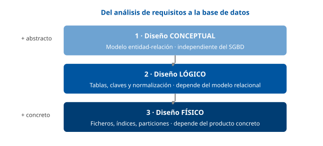

------------------------------------------------------------------------

### D2 · Elementos del modelo entidad-relación

**Sección**: §1.4 — Diseño conceptual: el modelo entidad-relación **Propósito**: Recordar la notación E-R (rectángulo, elipse, rombo) con un ejemplo del Padrón.

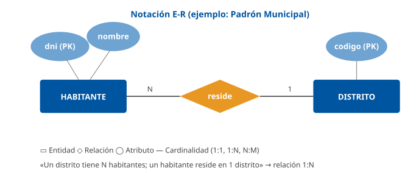

------------------------------------------------------------------------

### D3 · Transformación E-R → relacional

**Sección**: §2.2 — Transformación de entidades y relaciones al modelo relacional **Propósito**: Contrastar la regla 1:N (propaga clave) con la N:M (crea tabla intermedia).

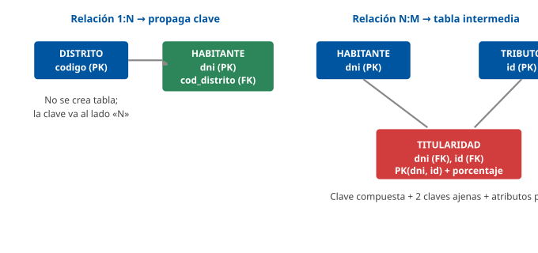

------------------------------------------------------------------------

### D4 · Integridad de entidad y referencial

**Sección**: §2.4 — Integridad de entidad e integridad referencial **Propósito**: Visualizar la clave primaria (sin nulos) y la clave ajena que apunta a una fila existente.

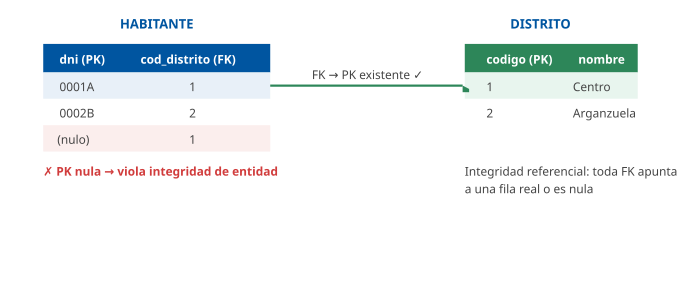

------------------------------------------------------------------------

### D5 · Los cuatro sublenguajes de SQL

**Sección**: §2.5 — Lenguajes de definición y manipulación **Propósito**: Separar DDL / DML / DCL / TCL por su finalidad.

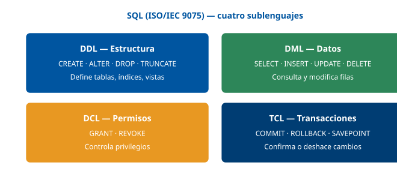

------------------------------------------------------------------------

### D6 · Tipos de índice

**Sección**: §2.8 — Índices **Propósito**: Comparar B+tree, hash y bitmap según su uso ideal.

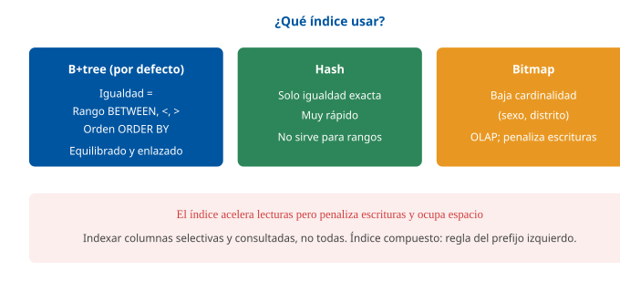

------------------------------------------------------------------------

### D7 · Conceptos del modelo relacional

**Sección**: §3.1 — Conceptos básicos **Propósito**: Anclar relación/tupla/atributo/dominio/grado/cardinalidad sobre una tabla.

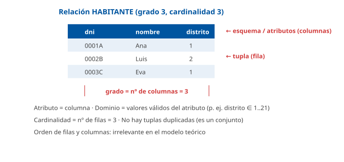

------------------------------------------------------------------------

### D8 · Tipos de claves

**Sección**: §3.2 — Claves: candidata, primaria, alternativa, superclave y ajena **Propósito**: Mostrar el anidamiento superclave ⊇ candidata ⊇ primaria y la clave ajena.

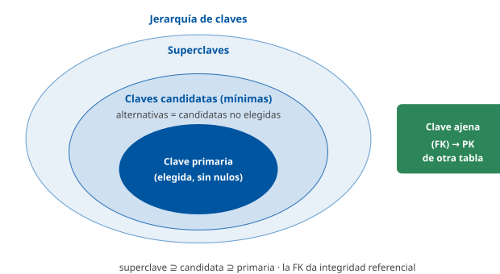

------------------------------------------------------------------------

### D9 · Operadores del álgebra relacional

**Sección**: §3.4 — Álgebra relacional **Propósito**: Listar operadores primitivos y derivados con su símbolo y efecto.

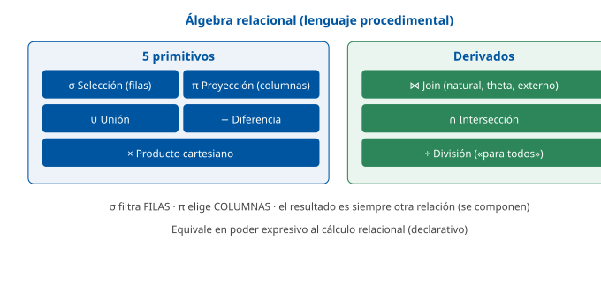

------------------------------------------------------------------------

### D10 · Las tres anomalías

**Sección**: §4.1 — Normalización: objetivos, redundancia y anomalías **Propósito**: Mostrar las anomalías de inserción, borrado y actualización sobre una tabla redundante.

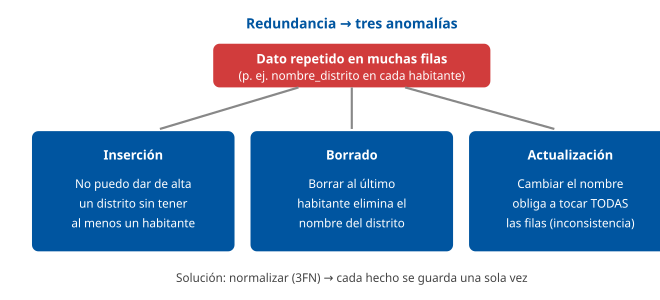

------------------------------------------------------------------------

### D11 · Las formas normales (anidadas)

**Sección**: §4.1-2.12 — Normalización **Propósito**: Mostrar el anidamiento 1FN ⊃ 2FN ⊃ 3FN ⊃ BCNF ⊃ 4FN ⊃ 5FN y qué exige cada una.

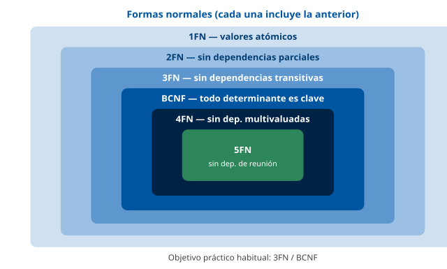

------------------------------------------------------------------------

### D12 · Estructura de un índice B+tree

**Sección**: §2.8 — Índices **Propósito**: Ilustrar el árbol equilibrado con hojas enlazadas (igualdad y rango).

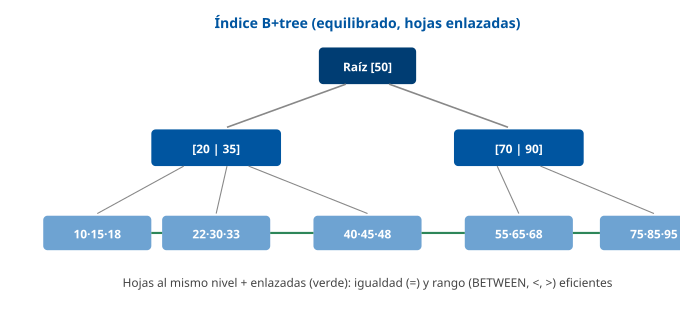

## Casos prácticos

Los tres casos recorren las tres partes del tema: el **Caso 1** trabaja el **diseño lógico** (transformación del modelo E-R a tablas e integridad) sobre los expedientes; el **Caso 2**, la **normalización** (anomalías y paso a 3FN) sobre las licencias; y el **Caso 3**, el **diseño físico y las consultas** (índices, plan de ejecución, desnormalización) sobre las multas y el cuadro de mando.

------------------------------------------------------------------------

### Caso 1 — Diseño lógico del registro de expedientes

#### Enunciado

El Ayuntamiento gestiona **expedientes administrativos**. De cada expediente se conoce su número, la fecha de apertura y el procedimiento al que pertenece. Un **procedimiento** (licencia de obra, multa, ayuda social…) tiene un código y una denominación. En cada expediente intervienen uno o varios **interesados** (ciudadanos), identificados por su DNI y nombre, y un mismo ciudadano puede figurar en muchos expedientes. Además, cada expediente está asignado a **una** unidad tramitadora, y una unidad tramita muchos expedientes. Debe diseñar el esquema relacional.

#### Cuestiones

**Cuestión 1 — Entidades y claves (2 puntos).** Identifique las entidades del problema y proponga la clave primaria de cada una.

**Cuestión 2 — Relación 1:N (2 puntos).** ¿Cómo se representa la relación «una unidad tramita muchos expedientes» en el modelo relacional? Indique dónde va la clave ajena.

**Cuestión 3 — Relación N:M (3 puntos).** La relación entre EXPEDIENTE e INTERESADO es N:M. Diseñe la solución relacional completa, con la tabla resultante, su clave primaria y sus claves ajenas.

**Cuestión 4 — Integridad (3 puntos).** Explique qué reglas de integridad (de entidad y referencial) garantizan que: (a) no exista un expediente sin número; (b) no se asigne un expediente a una unidad inexistente. Proponga la política referencial al intentar borrar una unidad que aún tramita expedientes.

#### Solución orientativa

- **C1**: Entidades `PROCEDIMIENTO(cod_proc PK)`, `EXPEDIENTE(num_exp PK)`, `INTERESADO(dni PK)`, `UNIDAD(cod_unidad PK)`. Las claves naturales son cod_proc, num_exp, dni y cod_unidad. *(§1.4, §3.2)*
- **C2**: Es una relación **1:N** → la clave de UNIDAD se **propaga** como clave ajena en EXPEDIENTE: `EXPEDIENTE(num_exp PK, fecha_apertura, cod_proc FK, cod_unidad FK)`. No se crea tabla nueva. *(§2.2)*
- **C3**: La N:M se resuelve con una **tabla intermedia**: `INTERVENCION(num_exp, dni, rol, PK(num_exp, dni))` con dos claves ajenas (`num_exp → EXPEDIENTE`, `dni → INTERESADO`). El atributo `rol` (titular, representante…) es propio de la relación. *(§2.2)*
- **C4**: (a) la **integridad de entidad** impide que `num_exp` (clave primaria) sea nulo; (b) la **integridad referencial** sobre `cod_unidad` impide asignar el expediente a una unidad inexistente. Al borrar una unidad con expedientes, la política adecuada es `RESTRICT/NO ACTION` (rechazar el borrado) para no dejar expedientes huérfanos. *(§2.4)*

#### Criterios de evaluación

| Criterio                                                        | Puntos |
|-----------------------------------------------------------------|--------|
| Identifica entidades y claves primarias correctas               | 2      |
| Resuelve la 1:N propagando la clave ajena al lado «N»           | 2      |
| Diseña la tabla intermedia N:M con clave compuesta y dos FK     | 3      |
| Explica integridad de entidad y referencial + política RESTRICT | 3      |

------------------------------------------------------------------------

#### Preguntas tipo test sobre este caso

##### 1. En el supuesto del registro de expedientes, ¿qué entidades deben identificarse?

- a) PROCEDIMIENTO, EXPEDIENTE, INTERESADO y UNIDAD.
- b) EXPEDIENTE, INTERESADO y UNIDAD; el procedimiento es solo un atributo del expediente.
- c) EXPEDIENTE, CIUDADANO, FECHA_APERTURA y UNIDAD.

**Respuesta correcta:** a) · **Referencia:** Caso 1, cuestión 1 · §1.4

Son objetos con existencia propia sobre los que se guardan datos: el procedimiento tiene su propio código y denominación, y la fecha de apertura es un atributo del expediente.

##### 2. ¿Qué clave primaria corresponde a la tabla EXPEDIENTE?

- a) fecha_apertura.
- b) La combinación (num_exp, cod_proc).
- c) num_exp.

**Respuesta correcta:** c) · **Referencia:** Caso 1, cuestión 1 · §3.2

El número identifica cada expediente. (num_exp, cod_proc) también identifica, pero no es mínima: es una superclave, no una clave candidata.

##### 3. ¿Cómo se representa en el modelo relacional la relación «una unidad tramita muchos expedientes»?

- a) Con num_exp como clave ajena en UNIDAD, sin crear tabla nueva.
- b) Con cod_unidad como clave ajena en EXPEDIENTE, sin crear tabla nueva.
- c) Con una tabla intermedia UNIDAD_EXPEDIENTE con ambas claves.

**Respuesta correcta:** b) · **Referencia:** Caso 1, cuestión 2 · §2.2

En una relación 1:N, la clave de la entidad del lado «1» (UNIDAD) se propaga como clave ajena en la tabla del lado «N» (EXPEDIENTE); la tabla intermedia es para las N:M.

##### 4. Teniendo en cuenta sus relaciones 1:N, ¿cómo queda la tabla EXPEDIENTE?

- a) EXPEDIENTE(num_exp PK, fecha_apertura, dni FK, cod_unidad FK).
- b) EXPEDIENTE(num_exp, cod_unidad PK, fecha_apertura, cod_proc FK).
- c) EXPEDIENTE(num_exp PK, fecha_apertura, cod_proc FK, cod_unidad FK).

**Respuesta correcta:** c) · **Referencia:** Caso 1, cuestión 2 · §2.2

Recibe como claves ajenas las de PROCEDIMIENTO y UNIDAD (lados «1»). El DNI no puede ir en EXPEDIENTE, porque con interesados es N:M y un expediente tiene varios.

##### 5. La relación entre EXPEDIENTE e INTERESADO es N:M. ¿Cuál es la solución relacional correcta?

- a) Una tabla INTERVENCION(num_exp, dni, rol) con PK(num_exp, dni) y dos claves ajenas.
- b) Añadir dni como clave ajena en EXPEDIENTE para enlazar con el interesado.
- c) Una tabla INTERVENCION(num_exp, dni, rol) con PK(num_exp) y dni como clave ajena.

**Respuesta correcta:** a) · **Referencia:** Caso 1, cuestión 3 · §2.2

La N:M se resuelve con una tabla intermedia cuya clave primaria combina las claves de ambas entidades, con una clave ajena hacia cada una; con PK(num_exp) un expediente solo podría tener un interesado.

##### 6. En cada expediente, el ciudadano interviene como titular o como representante. ¿Dónde se guarda ese rol?

- a) En la tabla INTERESADO, como atributo del ciudadano.
- b) En la tabla intermedia INTERVENCION, como atributo de la relación.
- c) En la tabla EXPEDIENTE, como atributo del expediente.

**Respuesta correcta:** b) · **Referencia:** Caso 1, cuestión 3 · §2.2

El rol depende de la pareja expediente-ciudadano (el mismo ciudadano puede ser titular en uno y representante en otro): es propio de la relación y vive en la tabla intermedia.

##### 7. ¿Qué regla de integridad garantiza que no exista ningún expediente sin número?

- a) La integridad de entidad, porque num_exp es la clave primaria.
- b) La integridad referencial, porque num_exp se referencia desde INTERVENCION.
- c) La integridad de dominio, porque num_exp tiene un formato definido.

**Respuesta correcta:** a) · **Referencia:** Caso 1, cuestión 4 · §2.4

La integridad de entidad prohíbe que un atributo de la clave primaria tome valor nulo: si fuese nula, no podría identificar la fila.

##### 8. ¿Qué regla impide asignar un expediente a una unidad tramitadora que no existe?

- a) La integridad de entidad sobre la columna cod_unidad.
- b) Una restricción UNIQUE sobre cod_unidad en EXPEDIENTE.
- c) La integridad referencial sobre la clave ajena cod_unidad.

**Respuesta correcta:** c) · **Referencia:** Caso 1, cuestión 4 · §2.4

La integridad referencial exige que el valor de una clave ajena coincida con una clave primaria existente (o sea nulo). Un UNIQUE impediría que una unidad tramitase varios expedientes.

##### 9. Se intenta borrar una unidad que aún tramita expedientes. ¿Qué política referencial es la adecuada?

- a) CASCADE: borrar a la vez todos los expedientes de la unidad.
- b) RESTRICT / NO ACTION: rechazar el borrado mientras haya expedientes.
- c) SET NULL: dejar a nulo la unidad de esos expedientes.

**Respuesta correcta:** b) · **Referencia:** Caso 1, cuestión 4 · §2.4

RESTRICT/NO ACTION rechaza la operación si hay filas hijas que referencian la fila padre, de modo que ningún expediente queda sin unidad ni se borra.

##### 10. Si por error se hubiera definido CASCADE sobre cod_unidad, ¿qué pasaría al borrar esa unidad?

- a) El SGBD rechazaría el borrado de la unidad.
- b) Los expedientes quedarían con la unidad a nulo.
- c) Se borrarían también todos los expedientes que tramita.

**Respuesta correcta:** c) · **Referencia:** Caso 1, cuestión 4 · §2.4

CASCADE propaga el borrado de la fila padre a las filas hijas; rechazar es RESTRICT y poner a nulo es SET NULL.

### Caso 2 — Normalización del registro de licencias

#### Enunciado

Un sistema antiguo guarda las licencias de actividad en **una sola tabla**:

`LICENCIA(num_lic, titular_dni, titular_nombre, cod_distrito, nombre_distrito, tasa_distrito, tecnicos)`

donde `tecnicos` contiene los nombres de los técnicos asignados separados por comas, `nombre_distrito` y `tasa_distrito` dependen del `cod_distrito`, y `titular_nombre` depende del `titular_dni`. Se han detectado incoherencias: el mismo distrito aparece con nombres distintos y, al borrar la última licencia de un distrito, se pierde su tasa.

#### Cuestiones

**Cuestión 1 — Anomalías (2 puntos).** Identifique y nombre las tres anomalías presentes, con un ejemplo de cada una sobre estos datos.

**Cuestión 2 — 1FN (2 puntos).** ¿Qué regla viola el atributo `tecnicos`? Normalice la tabla a 1FN.

**Cuestión 3 — 2FN y 3FN (4 puntos).** Lleve el diseño hasta la 3FN explicando, en cada paso, qué tipo de dependencia se elimina (parcial o transitiva) y mostrando las tablas resultantes con sus claves.

**Cuestión 4 — Justificación (2 puntos).** ¿Por qué el diseño normalizado elimina las incoherencias detectadas? ¿Hasta qué forma normal es razonable llegar aquí y por qué?

#### Solución orientativa

- **C1**: **Inserción** (no se puede registrar un distrito nuevo sin una licencia); **borrado** (borrar la última licencia de un distrito elimina su nombre y tasa); **actualización** (cambiar el nombre del distrito obliga a tocar todas las filas, y olvidar alguna genera la incoherencia observada). *(§4.1)*
- **C2**: `tecnicos` viola la **1FN** (varios valores en una celda, no atómico). Se extrae: `LICENCIA(num_lic PK, titular_dni, titular_nombre, cod_distrito, nombre_distrito, tasa_distrito)` y `ASIGNACION(num_lic, tecnico, PK(num_lic, tecnico))`. *(§4.3)*
- **C3**: La clave de LICENCIA es simple (`num_lic`) → no hay dependencias **parciales**, ya está en **2FN**. Pero hay dependencias **transitivas**: `num_lic → cod_distrito → {nombre_distrito, tasa_distrito}` y `num_lic → titular_dni → titular_nombre`. Para la **3FN** se separan: `DISTRITO(cod_distrito PK, nombre_distrito, tasa_distrito)`, `TITULAR(titular_dni PK, titular_nombre)` y `LICENCIA(num_lic PK, titular_dni FK, cod_distrito FK)`. *(§4.4, §4.5)*
- **C4**: Cada hecho (nombre y tasa del distrito, nombre del titular) se almacena **una sola vez**, así que no puede quedar inconsistente, se puede dar de alta un distrito sin licencias y borrar una licencia no afecta al distrito. Llegar a **3FN** es suficiente: aquí cada determinante de las tablas resultantes es clave, por lo que también cumplen BCNF, sin necesidad de formas superiores. *(§4.1, §4.5, §4.6)*

#### Criterios de evaluación

| Criterio | Puntos |
|----|----|
| Nombra las tres anomalías con ejemplos correctos | 2 |
| Detecta la violación de 1FN y la corrige con tabla aparte | 2 |
| Alcanza la 3FN distinguiendo dependencia parcial vs transitiva | 4 |
| Justifica la eliminación de incoherencias y el grado de normalización | 2 |

------------------------------------------------------------------------

#### Preguntas tipo test sobre este caso

##### 1. En el supuesto de la tabla LICENCIA, el mismo distrito aparece con nombres distintos en filas diferentes. ¿Qué anomalía lo explica?

- a) La anomalía de inserción.
- b) La anomalía de actualización.
- c) La anomalía de borrado.

**Respuesta correcta:** b) · **Referencia:** Caso 2, cuestión 1 · §4.1

Un dato repetido en muchas filas hay que cambiarlo en todas; si se olvida alguna, queda inconsistente. Eso ha ocurrido con el nombre del distrito.

##### 2. Al borrar la última licencia de un distrito se pierde su tasa. ¿Qué anomalía es?

- a) La anomalía de borrado.
- b) La anomalía de inserción.
- c) La anomalía de actualización.

**Respuesta correcta:** a) · **Referencia:** Caso 2, cuestión 1 · §4.1

Hay anomalía de borrado cuando, al eliminar una fila, se pierde información que no se quería eliminar, como el nombre y la tasa del distrito.

##### 3. El servicio quiere registrar un distrito nuevo con su tasa antes de que tenga ninguna licencia, y no puede. ¿Qué anomalía sufre?

- a) La anomalía de borrado.
- b) La anomalía de actualización.
- c) La anomalía de inserción.

**Respuesta correcta:** c) · **Referencia:** Caso 2, cuestión 1 · §4.1

La anomalía de inserción impide dar de alta un hecho (el distrito) sin conocer otro no relacionado (una licencia), porque ambos viven en la misma tabla.

##### 4. El atributo tecnicos guarda varios nombres separados por comas. ¿Qué forma normal incumple?

- a) La 1FN, porque la celda no contiene un valor atómico.
- b) La 2FN, porque depende de una parte de la clave.
- c) La 3FN, porque depende de otro atributo no clave.

**Respuesta correcta:** a) · **Referencia:** Caso 2, cuestión 2 · §4.3

La 1FN exige que todos los atributos sean atómicos, con un único valor por celda; una lista de nombres en una celda la viola.

##### 5. ¿Cómo se lleva la tabla LICENCIA a 1FN?

- a) Sustituyendo tecnicos por las columnas tecnico1, tecnico2 y tecnico3.
- b) Con una tabla ASIGNACION(num_lic, tecnico) cuya clave es (num_lic, tecnico).
- c) Manteniendo la lista de técnicos, pero ordenada alfabéticamente.

**Respuesta correcta:** b) · **Referencia:** Caso 2, cuestión 2 · §4.3

Los valores multivaluados se extraen a una tabla aparte relacionada por clave ajena; las columnas repetidas tecnico1, tecnico2… son también una violación típica de la 1FN.

##### 6. Tras pasar a 1FN, ¿está LICENCIA(num_lic PK, titular_dni, titular_nombre, cod_distrito, nombre_distrito, tasa_distrito) en 2FN?

- a) No: titular_nombre depende solo de una parte de la clave primaria.
- b) No: hay que separar antes DISTRITO para poder alcanzar la 2FN.
- c) Sí: su clave es simple (num_lic), así que no puede haber dependencias parciales.

**Respuesta correcta:** c) · **Referencia:** Caso 2, cuestión 3 · §4.4

La 2FN elimina dependencias de una parte de la clave, lo que solo puede ocurrir con claves compuestas; con clave de un único atributo, 1FN implica 2FN.

##### 7. num_lic → cod_distrito y cod_distrito → {nombre_distrito, tasa_distrito}. ¿Qué tipo de dependencia hay y qué forma normal la elimina?

- a) Parcial, que elimina la 2FN.
- b) Transitiva, que elimina la 3FN.
- c) Multivaluada, que elimina la 4FN.

**Respuesta correcta:** b) · **Referencia:** Caso 2, cuestión 3 · §4.2, §4.5

nombre_distrito y tasa_distrito dependen de la clave a través de un atributo no clave (cod_distrito): es una dependencia transitiva, y la 3FN la elimina.

##### 8. ¿Qué conjunto de tablas deja LICENCIA (sin los técnicos) en 3FN?

- a) LICENCIA(num_lic PK, titular_dni FK, cod_distrito FK), TITULAR(titular_dni PK, titular_nombre) y DISTRITO(cod_distrito PK, nombre_distrito, tasa_distrito).
- b) LICENCIA(num_lic PK, titular_dni, titular_nombre, cod_distrito FK), DISTRITO(cod_distrito PK, nombre_distrito) y TASA(cod_distrito PK, tasa_distrito).
- c) LICENCIA(num_lic PK, titular_dni FK, cod_distrito FK, nombre_distrito), TITULAR(titular_dni PK, titular_nombre) y DISTRITO(cod_distrito PK, tasa_distrito).

**Respuesta correcta:** a) · **Referencia:** Caso 2, cuestión 3 · §4.5

Hay dos dependencias transitivas (a través de cod_distrito y de titular_dni): se separan DISTRITO y TITULAR, y en LICENCIA quedan solo sus claves ajenas.

##### 9. ¿Por qué el diseño normalizado elimina las incoherencias detectadas en los nombres de distrito?

- a) Porque los índices de cada tabla impiden guardar valores duplicados.
- b) Porque los disparadores corrigen las filas que quedan inconsistentes.
- c) Porque cada hecho, como el nombre del distrito, se guarda una sola vez.

**Respuesta correcta:** c) · **Referencia:** Caso 2, cuestión 4 · §4.1

La normalización garantiza que cada hecho se almacene una sola vez: el nombre y la tasa del distrito viven solo en DISTRITO y no pueden quedar inconsistentes.

##### 10. ¿Hasta qué forma normal es razonable llegar en este diseño?

- a) Hasta la 3FN, que aquí ya cumple BCNF porque todo determinante es clave.
- b) Hasta la 4FN, porque la lista de técnicos es una dependencia multivaluada.
- c) Solo hasta la 2FN, porque la clave de LICENCIA es un único atributo.

**Respuesta correcta:** a) · **Referencia:** Caso 2, cuestión 4 · §4.6, §4.7

En las tablas resultantes el único determinante es la clave, de modo que cumplen BCNF; llegar a 3FN o BCNF es suficiente en la inmensa mayoría de los diseños.

### Caso 3 — Diseño físico y consultas sobre las multas de tráfico

#### Enunciado

La base de datos de **multas de tráfico** tiene una tabla `MULTA(id, matricula, dni_conductor, cod_distrito, fecha_denuncia, importe, estado)` con más de 20 millones de filas. Las consultas más frecuentes son: (a) buscar multas por **matrícula**; (b) listar multas de un **rango de fechas**; (c) un **informe analítico anual** con el total recaudado por distrito. El equipo se queja de lentitud y de que la carga nocturna de nuevas denuncias tarda demasiado.

#### Cuestiones

**Cuestión 1 — Índices (3 puntos).** Proponga índices para las consultas (a) y (b), indicando el tipo de índice y por qué. ¿Qué efecto tienen los índices sobre la carga nocturna?

**Cuestión 2 — Plan de ejecución (2 puntos).** La consulta por matrícula hace un *full table scan*. ¿Qué herramienta usaría para comprobarlo y qué dato necesita el optimizador para elegir bien el plan?

**Cuestión 3 — Particionamiento (2 puntos).** ¿Cómo organizaría físicamente la tabla para que el informe anual no recorra los 20 millones de filas? Nombre la técnica y el beneficio.

**Cuestión 4 — Desnormalización (3 puntos).** Para el cuadro de mando, ¿qué técnica aplicaría y qué contrapartida asume? Distinga el tratamiento entre el sistema transaccional (altas diarias) y el analítico.

#### Solución orientativa

- **C1**: Para (a), índice **B-tree** sobre `matricula` (igualdad, columna selectiva). Para (b), índice **B-tree** sobre `fecha_denuncia` (soporta rangos). Los índices **aceleran las lecturas** pero **penalizan la carga nocturna**, porque cada INSERT debe actualizar todos los índices: hay que equilibrar. *(§2.8)*
- **C2**: `EXPLAIN` (PostgreSQL/MySQL) o `EXPLAIN PLAN` (Oracle) muestra el plan. El optimizador necesita **estadísticas actualizadas** (cardinalidad, distribución de valores) para estimar costes; conviene ejecutar `ANALYZE`. Si tras crear el índice sigue el *full scan*, suele ser por estadísticas desactualizadas o por una función sobre la columna. *(§2.9)*
- **C3**: **Particionar** la tabla **por rango de fecha (por año)**. El informe del ejercicio en curso lee solo la partición correspondiente (*partition pruning*) en vez de los 20 millones de filas; además facilita el mantenimiento y el archivado. *(§2.9)*
- **C4**: Una **vista materializada** (o tabla de resumen) con el total recaudado por distrito y año, que evita recalcular el agregado en cada acceso. Contrapartida: hay que **refrescarla** y asume **redundancia controlada**. El sistema **transaccional** se mantiene **normalizado** (integridad de las altas); el **analítico/cuadro de mando** se **desnormaliza** (rendimiento de lectura). *(§2.9, §4.8)*

#### Criterios de evaluación

| Criterio | Puntos |
|----|----|
| Propone índices B-tree adecuados y reconoce su coste en escritura | 3 |
| Identifica EXPLAIN y la necesidad de estadísticas | 2 |
| Aplica particionamiento por rango con *partition pruning* | 2 |
| Justifica la desnormalización/vista materializada y distingue OLTP vs OLAP | 3 |

------------------------------------------------------------------------

*Los tres casos pueden resolverse íntegramente con el contenido teórico del tema. Las referencias entre paréntesis (§) remiten a la pestaña Contenido.*

#### Preguntas tipo test sobre este caso

##### 1. En la tabla MULTA, ¿qué índice propondría para la consulta (a), buscar multas por matrícula?

- a) Un índice bitmap sobre matricula, columna de baja cardinalidad.
- b) Ninguno: el full table scan es lo más rápido en tablas grandes.
- c) Un índice B-tree sobre matricula, columna muy selectiva.

**Respuesta correcta:** c) · **Referencia:** Caso 3, cuestión 1 · §2.8

La matrícula es muy selectiva y la búsqueda es por igualdad: un B-tree es adecuado. El bitmap es para columnas de baja cardinalidad, y el full scan solo compensa en tablas pequeñas.

##### 2. Para la consulta (b), listar multas de un rango de fechas, ¿qué índice es el adecuado?

- a) Un índice hash sobre fecha_denuncia.
- b) Un índice B-tree sobre fecha_denuncia.
- c) Un índice bitmap sobre importe.

**Respuesta correcta:** b) · **Referencia:** Caso 3, cuestión 1 · §2.8

El B-tree sirve para igualdad y para rangos (BETWEEN, <, >); el hash solo sirve para igualdad exacta y no admite rangos.

##### 3. ¿Qué efecto tendrán los nuevos índices sobre la carga nocturna de denuncias?

- a) La ralentizarán, porque cada INSERT debe actualizar los índices.
- b) La acelerarán, porque las filas se insertan ya ordenadas.
- c) No le afectarán, porque los índices solo intervienen en lecturas.

**Respuesta correcta:** a) · **Referencia:** Caso 3, cuestión 1 · §2.8

Los índices aceleran las lecturas pero penalizan las escrituras, porque hay que mantenerlos en cada INSERT; hay que equilibrar cuántos se crean.

##### 4. La consulta por matrícula hace un full table scan. ¿Con qué herramienta lo comprueba el técnico?

- a) Con ANALYZE, que muestra el plan elegido.
- b) Con EXPLAIN o EXPLAIN PLAN, que muestra el plan de ejecución.
- c) Con REINDEX, que muestra los índices usados.

**Respuesta correcta:** b) · **Referencia:** Caso 3, cuestión 2 · §2.9

El plan de ejecución se inspecciona con EXPLAIN (PostgreSQL/MySQL) o EXPLAIN PLAN (Oracle). ANALYZE recalcula estadísticas y REINDEX reconstruye índices.

##### 5. ¿Qué necesita el optimizador para elegir bien el plan de ejecución?

- a) Que la tabla MULTA esté normalizada hasta BCNF.
- b) Un índice hash sobre cada columna de la tabla.
- c) Estadísticas actualizadas sobre filas y distribución de valores.

**Respuesta correcta:** c) · **Referencia:** Caso 3, cuestión 2 · §2.9

El optimizador basado en costes estima cada plan con estadísticas (número de filas, distribución de valores, cardinalidad); por eso hay que mantenerlas al día (ANALYZE).

##### 6. Tras crear el índice sobre matricula, la consulta sigue haciendo full table scan. ¿Qué causa es posible?

- a) Que las estadísticas estén desactualizadas o la consulta aplique una función sobre la columna.
- b) Que un índice B-tree no pueda usarse en búsquedas por igualdad exacta.
- c) Que el plan de ejecución se fije al crear la tabla y ya no pueda cambiar.

**Respuesta correcta:** a) · **Referencia:** Caso 3, cuestión 2 · §2.9

El optimizador puede ignorar un índice si las estadísticas están desactualizadas o si la consulta aplica una función sobre la columna indexada (WHERE UPPER(…) = …).

##### 7. ¿Cómo organizaría físicamente MULTA para que el informe anual no recorra los 20 millones de filas?

- a) Particionándola por hash de la matrícula.
- b) Separándola en dos tablas, pagadas y pendientes.
- c) Particionándola por rango de fecha, por años.

**Respuesta correcta:** c) · **Referencia:** Caso 3, cuestión 3 · §2.9

El particionamiento por rango de fechas permite que la consulta de un año acceda solo a su partición; el hash por matrícula reparte las filas sin agruparlas por año.

##### 8. ¿Cómo se llama el beneficio por el que el informe del año solo lee su partición?

- a) Index-only scan.
- b) Partition pruning.
- c) Hash join.

**Respuesta correcta:** b) · **Referencia:** Caso 3, cuestión 3 · §2.9

Con partition pruning la consulta accede solo a la partición relevante; además, el particionamiento facilita el mantenimiento y el archivado.

##### 9. Para el cuadro de mando con el total recaudado por distrito y año, ¿qué técnica aplicaría?

- a) Una vista materializada (o tabla de resumen) con esos totales.
- b) Normalizar la tabla MULTA hasta la forma normal de Boyce-Codd.
- c) Un índice hash sobre la columna importe de la tabla MULTA.

**Respuesta correcta:** a) · **Referencia:** Caso 3, cuestión 4 · §2.9, §4.8

La vista materializada o tabla de resumen precalcula el agregado y evita recalcularlo en cada acceso: es una técnica de desnormalización controlada.

##### 10. ¿Qué contrapartida asume esa técnica y cómo se tratan el sistema transaccional y el analítico?

- a) Ninguna, porque se actualiza sola; ambos sistemas se desnormalizan.
- b) Hay que refrescarla; el transaccional sigue normalizado y el analítico se desnormaliza.
- c) Hay que refrescarla; el transaccional se desnormaliza y el analítico no.

**Respuesta correcta:** b) · **Referencia:** Caso 3, cuestión 4 · §4.8

La desnormalización gana velocidad de lectura a costa de redundancia que hay que mantener; es típica de los entornos analíticos y poco recomendable en los transaccionales con muchas escrituras.

## Fuentes

### Tier 1 — Canónicas y normativas

| ID | Referencia |
|----|----|
| `[CODD70]` | Codd, E. F. (1970). *A Relational Model of Data for Large Shared Data Banks*. Communications of the ACM, 13(6). Artículo fundacional del modelo relacional. |
| `[CODD72]` | Codd, E. F. (1972). *Further Normalization of the Data Base Relational Model*. IBM Research. Define 2FN y 3FN. |
| `[CODD74BCNF]` | Codd, E. F.; Boyce, R. F. (1974). Forma Normal de Boyce-Codd (BCNF). |
| `[CHEN76]` | Chen, P. P. (1976). *The Entity-Relationship Model — Toward a Unified View of Data*. ACM TODS, 1(1). Modelo entidad-relación. |
| `[ARMSTRONG74]` | Armstrong, W. W. (1974). *Dependency Structures of Data Base Relationships*. Axiomas de inferencia de dependencias funcionales. |
| `[FAGIN77]` | Fagin, R. (1977). *Multivalued Dependencies and a New Normal Form (4FN)*. ACM TODS. |
| `[DATE]` | Date, C. J. *An Introduction to Database Systems* (8.ª ed.). Addison-Wesley. Referencia general de modelo relacional, álgebra, cálculo y normalización. |
| `[ELMASRI]` | Elmasri, R.; Navathe, S. B. *Fundamentals of Database Systems* (7.ª ed.). Pearson. Diseño conceptual/lógico/físico y E-R. |
| `[SILBER]` | Silberschatz, A.; Korth, H.; Sudarshan, S. *Database System Concepts* (7.ª ed.). McGraw-Hill. |
| `[RAMAKRISHNAN]` | Ramakrishnan, R.; Gehrke, J. *Database Management Systems* (3.ª ed.). McGraw-Hill. Diseño físico, índices y optimización. |
| `[ISO9075]` | ISO/IEC 9075:2023 *Information technology — Database languages — SQL*. Norma del lenguaje SQL (DDL/DML/DCL/TCL). |
| `[ISO11179]` | ISO/IEC 11179 *Metadata Registries*. Gobierno de metadatos y diccionario de datos. |

### Tier 2 — Manuales y documentación de producto

| ID | Referencia |
|----|----|
| `[PG-DOC]` | PostgreSQL Global Development Group. *PostgreSQL Documentation* — Indexes, EXPLAIN, Partitioning. postgresql.org/docs |
| `[ORA-CONCEPTS]` | Oracle. *Database Concepts* — Schema Objects, Indexes, Tablespaces, Optimizer. |
| `[MS-SQL-INDEX]` | Microsoft. *SQL Server — Clustered and Nonclustered Indexes, Execution Plans*. learn.microsoft.com |
| `[MYSQL-DOC]` | Oracle. *MySQL Reference Manual* — InnoDB, Optimization, Partitioning. |

### Tier 3 — Marco normativo del puesto (contexto, no contenido técnico)

| ID | Referencia |
|----|----|
| `[RGPD]` | [Reglamento (UE) 2016/679](https://eur-lex.europa.eu/legal-content/ES/TXT/?uri=CELEX:32016R0679) (RGPD) — minimización y exactitud de datos en el diseño. |
| `[LOPDGDD]` | [Ley Orgánica 3/2018](https://www.boe.es/buscar/act.php?id=BOE-A-2018-16673) de Protección de Datos y Garantía de los Derechos Digitales. |
| `[ENS]` | [Real Decreto 311/2022](https://www.boe.es/buscar/act.php?id=BOE-A-2022-7191), Esquema Nacional de Seguridad — integridad y trazabilidad. |
| `[BOAM10032]` | BOAM 10.032 (23-dic-2025). Bases específicas TIC C1 Ayto. Madrid — temario oficial. |

------------------------------------------------------------------------

*Las referencias Tier 1 son la base del contenido; Tier 2 ilustra la materialización en productos reales; Tier 3 enmarca el cumplimiento aplicable al Ayuntamiento de Madrid.*
