# Tema 18. Lenguajes de programación

**Bloque:** técnico  
**Enunciado oficial** (BOAM n.º 10.032, de 23 de diciembre de 2025): Lenguajes de programación. Representación de tipos de datos. Operadores. Instrucciones condicionales. Bucles y recursividad. Procedimientos, funciones y parámetros. Vectores y registros. Estructura de un programa.

Versión web: <https://ayuntamientomadrid.github.io/temario-tecnico-auxiliar/temas/tema-18.html> · PDF: [tema-18.pdf](tema-18.pdf) · Test: [../../../tests/tecnico/tema-18.md](../../../tests/tecnico/tema-18.md)

## Índice

- 1. Lenguajes de programación
  - 1.1. Concepto de lenguaje de programación
  - 1.2. Evolución y clasificación de los lenguajes
  - 1.3. Elementos fundamentales de un lenguaje
  - 1.4. Sintaxis, semántica y pragmática
  - 1.5. Variables, constantes e identificadores
  - 1.6. Expresiones y sentencias
- 2. Representación de tipos de datos
  - 2.1. Concepto y clasificación de los tipos de datos
  - 2.2. Tipos de datos simples o primitivos
  - 2.3. Tipos de datos estructurados
  - 2.4. Conversión y compatibilidad de tipos
- 3. Operadores
  - 3.1. Operadores aritméticos
  - 3.2. Operadores relacionales y lógicos
  - 3.3. Operadores de asignación y otros operadores
  - 3.4. Precedencia y asociatividad
- 4. Estructuras de control
  - 4.1. Programación estructurada: el teorema de Böhm-Jacopini
  - 4.2. Instrucciones condicionales
  - 4.3. Bucles e iteraciones
  - 4.4. Recursividad
  - 4.5. Programación modular: procedimientos y funciones
  - 4.6. Parámetros y mecanismos de paso de argumentos
  - 4.7. Ámbito y ciclo de vida de las variables
- 5. Estructuras de datos básicas
  - 5.1. Vectores o arrays
  - 5.2. Registros o estructuras
  - 5.3. Operaciones fundamentales sobre vectores y registros
- 6. Estructura de un programa
  - 6.1. Organización del código
  - 6.2. Buenas prácticas de programación
  - 6.3. Documentación, pruebas y mantenimiento
- 7. Tendencias actuales en los lenguajes de programación

### Conceptos clave para memorizar

| Concepto | Dato clave |
|----|----|
| Lenguaje de programación | Notación formal para expresar algoritmos que una máquina puede ejecutar; tiene léxico, sintaxis y semántica |
| Nivel del lenguaje | Bajo (máquina, ensamblador) ↔ alto (cercano al humano, independiente de la máquina) |
| Generaciones | 1GL máquina · 2GL ensamblador · 3GL estructurados (C, Java) · 4GL declarativos (SQL) · 5GL lógicos/IA |
| Paradigma | Imperativo, declarativo (funcional, lógico), orientado a objetos — formas de estructurar el programa |
| Traductor | Compilador (traduce todo antes) vs intérprete (traduce y ejecuta línea a línea) |
| Sintaxis / Semántica / Pragmática | Forma (reglas gramaticales) / significado / uso en la práctica |
| Identificador | Nombre que damos a variables, constantes, funciones… |
| Variable / Constante | Espacio de memoria con nombre cuyo valor cambia / valor fijo que no cambia |
| Tipo de dato | Conjunto de valores + operaciones permitidas sobre ellos |
| Tipos primitivos | Entero, real (coma flotante IEEE 754), carácter, booleano |
| Tipos estructurados | Array (vector), registro (struct), cadena, conjunto, fichero |
| Tipado fuerte / débil | Cuánto controla el lenguaje las mezclas de tipos |
| Tipado estático / dinámico | El tipo se comprueba en compilación / en ejecución |
| Casting | Conversión de tipo, implícita (automática) o explícita (forzada por el programador) |
| Operadores | Aritméticos, relacionales, lógicos, de asignación, a nivel de bits |
| Precedencia | Orden en que se evalúan los operadores en una expresión |
| Estructuras de control | Secuencia, selección (if/switch) e iteración (bucles) |
| Recursividad | Función que se llama a sí misma; necesita **caso base** y **caso recursivo** |
| Procedimiento / Función | Subprograma sin valor de retorno / que devuelve un valor |
| Paso por valor / por referencia | Se copia el valor del argumento / se pasa su dirección (puede modificar el original) |
| Ámbito (scope) | Zona del programa donde una variable es visible (local, global) |
| Tiempo de vida | Periodo en que la variable existe en memoria |
| Array | Colección indexada de elementos del **mismo** tipo, contiguos en memoria |
| Registro | Colección de campos de tipos **distintos** agrupados bajo un nombre |
| Programa estructurado | Solo secuencia, selección e iteración; sin `goto` (Böhm-Jacopini) |

## Contenido

### Convenciones del documento

Este tema incluye cuatro tipos de **cajas callout** para facilitar el estudio:

> **Dato clave.** Información de alta densidad memorística.

> **Ejercicio resuelto.** Problema + solución paso a paso (traza de un algoritmo, cálculo de una expresión, diseño de una función).

> **Ejemplo de aplicación en el ayto.** Aplicación real de la teoría al entorno municipal (Padrón, tributos, expedientes, multas, callejero).

> **Relación con otros temas.** Enlace conceptual a otros temas del temario oficial.

Los ejemplos de código se escriben en **pseudocódigo neutro en castellano** (`si … entonces … fin_si`, `mientras … fin_mientras`, `funcion … devolver`), independiente de cualquier lenguaje concreto, tal como se usa en los enunciados de oposición. Cuando conviene ilustrar una particularidad real se nombra el lenguaje (C, Java, Python, JavaScript). Las fuentes se citan con etiquetas breves tipo `[SEBESTA]` o `[SCOTT, cap. 8]`; el registro completo está en la pestaña Fuentes.

------------------------------------------------------------------------

### 1. Lenguajes de programación

#### 1.1. Concepto de lenguaje de programación

Un **lenguaje de programación** es una notación formal, con reglas precisas, que permite escribir **algoritmos** de forma que una computadora los pueda ejecutar y una persona los pueda leer y mantener \[SEBESTA, cap. 1\]. Es el puente entre la manera humana de razonar un problema y la manera en que la máquina —que solo entiende secuencias de ceros y unos— lo ejecuta.

Todo lenguaje de programación se define mediante tres componentes, igual que un lenguaje natural \[ASU, cap. 1\]:

- **Léxico**: el vocabulario, es decir, el conjunto de palabras y símbolos válidos (palabras reservadas como `si`, `mientras`; identificadores; números; operadores).
- **Sintaxis**: las reglas gramaticales que dicen cómo se combinan esos símbolos para formar instrucciones correctas.
- **Semántica**: el significado de cada construcción, esto es, qué hace realmente el programa cuando se ejecuta.

Un **programa** es un texto escrito en un lenguaje de programación (el **código fuente**). Como la máquina no ejecuta directamente ese texto, hace falta un **traductor** que lo convierta a instrucciones que el procesador entienda (código máquina).

> **Dato clave.** No confundir **algoritmo** con **programa**. El **algoritmo** es la secuencia lógica de pasos para resolver un problema, independiente del lenguaje; el **programa** es ese algoritmo escrito en un lenguaje concreto y ejecutable. Un mismo algoritmo puede programarse en C, Java o Python.

> **Relación con otros temas.** El **Tema 13** trata los **algoritmos** y las estructuras de datos abstractas (pilas, colas, árboles) y su análisis de coste; el **Tema 11**, la **representación binaria** de la información (cómo se almacenan en el fondo los enteros, reales y caracteres que aquí manejamos como tipos). Este Tema 18 es el eslabón intermedio: cómo se **expresan** esos algoritmos y datos en un lenguaje.

#### 1.2. Evolución y clasificación de los lenguajes

**Según su nivel de abstracción** —la distancia respecto al hardware— los lenguajes se clasifican en \[PRATT, cap. 1\]:

- **Lenguaje máquina** (bajo nivel): instrucciones en binario que el procesador ejecuta directamente. Depende totalmente de la arquitectura de la CPU. Ilegible para las personas.
- **Lenguaje ensamblador** (bajo nivel): sustituye los códigos binarios por **mnemónicos** (`MOV`, `ADD`, `JMP`). Sigue atado a la máquina, pero es legible. Necesita un **ensamblador** que lo traduzca.
- **Lenguajes de alto nivel**: cercanos al lenguaje humano y matemático (C, Java, Python, C#). Son **independientes de la máquina**: el mismo programa puede ejecutarse en distintos procesadores si existe un traductor para cada uno.

Una clasificación clásica es la de **generaciones**:

| Generación | Tipo | Ejemplos | Idea |
|----|----|----|----|
| **1GL** | Lenguaje máquina | Binario puro | Ceros y unos; máxima eficiencia, nula portabilidad |
| **2GL** | Ensamblador | ASM x86 | Mnemónicos; dependiente de la CPU |
| **3GL** | Alto nivel, procedimental/estructurado | C, Pascal, Fortran, Java | Se dice **qué** hacer paso a paso; independiente de la máquina |
| **4GL** | Muy alto nivel, declarativo | SQL, informes, generadores | Se dice **qué** se quiere, no **cómo** obtenerlo |
| **5GL** | Lógico / IA | Prolog, sistemas expertos | Se describen restricciones y el motor deduce la solución |

**Según el paradigma** —la forma de concebir y estructurar el programa— \[SEBESTA, cap. 1; PRATT, cap. 1\]:

- **Imperativo**: el programa es una secuencia de **órdenes** que cambian el estado de la memoria (variables). Se subdivide en:
  - **Estructurado / procedimental**: se organiza en procedimientos y funciones con las tres estructuras de control básicas (C, Pascal).
  - **Orientado a objetos**: el programa se organiza en **objetos** que combinan datos y comportamiento (Java, C++, Python). → **Tema 20**.
- **Declarativo**: se describe **qué** se quiere obtener, no la secuencia de pasos. Incluye:
  - **Funcional**: el cálculo se expresa como evaluación de funciones matemáticas, evitando estado mutable (Lisp, Haskell, y rasgos en Python/JavaScript).
  - **Lógico**: se enuncian hechos y reglas y el sistema infiere respuestas (Prolog).

> **Dato clave.** Distinción imperativo vs declarativo: en el **imperativo** el programador dice **CÓMO** resolver el problema (los pasos); en el **declarativo** dice **QUÉ** quiere y el sistema decide cómo. **SQL** (Tema 19) es el ejemplo típico de lenguaje **declarativo** de 4.ª generación.

**Según la forma de traducirse y ejecutarse**:

- **Compilados**: un **compilador** traduce **todo** el código fuente a código máquina (o a un objeto ejecutable) **antes** de ejecutarlo. La traducción se hace una vez; la ejecución es rápida (C, C++). → *Diagrama D2*.
- **Interpretados**: un **intérprete** lee y ejecuta el programa **instrucción a instrucción** en tiempo de ejecución, sin producir un ejecutable independiente. Más flexible y portable, algo más lento (Python clásico, JavaScript).
- **Híbridos (bytecode + máquina virtual)**: el fuente se compila a un **código intermedio** portable (*bytecode*) que ejecuta una **máquina virtual** (Java → JVM; C# → CLR). Combina portabilidad e interpretación con compilación **JIT** (*just-in-time*) para acelerar. → **Tema 21** (Java EE).

> **Dato clave.** Compilador ≠ intérprete. El **compilador** traduce el programa **completo** antes de ejecutar y detecta muchos errores en compilación; el **intérprete** traduce y ejecuta **línea a línea** y los errores afloran en ejecución. Java usa un **modelo híbrido**: compila a *bytecode* y lo ejecuta la **JVM** («compile once, run anywhere»).

#### 1.3. Elementos fundamentales de un lenguaje

Con independencia del paradigma, casi todo lenguaje de alto nivel proporciona \[SEBESTA, cap. 1\]:

1.  **Tipos de datos**: qué clases de valores maneja (enteros, reales, caracteres, booleanos, estructuras).
2.  **Variables y constantes**: cómo se nombran y almacenan los datos.
3.  **Operadores y expresiones**: cómo se combinan los datos para producir nuevos valores.
4.  **Estructuras de control**: cómo se decide el orden de ejecución (secuencia, selección, iteración).
5.  **Subprogramas** (procedimientos y funciones): cómo se organiza y reutiliza el código.
6.  **Entrada/salida**: cómo el programa lee datos y comunica resultados.
7.  **Gestión de memoria**: cómo se reserva y libera el espacio de los datos (manual en C, automática por *garbage collector* en Java/Python).

Estos elementos son precisamente el esqueleto de este tema.

#### 1.4. Sintaxis, semántica y pragmática

Los tres niveles con que se estudia todo lenguaje formal \[ASU, cap. 1; SCOTT, cap. 1\]:

- **Sintaxis**: reglas que determinan **qué secuencias de símbolos están bien formadas**. Se describe con **gramáticas** (típicamente en notación **BNF**, *Backus-Naur Form*). Ejemplo: en muchos lenguajes toda sentencia termina en `;`, y un `si` va seguido de una condición entre paréntesis. Un error de sintaxis (olvidar un paréntesis) impide compilar.
- **Semántica**: el **significado** de las construcciones sintácticamente correctas. Una sentencia puede ser sintácticamente válida y semánticamente errónea (dividir entre cero, usar una variable no inicializada). Distinguimos **semántica estática** (comprobaciones en compilación: tipos, declaraciones) y **semántica dinámica** (comportamiento en ejecución).
- **Pragmática**: cómo se **usa** el lenguaje en la práctica: convenciones de estilo, legibilidad, idioms, buenas prácticas. No la impone la gramática, pero determina la calidad del código.

> **Ejercicio resuelto.** Clasifica el error en cada caso (pseudocódigo). (a) `si x > 0 entonces` sin `fin_si` → **error de sintaxis** (falta cerrar la estructura). (b) `resultado = total / num_habitantes` cuando `num_habitantes` vale 0 → **error semántico dinámico** (división por cero en ejecución). (c) `x = "hola" + 5` en un lenguaje de tipado fuerte → **error semántico estático** (tipos incompatibles, detectado al compilar).

**Notación BNF (introducción):** una gramática BNF define reglas de producción. Por ejemplo, un número entero podría describirse así:

    <digito>  ::= 0 | 1 | 2 | 3 | 4 | 5 | 6 | 7 | 8 | 9
    <entero>  ::= <digito> | <digito> <entero>

Se lee: «un entero es un dígito, o un dígito seguido de otro entero». Esta recursión permite describir números de cualquier longitud con reglas finitas. El **compilador**, en su fase de **análisis sintáctico**, comprueba que el código respeta estas reglas \[ASU, cap. 4\].

#### 1.5. Variables, constantes e identificadores

Un **identificador** es el **nombre** que el programador da a los elementos del programa (variables, constantes, funciones, tipos). Las reglas habituales: empieza por letra o guion bajo, continúa con letras/dígitos/guiones bajos, no coincide con una palabra reservada y —en la mayoría de lenguajes— **distingue mayúsculas de minúsculas** (`Total` ≠ `total`) \[SEBESTA, cap. 5\].

Una **variable** es una posición de memoria **con nombre** cuyo **valor puede cambiar** durante la ejecución. Toda variable tiene cuatro atributos \[SCOTT, cap. 3\]:

- **Nombre** (identificador),
- **Tipo** (qué valores admite y qué operaciones permite),
- **Valor** (el contenido actual),
- **Dirección** (dónde reside en memoria; a veces llamada *l-value*).

Una **constante** es un dato con nombre cuyo **valor no cambia** una vez fijado (`PI = 3.1416`, `IVA = 0.21`). Aporta legibilidad (un nombre en vez de un «número mágico») y seguridad (el compilador impide modificarla). Un **literal** es un valor escrito directamente en el código (`42`, `"Madrid"`, `verdadero`).

> **Dato clave.** **Declaración** vs **inicialización** vs **asignación**. **Declarar** = presentar la variable y su tipo (`entero edad`). **Inicializar** = darle su **primer** valor (`edad = 0`). **Asignar** = darle un valor **nuevo** después (`edad = 34`). Usar una variable **declarada pero no inicializada** es una fuente clásica de errores (valor «basura» en C).

> **Ejemplo de aplicación en el ayto.** En un módulo del Padrón, `MAX_HABITANTES_VIVIENDA` sería una **constante**; `dni_ciudadano` y `codigo_distrito`, **variables**; y `21` (número de distritos de Madrid) aparecería mejor como constante con nombre `NUM_DISTRITOS` que como literal repetido por el código, evitando «números mágicos» difíciles de mantener \[MCCONNELL, cap. 12\].

#### 1.6. Expresiones y sentencias

Una **expresión** es una combinación de valores, variables, constantes, operadores y llamadas a función que, al **evaluarse**, produce **un valor** \[SEBESTA, cap. 7\]. Ejemplos: `2 + 3`, `base * altura / 2`, `edad >= 18`.

Una **sentencia** (o instrucción) es una **orden completa** que el programa ejecuta y que, por lo general, produce un **efecto** (cambiar una variable, decidir un camino, repetir un bloque). Tipos habituales:

- **Sentencia de asignación**: `area = base * altura` (evalúa la expresión de la derecha y guarda el resultado en la variable de la izquierda).
- **Sentencia de control**: `si`, `mientras`, `para`, `segun` (deciden el flujo).
- **Sentencia de llamada**: `imprimir(area)` (invoca un subprograma).
- **Sentencia compuesta o bloque**: agrupa varias sentencias como una sola (entre `inicio…fin`, `{ }` o por indentación).

> **Dato clave.** Regla mnemotécnica: **una expresión se evalúa (da un valor); una sentencia se ejecuta (produce un efecto)**. `x + 1` es una expresión; `x = x + 1` es una sentencia (de asignación) que contiene una expresión.

------------------------------------------------------------------------

### 2. Representación de tipos de datos

#### 2.1. Concepto y clasificación de los tipos de datos

Un **tipo de dato** es la definición de un **conjunto de valores** posibles junto con las **operaciones** permitidas sobre ellos \[PIERCE, cap. 1\]. El tipo `entero`, por ejemplo, es el conjunto de los números enteros representables y operaciones como suma, resta o módulo. El tipo cumple tres funciones: acota los valores válidos, determina cuánta **memoria** ocupa el dato y permite al lenguaje **detectar errores** (sumar un número a un texto).

Clasificación general \[SEBESTA, cap. 6\]:

- **Tipos simples o primitivos**: valores atómicos e indivisibles (entero, real, carácter, booleano).
- **Tipos estructurados o compuestos**: agrupan varios valores (array, registro, cadena, conjunto, fichero).
- **Tipos definidos por el usuario**: enumerados, subrangos, tipos abstractos y, en POO, clases (→ Tema 20).
- **Tipos puntero/referencia**: contienen la **dirección** de otro dato en memoria.

> **Relación con otros temas.** Cómo se **codifican en binario** estos tipos (complemento a dos para enteros, coma flotante IEEE 754 para reales, ASCII/Unicode para caracteres) corresponde al **Tema 11** (representación de la información). Las **estructuras de datos abstractas** que se construyen sobre estos tipos (listas, pilas, colas, árboles) se estudian en el **Tema 13**.

#### 2.2. Tipos de datos simples o primitivos

Los cuatro primitivos clásicos \[ISO-C; JLS\]:

- **Entero** (`entero`, *int*): números sin parte decimal. Con signo (positivos y negativos) o sin signo. El **rango** depende del número de bits: un entero de 32 bits con signo abarca de −2 147 483 648 a 2 147 483 647. Si un cálculo excede el rango se produce **desbordamiento** (*overflow*).
- **Real / coma flotante** (`real`, *float*/*double*): números con parte decimal. Se representan según la norma **IEEE 754** con signo, mantisa y exponente. **Precisión limitada**: no todos los decimales se representan exactamente (por eso `0.1 + 0.2` no da exactamente `0.3` en coma flotante).
- **Carácter** (`caracter`, *char*): un símbolo individual (`'A'`, `'ñ'`, `'7'`). Internamente es un código numérico (ASCII de 8 bits o **Unicode**, que cubre prácticamente todos los idiomas). Ojo: `'7'` (carácter) ≠ `7` (entero).
- **Booleano** (`logico`, *bool*): solo dos valores, **verdadero** o **falso**. Es la base de las condiciones y de la lógica de control.

> **Dato clave.** El tipo **real** tiene **precisión finita**: los números en coma flotante (IEEE 754) son aproximaciones. **Nunca** se deben comparar dos reales con `=` directamente (`a = b`); se comprueba si su diferencia es menor que una tolerancia pequeña (`|a − b| < ε`). Para dinero (tributos, tasas) se recomienda **entero de céntimos** o un tipo decimal exacto, no coma flotante.

> **Ejemplo de aplicación en el ayto.** Al liquidar el **IBI**, guardar el importe como `real` puede introducir céntimos erróneos por redondeo de coma flotante. La práctica correcta es almacenar el importe en **céntimos como entero** (`long`) o usar un tipo **decimal** exacto, y redondear solo al presentar. Un error de un céntimo multiplicado por miles de recibos es un problema contable real.

#### 2.3. Tipos de datos estructurados

Agrupan varios valores bajo una organización \[SEBESTA, cap. 6\]:

- **Cadena de caracteres** (*string*): secuencia de caracteres (`"Ayuntamiento de Madrid"`). En unos lenguajes es un tipo primitivo (Python, Java); en otros (C) es un **array de caracteres** terminado en nulo.
- **Array o vector**: colección **indexada** de elementos del **mismo tipo** (se desarrolla en §5.1).
- **Registro o estructura** (*struct*): colección de **campos** de tipos **posiblemente distintos** (se desarrolla en §5.2).
- **Conjunto** (*set*): colección **sin orden y sin duplicados** de elementos de un mismo tipo, con operaciones de unión, intersección y diferencia.
- **Enumerado** (*enum*): tipo definido por el usuario cuyos valores son una lista fija de nombres (`ESTADO = {ABIERTO, EN_TRAMITE, RESUELTO, ARCHIVADO}`). Mejora la legibilidad frente a usar números.
- **Fichero**: secuencia de datos en almacenamiento persistente (→ Tema 13 para organizaciones de ficheros).

#### 2.4. Conversión y compatibilidad de tipos

Cuando una operación mezcla tipos distintos hay que **convertir** (*type casting*) \[SCOTT, cap. 7\]:

- **Conversión implícita (coerción)**: la realiza **automáticamente** el lenguaje, normalmente **ampliando** (*widening*) de un tipo «menor» a uno «mayor» sin pérdida (`entero → real`). Ejemplo: en `3 + 2.5`, el `3` se convierte a `3.0` antes de sumar.
- **Conversión explícita (cast)**: la **fuerza el programador** indicando el tipo destino. Necesaria cuando hay riesgo de **pérdida** (*narrowing*, `real → entero` trunca los decimales) o el lenguaje no la hace sola.

El comportamiento depende del **sistema de tipos** del lenguaje \[PIERCE, cap. 1; SEBESTA, cap. 6\]:

- **Tipado fuerte vs débil**: un lenguaje **fuertemente tipado** (Java, Python) impide o controla las mezclas de tipos incoherentes; uno **débilmente tipado** (C en muchos casos, JavaScript) las permite con coerciones automáticas que pueden sorprender (`"5" + 3` puede dar `"53"`).
- **Tipado estático vs dinámico**: en el **estático** (C, Java) el tipo de cada variable se conoce y comprueba en **compilación**; en el **dinámico** (Python, JavaScript) el tipo va asociado al **valor** y se comprueba en **ejecución**, y una variable puede contener a lo largo del tiempo valores de distinto tipo.

> **Dato clave.** No confundir los dos ejes. **Fuerte/débil** = cuán estricto es el lenguaje con las mezclas de tipos. **Estático/dinámico** = **cuándo** se comprueba el tipo (compilación vs ejecución). Son independientes: Python es **fuerte y dinámico**; C es **estático y relativamente débil**. → *Diagrama D5*.

> **Ejercicio resuelto.** ¿Qué vale `resultado` tras `entero a = 7; entero b = 2; real resultado = a / b;` en un lenguaje con **división entera**? La división `a / b` se evalúa **primero** entre enteros → `3` (se pierde el decimal), y **luego** se convierte a real → `resultado = 3.0`, **no** `3.5`. Para obtener `3.5` hay que convertir **antes** de dividir: `resultado = (real) a / b`. Es un error frecuente.

------------------------------------------------------------------------

### 3. Operadores

Los **operadores** son símbolos que representan operaciones sobre uno o varios **operandos** produciendo un resultado. Según el número de operandos: **unarios** (uno, `−x`, `no p`), **binarios** (dos, `a + b`) y **ternario** (tres, el operador condicional `cond ? v1 : v2`) \[SEBESTA, cap. 7\].

#### 3.1. Operadores aritméticos

Operan sobre números y devuelven un número:

| Operador     | Operación           | Ejemplo   | Resultado                   |
|--------------|---------------------|-----------|-----------------------------|
| `+`          | Suma                | `7 + 2`   | `9`                         |
| `−`          | Resta               | `7 − 2`   | `5`                         |
| `*`          | Multiplicación      | `7 * 2`   | `14`                        |
| `/`          | División            | `7 / 2`   | `3.5` (real) o `3` (entera) |
| `div` / `//` | División **entera** | `7 div 2` | `3`                         |
| `mod` / `%`  | **Módulo** (resto)  | `7 mod 2` | `1`                         |
| `^` / `**`   | Potencia            | `2 ^ 10`  | `1024`                      |

> **Dato clave.** El operador **módulo** (`mod`, `%`) devuelve el **resto** de la división entera. Usos típicos: `n mod 2 == 0` comprueba si `n` es **par**; `n mod k == 0` comprueba si `n` es **múltiplo** de `k`. La **división entera** (`div`) devuelve el **cociente** sin decimales.

#### 3.2. Operadores relacionales y lógicos

Los **relacionales (o de comparación)** comparan dos valores y devuelven un **booleano**:

| Operador    | Significado                   |
|-------------|-------------------------------|
| `==`        | Igual a                       |
| `!=` / `<>` | Distinto de                   |
| `<` `>`     | Menor / mayor que             |
| `<=` `>=`   | Menor o igual / mayor o igual |

> **Dato clave.** No confundir `=` (asignación: **guarda** un valor) con `==` (comparación: **pregunta** si son iguales y devuelve verdadero/falso). Escribir `si (x = 5)` en vez de `si (x == 5)` es uno de los errores más frecuentes; en muchos lenguajes ni siquiera da error de compilación y provoca un fallo lógico difícil de encontrar.

Los **lógicos (o booleanos)** combinan condiciones:

| Operador | Nombre | Resultado |  |  |
|----|----|----|----|----|
| `Y` / `&&` / `AND` | Conjunción | Verdadero solo si **ambos** operandos son verdaderos |  |  |
| `O` / \` |  | ` / `OR\` | Disyunción | Verdadero si **al menos uno** es verdadero |
| `NO` / `!` / `NOT` | Negación | Invierte el valor (unario) |  |  |

Muchos lenguajes aplican **evaluación en cortocircuito** (*short-circuit*): en `a Y b`, si `a` es falso, `b` **ni se evalúa** (el resultado ya es falso); en `a O b`, si `a` es verdadero, `b` no se evalúa. Esto se aprovecha para proteger operaciones: `si (divisor != 0 Y dividendo / divisor > 1)` evita la división por cero.

> **Ejercicio resuelto.** Tabla de verdad de `(p O q) Y NO r` con `p=V, q=F, r=F`: `p O q = V O F = V`; `NO r = NO F = V`; `V Y V = V`. Resultado: **verdadero**.

Existen también los **operadores a nivel de bits** (*bitwise*), que operan sobre la representación binaria: AND `&`, OR `|`, XOR `^`, NOT `~`, desplazamientos `<<` y `>>`. Se usan en programación de bajo nivel, máscaras y optimizaciones (→ Tema 11).

#### 3.3. Operadores de asignación y otros operadores

- **Asignación simple**: `=` guarda en la variable de la izquierda el valor de la expresión de la derecha.
- **Asignación compuesta**: combina una operación con la asignación: `x += 3` equivale a `x = x + 3`; también `−=`, `*=`, `/=`, `%=`.
- **Incremento/decremento**: `x++` (post-incremento) y `++x` (pre-incremento) suman 1; `x--` resta 1. La diferencia pre/post importa cuando se usan dentro de una expresión mayor.
- **Operador condicional (ternario)**: `condicion ? valor_si_verdadero : valor_si_falso`. Ejemplo: `mayoria = (edad >= 18) ? "sí" : "no"`.
- **Operadores de acceso**: al elemento de un array (`vector[i]`), al campo de un registro (`persona.dni`), o a través de un puntero.

#### 3.4. Precedencia y asociatividad

Cuando una expresión combina varios operadores, la **precedencia** decide **cuáles se evalúan antes** y la **asociatividad** decide el orden entre operadores de igual precedencia (normalmente de **izquierda a derecha**) \[SEBESTA, cap. 7\]. La jerarquía habitual, de mayor a menor:

1.  Paréntesis `( )` — fuerzan el orden y **siempre** mandan.
2.  Operadores unarios (`−`, `NO`, `++`).
3.  Multiplicativos (`*`, `/`, `mod`).
4.  Aditivos (`+`, `−`).
5.  Relacionales (`<`, `<=`, `>`, `>=`).
6.  Igualdad (`==`, `!=`).
7.  Lógico `Y`.
8.  Lógico `O`.
9.  Asignación (`=`, `+=`…).

> **Dato clave.** «Primero lo de dentro del paréntesis; luego se multiplica y divide antes de sumar y restar; las comparaciones y la lógica, al final.» En caso de duda, **usar paréntesis**: mejoran la legibilidad y evitan errores de precedencia. `2 + 3 * 4` = `2 + 12` = **14**, no `20`.

------------------------------------------------------------------------

### 4. Estructuras de control

#### 4.1. Programación estructurada: el teorema de Böhm-Jacopini

El **teorema del programa estructurado** (Böhm y Jacopini, 1966) demuestra que **cualquier** algoritmo computable puede escribirse combinando únicamente **tres** estructuras de control \[BOHM66\]:

1.  **Secuencia**: ejecutar instrucciones una tras otra en orden.
2.  **Selección** (condicional): elegir entre caminos según una condición.
3.  **Iteración** (bucle): repetir un bloque mientras se cumpla una condición.

De aquí nace la **programación estructurada**, que proscribe el salto incondicional **`goto`** por hacer el código ilegible e inmantenible («código espagueti»), como argumentó Dijkstra en su célebre artículo de 1968 \[DIJKSTRA68\]. Un programa estructurado tiene **un único punto de entrada y uno de salida** por bloque, lo que facilita razonar sobre su corrección. → *Diagrama D6*.

> **Dato clave.** Las **tres** estructuras de control suficientes (Böhm-Jacopini, 1966) son **secuencia, selección e iteración**. La programación estructurada **evita el `goto`** (Dijkstra, 1968).

#### 4.2. Instrucciones condicionales

Permiten ejecutar unas instrucciones u otras según se cumpla una condición booleana \[SEBESTA, cap. 8\].

**Condicional simple** (`si`): ejecuta el bloque solo si la condición es verdadera.

    si (edad >= 18) entonces
        imprimir("Mayor de edad")
    fin_si

**Condicional doble** (`si … si_no`): un camino si la condición es verdadera y otro si es falsa.

    si (nota >= 5) entonces
        imprimir("Apto")
    si_no
        imprimir("No apto")
    fin_si

**Condicional múltiple anidado** (`si … si_no si …`): encadena varias condiciones.

    si (renta < 12000) entonces
        bonificacion = 0.50
    si_no si (renta < 20000) entonces
        bonificacion = 0.25
    si_no
        bonificacion = 0.00
    fin_si

**Selección múltiple** (`segun` / `switch` / `case`): compara una expresión contra varios valores constantes. Más legible que muchos `si` encadenados cuando se decide sobre un mismo valor discreto.

    segun (codigo_distrito) hacer
        caso 1: nombre = "Centro"
        caso 2: nombre = "Arganzuela"
        ...
        por_defecto: nombre = "Desconocido"
    fin_segun

> **Dato clave.** En muchos lenguajes (C, Java) cada `caso` de un `switch` necesita un **`break`** para no «caer» (*fall-through*) al siguiente caso. Olvidar el `break` es un error frecuente. La rama **`por_defecto`** (*default*) captura los valores no contemplados.

#### 4.3. Bucles e iteraciones

Repiten un bloque de instrucciones. Se distinguen por **cuándo** y **cómo** se comprueba la condición \[SEBESTA, cap. 8\]:

**Bucle `mientras`** (*while*) — **precondicional**: comprueba la condición **antes** de cada repetición. Si es falsa de entrada, el cuerpo **no se ejecuta ninguna vez**.

    i = 1
    mientras (i <= 10) hacer
        imprimir(i)
        i = i + 1
    fin_mientras

**Bucle `repetir … hasta`** (*do-while*) — **postcondicional**: ejecuta el cuerpo **y luego** comprueba la condición. Se ejecuta **al menos una vez**.

    repetir
        opcion = leer_menu()
    hasta (opcion == "salir")

**Bucle `para`** (*for*) — **con contador**: se usa cuando se conoce **de antemano** el número de repeticiones. Integra inicialización, condición e incremento del contador.

    para i desde 1 hasta 21 hacer
        procesar_distrito(i)
    fin_para

> **Dato clave.** Diferencia clave: el **`mientras`** (precondicional) puede ejecutarse **cero** veces; el **`repetir…hasta`** (postcondicional) se ejecuta **como mínimo una** vez. El **`para`** se usa cuando el número de iteraciones es **conocido**; el `mientras`, cuando depende de una condición que puede cambiar. → *Diagrama D7*.

**Control del bucle**: `romper` (*break*) sale del bucle inmediatamente; `continuar` (*continue*) salta a la siguiente iteración. Un **bucle infinito** ocurre cuando la condición nunca se hace falsa (olvidar incrementar el contador) — error grave que cuelga el programa.

> **Ejercicio resuelto.** ¿Cuántas veces se imprime? `i = 5; mientras (i < 5) hacer imprimir(i); i = i + 1; fin_mientras`. La condición `5 < 5` es **falsa** de entrada → el cuerpo se ejecuta **0 veces**. Si fuera `repetir imprimir(i); i=i+1; hasta (i>=5)` con `i=5`, imprimiría **una** vez (postcondicional).

#### 4.4. Recursividad

La **recursividad** es la técnica por la cual una función **se llama a sí misma** para resolver un problema descomponiéndolo en subproblemas más pequeños del mismo tipo \[ABELSON, cap. 1; CLRS, cap. 2\]. Toda función recursiva **bien construida** tiene dos partes:

- **Caso base**: la condición de parada, un caso tan simple que se resuelve directamente **sin** volver a llamarse. **Imprescindible**: sin él la recursión no termina.
- **Caso recursivo**: la función se llama a sí misma con un problema **más pequeño**, acercándose al caso base.

Ejemplo clásico, el **factorial** (n! = n × (n−1)!):

    funcion factorial(n)
        si (n <= 1) entonces          // caso base
            devolver 1
        si_no
            devolver n * factorial(n - 1)   // caso recursivo
        fin_si
    fin_funcion

> **Dato clave.** Una función recursiva **debe** tener **caso base** (parada) y **caso recursivo** (que se acerque al caso base). Si falta el caso base o no se avanza hacia él, se produce **recursión infinita** y se agota la **pila** de llamadas (*stack overflow*). Cada llamada pendiente ocupa un marco en la **pila**.

**Recursividad vs iteración**: todo algoritmo recursivo puede reescribirse de forma **iterativa** (con un bucle) y viceversa \[CLRS\]. La recursión suele ser **más elegante y legible** para problemas naturalmente recursivos (recorridos de árboles, *divide y vencerás*, Torres de Hanói), pero consume **más memoria** (marcos de pila) y puede ser más lenta. La iteración es más eficiente en memoria. → *Diagrama D8*.

> **Ejercicio resuelto.** Traza de `factorial(4)`: `factorial(4) = 4 `*`factorial(3) = 4`*` (3 `*`factorial(2)) = 4`*` (3 `*`(2`*` factorial(1)))`. `factorial(1)` es el caso base → `1`. Se «desenrolla»: `2`*`1=2`, `3`*`2=6`, `4*6=24`. Resultado **24**. Hubo 4 llamadas apiladas.

> **Relación con otros temas.** El análisis del **coste** de los algoritmos recursivos e iterativos (notación O grande, ecuaciones de recurrencia) y las estructuras de datos sobre las que operan (pilas, árboles) se desarrollan en el **Tema 13** (Tipos abstractos, estructuras de datos y algoritmos).

#### 4.5. Programación modular: procedimientos y funciones

La **modularidad** consiste en dividir un programa grande en **subprogramas** (módulos) pequeños, con una responsabilidad clara, que se pueden desarrollar, probar y reutilizar por separado. Es la aplicación del principio «divide y vencerás» al diseño del software \[ABELSON; MCCONNELL, cap. 5\]. Un **subprograma** tiene un nombre, recibe **parámetros** (datos de entrada) y encapsula un bloque de código. Dos variantes:

- **Función**: subprograma que **devuelve un valor** como resultado (`funcion area(base, altura) … devolver base * altura`). Se usa dentro de expresiones.
- **Procedimiento**: subprograma que **no devuelve valor**; ejecuta una acción por sus **efectos** (`procedimiento imprimir_recibo(datos) …`). En muchos lenguajes modernos (C, Java) se unifican como funciones que devuelven «nada» (`void`).

Ventajas de la modularidad \[MCCONNELL, cap. 5-6\]: **reutilización** (escribir una vez, usar muchas), **legibilidad**, **mantenimiento** (un cambio en un solo sitio), **abstracción** (usar un módulo sabiendo qué hace sin saber cómo) y **prueba** independiente. El **acoplamiento** entre módulos debe ser **bajo** y la **cohesión** dentro de cada módulo, **alta**.

> **Dato clave.** **Función** = devuelve un valor (se usa en una expresión). **Procedimiento** = no devuelve valor, actúa por sus efectos. La **firma** (o cabecera) de un subprograma es su nombre + la lista de parámetros + el tipo devuelto. La **interfaz** es lo que el módulo expone; la **implementación**, cómo lo hace por dentro (encapsulación).

#### 4.6. Parámetros y mecanismos de paso de argumentos

Hay que distinguir \[SCOTT, cap. 8; SEBESTA, cap. 9\]:

- **Parámetro formal**: la variable que aparece en la **definición** del subprograma (`funcion area(base, altura)` → `base`, `altura`).
- **Argumento (o parámetro real)**: el valor concreto que se pasa en la **llamada** (`area(10, 5)` → `10`, `5`).

Los **mecanismos de paso** más importantes:

- **Paso por valor**: se pasa una **copia** del argumento. El subprograma trabaja sobre la copia; los cambios **no** afectan a la variable original del llamador. Es el más seguro y el predeterminado en muchos lenguajes (Java para primitivos, C por defecto).
- **Paso por referencia**: se pasa la **dirección** (referencia) de la variable original. El subprograma accede a la variable real; los cambios **sí** persisten fuera. Permite que un subprograma modifique datos del llamador o devuelva varios resultados. En C se emula con **punteros**; en C++ y otros hay referencias explícitas.

> **Dato clave.** **Por valor** = se copia el argumento → el original **no** cambia. **Por referencia** = se pasa la dirección → el original **sí** puede cambiar. Matiz frecuente: en Java y Python los **objetos** se pasan «por valor de la referencia», por lo que se puede modificar el objeto apuntado pero no reasignar la variable del llamador; los **primitivos** en Java van siempre por valor.

> **Ejercicio resuelto.** `procedimiento duplica(x) { x = x * 2 }`. Si `a = 10` y llamamos `duplica(a)`: **por valor**, `a` sigue valiendo **10** (se duplicó la copia); **por referencia**, `a` pasa a **20** (se duplicó el original). El ejemplo permite distinguir ambos mecanismos.

Otros mecanismos citados en la bibliografía: **por valor-resultado** (copia-restaura), **por nombre** (sustitución textual, en Algol) y **por defecto** (parámetros con valor predefinido si se omiten, en Python).

#### 4.7. Ámbito y ciclo de vida de las variables

El **ámbito** (*scope*) de una variable es la **región del programa donde es visible** y se puede usar \[SCOTT, cap. 3; SEBESTA, cap. 5\]:

- **Variable local**: declarada **dentro** de un subprograma o bloque; solo es visible ahí. Distintos subprogramas pueden tener variables locales con el mismo nombre sin interferir.
- **Variable global**: declarada **fuera** de todo subprograma; visible desde cualquier parte del programa. Cómodas pero **peligrosas**: crean acoplamiento oculto y dificultan el mantenimiento; se desaconseja abusar de ellas \[MCCONNELL, cap. 13\].
- **Ámbito de bloque**: en lenguajes modernos, una variable declarada dentro de un `{ }` o de un bucle solo vive en ese bloque.

Cuando una variable local tiene el mismo nombre que una global, la local **oculta** (*shadowing*) a la global dentro de su ámbito.

El **tiempo de vida** (*lifetime*) es el periodo durante el cual la variable **existe en memoria** \[SCOTT, cap. 3\]:

- **Automática**: la variable local nace al entrar en el subprograma y **muere al salir** (se ubica en la **pila**). Es el caso normal.
- **Estática**: conserva su valor entre llamadas sucesivas al subprograma (palabra `static` en C).
- **Dinámica**: se reserva y libera **explícitamente** en tiempo de ejecución (memoria del ***heap***/montículo, con `new`/`malloc`); su vida la controla el programador o el recolector de basura.

> **Dato clave.** **Ámbito** = **dónde** es visible la variable (local/global). **Tiempo de vida** = **cuánto tiempo** existe en memoria. No son lo mismo: una variable `static` local tiene ámbito local (solo visible en su función) pero tiempo de vida **global** (persiste entre llamadas). La memoria se organiza en **pila** (variables automáticas, marcos de llamada) y ***heap*** (memoria dinámica). → *Diagrama D9*.

> **Ejemplo de aplicación en el ayto.** En un módulo que calcula la tasa de un expediente, `importe_base` y `bonificacion` deben ser **variables locales** de la función de cálculo, no globales: así dos expedientes tramitados «a la vez» (dos llamadas) no se pisan los valores. Reservar una tabla de los 21 distritos que debe sobrevivir a toda la ejecución sería un caso de dato con **tiempo de vida** largo (estático o en *heap*).

------------------------------------------------------------------------

### 5. Estructuras de datos básicas

#### 5.1. Vectores o arrays

Un **array** (vector o arreglo) es una colección de elementos del **mismo tipo**, almacenados en posiciones **contiguas** de memoria y accesibles mediante un **índice** \[KNUTH1, cap. 2\]. Sus rasgos definitorios:

- **Homogéneo**: todos los elementos son del mismo tipo.
- **Tamaño fijo** (en arrays estáticos): se declara de antemano.
- **Acceso directo** por índice en tiempo **constante** O(1): `notas[3]` va directamente al cuarto elemento sin recorrer los anteriores. Esta es su gran ventaja.

&nbsp;

    declarar poblacion : array[1..21] de entero   // 21 distritos
    poblacion[1] = 149000                          // asignar
    total = poblacion[1] + poblacion[2]            // leer

> **Dato clave.** Los índices suelen empezar en **0** (C, Java, Python) o en **1** (según el pseudocódigo). Acceder a un índice fuera del rango declarado (`array[i]` con `i` inválido) es un error grave: en C corrompe memoria silenciosamente; en Java/Python lanza una **excepción** (`IndexOutOfBounds`). El acceso por índice es **O(1)** (constante).

Un **array multidimensional** (matriz) usa varios índices: `tarifa[distrito][tramo]`. Un array de dos dimensiones se recorre con **bucles anidados**.

> **Relación con otros temas.** El array es la base para construir estructuras de datos más ricas —listas, pilas, colas, tablas *hash*— que se estudian como **tipos abstractos de datos** en el **Tema 13**. Frente a la **lista enlazada**, el array da acceso directo O(1) pero coste alto al insertar/borrar en medio (hay que desplazar elementos).

#### 5.2. Registros o estructuras

Un **registro** (*struct* o estructura) agrupa varios **campos** de tipos **posiblemente distintos** bajo un único nombre, para representar una **entidad** con varios atributos \[KNUTH1; K&R, cap. 6\]. A diferencia del array (homogéneo, acceso por índice), el registro es **heterogéneo** y se accede por **nombre de campo**.

    tipo Ciudadano = registro
        dni        : cadena
        nombre     : cadena
        edad       : entero
        distrito   : entero
        empadronado: logico
    fin_registro

    declarar c : Ciudadano
    c.dni = "12345678Z"        // acceso por nombre de campo con el punto
    c.edad = 34

Combinando ambos se obtiene un **array de registros**, la estructura más habitual para representar una tabla o listado: `declarar censo : array[1..N] de Ciudadano` → `censo[i].nombre`.

> **Dato clave.** **Array vs registro**: el **array** agrupa elementos del **mismo tipo** y se accede por **índice** (`v[i]`); el **registro** agrupa campos de **tipos distintos** y se accede por **nombre de campo** (`r.campo`). Un **array de registros** combina ambos y es la representación natural de una tabla de datos.

> **Ejemplo de aplicación en el ayto.** El **Padrón Municipal** se modela de forma natural como un **array (o lista) de registros** `Habitante`, con campos `dni`, `nombre`, `fecha_nacimiento`, `codigo_distrito`, `codigo_via`. Cada habitante es un registro; el censo completo, la colección. Esta representación en memoria es el paso previo a persistirlo en una **base de datos relacional** (Temas 17 y 19), donde el registro se convierte en **fila** y los campos en **columnas**.

#### 5.3. Operaciones fundamentales sobre vectores y registros

Operaciones típicas sobre un **array** \[CLRS; KNUTH1\]:

- **Recorrido**: visitar todos los elementos con un bucle `para` (para sumar, imprimir, transformar).
- **Búsqueda**: localizar un elemento. **Secuencial/lineal**: recorrer hasta encontrarlo, O(n); sirve en cualquier array. **Binaria (dicotómica)**: sobre un array **ordenado**, divide el rango a la mitad en cada paso, O(log n) — mucho más rápida.
- **Inserción / borrado**: añadir o quitar un elemento; en un array puede exigir **desplazar** los demás (coste O(n)).
- **Ordenación**: reordenar los elementos (métodos de la burbuja, inserción, *quicksort*, *mergesort* — detalle en Tema 13).
- **Actualización**: modificar el valor de una posición (`v[i] = nuevo`).

Sobre un **registro**: **acceso** a un campo (lectura), **modificación** de un campo, y **copia** del registro completo.

> **Ejercicio resuelto.** Suma y máximo de un array `v` de `n` enteros (un solo recorrido):

    funcion resumen(v, n)
        suma = 0
        maximo = v[1]
        para i desde 1 hasta n hacer
            suma = suma + v[i]
            si (v[i] > maximo) entonces
                maximo = v[i]
            fin_si
        fin_para
        devolver (suma, maximo)
    fin_funcion

Un único recorrido O(n) calcula ambos resultados; inicializar `maximo` con el **primer** elemento (no con 0) evita errores si todos los valores son negativos.

------------------------------------------------------------------------

### 6. Estructura de un programa

#### 6.1. Organización del código

Aunque varía según el lenguaje, un programa de alto nivel suele organizarse en estas partes \[MCCONNELL, cap. 4; SEBESTA, cap. 1\]:

1.  **Cabecera / importaciones**: inclusión de bibliotecas y módulos externos que se van a usar (`#include`, `import`, `using`).
2.  **Declaraciones globales**: constantes, tipos y (con moderación) variables globales.
3.  **Definición de subprogramas**: las funciones y procedimientos.
4.  **Programa principal** (`main`): el punto de entrada por donde comienza la ejecución; orquesta las llamadas a los subprogramas.

Un buen código separa **datos** (tipos, estructuras), **lógica** (funciones) y **flujo principal**, y agrupa lo relacionado en **módulos/ficheros** cohesionados. La organización física en archivos y paquetes refleja la organización lógica.

> **Ejemplo de aplicación en el ayto.** Una aplicación de gestión de tributos se organizaría en módulos: `padron` (altas/consultas de habitantes), `tributos` (cálculo de IBI, IVTM, tasas), `expedientes` (tramitación) y `comun` (utilidades, constantes como `NUM_DISTRITOS = 21`, tipos como `Ciudadano`). Cada módulo con **alta cohesión** (hace una cosa) y **bajo acoplamiento** (depende poco de los demás), de modo que tocar el cálculo del IBI no obligue a recompilar el Padrón.

#### 6.2. Buenas prácticas de programación

Prácticas ampliamente aceptadas para escribir código de calidad \[MCCONNELL; KP\]:

- **Nombres significativos**: `importe_total` mejor que `x`; los nombres deben revelar la intención.
- **Sangría (indentación) y formato consistentes**: hacen visible la estructura de bloques y anidamientos.
- **Modularidad**: funciones cortas, con una única responsabilidad; evitar funciones kilométricas.
- **Evitar «números mágicos»**: sustituir literales por constantes con nombre.
- **No repetir código** (principio **DRY**, *Don't Repeat Yourself*): factorizar lo común en funciones.
- **Comentarios útiles**: explicar el **porqué**, no el **qué** obvio; mantenerlos actualizados.
- **Programación defensiva**: validar entradas, comprobar rangos, controlar errores y casos límite (divisor cero, array vacío, nulos).
- **KISS** (*Keep It Simple*): preferir la solución simple a la ingeniosa pero opaca.
- **Control de versiones**: gestionar el código con herramientas como Git.

> **Dato clave.** Siglas frecuentes: **DRY** (no repetir código), **KISS** (mantenlo simple), **YAGNI** (*You Aren't Gonna Need It*: no programar lo que no hace falta aún). La **legibilidad** prima: el código se lee muchas más veces de las que se escribe \[MCCONNELL\].

#### 6.3. Documentación, pruebas y mantenimiento

**Documentación** \[MCCONNELL, cap. 32\]:

- **Interna**: comentarios en el propio código y nombres autoexplicativos.
- **Externa**: manuales técnicos, de usuario, documentación de la API (a veces generada desde comentarios, como *Javadoc*).

**Pruebas** (*testing*) — verificar que el programa hace lo esperado \[KP, cap. 6\]:

- **Pruebas unitarias**: comprueban una función o módulo aislado.
- **Pruebas de integración**: comprueban que los módulos funcionan juntos.
- **Pruebas de sistema y de aceptación**: el conjunto completo frente a los requisitos, con el usuario.
- **Caja blanca vs caja negra**: mirando el código interno (cobertura de caminos) vs solo entradas/salidas.
- **Depuración** (*debugging*): localizar y corregir los errores (*bugs*) que las pruebas revelan.

> **Dato clave.** No confundir tipos de error. **Error de compilación (sintáctico)**: el código no cumple la gramática; no llega a ejecutarse. **Error de ejecución (runtime)**: falla al ejecutar (división por cero, índice fuera de rango). **Error lógico**: el programa se ejecuta sin fallar pero da un **resultado incorrecto** — el más difícil de detectar, se caza con **pruebas**.

**Mantenimiento** — la fase **más larga y costosa** del ciclo de vida del software \[ISO25010\]. Tipos:

- **Correctivo**: arreglar errores detectados.
- **Adaptativo**: ajustar el software a cambios del entorno (nueva ley, nuevo sistema operativo).
- **Perfectivo**: mejorar rendimiento o añadir funcionalidad.
- **Preventivo**: mejorar la estructura para facilitar el mantenimiento futuro (refactorización).

La **mantenibilidad** —lo fácil que resulta modificar el software— es un atributo de calidad de la norma **ISO/IEC 25010:2023** y depende directamente de las buenas prácticas de §6.2.

> **Relación con otros temas.** Los aspectos de **seguridad en el desarrollo** (validación de entradas frente a inyecciones, gestión segura de errores) se tratan en el **Tema 25**; la materialización de estos programas como **aplicaciones web** y **lenguajes de script**, en el **Tema 23**; y el salto al paradigma de **objetos** (clases, herencia, encapsulación) que reorganiza esta «estructura de un programa», en el **Tema 20**.

------------------------------------------------------------------------

### 7. Tendencias actuales en los lenguajes de programación

> **Material complementario.** El enunciado oficial de este tema no nombra este apartado. Se mantiene porque esta materia envejece deprisa y conviene conocer su estado actual, pero lo exigible es lo que enumera el título del tema.

El diseño de lenguajes evoluciona, pero los fundamentos de este tema (tipos, operadores, control, modularidad) permanecen. Las **líneas de fondo** más relevantes en la actualidad —planteadas de forma duradera, sin atarse a versiones concretas— son \[SEBESTA, cap. 1; SCOTT, cap. 1\]:

- **Seguridad de memoria y de tipos**: lenguajes modernos (p. ej. Rust) buscan eliminar en tiempo de compilación errores clásicos de C (accesos inválidos, fugas de memoria) sin recolector de basura, mediante sistemas de propiedad. Es una respuesta a que gran parte de las vulnerabilidades graves proceden de la gestión manual de memoria.
- **Tipado gradual**: acercar lo mejor del tipado estático y del dinámico, añadiendo **anotaciones de tipo opcionales** a lenguajes dinámicos (*type hints* en Python, TypeScript sobre JavaScript) para detectar errores antes sin perder flexibilidad.
- **Auge del paradigma funcional**: características funcionales (funciones como valores, inmutabilidad, expresiones lambda, *map/filter/reduce*) incorporadas a lenguajes imperativos y orientados a objetos (Java, C#, Python, JavaScript) por su encaje con la **concurrencia**.
- **Concurrencia y paralelismo**: con los procesadores multinúcleo, los lenguajes ofrecen modelos de alto nivel (corrutinas, *async/await*, actores) para aprovechar varios núcleos con menos errores que los hilos tradicionales.
- **Multiplataforma y web**: *bytecode* y máquinas virtuales, **WebAssembly** (WASM) para ejecutar código de alto rendimiento en el navegador, y lenguajes/*frameworks* que compilan a múltiples destinos.
- **Productividad e IA**: **asistentes de programación basados en IA** (autocompletado y generación de código) que aceleran el desarrollo, y plataformas **low-code / no-code** que permiten construir aplicaciones sencillas con poca o ninguna escritura de código. No sustituyen el criterio del programador: exigen saber leer, validar y corregir el código resultante.

> **Dato clave.** Tendencias de fondo (no memorizar versiones): **seguridad de memoria** (Rust), **tipado gradual** (TypeScript, *type hints* de Python), rasgos **funcionales** e **inmutabilidad** en lenguajes clásicos, **concurrencia** de alto nivel (*async/await*), **WebAssembly** y **asistentes de IA / low-code**. Los **fundamentos** del tema (tipos, operadores, estructuras de control, modularidad) siguen plenamente vigentes por debajo de todas ellas.

> **Ejemplo de aplicación en el ayto.** En una administración, estas tendencias se traducen en decisiones prácticas: elegir lenguajes con **tipado** que reduzca errores en aplicaciones críticas (tributos, Padrón), aprovechar el **tipado gradual** para modernizar aplicaciones heredadas sin reescribirlas, y adoptar asistentes de IA **con revisión humana** y control de versiones, garantizando siempre la **trazabilidad** y la seguridad que exige el Esquema Nacional de Seguridad (Tema 39).

## Diagramas

### Índice de diagramas

| ID  | Título                              | Sección | Tipo        |
|-----|-------------------------------------|---------|-------------|
| D1  | Niveles y generaciones de lenguajes | §1.2    | Escala      |
| D2  | Compilador frente a intérprete      | §1.2    | Flujo       |
| D3  | Sintaxis, semántica y pragmática    | §1.4    | Bloques     |
| D4  | Clasificación de los tipos de datos | §2.1    | Árbol       |
| D5  | Sistema de tipos: dos ejes          | §2.4    | Matriz      |
| D6  | Las tres estructuras de control     | §4.1    | Comparativa |
| D7  | Tipos de bucle                      | §4.3    | Comparativa |
| D8  | Recursividad: pila del factorial    | §4.4    | Pila        |
| D9  | Memoria: pila y montículo           | §4.7    | Estructura  |
| D10 | Paso por valor y por referencia     | §4.6    | Comparativa |
| D11 | Array frente a registro             | §5.2    | Comparativa |
| D12 | Estructura de un programa           | §6.1    | Bloques     |

------------------------------------------------------------------------

### D1 · Niveles y generaciones de lenguajes

**Sección**: §1.2 — Evolución y clasificación de los lenguajes **Propósito**: Situar los lenguajes del más cercano a la máquina (1GL) al más cercano al humano (5GL).

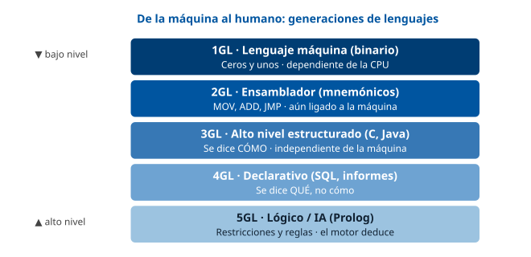

------------------------------------------------------------------------

### D2 · Compilador frente a intérprete

**Sección**: §1.2 — Formas de traducción **Propósito**: Contrastar la traducción completa previa (compilador) con la traducción línea a línea (intérprete).

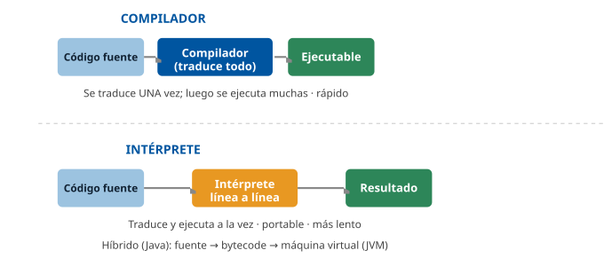

------------------------------------------------------------------------

### D3 · Sintaxis, semántica y pragmática

**Sección**: §1.4 — Los tres niveles de descripción de un lenguaje **Propósito**: Separar la forma (sintaxis), el significado (semántica) y el uso (pragmática).

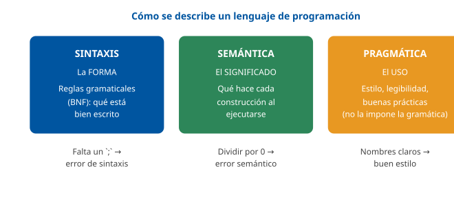

------------------------------------------------------------------------

### D4 · Clasificación de los tipos de datos

**Sección**: §2.1 — Concepto y clasificación **Propósito**: Distinguir tipos simples de estructurados y ver ejemplos de cada uno.

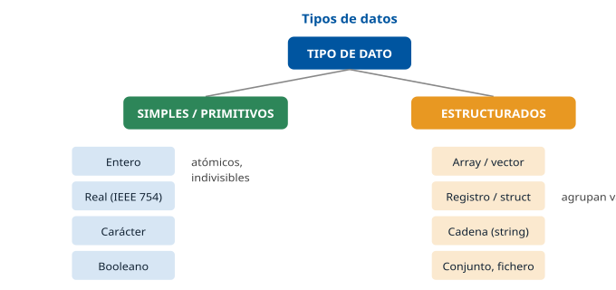

------------------------------------------------------------------------

### D5 · Sistema de tipos: dos ejes

**Sección**: §2.4 — Conversión y compatibilidad de tipos **Propósito**: Separar los dos ejes independientes (estático/dinámico y fuerte/débil) con ejemplos.

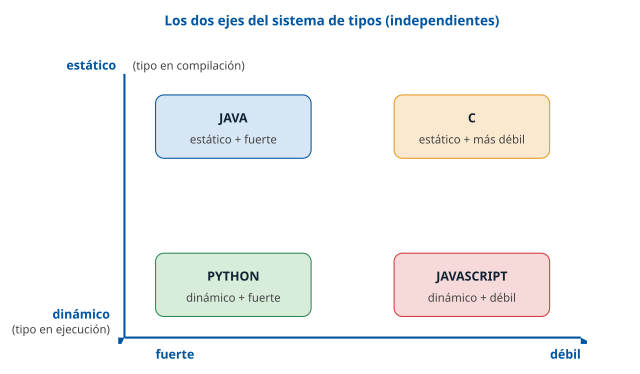

------------------------------------------------------------------------

### D6 · Las tres estructuras de control

**Sección**: §4.1 — Teorema de Böhm-Jacopini **Propósito**: Las tres únicas estructuras necesarias: secuencia, selección e iteración.

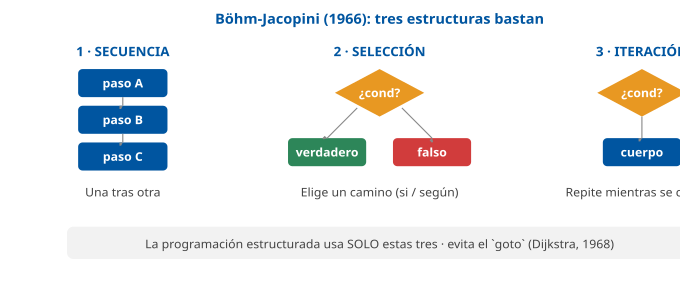

------------------------------------------------------------------------

### D7 · Tipos de bucle

**Sección**: §4.3 — Bucles e iteraciones **Propósito**: Distinguir precondicional (while), postcondicional (do-while) y con contador (for).

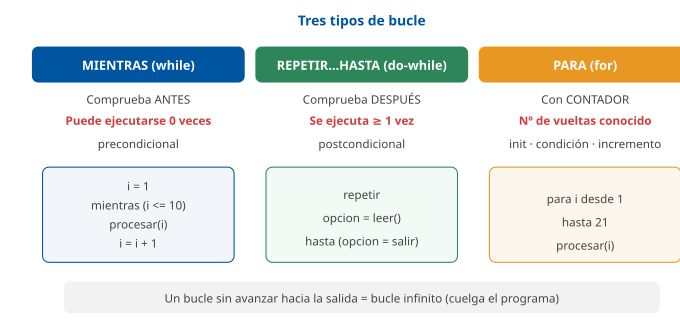

------------------------------------------------------------------------

### D8 · Recursividad: pila del factorial

**Sección**: §4.4 — Recursividad **Propósito**: Visualizar el apilamiento de llamadas de factorial(4) y su desenrollado desde el caso base.

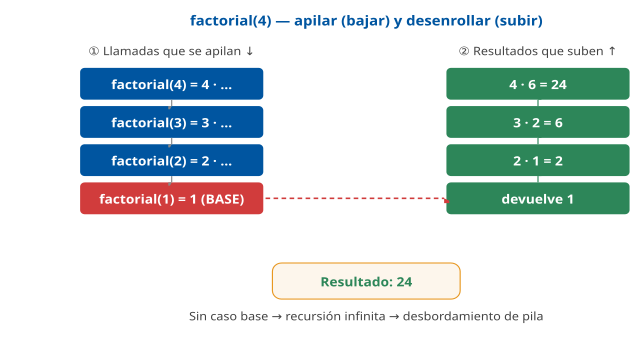

------------------------------------------------------------------------

### D9 · Memoria: pila y montículo

**Sección**: §4.7 — Ámbito y ciclo de vida **Propósito**: Distinguir la pila (variables automáticas, marcos de llamada) del montículo (memoria dinámica).

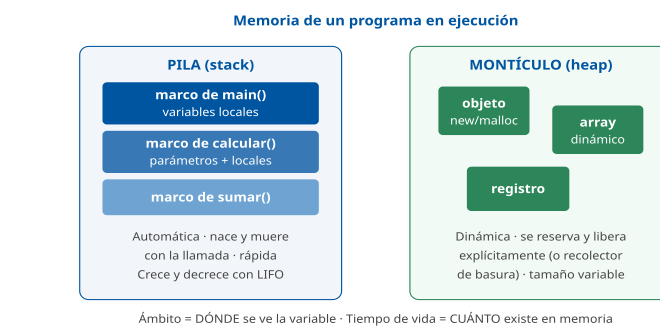

------------------------------------------------------------------------

### D10 · Paso por valor y por referencia

**Sección**: §4.6 — Parámetros y mecanismos de paso **Propósito**: Mostrar por qué por valor no altera el original y por referencia sí.

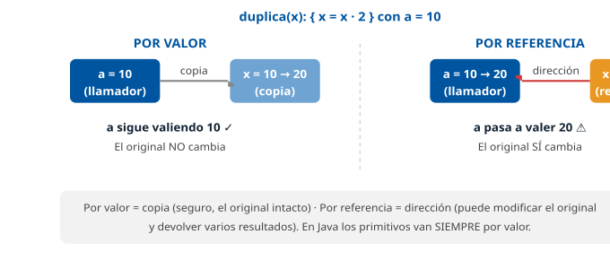

------------------------------------------------------------------------

### D11 · Array frente a registro

**Sección**: §5.2 — Registros o estructuras **Propósito**: Contrastar el array (homogéneo, por índice) con el registro (heterogéneo, por campo).

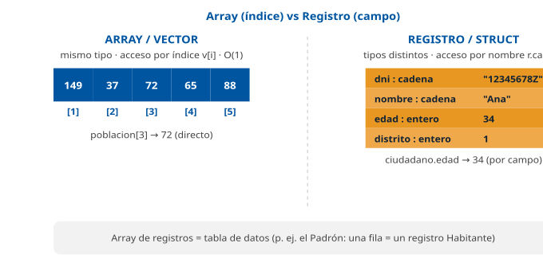

------------------------------------------------------------------------

### D12 · Estructura de un programa

**Sección**: §6.1 — Organización del código **Propósito**: Mostrar las partes típicas de un programa y el flujo de arranque en `main`.

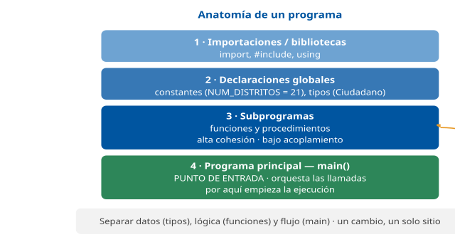

## Casos prácticos

Los tres casos recorren el tema en pseudocódigo neutro: el **Caso 1** trabaja **tipos, operadores y estructuras de control** (cálculo de una tasa con condicionales) sobre los tributos; el **Caso 2**, **arrays, registros y bucles** (procesar el censo de los distritos); y el **Caso 3**, **funciones, recursividad y paso de parámetros** sobre la tramitación de expedientes.

------------------------------------------------------------------------

### Caso 1 — Cálculo de la tasa de un servicio municipal

#### Enunciado

El Ayuntamiento aplica una **tasa** por la tramitación de una licencia. La cuota se calcula sobre un **importe base** al que se aplica una **bonificación** según la renta del solicitante: renta inferior a 12.000 € → 50 %; entre 12.000 y 20.000 € → 25 %; superior a 20.000 € → sin bonificación. Además, si el solicitante tiene **familia numerosa**, se aplica **5 puntos porcentuales adicionales** de bonificación (acumulables). La cuota final nunca puede ser negativa. Debe diseñar el algoritmo de cálculo.

#### Cuestiones

**Cuestión 1 — Tipos de datos (2 puntos).** Indique qué tipo de dato usaría para: el importe base, la renta, el porcentaje de bonificación y el indicador de familia numerosa. Justifique la elección del tipo para importes monetarios.

**Cuestión 2 — Estructura de control (3 puntos).** Escriba en pseudocódigo la lógica que asigna la bonificación por tramos de renta. ¿Qué estructura de control es la más adecuada y por qué?

**Cuestión 3 — Operadores y expresión (3 puntos).** Escriba la expresión que calcula la `cuota_final` a partir del `importe_base` y la `bonificacion` total (en tanto por uno). Añada el ajuste de familia numerosa y garantice que la cuota no sea negativa.

**Cuestión 4 — Constante y mantenimiento (2 puntos).** Los umbrales (12.000, 20.000) y los porcentajes aparecen en el código. ¿Cómo mejoraría el mantenimiento del programa si el pleno cambia los tramos el año que viene?

#### Solución orientativa

- **C1**: `importe_base` y `cuota_final` → **entero de céntimos** o tipo **decimal** exacto (nunca coma flotante, por el redondeo de dinero, §2.2); `renta` → real o entero de euros; `bonificacion` → real (tanto por uno); `familia_numerosa` → **booleano** (verdadero/falso). *(§2.1-2.2)*
- **C2**: condicional **múltiple anidado** (`si … si_no si … si_no`), porque se decide sobre **rangos** de un valor continuo (la renta), no sobre valores discretos —lo que descartaría un `segun`/`switch`—. *(§4.2)*

&nbsp;

    si (renta < UMBRAL_BAJO) entonces
        bonificacion = 0.50
    si_no si (renta <= UMBRAL_MEDIO) entonces
        bonificacion = 0.25
    si_no
        bonificacion = 0.00
    fin_si

- **C3**: se acumulan los 5 puntos (0.05) si hay familia numerosa y se aplica el operador para evitar negativos. *(§3.1, §3.3, §4.2)*

&nbsp;

    si (familia_numerosa) entonces
        bonificacion = bonificacion + 0.05
    fin_si
    cuota_final = importe_base * (1 - bonificacion)
    si (cuota_final < 0) entonces
        cuota_final = 0
    fin_si

- **C4**: sustituir los «números mágicos» por **constantes con nombre** (`UMBRAL_BAJO = 12000`, `UMBRAL_MEDIO = 20000`, `BONIF_BAJA = 0.50`…) declaradas en un solo lugar. Así, un cambio de tramos se hace en **un único punto** sin buscar por todo el código (principio DRY, §6.2). *(§1.5, §6.2)*

#### Criterios de evaluación

| Criterio                                                        | Puntos |
|-----------------------------------------------------------------|--------|
| Elige tipos correctos y justifica el tipo monetario exacto      | 2      |
| Usa condicional múltiple anidado y lo justifica frente a switch | 3      |
| Expresión de cuota correcta con ajuste y control de no-negativo | 3      |
| Propone constantes con nombre para el mantenimiento (DRY)       | 2      |

------------------------------------------------------------------------

#### Preguntas tipo test sobre este caso

##### 1. En el supuesto de la tasa, ¿qué tipo de dato debe usarse para el importe_base y la cuota_final?

- a) Un real en coma flotante, porque admite decimales.
- b) Un entero de céntimos o un tipo decimal exacto.
- c) Una cadena de caracteres, para guardar el símbolo €.

**Respuesta correcta:** b) · **Referencia:** Caso 1, cuestión 1 · §2.2

Para dinero se recomienda un entero de céntimos o un tipo decimal exacto, no coma flotante, porque los reales en coma flotante son aproximaciones.

##### 2. ¿Por qué no conviene guardar esos importes en coma flotante?

- a) Porque la representación IEEE 754 es aproximada y puede introducir céntimos erróneos.
- b) Porque la coma flotante no admite valores con parte decimal, como los céntimos.
- c) Porque la coma flotante no permite representar importes negativos ni el cero.

**Respuesta correcta:** a) · **Referencia:** Caso 1, cuestión 1 · §2.2

Los reales se representan según IEEE 754 con precisión finita: no todos los decimales son exactos, y un céntimo de error multiplicado por miles de recibos es un problema contable.

##### 3. ¿Qué tipo de dato corresponde al indicador de familia numerosa?

- a) Real, en tanto por uno.
- b) Enumerado con los tramos de renta.
- c) Booleano (verdadero/falso).

**Respuesta correcta:** c) · **Referencia:** Caso 1, cuestión 1 · §2.2

El indicador solo puede tomar dos valores, sí o no: es un booleano. El tanto por uno es propio de la bonificación.

##### 4. ¿Qué estructura de control es la más adecuada para asignar la bonificación por tramos de renta?

- a) Una selección múltiple segun / switch sobre la renta.
- b) Un condicional múltiple anidado (si … si_no si … si_no).
- c) Un bucle mientras que recorra los tramos de renta.

**Respuesta correcta:** b) · **Referencia:** Caso 1, cuestión 2 · §4.2

El condicional múltiple anidado encadena varias condiciones sobre rangos (renta < 12.000; renta ≤ 20.000, porque el tramo «entre 12.000 y 20.000 €» incluye los 20.000; resto), que es lo que pide el cálculo.

##### 5. ¿Por qué se descarta aquí la selección múltiple segun / switch?

- a) Porque switch compara contra valores constantes y aquí se decide por rangos.
- b) Porque switch no admite una rama por defecto para los demás valores.
- c) Porque switch solo puede distinguir entre dos casos distintos.

**Respuesta correcta:** a) · **Referencia:** Caso 1, cuestión 2 · §4.2

La selección múltiple compara una expresión contra varios valores constantes y es útil con valores discretos; la renta es continua y se clasifica por rangos.

##### 6. Un solicitante tiene una renta de 15.000 € y familia numerosa. ¿Qué bonificación total (en tanto por uno) le corresponde?

- a) 0,25.
- b) 0,55.
- c) 0,30.

**Respuesta correcta:** c) · **Referencia:** Caso 1, cuestiones 2 y 3

La renta está entre 12.000 y 20.000 €, tramo del 25 % (0,25); la familia numerosa suma 5 puntos acumulables (0,05): 0,25 + 0,05 = 0,30.

##### 7. ¿Qué expresión calcula correctamente la cuota_final?

- a) cuota_final = importe_base * (1 - bonificacion)
- b) cuota_final = importe_base * 1 - bonificacion
- c) cuota_final = importe_base * bonificacion

**Respuesta correcta:** a) · **Referencia:** Caso 1, cuestión 3 · §3.1, §3.4

La cuota es la parte no bonificada del importe: importe_base × (1 − bonificación). Sin paréntesis, la multiplicación se evalúa antes que la resta y el resultado sería importe_base − bonificación.

##### 8. Con un importe_base de 200 € y una bonificación total de 0,30, ¿cuál es la cuota_final?

- a) 60 €.
- b) 140 €.
- c) 199,70 €.

**Respuesta correcta:** b) · **Referencia:** Caso 1, cuestión 3

cuota_final = 200 × (1 − 0,30) = 200 × 0,70 = 140 €. Los 60 € son el importe bonificado, no la cuota.

##### 9. ¿Qué fragmento garantiza que la cuota final nunca sea negativa?

- a) si (cuota_final == 0) entonces cuota_final = 0 fin_si
- b) si (cuota_final < 0) entonces cuota_final = importe_base fin_si
- c) si (cuota_final < 0) entonces cuota_final = 0 fin_si

**Respuesta correcta:** c) · **Referencia:** Caso 1, cuestión 3 · §3.2, §4.2

Un condicional simple comprueba si la cuota es menor que cero y, en ese caso, la fija en 0; comparar con == 0 no corrige nada y poner el importe base anularía la bonificación.

##### 10. Los umbrales (12.000, 20.000) y los porcentajes aparecen como literales en el código. ¿Cómo se facilita el cambio de tramos del año que viene?

- a) Sustituyéndolos por constantes con nombre declaradas en un único lugar.
- b) Añadiendo un comentario junto a cada literal que explique su significado.
- c) Usando variables globales que cualquier función pueda modificar.

**Respuesta correcta:** a) · **Referencia:** Caso 1, cuestión 4 · §1.5, §6.2

Las constantes con nombre (UMBRAL_BAJO = 12000…) eliminan los «números mágicos»: el cambio se hace en un solo punto. Las variables globales modificables se desaconsejan.

### Caso 2 — Procesado del censo de habitantes por distrito

#### Enunciado

Se dispone del **censo del Padrón** como un **array de registros** `Habitante`, con los campos `dni`, `nombre`, `edad` (entero) y `codigo_distrito` (entero de 1 a 21). Se pide un módulo que, recorriendo el censo **una sola vez**, calcule: (a) el **número total** de habitantes, (b) cuántos son **mayores de edad** (18 o más) y (c) la **población de cada distrito** en un array indexado por distrito. Los 21 distritos de Madrid se numeran del 1 al 21.

#### Cuestiones

**Cuestión 1 — Estructuras de datos (2 puntos).** Defina el tipo registro `Habitante` y declare las estructuras que necesita para almacenar el censo y el resultado de población por distrito.

**Cuestión 2 — Recorrido con bucle (3 puntos).** Escriba en pseudocódigo el recorrido del censo que actualiza los tres resultados. ¿Qué tipo de bucle usa y por qué?

**Cuestión 3 — Acceso a array y a campo (3 puntos).** Explique cómo accede, dentro del bucle, al distrito de cada habitante y cómo incrementa el contador del distrito correspondiente. Distinga el acceso por índice del acceso por campo.

**Cuestión 4 — Programación defensiva (2 puntos).** ¿Qué comprobación añadiría antes de usar `codigo_distrito` como índice del array de población? ¿Qué ocurriría si un registro trae un distrito 0 o 25?

#### Solución orientativa

- **C1**: registro y arrays. El acceso al elemento del censo es por **índice** (`censo[i]`) y a sus datos por **nombre de campo** (`censo[i].edad`). *(§5.1-5.2)*

&nbsp;

    tipo Habitante = registro
        dni : cadena
        nombre : cadena
        edad : entero
        codigo_distrito : entero
    fin_registro

    declarar censo : array[1..N] de Habitante
    declarar poblacion : array[1..21] de entero   // contador por distrito

- **C2**: bucle **`para`** (for), porque el número de habitantes `N` es **conocido**; un único recorrido O(n) calcula los tres resultados (§4.3, §5.3).

&nbsp;

    total = 0
    mayores = 0
    para d desde 1 hasta 21 hacer poblacion[d] = 0 fin_para   // inicializar
    para i desde 1 hasta N hacer
        total = total + 1
        si (censo[i].edad >= 18) entonces
            mayores = mayores + 1
        fin_si
        dist = censo[i].codigo_distrito
        poblacion[dist] = poblacion[dist] + 1
    fin_para

- **C3**: `censo[i]` accede al **registro** i-ésimo **por índice** (O(1)); `.codigo_distrito` accede a su **campo** **por nombre**. Ese valor se usa a su vez como **índice** del array `poblacion`, y `poblacion[dist] = poblacion[dist] + 1` incrementa el contador de ese distrito. *(§5.1-5.3)*
- **C4**: antes de usarlo como índice, comprobar el **rango**: `si (dist >= 1 Y dist <= 21) entonces …`. Sin esa comprobación, un distrito 0 o 25 provocaría un **acceso fuera de rango** (índice inválido): corrupción de memoria en C o excepción `IndexOutOfBounds` en Java/Python (§5.1). Es programación defensiva (§6.2). *(§5.1, §6.2)*

#### Criterios de evaluación

| Criterio | Puntos |
|----|----|
| Define el registro Habitante y declara censo + array de población | 2 |
| Recorrido en un solo bucle `para` justificado, con inicialización | 3 |
| Distingue acceso por índice (censo\[i\]) de acceso por campo (.distrito) | 3 |
| Valida el rango del índice antes de usarlo (defensiva) | 2 |

------------------------------------------------------------------------

#### Preguntas tipo test sobre este caso

##### 1. En el supuesto del censo, ¿qué estructura representa a cada Habitante, con su dni, nombre, edad y codigo_distrito?

- a) Un array de cuatro elementos, todos ellos del mismo tipo de dato.
- b) Un tipo enumerado, con una lista fija de nombres de valores.
- c) Un registro, porque agrupa campos de tipos distintos accesibles por nombre.

**Respuesta correcta:** c) · **Referencia:** Caso 2, cuestión 1 · §5.2

El registro agrupa campos de tipos posiblemente distintos (cadenas y enteros) bajo un nombre y se accede por nombre de campo; el array es homogéneo.

##### 2. ¿Qué declaraciones necesita el módulo para el censo y para la población por distrito?

- a) censo : array[1..N] de Habitante y poblacion : array[1..21] de entero.
- b) censo : registro de N campos y poblacion : array[1..N] de entero.
- c) censo : array[1..21] de Habitante y poblacion : array[1..N] de entero.

**Respuesta correcta:** a) · **Referencia:** Caso 2, cuestión 1 · §5.1, §5.2

El censo es un array de registros (uno por habitante) y la población es un array de 21 contadores enteros, uno por distrito.

##### 3. ¿Qué bucle es el adecuado para recorrer el censo y por qué?

- a) Un bucle mientras, porque el número de habitantes es desconocido.
- b) Un bucle para (for), porque se conoce el número N de habitantes.
- c) Un bucle repetir … hasta, porque el censo debe procesarse dos veces.

**Respuesta correcta:** b) · **Referencia:** Caso 2, cuestión 2 · §4.3

El bucle para se usa cuando se conoce de antemano el número de repeticiones, como aquí, donde N es conocido.

##### 4. ¿Cuántos recorridos del censo hacen falta para obtener los tres resultados y con qué coste?

- a) Tres recorridos, uno por resultado, con coste O(n²).
- b) Veintiún recorridos, uno por distrito, con coste O(n).
- c) Un único recorrido, con coste O(n).

**Respuesta correcta:** c) · **Referencia:** Caso 2, cuestión 2 · §5.3

Dentro del mismo bucle se actualizan el total, los mayores de edad y el contador del distrito: un solo recorrido lineal, O(n).

##### 5. Antes de recorrer el censo, ¿qué debe hacerse con el array poblacion?

- a) Nada: el lenguaje pone siempre a 0 sus posiciones al declararlo.
- b) Inicializar a 0 sus 21 posiciones, igual que total y mayores.
- c) Cargar en cada posición la edad del primer habitante del distrito.

**Respuesta correcta:** b) · **Referencia:** Caso 2, cuestión 2 · §1.5

Los contadores deben inicializarse antes de acumular; usar una variable declarada pero no inicializada es una fuente clásica de errores (valor «basura» en C).

##### 6. ¿Qué condición cuenta correctamente a los mayores de edad (18 o más)?

- a) si (censo[i].edad >= 18)
- b) si (censo[i].edad > 18)
- c) si (censo.edad[i] >= 18)

**Respuesta correcta:** a) · **Referencia:** Caso 2, cuestión 2 · §3.2, §5.2

Hay que incluir los 18 años (>=) y acceder primero al registro i-ésimo y después a su campo edad: censo[i].edad.

##### 7. En la expresión censo[i].codigo_distrito, ¿cómo se accede a cada parte?

- a) censo[i] accede al campo por nombre; .codigo_distrito, al registro por índice.
- b) Ambas partes acceden por índice: i al registro y codigo_distrito a la posición.
- c) censo[i] accede al registro por índice; .codigo_distrito, al campo por nombre.

**Respuesta correcta:** c) · **Referencia:** Caso 2, cuestión 3 · §5.1, §5.2

Al elemento de un array se accede por índice (en tiempo constante) y al campo de un registro, por su nombre con el punto.

##### 8. Con dist = censo[i].codigo_distrito, ¿qué sentencia incrementa el contador del distrito de ese habitante?

- a) poblacion[i] = poblacion[i] + 1
- b) poblacion[dist] = poblacion[dist] + 1
- c) poblacion = poblacion + dist

**Respuesta correcta:** b) · **Referencia:** Caso 2, cuestión 3 · §5.1

El valor del campo codigo_distrito se usa como índice del array poblacion; el índice i recorre habitantes, no distritos.

##### 9. ¿Qué comprobación defensiva debe hacerse antes de usar dist como índice de poblacion?

- a) si (dist >= 1 Y dist <= 21) entonces …
- b) si (dist >= 1 O dist <= 21) entonces …
- c) si (dist > 1 Y dist < 21) entonces …

**Respuesta correcta:** a) · **Referencia:** Caso 2, cuestión 4 · §3.2, §6.2

Hay que exigir a la vez (Y) que el valor esté entre 1 y 21, ambos incluidos. Con O la condición siempre es verdadera, y con > y < se excluyen los distritos 1 y 21.

##### 10. Si un registro trae el distrito 0 o 25 y no se comprueba el rango, ¿qué ocurre?

- a) El lenguaje ajusta el índice al extremo más cercano y suma el habitante al distrito 1 o 21.
- b) El compilador detecta el valor erróneo del registro e impide ejecutar el programa.
- c) Un acceso fuera de rango: corrompe memoria en C o lanza IndexOutOfBounds en Java/Python.

**Respuesta correcta:** c) · **Referencia:** Caso 2, cuestión 4 · §5.1

Acceder a un índice fuera del rango declarado es un error grave: en C corrompe memoria silenciosamente y en Java o Python lanza una excepción.

### Caso 3 — Tramitación y numeración de expedientes

#### Enunciado

Una unidad tramita **expedientes** identificados por un número. Se pide: (a) una **función** que valide si un número de expediente es **par** (por criterio interno, los pares se asignan a la vía telemática); (b) una **función recursiva** que calcule la **suma de los primeros N** números de expediente (1 + 2 + … + N) para una estadística de carga; y (c) razonar el efecto de pasar un contador **por valor** o **por referencia** a un procedimiento que lo incrementa.

#### Cuestiones

**Cuestión 1 — Función y operador (2 puntos).** Escriba la función `es_par(n)` que devuelve verdadero si `n` es par. ¿Qué operador utiliza?

**Cuestión 2 — Recursividad (4 puntos).** Escriba la función **recursiva** `suma_hasta(n)` que calcule 1 + 2 + … + n. Identifique el **caso base** y el **caso recursivo**, y explique qué pasaría sin caso base.

**Cuestión 3 — Traza (2 puntos).** Muestre la traza de `suma_hasta(4)` indicando el valor devuelto.

**Cuestión 4 — Paso de parámetros (2 puntos).** Un procedimiento `incrementar(c) { c = c + 1 }` se llama con `contador = 10`. ¿Cuánto vale `contador` después si el paso es **por valor**? ¿Y si es **por referencia**?

#### Solución orientativa

- **C1**: usa el operador **módulo** (`mod`), que devuelve el resto (§3.1). Es una **función** porque **devuelve un valor** (booleano), §4.5.

&nbsp;

    funcion es_par(n)
        devolver (n mod 2 == 0)
    fin_funcion

- **C2**: la función recursiva necesita **caso base** y **caso recursivo** (§4.4). Sin caso base habría **recursión infinita** con desbordamiento de pila.

&nbsp;

    funcion suma_hasta(n)
        si (n <= 1) entonces          // caso base
            devolver n
        si_no
            devolver n + suma_hasta(n - 1)   // caso recursivo
        fin_si
    fin_funcion

- **C3**: `suma_hasta(4) = 4 + suma_hasta(3) = 4 + (3 + suma_hasta(2)) = 4 + (3 + (2 + suma_hasta(1)))`. El caso base `suma_hasta(1) = 1`. Se desenrolla: `2+1=3`, `3+3=6`, `4+6=` **10**. *(§4.4)*
- **C4**: **por valor**, `contador` sigue valiendo **10** (se incrementó una copia); **por referencia**, `contador` pasa a **11** (se modificó el original a través de su dirección). *(§4.6)*

#### Criterios de evaluación

| Criterio                                                       | Puntos |
|----------------------------------------------------------------|--------|
| Función `es_par` correcta usando el operador módulo            | 2      |
| Función recursiva con caso base y recursivo bien identificados | 4      |
| Traza de `suma_hasta(4)` = 10 correcta                         | 2      |
| Distingue el efecto de por valor (10) y por referencia (11)    | 2      |

------------------------------------------------------------------------

*Los tres casos son orientativos y pensados para la autoevaluación; las soluciones muestran una vía correcta, no la única posible. El contexto (tributos, Padrón, expedientes) es propio del Ayuntamiento de Madrid.*

#### Preguntas tipo test sobre este caso

##### 1. En el supuesto de los expedientes, ¿qué expresión usa la función es_par(n)?

- a) n mod 2 == 0
- b) n div 2 == 0
- c) n / 2 == 0

**Respuesta correcta:** a) · **Referencia:** Caso 3, cuestión 1 · §3.1

El operador módulo devuelve el resto de la división entera: si el resto de dividir entre 2 es cero, el número es par. div devuelve el cociente.

##### 2. ¿Por qué es_par se define como función y no como procedimiento?

- a) Porque no devuelve ningún valor y actúa por sus efectos.
- b) Porque devuelve un valor (booleano) que se usa en expresiones.
- c) Porque recibe un parámetro, cosa que no admite un procedimiento.

**Respuesta correcta:** b) · **Referencia:** Caso 3, cuestión 1 · §4.5

La función devuelve un valor y se usa dentro de expresiones; el procedimiento no devuelve valor y actúa por sus efectos. Ambos pueden recibir parámetros.

##### 3. En la función recursiva suma_hasta(n), ¿cuál es el caso base?

- a) devolver n + suma_hasta(n - 1)
- b) La llamada inicial suma_hasta(4)
- c) si (n <= 1) entonces devolver n

**Respuesta correcta:** c) · **Referencia:** Caso 3, cuestión 2 · §4.4

El caso base es la condición de parada que se resuelve directamente sin volver a llamarse: para n ≤ 1 se devuelve n.

##### 4. ¿Qué caso recursivo es correcto para suma_hasta(n)?

- a) devolver n + suma_hasta(n - 1)
- b) devolver n + suma_hasta(n + 1)
- c) devolver n + suma_hasta(n)

**Respuesta correcta:** a) · **Referencia:** Caso 3, cuestión 2 · §4.4

El caso recursivo debe llamarse con un problema más pequeño que se acerque al caso base; con n + 1 se aleja y con n no avanza.

##### 5. ¿Qué pasaría si suma_hasta no tuviera caso base?

- a) Devolvería 0 al llegar a n = 0 y terminaría con normalidad.
- b) El compilador lo detectaría como error de sintaxis.
- c) Recursión infinita hasta agotar la pila (stack overflow).

**Respuesta correcta:** c) · **Referencia:** Caso 3, cuestión 2 · §4.4

Sin caso base la recursión no termina: cada llamada pendiente ocupa un marco en la pila hasta agotarla.

##### 6. ¿Qué valor devuelve suma_hasta(4)?

- a) 24.
- b) 10.
- c) 6.

**Respuesta correcta:** b) · **Referencia:** Caso 3, cuestión 3 · §4.4

suma_hasta(4) = 4 + (3 + (2 + suma_hasta(1))), con suma_hasta(1) = 1: 2 + 1 = 3, 3 + 3 = 6, 4 + 6 = 10. El 24 sería el factorial de 4.

##### 7. ¿Cuántas llamadas a suma_hasta llegan a estar apiladas a la vez al calcular suma_hasta(4)?

- a) Cuatro: suma_hasta(4), (3), (2) y (1).
- b) Tres: suma_hasta(4), (3) y (2).
- c) Cinco: de suma_hasta(4) a suma_hasta(0).

**Respuesta correcta:** a) · **Referencia:** Caso 3, cuestión 3 · §4.4

La recursión se detiene en suma_hasta(1), el caso base; hasta entonces cada llamada pendiente ocupa un marco en la pila: 4, 3, 2 y 1.

##### 8. Se llama a incrementar(c) { c = c + 1 } con contador = 10. Si el paso es por valor, ¿cuánto vale contador después?

- a) 11, porque c y contador comparten la misma dirección.
- b) 10, porque se incrementó una copia del argumento.
- c) 0, porque la copia se destruye al salir del procedimiento.

**Respuesta correcta:** b) · **Referencia:** Caso 3, cuestión 4 · §4.6

En el paso por valor el subprograma trabaja sobre una copia; los cambios no afectan a la variable original del llamador.

##### 9. ¿Y si el paso de contador a incrementar(c) es por referencia?

- a) 10, porque el original nunca se modifica.
- b) 12, porque se incrementan c y contador.
- c) 11, porque se modifica el original.

**Respuesta correcta:** c) · **Referencia:** Caso 3, cuestión 4 · §4.6

En el paso por referencia el subprograma accede a la variable real, de modo que el incremento persiste: contador pasa de 10 a 11.

##### 10. ¿Qué explica que, con el paso por referencia, la llamada sí modifique contador?

- a) Que el procedimiento devuelve el nuevo valor de c al llamador.
- b) Que se pasa la dirección de la variable, no una copia de su valor.
- c) Que c se declara como variable global visible en todo el programa.

**Respuesta correcta:** b) · **Referencia:** Caso 3, cuestión 4 · §4.5, §4.6

Por referencia se pasa la dirección de la variable original y el subprograma trabaja sobre ella; un procedimiento, además, no devuelve valor.

## Fuentes

### Tier 1 — Canónicas y normativas

| ID | Referencia |
|----|----|
| `[SEBESTA]` | Sebesta, R. W. *Concepts of Programming Languages* (11.ª ed.). Pearson. Obra de referencia sobre diseño de lenguajes: sintaxis, semántica, tipos, ámbito, subprogramas. |
| `[SCOTT]` | Scott, M. L. *Programming Language Pragmatics* (4.ª ed.). Morgan Kaufmann. Semántica, sistemas de tipos, paso de parámetros, gestión de memoria. |
| `[ASU]` | Aho, A.; Lam, M.; Sethi, R.; Ullman, J. *Compilers: Principles, Techniques and Tools* (2.ª ed., «Dragon Book»). Análisis léxico, sintáctico y semántico. |
| `[PRATT]` | Pratt, T. W.; Zelkowitz, M. V. *Programming Languages: Design and Implementation* (4.ª ed.). Prentice Hall. Clasificación de lenguajes y paradigmas. |
| `[PIERCE]` | Pierce, B. C. *Types and Programming Languages*. MIT Press. Teoría de tipos, tipado estático/dinámico, seguridad de tipos. |
| `[BOHM66]` | Böhm, C.; Jacopini, G. (1966). *Flow diagrams, Turing machines and languages with only two formation rules*. CACM. Teorema del programa estructurado (secuencia, selección, iteración). |
| `[DIJKSTRA68]` | Dijkstra, E. W. (1968). *Go To Statement Considered Harmful*. CACM 11(3). Fundamento de la programación estructurada. |
| `[KNUTH1]` | Knuth, D. E. *The Art of Computer Programming, Vol. 1: Fundamental Algorithms*. Addison-Wesley. Vectores, registros, representación en memoria, recursión. |
| `[CLRS]` | Cormen, T.; Leiserson, C.; Rivest, R.; Stein, C. *Introduction to Algorithms* (3.ª ed.). MIT Press. Recursividad, arrays, coste algorítmico. |
| `[ABELSON]` | Abelson, H.; Sussman, G. J. *Structure and Interpretation of Computer Programs* (SICP, 2.ª ed.). MIT Press. Abstracción, procedimientos, recursión, ámbito. |
| `[MCCONNELL]` | McConnell, S. *Code Complete* (2.ª ed.). Microsoft Press. Buenas prácticas, nombrado, variables, estructura del código, defensas. |
| `[KP]` | Kernighan, B. W.; Pike, R. *The Practice of Programming*. Addison-Wesley. Estilo, depuración, pruebas, portabilidad. |
| `[IEEE754]` | IEEE 754-2019 *Standard for Floating-Point Arithmetic*. Representación de reales en coma flotante. |
| `[ISO-C]` | ISO/IEC 9899:2024 *Programming languages — C* (C23). Anula y sustituye a la ISO/IEC 9899:2018 (C17): es la edición vigente de la norma del lenguaje C. Tipos primitivos, operadores, conversiones. |
| `[ISO-C-2018]` | ISO/IEC 9899:2018 *Programming languages — C* (C17). Anulada y sustituida por la ISO/IEC 9899:2024. Se conserva la referencia porque es la que recogen los temarios al uso. |

### Tier 2 — Manuales y documentación de lenguajes

| ID | Referencia |
|----|----|
| `[PY-DOC]` | Python Software Foundation. *The Python Language Reference & Tutorial* — tipos, operadores, funciones, ámbito. docs.python.org |
| `[JLS]` | Gosling, J. et al. *The Java Language Specification* (Java SE). Tipos primitivos, operadores, paso por valor, arrays. |
| `[K&R]` | Kernighan, B. W.; Ritchie, D. M. *The C Programming Language* (2.ª ed.). Prentice Hall. Punteros, arrays, structs. |
| `[MDN-JS]` | Mozilla Developer Network. *JavaScript Reference* — tipado dinámico, coerción, funciones. developer.mozilla.org |

### Tier 3 — Marco de calidad y del puesto (contexto, no contenido técnico)

| ID | Referencia |
|----|----|
| `[ISO25010]` | ISO/IEC 25010:2023 *Systems and software Quality Requirements and Evaluation (SQuaRE) — Product quality model*. Anula y sustituye a la ISO/IEC 25010:2011: es la edición vigente del modelo de calidad del producto — mantenibilidad, fiabilidad. |
| `[ISO25010-2011]` | ISO/IEC 25010:2011 *Systems and software Quality Requirements and Evaluation (SQuaRE) — System and software quality models*. Anulada y sustituida por la ISO/IEC 25010:2023. Se conserva la referencia porque es la que recogen los temarios al uso. |
| `[ENS]` | [Real Decreto 311/2022](https://www.boe.es/buscar/act.php?id=BOE-A-2022-7191), Esquema Nacional de Seguridad — seguridad en el desarrollo y trazabilidad del código. |
| `[BOAM10032]` | BOAM 10.032 (23-dic-2025). Bases específicas TIC C1 Ayto. Madrid — temario oficial. |

------------------------------------------------------------------------

*Las referencias Tier 1 son la base del contenido; Tier 2 ilustra la materialización en lenguajes reales (C, Java, Python, JavaScript) sin atar el tema a ninguno; Tier 3 enmarca la calidad y la seguridad aplicables al desarrollo en el Ayuntamiento de Madrid.*
