# Tema 19. Lenguajes de interrogación de bases de datos

**Bloque:** técnico  
**Enunciado oficial** (BOAM n.º 10.032, de 23 de diciembre de 2025): Lenguajes de interrogación de bases de datos. Estándar ANSI SQL. Procedimientos almacenados. Eventos y disparadores.

Versión web: <https://ayuntamientomadrid.github.io/temario-tecnico-auxiliar/temas/tema-19.html> · PDF: [tema-19.pdf](tema-19.pdf) · Test: [../../../tests/tecnico/tema-19.md](../../../tests/tecnico/tema-19.md)

## Índice

- 1. Lenguajes de interrogación de bases de datos
  - 1.1. Definición en el modelo relacional
  - 1.2. Álgebra relacional y el cálculo relacional
  - 1.3. Tipología de lenguajes en un SGBD
  - 1.4. Lenguajes procedimentales y declarativos
  - 1.5. Utilización de lenguajes en aplicaciones
- 2. El estándar ANSI SQL
  - 2.1. Origen y evolución del estándar SQL
  - 2.2. Niveles de conformidad
  - 2.3. Sintaxis de una sentencia SQL
  - 2.4. Operaciones de agregación, agrupamiento y filtrado
  - 2.5. Tipologías de acoplamiento (Join)
  - 2.6. Subconsultas: correlacionadas, no correlacionadas y predicados cuantificados
  - 2.7. Expresiones de Tabla Comunes (CTE) y consultas recursivas
  - 2.8. Funciones de ventana analíticas
  - 2.9. Extensiones del estándar y extensiones procedimentales
- 3. Procedimientos almacenados
  - 3.1. Concepto y características
  - 3.2. Arquitectura y ciclo de vida de ejecución en el servidor
  - 3.3. Parámetros de entrada, salida y retorno
  - 3.4. Gestión de cursores y tipos de cursores
  - 3.5. Estructuras de control de flujo
  - 3.6. Gestión de excepciones y errores
- 4. Eventos y disparadores
  - 4.1. Definición, arquitectura orientada a eventos
  - 4.2. Clasificación de los disparadores
  - 4.3. Casos de uso de eventos y disparadores
  - 4.4. Riesgos, limitaciones y buenas prácticas
- 5. Tendencias actuales en los lenguajes de interrogación

### Conceptos clave para memorizar

| Concepto | Dato clave |
|----|----|
| Lenguaje de interrogación | Permite formular consultas sobre las relaciones (tablas) del modelo relacional de Codd (1970) |
| Álgebra relacional | Lenguaje **procedimental**: operadores (σ, π, ρ, ∪, −, ×, ⋈, ÷) que se componen paso a paso; dice **CÓMO** |
| Cálculo relacional | Lenguaje **declarativo**, basado en lógica de predicados; dice **QUÉ** se quiere, no el procedimiento |
| Completitud relacional (Codd) | Un lenguaje es relacionalmente completo si iguala en poder expresivo al álgebra/cálculo relacional |
| DDL / DML / DQL | Definición (CREATE/ALTER/DROP) / Manipulación (INSERT/UPDATE/DELETE) / Consulta (SELECT) |
| DCL / TCL | Control de datos: permisos (GRANT/REVOKE) / Control de transacciones (COMMIT/ROLLBACK/SAVEPOINT) |
| SEQUEL → SQL | Chamberlin y Boyce (IBM, 1974) sobre System R; renombrado SQL por conflicto de marca |
| SQL-86 / SQL-92 / SQL:1999 | Primer estándar ANSI (1986) / gran expansión — joins explícitos, subconsultas (1992) / recursividad y triggers (1999) |
| Niveles de conformidad SQL-92 | Entry, Intermediate, Full — sustituidos desde SQL:1999 por «core» + «features» opcionales |
| Orden lógico de evaluación | FROM → WHERE → GROUP BY → HAVING → SELECT → DISTINCT → ORDER BY → LIMIT |
| WHERE vs HAVING | WHERE filtra filas **antes** de agrupar; HAVING filtra grupos **después** de agregar |
| Subconsulta correlacionada | Referencia columnas de la consulta externa; se reevalúa por cada fila candidata |
| CTE recursiva | `WITH RECURSIVE`: miembro ancla `UNION ALL` miembro recursivo, con condición de parada |
| Función de ventana | `OVER (PARTITION BY … ORDER BY …)`: calcula sobre un grupo **sin colapsar** las filas (a diferencia de GROUP BY) |
| Procedimiento almacenado | Bloque de código precompilado y almacenado en el catálogo del SGBD, ejecutado en el servidor |
| Cursor | Puntero para recorrer fila a fila un resultado cuando no basta el procesamiento por conjuntos |
| Parámetros IN / OUT / INOUT | Solo entrada / solo salida / entrada y salida |
| Disparador (trigger) | Procedimiento especial que se ejecuta automáticamente ante un evento, sin invocación explícita |
| BEFORE / AFTER | Se dispara antes de aplicar el cambio (puede cancelarlo) / después de aplicarlo |
| De fila / de sentencia | Una ejecución por cada fila afectada (`FOR EACH ROW`) / una única ejecución por sentencia |
| INSTEAD OF | Sustituye la operación DML sobre una vista no actualizable, redirigiéndola a las tablas base |

## Contenido

### Convenciones del documento

Este tema incluye cuatro tipos de **cajas callout** para facilitar el estudio:

> **Dato clave.** Información de alta densidad memorística.

> **Ejercicio resuelto.** Problema + solución paso a paso (una consulta, una traza, el diseño de un procedimiento).

> **Ejemplo de aplicación en el ayto.** Aplicación real de la teoría al entorno municipal (Padrón, tributos, expedientes, licencias).

> **Relación con otros temas.** Enlace conceptual a otros temas del temario oficial.

Los ejemplos de **consultas** se escriben en **SQL estándar (ANSI SQL / ISO-IEC 9075)**, sin extensiones propietarias, tal y como corresponde a un tema centrado en el **estándar**. Los ejemplos de **procedimientos almacenados y disparadores** se escriben en **pseudocódigo SQL genérico** (`CREATE PROCEDURE … INICIO … FIN`, `SI … ENTONCES … FIN_SI`), porque el propio estándar (SQL/PSM, ISO/IEC 9075-4) apenas se implementa tal cual en la práctica: cada motor tiene su dialecto (PL/SQL de Oracle, T-SQL de SQL Server, PL/pgSQL de PostgreSQL). Cuando conviene situar una particularidad real se nombra el motor entre corchetes de referencia (`[ORACLE-DOC]`, `[MSSQL-DOC]`, `[PSQL-DOC]`, `[MYSQL-DOC]`) sin atar el tema a ninguno. Las fuentes se citan con etiquetas breves tipo `[DATE-REL]` o `[SILBERSCHATZ, cap. 8]`; el registro completo está en la pestaña Fuentes.

**Esquema de ejemplo usado en todo el tema** (contexto Ayuntamiento de Madrid, simplificado):

    DISTRITO       (id_distrito, nombre_distrito)
    CONTRIBUYENTE  (dni, nombre, id_distrito)
    TRIBUTO        (id_tributo, tipo, importe, dni_contribuyente, fecha_liquidacion)
    EXPEDIENTE     (id_expediente, tipo, estado, dni_contribuyente, id_tramitador, fecha_apertura)
    FUNCIONARIO    (id_funcionario, nombre, id_departamento)

------------------------------------------------------------------------

### 1. Lenguajes de interrogación de bases de datos

#### 1.1. Definición en el modelo relacional

Un **lenguaje de interrogación de bases de datos** (*query language*) es la notación formal que permite **formular consultas** —preguntas— sobre los datos almacenados en una base de datos y obtener como resultado los datos que satisfacen esa consulta \[DATE-INTRO, cap. 1\]. En el **modelo relacional** propuesto por E. F. Codd en 1970, los datos se organizan en **relaciones** (tablas), cada una formada por un conjunto de **tuplas** (filas) sobre un esquema fijo de **atributos** (columnas) \[CODD70\]. Un lenguaje de interrogación relacional opera, por tanto, **sobre relaciones y produce relaciones**: es la propiedad de **cierre** (*closure*) que hace posible componer consultas dentro de otras consultas.

Codd definió formalmente dos lenguajes equivalentes para interrogar el modelo relacional: el **álgebra relacional**, de naturaleza **procedimental**, y el **cálculo relacional**, de naturaleza **declarativa** \[CODD70; DATE-REL, cap. 6\]. Ambos son el fundamento teórico sobre el que se construyó después **SQL**, el lenguaje comercial que domina hoy la interrogación de bases de datos relacionales.

> **Dato clave.** Un lenguaje de interrogación relacional se dice **relacionalmente completo** cuando tiene, como mínimo, el mismo poder expresivo que el álgebra relacional (o el cálculo relacional seguro, que son equivalentes). Es la **prueba de Codd** para valorar si un lenguaje de consulta es suficientemente potente \[CODD70; DATE-REL, cap. 6\].

> **Relación con otros temas.** El **Tema 15** trata los SGBD relacionales, orientados a objetos y NoSQL como sistemas; el **Tema 16**, el **modelo conceptual** de datos (entidad-relación) que se traduce al modelo relacional; el **Tema 17**, el **diseño lógico** (normalización) que produce el esquema de tablas sobre el que este Tema 19 formula las consultas.

#### 1.2. Álgebra relacional y el cálculo relacional

**Álgebra relacional.** Es un lenguaje **procedimental**: una consulta se expresa como una **secuencia de operaciones** sobre relaciones, cada una de las cuales produce una nueva relación que puede alimentar a la siguiente operación \[DATE-INTRO, cap. 6; GMUW, cap. 2\]. Sus operadores fundamentales, definidos por Codd, se dividen en:

- **Operadores unarios** (una sola relación de entrada):
  - **Selección** (σ): extrae las **filas** que cumplen una condición. `σ_{importe>100}(TRIBUTO)`.
  - **Proyección** (π): extrae **columnas**, eliminando duplicados. `π_{nombre,importe}(TRIBUTO)`.
  - **Renombrado** (ρ): cambia el nombre de una relación o de sus atributos, necesario para combinar una relación consigo misma.
- **Operadores binarios de conjuntos** (dos relaciones **compatibles por unión**, es decir, con el mismo esquema): **unión** (∪), **diferencia** (−) e **intersección** (∩, derivable de las dos anteriores).
- **Producto cartesiano** (×): combina **cada** tupla de una relación con **cada** tupla de otra. Es la base sobre la que se define el **join**.
- **Operadores derivados**, expresables a partir de los anteriores pero fundamentales en la práctica: la **reunión** o **join** (⋈, un producto cartesiano seguido de una selección por la condición de reunión) y la **división** (÷, resuelve consultas del tipo «qué X están relacionados con TODOS los Y»).

> **Dato clave.** El álgebra relacional es **procedimental**: el orden en que se escriben y componen los operadores importa y determina cómo se calcula el resultado. El **cálculo relacional** es **declarativo**: solo se especifica **qué** propiedades debe cumplir el resultado, sin indicar el procedimiento. **SQL hereda ambos rasgos**: en su sintaxis es declarativo (se parece al cálculo relacional), pero internamente el optimizador del SGBD lo traduce a un **plan de ejecución** expresado en términos algebraicos \[DATE-REL, cap. 6\].

**Cálculo relacional.** Se basa en la **lógica de predicados de primer orden**: una consulta se expresa como `{ t | P(t) }`, es decir, «el conjunto de tuplas *t* tales que se cumple el predicado *P*» \[CODD70\]. Existen dos variantes:

- **Cálculo relacional de tuplas**: las variables representan **tuplas completas** (`t ∈ TRIBUTO`). Es la base conceptual más cercana a SQL.
- **Cálculo relacional de dominios**: las variables representan **valores de un dominio** (una columna concreta), no tuplas completas. Es la base conceptual del lenguaje **QBE** (*Query by Example*).

Codd demostró la **equivalencia expresiva** entre el álgebra relacional y el cálculo relacional **seguro** (*safe*, es decir, restringido a dominios finitos para evitar resultados infinitos): todo lo expresable en uno es expresable en el otro. Esta equivalencia es el fundamento del criterio de **completitud relacional** citado arriba \[CODD70; DATE-REL, cap. 6\].

> **Ejercicio resuelto.** Sobre el esquema `CONTRIBUYENTE(dni, nombre, id_distrito)` y `TRIBUTO(id_tributo, importe, dni_contribuyente)`, expresa en álgebra relacional «nombre de los contribuyentes del distrito 3 con algún tributo de importe superior a 500 €». 1. Filtra distrito: `R1 = σ_{id_distrito=3}(CONTRIBUYENTE)`. 2. Filtra tributos: `R2 = σ_{importe>500}(TRIBUTO)`. 3. Reúne por DNI: `R3 = R1 ⋈_{dni=dni_contribuyente} R2`. 4. Proyecta el resultado: `π_{nombre}(R3)`. En cálculo relacional de tuplas, la misma consulta se expresaría de forma declarativa: `{ t.nombre | t ∈ CONTRIBUYENTE ∧ t.id_distrito = 3 ∧ (∃ u ∈ TRIBUTO)(u.dni_contribuyente = t.dni ∧ u.importe > 500) }`. Obsérvese que el álgebra **indica el procedimiento** (primero esto, luego aquello) y el cálculo **solo describe la condición**.

#### 1.3. Tipología de lenguajes en un SGBD

Dentro de un SGBD, el lenguaje de interrogación se subdivide, por **función**, en varios sublenguajes que en conjunto conforman **SQL** \[SILBERSCHATZ, cap. 3; ELMASRI, cap. 6\]:

| Sublenguaje | Siglas | Función | Sentencias típicas |
|----|----|----|----|
| Lenguaje de Definición de Datos | **DDL** | Define y modifica la **estructura** (esquema): tablas, vistas, índices, restricciones | `CREATE`, `ALTER`, `DROP`, `TRUNCATE` |
| Lenguaje de Manipulación de Datos | **DML** | **Modifica el contenido** de las tablas | `INSERT`, `UPDATE`, `DELETE`, `MERGE` |
| Lenguaje de Consulta de Datos | **DQL** | **Recupera** datos sin modificarlos | `SELECT` |
| Lenguaje de Control de Datos | **DCL** | Gestiona **permisos** y seguridad de acceso | `GRANT`, `REVOKE` |
| Lenguaje de Control de Transacciones | **TCL** | Gestiona el **ciclo de vida de las transacciones** | `COMMIT`, `ROLLBACK`, `SAVEPOINT`, `SET TRANSACTION` |

> **Dato clave.** El estándar ISO/IEC 9075 no separa formalmente DQL del DML: `SELECT` se clasifica dentro del DML en la norma \[ISO9075\]. La distinción DDL/DML/**DQL**/DCL/TCL es una convención **didáctica**, muy usada en oposiciones y manuales, que separa el `SELECT` (consulta, no modifica datos) del resto de DML (que sí modifica) por su naturaleza claramente distinta. Es importante saber reconocer ambas clasificaciones.

**DDL (Data Definition Language).** Opera sobre el **catálogo o diccionario de datos** del SGBD: crea y elimina objetos (`CREATE TABLE`, `DROP INDEX`), y modifica la estructura de los ya existentes (`ALTER TABLE … ADD COLUMN`). En la mayoría de motores, las sentencias DDL provocan un **commit implícito**: no se pueden deshacer con `ROLLBACK` como una operación DML normal.

**DML (Data Manipulation Language).** Modifica el **contenido** de las tablas sin alterar su estructura: `INSERT` añade filas, `UPDATE` modifica valores de filas existentes, `DELETE` elimina filas, y `MERGE` (SQL:2003) combina inserción y actualización en una sola sentencia («upsert») según una condición de coincidencia.

**DQL (Data Query Language).** Se reduce, en la práctica, a la sentencia `SELECT` y su enorme riqueza de cláusulas (§2.3-2.8 de este tema).

**DCL (Data Control Language).** `GRANT` concede privilegios (`SELECT`, `INSERT`, `EXECUTE`…) sobre un objeto a un usuario o rol; `REVOKE` los retira. Es el mecanismo declarativo de **control de acceso discrecional** (DAC) dentro del SGBD.

**TCL (Transaction Control Language).** Gestiona la atomicidad de un conjunto de operaciones: `COMMIT` confirma de forma permanente los cambios de la transacción; `ROLLBACK` los deshace; `SAVEPOINT` marca un punto intermedio al que se puede retroceder sin deshacer toda la transacción. Estas sentencias son el mecanismo con el que el SGBD garantiza las propiedades **ACID** (Atomicidad, Consistencia, Aislamiento, Durabilidad) \[ACID83\].

> **Ejemplo de aplicación en el ayto.** Dar de alta un nuevo tipo de tasa municipal en el sistema implica los cinco sublenguajes: **DDL** para crear la tabla `TASA_NUEVA` si no existe; **DML** para insertar sus registros iniciales; **DQL** para comprobar que se ha cargado correctamente; **DCL** para conceder al perfil «gestor tributario» permiso de `SELECT` e `INSERT` sobre la tabla, pero no de `DROP`; y **TCL** para que la carga inicial de datos se confirme como una única unidad atómica (`COMMIT`) o se deshaga entera si algo falla a mitad (`ROLLBACK`).

#### 1.4. Lenguajes procedimentales y declarativos

Ya introducida la distinción en §1.2 para álgebra/cálculo, conviene generalizarla \[DATE-REL, cap. 6; MELTON, cap. 1\]:

- **Procedimental**: el usuario especifica **el procedimiento**, es decir, la secuencia de pasos que hay que ejecutar para obtener el resultado (**CÓMO**). El álgebra relacional es procedimental.
- **Declarativo**: el usuario especifica **las propiedades del resultado deseado** (**QUÉ**), y es el sistema —normalmente a través de un **optimizador de consultas**— quien decide el procedimiento concreto (el **plan de ejecución**) para obtenerlo de la forma más eficiente. El cálculo relacional, y con él **SQL**, son declarativos.

**SQL es un lenguaje de cuarta generación (4GL) declarativo**: un `SELECT` describe el resultado que se quiere (qué filas, qué columnas, bajo qué condiciones), pero no indica en qué orden física se recorren las tablas ni qué algoritmo de *join* se usa; eso lo decide el **optimizador** en función de estadísticas, índices y coste estimado. Dos consultas SQL equivalentes desde el punto de vista lógico pueden ejecutarse con planes de ejecución muy distintos.

> **Dato clave.** SQL es **declarativo en su sintaxis** pero **procedimental en su ejecución interna**: el motor SQL traduce internamente cada consulta a una secuencia de operadores algebraicos (selección, proyección, reunión…) organizados en un **árbol de ejecución**, que es lo que realmente procesa el motor de bases de datos \[DATE-REL, cap. 6\].

#### 1.5. Utilización de lenguajes en aplicaciones

Una aplicación rara vez interroga la base de datos «a mano»: necesita un **mecanismo de acceso a datos** que combine el lenguaje de interrogación con el lenguaje de programación de la aplicación \[SILBERSCHATZ, cap. 10\]:

- **SQL embebido** (*embedded SQL*): sentencias SQL insertadas directamente en el código fuente de un lenguaje anfitrión (C, COBOL), precompiladas antes de la compilación normal. El estándar lo recoge en ISO/IEC 9075-2 (embedded SQL) y en SQL/PSM (ISO/IEC 9075-4) para el código almacenado en el propio servidor (§3).
- **APIs de acceso a datos estandarizadas**: interfaces que exponen un conjunto común de funciones para conectar, enviar SQL y recuperar resultados, independientemente del SGBD concreto: **ODBC** (*Open Database Connectivity*, estándar de Microsoft/X-Open sobre C) y **JDBC** (*Java Database Connectivity*, su equivalente en el ecosistema Java). Ambas siguen el mismo patrón: driver específico del motor + interfaz común para la aplicación.
- **SQL dinámico frente a SQL estático**: el SQL **estático** se conoce y valida en tiempo de compilación (SQL embebido clásico); el SQL **dinámico** se construye y envía como cadena de texto en tiempo de ejecución (`EXECUTE IMMEDIATE`, o simplemente concatenando la sentencia en la aplicación), lo que da más flexibilidad pero exige extremar la prevención de **inyección SQL** mediante **sentencias parametrizadas** (*prepared statements*).
- **ORM** (*Object-Relational Mapping*): capa de abstracción que traduce automáticamente entre **objetos** del lenguaje de programación y **filas** de tablas relacionales, generando el SQL correspondiente (Hibernate/JPA en Java, Entity Framework en .NET). Facilita la productividad, pero puede generar consultas subóptimas si se usa sin entender el SQL resultante.
- **Procedimientos almacenados** (§3) como interfaz de acceso: la aplicación llama a un procedimiento por nombre en lugar de enviar SQL directamente, encapsulando la lógica de acceso en el servidor.

> **Relación con otros temas.** El **Tema 21** (arquitectura Java EE) desarrolla en detalle **JDBC** y las capas de persistencia de las aplicaciones empresariales; el **Tema 23** trata los lenguajes de programación web que a menudo consumen datos vía API en lugar de SQL directo.

------------------------------------------------------------------------

### 2. El estándar ANSI SQL

#### 2.1. Origen y evolución del estándar SQL

SQL nace como **SEQUEL** (*Structured English Query Language*), diseñado por Donald D. Chamberlin y Raymond F. Boyce en IBM (1974) para interrogar **System R**, el primer prototipo de SGBD relacional construido para validar en la práctica el modelo teórico que Codd había publicado en 1970 \[CHAMBERLIN74; CODD70\]. El nombre se abrevió a **SQL** por un conflicto de marca registrada previa con «SEQUEL».

Ante la proliferación de dialectos comerciales, **ANSI** (American National Standards Institute) publicó el primer estándar en **1986** (conocido como **SQL-86** o **SQL1**), adoptado por **ISO** un año después como ISO 9075:1987 \[MELTON, cap. 1\]. Desde entonces el estándar se ha revisado periódicamente:

| Edición | Año | Aportación principal |
|----|----|----|
| **SQL-86 / SQL1** | 1986 | Primer estándar ANSI; sintaxis básica de DDL, DML y DQL |
| **SQL-89** | 1989 | Revisión menor: integridad referencial (claves foráneas) |
| **SQL-92 / SQL2** | 1992 | Gran expansión: sintaxis de `JOIN` explícita, subconsultas, niveles de conformidad (§2.2) |
| **SQL:1999 / SQL3** | 1999 | **Recursividad** (CTE recursivas), **disparadores**, tipos definidos por el usuario, orientación a objetos \[EISENBERG99\] |
| **SQL:2003** | 2003 | **Funciones de ventana analíticas** \[ZEMKE03\], columnas de identidad autonuméricas, soporte de XML |
| **SQL:2006** | 2006 | Ampliación de la integración con **XML** (`XQuery`) |
| **SQL:2008** | 2008 | Sentencia `MERGE` (*upsert*), `TRUNCATE TABLE` |
| **SQL:2011** | 2011 | Datos **temporales** (tablas con periodo de validez, *temporal tables*) |
| **SQL:2016** | 2016 | Soporte nativo de **JSON**, funciones de reconocimiento de patrones de fila |
| **SQL:2019** | 2019 | *Multidimensional arrays*, polimorfismo de tablas |
| **SQL:2023** | 2023 | **SQL/PGQ**: consultas de **grafos de propiedades** sobre el modelo relacional |

> **Dato clave.** Tres hitos imprescindibles: **SQL-86**, primer estándar ANSI/ISO; **SQL-92**, la revisión más citada porque introdujo la sintaxis moderna de `JOIN` y las subconsultas tal como se usan hoy; y **SQL:1999**, que trajo la **recursividad** y los **disparadores** —dos de los cuatro bloques de este mismo Tema 19— al estándar \[MELTON, cap. 1; EISENBERG99\].

> **Relación con otros temas.** El origen de **System R** y la validación práctica del modelo relacional de Codd conectan con el **Tema 15** (SGBD relacionales: características y componentes) y con el **Tema 17** (diseño lógico relacional), ambos previos a este tema en el temario.

#### 2.2. Niveles de conformidad

Ningún SGBD comercial implementa el 100 % del estándar SQL, ni todos implementan el mismo subconjunto: por ello el propio estándar define **niveles de conformidad** \[MELTON, cap. 2\]:

- **SQL-92** fue el primero en formalizar tres niveles: **Entry** (mínimo, próximo a SQL-89), **Intermediate** (subconjunto amplio, incluye ya `JOIN` explícito y tipos de fecha/hora) y **Full** (todas las características de la norma).
- Desde **SQL:1999**, el esquema de niveles único se sustituyó por un modelo de **«core» obligatorio + «features» opcionales**, identificadas con códigos (p. ej. `F031` para columnas de identidad, `T131` para CTE recursivas): un motor puede declarar conformidad con el *core* y con determinadas *features* concretas, sin exigir el «todo o nada» del esquema anterior.

Como consecuencia práctica, cada SGBD añade **extensiones propietarias** no estándar (funciones, tipos de datos, sintaxis procedimental — §2.9), lo que da lugar a **dialectos**: T-SQL (Microsoft SQL Server), PL/SQL (Oracle), PL/pgSQL (PostgreSQL), el dialecto de MySQL, etc. El **núcleo del estándar** (DQL, DDL, DML básico) es, sin embargo, muy portable entre motores.

> **Dato clave.** No existe un SGBD 100 % conforme con SQL. La utilidad práctica del estándar no es que todos los motores lo implementen íntegro, sino que fija un **núcleo común** que hace el conocimiento de SQL **transferible** entre productos, y un vocabulario compartido para describir extensiones.

#### 2.3. Sintaxis de una sentencia SQL

La sentencia `SELECT` es la más completa del estándar. Su forma general, en orden de **escritura**, es:

    SELECT [DISTINCT] lista_columnas
    FROM   tabla_1 [JOIN tabla_2 ON condicion] ...
    WHERE  condicion_de_fila
    GROUP BY columnas_de_agrupacion
    HAVING condicion_de_grupo
    ORDER BY columnas [ASC|DESC]
    [LIMIT n | FETCH FIRST n ROWS ONLY]

Sin embargo, el **orden en que se escribe** una consulta **no** coincide con el **orden lógico en que el motor la evalúa** \[SILBERSCHATZ, cap. 3; ELMASRI, cap. 6\]:

    1. FROM      → identifica y combina las tablas de origen
    2. JOIN/ON   → aplica las condiciones de reunión
    3. WHERE     → filtra filas individuales
    4. GROUP BY  → agrupa las filas restantes
    5. HAVING    → filtra grupos ya agregados
    6. SELECT    → calcula la lista de columnas/expresiones de salida
    7. DISTINCT  → elimina filas duplicadas del resultado
    8. ORDER BY  → ordena el resultado final
    9. LIMIT/OFFSET → recorta el número de filas devueltas

> **Dato clave.** El **orden lógico de evaluación** es el siguiente: `FROM → WHERE → GROUP BY → HAVING → SELECT → DISTINCT → ORDER BY → LIMIT`. Explica, por ejemplo, por qué un **alias** definido en `SELECT` no puede usarse en `WHERE` en la mayoría de motores (el `WHERE` se evalúa **antes** de que exista ese alias), pero sí puede usarse en `ORDER BY` (que se evalúa **después**) \[SILBERSCHATZ, cap. 3\].

#### 2.4. Operaciones de agregación, agrupamiento y filtrado

Las **funciones de agregación** resumen un conjunto de filas en un único valor: `COUNT` (número de filas), `SUM` (suma), `AVG` (media), `MIN` y `MAX` \[ISO9075\]. `GROUP BY` divide el resultado en **grupos** según el valor de una o varias columnas, y aplica la función de agregación **a cada grupo por separado**.

    SELECT id_distrito, COUNT(*) AS num_tributos, SUM(importe) AS total_recaudado
    FROM   TRIBUTO t JOIN CONTRIBUYENTE c ON t.dni_contribuyente = c.dni
    GROUP BY id_distrito
    HAVING SUM(importe) > 100000
    ORDER BY total_recaudado DESC;

> **Dato clave.** La distinción **WHERE frente a HAVING** es la siguiente: **`WHERE`** filtra **filas individuales**, **antes** de que existan los grupos, y **no puede** contener funciones de agregación; **`HAVING`** filtra **grupos ya agregados**, **después** de `GROUP BY`, y es la cláusula correcta para condiciones como `SUM(importe) > 100000`. Toda columna del `SELECT` que no esté en una función de agregación debe figurar en el `GROUP BY` (regla de **dependencia funcional del `GROUP BY`**).

> **Ejemplo de aplicación en el ayto.** «Distritos donde se ha recaudado más de 100.000 € en tributos» exige `HAVING`, porque la condición depende de un **total agregado por distrito**; «tributos liquidados después del 1 de enero» exige `WHERE`, porque la condición se evalúa **fila a fila** antes de agrupar nada.

#### 2.5. Tipologías de acoplamiento (Join)

El **join** (reunión) combina filas de dos o más tablas según una condición de relación entre ellas, y es la materialización práctica del operador algebraico de reunión (§1.2) \[ELMASRI, cap. 7\]:

| Tipo de join | Qué devuelve |
|----|----|
| **INNER JOIN** (o *equi-join*/*theta-join* si la condición no es de igualdad) | Solo las filas que **coinciden** en ambas tablas según la condición |
| **LEFT \[OUTER\] JOIN** | Todas las filas de la tabla **izquierda**, y las de la derecha que coincidan; `NULL` donde no hay coincidencia |
| **RIGHT \[OUTER\] JOIN** | Todas las filas de la tabla **derecha**, y las de la izquierda que coincidan; `NULL` donde no hay coincidencia |
| **FULL \[OUTER\] JOIN** | Todas las filas de **ambas** tablas, coincidan o no; `NULL` en el lado que falte |
| **CROSS JOIN** | El **producto cartesiano** completo: cada fila de una tabla combinada con cada fila de la otra, sin condición |
| **SELF JOIN** | Una tabla unida **consigo misma**, usando alias distintos para cada «copia» lógica |
| **NATURAL JOIN** | Reunión **implícita** por las columnas que comparten el mismo nombre en ambas tablas (desaconsejado: frágil ante cambios de esquema) |

    -- INNER JOIN: solo contribuyentes con tributos liquidados
    SELECT c.nombre, t.importe
    FROM   CONTRIBUYENTE c
    INNER JOIN TRIBUTO t ON c.dni = t.dni_contribuyente;

    -- LEFT JOIN: todos los contribuyentes, tengan o no tributos
    SELECT c.nombre, t.importe
    FROM   CONTRIBUYENTE c
    LEFT JOIN TRIBUTO t ON c.dni = t.dni_contribuyente;

    -- SELF JOIN: funcionarios que tramitan expedientes del mismo distrito que su compañero
    SELECT f1.nombre, f2.nombre
    FROM   FUNCIONARIO f1
    JOIN   FUNCIONARIO f2 ON f1.id_departamento = f2.id_departamento AND f1.id_funcionario < f2.id_funcionario;

> **Dato clave.** El `LEFT JOIN` es la forma estándar de responder a «todos los X, **tengan o no** relación con Y» (todos los contribuyentes, tengan o no tributos liquidados). Cuando la fila de la derecha no existe, sus columnas aparecen como `NULL`, y ese `NULL` es precisamente lo que permite **detectar la ausencia** con `WHERE t.importe IS NULL`.

> **Relación con otros temas.** El **operador de división** del álgebra relacional (§1.2) resuelve en SQL consultas del tipo «contribuyentes que tienen liquidado **todos** los tipos de tributo», que se implementan típicamente combinando `GROUP BY`/`HAVING COUNT(...) = (SELECT COUNT(*) FROM ...)` o con predicados cuantificados (§2.6).

#### 2.6. Subconsultas: correlacionadas, no correlacionadas y predicados cuantificados

Una **subconsulta** es un `SELECT` anidado dentro de otra sentencia SQL (en el `WHERE`, el `FROM`, el `SELECT` o incluso el `HAVING`) \[DATE-INTRO, cap. 8; SILBERSCHATZ, cap. 3\]. Según su relación con la consulta externa:

- **Subconsulta no correlacionada**: es **independiente** de la fila que se esté evaluando en la consulta externa. El motor la puede ejecutar **una sola vez** y reutilizar su resultado.
- **Subconsulta correlacionada**: **referencia una columna de la consulta externa**, por lo que su resultado depende de la fila actual y, en principio, debe **reevaluarse por cada fila candidata** de la consulta externa (aunque el optimizador puede reescribirla como un join en muchos casos).

&nbsp;

    -- No correlacionada: el subselect no depende de CONTRIBUYENTE
    SELECT nombre
    FROM   CONTRIBUYENTE
    WHERE  dni IN (SELECT dni_contribuyente FROM TRIBUTO WHERE importe > 500);

    -- Correlacionada: el subselect referencia c.dni de la consulta externa
    SELECT c.nombre
    FROM   CONTRIBUYENTE c
    WHERE  EXISTS (SELECT 1 FROM TRIBUTO t WHERE t.dni_contribuyente = c.dni AND t.importe > 500);

**Predicados cuantificados**, la forma en que SQL expresa la lógica de existencia y universalidad del cálculo relacional (§1.2):

| Predicado | Significado |
|----|----|
| `IN` / `NOT IN` | El valor pertenece / no pertenece al conjunto devuelto por la subconsulta |
| `EXISTS` / `NOT EXISTS` | La subconsulta devuelve / no devuelve **al menos una fila** (no importa el valor, solo la existencia) |
| `ANY` / `SOME` (sinónimos) | La comparación es cierta para **al menos un** valor devuelto por la subconsulta |
| `ALL` | La comparación es cierta para **todos** los valores devueltos por la subconsulta |

> **Dato clave.** `EXISTS` suele ser más eficiente que `IN` con subconsultas grandes porque el motor puede **detenerse en la primera coincidencia** (no necesita construir el conjunto completo). `NOT IN`, además, tiene una trampa: si la subconsulta devuelve **algún `NULL`**, `NOT IN` puede no devolver ninguna fila (por la lógica trivaluada de SQL), mientras que `NOT EXISTS` no tiene ese problema.

> **Ejercicio resuelto.** «Contribuyentes cuyo tributo más alto es mayor que **todos** los tributos del distrito 1» se puede resolver con `ALL`: `SELECT dni_contribuyente FROM TRIBUTO WHERE importe > ALL (SELECT importe FROM TRIBUTO t2 JOIN CONTRIBUYENTE c2 ON t2.dni_contribuyente = c2.dni WHERE c2.id_distrito = 1)`. Es equivalente a comparar con el `MAX()` de esa subconsulta, pero `ALL` generaliza el patrón a cualquier operador de comparación.

#### 2.7. Expresiones de Tabla Comunes (CTE) y consultas recursivas

Una **CTE** (*Common Table Expression*, introducida en SQL:1999) es un conjunto de resultados **nombrado y temporal**, definido con la cláusula `WITH`, que existe solo durante la ejecución de la sentencia que lo usa \[EISENBERG99\]. Mejora la legibilidad frente a subconsultas anidadas y permite **referenciarse varias veces** dentro de la misma consulta.

    WITH tributos_altos AS (
        SELECT dni_contribuyente, SUM(importe) AS total
        FROM   TRIBUTO
        GROUP BY dni_contribuyente
        HAVING SUM(importe) > 1000
    )
    SELECT c.nombre, ta.total
    FROM   CONTRIBUYENTE c
    JOIN   tributos_altos ta ON c.dni = ta.dni_contribuyente;

Una **CTE recursiva** (`WITH RECURSIVE` en el estándar) se define en dos partes unidas por `UNION ALL` \[ISO9075; EISENBERG99\]:

1.  **Miembro ancla** (*anchor member*): la consulta base, que no se referencia a sí misma; produce el conjunto inicial de filas.
2.  **Miembro recursivo**: referencia a **la propia CTE**, y se ejecuta repetidamente **sobre el resultado del paso anterior** hasta que deja de producir filas nuevas —esa ausencia de filas nuevas es la **condición de parada implícita**.

&nbsp;

    WITH RECURSIVE organigrama AS (
        -- Miembro ancla: el funcionario raíz (sin superior)
        SELECT id_funcionario, nombre, id_superior, 1 AS nivel
        FROM   FUNCIONARIO
        WHERE  id_superior IS NULL

        UNION ALL

        -- Miembro recursivo: cada subordinado del nivel anterior
        SELECT f.id_funcionario, f.nombre, f.id_superior, o.nivel + 1
        FROM   FUNCIONARIO f
        JOIN   organigrama o ON f.id_superior = o.id_funcionario
    )
    SELECT * FROM organigrama ORDER BY nivel;

> **Dato clave.** Toda CTE recursiva necesita: (1) un **miembro ancla** sin referencia a sí misma, (2) `UNION ALL` (no `UNION`, que eliminaría duplicados de forma costosa e incluso podría impedir terminar en algunos casos) y (3) un **miembro recursivo** cuya condición de reunión avance hacia la parada. Sin una relación que reduzca el conjunto en cada paso, la recursión no termina.

> **Ejemplo de aplicación en el ayto.** Una CTE recursiva es la forma natural de resolver jerarquías administrativas del Ayuntamiento: la estructura de **Áreas de Gobierno → Direcciones Generales → Subdirecciones** (Tema 3), o un árbol de **expedientes padre-hijo** cuando un expediente se desglosa en sub-expedientes.

#### 2.8. Funciones de ventana analíticas

Las **funciones de ventana** (*window functions*, incorporadas en SQL:2003) calculan un valor **para cada fila** en relación con un **grupo de filas relacionado** (su «ventana»), **sin colapsar** las filas del resultado como hace `GROUP BY` \[ZEMKE03; SILBERSCHATZ, cap. 5\]. Se identifican por la cláusula `OVER (...)`:

    SELECT dni_contribuyente, importe,
           ROW_NUMBER() OVER (PARTITION BY dni_contribuyente ORDER BY importe DESC) AS orden,
           RANK()       OVER (PARTITION BY dni_contribuyente ORDER BY importe DESC) AS puesto,
           SUM(importe) OVER (PARTITION BY dni_contribuyente) AS total_contribuyente
    FROM   TRIBUTO;

Funciones de ventana más habituales:

| Función | Qué calcula |
|----|----|
| `ROW_NUMBER()` | Un número **secuencial único** dentro de la partición, sin empates |
| `RANK()` | Posición dentro de la partición; **salta números** tras un empate (1, 2, 2, 4…) |
| `DENSE_RANK()` | Posición dentro de la partición; **no salta números** tras un empate (1, 2, 2, 3…) |
| `NTILE(n)` | Reparte las filas de la partición en **n grupos** de tamaño lo más igual posible |
| `LAG(col, n)` | Valor de la columna en la fila **n posiciones anterior** dentro de la partición |
| `LEAD(col, n)` | Valor de la columna en la fila **n posiciones posterior** dentro de la partición |
| `SUM()/AVG()/COUNT()… OVER (...)` | Funciones de agregación aplicadas **como ventana**, sin colapsar filas |

> **Dato clave.** Diferencia clave con `GROUP BY`: `GROUP BY` **reduce** el número de filas del resultado (una por grupo); una función de ventana **conserva todas las filas originales** y añade una columna calculada sobre su partición. `PARTITION BY` divide en grupos (como `GROUP BY`, pero sin colapsar); el `ORDER BY` **dentro** del `OVER (...)` define el orden en que se calcula la función dentro de cada partición (imprescindible para `ROW_NUMBER`, `RANK`, `LAG`/`LEAD`).

> **Ejemplo de aplicación en el ayto.** «Para cada contribuyente, mostrar cada tributo junto con el porcentaje que representa sobre el total que ese contribuyente paga» es un caso típico de ventana: `importe / SUM(importe) OVER (PARTITION BY dni_contribuyente)`, calculado fila a fila sin perder el detalle de cada tributo individual (que sí se perdería con un `GROUP BY`).

#### 2.9. Extensiones del estándar y extensiones procedimentales

El **núcleo** del estándar SQL (DDL, DML, DQL básicos) es muy portable, pero cada motor añade **extensiones propias**, especialmente en dos frentes \[MELTON, cap. 1\]:

- **Extensiones procedimentales**: el estándar define una sintaxis de referencia, **SQL/PSM** (*Persistent Stored Modules*, ISO/IEC 9075-4), para escribir procedimientos almacenados y disparadores con estructuras de control (§3), pero en la práctica **cada motor implementa su propio dialecto procedimental**, inspirado en SQL/PSM pero no idéntico a él: **PL/SQL** en Oracle `[ORACLE-DOC]`, **T-SQL** (*Transact-SQL*) en Microsoft SQL Server `[MSSQL-DOC]`, **PL/pgSQL** en PostgreSQL `[PSQL-DOC]`, y el dialecto propio de MySQL `[MYSQL-DOC]`.
- **Extensiones funcionales**: soporte de **JSON** (funciones como `JSON_VALUE`, `JSON_TABLE`, normalizadas en SQL:2016), tipos y funciones **geoespaciales** (no forman parte del núcleo del estándar, se rigen por especificaciones del *Open Geospatial Consortium*), y, desde SQL:2023, consultas de **grafos de propiedades** (SQL/PGQ).

> **Dato clave.** Distinguir con precisión: el **estándar SQL** define el núcleo declarativo (DDL/DML/DQL/DCL/TCL) y una referencia procedimental (SQL/PSM); los **dialectos procedimentales reales** (PL/SQL, T-SQL, PL/pgSQL) son **extensiones no estándar**, cada una con su propia sintaxis, aunque comparten conceptos comunes (variables, cursores, control de flujo, excepciones) que sí están normalizados a nivel conceptual en SQL/PSM \[MELTON-PSM\].

------------------------------------------------------------------------

### 3. Procedimientos almacenados

#### 3.1. Concepto y características

Un **procedimiento almacenado** (*stored procedure*) es un bloque de código —combinación de sentencias SQL y lógica procedimental (condicionales, bucles, variables)— que se **escribe una vez**, se **compila y almacena en el catálogo del SGBD**, y se **ejecuta en el servidor** bajo demanda, invocado por su nombre \[SILBERSCHATZ, cap. 5; MELTON-PSM\]. Sus características principales:

- **Reutilización**: se define una vez y lo invocan muchas aplicaciones o usuarios distintos, evitando duplicar la misma lógica SQL en cada cliente.
- **Reducción de tráfico de red**: la aplicación envía **una sola llamada** (nombre + parámetros) en lugar de todo el texto SQL, especialmente relevante cuando la lógica implica varias sentencias encadenadas.
- **Rendimiento**: al estar precompilado y con su **plan de ejecución cacheado** (§3.2), evita repetir el análisis y la optimización en cada llamada.
- **Seguridad y encapsulación**: se puede conceder permiso de **ejecución** (`EXECUTE`) sobre el procedimiento sin dar acceso directo (`SELECT`/`UPDATE`) a las tablas subyacentes, encapsulando la lógica de negocio en la capa de datos.
- **Consistencia**: centraliza reglas de negocio que, de repetirse en cada aplicación cliente, podrían divergir con el tiempo.

Una **función almacenada** (*stored function*) se diferencia del procedimiento en que **siempre devuelve un único valor** mediante `RETURN` y, en la mayoría de motores, puede **usarse dentro de una expresión SQL** (por ejemplo, en un `SELECT`); un procedimiento se **invoca** como sentencia independiente (`CALL`) y puede devolver **cero, uno o varios** valores a través de parámetros de salida (§3.3).

> **Relación con otros temas.** Los **procedimientos, funciones y parámetros** en un lenguaje de programación de propósito general se estudian en el **Tema 18**; este Tema 19 aplica los mismos conceptos —modularidad, parámetros, ámbito— al contexto específico del **servidor de bases de datos**.

#### 3.2. Arquitectura y ciclo de vida de ejecución en el servidor

El ciclo de vida de un procedimiento almacenado atraviesa varias fases \[GMUW, cap. 8; ORACLE-DOC\]:

1.  **Creación** (`CREATE PROCEDURE`): el SGBD **analiza** (parsea) el código, comprueba su corrección sintáctica y las referencias a objetos existentes, y lo **almacena** en el **catálogo o diccionario de datos** junto con el resto de metadatos del esquema.
2.  **Primera invocación**: en la primera llamada (o, en algunos motores, ya en la creación), el SGBD genera un **plan de ejecución** optimizado para las sentencias SQL internas del procedimiento y lo **cachea** en una zona de memoria compartida (*procedure cache* / *shared pool*).
3.  **Invocaciones posteriores**: reutilizan el plan **cacheado**, evitando repetir el análisis y la optimización — la principal ventaja de rendimiento frente a enviar SQL dinámico repetidamente.
4.  **Invalidación y recompilación**: el plan se invalida (y se recalcula en la siguiente llamada) cuando cambian las **estadísticas** de las tablas implicadas, se modifican objetos referenciados (por ejemplo, se añade un índice) o el propio código del procedimiento se **altera** (`ALTER PROCEDURE`).
5.  **Eliminación** (`DROP PROCEDURE`): borra el procedimiento del catálogo; cualquier objeto que dependiera de él (otro procedimiento, un disparador) queda inválido si no se gestiona la dependencia.

> **Dato clave.** La ventaja de rendimiento de un procedimiento almacenado frente a enviar la misma consulta repetidamente como SQL dinámico se debe, sobre todo, a la **reutilización del plan de ejecución cacheado**: el coste de analizar y optimizar se paga **una vez**, no en cada llamada.

#### 3.3. Parámetros de entrada, salida y retorno

Un procedimiento se comunica con quien lo invoca a través de **parámetros**, cuyo modo determina el sentido del flujo de datos \[MELTON-PSM; MSSQL-DOC\]:

| Modo | Sentido | Comportamiento |
|----|----|----|
| **IN** | Entrada | El llamador pasa un valor; el procedimiento **solo lo lee**, no puede modificarlo de forma visible al exterior. Es el modo **por defecto**. |
| **OUT** | Salida | El procedimiento **asigna** un valor a este parámetro, que se devuelve al llamador al terminar; su valor de entrada se ignora. |
| **INOUT** (o **IN OUT**) | Entrada y salida | El llamador pasa un valor inicial, el procedimiento puede **leerlo y modificarlo**, y el valor final se devuelve al llamador. |

    CREAR PROCEDIMIENTO liquidar_tributo(
        ENTRADA dni_contribuyente : cadena,
        ENTRADA importe_base : decimal,
        SALIDA importe_liquidado : decimal,
        ENTRADA_SALIDA num_liquidaciones : entero
    )
    INICIO
        importe_liquidado = importe_base * 1.0   -- lógica de cálculo
        num_liquidaciones = num_liquidaciones + 1
        INSERTAR EN TRIBUTO (dni_contribuyente, importe) VALORES (dni_contribuyente, importe_liquidado)
    FIN

Una **función**, a diferencia del procedimiento, siempre incluye una cláusula `RETURN` (o `RETURNS` en su declaración) que fija el **tipo del valor único** que devuelve, y esa `RETURN` **termina la ejecución** de la función en el punto en que se alcanza.

> **Dato clave.** Regla mnemotécnica: **IN se lee, OUT se escribe, INOUT se lee y se escribe**. Un procedimiento puede tener **varios** parámetros `OUT`/`INOUT` (varios «resultados» de salida); una función solo tiene **un único** valor de retorno vía `RETURN`, aunque puede aceptar tantos parámetros `IN` como necesite.

#### 3.4. Gestión de cursores y tipos de cursores

SQL trabaja de forma nativa por **conjuntos** (*set-based*): una sentencia `SELECT` devuelve todas sus filas a la vez. Cuando la lógica procedimental necesita procesar ese resultado **fila a fila** —por ejemplo, para aplicar una regla de negocio distinta a cada fila—, se usa un **cursor**: un puntero que permite recorrer el conjunto de resultados de una consulta de forma controlada \[SILBERSCHATZ, cap. 5; ORACLE-DOC\].

**Según su gestión:**

- **Cursor implícito**: el propio SGBD lo crea y gestiona automáticamente para sentencias DML simples (un `UPDATE` o `DELETE` sin bucle explícito), sin que el programador lo declare.
- **Cursor explícito**: el programador lo **declara** para un `SELECT` concreto y controla su ciclo de vida paso a paso.

**Según su capacidad de desplazamiento:**

- **Forward-only** (o *unidireccional*): solo puede avanzar hacia adelante, fila a fila; es el más ligero y el más usado.
- **Scrollable** (bidireccional): puede moverse hacia adelante y hacia atrás, e incluso saltar a una fila concreta; consume más recursos.

**Según su sensibilidad a cambios concurrentes:**

- **Sensible**: refleja los cambios que otras transacciones hacen sobre los datos mientras el cursor está abierto.
- **Insensible**: trabaja sobre una **instantánea** (*snapshot*) tomada al abrir el cursor, ajena a cambios posteriores de otras transacciones.

El **ciclo de vida** de un cursor explícito sigue siempre cuatro pasos:

    DECLARAR CURSOR c_tributos PARA
        SELECT dni_contribuyente, importe FROM TRIBUTO WHERE importe > 1000

    ABRIR c_tributos
    BUCLE
        OBTENER SIGUIENTE DE c_tributos EN v_dni, v_importe
        SALIR_SI_NO_HAY_MAS_FILAS
        -- procesar la fila v_dni, v_importe
    FIN_BUCLE
    CERRAR c_tributos

> **Dato clave.** Ciclo del cursor explícito: **DECLARE → OPEN → FETCH (en bucle) → CLOSE**. Un cursor abierto y no cerrado consume recursos del servidor (memoria, bloqueos) mientras dura la sesión; es una **mala práctica** habitual olvidar el `CLOSE`. Siempre que la lógica se pueda expresar como una operación de **conjunto** (un `UPDATE` con `WHERE`, por ejemplo), es preferible a recorrer fila a fila con un cursor, por rendimiento.

> **Ejemplo de aplicación en el ayto.** Recalcular la bonificación de cada expediente de un lote, aplicando una regla distinta según el historial de cada contribuyente, es un caso legítimo de cursor: la regla no se puede expresar como una única sentencia `UPDATE` de conjunto porque depende de una lógica condicional compleja fila a fila.

#### 3.5. Estructuras de control de flujo

Los lenguajes procedimentales de los SGBD ofrecen, sobre la base de SQL/PSM, las mismas categorías de control de flujo que cualquier lenguaje de programación (→ **Tema 18**), adaptadas al contexto de la base de datos \[MELTON-PSM\]:

- **Condicionales**: `SI … ENTONCES … SINO … FIN_SI` (equivalente a `IF … THEN … ELSE`) y `SEGUN_CASO … CUANDO … FIN_SEGUN` (equivalente a `CASE`), para decidir entre varias ramas según el valor de una expresión.
- **Bucles**: `MIENTRAS … FIN_MIENTRAS` (equivalente a `WHILE`, condición evaluada antes de cada iteración), `REPETIR … HASTA` (equivalente a `REPEAT`, condición evaluada después), y bucles `PARA` sobre un cursor (una iteración por cada fila del resultado, encapsulando internamente el `FETCH`).
- **Sentencias de salto**: `SALIR`/`LEAVE` (rompe el bucle actual) e `ITERAR`/`CONTINUE` (salta directamente a la siguiente iteración).

&nbsp;

    CREAR PROCEDIMIENTO clasificar_tributo(ENTRADA importe : decimal, SALIDA categoria : cadena)
    INICIO
        SEGUN_CASO
            CUANDO importe < 100 ENTONCES categoria = 'BAJO'
            CUANDO importe < 1000 ENTONCES categoria = 'MEDIO'
            SINO categoria = 'ALTO'
        FIN_SEGUN
    FIN

> **Relación con otros temas.** Las estructuras `SI/SEGUN_CASO` y `MIENTRAS/REPETIR` son formalmente las mismas que las **instrucciones condicionales**, **bucles y recursividad** del **Tema 18** (Böhm-Jacopini: secuencia, selección, iteración); aquí se aplican dentro de un procedimiento que vive **en el servidor** en lugar de en una aplicación cliente.

#### 3.6. Gestión de excepciones y errores

Igual que ocurre con la sintaxis procedimental en general, el estándar SQL/PSM define un modelo conceptual de manejo de errores que cada motor implementa con su propia sintaxis, pero con la misma idea de fondo \[MELTON-PSM; MSSQL-DOC\]: separar el **código normal** del **código de tratamiento de errores**, en bloques del tipo `INICIO … EXCEPCION CUANDO … FIN` (o `TRY/CATCH` en la terminología de otros lenguajes).

- **Códigos de error estandarizados**: el estándar SQL define `SQLSTATE`, un código de cinco caracteres normalizado (p. ej. `'02000'` indica «no se encontraron datos»); muchos motores añaden además su propio código numérico (`SQLCODE`) específico del producto.
- **Excepciones definidas por el usuario**: además de los errores del sistema, el propio código del procedimiento puede **lanzar** (`LANZAR`/`RAISE`/`THROW`) un error de negocio propio, con un mensaje descriptivo, cuando detecta una condición inválida (por ejemplo, un importe negativo).
- **Propagación y transacciones**: si una excepción no se captura dentro del procedimiento, se **propaga** hacia quien lo invocó; si la excepción ocurre dentro de una transacción no confirmada, buena parte de las plataformas exigen o recomiendan un `ROLLBACK` explícito en el manejador para no dejar la transacción a medias.

&nbsp;

    CREAR PROCEDIMIENTO liquidar_tributo(ENTRADA importe : decimal)
    INICIO
        SI importe < 0 ENTONCES
            LANZAR ERROR 'El importe de un tributo no puede ser negativo'
        FIN_SI

        INICIO_BLOQUE_PROTEGIDO
            INSERTAR EN TRIBUTO (importe) VALORES (importe)
        EXCEPCION CUANDO ERROR_DE_INTEGRIDAD ENTONCES
            DESHACER
            LANZAR ERROR 'No se pudo liquidar el tributo: violación de integridad'
        FIN_BLOQUE_PROTEGIDO
    FIN

> **Dato clave.** Un manejador de excepciones bien diseñado debe: (1) capturar el error **más específico** posible antes que uno genérico, (2) decidir explícitamente si hace `ROLLBACK` (deshacer) o puede continuar, y (3) **no silenciar** el error sin registrarlo — un `CATCH` vacío que «traga» la excepción es una de las peores prácticas de programación de bases de datos, porque oculta fallos que después son muy difíciles de depurar.

------------------------------------------------------------------------

### 4. Eventos y disparadores

#### 4.1. Definición, arquitectura orientada a eventos

Un **disparador** o **trigger** es un tipo especial de procedimiento almacenado que **no se invoca explícitamente** por su nombre, sino que el SGBD lo **ejecuta automáticamente** («se dispara») en respuesta a un **evento** que ocurre sobre una tabla o vista: una operación DML (`INSERT`, `UPDATE`, `DELETE`) o, en algunos motores, un evento del propio sistema o del calendario \[SILBERSCHATZ, cap. 5; ELMASRI, cap. 5\]. Es la aplicación, dentro del SGBD, de una **arquitectura orientada a eventos**: en lugar de que la aplicación cliente tenga que acordarse de ejecutar una acción derivada cada vez que modifica un dato, esa acción queda **garantizada por el propio motor**, con independencia de qué aplicación o usuario haya originado el cambio.

> **Dato clave.** La diferencia esencial entre un **procedimiento almacenado** y un **disparador**: el procedimiento se ejecuta cuando **alguien lo llama** explícitamente (`CALL`); el disparador se ejecuta cuando **ocurre el evento** para el que está definido, sin que nadie lo invoque directamente. Un disparador **no admite parámetros** de entrada al estilo de un procedimiento: recibe implícitamente el contexto del evento (los valores `OLD`/`NEW` de la fila afectada).

#### 4.2. Clasificación de los disparadores

Los disparadores se clasifican por tres criterios independientes, que se combinan entre sí \[ISO9075; MYSQL-DOC\]:

##### BEFORE y AFTER

- **BEFORE**: se ejecuta **antes** de que el SGBD aplique físicamente el cambio. Permite **validar** o **modificar** los valores que se van a escribir (por ejemplo, normalizar un texto a mayúsculas, calcular un valor derivado) e incluso **cancelar** la operación si la lógica del disparador detecta un error.
- **AFTER**: se ejecuta **después** de que el cambio ya se ha aplicado. Es la elección natural para acciones **derivadas** que necesitan que el dato ya exista tal cual quedó escrito, como registrar una entrada de auditoría.

##### De fila y de sentencia

- **De fila** (`FOR EACH ROW`): se ejecuta **una vez por cada fila** afectada por la sentencia que lo dispara, con acceso a los valores `OLD` (el valor antes del cambio; no existe en `INSERT`) y `NEW` (el valor después del cambio; no existe en `DELETE`).
- **De sentencia** (`FOR EACH STATEMENT`): se ejecuta **una única vez** por sentencia, con independencia de cuántas filas haya afectado (incluso si afecta a cero filas o a diez mil), sin acceso directo a los valores individuales de cada fila.

##### INSTEAD OF sobre vistas

Un disparador **`INSTEAD OF`** **sustituye por completo** la operación DML sobre una **vista**, en lugar de ejecutarse antes o después de ella. Es imprescindible cuando la vista **no es directamente actualizable** —por ejemplo, una vista que combina varias tablas con un `JOIN`—: el disparador `INSTEAD OF` contiene la lógica que traduce el `INSERT`/`UPDATE`/`DELETE` sobre la vista en las operaciones equivalentes sobre las **tablas base** subyacentes.

##### Eventos programados

Además de los disparadores ligados a DML, la mayoría de motores ofrecen **eventos programados** (*scheduled events* / *jobs*), que se disparan por **tiempo** en lugar de por una modificación de datos: el *Event Scheduler* de MySQL `[MYSQL-DOC]`, el *SQL Server Agent* `[MSSQL-DOC]`, `DBMS_SCHEDULER` de Oracle `[ORACLE-DOC]` o `pg_cron` en PostgreSQL `[PSQL-DOC]` son ejemplos de esta capacidad, típicamente usada para tareas de mantenimiento periódico (purgas, recálculo de agregados, generación de informes nocturnos).

> **Dato clave.** Combinaciones posibles: `BEFORE`/`AFTER` × `FOR EACH ROW`/`FOR EACH STATEMENT` da **cuatro** tipos de disparador DML; `INSTEAD OF` es un caso aparte, exclusivo de vistas no actualizables directamente, y los eventos programados son un cuarto tipo, disparado por **tiempo** y no por DML.

> **Ejemplo de aplicación en el ayto.** Una vista `VISTA_EXPEDIENTES_COMPLETA` que combina `EXPEDIENTE`, `CONTRIBUYENTE` y `FUNCIONARIO` con varios `JOIN` no admite `UPDATE` directo en la mayoría de motores; un disparador `INSTEAD OF UPDATE` sobre esa vista traduce la actualización recibida a los `UPDATE` correctos sobre `EXPEDIENTE` (y, si procede, sobre `CONTRIBUYENTE`), de forma transparente para quien consulta la vista.

#### 4.3. Casos de uso de eventos y disparadores

##### Auditoría y trazabilidad

El caso de uso más habitual: un disparador `AFTER INSERT/UPDATE/DELETE` de fila que escribe en una **tabla de auditoría** quién hizo el cambio, cuándo, y qué valores tenía antes y después (`OLD`/`NEW`), sin que la aplicación cliente tenga que implementar esa lógica en cada punto donde modifica el dato.

    CREAR DISPARADOR trg_auditoria_tributo
    DESPUES DE ACTUALIZAR EN TRIBUTO
    PARA_CADA_FILA
    INICIO
        INSERTAR EN AUDITORIA_TRIBUTO (id_tributo, importe_anterior, importe_nuevo, usuario, fecha)
        VALORES (ANTIGUO.id_tributo, ANTIGUO.importe, NUEVO.importe, USUARIO_ACTUAL(), FECHA_ACTUAL())
    FIN

##### Mantenimiento de la integridad

Reglas de negocio **complejas o cruzadas entre tablas** que las restricciones declarativas (`CHECK`, clave foránea) no pueden expresar por sí solas —por ejemplo, «un expediente no puede pasar al estado `CERRADO` si tiene tareas pendientes en otra tabla»— se implementan con un disparador `BEFORE` que valida la condición y, si no se cumple, cancela la operación lanzando un error.

##### Automatización de procesos

Mantenimiento de **columnas derivadas o desnormalizadas** que dependen de otras tablas: actualizar un contador de expedientes abiertos en la tabla `DISTRITO` cada vez que se inserta un `EXPEDIENTE`, sincronizar un campo `fecha_ultima_modificacion` automáticamente en cada `UPDATE`, o generar una notificación (insertar en una cola de mensajes) cuando cambia el estado de un expediente a un valor crítico.

> **Relación con otros temas.** La **auditoría y trazabilidad** conecta con el **Esquema Nacional de Seguridad** \[ENS\], que exige registro y trazabilidad de las operaciones sobre datos sensibles; y con el **Tema 6** (Ley 19/2013 de transparencia), en la medida en que la trazabilidad de las modificaciones sustenta la rendición de cuentas de la actuación administrativa.

#### 4.4. Riesgos, limitaciones y buenas prácticas

Los disparadores son una herramienta potente, pero conllevan riesgos bien documentados que justifican usarlos con moderación \[SILBERSCHATZ, cap. 5; GMUW, cap. 8\]:

- **Lógica oculta y difícil de rastrear**: a diferencia de una sentencia SQL explícita en la aplicación, un disparador se ejecuta de forma **implícita**; quien lee el código de la aplicación puede no darse cuenta de que una simple `UPDATE` desencadena efectos adicionales, lo que dificulta el mantenimiento y la depuración.
- **Efectos en cascada («trigger chain»)**: un disparador puede provocar una operación DML sobre otra tabla que, a su vez, dispare **otro** trigger, y así sucesivamente. Estas cadenas son difíciles de razonar y depurar, y en el peor caso pueden derivar en **recursión no controlada** (un trigger que, directa o indirectamente, vuelve a modificar la tabla que lo disparó).
- **Impacto en el rendimiento**: cada disparador añade **sobrecarga** a la operación DML que lo activa; en tablas de alto volumen de escritura, disparadores mal optimizados (por ejemplo, uno de fila que ejecuta una subconsulta costosa) pueden degradar notablemente el rendimiento.
- **Orden de ejecución no siempre garantizado**: cuando varios disparadores del mismo tipo (por ejemplo, dos `AFTER INSERT`) actúan sobre la misma tabla, el estándar no garantiza un orden determinado salvo que el motor ofrezca un mecanismo explícito para fijarlo (cláusulas del tipo `FOLLOWS`/`PRECEDES` en algunos motores).

**Buenas prácticas** ampliamente aceptadas: documentar claramente la existencia y el propósito de cada disparador (idealmente en un catálogo accesible al equipo, no solo en el propio código), mantener su lógica **mínima y centrada** en una sola responsabilidad, evitar cascadas profundas de disparadores encadenados, preferir restricciones declarativas (`CHECK`, clave foránea, `UNIQUE`) siempre que basten para expresar la regla, y probar explícitamente el comportamiento ante operaciones **masivas** (miles de filas en una sola sentencia), no solo ante cambios de una fila.

> **Dato clave.** Los disparadores deben reservarse para lo que **no se puede expresar de forma declarativa**: si una regla se puede implementar con una restricción `CHECK` o una clave foránea, esa opción es preferible a un disparador, porque el optimizador la puede aprovechar mejor y el comportamiento es más predecible y menos propenso a efectos ocultos \[ISO25010\].

------------------------------------------------------------------------

### 5. Tendencias actuales en los lenguajes de interrogación

> **Material complementario.** El enunciado oficial de este tema no nombra este apartado. Se mantiene porque esta materia envejece deprisa y conviene conocer su estado actual, pero lo exigible es lo que enumera el título del tema.

El estándar SQL sigue evolucionando para responder a necesidades que no existían cuando se formalizó el modelo relacional clásico, sin que esto reste vigencia a los fundamentos de este tema \[MELTON, cap. 12\]:

- **Convergencia SQL / NoSQL**: el soporte nativo de **JSON** en el estándar (SQL:2016, funciones `JSON_VALUE`, `JSON_TABLE`) permite almacenar y consultar datos semiestructurados **dentro** de un motor relacional, reduciendo la necesidad de elegir entre un SGBD relacional y uno documental para un mismo proyecto (→ **Tema 15**, SGBD NoSQL).
- **Consultas de grafos sobre el modelo relacional**: **SQL/PGQ** (SQL:2023) incorpora una sintaxis declarativa para expresar consultas de **grafos de propiedades** (nodos y relaciones) directamente sobre tablas relacionales, sin necesidad de migrar a un motor de grafos especializado.
- **Motores analíticos (OLAP) sobre grandes volúmenes**: la extensión de las funciones de ventana analíticas (§2.8) y de agregaciones avanzadas (`ROLLUP`, `CUBE`, `GROUPING SETS`) responde a la creciente necesidad de análisis multidimensional directamente en SQL, sin exportar los datos a herramientas externas.
- **Generación de SQL desde la capa de aplicación**: el uso de **ORM** y *query builders* (§1.5) sigue creciendo en aplicaciones modernas, lo que hace todavía más relevante entender el SQL que esas herramientas generan «por debajo», para poder diagnosticar problemas de rendimiento que la capa de abstracción no siempre deja ver.
- **Consultas continuas sobre flujos de datos**: en arquitecturas orientadas a eventos a gran escala, han surgido variantes de SQL para expresar consultas **continuas** sobre flujos de datos en movimiento (*streaming SQL*), en lugar de sobre datos ya almacenados, aplicando conceptos como ventanas temporales que recuerdan, conceptualmente, a las funciones de ventana de §2.8.

> **Dato clave.** Estas tendencias **amplían** el estándar SQL sin sustituir sus fundamentos: el modelo relacional (§1), el núcleo declarativo del `SELECT` (§2.3-2.8) y la lógica de procedimientos/disparadores (§3-4) siguen siendo la base sobre la que se construyen todas estas extensiones más recientes.

------------------------------------------------------------------------

*Fin del contenido teórico del Tema 19. Continúa en la pestaña Diagramas (12 diagramas SVG), la pestaña [Test](../index.html#/examen/19) (60 preguntas) y la pestaña Casos (3 casos Ayuntamiento de Madrid).*

## Diagramas

### Índice de diagramas

| ID | Título | Sección | Tipo |
|----|----|----|----|
| D1 | Anatomía de una relación | §1.1 | Bloques |
| D2 | Álgebra relacional frente a cálculo relacional | §1.2 | Comparativa |
| D3 | Operadores del álgebra relacional | §1.2 | Cheat sheet |
| D4 | Tipología de lenguajes en un SGBD | §1.3 | Bloques |
| D5 | Evolución del estándar SQL | §2.1 | Línea de tiempo |
| D6 | Orden lógico de evaluación de un SELECT | §2.3 | Flujo |
| D7 | Tipos de JOIN | §2.5 | Diagramas de Venn |
| D8 | Subconsulta correlacionada frente a no correlacionada | §2.6 | Comparativa |
| D9 | CTE recursiva: ancla y miembro recursivo | §2.7 | Ciclo |
| D10 | Ciclo de vida de un procedimiento almacenado | §3.2 | Flujo |
| D11 | Ciclo de vida de un cursor explícito | §3.4 | Ciclo |
| D12 | Clasificación de disparadores | §4.2 | Matriz |

------------------------------------------------------------------------

### D1 · Anatomía de una relación

**Sección**: §1.1 — Definición en el modelo relacional **Propósito**: Fijar el vocabulario base (relación, tupla, atributo) sobre una tabla de ejemplo.

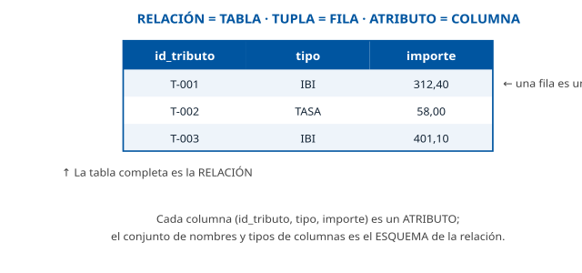

------------------------------------------------------------------------

### D2 · Álgebra relacional frente a cálculo relacional

**Sección**: §1.2 — Álgebra relacional y el cálculo relacional **Propósito**: Contrastar el enfoque procedimental (CÓMO) con el declarativo (QUÉ).

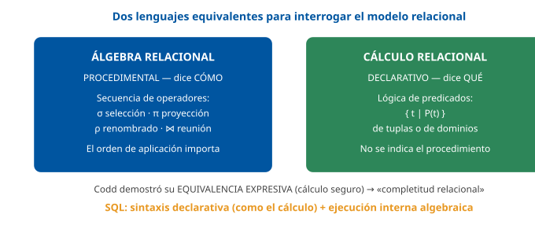

------------------------------------------------------------------------

### D3 · Operadores del álgebra relacional

**Sección**: §1.2 — Operadores unarios, binarios y derivados **Propósito**: Cheat sheet de los 8 operadores fundamentales.

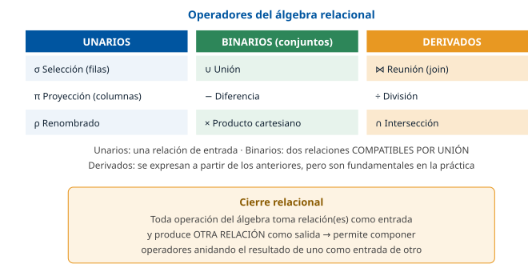

------------------------------------------------------------------------

### D4 · Tipología de lenguajes en un SGBD

**Sección**: §1.3 — DDL, DML, DQL, DCL, TCL **Propósito**: Situar los cinco sublenguajes y su función.

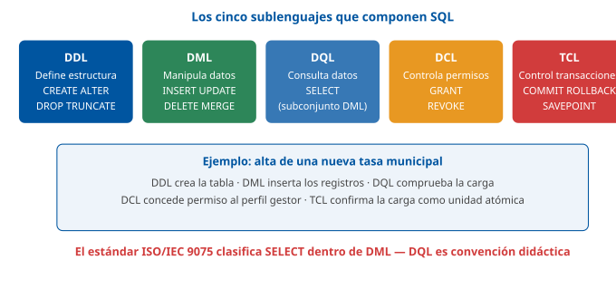

------------------------------------------------------------------------

### D5 · Evolución del estándar SQL

**Sección**: §2.1 — Origen y evolución del estándar SQL **Propósito**: Línea de tiempo de SEQUEL a SQL:2023, con el hito de cada edición.

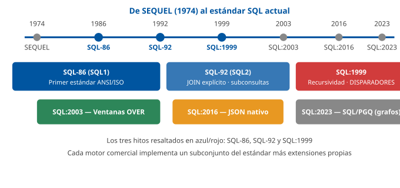

------------------------------------------------------------------------

### D6 · Orden lógico de evaluación de un SELECT

**Sección**: §2.3 — Sintaxis de una sentencia SQL **Propósito**: Contrastar el orden de escritura con el orden real en que el motor evalúa las cláusulas.

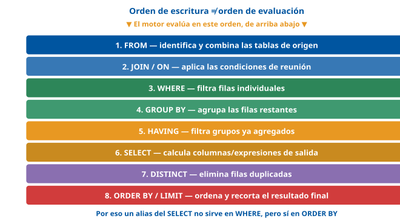

------------------------------------------------------------------------

### D7 · Tipos de JOIN

**Sección**: §2.5 — Tipologías de acoplamiento (Join) **Propósito**: Representar con diagramas de Venn INNER, LEFT, RIGHT, FULL y CROSS.

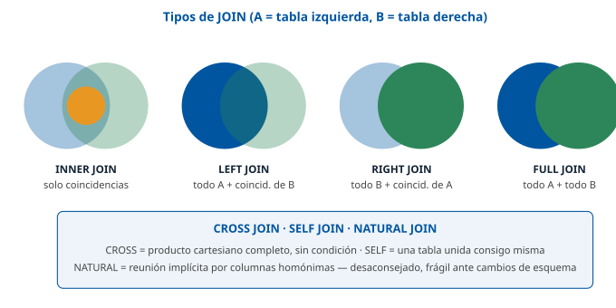

------------------------------------------------------------------------

### D8 · Subconsulta correlacionada frente a no correlacionada

**Sección**: §2.6 — Subconsultas y predicados cuantificados **Propósito**: Mostrar la dependencia (o no) de la subconsulta respecto a la fila externa.

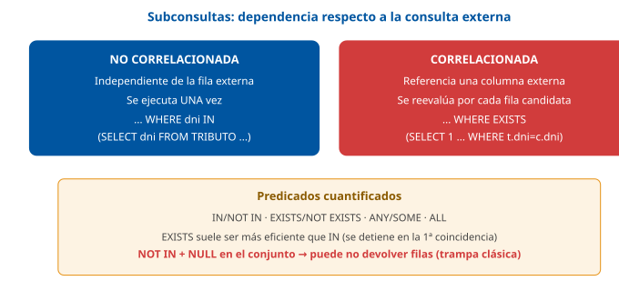

------------------------------------------------------------------------

### D9 · CTE recursiva: ancla y miembro recursivo

**Sección**: §2.7 — Expresiones de Tabla Comunes y consultas recursivas **Propósito**: Visualizar el bucle lógico ancla → recursivo → parada.

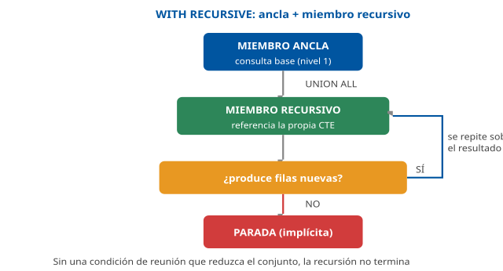

------------------------------------------------------------------------

### D10 · Ciclo de vida de un procedimiento almacenado

**Sección**: §3.2 — Arquitectura y ciclo de vida de ejecución en el servidor **Propósito**: Mostrar las fases desde CREATE hasta la reutilización del plan cacheado.

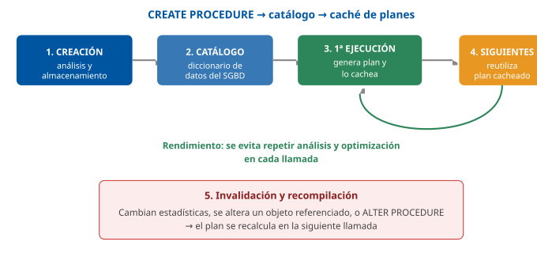

------------------------------------------------------------------------

### D11 · Ciclo de vida de un cursor explícito

**Sección**: §3.4 — Gestión de cursores y tipos de cursores **Propósito**: Fijar la secuencia DECLARE → OPEN → FETCH → CLOSE.

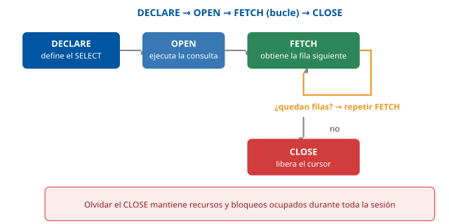

------------------------------------------------------------------------

### D12 · Clasificación de disparadores

**Sección**: §4.2 — Clasificación de los disparadores **Propósito**: Matriz BEFORE/AFTER × fila/sentencia, más INSTEAD OF y eventos programados.

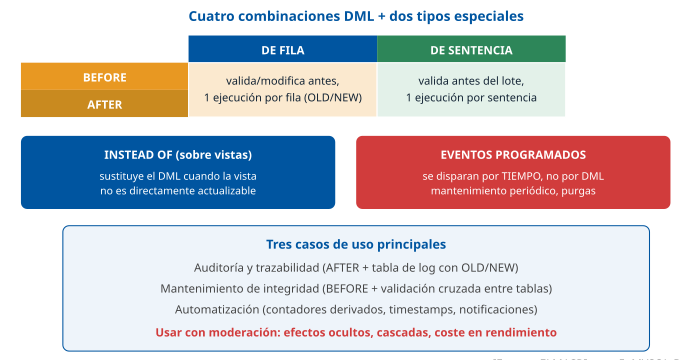

------------------------------------------------------------------------

## Casos prácticos

Los tres casos recorren el tema sobre el esquema `DISTRITO / CONTRIBUYENTE / TRIBUTO / EXPEDIENTE / FUNCIONARIO` (ver la pestaña Contenido, «Convenciones»): el **Caso 1** trabaja **SQL declarativo** (joins, agregación, subconsultas) sobre los tributos; el **Caso 2**, un **procedimiento almacenado con cursor** sobre el censo de contribuyentes; y el **Caso 3**, un **disparador de auditoría** sobre la tramitación de expedientes.

------------------------------------------------------------------------

### Caso 1 — Análisis de recaudación de tributos por distrito

#### Enunciado

El área de Hacienda quiere analizar la recaudación de **TRIBUTO** liquidada por **CONTRIBUYENTE** y **DISTRITO**. Se pide escribir, en **SQL estándar**, las consultas necesarias para responder a cuatro preguntas de negocio sobre el esquema `DISTRITO(id_distrito, nombre_distrito)`, `CONTRIBUYENTE(dni, nombre, id_distrito)` y `TRIBUTO(id_tributo, tipo, importe, dni_contribuyente, fecha_liquidacion)`.

#### Cuestiones

**Cuestión 1 — Agregación y filtrado de grupos (3 puntos).** Escriba la consulta que devuelve, para cada distrito, el número de tributos liquidados y el importe total recaudado, mostrando **solo los distritos** cuyo total recaudado supere los 100.000 €, ordenados de mayor a menor recaudación.

**Cuestión 2 — Outer join (2 puntos).** Escriba la consulta que devuelve **todos** los contribuyentes de un distrito, tengan o no algún tributo liquidado, junto con el importe de sus tributos (o vacío si no tiene ninguno).

**Cuestión 3 — Subconsulta correlacionada (3 puntos).** Escriba la consulta que devuelve el nombre de los contribuyentes cuyo **tributo de mayor importe** sea superior a la **media de importes de su propio distrito**.

**Cuestión 4 — Función de ventana (2 puntos).** Escriba la consulta que, para cada tributo, muestre su importe junto con el **puesto** que ocupa ese tributo dentro de los tributos del mismo contribuyente, ordenados de mayor a menor importe.

#### Solución orientativa

- **C1**: agregación con `GROUP BY` y filtro de grupo con `HAVING` (§2.4). El orden de evaluación explica por qué la condición sobre el total va en `HAVING`, no en `WHERE`.

&nbsp;

    SELECT d.id_distrito, d.nombre_distrito, COUNT(*) AS num_tributos, SUM(t.importe) AS total_recaudado
    FROM   DISTRITO d
    JOIN   CONTRIBUYENTE c ON c.id_distrito = d.id_distrito
    JOIN   TRIBUTO t ON t.dni_contribuyente = c.dni
    GROUP BY d.id_distrito, d.nombre_distrito
    HAVING SUM(t.importe) > 100000
    ORDER BY total_recaudado DESC;

- **C2**: `LEFT JOIN` desde `CONTRIBUYENTE` hacia `TRIBUTO`, para no perder los contribuyentes sin tributos (§2.5).

&nbsp;

    SELECT c.nombre, t.importe
    FROM   CONTRIBUYENTE c
    LEFT JOIN TRIBUTO t ON t.dni_contribuyente = c.dni
    WHERE  c.id_distrito = 3;

- **C3**: subconsulta **correlacionada** (referencia `c.id_distrito` de la fila externa) comparando el `MAX` del contribuyente frente al `AVG` de su distrito (§2.6).

&nbsp;

    SELECT c.nombre
    FROM   CONTRIBUYENTE c
    WHERE  (SELECT MAX(t.importe) FROM TRIBUTO t WHERE t.dni_contribuyente = c.dni)
         > (SELECT AVG(t2.importe) FROM TRIBUTO t2
            JOIN CONTRIBUYENTE c2 ON c2.dni = t2.dni_contribuyente
            WHERE c2.id_distrito = c.id_distrito);

- **C4**: función de ventana `RANK()` particionada por contribuyente (§2.8); no colapsa filas, a diferencia de un `GROUP BY`.

&nbsp;

    SELECT dni_contribuyente, importe,
           RANK() OVER (PARTITION BY dni_contribuyente ORDER BY importe DESC) AS puesto
    FROM   TRIBUTO;

#### Criterios de evaluación

| Criterio                                                        | Puntos |
|-----------------------------------------------------------------|--------|
| GROUP BY + HAVING correctos, con orden y agregación adecuados   | 3      |
| LEFT JOIN correcto, conserva contribuyentes sin tributos        | 2      |
| Subconsulta correlacionada correcta, referencia la fila externa | 3      |
| Función de ventana RANK() con PARTITION BY correcta             | 2      |

------------------------------------------------------------------------

#### Preguntas tipo test sobre este caso

##### 1. En el supuesto planteado, Hacienda quiere ver solo los distritos cuyo total recaudado supere los 100.000 €. ¿Dónde debe expresarse esa condición?

- a) En la cláusula WHERE, con la condición SUM(t.importe) > 100000, antes del GROUP BY.
- b) En la cláusula HAVING, con la condición SUM(t.importe) > 100000, después del GROUP BY.
- c) En la cláusula ORDER BY, que descarta los grupos que no alcanzan el valor indicado.

**Respuesta correcta:** b) · **Referencia:** Caso 1, cuestión 1 · §2.4

La condición depende de un total agregado por distrito, así que filtra grupos ya formados: eso es HAVING, que se evalúa después de GROUP BY.

##### 2. ¿Por qué la condición sobre el total recaudado no puede ir en la cláusula WHERE de la consulta?

- a) Porque WHERE filtra filas individuales antes de que existan los grupos y no puede contener funciones de agregación.
- b) Porque WHERE se evalúa después del ORDER BY, cuando el resultado ya está ordenado y no admite más filtros.
- c) Porque WHERE solo admite condiciones sobre columnas de clave primaria, como id_distrito o dni.

**Respuesta correcta:** a) · **Referencia:** Caso 1, cuestión 1 · §2.3 y §2.4

En el orden lógico de evaluación (FROM → WHERE → GROUP BY → HAVING → SELECT → ORDER BY), WHERE actúa fila a fila antes de agrupar, por lo que no puede usar SUM().

##### 3. La consulta del distrito muestra id_distrito, nombre_distrito, COUNT(*) y SUM(t.importe). ¿Qué columnas deben figurar en el GROUP BY?

- a) Solo las expresiones agregadas COUNT(*) y SUM(t.importe), que son las que se calculan por grupo.
- b) Ninguna, porque el motor agrupa automáticamente por todas las columnas que aparecen en el SELECT.
- c) id_distrito y nombre_distrito, porque toda columna del SELECT no agregada debe figurar en el GROUP BY.

**Respuesta correcta:** c) · **Referencia:** Caso 1, cuestión 1 · §2.4

Regla de dependencia funcional del GROUP BY: toda columna del SELECT que no esté dentro de una función de agregación debe aparecer en la cláusula de agrupación.

##### 4. La consulta termina con ORDER BY total_recaudado DESC, usando el alias definido en el SELECT. ¿Es válido?

- a) Sí, porque ORDER BY se evalúa después del SELECT, cuando el alias ya existe.
- b) No, porque un alias del SELECT solo puede utilizarse dentro de la cláusula WHERE.
- c) No, porque ORDER BY se evalúa antes del SELECT y hay que repetir SUM(t.importe).

**Respuesta correcta:** a) · **Referencia:** Caso 1, cuestión 1 · §2.3

El orden lógico de evaluación sitúa ORDER BY después de SELECT; por eso el alias sí puede usarse en ORDER BY, aunque no en WHERE.

##### 5. Para obtener todos los contribuyentes de un distrito, tengan o no algún tributo liquidado, ¿qué reunión debe usarse?

- a) Un INNER JOIN entre CONTRIBUYENTE y TRIBUTO por el DNI del contribuyente.
- b) Un LEFT JOIN desde CONTRIBUYENTE hacia TRIBUTO por el DNI del contribuyente.
- c) Un CROSS JOIN entre CONTRIBUYENTE y TRIBUTO, filtrado después por el distrito.

**Respuesta correcta:** b) · **Referencia:** Caso 1, cuestión 2 · §2.5

El LEFT JOIN conserva todas las filas de la tabla izquierda (CONTRIBUYENTE) aunque no tengan coincidencia en la derecha; el INNER JOIN perdería a quienes no tienen tributos.

##### 6. En el resultado de esa reunión, ¿cómo aparece un contribuyente del distrito que no tiene ningún tributo liquidado?

- a) No aparece, porque la reunión descarta las filas sin coincidencia en la tabla de la derecha.
- b) Aparece con el importe a cero, que el motor asigna por defecto a las filas sin pareja.
- c) Aparece con su nombre y con la columna importe a NULL, al no existir la fila de la derecha.

**Respuesta correcta:** c) · **Referencia:** Caso 1, cuestión 2 · §2.5

En un LEFT JOIN, cuando la fila de la derecha no existe, sus columnas aparecen como NULL; el contribuyente se conserva.

##### 7. El técnico quiere ahora listar solo los contribuyentes del distrito que NO tienen ningún tributo. Partiendo del LEFT JOIN anterior, ¿qué debe añadir?

- a) La condición WHERE t.importe IS NULL, que detecta la ausencia de fila en TRIBUTO.
- b) La condición WHERE t.importe = 0, que identifica a los contribuyentes sin liquidaciones.
- c) Un ORDER BY t.importe, que agrupa al principio a los contribuyentes sin tributos.

**Respuesta correcta:** a) · **Referencia:** Caso 1, cuestión 2 · §2.5

El NULL que genera el LEFT JOIN en las columnas de la derecha es precisamente lo que permite detectar la ausencia de relación con WHERE t.importe IS NULL.

##### 8. En la cuestión 3, la subconsulta que calcula la media de importes filtra por el distrito de la fila que se está evaluando (c.id_distrito). ¿Qué tipo de subconsulta es?

- a) No correlacionada: el motor la ejecuta una sola vez y reutiliza su resultado para todas las filas.
- b) Una expresión de tabla común recursiva, porque se referencia a sí misma en cada paso.
- c) Correlacionada: referencia una columna de la consulta externa y su resultado depende de la fila actual.

**Respuesta correcta:** c) · **Referencia:** Caso 1, cuestión 3 · §2.6

Al referenciar c.id_distrito de la consulta externa, la media cambia según el contribuyente evaluado: es una subconsulta correlacionada.

##### 9. Para mostrar cada tributo con el puesto que ocupa entre los tributos del mismo contribuyente, de mayor a menor importe y sin perder filas, ¿qué expresión es la adecuada?

- a) GROUP BY dni_contribuyente con COUNT(*), que numera los tributos de cada contribuyente.
- b) RANK() OVER (PARTITION BY dni_contribuyente ORDER BY importe DESC).
- c) ROW_NUMBER() OVER (ORDER BY dni_contribuyente), sin partición por contribuyente.

**Respuesta correcta:** b) · **Referencia:** Caso 1, cuestión 4 · §2.8

Una función de ventana conserva todas las filas y calcula el puesto dentro de cada partición; PARTITION BY agrupa por contribuyente y el ORDER BY del OVER fija el orden por importe.

##### 10. Un contribuyente tiene cuatro tributos y los dos segundos de mayor importe empatan. Con RANK(), ¿qué puesto recibe el cuarto tributo?

- a) El 4, porque RANK() salta números tras un empate (1, 2, 2, 4).
- b) El 3, porque RANK() no deja huecos en la numeración tras un empate.
- c) El 2, porque RANK() repite el último puesto hasta el final de la partición.

**Respuesta correcta:** a) · **Referencia:** Caso 1, cuestión 4 · §2.8

RANK() da el mismo puesto a los empatados y salta números después (1, 2, 2, 4); la numeración sin huecos (1, 2, 2, 3) es la de DENSE_RANK().

### Caso 2 — Procedimiento almacenado de recálculo de bonificaciones del Padrón

#### Enunciado

Se necesita un **procedimiento almacenado** que, para un distrito dado, recorra **todos** sus contribuyentes con tributos liquidados y aplique una bonificación del 10 % a los importes superiores a 500 €, devolviendo además el **número total de tributos bonificados**. La lógica no puede expresarse como una única sentencia `UPDATE` de conjunto porque, en una versión posterior, cada tributo llevará una regla de bonificación distinta según su tipo (se pide, por tanto, resolverlo con cursor).

#### Cuestiones

**Cuestión 1 — Parámetros (2 puntos).** Defina la cabecera del procedimiento `bonificar_tributos_distrito` indicando el modo (IN/OUT) de cada parámetro: el distrito a procesar y el número de tributos bonificados.

**Cuestión 2 — Cursor (3 puntos).** Escriba, en pseudocódigo SQL genérico, el cursor que recorre los tributos superiores a 500 € de ese distrito, y su ciclo `DECLARE → OPEN → FETCH → CLOSE`.

**Cuestión 3 — Control de flujo (3 puntos).** Dentro del bucle del cursor, escriba la lógica que aplica la bonificación del 10 % y actualiza el contador de salida.

**Cuestión 4 — Excepciones (2 puntos).** ¿Qué bloque de manejo de errores añadiría, y qué haría si falla la actualización de un tributo concreto? Justifique si debería abortar todo el procedimiento o continuar con el resto.

#### Solución orientativa

- **C1**: un parámetro `IN` (dato de entrada, no se modifica) y un parámetro `OUT` (el procedimiento lo asigna y se devuelve al llamador) (§3.3).

&nbsp;

    CREAR PROCEDIMIENTO bonificar_tributos_distrito(
        ENTRADA p_distrito : entero,
        SALIDA p_num_bonificados : entero
    )

- **C2**: cursor explícito forward-only sobre los tributos superiores a 500 € del distrito (§3.4).

&nbsp;

    DECLARAR CURSOR c_tributos PARA
        SELECT t.id_tributo, t.importe
        FROM   TRIBUTO t JOIN CONTRIBUYENTE c ON c.dni = t.dni_contribuyente
        WHERE  c.id_distrito = p_distrito AND t.importe > 500

    p_num_bonificados = 0    -- el contador se inicializa una sola vez, antes del bucle
    ABRIR c_tributos
    BUCLE
        OBTENER SIGUIENTE DE c_tributos EN v_id_tributo, v_importe
        SALIR_SI_NO_HAY_MAS_FILAS
        -- (cuerpo en C3)
    FIN_BUCLE
    CERRAR c_tributos

- **C3**: dentro del bucle, que repite el cuerpo una vez por fila (§3.5, bucles), se calcula el nuevo importe y se actualiza la fila y el contador. No hace falta un condicional `SI`: el filtro `importe > 500` ya está en la consulta del cursor.

&nbsp;

    INICIO
        v_nuevo_importe = v_importe * 0.90
        ACTUALIZAR TRIBUTO
        ESTABLECER importe = v_nuevo_importe
        DONDE id_tributo = v_id_tributo
        p_num_bonificados = p_num_bonificados + 1
    FIN

- **C4**: un bloque `INICIO_BLOQUE_PROTEGIDO … EXCEPCION CUANDO … FIN_BLOQUE_PROTEGIDO` alrededor de la actualización de cada fila (§3.6). Como el procesamiento es **fila a fila** y el fallo de un tributo no debería impedir bonificar el resto, lo más razonable es **capturar la excepción dentro del bucle**, registrar el error (por ejemplo, insertándolo en una tabla de incidencias) y **continuar** con la siguiente iteración, en lugar de deshacer todo el procedimiento con un `ROLLBACK` global — salvo que el requisito de negocio exija que el lote sea todo-o-nada.

#### Criterios de evaluación

| Criterio | Puntos |
|----|----|
| Cabecera con modos IN/OUT correctos | 2 |
| Cursor con ciclo DECLARE/OPEN/FETCH/CLOSE completo y condición correcta | 3 |
| Lógica de bonificación y actualización del contador correctas | 3 |
| Manejo de excepciones razonado (continuar vs abortar) | 2 |

------------------------------------------------------------------------

#### Preguntas tipo test sobre este caso

##### 1. En la cabecera de bonificar_tributos_distrito, ¿qué modo debe tener el parámetro que indica el distrito a procesar?

- a) OUT, porque el procedimiento devuelve el distrito procesado al llamador al terminar.
- b) INOUT, porque el procedimiento necesita modificar el distrito durante el recorrido.
- c) IN, porque es un dato de entrada que el procedimiento solo lee y no modifica.

**Respuesta correcta:** c) · **Referencia:** Caso 2, cuestión 1 · §3.3

IN es el modo de entrada: el llamador pasa el valor y el procedimiento solo lo lee. Es, además, el modo por defecto.

##### 2. ¿Qué modo debe tener el parámetro que devuelve el número de tributos bonificados?

- a) IN, porque el llamador debe indicar de antemano cuántos tributos se van a bonificar.
- b) OUT, porque el procedimiento le asigna el valor y lo devuelve al llamador al terminar.
- c) Ninguno: un procedimiento devuelve siempre su resultado mediante la cláusula RETURN.

**Respuesta correcta:** b) · **Referencia:** Caso 2, cuestión 1 · §3.3

Un parámetro OUT recibe el valor que le asigna el procedimiento y se devuelve al llamador; su valor de entrada se ignora. RETURN es propio de las funciones.

##### 3. Un compañero propone convertir el procedimiento en una función almacenada. ¿Qué rasgo distinguiría a la función?

- a) Que devuelve siempre un único valor mediante RETURN y puede usarse dentro de una expresión SQL.
- b) Que admite varios parámetros de salida OUT y se invoca como sentencia independiente con CALL.
- c) Que se ejecuta automáticamente cada vez que se actualiza un importe de la tabla TRIBUTO.

**Respuesta correcta:** a) · **Referencia:** Caso 2, cuestión 1 · §3.1 y §3.3

La función devuelve un único valor con RETURN y suele poder usarse en un SELECT; el procedimiento se invoca con CALL y puede devolver varios valores por parámetros OUT.

##### 4. ¿Por qué en este supuesto se recorre el resultado con un cursor en lugar de lanzar una única sentencia UPDATE de conjunto?

- a) Porque una sentencia UPDATE no puede modificar más de una fila de la tabla en cada ejecución.
- b) Porque en una versión posterior cada tributo llevará una regla distinta según su tipo y hay que tratarlo fila a fila.
- c) Porque recorrer fila a fila con un cursor es siempre más rápido que una operación de conjunto.

**Respuesta correcta:** b) · **Referencia:** Caso 2, enunciado y cuestión 2 · §3.4

El cursor está justificado cuando la regla no se puede expresar como un UPDATE de conjunto; si se pudiera, la operación de conjunto sería preferible por rendimiento.

##### 5. ¿Cuál es la secuencia correcta del ciclo de vida del cursor que recorre los tributos del distrito?

- a) OPEN → DECLARE → FETCH en bucle → CLOSE.
- b) DECLARE → FETCH en bucle → OPEN → CLOSE.
- c) DECLARE → OPEN → FETCH en bucle → CLOSE.

**Respuesta correcta:** c) · **Referencia:** Caso 2, cuestión 2 · §3.4

El cursor explícito se declara sobre un SELECT, se abre, se leen sus filas con FETCH dentro de un bucle hasta que no quedan más y, por último, se cierra.

##### 6. El recorrido solo necesita avanzar, fila a fila, desde el primer tributo hasta el último. ¿Qué tipo de cursor es el adecuado?

- a) Un cursor forward-only, que solo avanza hacia adelante y es el más ligero.
- b) Un cursor scrollable, que permite moverse hacia atrás y saltar a una fila concreta.
- c) Un cursor implícito, que el programador declara y controla paso a paso.

**Respuesta correcta:** a) · **Referencia:** Caso 2, cuestión 2 · §3.4

El forward-only solo avanza, consume menos recursos y es el más usado; el scrollable consume más. El cursor implícito lo gestiona el propio SGBD, no el programador.

##### 7. Si el programador olvidara la instrucción CLOSE al terminar el bucle, ¿qué consecuencia tendría?

- a) El cursor volvería automáticamente a la primera fila y repetiría el recorrido completo.
- b) El SGBD desharía todas las bonificaciones aplicadas durante el recorrido del cursor.
- c) El cursor seguiría consumiendo recursos del servidor (memoria, bloqueos) mientras dure la sesión.

**Respuesta correcta:** c) · **Referencia:** Caso 2, cuestión 2 · §3.4

Un cursor abierto y no cerrado consume memoria y bloqueos del servidor mientras dura la sesión; olvidar el CLOSE es una mala práctica habitual.

##### 8. Dentro del bucle se aplica la bonificación del 10 % a un tributo de 800 €. ¿Qué importe queda y cómo se calcula?

- a) 80 €, multiplicando el importe por 0,10.
- b) 720 €, multiplicando el importe por 0,90.
- c) 880 €, multiplicando el importe por 1,10.

**Respuesta correcta:** b) · **Referencia:** Caso 2, cuestión 3

Bonificar un 10 % significa cobrar el 90 % del importe: 800 × 0,90 = 720 €.

##### 9. Tras actualizar cada tributo dentro del bucle, ¿qué debe hacerse con el parámetro de salida que cuenta los tributos bonificados?

- a) Incrementarlo en una unidad: p_num_bonificados = p_num_bonificados + 1.
- b) Asignarle el nuevo importe del tributo que se acaba de actualizar.
- c) Leerlo para decidir si el tributo actual debe bonificarse o no.

**Respuesta correcta:** a) · **Referencia:** Caso 2, cuestión 3 · §3.3

El parámetro OUT acumula cuántos tributos se han bonificado: se suma uno por cada fila actualizada y su valor final se devuelve al llamador.

##### 10. Durante la ejecución falla la actualización de un tributo concreto. Si el negocio no exige que el lote sea todo o nada, ¿cuál es el tratamiento más razonable?

- a) Hacer un ROLLBACK global que deshaga todas las bonificaciones aplicadas hasta ese momento.
- b) Capturar la excepción con un manejador vacío, sin registrarla, y seguir con el recorrido.
- c) Capturar la excepción dentro del bucle, registrar el error y continuar con el siguiente tributo.

**Respuesta correcta:** c) · **Referencia:** Caso 2, cuestión 4 · §3.6

El fallo de un tributo no debe impedir bonificar el resto, pero el error no puede silenciarse: un manejador vacío que «traga» la excepción oculta fallos difíciles de depurar.

### Caso 3 — Auditoría de cambios de estado en expedientes

#### Enunciado

Un expediente pasa por los estados `ABIERTO → EN_TRAMITE → RESUELTO → CERRADO`. Se pide diseñar los **disparadores** necesarios para: (a) **impedir** que un expediente pase a `CERRADO` si no ha pasado antes por `RESUELTO`, y (b) **registrar** en una tabla `AUDITORIA_EXPEDIENTE` cada cambio de estado, con el estado anterior, el nuevo y el funcionario que lo realizó.

#### Cuestiones

**Cuestión 1 — Clasificación (2 puntos).** ¿Qué tipo de disparador (BEFORE/AFTER, de fila/de sentencia) usaría para cada una de las dos necesidades (a) y (b)? Justifique la elección.

**Cuestión 2 — Validación (3 puntos).** Escriba, en pseudocódigo SQL genérico, el disparador que impide el cambio a `CERRADO` sin pasar por `RESUELTO`.

**Cuestión 3 — Auditoría (3 puntos).** Escriba el disparador que registra cada cambio de estado en `AUDITORIA_EXPEDIENTE(id_expediente, estado_anterior, estado_nuevo, id_funcionario, fecha)`.

**Cuestión 4 — Riesgos (2 puntos).** ¿Qué riesgo debe vigilarse si en el futuro se añade un tercer disparador sobre `EXPEDIENTE` que también modifica la propia tabla `EXPEDIENTE`? ¿Cómo lo mitigaría?

#### Solución orientativa

- **C1**: (a) requiere un disparador **BEFORE UPDATE, de fila** (`FOR EACH ROW`), porque debe **validar y poder cancelar** la operación **antes** de que se aplique, y necesita el valor `NUEVO.estado` de cada fila concreta; (b) requiere un disparador **AFTER UPDATE, de fila**, porque debe registrar el cambio **una vez confirmado**, con acceso a `ANTIGUO.estado` y `NUEVO.estado` de cada fila (§4.2).

&nbsp;

- **C2**: el disparador `BEFORE` valida la transición y lanza un error que cancela la operación si no se cumple (§3.6, §4.2).

&nbsp;

    CREAR DISPARADOR trg_valida_cierre_expediente
    ANTES DE ACTUALIZAR EN EXPEDIENTE
    PARA_CADA_FILA
    INICIO
        SI NUEVO.estado = 'CERRADO' Y ANTIGUO.estado <> 'RESUELTO' ENTONCES
            LANZAR ERROR 'No se puede cerrar un expediente que no ha sido resuelto'
        FIN_SI
    FIN

- **C3**: el disparador `AFTER` inserta la fila de auditoría solo cuando el estado ha cambiado realmente (§4.3, auditoría y trazabilidad).

&nbsp;

    CREAR DISPARADOR trg_auditoria_expediente
    DESPUES DE ACTUALIZAR EN EXPEDIENTE
    PARA_CADA_FILA
    INICIO
        SI NUEVO.estado <> ANTIGUO.estado ENTONCES
            INSERTAR EN AUDITORIA_EXPEDIENTE (id_expediente, estado_anterior, estado_nuevo, id_funcionario, fecha)
            VALORES (NUEVO.id_expediente, ANTIGUO.estado, NUEVO.estado, USUARIO_ACTUAL(), FECHA_ACTUAL())
        FIN_SI
    FIN

- **C4**: el riesgo es una **cadena de disparadores** (*trigger chain*): si el tercer disparador vuelve a modificar `EXPEDIENTE`, puede reactivar `trg_valida_cierre_expediente` y `trg_auditoria_expediente`, generando efectos difíciles de rastrear o incluso una **recursión no controlada** (§4.4). Se mitiga documentando explícitamente el orden y el propósito de cada disparador, evitando que un disparador AFTER vuelva a escribir sobre la misma tabla que lo activó salvo que sea estrictamente necesario, y probando el comportamiento con actualizaciones **masivas**, no solo de una fila.

#### Criterios de evaluación

| Criterio | Puntos |
|----|----|
| Clasificación BEFORE/AFTER y de fila justificada para (a) y (b) | 2 |
| Disparador de validación correcto, cancela la operación indebida | 3 |
| Disparador de auditoría correcto, solo registra cambios reales | 3 |
| Identifica el riesgo de cadena de disparadores y propone mitigación | 2 |

------------------------------------------------------------------------

*Los tres casos son orientativos y pensados para la autoevaluación; las soluciones muestran una vía correcta, no la única posible. Las consultas del Caso 1 usan SQL estándar; los procedimientos y disparadores de los Casos 2 y 3, pseudocódigo SQL genérico, independiente de cualquier motor concreto.*

#### Preguntas tipo test sobre este caso

##### 1. Para impedir que un expediente pase a CERRADO sin haber pasado antes por RESUELTO, ¿qué tipo de disparador debe usarse?

- a) AFTER UPDATE de sentencia, que se ejecuta una vez cuando el cambio ya se ha aplicado.
- b) BEFORE UPDATE de fila, que valida cada fila y puede cancelar la operación antes de aplicarla.
- c) INSTEAD OF UPDATE sobre la tabla EXPEDIENTE, que sustituye la actualización original.

**Respuesta correcta:** b) · **Referencia:** Caso 3, cuestión 1 · §4.2

El disparador BEFORE se ejecuta antes de aplicar el cambio y puede cancelarlo; de fila, para disponer de los valores de cada expediente. INSTEAD OF es exclusivo de vistas.

##### 2. Para registrar en AUDITORIA_EXPEDIENTE cada cambio de estado, ¿qué tipo de disparador es el adecuado?

- a) BEFORE UPDATE de sentencia, que se ejecuta una sola vez antes de la actualización.
- b) Un evento programado nocturno que revise los expedientes modificados durante el día.
- c) AFTER UPDATE de fila, que registra el cambio de cada expediente una vez aplicado.

**Respuesta correcta:** c) · **Referencia:** Caso 3, cuestión 1 · §4.2 y §4.3

La auditoría es la elección natural de un disparador AFTER: se ejecuta cuando el dato ya ha quedado escrito y, siendo de fila, accede a los valores anterior y nuevo.

##### 3. ¿Por qué el disparador de auditoría debe ser de fila y no de sentencia?

- a) Porque el de fila se ejecuta por cada fila afectada con acceso a OLD y NEW; el de sentencia no accede a los valores de cada fila.
- b) Porque el de sentencia no llega a ejecutarse cuando la actualización afecta a más de una fila de la tabla.
- c) Porque el de fila es el único que puede activarse con UPDATE; el de sentencia solo responde a INSERT.

**Respuesta correcta:** a) · **Referencia:** Caso 3, cuestión 1 · §4.2

El disparador FOR EACH STATEMENT se ejecuta una sola vez por sentencia, afecte a cero o a diez mil filas, sin acceso directo a los valores individuales de cada fila.

##### 4. ¿Qué condición debe comprobar el disparador de validación para lanzar el error?

- a) SI ANTIGUO.estado = 'CERRADO' Y NUEVO.estado <> 'RESUELTO'.
- b) SI NUEVO.estado = 'RESUELTO' Y ANTIGUO.estado <> 'CERRADO'.
- c) SI NUEVO.estado = 'CERRADO' Y ANTIGUO.estado <> 'RESUELTO'.

**Respuesta correcta:** c) · **Referencia:** Caso 3, cuestión 2 · §4.2

Lo prohibido es llegar a CERRADO (valor nuevo) desde un estado que no sea RESUELTO (valor anterior).

##### 5. Cuando el disparador de validación detecta un cierre indebido, ¿qué debe hacer?

- a) Insertar una fila en la tabla de auditoría y dejar que la actualización continúe.
- b) Lanzar un error de negocio con un mensaje descriptivo, que cancela la operación.
- c) Ejecutar un COMMIT que confirme el estado anterior del expediente afectado.

**Respuesta correcta:** b) · **Referencia:** Caso 3, cuestión 2 · §3.6 y §4.3

Las reglas de negocio que no expresan las restricciones declarativas se implementan con un disparador BEFORE que, si no se cumple la condición, cancela la operación lanzando un error.

##### 6. El disparador de auditoría solo debe insertar una fila cuando el estado ha cambiado realmente. ¿Qué condición lo garantiza?

- a) SI NUEVO.estado <> ANTIGUO.estado.
- b) SI NUEVO.estado = 'CERRADO'.
- c) SI ANTIGUO.estado = 'ABIERTO'.

**Respuesta correcta:** a) · **Referencia:** Caso 3, cuestión 3 · §4.3

Un UPDATE puede tocar otras columnas sin modificar el estado; comparar el valor anterior con el nuevo evita registrar cambios que no son de estado.

##### 7. Para rellenar estado_anterior y estado_nuevo en AUDITORIA_EXPEDIENTE, ¿qué valores usa el disparador?

- a) Los de la última fila registrada en AUDITORIA_EXPEDIENTE para ese mismo expediente.
- b) ANTIGUO.estado y NUEVO.estado, que el disparador de fila recibe del evento.
- c) NUEVO.estado en ambas columnas, porque el valor anterior ya no existe tras el UPDATE.

**Respuesta correcta:** b) · **Referencia:** Caso 3, cuestión 3 · §4.2

Un disparador de fila sobre UPDATE accede a OLD (valor antes del cambio) y NEW (valor después); en un AFTER UPDATE ambos están disponibles.

##### 8. Un desarrollador propone que la aplicación pase al disparador, como parámetro, el identificador del funcionario que hace el cambio. ¿Es viable?

- a) Sí, declarándolo como parámetro IN en la cabecera del disparador.
- b) Sí, declarándolo como parámetro OUT para devolverlo a la aplicación.
- c) No: el disparador no admite parámetros; recibe implícitamente el contexto del evento.

**Respuesta correcta:** c) · **Referencia:** Caso 3, cuestión 3 · §4.1

Un disparador no se invoca por su nombre ni admite parámetros de entrada al estilo de un procedimiento: trabaja con los valores OLD/NEW de la fila afectada. El usuario se obtiene con una función como USUARIO_ACTUAL().

##### 9. En el futuro se añade un tercer disparador sobre EXPEDIENTE que también modifica la propia tabla EXPEDIENTE. ¿Qué riesgo hay que vigilar?

- a) Una cadena de disparadores que reactive los otros dos y pueda llegar a una recursión no controlada.
- b) Que el nuevo disparador nunca llegue a ejecutarse, porque una tabla solo admite dos disparadores.
- c) Que los disparadores anteriores pierdan el acceso a los valores ANTIGUO y NUEVO de cada fila.

**Respuesta correcta:** a) · **Referencia:** Caso 3, cuestión 4 · §4.4

Un disparador que vuelve a modificar la tabla que lo activó puede desencadenar efectos en cascada («trigger chain»), difíciles de depurar y, en el peor caso, recursivos.

##### 10. ¿Qué medida mitiga ese riesgo de forma adecuada?

- a) Añadir nuevos disparadores de control que vigilen y registren la ejecución de los tres anteriores.
- b) Documentar cada disparador, evitar que un AFTER reescriba su propia tabla y probar con cargas masivas.
- c) Probar cada disparador solo con actualizaciones de una fila, para aislar bien el efecto de cada uno.

**Respuesta correcta:** b) · **Referencia:** Caso 3, cuestión 4 · §4.4

Las buenas prácticas son documentar cada disparador, evitar cascadas profundas y probar el comportamiento ante operaciones masivas, no solo ante cambios de una fila.

## Fuentes

### Tier 1 — Canónicas y normativas

| ID | Referencia |
|----|----|
| `[CODD70]` | Codd, E. F. (1970). *A Relational Model of Data for Large Shared Data Banks*. Communications of the ACM, 13(6). Artículo fundacional del modelo relacional, base del álgebra y el cálculo relacional. |
| `[CHAMBERLIN74]` | Chamberlin, D. D.; Boyce, R. F. (1974). *SEQUEL: A Structured English Query Language*. Proc. ACM SIGFIDET. Origen de SQL sobre el prototipo System R de IBM. |
| `[ISO9075]` | ISO/IEC 9075:2023 *Information technology — Database languages — SQL* (partes 1-Framework, 2-Foundation, 4-PSM, 14-JSON). Norma vigente del estándar SQL. |
| `[DATE-REL]` | Date, C. J. *SQL and Relational Theory* (3.ª ed.). O'Reilly. Fundamento lógico de SQL frente al álgebra y el cálculo relacional; distingue el estándar de sus implementaciones. |
| `[DATE-INTRO]` | Date, C. J. *An Introduction to Database Systems* (8.ª ed.). Addison-Wesley. Obra de referencia sobre el modelo relacional, álgebra/cálculo y lenguajes de consulta. |
| `[SILBERSCHATZ]` | Silberschatz, A.; Korth, H. F.; Sudarshan, S. *Database System Concepts* (7.ª ed.). McGraw-Hill. SQL, procedimientos almacenados, disparadores, transacciones. |
| `[ELMASRI]` | Elmasri, R.; Navathe, S. B. *Fundamentals of Database Systems* (7.ª ed.). Pearson. Álgebra y cálculo relacional, SQL avanzado, triggers. |
| `[GMUW]` | Garcia-Molina, H.; Ullman, J. D.; Widom, J. *Database Systems: The Complete Book* (2.ª ed.). Pearson. Álgebra relacional formal, optimización de consultas, procedimientos almacenados. |
| `[MELTON]` | Melton, J.; Simon, A. R. *Understanding the New SQL: A Complete Guide*. Morgan Kaufmann. Evolución histórica del estándar SQL edición a edición. |
| `[MELTON-PSM]` | Melton, J. (2002). *Understanding SQL's Stored Procedures: A Complete Guide to SQL/PSM*. Morgan Kaufmann. Referencia del estándar SQL/PSM (ISO/IEC 9075-4) para procedimientos almacenados. |
| `[EISENBERG99]` | Eisenberg, A.; Melton, J. (1999). *SQL:1999, formerly known as SQL3*. ACM SIGMOD Record 28(1). Introducción de recursividad (CTE), triggers y tipos definidos por el usuario en el estándar. |
| `[ZEMKE03]` | Zemke, F. et al. (2003). *Introducing OLAP Functions in SQL:1999*. ACM SIGMOD Record. Origen normativo de las funciones de ventana analíticas. |
| `[ACID83]` | Härder, T.; Reuter, A. (1983). *Principles of Transaction-Oriented Database Recovery*. ACM Computing Surveys. Propiedades ACID que fundamentan TCL (COMMIT/ROLLBACK). |

### Tier 2 — Documentación de motores (ilustración de extensiones procedimentales)

| ID | Referencia |
|----|----|
| `[PSQL-DOC]` | PostgreSQL Global Development Group. *PostgreSQL Documentation* — capítulos de PL/pgSQL, disparadores y funciones de ventana. postgresql.org/docs |
| `[ORACLE-DOC]` | Oracle Corporation. *Oracle Database PL/SQL Language Reference*. Cursores, excepciones, paquetes. docs.oracle.com |
| `[MSSQL-DOC]` | Microsoft. *Transact-SQL (T-SQL) Reference*. Procedimientos almacenados, TRY/CATCH, SQL Server Agent. learn.microsoft.com |
| `[MYSQL-DOC]` | Oracle Corporation. *MySQL 8.0 Reference Manual* — Stored Program Objects, Triggers, Event Scheduler. dev.mysql.com/doc |

### Tier 3 — Marco de calidad y del puesto (contexto, no contenido técnico)

| ID | Referencia |
|----|----|
| `[ISO25010]` | ISO/IEC 25010:2023 *Systems and software Quality Requirements and Evaluation (SQuaRE) — Product quality model*. Anula y sustituye a la ISO/IEC 25010:2011: es la edición vigente del modelo de calidad del producto — mantenibilidad, fiabilidad aplicadas a lógica en el SGBD. |
| `[ISO25010-2011]` | ISO/IEC 25010:2011 *Systems and software Quality Requirements and Evaluation (SQuaRE) — System and software quality models*. Anulada y sustituida por la ISO/IEC 25010:2023. Se conserva la referencia porque es la que recogen los temarios al uso. |
| `[ENS]` | [Real Decreto 311/2022](https://www.boe.es/buscar/act.php?id=BOE-A-2022-7191), Esquema Nacional de Seguridad — trazabilidad y auditoría, relevante para disparadores de auditoría. |
| `[BOAM10032]` | BOAM 10.032 (23-dic-2025). Bases específicas TIC C1 Ayto. Madrid — temario oficial. |

------------------------------------------------------------------------

*Las referencias Tier 1 fijan el fundamento teórico (modelo relacional, álgebra/cálculo, estándar ISO/IEC 9075) y son la base de todo el contenido; Tier 2 se cita solo en los callouts de \[RELACIÓN CON OTROS TEMAS\]/contexto para señalar cómo cada motor real nombra sus extensiones procedimentales, sin que ningún ejemplo del cuerpo del tema dependa de un motor concreto — los ejemplos de código son **ANSI SQL estándar**, y los de procedimientos/disparadores, **pseudocódigo SQL genérico**; Tier 3 enmarca la calidad y la seguridad aplicables en el Ayuntamiento de Madrid.*
