# Tema 20. Diseño y programación orientada a objetos

**Bloque:** técnico  
**Enunciado oficial** (BOAM n.º 10.032, de 23 de diciembre de 2025): Diseño y programación orientada a objetos. Elementos y componentes software: objetos, clases, herencia, métodos, sobrecarga. Ventajas e inconvenientes. Patrones de diseño y lenguaje de modelado unificado (UML).

Versión web: <https://ayuntamientomadrid.github.io/temario-tecnico-auxiliar/temas/tema-20.html> · PDF: [tema-20.pdf](tema-20.pdf) · Test: [../../../tests/tecnico/tema-20.md](../../../tests/tecnico/tema-20.md)

## Índice

- 1. Fundamentos de la programación orientada a objetos
  - 1.1. Evolución de la ingeniería del software hacia el paradigma OO
  - 1.2. Pilares fundamentales de la POO: abstracción y encapsulamiento
  - 1.3. Modularidad y cohesión
  - 1.4. Principios SOLID de diseño de software
- 2. Elementos y componentes software
  - 2.1. Clases y objetos; ciclo de vida
  - 2.2. Atributos, variables, métodos y constructores
  - 2.3. Visibilidad y control de acceso
  - 2.4. Mecanismos avanzados en POO: herencia simple y múltiple
  - 2.5. Sobrecarga y sobrescritura de métodos
  - 2.6. Polimorfismo y ligadura dinámica
  - 2.7. Jerarquías y reutilización de código
  - 2.8. Relaciones de acoplamiento
- 3. Ventajas e inconvenientes del paradigma OO
  - 3.1. Beneficios en el ciclo de vida del software: reutilizabilidad y mantenibilidad
  - 3.2. Escalabilidad y aislamiento de errores
  - 3.3. Limitaciones, costes y penalizaciones técnicas: curva de aprendizaje y complejidad de diseño
  - 3.4. Sobrecarga en tiempo de ejecución
  - 3.5. Riesgos de un mal diseño orientado a objetos
- 4. Patrones de diseño
  - 4.1. Concepto y catálogo (Gang of Four)
  - 4.2. Patrón, anti-patrón y criterios de aplicabilidad arquitectónica
  - 4.3. Clasificación técnica: patrones creacionales
  - 4.4. Patrones estructurales
  - 4.5. Patrones de comportamiento
- 5. Modelado de sistemas con UML (Unified Modeling Language)
  - 5.1. Fundamentos y especificación del estándar OMG: origen y evolución
  - 5.2. Bloques de construcción y mecanismos comunes
  - 5.3. Diagramas estructurales y estáticos: Diagrama de Clases y Diagrama de Objetos
  - 5.4. Diagramas de Arquitectura física
  - 5.5. Diagramas de comportamiento: modelado de requisitos funcionales (Diagrama de Casos de Uso)
  - 5.6. Interacción temporal: Diagramas de Secuencia y de Comunicación/Colaboración
  - 5.7. Control de flujo y estados: Diagramas de Máquina de Estados y de Actividades
- 6. Tendencias actuales en el diseño orientado a objetos

### Conceptos clave para memorizar

| Concepto | Dato clave |
|----|----|
| Los 4 pilares de la POO | Abstracción, Encapsulamiento, Herencia, Polimorfismo \[BOOCH07\] |
| SOLID | Single Responsibility, Open/Closed, Liskov Substitution, Interface Segregation, Dependency Inversion \[MARTIN03\] |
| Herencia vs Composición | «Favorece la composición sobre la herencia» — principio de diseño de GoF para reducir acoplamiento \[GOF94\] |
| Sobrecarga (overloading) | Mismo nombre de método, distinta firma, ligadura en **tiempo de compilación** (estática) \[GOSLING-JLS\] |
| Sobrescritura (overriding) | Redefinición de un método heredado, ligadura en **tiempo de ejecución** (dinámica) \[GOSLING-JLS\] |
| Catálogo GoF | 23 patrones: 5 creacionales + 7 estructurales + 11 de comportamiento \[GOF94\] |
| UML | Estándar OMG, 14 tipos de diagrama: 7 estructurales + 7 de comportamiento \[OMG-UML25\] |
| Diagrama de Clases | Único diagrama UML de obligada elaboración en casi cualquier diseño OO; 3 compartimentos (nombre, atributos, métodos) \[FOWLER-UML\] |
| Composición vs agregación | Composición = dependencia de ciclo de vida («todo-parte» fuerte, rombo relleno); agregación = independencia («todo-parte» débil, rombo hueco) \[RUMBAUGH05\] |

*Todos los ejemplos de código de este tema se escriben en **Java** (coherente con el Tema 21 — Arquitectura Java EE). Ver la pestaña Contenido, sección «Convenciones», para el detalle de las cuatro cajas callout y el esquema de clases usado en los ejemplos.*

## Contenido

### Convenciones del documento

Este tema incluye cuatro tipos de **cajas callout** para facilitar el estudio:

> **Dato clave.** Información de alta densidad memorística.

> **Ejercicio resuelto.** Problema + solución paso a paso (una clase, una jerarquía, un patrón aplicado).

> **Ejemplo de aplicación en el ayto.** Aplicación real de la teoría al entorno municipal (expedientes, licencias, tributos, notificaciones).

> **Relación con otros temas.** Enlace conceptual a otros temas del temario oficial.

Los ejemplos de código se escriben en **Java** (coherente con que el Tema 21 desarrolla la arquitectura Java EE justo a continuación). Cuando un concepto es independiente del lenguaje (p. ej. el problema del diamante en herencia múltiple, presente en C++ pero no en Java) se advierte explícitamente. Las fuentes se citan con etiquetas breves tipo `[GOF94]` o `[BOOCH07, cap. 2]`; el registro completo está en la pestaña Fuentes.

**Jerarquía de ejemplo usada en todo el tema** (contexto Ayuntamiento de Madrid, simplificada, sobre la tramitación de expedientes):

    public abstract class Expediente {
        private String idExpediente;
        private String estado;
        protected LocalDate fechaApertura;

        public Expediente(String idExpediente, LocalDate fechaApertura) {
            this.idExpediente = idExpediente;
            this.fechaApertura = fechaApertura;
            this.estado = "ABIERTO";
        }

        public abstract int calcularPlazoResolucion();

        public String getEstado() { return estado; }
        protected void setEstado(String estado) { this.estado = estado; }
    }

    public class ExpedienteLicencia extends Expediente {
        private String tipoLicencia; // "OBRA_MENOR" | "OBRA_MAYOR" | "ACTIVIDAD"

        public ExpedienteLicencia(String id, LocalDate apertura, String tipoLicencia) {
            super(id, apertura);
            this.tipoLicencia = tipoLicencia;
        }

        @Override
        public int calcularPlazoResolucion() {
            return "OBRA_MAYOR".equals(tipoLicencia) ? 90 : 30;
        }
    }

    public class ExpedienteTributario extends Expediente {
        private double importe;

        public ExpedienteTributario(String id, LocalDate apertura, double importe) {
            super(id, apertura);
            this.importe = importe;
        }

        @Override
        public int calcularPlazoResolucion() { return 20; }
    }

`Expediente` es una **clase abstracta**: fija el contrato común (`calcularPlazoResolucion()`) y delega en cada subclase la regla concreta. Este ejemplo se retoma en las secciones 2 y 4 para ilustrar herencia, polimorfismo y patrones de diseño.

------------------------------------------------------------------------

### 1. Fundamentos de la programación orientada a objetos

#### 1.1. Evolución de la ingeniería del software hacia el paradigma OO

La historia de los paradigmas de programación es, en gran parte, la historia de la búsqueda de una unidad de organización del código que **escale** con la complejidad del software. La **programación no estructurada** (años 50-60), basada en saltos incondicionales (`GOTO`), dio paso con el teorema de Böhm-Jacopini a la **programación estructurada**: secuencia, selección e iteración como únicos mecanismos de control de flujo (ver Tema 18, §4.1). La estructurada organiza el programa en **procedimientos y funciones** que operan sobre datos externos a ellos, lo que en sistemas grandes provoca un problema recurrente: los datos compartidos por muchos procedimientos son difíciles de proteger de modificaciones incoherentes, y un cambio en la estructura de un dato obliga a revisar todo el código que lo toca.

La **programación orientada a objetos** (POO) responde a este problema invirtiendo la relación entre datos y funciones: en lugar de procedimientos que operan sobre datos externos, se definen **objetos** que **encapsulan** sus propios datos (estado) junto con las operaciones que los manipulan (comportamiento) \[BOOCH07, cap. 1\]. Sus raíces se remontan a **Simula 67** (Dahl y Nygaard, 1967), primer lenguaje en introducir clases y objetos para la simulación de sistemas, y se consolida con **Smalltalk** (Xerox PARC, años 70), que populariza el término «orientado a objetos» y el envío de mensajes como mecanismo de interacción. **C++** (Stroustrup, 1983) lleva la POO a la corriente principal añadiéndola sobre C; **Java** (Sun Microsystems, 1995) simplifica el modelo (sin herencia múltiple de clases, con recolección automática de memoria) y lo convierte en el paradigma dominante de la programación empresarial \[GOSLING-JLS\].

> **Dato clave.** Orden histórico a memorizar: no estructurada → estructurada (Böhm-Jacopini, procedimientos/funciones) → modular → **orientada a objetos** (Simula 67 → Smalltalk → C++ → Java). La POO no sustituye a la estructurada: la incorpora dentro de los métodos de cada clase.

#### 1.2. Pilares fundamentales de la POO: abstracción y encapsulamiento

La literatura clásica \[BOOCH07; MEYER97\] identifica **cuatro pilares** que definen si un lenguaje o un diseño es verdaderamente orientado a objetos: **abstracción**, **encapsulamiento**, **herencia** y **polimorfismo**. Los dos primeros se tratan en este epígrafe; herencia y polimorfismo, en la sección 2.

La **abstracción** consiste en identificar las características esenciales de una entidad del dominio del problema, ignorando los detalles irrelevantes para el contexto de uso. Una clase `Expediente` abstrae de un expediente real solo lo que el sistema necesita conocer (identificador, estado, fecha), no el papel físico ni el color de la carpeta. La abstracción se materializa en la **interfaz pública** de la clase: el conjunto de operaciones que un objeto ofrece al resto del sistema, sin revelar cómo las implementa \[MEYER97, cap. 2\].

El **encapsulamiento** (o encapsulación) es el mecanismo que **oculta** el estado interno de un objeto y **restringe** el acceso a él a través de una interfaz controlada (los métodos públicos). Su justificación no es solo de seguridad, sino sobre todo de **mantenibilidad**: si el estado interno solo puede modificarse a través de métodos, el objeto puede garantizar sus **invariantes** (p. ej., que `estado` nunca tome un valor distinto de `"ABIERTO"`, `"EN_TRAMITE"`, `"RESUELTO"` o `"CERRADO"`) y el código que usa la clase puede cambiar de implementación interna sin romper a sus clientes, siempre que la interfaz pública se mantenga \[MEYER97, cap. 3\]. En el ejemplo de la sección de Convenciones, `idExpediente` y `estado` son `private`; solo se exponen a través de `getEstado()` y de un `setEstado()` protegido que solo las subclases pueden invocar.

> **Dato clave.** Abstracción responde a **QUÉ** hace un objeto (su interfaz); encapsulamiento responde a **CÓMO** protege su estado (oculta la implementación). Son complementarios, no sinónimos.

#### 1.3. Modularidad y cohesión

La **modularidad** es la propiedad de un sistema de estar dividido en unidades (módulos, en OO: clases y paquetes) que pueden diseñarse, compilarse y probarse con relativa independencia \[SOMMERVILLE16, cap. 6\]. En POO, cada clase es, idealmente, un módulo con una responsabilidad delimitada. La calidad de esa división se mide con dos conceptos complementarios que provienen de la ingeniería del software estructurada (Stevens, Myers y Constantine, años 70) y que se aplican íntegramente al diseño OO:

- **Cohesión**: grado en que los elementos internos de un módulo (los atributos y métodos de una clase) están relacionados entre sí y contribuyen a una única responsabilidad. Una clase con **alta cohesión** hace una sola cosa bien; una clase con baja cohesión —que mezcla, por ejemplo, la lógica de negocio de un expediente con la generación de un PDF y el envío de correos— es difícil de entender, probar y reutilizar.
- **Acoplamiento**: grado de dependencia entre módulos distintos (se desarrolla en profundidad en §2.8, tras presentar herencia y composición, que son sus dos formas principales en OO).

> **Dato clave.** El objetivo de diseño es **alta cohesión + bajo acoplamiento**: clases centradas en una responsabilidad, con el mínimo de dependencias necesarias entre ellas.

#### 1.4. Principios SOLID de diseño de software

**SOLID** es el acrónimo, propuesto por Robert C. Martin a partir de sus artículos de 2000 \[MARTIN00\] y sistematizado en 2003 \[MARTIN03\], de cinco principios de diseño orientado a objetos que persiguen sistemas mantenibles y extensibles:

- **S — Single Responsibility Principle** (principio de responsabilidad única): una clase debe tener **una, y solo una, razón para cambiar**. Si `ExpedienteLicencia` calculase también el importe de la tasa asociada, tendría dos razones de cambio (reglas de tramitación y reglas fiscales) y debería dividirse.
- **O — Open/Closed Principle** (principio abierto/cerrado): las entidades deben estar **abiertas a extensión** pero **cerradas a modificación**. Añadir un nuevo tipo de expediente (`ExpedienteSubvencion`) no debería obligar a modificar el código que ya trata con `Expediente`; basta con crear una nueva subclase.
- **L — Liskov Substitution Principle** (principio de sustitución de Liskov): un objeto de una subclase debe poder **sustituir** a un objeto de su superclase sin alterar la corrección del programa \[LISKOV94\]. Si `ExpedienteTributario.calcularPlazoResolucion()` devolviese un valor negativo o lanzase una excepción no esperada por el código que trata genéricamente con `Expediente`, se violaría LSP.
- **I — Interface Segregation Principle** (principio de segregación de interfaces): es preferible tener **varias interfaces específicas** de cliente antes que una interfaz general y sobrecargada que obligue a implementar métodos irrelevantes.
- **D — Dependency Inversion Principle** (principio de inversión de dependencias): los módulos de alto nivel no deben depender de módulos de bajo nivel; **ambos deben depender de abstracciones** (interfaces), no de implementaciones concretas.

> **Ejemplo de aplicación en el ayto.** Un servicio `NotificadorExpedientes` que dependiera directamente de una clase concreta `EnvioCorreoSMTP` violaría DIP. Si en su lugar depende de una interfaz `CanalNotificacion` (implementada por `EnvioCorreoSMTP`, `EnvioSMS` o `EnvioSedeElectronica`), el Ayuntamiento puede añadir un nuevo canal —por ejemplo, notificación push en la app municipal— sin tocar el servicio existente. Este patrón se retoma en §4.5 (patrón Strategy).

> **Relación con otros temas.** SOLID es un desarrollo de los principios de **modularidad, cohesión y acoplamiento** de la ingeniería del software clásica (Tema 16, modelo conceptual de datos; Tema 25, seguridad en el desarrollo) aplicados específicamente al diseño OO.

------------------------------------------------------------------------

### 2. Elementos y componentes software

#### 2.1. Clases y objetos; ciclo de vida

Una **clase** es la plantilla o molde que define la **estructura** (atributos) y el **comportamiento** (métodos) comunes a un conjunto de entidades. Un **objeto** es una **instancia** concreta de una clase: existe en memoria, tiene un estado propio (los valores particulares de sus atributos) y una identidad que lo distingue de cualquier otro objeto, aunque tenga el mismo estado \[BOOCH07, cap. 2\]. La relación es la misma que hay entre un plano arquitectónico (la clase) y cada edificio construido con ese plano (los objetos): `ExpedienteLicencia` es la clase; cada expediente real tramitado en el registro es un objeto.

El **ciclo de vida de un objeto** en un lenguaje con recolección automática de memoria como Java consta de las siguientes fases:

1.  **Declaración**: se reserva un nombre de variable de un tipo de referencia (`Expediente exp;`), sin que exista todavía objeto alguno.
2.  **Instanciación**: el operador `new` reserva memoria en el **montículo** (*heap*) y devuelve una referencia (`exp = new ExpedienteLicencia("EXP-2026-001", LocalDate.now(), "OBRA_MAYOR");`).
3.  **Construcción**: se ejecuta el **constructor**, que inicializa el estado del objeto (ver §2.2).
4.  **Uso**: el objeto recibe **mensajes** (invocaciones a sus métodos) durante su vida útil.
5.  **Destrucción o recolección**: en Java, cuando ya no existe ninguna referencia alcanzable al objeto, el **recolector de basura** (*garbage collector*) libera su memoria automáticamente; en lenguajes sin recolección automática (C++), la destrucción es responsabilidad explícita del programador (`delete`).

> **Dato clave.** Una **clase** no ocupa memoria de datos en tiempo de ejecución (es una definición); un **objeto**, sí. Dos objetos de la misma clase con idéntico estado son, aun así, entidades distintas (identidad ≠ igualdad de estado).

#### 2.2. Atributos, variables, métodos y constructores

Los **atributos** (también llamados campos o propiedades) son las variables que almacenan el estado de un objeto; pueden ser **de instancia** (cada objeto tiene su propia copia, como `idExpediente`) o **de clase** (`static` en Java: una única copia compartida por todos los objetos de la clase, útil por ejemplo para un contador de expedientes abiertos). Los **métodos** son las operaciones que definen el comportamiento; también pueden ser de instancia o **estáticos**, si no dependen del estado de un objeto concreto.

El **constructor** es un método especial, con el mismo nombre que la clase y sin tipo de retorno, invocado automáticamente al crear un objeto con `new`, cuya responsabilidad es dejar el objeto en un **estado inicial válido**. Una clase puede tener **varios constructores sobrecargados** (misma clase, distinta lista de parámetros; ver §2.5) para admitir distintas formas de inicialización. Si una subclase no invoca explícitamente un constructor de su superclase con `super(...)`, Java invoca implícitamente el constructor sin argumentos de la superclase —y si este no existe, se produce un error de compilación—, lo que obliga a razonar con cuidado el orden de inicialización en una jerarquía.

> **Ejercicio resuelto.** Añadir a `Expediente` un atributo de clase que cuente los expedientes abiertos: \`\``java public abstract class Expediente { private static int totalAbiertos = 0; // ... atributos de instancia ... public Expediente(String id, LocalDate apertura) { this.idExpediente = id; this.fechaApertura = apertura; this.estado = "ABIERTO"; totalAbiertos++; // variable de clase: compartida } public static int getTotalAbiertos() { return totalAbiertos; } } `\`` `totalAbiertos` existe `**`una sola vez`**`, independientemente de cuántos objetos `Expediente` se creen; se accede sin instancia, con `Expediente.getTotalAbiertos()\`.

#### 2.3. Visibilidad y control de acceso

Los **modificadores de acceso** controlan qué otras clases pueden ver y usar un atributo, método o constructor, y son el mecanismo técnico que **implementa** el encapsulamiento (§1.2). Java define cuatro niveles:

| Modificador | Misma clase | Mismo paquete | Subclase (otro paquete) | Cualquier clase |
|----|----|----|----|----|
| `private` | Sí | No | No | No |
| *(sin modificador, package-private)* | Sí | Sí | No | No |
| `protected` | Sí | Sí | Sí | No |
| `public` | Sí | Sí | Sí | Sí |

La **regla de diseño general** es exponer el mínimo nivel de visibilidad necesario: atributos casi siempre `private` (accesibles solo mediante métodos `get`/`set` que pueden validar o transformar el valor), métodos de utilidad interna `private`, métodos pensados para que las subclases los reutilicen o sobrescriban `protected`, y solo la interfaz realmente destinada a otros módulos, `public`. Esta disciplina —conocida como **minimizar la visibilidad**— reduce el acoplamiento y facilita refactorizar la implementación interna sin romper el código cliente.

> **Relación con otros temas.** La visibilidad `protected`/`public` en Java determina qué operaciones aparecen en la **interfaz** de una clase representada en un diagrama de clases UML (§5.3), donde se anotan con los símbolos `-` (private), `#` (protected), `~` (package) y `+` (public).

#### 2.4. Mecanismos avanzados en POO: herencia simple y múltiple

La **herencia** es el mecanismo por el cual una clase (**subclase** o clase derivada) adquiere los atributos y métodos de otra clase (**superclase** o clase base), pudiendo añadir nuevos miembros o **redefinir** el comportamiento heredado. Modela relaciones **«es un»** (*is-a*): `ExpedienteLicencia` **es un** `Expediente`. En el ejemplo de Convenciones, `extends` establece la herencia; el constructor de la subclase invoca con `super(...)` al de la superclase para inicializar la parte heredada del estado.

Se distingue:

- **Herencia simple**: una clase hereda de una única superclase. Es el único modelo que admite Java para clases (`class B extends A`), lo que simplifica notablemente el modelo de memoria y de resolución de nombres.
- **Herencia múltiple**: una clase hereda de **varias** superclases simultáneamente. La admiten C++ o Python, pero introduce el conocido **problema del diamante** (*diamond problem*): si las clases `B` y `C` heredan de `A` y redefinen un mismo método, y una clase `D` hereda de `B` y `C`, ¿qué versión del método hereda `D`? Distintos lenguajes lo resuelven con reglas de precedencia distintas (C++ exige desambiguar explícitamente; Python usa el *Method Resolution Order*, MRO).

Java evita este problema **prohibiendo la herencia múltiple de clases**, pero permite que una clase implemente **varias interfaces** (`class X implements InterfazA, InterfazB`), lo que aporta polimorfismo múltiple sin el conflicto de estado del diamante, porque una interfaz (hasta Java 8) no aporta estado ni implementación por defecto de sus métodos.

> **Dato clave.** Java: herencia simple de clases (`extends`, una sola superclase) + implementación múltiple de interfaces (`implements`, varias). El problema del diamante clásico es un riesgo de C++, **no** de Java.

#### 2.5. Sobrecarga y sobrescritura de métodos

Son dos mecanismos frecuentemente confundidos por su nombre parecido en español, pero con semántica y momento de resolución radicalmente distintos \[GOSLING-JLS, §8.4\]:

- **Sobrecarga** (*overloading*): definir en la **misma clase** varios métodos con el **mismo nombre** pero **distinta firma** (número, tipo u orden de los parámetros). El compilador decide, en **tiempo de compilación**, qué versión invocar según los tipos de los argumentos de la llamada (**ligadura estática**). No es un mecanismo de POO en sentido estricto —existe también en lenguajes no orientados a objetos que lo soporten— sino de resolución de nombres del lenguaje.
- **Sobrescritura** (*overriding*): redefinir en una **subclase** un método **heredado**, con la **misma firma** que en la superclase, para especializar su comportamiento. La versión que se ejecuta se decide en **tiempo de ejecución**, según la clase real del objeto (**ligadura dinámica**; se desarrolla en §2.6). En Java se marca (opcionalmente, pero recomendado) con la anotación `@Override`, que hace que el compilador verifique que realmente existe un método de igual firma en la superclase.

&nbsp;

    public class Expediente {
        public void notificar(String mensaje) { /* canal por defecto */ }
        public void notificar(String mensaje, String canal) { /* SOBRECARGA: firma distinta */ }
    }

    public class ExpedienteLicencia extends Expediente {
        @Override
        public int calcularPlazoResolucion() { /* SOBRESCRITURA: misma firma que en Expediente */
            return 30;
        }
    }

> **Dato clave.** Sobrecarga = mismo nombre, **distinta** firma, **misma** clase, ligadura **estática** (compilación). Sobrescritura = **misma** firma, **distinta** clase (herencia), ligadura **dinámica** (ejecución).

#### 2.6. Polimorfismo y ligadura dinámica

El **polimorfismo** (del griego «muchas formas») es la capacidad de que una misma operación —invocada con la misma sintaxis— se comporte de manera distinta según el objeto real sobre el que se ejecuta \[BOOCH07, cap. 2\]. Es la consecuencia directa de combinar herencia (§2.4) con sobrescritura (§2.5): una variable declarada del tipo de la superclase puede referenciar en tiempo de ejecución a un objeto de cualquier subclase, y al invocar un método sobrescrito se ejecuta la versión de la clase **real** del objeto, no la del tipo declarado de la variable.

    List<Expediente> expedientes = List.of(
        new ExpedienteLicencia("EXP-001", LocalDate.now(), "OBRA_MAYOR"),
        new ExpedienteTributario("EXP-002", LocalDate.now(), 312.40)
    );
    for (Expediente e : expedientes) {
        // Cada iteración invoca calcularPlazoResolucion() de la clase REAL de "e",
        // aunque el tipo declarado de la variable "e" sea siempre Expediente.
        System.out.println(e.calcularPlazoResolucion());  // 90, luego 20
    }

Este mecanismo se llama **ligadura dinámica** o **tardía** (*late binding*, *dynamic dispatch*): la decisión de qué código ejecutar se pospone hasta el momento de la llamada, en tiempo de ejecución, frente a la **ligadura estática** (*early binding*) de la sobrecarga, resuelta en compilación. En la máquina virtual de Java se implementa mediante una tabla de métodos virtuales asociada a cada clase (mecanismo interno equivalente a la *vtable* de C++), que la JVM consulta para localizar la implementación correspondiente al tipo real del objeto en cada invocación.

> **Ejemplo de aplicación en el ayto.** Un método `generarInformeMensual(List<Expediente> pendientes)` puede recorrer expedientes de licencia y tributarios **indistintamente**, sin necesidad de un `if (exp instanceof ExpedienteLicencia) ... else if (...)` para cada tipo: el polimorfismo delega esa decisión en cada objeto. Esto es precisamente lo que permite cumplir el principio abierto/cerrado (§1.4): añadir `ExpedienteSubvencion` no obliga a tocar `generarInformeMensual`.

> **Relación con otros temas.** El polimorfismo es la base técnica de casi todo el catálogo de patrones de comportamiento (§4.5) y del propio Diagrama de Clases UML, donde una relación de herencia con un método abstracto anuncia visualmente un punto de extensión polimórfico (§5.3).

#### 2.7. Jerarquías y reutilización de código

Encadenar relaciones de herencia produce una **jerarquía de clases**: un árbol (en Java, siempre árbol, nunca grafo, por la herencia simple de §2.4) con una superclase raíz —en Java, implícitamente `Object` para toda clase que no declare otra— y subclases cada vez más especializadas. La jerarquía es el mecanismo de **reutilización de código por herencia**: el código común se escribe una sola vez en la superclase (`Expediente.getEstado()`, el constructor que fija `estado = "ABIERTO"`) y todas las subclases lo reciben sin duplicarlo.

Existe, sin embargo, una alternativa a la herencia para reutilizar código: la **composición**, en la que una clase incluye como atributo una **instancia** de otra clase y delega en ella parte de su comportamiento, en lugar de heredar de ella. GoF formula el principio de diseño **«favorece la composición sobre la herencia»** \[GOF94, cap. 1\]: la herencia crea un acoplamiento muy fuerte entre subclase y superclase (un cambio en la superclase puede romper subclases, el llamado **problema de la clase base frágil**, *fragile base class*), mientras que la composición permite combinar comportamientos en tiempo de ejecución y cambiar la implementación delegada sin alterar la jerarquía. Este principio no descarta la herencia —sigue siendo el mecanismo natural para relaciones «es un» estables y poco cambiantes— pero advierte contra su uso indiscriminado solo para reutilizar código cuando la relación real es «tiene un» (*has-a*).

> **Dato clave.** Herencia = reutilización por **especialización** («es un»), acoplamiento fuerte, decidido en tiempo de compilación. Composición = reutilización por **delegación** («tiene un»), acoplamiento débil, se puede reconfigurar en tiempo de ejecución. GoF recomienda composición como opción por defecto.

#### 2.8. Relaciones de acoplamiento

El **acoplamiento** (introducido en §1.3) mide el grado de interdependencia entre clases. En diseño OO se distinguen, de mayor a menor grado de acoplamiento (y por tanto de peor a mejor, salvo cuando la semántica del dominio exige el más fuerte):

1.  **Herencia** (`extends`): la subclase depende de los detalles de implementación de la superclase, incluidos los que no forman parte de su interfaz pública si son `protected`. Es el acoplamiento más fuerte entre dos clases.
2.  **Composición**: el objeto contenedor gestiona el **ciclo de vida** del objeto contenido (si se destruye el contenedor, se destruye lo contenido). Relación «todo-parte» fuerte.
3.  **Agregación**: el objeto contenedor **referencia** a otro objeto que existe con independencia de él (mismo ciclo de vida separado). Relación «todo-parte» débil.
4.  **Asociación**: dos clases se conocen y colaboran (un atributo de una clase es una referencia a otra), sin relación de contención.
5.  **Dependencia**: el acoplamiento más débil; una clase usa a otra solo puntualmente (p. ej. como tipo de un parámetro o variable local de un método), sin mantener una referencia permanente.

> **Ejemplo de aplicación en el ayto.** `Expediente` tiene una **composición** con sus `DocumentoAdjunto` (si se elimina el expediente, se eliminan sus documentos); una **agregación** con el `Funcionario` tramitador (el funcionario existe independientemente del expediente y puede tramitar otros); y una **dependencia** puntual con `GeneradorPDF` si solo lo usa como parámetro de un método `exportar(GeneradorPDF gen)`, sin guardar una referencia a él como atributo.

Estas cinco relaciones se representan gráficamente en el Diagrama de Clases UML con notaciones distintas (§5.3): la herencia con una flecha de punta triangular hueca, la composición con un rombo relleno, la agregación con un rombo hueco, y la asociación/dependencia con líneas continuas o discontinuas.

> **Relación con otros temas.** El acoplamiento entre módulos software es también un factor de riesgo de seguridad y de propagación de errores tratado desde la óptica de la arquitectura cliente-servidor y de servicios web en el Tema 22.

------------------------------------------------------------------------

### 3. Ventajas e inconvenientes del paradigma OO

#### 3.1. Beneficios en el ciclo de vida del software: reutilizabilidad y mantenibilidad

La justificación última de la POO no es estética, sino económica: reducir el **coste total** del software a lo largo de su ciclo de vida, donde el mantenimiento —no el desarrollo inicial— representa históricamente la mayor parte del gasto \[PRESSMAN14, cap. 20\]. Sus beneficios principales:

- **Reutilizabilidad**: clases bien diseñadas (con alta cohesión y bajo acoplamiento) pueden emplearse en distintos proyectos o partes de un sistema sin modificación, especialmente cuando se organizan en bibliotecas o *frameworks*.
- **Mantenibilidad**: el encapsulamiento limita el impacto de un cambio a la clase afectada, siempre que su interfaz pública no varíe; la localización de un fallo se facilita porque el estado y el comportamiento relacionado están en el mismo lugar (la clase), no dispersos.
- **Correspondencia con el dominio**: las clases suelen modelar directamente entidades del mundo real del problema (`Expediente`, `Ciudadano`, `Tributo`), lo que facilita la comunicación entre el equipo técnico y los expertos del dominio (funcionarios, analistas de negocio) y reduce la distancia conceptual entre el modelo y el sistema.

#### 3.2. Escalabilidad y aislamiento de errores

- **Escalabilidad del equipo**: al dividir el sistema en clases con responsabilidades delimitadas, distintos desarrolladores pueden trabajar en paralelo sobre clases diferentes con interferencia mínima, siempre que las interfaces estén bien definidas.
- **Aislamiento de errores**: un fallo en la implementación interna de una clase, si no altera el cumplimiento de su interfaz pública ni sus invariantes, queda contenido dentro de esa clase y no se propaga en cascada al resto del sistema, lo que facilita las pruebas unitarias por clase.
- **Extensibilidad controlada**: gracias al polimorfismo (§2.6) y al principio abierto/cerrado (§1.4), el sistema puede crecer añadiendo nuevas clases sin reescribir las existentes, lo que reduce el riesgo de introducir regresiones al añadir funcionalidad.

> **Dato clave.** Las cuatro ventajas más citadas del paradigma OO: **reutilización, mantenibilidad, escalabilidad y aislamiento de errores** — todas ellas consecuencia directa del encapsulamiento y la modularidad, no propiedades independientes.

#### 3.3. Limitaciones, costes y penalizaciones técnicas: curva de aprendizaje y complejidad de diseño

La POO no es gratuita. Su primer coste es formativo: dominar simultáneamente abstracción, encapsulamiento, herencia, polimorfismo y los principios de diseño asociados exige una **curva de aprendizaje** notablemente más larga que la de la programación estructurada básica, y errores conceptuales tempranos (jerarquías de herencia mal planteadas, clases con responsabilidades mezcladas) suelen arrastrarse y ser costosos de corregir más adelante.

Además, **diseñar bien** en OO —decidir qué es una clase, dónde trazar los límites de responsabilidad, cuándo usar herencia frente a composición, qué patrón aplicar— requiere experiencia y no tiene una respuesta mecánica; un mal diseño inicial puede resultar **más rígido** de modificar que el equivalente estructurado, precisamente por el acoplamiento fuerte que introduce una jerarquía de herencia extensa y profunda (§2.8).

#### 3.4. Sobrecarga en tiempo de ejecución

Existe también un coste en **rendimiento** frente a código puramente procedimental equivalente:

- La **ligadura dinámica** (§2.6) exige, en cada invocación de un método sobrescribible, una consulta indirecta a la tabla de métodos de la clase real del objeto, más costosa que una llamada directa resuelta en compilación.
- Cada objeto conlleva **memoria adicional** de gestión (metadatos de tipo, referencia a la tabla de métodos), sobre la memoria estrictamente necesaria para sus atributos.
- En lenguajes con recolección automática de memoria como Java, la creación y destrucción frecuente de muchos objetos de vida corta incrementa la presión sobre el **recolector de basura**, lo que puede introducir pausas apreciables en sistemas de alto rendimiento o tiempo real.

> **Dato clave.** El coste en rendimiento de la POO frente a la programación estructurada equivalente proviene, sobre todo, de la **ligadura dinámica** (indirección en cada llamada polimórfica) y de la **gestión de memoria por objeto**, no del hecho de «usar clases» en sí mismo.

#### 3.5. Riesgos de un mal diseño orientado a objetos

Un diseño OO deficiente introduce anti-patrones bien documentados (desarrollados en detalle en §4.2): jerarquías de herencia profundas y rígidas que dificultan cualquier cambio (**herencia frágil**), clases enormes que acumulan demasiadas responsabilidades (**God Object**, contrario al SRP), o cadenas de dependencias entre objetos que ocultan el flujo real de control y dificultan las pruebas. La disciplina de diseño (SOLID, patrones, revisión de acoplamiento) no es opcional en sistemas OO de tamaño medio o grande: es la que evita que las ventajas teóricas del paradigma (§3.1-3.2) se conviertan, en la práctica, en un sistema más difícil de mantener que uno estructurado bien escrito.

> **Relación con otros temas.** Los riesgos de un diseño OO deficiente en cuanto a seguridad y confidencialidad del dato manejado en cada clase se desarrollan en el Tema 25 (accesibilidad, usabilidad y conceptos de seguridad en el desarrollo).

------------------------------------------------------------------------

### 4. Patrones de diseño

#### 4.1. Concepto y catálogo (Gang of Four)

Un **patrón de diseño** es una solución **general y reutilizable** a un problema que se presenta habitualmente en el diseño de software orientado a objetos: no es código listo para copiar, sino una **plantilla conceptual** —con nombre propio, problema que resuelve, solución estructural en términos de clases y objetos, y consecuencias de aplicarla— que puede adaptarse a cada situación concreta \[GOF94, cap. 1\].

El catálogo de referencia es el de **Gamma, Helm, Johnson y Vlissides** (1994), conocidos colectivamente como **Gang of Four** (GoF), que sistematizó **23 patrones** observados de forma recurrente en sistemas OO bien diseñados, agrupados en tres familias según el problema que abordan (desarrolladas en §4.3-4.5): **creacionales** (cómo se crean los objetos), **estructurales** (cómo se componen clases y objetos en estructuras mayores) y **de comportamiento** (cómo colaboran e intercambian responsabilidades los objetos).

Cada patrón GoF documenta, además del nombre, la **intención** (qué problema resuelve), la **aplicabilidad** (cuándo usarlo), la **estructura** (típicamente, un mini diagrama de clases UML) y las **consecuencias** (ventajas e inconvenientes de aplicarlo), lo que da a los equipos de desarrollo un **vocabulario común**: nombrar «vamos a aplicar un Factory Method aquí» comunica en una frase una solución completa que, de otro modo, requeriría explicar en detalle.

> **Dato clave.** GoF = 23 patrones = **5 creacionales + 7 estructurales + 11 de comportamiento**. Conviene memorizar la distribución, no solo el total.

#### 4.2. Patrón, anti-patrón y criterios de aplicabilidad arquitectónica

Frente al **patrón** (solución probada y recomendable) se define el **anti-patrón**: una solución que, aunque frecuente en la práctica, es **contraproducente** a medio o largo plazo y suele surgir de aplicar un patrón fuera de contexto, o de no aplicar ninguno donde hacía falta. Los anti-patrones OO más citados:

- **God Object** (objeto todopoderoso): una clase que acumula demasiadas responsabilidades y conoce/controla la mayor parte del sistema, violando el SRP (§1.4) y concentrando un acoplamiento extremo.
- **Spaghetti Code** orientado a objetos: uso de clases y objetos sin una estructura de colaboración clara, con dependencias circulares y flujo de control difícil de seguir pese a la apariencia «orientada a objetos» del código.
- **Golden Hammer** (martillo de oro): aplicar sistemáticamente un mismo patrón conocido a cualquier problema, aunque no encaje, por familiaridad del equipo con él.
- **Herencia por conveniencia**: usar `extends` únicamente para reutilizar código de una clase con la que no existe una relación «es un» real, generando jerarquías semánticamente falsas (§2.7).

Un **criterio de aplicabilidad arquitectónica** correcto exige, antes de introducir un patrón: (1) identificar el problema concreto de diseño (¿variabilidad en la creación? ¿necesidad de desacoplar una jerarquía de una funcionalidad transversal? ¿múltiples algoritmos intercambiables?); (2) verificar que el patrón candidato resuelve exactamente ese problema, consultando su sección de aplicabilidad en el catálogo; y (3) valorar el coste de la indirección adicional que casi todo patrón introduce frente al beneficio de flexibilidad, evitando aplicar patrones de forma preventiva sin necesidad real (sobre-ingeniería).

> **Relación con otros temas.** La distinción patrón/anti-patrón se aplica igualmente al diseño de bases de datos (Tema 17, normalización frente a desnormalización mal justificada) y a la arquitectura de sistemas cliente-servidor y de servicios web (Tema 22).

#### 4.3. Clasificación técnica: patrones creacionales

Los **patrones creacionales** abstraen y flexibilizan el **proceso de instanciación** de objetos, desacoplando al código cliente de las clases concretas que finalmente se crean. Los cinco del catálogo GoF:

| Patrón | Intención |
|----|----|
| **Singleton** | Garantiza que una clase tenga una única instancia global y proporciona un punto de acceso a ella (p. ej. un `GestorConfiguracionAyuntamiento` con la configuración cargada una sola vez). |
| **Factory Method** | Define una interfaz para crear un objeto, dejando que las subclases decidan qué clase concreta instanciar. |
| **Abstract Factory** | Proporciona una interfaz para crear **familias** de objetos relacionados sin especificar sus clases concretas. |
| **Builder** | Separa la construcción de un objeto complejo (con muchos parámetros opcionales) de su representación final, permitiendo construirlo paso a paso. |
| **Prototype** | Crea nuevos objetos **clonando** un objeto prototipo existente, en lugar de instanciar desde cero. |

> **Ejercicio resuelto.** Aplicar **Factory Method** a la jerarquía `Expediente`: en lugar de que el código cliente escriba `new ExpedienteLicencia(...)` o `new ExpedienteTributario(...)` directamente (lo que le acopla a las clases concretas), se delega la creación en una fábrica: \`\``java public class ExpedienteFactory { public static Expediente crear(String tipo, String id, LocalDate apertura, Object datoExtra) { return switch (tipo) { case "LICENCIA" -> new ExpedienteLicencia(id, apertura, (String) datoExtra); case "TRIBUTARIO" -> new ExpedienteTributario(id, apertura, (Double) datoExtra); default -> throw new IllegalArgumentException("Tipo no soportado: " + tipo); }; } } `\`` Si el Ayuntamiento añade `ExpedienteSubvencion`, solo se modifica `ExpedienteFactory`; el código cliente que llama a `ExpedienteFactory.crear(...)\` no cambia.

#### 4.4. Patrones estructurales

Los **patrones estructurales** resuelven cómo componer clases y objetos en estructuras más grandes, manteniendo esas estructuras flexibles y eficientes. Los siete del catálogo GoF:

| Patrón | Intención |
|----|----|
| **Adapter** | Convierte la interfaz de una clase existente en otra interfaz que el cliente espera, permitiendo colaborar a clases incompatibles. |
| **Bridge** | Desacopla una abstracción de su implementación, de modo que ambas puedan variar independientemente. |
| **Composite** | Compone objetos en estructuras de árbol para representar jerarquías «todo-parte», tratando de manera uniforme objetos individuales y composiciones. |
| **Decorator** | Añade responsabilidades a un objeto dinámicamente, como alternativa flexible a la herencia para extender funcionalidad. |
| **Facade** | Proporciona una interfaz unificada y simplificada a un conjunto de interfaces de un subsistema complejo. |
| **Flyweight** | Comparte eficientemente objetos de grano fino con estado común, para reducir el consumo de memoria. |
| **Proxy** | Proporciona un objeto sustituto (representante) que controla el acceso a otro objeto, p. ej. para carga diferida o control de permisos. |

> **Ejemplo de aplicación en el ayto.** Un `ExpedienteProxy` podría interponerse entre el módulo de tramitación y el `Expediente` real, comprobando —antes de reenviar cada llamada— que el funcionario autenticado tiene permiso sobre ese distrito, sin modificar la clase `Expediente` original. Es una aplicación directa del patrón **Proxy** con fines de control de acceso.

#### 4.5. Patrones de comportamiento

Los **patrones de comportamiento** se ocupan de cómo se **comunican y reparten responsabilidades** los objetos entre sí, especialmente cuando existen algoritmos o flujos de control intercambiables. Los once del catálogo GoF:

| Patrón | Intención |
|----|----|
| **Strategy** | Encapsula una familia de algoritmos intercambiables (p. ej. distintos canales de notificación, ver §1.4) tras una interfaz común, seleccionable en tiempo de ejecución. |
| **Observer** | Define una dependencia uno-a-muchos: cuando un objeto (sujeto) cambia de estado, notifica automáticamente a todos sus observadores registrados. |
| **Command** | Encapsula una petición como un objeto, permitiendo parametrizar, encolar o deshacer operaciones. |
| **State** | Permite que un objeto altere su comportamiento cuando cambia su estado interno, como si cambiase de clase. |
| **Template Method** | Define el esqueleto de un algoritmo en la superclase, delegando pasos concretos a las subclases (aplicado ya, de facto, en `calcularPlazoResolucion()` de `Expediente`). |
| **Chain of Responsibility** | Encadena objetos receptores de una petición, hasta que uno de ellos la procesa. |
| **Iterator** | Proporciona acceso secuencial a los elementos de una colección sin exponer su representación interna. |
| **Mediator** | Centraliza la comunicación compleja entre un conjunto de objetos en un único objeto mediador. |
| **Memento** | Captura y externaliza el estado interno de un objeto para poder restaurarlo después, sin violar su encapsulamiento. |
| **Visitor** | Separa un algoritmo de la estructura de objetos sobre la que opera, permitiendo añadir operaciones nuevas sin modificar las clases visitadas. |
| **Interpreter** | Define una representación gramatical de un lenguaje y un intérprete para evaluar sentencias de ese lenguaje. |

> **Ejemplo de aplicación en el ayto.** Aplicar **Observer** para que, cuando un `Expediente` cambie de estado (`EN_TRAMITE → RESUELTO`), se notifique automáticamente al ciudadano (por el canal que prefiera, resuelto a su vez con **Strategy**) y se actualice un panel de indicadores del Área de Gobierno correspondiente, sin que la clase `Expediente` conozca los detalles de cada suscriptor.

> **Relación con otros temas.** El patrón Observer es, conceptualmente, el mismo problema que resuelven los **disparadores** (*triggers*) en un SGBD relacional (Tema 19, §4): reaccionar automáticamente a un cambio de estado sin acoplar la lógica de reacción al código que provoca el cambio.

------------------------------------------------------------------------

### 5. Modelado de sistemas con UML (Unified Modeling Language)

#### 5.1. Fundamentos y especificación del estándar OMG: origen y evolución

**UML** (*Unified Modeling Language*) es el lenguaje de modelado gráfico estándar para especificar, visualizar, construir y documentar los artefactos de un sistema de software orientado a objetos \[OMG-UML25\]. Nace de la unificación, a mediados de los años 90, de tres notaciones de modelado OO previas y competidoras: el **método Booch**, la **OMT** (*Object Modeling Technique*) de Rumbaugh y el **OOSE** (*Object-Oriented Software Engineering*) de Jacobson, cuyos autores —conocidos como «los tres amigos»— unieron sus notaciones en Rational Software a partir de 1994 \[RUMBAUGH05, prefacio\]. El estándar se entregó al **Object Management Group** (OMG), consorcio que lo adopta como estándar en 1997 y mantiene desde entonces sus sucesivas versiones: UML 1.x (1997-2003), **UML 2.0** (2005, revisión mayor que introduce, entre otros, el diagrama de estructura compuesta y reformula el de actividades) y la versión vigente **UML 2.5.1** (2017) \[OMG-UML25\].

Es importante distinguir UML de un **método de desarrollo**: UML es **solo una notación** —un lenguaje gráfico— y no prescribe un proceso de desarrollo concreto (a diferencia, p. ej., del Proceso Unificado, con el que históricamente se ha combinado). Puede usarse en metodologías predictivas o ágiles, de forma más o menos exhaustiva, según las necesidades del proyecto.

> **Dato clave.** UML nace de la unión de tres notaciones (Booch + OMT de Rumbaugh + OOSE de Jacobson), estandarizada por **OMG**. UML es una **notación**, no una metodología de desarrollo.

#### 5.2. Bloques de construcción y mecanismos comunes

La especificación UML define tres categorías de **bloques de construcción** \[OMG-UML25, §7\]:

- **Elementos** (*things*): las abstracciones de primera clase del modelo — estructurales (clase, interfaz, componente, nodo), de comportamiento (interacción, máquina de estados), de agrupación (paquete) y de anotación (nota).
- **Relaciones**: los mecanismos que conectan elementos entre sí — dependencia, asociación, generalización (herencia) y realización (implementación de una interfaz).
- **Diagramas**: representaciones gráficas de un conjunto de elementos y relaciones, cada uno centrado en un aspecto del sistema (desarrollados en §5.3-5.7).

Además, UML define **mecanismos comunes** aplicables a cualquier diagrama: las **especificaciones** (semántica textual detrás de cada símbolo gráfico), las **adornos** (detalles visuales opcionales, como la multiplicidad de una asociación), las **divisiones comunes** (p. ej. clase/instancia, interfaz/implementación) y los **mecanismos de extensibilidad** — estereotipos (`«interface»`, `«actor»`), valores etiquetados y restricciones (entre llaves, `{restricción}`) — que permiten adaptar la notación estándar a necesidades específicas de un dominio sin crear un lenguaje nuevo.

#### 5.3. Diagramas estructurales y estáticos: Diagrama de Clases y Diagrama de Objetos

UML clasifica sus 14 tipos de diagrama en dos grandes familias \[UML-DIAG-TYPES\]: **estructurales** (7 tipos: qué existe) y **de comportamiento** (7 tipos: qué ocurre). Esta sección desarrolla los dos diagramas estructurales estáticos centrales para el diseño OO.

El **Diagrama de Clases** es el diagrama UML más utilizado en la práctica y, con frecuencia, el único elaborado de forma completa en proyectos pequeños: representa las clases del sistema, sus atributos y métodos, y las relaciones entre ellas. Cada clase se dibuja como un rectángulo con **tres compartimentos**: nombre de la clase (centrado, en negrita), atributos (con su visibilidad `-`/`#`/`~`/`+`, nombre y tipo) y métodos (igual notación de visibilidad, nombre, parámetros y tipo de retorno). Las relaciones entre clases (§2.8) se representan con líneas cuya terminación indica el tipo: flecha triangular hueca para **generalización**/herencia, rombo relleno para **composición**, rombo hueco para **agregación**, línea continua simple para **asociación** (con multiplicidad en los extremos, p. ej. `1..*`) y línea discontinua con flecha abierta para **dependencia** \[FOWLER-UML, cap. 5\].

El **Diagrama de Objetos** es un «pariente» del de clases que muestra, en cambio, una **instantánea** (*snapshot*) de instancias concretas en un momento dado, con sus valores de atributo reales (`exp001: ExpedienteLicencia`), útil para ilustrar ejemplos concretos de una relación compleja del diagrama de clases o para depurar un estado del sistema difícil de entender en abstracto.

> **Relación con otros temas.** El Diagrama de Clases UML **no sustituye** al modelo Entidad-Relación del Tema 16: ambos son diagramas estructurales estáticos, pero el E/R modela datos persistentes con vistas al diseño de una base de datos relacional (Tema 16-17), mientras que el Diagrama de Clases modela el diseño de software (datos **y comportamiento** juntos, con métodos) con vistas a la implementación orientada a objetos. Un mismo concepto del dominio (`Expediente`) puede aparecer en ambos diagramas con contenido distinto: como entidad con atributos en el E/R, como clase con atributos y métodos en UML.

#### 5.4. Diagramas de Arquitectura física

Completan la familia estructural los diagramas centrados en la organización física y de despliegue del sistema, más allá del diseño de clases:

- **Diagrama de Componentes**: muestra la organización del sistema en componentes software (módulos, bibliotecas, servicios) y las interfaces que exponen y consumen entre sí.
- **Diagrama de Despliegue** (*deployment*): representa la **arquitectura física**, es decir, los nodos de hardware (servidores, dispositivos) sobre los que se despliegan los artefactos software y las conexiones de red entre ellos.
- **Diagrama de Paquetes**: agrupa elementos del modelo (típicamente, clases) en paquetes y muestra las dependencias entre paquetes, útil para visualizar la organización modular de un sistema grande.
- **Diagrama de Estructura Compuesta** (introducido en UML 2.0): detalla la estructura interna de una clase o componente complejo, mostrando cómo colaboran sus partes internas.

> **Dato clave.** Los 7 diagramas **estructurales** de UML 2.5: Clases, Objetos, Componentes, Despliegue, Paquetes, Estructura Compuesta y Perfiles. De ellos, el de **Clases** es el más utilizado.

#### 5.5. Diagramas de comportamiento: modelado de requisitos funcionales (Diagrama de Casos de Uso)

Los **diagramas de comportamiento** modelan cómo interactúan los elementos del sistema entre sí y con sus usuarios, a diferencia de los estructurales, que fijan una fotografía estática del «qué existe».

El **Diagrama de Casos de Uso** es, de los siete diagramas de comportamiento, el orientado a **capturar requisitos funcionales** desde la perspectiva del usuario, no del diseño interno. Sus elementos son los **actores** (roles externos que interactúan con el sistema, representados con una figura de palotes: un ciudadano, un funcionario tramitador, un sistema externo) y los **casos de uso** (elipses con el nombre de una funcionalidad completa que el sistema ofrece al actor, p. ej. «Presentar solicitud de licencia»), conectados por líneas de asociación. Las relaciones entre casos de uso (`«include»` para funcionalidad obligatoria y reutilizada, `«extend»` para funcionalidad opcional que amplía otro caso de uso bajo ciertas condiciones) permiten estructurar requisitos complejos evitando la duplicación.

> **Ejemplo de aplicación en el ayto.** El caso de uso «Presentar solicitud de licencia de obra» (actor: Ciudadano) puede incluir (`«include»`) el caso de uso «Autenticarse en sede electrónica» (paso obligatorio y común a otros muchos casos de uso), y extenderse (`«extend»`) opcionalmente con «Adjuntar plano técnico» solo cuando la licencia solicitada sea de obra mayor.

> **Relación con otros temas.** El Diagrama de Casos de Uso cumple, en el diseño OO orientado a UML, un papel análogo al de los diagramas de flujo de datos (DFD) del análisis estructurado clásico visto en el Tema 16: ambos capturan **requisitos funcionales** de alto nivel antes de entrar en el diseño detallado, pero con notación y enfoque distintos — el DFD describe **flujos de datos** entre procesos y almacenes en un sistema estructurado, mientras que el Caso de Uso describe **interacciones actor-sistema** en un sistema orientado a objetos. No deben confundirse ni tratarse como notaciones intercambiables.

#### 5.6. Interacción temporal: Diagramas de Secuencia y de Comunicación/Colaboración

Dentro de los diagramas de comportamiento, los **diagramas de interacción** muestran cómo colaboran varios objetos concretos para completar un escenario, con énfasis en el **intercambio de mensajes**:

- **Diagrama de Secuencia**: organiza a los participantes (objetos o actores) en **líneas de vida verticales**, con el **tiempo avanzando de arriba abajo**; los mensajes entre ellos se dibujan como flechas horizontales entre líneas de vida, en el orden temporal exacto en que se producen. Es el diagrama de interacción más utilizado por su claridad temporal explícita, especialmente útil para documentar un flujo de negocio concreto paso a paso.
- **Diagrama de Comunicación** (llamado **de Colaboración** en UML 1.x): representa la misma información de colaboración entre objetos, pero organizada **espacialmente** en torno a los objetos participantes (como un grafo), con los mensajes numerados secuencialmente sobre las líneas de conexión para indicar el orden, en lugar de mediante la posición vertical.

Ambos diagramas son **semánticamente equivalentes** —UML permite, en herramientas de modelado, derivar automáticamente uno del otro— y difieren solo en el énfasis visual: el de secuencia prioriza el **orden temporal**; el de comunicación, la **topología de colaboración** entre objetos.

> **Ejercicio resuelto.** Escenario «Ciudadano presenta solicitud de licencia» en Diagrama de Secuencia (descripción textual del intercambio de mensajes, de arriba abajo): `Ciudadano → PortalWeb: enviarSolicitud(datos)` · `PortalWeb → ExpedienteFactory: crear("LICENCIA", ...)` (§4.3) · `ExpedienteFactory → ExpedienteLicencia: new` (mensaje de creación) · `PortalWeb → ExpedienteLicencia: calcularPlazoResolucion()` · `ExpedienteLicencia --> PortalWeb: 30` (mensaje de retorno, flecha discontinua) · `PortalWeb --> Ciudadano: confirmación con plazo`.

#### 5.7. Control de flujo y estados: Diagramas de Máquina de Estados y de Actividades

Cierran la familia de comportamiento los diagramas centrados en el **control interno**, más que en la colaboración entre objetos:

- **Diagrama de Máquina de Estados** (*state machine*, heredero del diagrama de estados o *statechart* de Harel): modela los distintos **estados** por los que puede pasar un objeto a lo largo de su vida (en el ejemplo del tema: `ABIERTO`, `EN_TRAMITE`, `RESUELTO`, `CERRADO`) y las **transiciones** entre estados, cada una disparada por un evento y, opcionalmente, condicionada por una guarda (`[condición]`) y acompañada de una acción. Es especialmente útil para objetos cuyo comportamiento depende fuertemente de su estado actual — el propio patrón de comportamiento **State** (§4.5) es, de hecho, la forma de implementar en código lo que este diagrama modela gráficamente.
- **Diagrama de Actividades**: modela el **flujo de control** de un proceso o algoritmo mediante nodos de acción, decisiones (rombos), bifurcaciones y uniones de flujos paralelos (barras de sincronización) y **carriles** (*swimlanes*) que asignan cada actividad a un actor o componente responsable. Es el diagrama UML más parecido, en apariencia, a un diagrama de flujo clásico, pero añade semántica de concurrencia y de responsabilidad por carril que el diagrama de flujo tradicional no tiene.

> **Dato clave.** Los 7 diagramas de **comportamiento** de UML 2.5: Casos de Uso, Secuencia, Comunicación, Máquina de Estados, Actividades, Interacción General y Temporización (*Timing*). De ellos, Casos de Uso (requisitos), Secuencia (interacción temporal) y Máquina de Estados (ciclo de vida de un objeto) son los tres más utilizados.

> **Relación con otros temas.** El Diagrama de Máquina de Estados formaliza, con notación UML, el mismo concepto de «estados y transiciones» que aparece en el ciclo de vida de un expediente administrativo (Tema 7, procedimiento LPACAP) o en la clasificación de disparadores por cambio de estado (Tema 19, §4.2): distintas disciplinas, mismo patrón conceptual subyacente.

------------------------------------------------------------------------

### 6. Tendencias actuales en el diseño orientado a objetos

> **Material complementario.** El enunciado oficial de este tema no nombra este apartado. Se mantiene porque esta materia envejece deprisa y conviene conocer su estado actual, pero lo exigible es lo que enumera el título del tema.

El paradigma OO, treinta años después de su consolidación con Java, convive hoy con corrientes que lo complementan o lo cuestionan parcialmente, sin sustituirlo. La **programación funcional** (inmutabilidad, funciones puras, funciones de orden superior) ha influido notablemente en los lenguajes OO modernos: Java incorpora desde la versión 8 expresiones lambda e interfaces funcionales, que en muchos casos ofrecen una alternativa más ligera que un patrón de comportamiento clásico (una lambda sustituye, a menudo, a una implementación completa del patrón Strategy) sin abandonar el modelo de clases y objetos subyacente. Los lenguajes contemporáneos más influyentes (Kotlin, Scala, incluso el propio Java reciente) son, en este sentido, **híbridos multiparadigma**, no puramente OO en el sentido clásico de Smalltalk.

En arquitectura de sistemas, el auge de los **microservicios** y del **diseño dirigido por el dominio** (*Domain-Driven Design*, DDD) ha reforzado, más que sustituido, los fundamentos de este tema: DDD extiende explícitamente conceptos de modelado OO —entidades con identidad, objetos de valor inmutables, agregados como unidad de consistencia transaccional— al diseño de servicios distribuidos, y sitúa el **Diagrama de Clases** y el vocabulario compartido con el negocio (el «lenguaje ubicuo») como herramientas de primer nivel también en arquitecturas modernas basadas en contenedores y APIs.

En el propio catálogo de patrones, la práctica ha ido depurando cuáles siguen siendo imprescindibles y cuáles se han vuelto menos frecuentes al estar ya resueltos por el propio lenguaje o el *framework*: la inyección de dependencias (una forma sistematizada del principio DIP, §1.4, y del patrón Factory) se ha convertido en un mecanismo de plataforma en los grandes *frameworks* empresariales Java (desarrollado en el Tema 21), reduciendo la necesidad de implementar manualmente Factory Method o Abstract Factory en cada proyecto. En el modelado, las herramientas actuales tienden hacia el **modelado ejecutable** y la **generación de código** a partir de diagramas de clases UML (ida y vuelta entre modelo y código, *round-trip engineering*), y hacia notaciones ligeras derivadas de UML —como los diagramas de clases en formato texto de herramientas como PlantMermaid o Mermaid— integradas directamente en la documentación versionada del código, sin renunciar a la semántica formal que fija el estándar OMG.

> **Relación con otros temas.** Los *frameworks* de inyección de dependencias y los contenedores de componentes que sistematizan varios patrones GoF a nivel de plataforma se desarrollan en el Tema 21 (arquitectura Java EE).

## Diagramas

### Índice de diagramas

| ID  | Título                                      | Sección  | Tipo            |
|-----|---------------------------------------------|----------|-----------------|
| D1  | Evolución hacia el paradigma OO             | §1.1     | Línea de tiempo |
| D2  | Los 4 pilares de la POO                     | §1.2     | Bloques         |
| D3  | Principios SOLID                            | §1.4     | Cheat sheet     |
| D4  | Anatomía de una clase y un objeto           | §2.1-2.2 | Bloques         |
| D5  | Modificadores de visibilidad                | §2.3     | Matriz          |
| D6  | Herencia simple frente a herencia múltiple  | §2.4     | Comparativa     |
| D7  | Sobrecarga frente a sobrescritura           | §2.5     | Comparativa     |
| D8  | Polimorfismo y ligadura dinámica            | §2.6     | Flujo           |
| D9  | Catálogo de patrones GoF (23)               | §4.1-4.5 | Matriz          |
| D10 | Patrón Factory Method aplicado              | §4.3     | Mini clase UML  |
| D11 | Notación del Diagrama de Clases UML         | §5.3     | Notación        |
| D12 | Familias de diagramas UML de comportamiento | §5.5-5.7 | Bloques         |

------------------------------------------------------------------------

### D1 · Evolución hacia el paradigma OO

**Sección**: §1.1 — Evolución de la ingeniería del software hacia el paradigma OO **Propósito**: Fijar el orden histórico de paradigmas y los hitos de lenguaje de la POO.

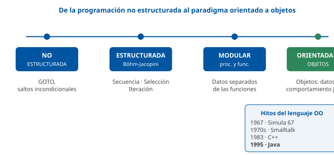

------------------------------------------------------------------------

### D2 · Los 4 pilares de la POO

**Sección**: §1.2 — Pilares fundamentales de la POO **Propósito**: Presentar de un vistazo abstracción, encapsulamiento, herencia y polimorfismo.

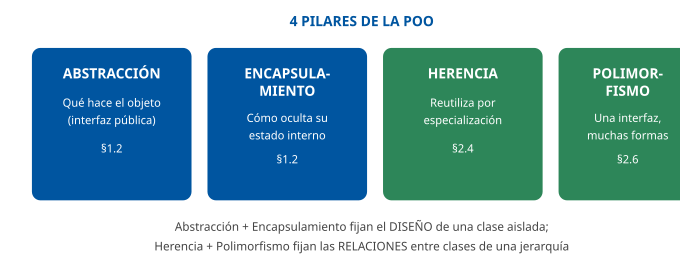

------------------------------------------------------------------------

### D3 · Principios SOLID

**Sección**: §1.4 — Principios SOLID de diseño de software **Propósito**: Cheat sheet de las cinco letras del acrónimo con su nombre y su idea clave.

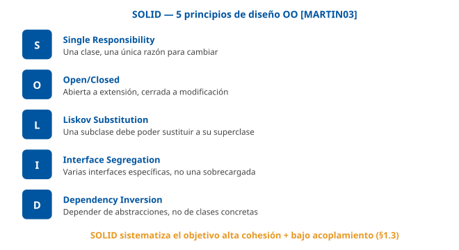

------------------------------------------------------------------------

### D4 · Anatomía de una clase y un objeto

**Sección**: §2.1-2.2 — Clases y objetos; atributos, métodos y constructores **Propósito**: Distinguir visualmente la clase (plantilla) de sus instancias (objetos).

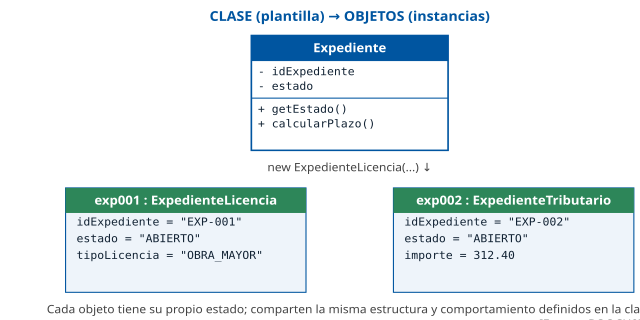

------------------------------------------------------------------------

### D5 · Modificadores de visibilidad

**Sección**: §2.3 — Visibilidad y control de acceso **Propósito**: Visualizar el alcance de los cuatro modificadores de acceso de Java.

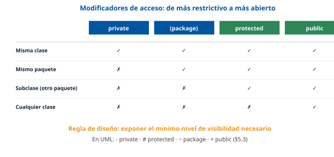

------------------------------------------------------------------------

### D6 · Herencia simple frente a herencia múltiple

**Sección**: §2.4 — Mecanismos avanzados en POO: herencia simple y múltiple **Propósito**: Contrastar la herencia simple de Java con la múltiple de C++ y el problema del diamante.

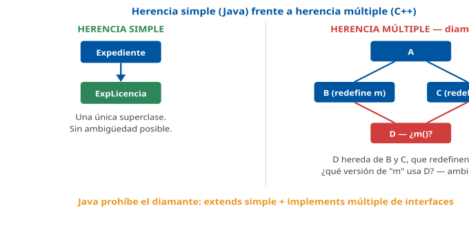

------------------------------------------------------------------------

### D7 · Sobrecarga frente a sobrescritura

**Sección**: §2.5 — Sobrecarga y sobrescritura de métodos **Propósito**: Contraste directo entre overloading (compilación) y overriding (ejecución).

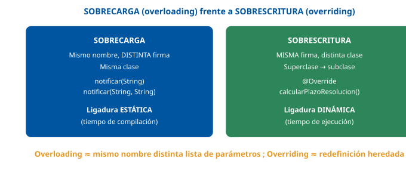

------------------------------------------------------------------------

### D8 · Polimorfismo y ligadura dinámica

**Sección**: §2.6 — Polimorfismo y ligadura dinámica **Propósito**: Mostrar cómo una variable de tipo superclase invoca, en ejecución, el método de la clase real del objeto.

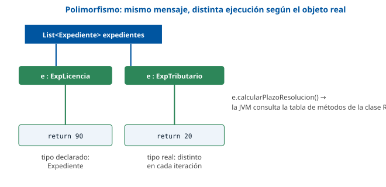

------------------------------------------------------------------------

### D9 · Catálogo de patrones GoF (23)

**Sección**: §4.1-4.5 — Concepto, catálogo y clasificación técnica de patrones de diseño **Propósito**: Distribución de los 23 patrones GoF en sus tres familias, para memorizar la cifra exacta.

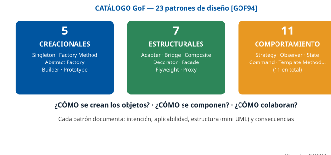

------------------------------------------------------------------------

### D10 · Patrón Factory Method aplicado

**Sección**: §4.3 — Clasificación técnica: patrones creacionales **Propósito**: Mini diagrama de clases UML del patrón Factory Method sobre la jerarquía Expediente.

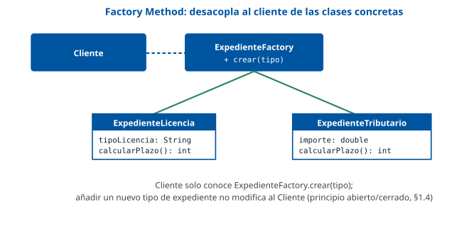

------------------------------------------------------------------------

### D11 · Notación del Diagrama de Clases UML

**Sección**: §5.3 — Diagramas estructurales y estáticos **Propósito**: Fijar la notación de caja de 3 compartimentos y los 5 tipos de relación entre clases.

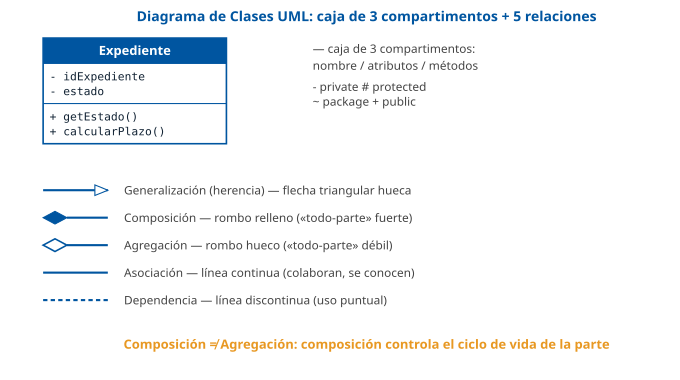

------------------------------------------------------------------------

### D12 · Familias de diagramas UML de comportamiento

**Sección**: §5.5-5.7 — Diagramas de comportamiento: casos de uso, interacción y estados/actividades **Propósito**: Visión de conjunto de los tres bloques de diagramas de comportamiento más utilizados.

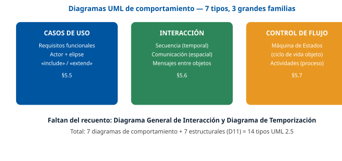

## Casos prácticos

Los tres casos recorren el tema sobre la jerarquía `Expediente / ExpedienteLicencia / ExpedienteTributario` (ver la pestaña Contenido, «Convenciones»), en **Java**: el **Caso 1** trabaja el **diseño de clases** (herencia, encapsulamiento, sobrecarga y sobrescritura); el **Caso 2**, la **aplicación de patrones de diseño** (Factory Method y Strategy) al mismo dominio; y el **Caso 3**, el **modelado UML** (diagrama de clases y diagrama de secuencia) del flujo de tramitación.

------------------------------------------------------------------------

### Caso 1 — Diseño de clases para la tramitación de licencias

#### Enunciado

El Área de Urbanismo necesita digitalizar la tramitación de licencias. Se pide diseñar en **Java** una pequeña jerarquía de clases sobre el dominio `Expediente(idExpediente, estado, fechaApertura)` que represente dos tipos de expediente: **licencias de obra** (con un atributo `tipoLicencia` de valores `"OBRA_MENOR"`, `"OBRA_MAYOR"` o `"ACTIVIDAD"`) y **licencias de terraza** (con un atributo `metrosCuadrados`), cada una con su propia regla de cálculo del plazo de resolución.

#### Cuestiones

**Cuestión 1 — Clase base y encapsulamiento (3 puntos).** Diseñe la clase abstracta `Expediente`, con los atributos `idExpediente` y `estado` correctamente encapsulados (visibilidad adecuada), un constructor que inicialice el expediente en estado `"ABIERTO"`, y un método abstracto `calcularPlazoResolucion()`.

**Cuestión 2 — Herencia y sobrescritura (3 puntos).** Diseñe las subclases `ExpedienteLicenciaObra` y `ExpedienteLicenciaTerraza`, cada una con su atributo propio y su implementación de `calcularPlazoResolucion()`: para obra, 90 días si `tipoLicencia` es `"OBRA_MAYOR"` y 30 en el resto de casos; para terraza, 15 días si `metrosCuadrados` es menor o igual a 20, y 30 en caso contrario.

**Cuestión 3 — Sobrecarga (2 puntos).** Añada a `Expediente` dos versiones **sobrecargadas** del método `notificar`: una que reciba solo un `String mensaje` (usa el canal por defecto) y otra que reciba además un `String canal`.

**Cuestión 4 — Razonamiento de diseño (2 puntos).** ¿Por qué `Expediente` debe ser una clase **abstracta** y no una clase concreta con una implementación por defecto de `calcularPlazoResolucion()` que devuelva, por ejemplo, 30 días? Razone la respuesta en términos de los principios SOLID vistos en §1.4.

#### Solución orientativa

- **C1**: atributos `private`, constructor que fija `estado = "ABIERTO"`, método abstracto sin cuerpo (§2.1-2.3).

&nbsp;

    public abstract class Expediente {
        private String idExpediente;
        private String estado;

        public Expediente(String idExpediente) {
            this.idExpediente = idExpediente;
            this.estado = "ABIERTO";
        }

        public abstract int calcularPlazoResolucion();

        public String getEstado() { return estado; }
        public String getIdExpediente() { return idExpediente; }
    }

- **C2**: cada subclase invoca `super(idExpediente)` y sobrescribe el método abstracto con `@Override` (§2.4-2.5).

&nbsp;

    public class ExpedienteLicenciaObra extends Expediente {
        private String tipoLicencia;

        public ExpedienteLicenciaObra(String id, String tipoLicencia) {
            super(id);
            this.tipoLicencia = tipoLicencia;
        }

        @Override
        public int calcularPlazoResolucion() {
            return "OBRA_MAYOR".equals(tipoLicencia) ? 90 : 30;
        }
    }

    public class ExpedienteLicenciaTerraza extends Expediente {
        private double metrosCuadrados;

        public ExpedienteLicenciaTerraza(String id, double metrosCuadrados) {
            super(id);
            this.metrosCuadrados = metrosCuadrados;
        }

        @Override
        public int calcularPlazoResolucion() {
            return metrosCuadrados <= 20 ? 15 : 30;
        }
    }

- **C3**: mismo nombre, distinta firma, resuelto en tiempo de compilación (§2.5).

&nbsp;

    public void notificar(String mensaje) {
        notificar(mensaje, "SEDE_ELECTRONICA");  // canal por defecto
    }

    public void notificar(String mensaje, String canal) {
        System.out.println("[" + canal + "] " + mensaje);
    }

- **C4**: si `Expediente` fuera concreta con una implementación por defecto arbitraria (30 días), violaría el **principio de responsabilidad única (SRP)** al mezclar "qué es un expediente" con una regla de negocio genérica que no corresponde a ningún tipo real, y sobre todo debilitaría el **principio abierto/cerrado (OCP)**: cualquier desarrollador podría olvidar sobrescribir el método en una subclase nueva y el sistema devolvería silenciosamente un plazo incorrecto (30 días) en lugar de fallar en compilación. Declarar el método `abstract` obliga al compilador a exigir la implementación en cada subclase concreta, haciendo explícito el contrato (§1.4, §2.1).

#### Criterios de evaluación

| Criterio | Puntos |
|----|----|
| Clase abstracta con encapsulamiento y constructor correctos | 3 |
| Herencia y sobrescritura correctas en ambas subclases, con reglas exactas | 3 |
| Sobrecarga de `notificar` con firmas distintas y delegación correcta | 2 |
| Razonamiento SOLID (SRP/OCP) sobre por qué debe ser abstracta | 2 |

------------------------------------------------------------------------

#### Preguntas tipo test sobre este caso

##### 1. En el supuesto planteado, ¿qué visibilidad deben tener los atributos idExpediente y estado de la clase Expediente para que queden correctamente encapsulados?

- a) public, para que el controlador y las subclases puedan leerlos y modificarlos directamente.
- b) protected, para que cualquier clase de la aplicación pueda consultarlos sin métodos get.
- c) private, de modo que solo se acceda a ellos a través de métodos públicos como getEstado().

**Respuesta correcta:** c) · **Referencia:** Caso 1, cuestión 1 · §2.3

La regla de diseño es exponer el mínimo nivel de visibilidad: atributos casi siempre private, accesibles solo mediante métodos get/set que pueden validar el valor.

##### 2. Desde un método de la subclase ExpedienteLicenciaObra, situada en otro paquete, ¿puede leerse directamente el atributo private estado heredado de Expediente?

- a) No: un atributo private solo es accesible desde su propia clase; la subclase debe usar getEstado().
- b) Sí: las subclases heredan el acceso directo a todos los atributos de la superclase.
- c) Sí: basta con marcar el método de la subclase con la anotación @Override.

**Respuesta correcta:** a) · **Referencia:** Caso 1, cuestión 1 · §2.3

Según la tabla de modificadores de Java, private es visible solo en la misma clase: ni desde el mismo paquete ni desde subclases.

##### 3. Expediente solo tiene un constructor, que recibe el identificador. Si en ExpedienteLicenciaObra se omitiera la llamada super(id), ¿qué ocurriría?

- a) El objeto se crearía igualmente, con el identificador y el estado sin inicializar y sin ningún aviso.
- b) Error de compilación: Java intentaría invocar un constructor sin argumentos de Expediente, que no existe.
- c) Java llamaría automáticamente a super(id) usando el identificador recibido por la subclase.

**Respuesta correcta:** b) · **Referencia:** Caso 1, cuestión 2 · §2.2

Si la subclase no invoca explícitamente un constructor de la superclase, Java invoca el constructor sin argumentos; si este no existe, se produce un error de compilación.

##### 4. Se registra una licencia de obra con tipoLicencia «ACTIVIDAD». ¿Qué plazo de resolución devuelve calcularPlazoResolucion()?

- a) 30 días, porque solo «OBRA_MAYOR» tiene un plazo distinto.
- b) 90 días, porque toda licencia de obra tiene el plazo largo.
- c) 15 días, porque «ACTIVIDAD» no es una obra propiamente dicha.

**Respuesta correcta:** a) · **Referencia:** Caso 1, cuestión 2

La regla de la subclase de obra es: 90 días si tipoLicencia es «OBRA_MAYOR» y 30 en el resto de casos, entre ellos «ACTIVIDAD».

##### 5. Una solicitud de terraza declara exactamente 20 metros cuadrados. ¿Qué plazo devuelve calcularPlazoResolucion()?

- a) 30 días, porque a partir de 20 metros cuadrados se aplica el plazo largo.
- b) 90 días, el mismo plazo que se aplica a una licencia de obra mayor.
- c) 15 días, porque la condición es menor o igual a 20 metros cuadrados.

**Respuesta correcta:** c) · **Referencia:** Caso 1, cuestión 2

La regla de terraza es metrosCuadrados <= 20 → 15 días; solo por encima de 20 se aplican 30 días.

##### 6. ¿Qué aporta la anotación @Override sobre calcularPlazoResolucion() en cada subclase?

- a) Hace que la versión que se ejecuta se decida en tiempo de compilación, no de ejecución.
- b) Hace que el compilador verifique que existe en la superclase un método con la misma firma.
- c) Es obligatoria: sin ella, Java ejecutaría siempre la versión de la superclase Expediente.

**Respuesta correcta:** b) · **Referencia:** Caso 1, cuestión 2 · §2.5

@Override es opcional pero recomendada: obliga al compilador a comprobar que realmente se está sobrescribiendo un método de igual firma de la superclase.

##### 7. Las dos versiones de notificar (una con mensaje y otra con mensaje y canal) conviven en Expediente. ¿Qué mecanismo es y cuándo se decide cuál se invoca?

- a) Sobrecarga: mismo nombre y distinta firma; el compilador elige la versión en tiempo de compilación.
- b) Sobrescritura: misma firma y distinta clase; la JVM elige la versión en tiempo de ejecución.
- c) Polimorfismo: misma firma en la misma clase; la versión depende del objeto real que la recibe.

**Respuesta correcta:** a) · **Referencia:** Caso 1, cuestión 3 · §2.5

La sobrecarga define en la misma clase varios métodos con el mismo nombre y distinta lista de parámetros, y se resuelve por ligadura estática, en compilación.

##### 8. Una lista declarada como List<Expediente> contiene una licencia de obra «OBRA_MAYOR» y una terraza de 12 m². Al recorrerla llamando a calcularPlazoResolucion(), ¿qué se obtiene?

- a) 30 y 30, porque se ejecuta la versión correspondiente al tipo declarado Expediente.
- b) 90 y 15, porque se ejecuta la versión de la clase real de cada objeto (ligadura dinámica).
- c) Un error de compilación, porque el método está declarado como abstracto en Expediente.

**Respuesta correcta:** b) · **Referencia:** Caso 1, cuestión 2 · §2.6

Con el polimorfismo, al invocar un método sobrescrito se ejecuta la versión de la clase real del objeto, no la del tipo declarado de la variable.

##### 9. ¿Por qué conviene que calcularPlazoResolucion() sea abstracto en lugar de tener en Expediente una implementación por defecto de 30 días?

- a) Porque los métodos abstractos se resuelven con ligadura estática y son más rápidos de ejecutar.
- b) Porque Java no permite que una clase concreta tenga subclases que sobrescriban sus métodos.
- c) Porque así el compilador exige la implementación en cada subclase y no se devuelve un plazo erróneo en silencio.

**Respuesta correcta:** c) · **Referencia:** Caso 1, cuestión 4 · §1.4

Con un valor por defecto, una subclase nueva que olvidara sobrescribir el método devolvería 30 días sin avisar; declararlo abstracto convierte ese olvido en un error de compilación.

##### 10. Urbanismo añade un nuevo tipo de expediente creando otra subclase de Expediente, sin tocar el código que ya trabaja con Expediente. ¿Qué principio SOLID se está respetando?

- a) El principio abierto/cerrado: abierto a extensión y cerrado a modificación.
- b) El principio de responsabilidad única: una sola razón para cambiar.
- c) El principio de segregación de interfaces: interfaces específicas de cliente.

**Respuesta correcta:** a) · **Referencia:** Caso 1, cuestión 4 · §1.4

Añadir un nuevo tipo de expediente no debería obligar a modificar el código que ya trata con Expediente: basta con crear una nueva subclase. Es el principio abierto/cerrado.

### Caso 2 — Aplicación de patrones de diseño al alta de expedientes

#### Enunciado

El módulo de registro necesita: (a) crear el tipo de expediente correcto (obra o terraza, del Caso 1) a partir de un código recibido desde el formulario web, sin que el controlador web conozca las clases concretas; y (b) notificar al ciudadano por el canal que haya elegido (correo, SMS o sede electrónica), pudiendo añadirse nuevos canales en el futuro sin modificar el código existente.

#### Cuestiones

**Cuestión 1 — Elección del patrón (2 puntos).** ¿Qué patrón creacional del catálogo GoF aplicaría para resolver la necesidad (a)? Justifique por qué encaja mejor que instanciar directamente cada subclase con `new` en el controlador.

**Cuestión 2 — Implementación del patrón creacional (3 puntos).** Escriba en Java la clase que aplica el patrón elegido en C1, con un método `crear(String tipo, ...)` que devuelva el `Expediente` correspondiente.

**Cuestión 3 — Elección y aplicación del patrón de comportamiento (3 puntos).** ¿Qué patrón de comportamiento aplicaría para resolver la necesidad (b)? Defina en Java la interfaz correspondiente y una implementación para el canal `SEDE_ELECTRONICA`.

**Cuestión 4 — Consecuencias del diseño (2 puntos).** Explique, en términos del principio abierto/cerrado (§1.4), qué cambia en el código existente si el Ayuntamiento añade un tercer tipo de expediente (`ExpedienteVadoPermanente`) y un cuarto canal de notificación (push en la app municipal).

#### Solución orientativa

- **C1**: **Factory Method**. Instanciar directamente con `new ExpedienteLicenciaObra(...)` o `new ExpedienteLicenciaTerraza(...)` en el controlador acopla el código web a las clases concretas y obliga a modificar el controlador cada vez que se añada un tipo nuevo, violando OCP (§4.1, §4.3).

&nbsp;

- **C2**:

&nbsp;

    public class ExpedienteFactory {
        public static Expediente crear(String tipo, String id, Object datoExtra) {
            return switch (tipo) {
                case "OBRA"    -> new ExpedienteLicenciaObra(id, (String) datoExtra);
                case "TERRAZA" -> new ExpedienteLicenciaTerraza(id, (Double) datoExtra);
                default -> throw new IllegalArgumentException("Tipo de expediente no soportado: " + tipo);
            };
        }
    }

- **C3**: **Strategy**, para intercambiar el algoritmo de envío sin tocar el código que decide "cuándo" notificar (§4.5, §1.4).

&nbsp;

    public interface CanalNotificacion {
        void enviar(String destinatario, String mensaje);
    }

    public class NotificacionSedeElectronica implements CanalNotificacion {
        @Override
        public void enviar(String destinatario, String mensaje) {
            System.out.println("[SEDE] Para " + destinatario + ": " + mensaje);
        }
    }

- **C4**: con Factory Method, añadir `ExpedienteVadoPermanente` solo exige un nuevo `case` en `ExpedienteFactory.crear(...)` y la nueva clase; el controlador que invoca la fábrica **no cambia**. Con Strategy, añadir la notificación push solo exige una nueva clase `NotificacionPush implements CanalNotificacion`; el código que recibe una referencia `CanalNotificacion` y llama a `enviar(...)` **tampoco cambia**. En ambos casos el sistema queda **abierto a extensión, cerrado a modificación** (§1.4): se añade código nuevo, no se toca el existente.

#### Criterios de evaluación

| Criterio | Puntos |
|----|----|
| Identifica Factory Method y justifica correctamente frente a `new` directo | 2 |
| Implementación correcta de la fábrica, con manejo del caso no soportado | 3 |
| Identifica Strategy, define interfaz e implementación correctas | 3 |
| Explica correctamente el cumplimiento de OCP en ambas extensiones | 2 |

------------------------------------------------------------------------

#### Preguntas tipo test sobre este caso

##### 1. Para crear el tipo de expediente correcto a partir del código recibido del formulario, sin que el controlador web conozca las clases concretas, ¿qué patrón creacional GoF se aplica?

- a) Factory Method, que delega en una fábrica la decisión de qué clase concreta instanciar.
- b) Singleton, que garantiza una única instancia global del expediente que se va a crear.
- c) Prototype, que crea cada expediente nuevo clonando un expediente ya existente.

**Respuesta correcta:** a) · **Referencia:** Caso 2, cuestión 1 · §4.3

Factory Method desacopla al código cliente de las clases concretas que se crean; el controlador pide un Expediente y la fábrica decide si es de obra o de terraza.

##### 2. ¿Qué inconveniente tendría instanciar directamente con new cada subclase dentro del controlador web?

- a) Que new es más lento que una fábrica, porque reserva memoria cada vez que se ejecuta.
- b) Que Java no permite instanciar subclases fuera del paquete donde se declara la superclase.
- c) Que acopla el controlador a las clases concretas y obliga a modificarlo al añadir un tipo nuevo.

**Respuesta correcta:** c) · **Referencia:** Caso 2, cuestión 1 · §4.3

Escribir new ExpedienteLicenciaObra(...) en el cliente lo acopla a las clases concretas; cada tipo nuevo obligaría a tocar el controlador, en contra del principio abierto/cerrado.

##### 3. La fábrica recibe desde el formulario un código de tipo que todavía no está soportado. ¿Cómo debe comportarse el método crear?

- a) Devolver null, para que el controlador decida después qué hacer con la solicitud.
- b) Lanzar una IllegalArgumentException que indique que el tipo de expediente no está soportado.
- c) Crear por defecto una licencia de obra, que es el tipo de expediente más frecuente.

**Respuesta correcta:** b) · **Referencia:** Caso 2, cuestión 2 · §4.3

La rama default del switch de la fábrica lanza IllegalArgumentException(«Tipo no soportado…»): el caso no previsto se trata de forma explícita.

##### 4. ¿Qué tipo de retorno debe declarar el método crear de ExpedienteFactory?

- a) Object, para que la fábrica pueda devolver cualquier clase de la aplicación.
- b) ExpedienteLicenciaObra, porque es la primera subclase contemplada en el switch.
- c) Expediente, la superclase abstracta, para que el controlador solo dependa de la abstracción.

**Respuesta correcta:** c) · **Referencia:** Caso 2, cuestión 2 · §4.3

La fábrica devuelve un Expediente: el código cliente trabaja con la superclase y no sabe qué subclase concreta se ha creado.

##### 5. Para notificar al ciudadano por el canal que haya elegido (correo, SMS o sede electrónica), pudiendo añadirse canales nuevos, ¿qué patrón de comportamiento se aplica?

- a) Strategy, que encapsula algoritmos intercambiables tras una interfaz común.
- b) Observer, que avisa a todos los suscriptores cuando cambia el estado del sujeto.
- c) Singleton, que mantiene un único canal global para todas las notificaciones.

**Respuesta correcta:** a) · **Referencia:** Caso 2, cuestión 3 · §4.5

Strategy encapsula una familia de algoritmos intercambiables (los canales de notificación) tras una interfaz común, seleccionable en tiempo de ejecución.

##### 6. El código que notifica depende de la interfaz CanalNotificacion y no de clases concretas como el envío por SMTP. ¿Qué principio SOLID se cumple así?

- a) El de sustitución de Liskov.
- b) El de inversión de dependencias.
- c) El de responsabilidad única.

**Respuesta correcta:** b) · **Referencia:** Caso 2, cuestión 3 · §1.4

El principio de inversión de dependencias pide que los módulos dependan de abstracciones (interfaces), no de implementaciones concretas; depender de una clase EnvioCorreoSMTP lo violaría.

##### 7. El Ayuntamiento añade un cuarto canal: notificación push en la app municipal. ¿Qué cambio exige el diseño propuesto?

- a) Añadir en el código que notifica una nueva rama if para el canal push.
- b) Añadir a la interfaz CanalNotificacion un método enviarPush específico.
- c) Crear una clase NotificacionPush que implemente CanalNotificacion.

**Respuesta correcta:** c) · **Referencia:** Caso 2, cuestión 4 · §1.4

Con Strategy, el canal nuevo es una implementación más de la interfaz; el código que recibe un CanalNotificacion y llama a enviar(...) no cambia.

##### 8. Se añade además el tipo ExpedienteVadoPermanente. ¿Qué hay que modificar?

- a) Crear la nueva subclase y añadir su case en la fábrica; el controlador que la invoca no cambia.
- b) Modificar el controlador web para que instancie directamente la nueva subclase con new.
- c) Nada: la fábrica detecta y crea automáticamente cualquier subclase nueva de Expediente.

**Respuesta correcta:** a) · **Referencia:** Caso 2, cuestión 4 · §4.3

Con la fábrica, un tipo nuevo solo afecta a la nueva clase y a ExpedienteFactory; el código cliente que llama a crear(...) permanece igual.

##### 9. ¿A qué familias del catálogo GoF pertenecen los dos patrones aplicados en el supuesto?

- a) Ambos pertenecen a la familia de los patrones estructurales.
- b) Factory Method es creacional y Strategy, de comportamiento.
- c) Factory Method es de comportamiento y Strategy, creacional.

**Respuesta correcta:** b) · **Referencia:** Caso 2, cuestiones 1 y 3 · §4.3 y §4.5

Los creacionales abstraen la instanciación de objetos (Factory Method); los de comportamiento, cómo colaboran y se reparten responsabilidades los objetos (Strategy).

##### 10. Si en lugar de fábrica y estrategia el controlador web concentrara la creación de todos los tipos de expediente y el envío por todos los canales, ¿en qué anti-patrón se incurriría?

- a) Golden Hammer, por aplicar a todo el mismo patrón conocido.
- b) Herencia por conveniencia, por heredar solo para reutilizar.
- c) God Object, por acumular demasiadas responsabilidades.

**Respuesta correcta:** c) · **Referencia:** Caso 2, cuestión 4 · §4.2

Una clase que acumula demasiadas responsabilidades y controla la mayor parte del sistema es un God Object: viola el principio de responsabilidad única.

### Caso 3 — Modelado UML del flujo de tramitación

#### Enunciado

Antes de programar el módulo de licencias del Caso 1, el equipo de análisis necesita fijar el diseño con UML para validarlo con el Área de Urbanismo. Se pide modelar, con la notación estudiada en §5, tanto la estructura estática de clases como el flujo dinámico de una solicitud.

#### Cuestiones

**Cuestión 1 — Diagrama de Clases (4 puntos).** Describa, con la notación de UML (compartimentos, visibilidad y tipo de relación), el diagrama de clases de `Expediente`, `ExpedienteLicenciaObra`, `ExpedienteLicenciaTerraza` y `CanalNotificacion` (Caso 2), incluyendo el tipo exacto de relación entre `Expediente` y `CanalNotificacion` si un expediente mantiene una referencia permanente a su canal de notificación preferido.

**Cuestión 2 — Diagrama de Casos de Uso (2 puntos).** Identifique el actor y el caso de uso principal de "solicitar una licencia de obra", y proponga una relación `«include»` con otro caso de uso que sea un paso obligatorio y reutilizado en otras solicitudes.

**Cuestión 3 — Diagrama de Secuencia (3 puntos).** Describa, en orden temporal, los mensajes intercambiados entre `Ciudadano`, `PortalWeb`, `ExpedienteFactory` y el `Expediente` creado, desde que el ciudadano envía el formulario hasta que recibe la confirmación con el plazo de resolución.

**Cuestión 4 — Elección del diagrama (1 punto).** Si el objetivo fuera mostrar, en un mismo esquema, en qué distrito de la administración física reside el servidor que aloja el módulo de licencias, ¿qué diagrama UML usaría, y de qué familia (estructural o de comportamiento) es?

#### Solución orientativa

- **C1**: `Expediente` es la superclase abstracta; `ExpedienteLicenciaObra` y `ExpedienteLicenciaTerraza` se conectan a ella con una flecha de **generalización** (triángulo hueco). La relación entre `Expediente` y `CanalNotificacion` es una **asociación** (§2.8, §5.3): `Expediente` conoce y colabora con `CanalNotificacion` a través de una referencia permanente (un atributo), pero no controla su ciclo de vida (el canal existe con independencia del expediente). Con las definiciones de §2.8, el criterio para elegir entre asociación y agregación es si la relación se lee como «todo-parte»: el canal no es una *parte* del expediente, sino un colaborador al que el expediente encarga el envío, así que la respuesta preferente es **asociación**. Se admite también **agregación** si se razona como «todo-parte débil» con un contenido de vida independiente, por analogía con el Funcionario tramitador del ejemplo de §2.8. No serían correctas la **composición** (el expediente no gestiona el ciclo de vida del canal) ni la **dependencia** (hay una referencia permanente como atributo, no un uso puntual).

&nbsp;

- **C2**: actor **Ciudadano**; caso de uso principal **"Solicitar licencia de obra"**, que incluye (`«include»`) el caso de uso **"Autenticarse en sede electrónica"**, paso obligatorio también en otras solicitudes (licencia de terraza, alta de vado, etc.) (§5.5).

&nbsp;

- **C3**: `Ciudadano → PortalWeb: enviarSolicitud(datosFormulario)` · `PortalWeb → ExpedienteFactory: crear("OBRA", id, tipoLicencia)` · `ExpedienteFactory → ExpedienteLicenciaObra: new` (mensaje de creación) · `PortalWeb → ExpedienteLicenciaObra: calcularPlazoResolucion()` · `ExpedienteLicenciaObra --> PortalWeb: 90` (retorno, flecha discontinua) · `PortalWeb --> Ciudadano: confirmación con plazo = 90 días` (§5.6).

&nbsp;

- **C4**: **Diagrama de Despliegue**, de la familia **estructural** (§5.4): es el único diagrama UML centrado en los nodos de hardware y su ubicación física, frente al Diagrama de Componentes (organización lógica de módulos software) o al de Clases (diseño de código).

#### Criterios de evaluación

| Criterio | Puntos |
|----|----|
| Diagrama de clases correcto: compartimentos, generalización y relación Expediente-CanalNotificacion identificada como asociación | 4 |
| Actor, caso de uso principal y relación «include» correctos y justificados | 2 |
| Secuencia de mensajes completa y en el orden temporal correcto | 3 |
| Identifica correctamente el Diagrama de Despliegue y su familia | 1 |

------------------------------------------------------------------------

*Los tres casos son orientativos y pensados para la autoevaluación; las soluciones muestran una vía correcta, no la única posible. El código de los Casos 1 y 2 está escrito en Java; el Caso 3 se resuelve con descripciones textuales de la notación UML, sin depender de ninguna herramienta de modelado concreta.*

#### Preguntas tipo test sobre este caso

##### 1. En el diagrama de clases del módulo de licencias, ¿cuántos compartimentos tiene el rectángulo de la clase Expediente y qué contienen?

- a) Dos: el nombre de la clase y la lista de métodos.
- b) Tres: el nombre de la clase, sus atributos y sus métodos.
- c) Cuatro: nombre, atributos, métodos y relaciones con otras clases.

**Respuesta correcta:** b) · **Referencia:** Caso 3, cuestión 1 · §5.3

Cada clase se dibuja como un rectángulo con tres compartimentos: nombre, atributos y métodos, estos dos últimos con su visibilidad.

##### 2. ¿Cómo se anota en el diagrama de clases el atributo private idExpediente de tipo String?

- a) - idExpediente : String
- b) # idExpediente : String
- c) + idExpediente : String

**Respuesta correcta:** a) · **Referencia:** Caso 3, cuestión 1 · §2.3 y §5.3

En UML la visibilidad se anota con - (private), # (protected), ~ (package) y + (public).

##### 3. ¿Con qué notación se une ExpedienteLicenciaObra a Expediente en el diagrama de clases?

- a) Con un rombo relleno en el extremo de Expediente, que indica composición.
- b) Con una línea discontinua y flecha abierta, que indica una dependencia puntual.
- c) Con una flecha de generalización de punta triangular hueca hacia Expediente.

**Respuesta correcta:** c) · **Referencia:** Caso 3, cuestión 1 · §5.3

La herencia (generalización) se dibuja con una flecha de punta triangular hueca que apunta a la superclase.

##### 4. Cada expediente guarda una referencia permanente a su canal de notificación preferido. ¿Por qué esa relación NO es una composición?

- a) Porque la composición solo puede unir clases abstractas con sus subclases concretas.
- b) Porque el expediente no controla el ciclo de vida del canal, que existe con independencia de él.
- c) Porque la composición no admite que una clase guarde una referencia a otra como atributo.

**Respuesta correcta:** b) · **Referencia:** Caso 3, cuestión 1 · §2.8

En la composición el contenedor gestiona el ciclo de vida del contenido (si se destruye uno, se destruye el otro); el canal de notificación sigue existiendo aunque desaparezca el expediente.

##### 5. En el diagrama de casos de uso de «solicitar una licencia de obra», ¿cuál es el actor y cuál el caso de uso principal?

- a) Actor: Ciudadano; caso de uso: «Solicitar licencia de obra».
- b) Actor: PortalWeb; caso de uso: «Crear expediente de obra».
- c) Actor: ExpedienteFactory; caso de uso: «Calcular el plazo».

**Respuesta correcta:** a) · **Referencia:** Caso 3, cuestión 2 · §5.5

Los actores son roles externos que interactúan con el sistema, como el ciudadano; el caso de uso es la funcionalidad completa que el sistema le ofrece.

##### 6. «Autenticarse en sede electrónica» es un paso obligatorio de la solicitud y se reutiliza en otras (terraza, vado). ¿Qué relación lo une a «Solicitar licencia de obra»?

- a) «extend», porque amplía la solicitud solo bajo ciertas condiciones.
- b) Generalización, porque la autenticación es un tipo de solicitud.
- c) «include», porque es funcionalidad obligatoria y reutilizada.

**Respuesta correcta:** c) · **Referencia:** Caso 3, cuestión 2 · §5.5

«include» se usa para funcionalidad obligatoria y reutilizada por varios casos de uso; «extend», para funcionalidad opcional bajo ciertas condiciones.

##### 7. El equipo quiere reflejar también que «Adjuntar plano técnico» solo se añade a la solicitud cuando la licencia es de obra mayor. ¿Qué relación corresponde?

- a) «include», porque el plano forma parte de toda solicitud de licencia.
- b) «extend», porque es funcionalidad opcional que amplía el caso de uso bajo una condición.
- c) Asociación, porque el plano es un actor externo que interactúa con el sistema.

**Respuesta correcta:** b) · **Referencia:** Caso 3, cuestión 2 · §5.5

«extend» modela funcionalidad opcional que amplía otro caso de uso solo cuando se da una condición, como la obra mayor.

##### 8. En el diagrama de secuencia de la solicitud, ¿cuál es el primer mensaje?

- a) PortalWeb → ExpedienteFactory: crear("OBRA", id, tipoLicencia).
- b) ExpedienteFactory → ExpedienteLicenciaObra: new (mensaje de creación).
- c) Ciudadano → PortalWeb: enviarSolicitud(datosFormulario).

**Respuesta correcta:** c) · **Referencia:** Caso 3, cuestión 3 · §5.6

El escenario empieza cuando el ciudadano envía el formulario al portal; después el portal pide a la fábrica que cree el expediente y esta lo instancia.

##### 9. El expediente de obra mayor responde al portal con el plazo de 90 días. ¿Cómo se dibuja ese mensaje en el diagrama de secuencia?

- a) Como un mensaje de retorno, con flecha discontinua hacia la línea de vida de PortalWeb.
- b) Como un rombo relleno sobre la línea de vida del expediente que devuelve el valor.
- c) Como una flecha de punta triangular hueca que sube hacia el primer mensaje enviado.

**Respuesta correcta:** a) · **Referencia:** Caso 3, cuestión 3 · §5.6

Los mensajes son flechas horizontales entre líneas de vida, en orden temporal de arriba abajo; el retorno se dibuja con flecha discontinua.

##### 10. Para mostrar en qué ubicación física está el servidor que aloja el módulo de licencias, ¿qué diagrama UML se usa y de qué familia es?

- a) El Diagrama de Despliegue, de la familia de comportamiento.
- b) El Diagrama de Despliegue, de la familia estructural.
- c) El Diagrama de Componentes, de la familia estructural.

**Respuesta correcta:** b) · **Referencia:** Caso 3, cuestión 4 · §5.4

El Diagrama de Despliegue representa la arquitectura física (nodos de hardware y sus conexiones) y es uno de los siete diagramas estructurales; el de Componentes muestra la organización lógica del software.

## Fuentes

### Tier 1 — Canónicas

| ID | Referencia |
|----|----|
| `[BOOCH07]` | Booch, G.; Maksimchuk, R. A.; Engle, M. W.; et al. *Object-Oriented Analysis and Design with Applications* (3.ª ed.). Addison-Wesley. Obra de referencia del análisis y diseño OO: abstracción, clases, jerarquías. |
| `[MEYER97]` | Meyer, B. *Object-Oriented Software Construction* (2.ª ed.). Prentice Hall. Fundamento formal de encapsulamiento, contratos, herencia y polimorfismo; origen del principio abierto/cerrado. |
| `[GOF94]` | Gamma, E.; Helm, R.; Johnson, R.; Vlissides, J. *Design Patterns: Elements of Reusable Object-Oriented Software*. Addison-Wesley. Obra fundacional del catálogo de 23 patrones de diseño (Gang of Four). |
| `[MARTIN03]` | Martin, R. C. *Agile Software Development, Principles, Patterns, and Practices*. Prentice Hall. Formulación y nombrado de los cinco principios **SOLID**. |
| `[MARTIN00]` | Martin, R. C. (2000). *Design Principles and Design Patterns*. objectmentor.com. Artículo original que enuncia SRP, OCP, LSP, ISP, DIP antes de su acrónimo SOLID. |
| `[LISKOV94]` | Liskov, B.; Wing, J. M. (1994). *A Behavioral Notion of Subtyping*. ACM TOPLAS 16(6). Formulación formal del principio de sustitución de Liskov. |
| `[OMG-UML25]` | Object Management Group. *OMG Unified Modeling Language (OMG UML), Version 2.5.1* (formal/2017-12-05). Especificación normativa vigente del estándar UML. |
| `[RUMBAUGH05]` | Rumbaugh, J.; Jacobson, I.; Booch, G. *The Unified Modeling Language Reference Manual* (2.ª ed.). Addison-Wesley. Los «tres amigos» creadores de UML; manual de referencia de la notación. |
| `[FOWLER-UML]` | Fowler, M. *UML Distilled: A Brief Guide to the Standard Object Modeling Language* (3.ª ed.). Addison-Wesley. Guía concisa y muy citada de los diagramas UML de uso práctico. |
| `[LARMAN04]` | Larman, C. *Applying UML and Patterns* (3.ª ed.). Prentice Hall. Puente entre análisis orientado a objetos, UML y patrones GRASP. |
| `[SOMMERVILLE16]` | Sommerville, I. *Software Engineering* (10.ª ed.). Pearson. Modularidad, cohesión, acoplamiento y ciclo de vida del software como marco de ingeniería. |
| `[PRESSMAN14]` | Pressman, R. S.; Maxim, B. R. *Software Engineering: A Practitioner's Approach* (8.ª ed.). McGraw-Hill. Métricas de diseño OO, ventajas/inconvenientes del paradigma. |
| `[GOSLING-JLS]` | Gosling, J.; Joy, B.; Steele, G.; Bracha, G.; Buckley, A. *The Java Language Specification* (SE 21 ed.). Oracle/Addison-Wesley. Especificación normativa de clases, herencia, sobrecarga y ligadura en Java. |

### Tier 2 — Documentación de lenguaje y herramientas (ejemplos e ilustración)

| ID | Referencia |
|----|----|
| `[ORACLE-JTUT]` | Oracle Corporation. *The Java Tutorials — Trail: Learning the Java Language (Classes and Objects, Interfaces and Inheritance)*. docs.oracle.com. Referencia práctica de sintaxis para los ejemplos de código del tema. |
| `[UML-DIAG-TYPES]` | Object Management Group. *UML 2.5.1 §9 — Classification of Diagrams* (formal/2017-12-05). Clasificación oficial de los 14 tipos de diagrama UML en estructurales y de comportamiento. |
| `[REFACTORING-GURU]` | Shvets, A. *Refactoring.Guru — Design Patterns*. Catálogo divulgativo de los 23 patrones GoF con ejemplos multi-lenguaje, usado como referencia de consulta rápida (no como fuente normativa). |

### Tier 3 — Marco de calidad e ingeniería del software (contexto, no contenido técnico nuclear)

| ID | Referencia |
|----|----|
| `[ISO25010]` | ISO/IEC 25010:2023 *Systems and software Quality Requirements and Evaluation (SQuaRE) — Product quality model*. Anula y sustituye a la ISO/IEC 25010:2011: es la edición vigente del modelo de calidad del producto — mantenibilidad, modularidad, reutilización aplicadas al diseño OO. |
| `[ISO25010-2011]` | ISO/IEC 25010:2011 *Systems and software Quality Requirements and Evaluation (SQuaRE) — System and software quality models*. Anulada y sustituida por la ISO/IEC 25010:2023. Se conserva la referencia porque es la que recogen los temarios al uso. |
| `[ISO24765]` | ISO/IEC/IEEE 24765:2017 *Systems and software engineering — Vocabulary*. Definiciones normalizadas de clase, objeto, herencia, polimorfismo. |
| `[BOAM10032]` | BOAM 10.032 (23-dic-2025). Bases específicas TIC C1 Ayto. Madrid — temario oficial. |

------------------------------------------------------------------------

*Las referencias Tier 1 fijan el fundamento teórico del paradigma OO (Booch, Meyer), los principios de diseño (Martin, Liskov), el catálogo de patrones (GoF) y el estándar de modelado (OMG UML, Rumbaugh/Jacobson/Booch), y son la base de todo el contenido; Tier 2 se cita en los ejemplos de código —escritos en **Java** (coherente con que el Tema 21 desarrolla la arquitectura Java EE)— y en la clasificación oficial de diagramas UML; Tier 3 enmarca la calidad y la vocabulario normalizado de ingeniería del software aplicables al puesto TIC del Ayuntamiento de Madrid.*
