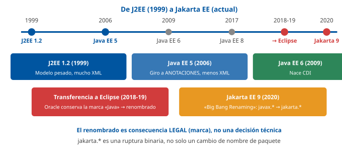
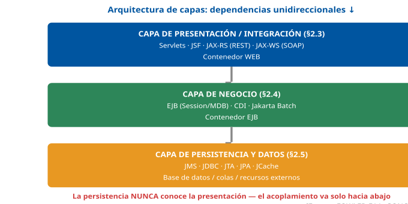
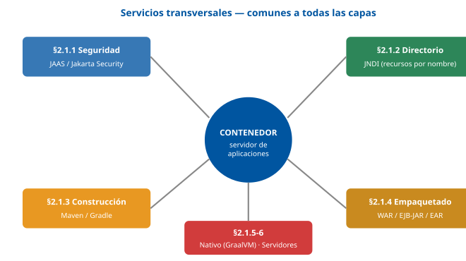
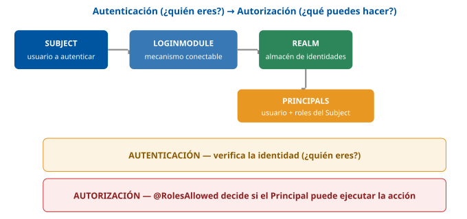
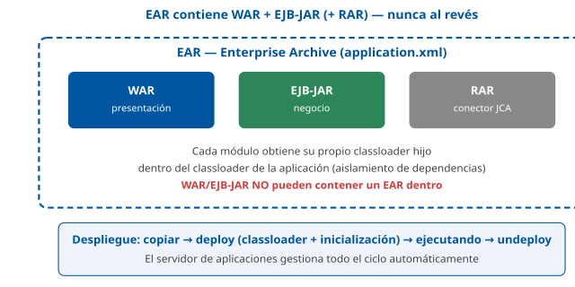
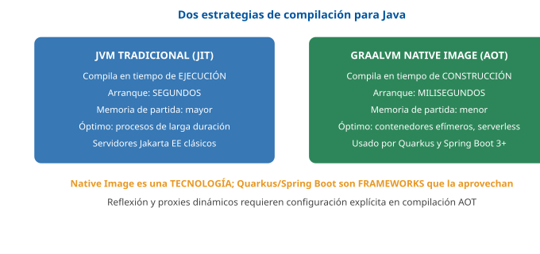
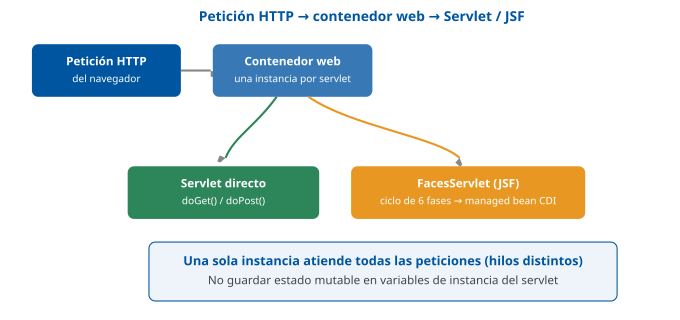
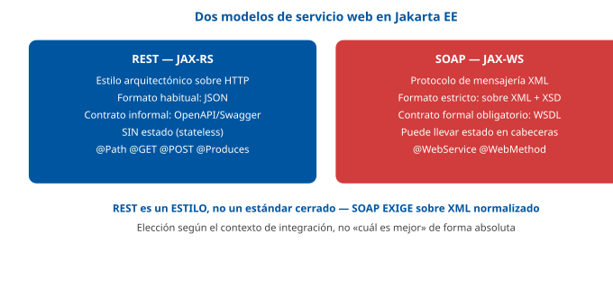
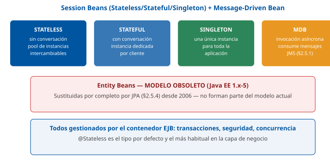

# Tema 21. La arquitectura Java EE

**Bloque:** técnico  
**Enunciado oficial** (BOAM n.º 10.032, de 23 de diciembre de 2025): La arquitectura Java EE: Características de funcionamiento. Elementos constitutivos. Productos y herramientas.

Versión web: <https://ayuntamientomadrid.github.io/temario-tecnico-auxiliar/temas/tema-21.html> · PDF: [tema-21.pdf](tema-21.pdf) · Test: [../../../tests/tecnico/tema-21.md](../../../tests/tecnico/tema-21.md)

## Índice

- 1. Introducción a Java EE
  - 1.1. Principios de la plataforma
  - 1.2. Evolución y contexto tecnológico
  - 1.3. De Java EE a Jakarta EE: evolución y gobernanza
- 2. Elementos constitutivos
  - 2.1. Componentes transversales
  - 2.2. Arquitectura de capas
  - 2.3. Capa de presentación/integración
  - 2.4. Capa de negocio
  - 2.5. Capa de persistencia y datos
- 3. Herramientas de desarrollo
  - 3.1. Gestión del rendimiento: Application Performance Manager (APM)
  - 3.2. Pruebas unitarias: JUnit, Mockito
  - 3.3. Pruebas de carga: JMeter
  - 3.4. Frameworks de desarrollo
- 4. Tendencias actuales en el desarrollo de aplicaciones empresariales Java

### Conceptos clave para memorizar

| Concepto | Dato clave |
|----|----|
| Java EE / Jakarta EE | Conjunto de especificaciones sobre Java SE para construir aplicaciones empresariales distribuidas, multicapa y gestionadas por un contenedor |
| Contenedor | Entorno de ejecución que gestiona el ciclo de vida, la seguridad, las transacciones y la concurrencia de los componentes, aplicando **inversión de control** |
| Especificación vs implementación | Java EE/Jakarta EE define **interfaces y contratos** (JSR / especificación Eclipse); cada servidor (GlassFish, WildFly, Payara…) es una **implementación** certificada |
| 2017-2019: transferencia a Eclipse | Oracle cede Java EE a la Eclipse Foundation; por conflicto de marca con «Java», el proyecto se renombra **Jakarta EE** |
| javax. *→ jakarta.* | Desde **Jakarta EE 9** (2020) todas las APIs cambian de paquete `javax.` *a `jakarta.`* — ruptura binaria, no solo de nombre |
| JAAS / Jakarta Security | Autenticación (quién eres) y autorización (qué puedes hacer) declarativas mediante `LoginModule`, `Realm`, roles |
| JNDI | API de localización de recursos por nombre (`DataSource`, EJB, colas JMS) en un árbol jerárquico, desacoplando la aplicación de la configuración física |
| WAR / EJB-JAR / EAR | Unidades de empaquetado: aplicación web / módulo de lógica de negocio / ensamblado completo de varios módulos |
| GraalVM Native Image | Compila Java **ahead-of-time** a un ejecutable nativo: arranque en milisegundos y memoria reducida, frente al arranque JIT de la JVM tradicional |
| Arquitectura de capas | Presentación → Negocio → Persistencia, con dependencias **unidireccionales** hacia abajo (patrón *Layers*) |
| Servlet | Componente que gestiona el ciclo `request-response` HTTP en el contenedor web; JSF se apoya en el mismo contenedor con un modelo de componentes de UI |
| REST vs SOAP | REST es un **estilo arquitectónico** sobre HTTP, orientado a recursos; SOAP es un **protocolo** con envoltura XML y contrato formal WSDL |
| EJB: Session/MDB/Entidad | Session (Stateless/Stateful/Singleton) para lógica de negocio invocada; Message-Driven para consumo asíncrono de JMS; Entidad (histórica, sustituida por JPA) |
| CDI | Inyección de dependencias **tipada** (`@Inject`) con ámbitos (`@RequestScoped`, `@SessionScoped`, `@ApplicationScoped`, `@Dependent`), unifica el modelo de componentes de toda la plataforma |
| JTA | Coordina transacciones **distribuidas** entre varios recursos (dos bases de datos, una BD y una cola JMS) mediante el protocolo de **commit en dos fases (2PC)** |
| JPA | Estándar de mapeo objeto-relacional (ORM): entidades anotadas, `EntityManager`, JPQL |
| Contenedor gestiona vs bean gestiona (BMT/CMT) | Las transacciones EJB pueden ser gestionadas por el **contenedor** (`CMT`, por defecto, declarativo) o por el **bean** (`BMT`, programático) |
| Pirámide de pruebas | Muchas pruebas unitarias (JUnit/Mockito) en la base, menos de integración, pocas de carga/end-to-end (JMeter) en la cima |

## Contenido

### Convenciones del documento

Este tema incluye cuatro tipos de **cajas callout** para facilitar el estudio:

> **Dato clave.** Información de alta densidad memorística.

> **Ejercicio resuelto.** Problema + solución paso a paso (diseño de un componente, elección arquitectónica razonada).

> **Ejemplo de aplicación en el ayto.** Aplicación real de la teoría al entorno municipal (Padrón, tributos, expedientes, licencias).

> **Relación con otros temas.** Enlace conceptual a otros temas del temario oficial.

Los ejemplos de **código** se escriben en **Java con anotaciones Jakarta EE reales** (`jakarta.`*), no en pseudocódigo neutro, porque este tema trata precisamente de esa plataforma y de sus APIs concretas — pseudocódigo agnóstico perdería el sentido didáctico. Se usa el **namespace** `jakarta.`*, vigente desde **Jakarta EE 9** (2020), como convención principal; donde procede se señala el namespace histórico `javax.*` como legado, relevante para leer código de aplicaciones anteriores a 2020 o del propio Java SE. Los fragmentos son deliberadamente breves e ilustrativos, no programas completos. Las fuentes se citan con etiquetas breves tipo `[JAKARTA-EJB]` o `[GONCALVES, cap. 4]`; el registro completo está en la pestaña Fuentes.

**Caso de referencia usado en todo el tema** (contexto Ayuntamiento de Madrid, simplificado): una aplicación **«Gestión de Expedientes y Tributos»**, con front-end web (JSF y una API REST), una capa de negocio con EJB/CDI que valida y liquida tributos, una capa de persistencia con JPA sobre la base de datos relacional del Tema 19, y una integración asíncrona por JMS que notifica a otros sistemas municipales cuando un expediente cambia de estado.

------------------------------------------------------------------------

### 1. Introducción a Java EE

#### 1.1. Principios de la plataforma

**Java EE** (*Java Platform, Enterprise Edition*), hoy **Jakarta EE**, es un conjunto de **especificaciones** que extienden **Java SE** (*Standard Edition*) con las capacidades necesarias para construir **aplicaciones empresariales**: distribuidas, multicapa, transaccionales, seguras y preparadas para un alto volumen de usuarios concurrentes \[JAKARTA-PLAT; GONCALVES, cap. 1\]. La idea central que distingue a la plataforma de escribir «Java a secas» es el **modelo de componentes gestionados por un contenedor**:

- **Componente**: una unidad de código con un contrato bien definido (un *servlet*, un *bean* de sesión, una entidad JPA) que el desarrollador escribe siguiendo las reglas de una especificación.
- **Contenedor** (*container*): el entorno de ejecución, provisto por el **servidor de aplicaciones**, que **instancia, gestiona el ciclo de vida y presta servicios transversales** a esos componentes —seguridad, transacciones, concurrencia, inyección de dependencias, acceso a recursos— sin que el desarrollador tenga que programarlos explícitamente.

Este reparto de responsabilidades es una aplicación del principio de **inversión de control** (*IoC*): en Java SE «a pelo», el programador escribe el `main()` y controla todo el ciclo de vida de sus objetos; en Java EE, es el **contenedor** quien crea los objetos, invoca sus métodos en el momento oportuno y les inyecta lo que necesitan — el desarrollador se limita a describir **qué** necesita el componente (mediante anotaciones o descriptores XML), no **cómo** obtenerlo.

> **Dato clave.** La diferencia esencial entre Java SE y Java EE no es «más librerías», sino un **modelo de programación distinto**: el contenedor invierte el control (*Hollywood principle*: «no nos llames, ya te llamaremos nosotros») y presta **servicios transversales declarativos** (seguridad, transacciones, concurrencia) que en Java SE habría que programar a mano \[JAKARTA-PLAT\].

Java EE/Jakarta EE se define, además, como una **plataforma de especificaciones**, no un producto: cada API (Servlets, EJB, CDI, JPA…) tiene una especificación formal, y los fabricantes de servidores (Oracle, Red Hat, Eclipse Foundation, IBM…) construyen **implementaciones** que deben pasar un **Technology Compatibility Kit** (TCK) para poder llamarse «compatibles con Jakarta EE». Esta separación especificación/implementación es la que permite, en teoría, **portar** una aplicación de un servidor a otro con cambios mínimos.

> **Relación con otros temas.** El **Tema 20** (diseño y programación orientada a objetos) es el fundamento directo de este tema: los componentes de Java EE (EJB, CDI beans, entidades JPA) son **clases Java** anotadas, y el contenedor aplica sobre ellas patrones de diseño estudiados en el Tema 20 (Factory, Proxy, Singleton, Observer) de forma transparente al desarrollador.

#### 1.2. Evolución y contexto tecnológico

La plataforma nace en **1999** como **J2EE 1.2** (*Java 2 Platform, Enterprise Edition*), impulsada por Sun Microsystems para dar respuesta a la necesidad de estandarizar el desarrollo de aplicaciones empresariales en Java, que hasta entonces se resolvía con soluciones propietarias de cada fabricante \[GONCALVES, cap. 1\]. Su evolución se puede resumir en tres grandes etapas:

| Etapa | Periodo | Rasgos |
|----|----|----|
| **J2EE** | 1999-2005 (1.2 → 1.4) | Modelo pesado: EJB 2.x con **interfaces home/remote** obligatorias, mucho **XML** de configuración (descriptores de despliegue), curva de aprendizaje alta. Provoca la aparición de alternativas como **Spring Framework** \[JOHNSON2002\]. |
| **Java EE** | 2006-2017 (5 → 8) | Giro hacia la **simplicidad**: Java EE 5 (2006) introduce **anotaciones** que sustituyen buena parte del XML; Java EE 6 (2009) introduce **CDI** y los **perfiles** (*Web Profile*); Java EE 7 (2013) añade **WebSocket**, **JSON-P**, **Batch**; Java EE 8 (2017) añade **JSON-B** y **Jakarta Security** (JSR 375). |
| **Jakarta EE** | 2018-presente | Oracle transfiere la plataforma a la **Eclipse Foundation** (§1.3); continúa la evolución con **Jakarta EE 9/9.1** (cambio de namespace), **10** (perfil *Core*, alineación con Java SE 11+) y **11** (alineación con Java SE 21, mayor integración con arquitecturas cloud-native). |

> **Dato clave.** Tres hitos: **1999**, nacimiento como **J2EE**; **2006** (Java EE 5), giro a **anotaciones** frente a XML, que simplifica radicalmente el modelo de programación; **2017-2019**, transferencia de Oracle a la **Eclipse Foundation** y renombrado a **Jakarta EE** \[GONCALVES, cap. 1\].

El **contexto tecnológico** que rodea a la plataforma también ha cambiado sustancialmente desde 1999: de aplicaciones monolíticas desplegadas en un único servidor de aplicaciones «pesado», el desarrollo empresarial Java ha evolucionado hacia **microservicios**, contenedores (Docker/Kubernetes) y **arranque rápido en la nube**, un contexto en el que perfiles ligeros de la propia plataforma y frameworks como **Quarkus** o **Spring Boot** (§2.1.5, §3.4) compiten y se complementan con los servidores de aplicaciones tradicionales.

#### 1.3. De Java EE a Jakarta EE: evolución y gobernanza

En **2017**, Oracle anunció su intención de transferir la gobernanza de Java EE a una fundación de código abierto independiente, con el objetivo declarado de **acelerar su evolución** fuera del proceso formal y más lento del **Java Community Process** (JCP) \[JAKARTA-PLAT\]. La **Eclipse Foundation** asumió el proyecto en **2018**, y el proceso de transferencia del código fuente y de la propiedad intelectual se completó durante **2018-2019**.

Sin embargo, Oracle **conservó la marca registrada «Java»**, lo que impidió a la Eclipse Foundation seguir usando el nombre «Java EE» sin autorización. Tras una consulta pública a la comunidad, el proyecto se renombró **Jakarta EE** (por «Eclipse Jakarta», el código en clave interno del proyecto) \[JAKARTA-PLAT\].

> **Dato clave.** El renombrado a **Jakarta EE** no fue una decisión técnica ni de marketing, sino la **consecuencia legal directa** de que Oracle retuvo los derechos de marca sobre «Java». Es un dato a menudo confundido con un simple «cambio de nombre por modernización».

Esta restricción de marca tuvo una consecuencia **técnica** de mucho mayor calado: Oracle tampoco permitió que las nuevas versiones de las especificaciones siguieran usando el **paquete Java** `javax.`*, reservado igualmente bajo su control. Como resultado, **Jakarta EE 9** (2020) llevó a cabo la llamada **«Gran Renombración»** (*Big Bang Renaming*): todas las APIs de la plataforma cambiaron su **paquete raíz** de `javax.`* a `jakarta.` *(por ejemplo, `javax.servlet.`* → `jakarta.servlet.`*; `javax.persistence.`* → `jakarta.persistence.*`).

    // Antes de Jakarta EE 9 (namespace legado, aún presente en código anterior a 2020)
    import javax.persistence.Entity;
    import javax.ejb.Stateless;

    // Desde Jakarta EE 9 (namespace vigente, usado en este tema)
    import jakarta.persistence.Entity;
    import jakarta.ejb.Stateless;

> **Dato clave.** El cambio `javax.` *→ `jakarta.`* en **Jakarta EE 9** es una **ruptura binaria** (*breaking change*), no un simple cambio cosmético: el código compilado contra `javax.` *no es compatible en tiempo de ejecución con contenedores que solo soportan `jakarta.`*, y las aplicaciones existentes requirieron una migración explícita (aunque las APIs, semánticamente, se mantuvieron casi idénticas en esa transición).

La **gobernanza** actual de Jakarta EE se organiza mediante el **Jakarta EE Working Group** dentro de la Eclipse Foundation, con un proceso de especificación abierto (**Jakarta EE Specification Process**, JESP) que sustituye al antiguo JCP para esta plataforma: cualquiera puede proponer y discutir cambios en un repositorio público, frente al proceso más cerrado y orientado a grandes fabricantes del JCP tradicional (que sigue vigente para Java SE).

> **Ejemplo de aplicación en el ayto.** Si el Ayuntamiento mantiene una aplicación de gestión de expedientes desarrollada sobre Java EE 7/8 (`javax.`*) y decide modernizar su plataforma de despliegue a un servidor compatible solo con Jakarta EE 10/11, no basta con actualizar el servidor: hay que **recompilar** la aplicación migrando todos los `import javax.`* a `jakarta.` *(existen herramientas automáticas de migración de bytecode, como el* Eclipse Transformer\*, precisamente para este escenario).

> **Relación con otros temas.** La distinción entre **especificación** (el JSR o la especificación Eclipse) e **implementación** (el servidor de aplicaciones concreto) es la misma idea que separa un **estándar** de sus **implementaciones** en el Tema 19 (ISO/IEC 9075 frente a PL/SQL, T-SQL…): un contrato normativo común, y varios productos que lo implementan con matices.

------------------------------------------------------------------------

### 2. Elementos constitutivos

#### 2.1. Componentes transversales

Antes de entrar en la arquitectura de capas (§2.2), conviene fijar un conjunto de **servicios transversales** (*cross-cutting concerns*) que el contenedor presta a **todas** las capas de una aplicación Java EE, con independencia de si el componente que los usa está en la capa de presentación, de negocio o de persistencia \[JAKARTA-PLAT; GONCALVES, cap. 3\]. Son «transversales» precisamente porque no pertenecen a una única capa: la seguridad protege tanto un *endpoint* REST como un método de negocio; la gestión de dependencias construye el proyecto entero; el empaquetado agrupa módulos de varias capas en un único artefacto desplegable.

##### 2.1.1. Seguridad y autenticación (JAAS/Jakarta Security)

La seguridad en Java EE se apoya, históricamente, en **JAAS** (*Java Authentication and Authorization Service*), incorporado ya en Java SE 1.4, y hoy se expresa a nivel de plataforma empresarial mediante la especificación **Jakarta Security** (JSR 375) \[JAKARTA-SEC\]. El modelo distingue con precisión dos preguntas distintas:

- **Autenticación** (*authentication*): «¿quién eres?». Verifica la identidad de quien realiza la petición, típicamente contrastando credenciales contra un **almacén de identidades** (*identity store*): una base de datos de usuarios, un directorio LDAP, un proveedor externo.
- **Autorización** (*authorization*): «¿qué puedes hacer?». Una vez autenticado, decide si el usuario tiene **permiso** para ejecutar una acción concreta, normalmente basándose en **roles**.

El vocabulario de JAAS, heredado por Jakarta Security, incluye piezas reutilizables en toda la plataforma:

| Concepto | Función |
|----|----|
| **Subject** | Representa a la entidad autenticada (un usuario, un sistema) durante la sesión de seguridad |
| **Principal** | Cada identidad asociada a un `Subject` (un nombre de usuario, un rol, un grupo) |
| **LoginModule** | Componente conectable que implementa un **mecanismo concreto** de autenticación (usuario/contraseña, certificado, LDAP…), siguiendo un patrón de complementos (*pluggable authentication*) |
| **Realm** | El almacén de identidades y roles contra el que se valida la autenticación, configurado a nivel de servidor de aplicaciones |

Jakarta Security moderniza este modelo con **anotaciones declarativas**, evitando escribir código de seguridad explícito en el componente:

    @ApplicationScoped
    @BasicAuthenticationMechanismDefinition(realmName = "expedientes-realm")
    public class ConfiguracionSeguridad { }

    @Path("/expedientes")
    @RolesAllowed("GESTOR_TRIBUTARIO")
    public class ExpedienteResource {
        @GET
        public Response listar() { /* ... */ return Response.ok().build(); }
    }

> **Dato clave.** Regla mnemotécnica: **autenticación es «quién», autorización es «qué puedes hacer»**. En Java EE la autorización se expresa casi siempre de forma **declarativa** con la anotación `@RolesAllowed` (o su equivalente XML en el descriptor de despliegue), no comprobando roles «a mano» dentro del método de negocio — es el contenedor quien intercepta la llamada y verifica el rol **antes** de ejecutar el código \[JAKARTA-SEC\].

> **Ejemplo de aplicación en el ayto.** El perfil «gestor tributario» (§1 del Tema 19, en el contexto DCL) se traduce, en la capa de aplicación, en un **rol** Jakarta Security: solo los usuarios autenticados con ese rol pueden invocar el *endpoint* REST que liquida un tributo; un ciudadano autenticado en la sede electrónica, sin ese rol, solo puede consultar sus propios expedientes.

> **Relación con otros temas.** El **Tema 39** (Esquema Nacional de Seguridad) exige mecanismos de autenticación proporcionados al nivel de seguridad del sistema y trazabilidad de accesos; los mecanismos declarativos de Jakarta Security son la forma en que esa exigencia normativa se materializa a nivel de aplicación \[ENS\].

##### 2.1.2. Servicios de directorio (JNDI)

**JNDI** (*Java Naming and Directory Interface*) es una API de **Java SE** (`javax.naming`, sin equivalente `jakarta.*` porque no forma parte de la especificación de la plataforma empresarial en sí, sino de la base sobre la que esta se apoya) que permite **localizar recursos por nombre** dentro de un espacio de nombres jerárquico, de forma análoga a como un sistema de ficheros localiza un fichero por su ruta \[ORACLE-JNDI\]. En Java EE, JNDI es el mecanismo estándar que **desacopla** el código de la aplicación de la **configuración física** de los recursos que usa: fuentes de datos (`DataSource`), fábricas de conexión JMS, referencias a otros EJB.

    // Búsqueda JNDI clásica (aunque hoy suele sustituirse por @Resource / @EJB, §2.4.2)
    InitialContext ctx = new InitialContext();
    DataSource ds = (DataSource) ctx.lookup("jdbc/ExpedientesDS");

En la práctica moderna, la mayoría del código de aplicación **no invoca JNDI explícitamente**: la **inyección de dependencias** de CDI (§2.4.2) y anotaciones como `@Resource` realizan la búsqueda JNDI **por debajo**, de forma transparente. Aun así, entender JNDI es imprescindible porque es el mecanismo que la **configuración del servidor de aplicaciones** usa para exponer esos recursos, y sigue siendo visible en la consola de administración de cualquier servidor Jakarta EE.

> **Dato clave.** JNDI es la pieza que permite que el **nombre lógico** de un recurso (`jdbc/ExpedientesDS`) usado dentro del código de la aplicación sea independiente de su **configuración física** (servidor, puerto, credenciales de la base de datos), que se define una sola vez en el servidor de aplicaciones. Cambiar de entorno (desarrollo → producción) no exige recompilar la aplicación, solo reconfigurar el recurso JNDI en el servidor.

> **Relación con otros temas.** El nombre lógico JNDI de un `DataSource` es exactamente el recurso al que se conecta **JDBC** (§2.5.2); JNDI es el **localizador**, JDBC es el **protocolo de acceso** a la base de datos una vez obtenida la conexión.

##### 2.1.3. Construcción: Maven, Gradle. Gestión de dependencias

Una aplicación Java EE real depende de decenas de bibliotecas (la propia API de la plataforma, frameworks, *drivers* de base de datos…), cuya descarga, versión y empaquetado no se gestionan a mano: se usan **herramientas de construcción** (*build tools*) \[MAVEN-DOC; GRADLE-DOC\].

**Apache Maven** define el ciclo de vida de la construcción mediante **convención sobre configuración** (una estructura de directorios fija, `src/main/java`, `src/main/resources`…) y un fichero declarativo, `pom.xml` (*Project Object Model*), donde se listan las **dependencias** con su coordenada `groupId:artifactId:version`, resueltas automáticamente desde un **repositorio** (Maven Central, o uno interno de la organización). Su ciclo de vida estándar encadena fases: `validate → compile → test → package → verify → install → deploy`.

    <dependency>
        <groupId>jakarta.platform</groupId>
        <artifactId>jakarta.jakartaee-api</artifactId>
        <version>10.0.0</version>
        <scope>provided</scope>
    </dependency>

**Gradle** resuelve el mismo problema con un modelo más flexible: un **DSL** (*Domain Specific Language*) en Groovy o Kotlin (`build.gradle` / `build.gradle.kts`) en lugar de XML declarativo puro, y un motor de ejecución basado en un **grafo de tareas** (*task graph*) con **caché incremental**, que solo re-ejecuta las tareas cuyas entradas han cambiado, lo que en proyectos grandes se traduce en construcciones sensiblemente más rápidas que Maven.

|  | Maven | Gradle |
|----|----|----|
| Configuración | XML declarativo (`pom.xml`) | DSL programable (Groovy/Kotlin) |
| Modelo de ejecución | Fases de ciclo de vida fijas | Grafo de tareas con caché incremental |
| Curva de aprendizaje | Más rígido, más predecible | Más flexible, mayor potencia expresiva |
| Uso típico | Estándar de facto en Java EE clásico | Predominante en Android; ganando terreno en microservicios |

La **gestión de dependencias** en ambas herramientas resuelve automáticamente el **árbol transitivo**: si la biblioteca A depende de B, y B de C, declarar A basta para que B y C se descarguen también, con reglas para resolver **conflictos de versión** (*dependency mediation*) cuando dos ramas del árbol piden versiones distintas de la misma biblioteca.

> **Dato clave.** El `scope provided` (Maven) o su equivalente `compileOnly` (Gradle) es clave para las dependencias de la propia API Jakarta EE: la API se necesita para **compilar**, pero **no** se empaqueta dentro del artefacto final, porque el **servidor de aplicaciones ya la proporciona** en tiempo de ejecución (§2.1.6). Empaquetarla también causaría conflictos de clases duplicadas.

##### 2.1.4. Empaquetado y ciclo de vida de las aplicaciones

Una aplicación Java EE se empaqueta en **archivos comprimidos estandarizados** (basados en el formato JAR/ZIP), cada uno con un propósito y una estructura de directorios fijada por la especificación \[JAKARTA-PLAT; JAKARTA-SERVLET\]:

| Formato | Contenido | Uso |
|----|----|----|
| **WAR** (*Web Archive*) | Un módulo web: *servlets*, JSF, recursos estáticos, `WEB-INF/web.xml` (opcional desde las anotaciones) | Aplicación web autocontenida, o módulo de presentación de una aplicación mayor |
| **EJB-JAR** | Uno o varios *Enterprise JavaBeans* (§2.4.1) | Módulo de lógica de negocio, desplegable de forma independiente |
| **RAR** (*Resource Adapter Archive*) | Un conector JCA (*Java EE Connector Architecture*) a un sistema externo (mainframe, ERP…) | Integración con sistemas heredados, uso menos frecuente hoy |
| **EAR** (*Enterprise Archive*) | Varios WAR/EJB-JAR/RAR ensamblados, con un descriptor `application.xml` | Aplicación empresarial completa, desplegada como una unidad |

El **ciclo de vida de despliegue** (*deployment*) atraviesa fases comunes con independencia del servidor concreto: el artefacto se **copia o publica** en el servidor; el servidor lo **despliega** (*deploy*), lo que implica desempaquetarlo, cargar sus clases en un **classloader** aislado (para que dos aplicaciones no colisionen entre sí aunque usen versiones distintas de una misma biblioteca), inicializar sus componentes gestionados y registrar sus recursos (*endpoints* web, colas JMS, EJB); la aplicación queda **en ejecución** (*running*) hasta que se **detiene** (*stop*) o se **retira** (*undeploy*).

> **Dato clave.** Jerarquía de empaquetado: un **EAR** puede contener varios **WAR** y **EJB-JAR**; un WAR o un EJB-JAR **no** puede contener otro EAR dentro. Cada WAR desplegado dentro de un EAR obtiene su propio *classloader* hijo, lo que permite aislar dependencias entre módulos de la misma aplicación empresarial.

> **Ejemplo de aplicación en el ayto.** La aplicación «Gestión de Expedientes y Tributos» podría empaquetarse como un **EAR** que agrupa un **WAR** (JSF + REST, capa de presentación) y un **EJB-JAR** (la lógica de liquidación de tributos, capa de negocio), de forma que ambos módulos comparten el mismo classloader de aplicación y pueden invocarse entre sí como componentes locales, sin pasar por la red.

##### 2.1.5. Compilación a nativo: GraalVM, Spring Boot y Quarkus

La JVM tradicional prioriza el **rendimiento sostenido**: compila el bytecode a código máquina de forma progresiva y adaptativa en tiempo de ejecución (*Just-In-Time*, JIT), optimizando las rutas de código más ejecutadas a medida que la aplicación funciona («calienta» durante los primeros segundos o minutos). Este modelo es excelente para procesos de **larga duración**, pero implica un **arranque relativamente lento** (segundos) y un consumo de memoria de partida considerable, dos rasgos poco adecuados para escenarios donde las instancias se crean y destruyen constantemente, como los **contenedores efímeros** en Kubernetes o las **funciones serverless** \[GRAALVM-DOC\].

**GraalVM Native Image** ofrece una alternativa: compila la aplicación Java **ahead-of-time** (AOT, en tiempo de construcción, no de ejecución) a un **ejecutable nativo autocontenido** para el sistema operativo destino, sin necesidad de una JVM instalada para ejecutarlo. El resultado son tiempos de **arranque en milisegundos** (frente a segundos) y una **huella de memoria** notablemente menor, a cambio de un análisis estático más restrictivo (reflexión, carga dinámica de clases y *proxies* dinámicos deben declararse explícitamente, porque el compilador AOT necesita conocer de antemano todo el código alcanzable).

|  | JVM tradicional (JIT) | GraalVM Native Image (AOT) |
|----|----|----|
| Compilación | En tiempo de ejecución, progresiva | En tiempo de construcción, completa |
| Arranque | Segundos (calentamiento JIT) | Milisegundos |
| Memoria de partida | Mayor | Sensiblemente menor |
| Rendimiento en carga sostenida | Óptimo tras el calentamiento | Sin optimización adaptativa continua |
| Reflexión/dinamismo | Sin restricciones | Requiere configuración explícita |
| Escenario idóneo | Procesos de larga duración, servidores clásicos | Contenedores efímeros, *serverless*, arranque rápido |

Dos frameworks del ecosistema Java han hecho de la compilación nativa un **objetivo de diseño central**, cada uno desde un enfoque distinto:

- **Quarkus** \[QUARKUS-DOC\], impulsado por Red Hat y construido explícitamente sobre estándares Jakarta EE/MicroProfile, mueve al **momento de construcción** (*build time*) todo el trabajo de metadatos y configuración que tradicionalmente se resolvía en tiempo de arranque (escaneo de anotaciones, generación de *proxies* de inyección de dependencias), de modo que tanto en modo JVM como compilado a nativo con GraalVM el arranque es órdenes de magnitud más rápido que un servidor Jakarta EE tradicional.
- **Spring Boot**, sobre **Spring Framework** (§3.4.1), añade también soporte de compilación con GraalVM Native Image desde su versión 3, mediante metadatos de compilación generados en tiempo de construcción y un modelo de *Ahead-of-Time processing* propio, con el mismo objetivo de arranque rápido y baja huella de memoria.

> **Dato clave.** GraalVM Native Image no es un framework, es una **tecnología de compilación**; Quarkus y Spring Boot son **frameworks** que la **aprovechan** (entre otras estrategias de arranque rápido) para ofrecer aplicaciones nativas. No confundir «compilar a nativo» con «usar Quarkus»: Quarkus también puede ejecutarse en modo JVM tradicional sin compilación nativa.

> **Ejemplo de aplicación en el ayto.** Un microservicio municipal que se despliega en Kubernetes y debe escalar automáticamente ante picos de tráfico (por ejemplo, la apertura del plazo de una convocatoria) se beneficia especialmente de la compilación nativa: cada nueva instancia debe estar lista para atender peticiones en milisegundos, no en segundos, algo que penaliza directamente la experiencia del ciudadano si se usa el modelo JVM tradicional bajo alta demanda súbita.

##### 2.1.6. Servidores de aplicaciones

El **servidor de aplicaciones** (*application server*) es el software que **implementa el contenedor**: aloja los componentes de la aplicación y les presta los servicios transversales descritos en esta sección \[JAKARTA-PLAT\]. Se distingue de un **servidor web** puro (como Apache HTTP Server o Nginx, que solo sirven contenido HTTP/HTTPS) precisamente por implementar el conjunto completo (o un subconjunto certificado) de especificaciones Jakarta EE: contenedor de *servlets*, contenedor de EJB, motor CDI, proveedor JPA, proveedor JMS, etc.

Algunos servidores de aplicaciones relevantes en el ecosistema Jakarta EE:

- **Eclipse GlassFish** \[GLASSFISH-DOC\]: la **implementación de referencia** (RI) histórica de la plataforma (originalmente de Sun/Oracle, hoy proyecto de la Eclipse Foundation), usada habitualmente para validar la conformidad de nuevas versiones de la especificación.
- **WildFly** \[WILDFLY-DOC\] (Red Hat, comunidad *upstream* del producto comercial JBoss EAP): servidor de código abierto ampliamente usado en entornos corporativos.
- **Open Liberty** (IBM): servidor modular y ligero, orientado a arranque rápido y despliegue en contenedores.
- **Payara Server**: derivado de GlassFish, con foco en soporte empresarial a largo plazo (*LTS*) y observabilidad.
- **Apache TomEE**: añade el conjunto de especificaciones Jakarta EE sobre **Apache Tomcat**, que en sí mismo es solo un **contenedor de *servlets*** (implementa Jakarta Servlet y Jakarta Faces, pero no EJB completo ni JMS ni JTA distribuido de forma nativa) — de ahí que Tomcat «a secas» no sea, estrictamente, un servidor de aplicaciones Jakarta EE completo, sino un **contenedor web**.

> **Dato clave.** Distinción: **Apache Tomcat** es un **contenedor de servlets/JSF** (implementa una parte de la especificación, típicamente empaquetada como *Web Profile*), no un servidor de aplicaciones Jakarta EE **completo** — le faltan EJB, JMS y JTA distribuido nativos. **TomEE** añade esas piezas sobre Tomcat para ofrecer conformidad completa (o de perfil *Web Profile*/*Full Platform* según la distribución).

> **Relación con otros temas.** La elección entre un servidor de aplicaciones Jakarta EE «pesado» y un *runtime* ligero orientado a microservicios (Quarkus, Spring Boot) es una decisión de **arquitectura de sistemas cliente/servidor y multicapas** que se trata en profundidad en el **Tema 22**; este Tema 21 se centra en los **elementos constitutivos** de la plataforma en sí, con independencia del estilo de despliegue elegido.

#### 2.2. Arquitectura de capas

Una aplicación Java EE se organiza, de forma canónica, en **capas** (*layers*): agrupaciones horizontales de responsabilidad, cada una construida **sobre** la de debajo y consumida **por** la de arriba, con **dependencias unidireccionales** \[FOWLER-EAA, patrón *Layers*; GONCALVES, cap. 2\]. Las tres capas clásicas de una aplicación Java EE son:

1.  **Capa de presentación/integración** (§2.3): gestiona la interacción con el exterior — un navegador (vía JSF/*servlets*) o un sistema externo (vía servicios web REST/SOAP).
2.  **Capa de negocio** (§2.4): contiene la **lógica de negocio** propiamente dicha — las reglas, cálculos y validaciones específicas del dominio (liquidar un tributo, validar un expediente).
3.  **Capa de persistencia y datos** (§2.5): gestiona el **acceso y almacenamiento** de los datos, típicamente en una base de datos relacional.

> **Dato clave.** El principio de la arquitectura en capas es que cada capa **solo conoce** a la capa inmediatamente inferior, nunca a la superior ni salta capas: la presentación llama a la lógica de negocio, y la lógica de negocio llama a la persistencia — la persistencia **no** debe conocer nada de la presentación. Este aislamiento es lo que permite **sustituir** una capa (cambiar JSF por una *single-page application* que consuma la misma API REST) sin tocar las demás \[FOWLER-EAA\].

Cada capa, además, se ejecuta típicamente dentro de un **contenedor** específico dentro del servidor de aplicaciones: el **contenedor web** (*servlets*, JSF, JAX-RS) gestiona la capa de presentación; el **contenedor EJB** gestiona la capa de negocio cuando esta se implementa con *Enterprise JavaBeans*. Ambos contenedores conviven dentro del mismo servidor de aplicaciones y comparten servicios transversales (§2.1) como la seguridad y las transacciones.

> **Ejemplo de aplicación en el ayto.** En la aplicación de referencia, un ciudadano que solicita el estado de un expediente desde la sede electrónica atraviesa las tres capas en cadena: la petición HTTP llega a un recurso **REST** (presentación), que invoca un método de un **EJB** de negocio (`ExpedienteService.consultarEstado()`), que a su vez usa el `EntityManager` de **JPA** (persistencia) para leer la fila correspondiente de la tabla `EXPEDIENTE`. La respuesta recorre las capas en sentido inverso hasta llegar al ciudadano.

#### 2.3. Capa de presentación/integración

##### 2.3.1. Servlets y JavaServer Faces (JSF / Jakarta Faces)

El **Servlet** es el componente más básico y fundacional de la capa de presentación: una clase Java que **extiende el protocolo HTTP** en el servidor, recibiendo una petición (`HttpServletRequest`) y produciendo una respuesta (`HttpServletResponse`) \[JAKARTA-SERVLET\]. El **contenedor de *servlets*** gestiona su ciclo de vida completo: crea **una única instancia** por *servlet* declarado (no una por petición), la inicializa (`init()`), despacha cada petición concurrente a un **hilo distinto** que invoca `service()` (que delega en `doGet()`, `doPost()`… según el verbo HTTP), y finalmente la destruye (`destroy()`) cuando la aplicación se detiene.

    @WebServlet("/consulta-expediente")
    public class ConsultaExpedienteServlet extends HttpServlet {
        @Override
        protected void doGet(HttpServletRequest req, HttpServletResponse resp)
                throws IOException {
            resp.getWriter().write("Estado del expediente: EN_TRAMITE");
        }
    }

> **Dato clave.** Un *servlet* es **singleton por diseño** dentro del contenedor: la misma instancia atiende **todas** las peticiones concurrentes en hilos distintos. Esto implica que **no debe guardar estado mutable en variables de instancia** (un `int contador` compartido entre peticiones sin sincronizar es una fuente clásica de errores de concurrencia); el estado por petición se guarda en `HttpServletRequest`, y el estado por usuario, en `HttpSession`.

**JavaServer Faces**, hoy **Jakarta Faces (JSF)** \[JAKARTA-FACES\], se construye **sobre** el contenedor de *servlets* (un único *servlet* especial, `FacesServlet`, despacha todas las peticiones JSF) y añade un **modelo de componentes de interfaz de usuario** orientado a eventos, similar en filosofía a un *framework* de escritorio, pero renderizado a HTML: páginas **Facelets** (`.xhtml`) describen la vista con componentes reutilizables (`<h:inputText>`, `<h:commandButton>`), vinculados mediante **expresiones de lenguaje** (*Expression Language*, EL) a propiedades de un **managed bean** (normalmente, hoy, un CDI bean con ámbito `@ViewScoped` o `@RequestScoped`, §2.4.2).

    <h:form>
        <h:inputText value="#{expedienteBean.dni}"/>
        <h:commandButton value="Consultar" action="#{expedienteBean.consultar}"/>
    </h:form>

JSF gestiona un **ciclo de vida de petición en seis fases** (restaurar vista, aplicar valores de la petición, procesar validaciones, actualizar valores del modelo, invocar la aplicación, renderizar la respuesta), frente al modelo mucho más simple de un *servlet* puro.

> **Relación con otros temas.** El **Tema 23** (aplicaciones web, HTML/XML, lenguajes de *script*) desarrolla el **front-end** propiamente dicho (HTML, CSS, JavaScript) que JSF genera y renderiza en el navegador; este Tema 21 se centra en el modelo de componentes **del lado del servidor**. Muchas arquitecturas actuales sustituyen JSF por una API REST (§2.3.2) consumida por una *single-page application* construida con esas tecnologías del Tema 23.

##### 2.3.2. Servicios web: REST (JAX-RS) y SOAP (JAX-WS)

Java EE ofrece dos modelos, de naturaleza muy distinta, para exponer funcionalidad como **servicio web** consumible por otros sistemas:

**REST** (*Representational State Transfer*) no es un protocolo, sino un **estilo arquitectónico** definido por Roy Fielding en su tesis doctoral de 2000 \[FIELDING2000\], que aprovecha las primitivas nativas de **HTTP** (verbos GET/POST/PUT/DELETE, códigos de estado, cabeceras) para operar sobre **recursos** identificados por una URI. **Jakarta RESTful Web Services (JAX-RS)** \[JAKARTA-REST\] es la especificación Jakarta EE que implementa este estilo mediante anotaciones:

    @Path("/expedientes")
    @ApplicationScoped
    public class ExpedienteResource {

        @Inject
        private ExpedienteService service;

        @GET
        @Path("/{id}")
        @Produces(MediaType.APPLICATION_JSON)
        public Response consultar(@PathParam("id") Long id) {
            Expediente e = service.buscarPorId(id);
            return (e != null) ? Response.ok(e).build()
                                : Response.status(Response.Status.NOT_FOUND).build();
        }

        @POST
        @Consumes(MediaType.APPLICATION_JSON)
        public Response crear(Expediente nuevo) {
            service.crear(nuevo);
            return Response.status(Response.Status.CREATED).build();
        }
    }

**SOAP** (*Simple Object Access Protocol*) es, en cambio, un **protocolo** de intercambio de mensajes basado en **XML**, con un sobre (*envelope*) normalizado, típicamente transportado sobre HTTP aunque no ligado a él, y descrito formalmente mediante un **contrato WSDL** (§2.3.3) \[SOAP12\]. **Jakarta XML Web Services (JAX-WS)** \[JAKARTA-XMLWS\] es la especificación Jakarta EE que implementa este modelo:

    @WebService
    public class TributoWebService {
        @WebMethod
        public double consultarImporte(String dniContribuyente) {
            return 312.40;
        }
    }

|  | REST (JAX-RS) | SOAP (JAX-WS) |
|----|----|----|
| Naturaleza | Estilo arquitectónico sobre HTTP | Protocolo de mensajería con sobre XML |
| Formato de datos | JSON habitual (también XML, texto plano…) | XML estricto, tipado por XSD |
| Contrato | Informal / OpenAPI (§2.3.3), no obligatorio | Formal y obligatorio: WSDL |
| Estado | Sin estado (*stateless*) por diseño | Puede llevar sesión/estado en cabeceras |
| Casos de uso típicos | APIs públicas, integraciones ligeras, móvil/web | Integraciones corporativas formales, sistemas heredados, contratos regulados |

> **Dato clave.** REST es un **estilo**, no un estándar cerrado: no exige JSON ni prohíbe XML, aunque en la práctica se asocia casi siempre a JSON por su ligereza. SOAP, al contrario, **exige** un sobre XML normalizado y habitualmente un contrato **WSDL** formal. La elección entre ambos no es «cuál es mejor» de forma absoluta, sino qué exige el **contexto de integración**: SOAP sigue siendo habitual en integraciones con sistemas corporativos heredados que exigen contrato formal y tipado estricto.

> **Ejemplo de aplicación en el ayto.** Una integración con la **Agencia Tributaria estatal** para el cruce de datos de un tributo puede exigir SOAP, si el organismo expone un servicio heredado con contrato WSDL formal; la propia API pública de consulta de expedientes que usa la sede electrónica del Ayuntamiento, orientada a un front-end web moderno, es un candidato natural a REST.

##### 2.3.3. Gobierno de APIs: Swagger, WSDL y UDDI

Exponer un servicio no basta: hay que **describirlo formalmente** para que otros sistemas (y otros equipos) sepan cómo consumirlo, y **gobernarlo** a lo largo de su ciclo de vida. Cada estilo de servicio web tiene su propio mecanismo de descripción:

- **WSDL** (*Web Services Description Language*) \[WSDL20\] es el contrato formal de un servicio **SOAP**: un documento XML que describe, con precisión de tipos, las operaciones disponibles, los mensajes de entrada/salida (mediante esquemas XSD) y el punto de acceso (*endpoint*) físico del servicio. JAX-WS puede **generar** el WSDL automáticamente a partir de las anotaciones del código (*contract-last*), o, a la inversa, **generar el esqueleto de código** a partir de un WSDL ya existente (*contract-first*), habitual cuando se integra con un servicio de un tercero.
- **UDDI** (*Universal Description, Discovery and Integration*) \[UDDI3\] es una especificación OASIS para un **registro** centralizado donde publicar y **descubrir** servicios web SOAP, de forma análoga a unas «páginas amarillas» de servicios: un proveedor publica su WSDL en el registro UDDI, y un consumidor lo **busca y descubre** en tiempo de diseño (o, en teoría, en tiempo de ejecución). En la práctica, UDDI tuvo una adopción muy limitada fuera de grandes integraciones corporativas y hoy es una tecnología en gran medida **residual**, aunque sigue apareciendo en el temario y en sistemas heredados.
- **Swagger**, hoy evolucionado a la especificación abierta **OpenAPI** \[OPENAPI\], cumple para **REST** el papel que WSDL cumple para SOAP: describe formalmente los recursos, operaciones, parámetros y esquemas de datos de una API REST en un documento (JSON/YAML), a partir del cual se pueden generar automáticamente documentación interactiva, clientes (*SDK*) y pruebas de contrato.

> **Dato clave.** Correspondencia: **WSDL es a SOAP lo que OpenAPI (Swagger) es a REST** — el contrato formal que describe el servicio. **UDDI** es el registro de **descubrimiento** de servicios SOAP, sin equivalente de uso extendido en el mundo REST (donde el descubrimiento suele resolverse con catálogos de API internos o *service mesh*, no con un estándar UDDI-like).

> **Relación con otros temas.** El **Tema 22** (arquitecturas de servicios web y protocolos asociados) profundiza en los protocolos de transporte y en los estilos arquitectónicos cliente/servidor y multicapa de forma general; este Tema 21 se centra en **cómo Java EE implementa** esos servicios (JAX-RS/JAX-WS) y en las herramientas de su gobierno documental (WSDL/UDDI/Swagger).

#### 2.4. Capa de negocio

##### 2.4.1. Enterprise JavaBeans (EJB): tipos (session, message-driven, entidad)

Los **Enterprise JavaBeans (EJB)** \[JAKARTA-EJB\] son el modelo de componentes **clásico** para implementar la capa de negocio en Java EE: clases Java gestionadas por un **contenedor EJB**, que les añade automáticamente transacciones (§2.5.3), seguridad, concurrencia segura y capacidad de invocación **remota** (entre distintas máquinas virtuales, incluso distintas máquinas físicas) sin que el desarrollador tenga que programar esos aspectos explícitamente.

Existen tres grandes tipos históricos de EJB:

- **Session Beans** (*beans de sesión*): implementan lógica de negocio invocable, con tres variantes según su **gestión de estado**:
  - **Stateless**: **sin estado** conversacional entre invocaciones; el contenedor mantiene un **pool** de instancias intercambiables, y cualquiera de ellas puede atender cualquier llamada — la variante más escalable y la más habitual.
  - **Stateful**: mantiene **estado conversacional** propio de un cliente concreto a lo largo de varias invocaciones (por ejemplo, los pasos de un asistente de tramitación de un expediente); el contenedor asocia una instancia dedicada a cada cliente durante toda la conversación.
  - **Singleton**: **una única instancia** compartida por toda la aplicación, útil para mantener estado o caché compartidos globalmente, con control explícito de la concurrencia de acceso (`@ConcurrencyManagement`).
- **Message-Driven Beans (MDB)**: se invocan **de forma asíncrona**, no por una llamada directa de un cliente sino en respuesta a la llegada de un **mensaje** en una cola o tema JMS (§2.5.1); son el puente natural entre la mensajería asíncrona y la lógica de negocio.
- **Entity Beans**: modelo **histórico** (Java EE 1.x-5) para representar datos persistentes como componentes gestionados por el contenedor. Fue **sustituido por completo** por **JPA** (§2.5.4) desde Java EE 5 (2006), por su complejidad y su rendimiento deficiente frente al enfoque de JPA (POJOs anotados, sin necesidad de heredar de clases del contenedor).

&nbsp;

    @Stateless
    public class LiquidacionTributoService {

        @Inject
        private EntityManager em;

        public void liquidar(String dni, double importeBase) {
            Tributo t = new Tributo(dni, importeBase * 1.0);
            em.persist(t);
        }
    }

> **Dato clave.** Distinción: **Stateless** = sin conversación, instancias intercambiables de un *pool* (la opción por defecto y más habitual); **Stateful** = con conversación, una instancia dedicada por cliente; **Singleton** = una única instancia para toda la aplicación. Las **Entity Beans** son un modelo **obsoleto**, sustituido por JPA desde 2006 — mencionarlas como «la forma actual de persistencia» en Java EE es un error frecuente.

> **Ejemplo de aplicación en el ayto.** El servicio `LiquidacionTributoService` que calcula y registra la liquidación de un tributo es un candidato natural a **Stateless Session Bean**: cada liquidación es una operación autocontenida, sin necesidad de recordar nada entre peticiones distintas. Un asistente web de varios pasos para dar de alta un expediente complejo, en cambio, encaja mejor como **Stateful**, para recordar los datos ya introducidos en pasos anteriores.

##### 2.4.2. Contexts and Dependency Injection (CDI)

**CDI** (*Contexts and Dependency Injection*) \[JAKARTA-CDI\] es, desde Java EE 6 (2009), el **modelo de componentes unificado** de la plataforma: mientras que EJB sigue siendo el mecanismo específico para lógica de negocio con transacciones y concurrencia gestionadas, CDI proporciona **inyección de dependencias tipada** y **gestión de contextos** (*scopes*) a **cualquier** clase Java de la aplicación, incluidos los propios EJB, los *managed beans* de JSF y los recursos JAX-RS.

La inyección se declara con la anotación `@Inject`, y el contenedor **resuelve automáticamente** qué implementación concreta proporcionar en función del **tipo** (a diferencia de JNDI, que resuelve por **nombre**, §2.1.2):

    @ApplicationScoped
    public class ExpedienteService {

        @Inject
        private LiquidacionTributoService liquidacion;

        public void tramitar(Expediente e) {
            liquidacion.liquidar(e.getDni(), e.getImporteBase());
        }
    }

Cada *bean* CDI vive dentro de un **ámbito** (*scope*), que determina **cuánto dura** su instancia y **quién la comparte**:

| Ámbito | Duración |
|----|----|
| `@RequestScoped` | Vive durante **una única petición** HTTP; se crea una nueva instancia en cada petición |
| `@SessionScoped` | Vive durante toda la **sesión HTTP** de un usuario concreto |
| `@ApplicationScoped` | **Una única instancia** compartida por toda la aplicación, durante todo su ciclo de vida (equivalente conceptual al patrón *Singleton* del Tema 20) |
| `@ConversationScoped` | Vive durante una **conversación** definida explícitamente por el desarrollador, útil para flujos multipaso en JSF |
| `@Dependent` (ámbito por defecto) | La instancia inyectada **hereda el ciclo de vida** del bean en el que se inyecta, sin contexto propio independiente |

> **Dato clave.** CDI resuelve por **tipo** (con posibilidad de desambiguar mediante *qualifiers* si hay varias implementaciones del mismo tipo); JNDI resuelve por **nombre**. Ambos son formas de inyección/localización de dependencias, pero con mecanismos de resolución distintos — es un matiz frecuentemente confundido.

CDI incorpora también **eventos tipados** (`@Observes`), que permiten a un *bean* reaccionar a un suceso publicado por otro sin acoplamiento directo entre ambos (patrón *Observer* del Tema 20, aplicado de forma declarativa por el contenedor), e **interceptores** (`@Interceptor`), que permiten insertar lógica transversal (registro, medición de tiempos, reintentos) alrededor de la invocación de un método sin modificar su código.

> **Relación con otros temas.** Los **patrones de diseño** (Singleton, Factory, Proxy, Observer) que el Tema 20 estudia de forma general son exactamente los que el contenedor CDI **aplica de forma automática y declarativa**: un bean `@ApplicationScoped` es, en esencia, un Singleton gestionado por el contenedor en lugar de codificado a mano; la inyección `@Inject` es una aplicación sistemática del patrón *Factory* / *Dependency Injection*.

##### 2.4.3. Jakarta Batch (JSR 352)

**Jakarta Batch** \[JAKARTA-BATCH\] estandariza el procesamiento de **trabajos por lotes** (*batch jobs*): tareas de gran volumen, ejecutadas sin interacción con un usuario, típicamente de forma periódica (cierres contables nocturnos, generación masiva de notificaciones, recálculo de un padrón completo), que en versiones anteriores de la plataforma cada organización resolvía con soluciones propietarias.

Un **job** se define declarativamente (XML) como una secuencia de **steps**, y cada *step* sigue habitualmente el patrón **ETL** (*Extract-Transform-Load*), implementado con tres componentes intercambiables:

- **ItemReader**: **lee** los elementos de entrada, uno a uno (un fichero, una consulta de base de datos).
- **ItemProcessor**: **transforma o valida** cada elemento leído (opcional; puede descartar elementos que no cumplan una condición).
- **ItemWriter**: **escribe** los elementos procesados, agrupados en **fragmentos** (*chunks*) de tamaño configurable, dentro de una única transacción por fragmento.

Este modelo de **procesamiento por fragmentos** (*chunk-oriented processing*) permite procesar millones de registros con un uso de memoria acotado (nunca se carga todo el conjunto de datos en memoria a la vez) y con **reinicio** (*restart*) desde el último fragmento confirmado si el proceso falla a mitad de ejecución, sin tener que repetir desde el principio.

> **Dato clave.** El patrón *chunk* de Jakarta Batch confirma la transacción **por fragmento**, no al final de todo el job: si el proceso falla en el fragmento 500 de 1.000, los 499 fragmentos anteriores ya están confirmados de forma permanente, y un **reinicio** puede retomar el trabajo desde ahí en lugar de reprocesar todo desde cero — una diferencia clave de eficiencia frente a procesar todo en una única transacción gigante.

> **Ejemplo de aplicación en el ayto.** El recálculo anual de bonificaciones sobre todos los tributos liquidados del ejercicio (el mismo caso de negocio que en el Tema 19 se resolvía con un procedimiento almacenado y cursor) puede implementarse alternativamente como un **job Jakarta Batch**: un `ItemReader` que lee los tributos candidatos, un `ItemProcessor` que calcula la bonificación, y un `ItemWriter` que actualiza los registros por fragmentos de, por ejemplo, 500 en 500.

#### 2.5. Capa de persistencia y datos

##### 2.5.1. Mensajería asíncrona Java (JMS)

**Jakarta Messaging (JMS)** \[JAKARTA-MSG\] es la API estándar para **mensajería asíncrona** dentro de la plataforma: permite que dos componentes se comuniquen **sin estar ambos activos y disponibles al mismo tiempo**, desacoplando al productor de un mensaje de su consumidor tanto en el tiempo como en el espacio (pueden ejecutarse en máquinas distintas, y el consumidor puede procesar el mensaje minutos después de que se haya enviado).

JMS define dos modelos de mensajería:

- **Punto a punto** (*point-to-point*), sobre una **cola** (`Queue`): cada mensaje lo consume **un único** receptor, aunque haya varios consumidores escuchando la misma cola (se reparten los mensajes, no los duplican) — modelo natural para **tareas de trabajo** que deben ejecutarse exactamente una vez.
- **Publicación/suscripción** (*publish/subscribe*), sobre un **tema** (`Topic`): cada mensaje lo reciben **todos** los suscriptores activos en el momento del envío — modelo natural para **notificaciones** de un suceso a varios interesados independientes.

&nbsp;

    @Inject
    private JMSContext contexto;

    @Resource(lookup = "jms/ColaNotificacionExpedientes")
    private Queue cola;

    public void notificarCambioEstado(Long idExpediente) {
        contexto.createProducer().send(cola, "Expediente " + idExpediente + " actualizado");
    }

Un **Message-Driven Bean** (§2.4.1) es la forma habitual de **consumir** mensajes JMS dentro de la capa de negocio: el contenedor invoca automáticamente su método `onMessage()` cada vez que llega un mensaje nuevo a la cola o tema al que está suscrito, sin que el desarrollador tenga que programar un bucle de sondeo (*polling*).

> **Dato clave.** Cola (`Queue`, punto a punto) = **un solo** consumidor recibe cada mensaje; Tema (`Topic`, *publish/subscribe*) = **todos** los suscriptores activos reciben cada mensaje.

> **Ejemplo de aplicación en el ayto.** Cuando un expediente cambia de estado a `RESUELTO`, la aplicación puede publicar un mensaje en un **tema** JMS `ExpedienteResuelto`: el sistema de notificaciones al ciudadano y el sistema de estadísticas internas del Área de Gobierno pueden **suscribirse ambos** al mismo tema de forma independiente, sin que la lógica de negocio que resuelve el expediente necesite conocer ni acoplarse a ninguno de los dos sistemas consumidores.

##### 2.5.2. Conectividad con bases de datos (JDBC)

**JDBC** (*Java Database Connectivity*) es la API de **Java SE** (no específica de Jakarta EE, pero fundamental para su capa de persistencia) que estandariza el acceso a bases de datos relacionales desde Java, mediante un **driver** específico de cada motor que implementa un conjunto común de interfaces (`Connection`, `Statement`, `ResultSet`) \[ORACLE-JNDI, contexto de recursos gestionados; §1.5 del Tema 19\].

En Java EE, la conexión JDBC **no se abre directamente** en el código de la aplicación con usuario y contraseña embebidos: se obtiene de un **`DataSource`** gestionado por el servidor de aplicaciones y localizado por **JNDI** (§2.1.2), que a su vez gestiona un **pool de conexiones**: un conjunto de conexiones físicas ya abiertas y reutilizables, evitando el coste de abrir y cerrar una conexión TCP nueva en cada operación.

    @Resource(lookup = "jdbc/ExpedientesDS")
    private DataSource ds;

    public double consultarImporte(String dni) throws SQLException {
        try (Connection con = ds.getConnection();
             PreparedStatement ps = con.prepareStatement(
                 "SELECT importe FROM TRIBUTO WHERE dni_contribuyente = ?")) {
            ps.setString(1, dni);
            try (ResultSet rs = ps.executeQuery()) {
                return rs.next() ? rs.getDouble("importe") : 0.0;
            }
        }
    }

> **Dato clave.** El uso de `PreparedStatement` con parámetros (`?`) en lugar de concatenar la consulta como texto es la defensa estándar frente a **inyección SQL** (§1.5 del Tema 19, SQL dinámico) — un `PreparedStatement` separa el **código SQL** (fijo, precompilado) de los **datos** (parámetros), de modo que un valor de entrada malicioso nunca puede alterar la estructura de la sentencia.

> **Relación con otros temas.** JDBC es la capa de conectividad **de bajo nivel**; sobre ella se construyen tanto los **procedimientos almacenados y consultas SQL directas** del Tema 19 como el **ORM** de JPA (§2.5.4), que internamente sigue generando y ejecutando SQL a través de JDBC — JPA no sustituye a JDBC, se apoya en él.

##### 2.5.3. Gestión de transacciones (JTA)

**Jakarta Transactions (JTA)** \[JAKARTA-JTA\] es la especificación que coordina **transacciones distribuidas**: operaciones que abarcan **varios recursos** transaccionales distintos (por ejemplo, escribir en dos bases de datos diferentes, o en una base de datos y enviar un mensaje JMS) que deben confirmarse o deshacerse **todas juntas**, garantizando las propiedades **ACID** también cuando el ámbito transaccional cruza los límites de un único gestor de recursos.

El mecanismo que hace esto posible es el **Coordinador de Transacciones** del servidor de aplicaciones, que implementa el protocolo de **commit en dos fases** (*Two-Phase Commit*, 2PC):

1.  **Fase de preparación** (*prepare*): el coordinador pregunta a **todos** los recursos participantes (cada base de datos, cada proveedor JMS) si están en condiciones de confirmar su parte de la transacción; cada recurso responde «listo» o «no puedo».
2.  **Fase de confirmación** (*commit*): si **todos** respondieron «listo», el coordinador ordena a todos que **confirmen** definitivamente; si **alguno** respondió «no puedo» (o no respondió a tiempo), ordena a todos que **deshagan** (*rollback*) — nunca queda un resultado parcial en el que unos recursos confirmaron y otros no.

Java EE ofrece dos modelos de gestión transaccional, elegibles por componente:

- **CMT** (*Container-Managed Transactions*): el **contenedor** gestiona la transacción de forma **declarativa**, según los atributos indicados con la anotación `@TransactionAttribute` — es el modelo **por defecto** y el más habitual en EJB.
- **BMT** (*Bean-Managed Transactions*): el **propio componente** controla explícitamente el inicio y el fin de la transacción mediante programación (`UserTransaction.begin()/commit()/rollback()`), necesario cuando la lógica de negocio requiere un control más fino que el que permiten los atributos declarativos.

&nbsp;

    @Stateless
    @TransactionAttribute(TransactionAttributeType.REQUIRED)
    public class LiquidacionTributoService {
        // REQUIRED: se une a una transacción existente, o crea una nueva si no hay ninguna activa
    }

| Atributo CMT | Comportamiento |
|----|----|
| `REQUIRED` (por defecto) | Se une a la transacción del llamador; si no hay ninguna activa, crea una nueva |
| `REQUIRES_NEW` | Suspende la transacción del llamador (si existe) y crea siempre una **nueva**, independiente |
| `MANDATORY` | Exige que **ya exista** una transacción activa; lanza excepción si no la hay |
| `NOT_SUPPORTED` | Se ejecuta **sin** transacción, suspendiendo la del llamador si existía |
| `NEVER` | Exige que **no** exista ninguna transacción activa; lanza excepción si la hay |
| `SUPPORTS` | Se une a la transacción del llamador si existe; si no, se ejecuta sin transacción |

> **Dato clave.** `REQUIRED` es el atributo **por defecto** y el más usado: garantiza que el método siempre se ejecuta dentro de una transacción, reutilizando la existente si la hay. `REQUIRES_NEW` es clave cuando se necesita que una parte de la lógica (por ejemplo, un registro de auditoría) se confirme **con independencia** de si el resto de la operación acaba haciendo `rollback`.

> **Relación con otros temas.** El **Tema 19** desarrolla **TCL** (`COMMIT`/`ROLLBACK`/`SAVEPOINT`) como el mecanismo transaccional **dentro de un único SGBD**; JTA extiende esa misma garantía ACID a escenarios donde intervienen **varios** recursos transaccionales distintos, coordinados desde el servidor de aplicaciones en lugar de desde el propio motor de base de datos.

##### 2.5.4. Java Persistence API (JPA)

**Jakarta Persistence (JPA)** \[JAKARTA-JPA\] es el estándar de **mapeo objeto-relacional** (*Object-Relational Mapping*, ORM) de la plataforma: permite trabajar con **objetos Java anotados** (**entidades**) en lugar de escribir SQL manualmente para cada operación de persistencia, traduciendo automáticamente entre el modelo de objetos de la aplicación y el modelo relacional de tablas y filas de la base de datos.

    @Entity
    @Table(name = "TRIBUTO")
    public class Tributo {
        @Id
        @GeneratedValue(strategy = GenerationType.IDENTITY)
        private Long idTributo;

        private String tipo;
        private double importe;

        @ManyToOne
        @JoinColumn(name = "dni_contribuyente")
        private Contribuyente contribuyente;

        // getters y setters
    }

El punto de entrada de la API es el **`EntityManager`**, que gestiona el **contexto de persistencia**: el conjunto de entidades actualmente «vigiladas» por JPA, cuyos cambios se **detectan automáticamente** (*dirty checking*) y se sincronizan con la base de datos al confirmar la transacción, sin necesidad de invocar explícitamente un `UPDATE`.

    @PersistenceContext
    private EntityManager em;

    public void aplicarBonificacion(Long idTributo, double porcentaje) {
        Tributo t = em.find(Tributo.class, idTributo);
        t.setImporte(t.getImporte() * (1 - porcentaje));
        // no hace falta llamar a em.merge(): el contexto de persistencia detecta
        // el cambio y genera el UPDATE automáticamente al confirmar la transacción
    }

Para consultas, JPA ofrece **JPQL** (*Jakarta Persistence Query Language*), un lenguaje de consulta que opera sobre **entidades y sus atributos**, no directamente sobre tablas y columnas físicas, y que el proveedor JPA traduce internamente a SQL:

    List<Tributo> altos = em.createQuery(
        "SELECT t FROM Tributo t WHERE t.importe > :minimo", Tributo.class)
        .setParameter("minimo", 500.0)
        .getResultList();

> **Dato clave.** JPA es una **especificación**; **Hibernate**, **EclipseLink** (implementación de referencia) o **OpenJPA** son **implementaciones** concretas del contrato JPA — la misma relación especificación/implementación de §1.1, aplicada a la persistencia. JPQL opera sobre el **modelo de entidades** (clases y atributos Java), a diferencia de SQL, que opera sobre el **modelo relacional físico** (tablas y columnas).

> **Relación con otros temas.** El **diseño lógico relacional y la normalización** del **Tema 17**, y el **SQL estándar** del **Tema 19**, son el fundamento sobre el que JPA construye su capa de abstracción: JPA no elimina la necesidad de entender el modelo relacional subyacente, solo evita escribir el SQL repetitivo a mano para las operaciones CRUD básicas — el SQL sigue ahí, generado por el proveedor JPA.

##### 2.5.5. JCache (JSR 107)

**JCache** \[JAKARTA-CACHE\] estandariza una API de **caché en memoria** para Java: un contrato común (`javax.cache.Cache`, mantenido bajo JCP y no bajo el paraguas `jakarta.*` por ser transversal a Java SE) implementado por proveedores como Ehcache, Hazelcast o Apache Ignite, que permite **reducir el acceso repetido** a un recurso costoso (típicamente, una consulta a base de datos o una llamada a un servicio externo) guardando en memoria los resultados ya calculados.

    @CacheResult(cacheName = "distritos")
    public Distrito buscarDistrito(int idDistrito) {
        // solo se ejecuta si el resultado no está ya en caché
        return em.find(Distrito.class, idDistrito);
    }

El uso de una caché introduce siempre el mismo compromiso fundamental: mejora el **rendimiento** al evitar recálculos o accesos repetidos, a cambio del riesgo de servir datos **obsoletos** (*stale*) si la fuente original cambia y la caché no se **invalida** o **actualiza** a tiempo. Las políticas de expiración (*time-to-live*) y de invalidación explícita son, por ello, tan importantes como la propia caché.

> **Dato clave.** JCache es una **especificación transversal**, aplicable tanto dentro como fuera de Jakarta EE (cualquier aplicación Java SE puede usarla); no debe confundirse con el **contexto de persistencia** de JPA (§2.5.4), que es una forma de caché **de primer nivel** implícita y limitada al ámbito de una transacción, mientras que JCache es una caché **explícita**, de propósito general y con control fino sobre su ciclo de vida.

> **Ejemplo de aplicación en el ayto.** El catálogo de `DISTRITO` (Tema 19) cambia con muy poca frecuencia; cachearlo con JCache evita repetir la misma consulta de solo lectura en cada petición que necesita mostrar el nombre de un distrito, a costa de tener que invalidar explícitamente la caché el día (excepcional) en que se modifique el catálogo de distritos.

------------------------------------------------------------------------

### 3. Herramientas de desarrollo

#### 3.1. Gestión del rendimiento: Application Performance Manager (APM)

Una herramienta **APM** (*Application Performance Manager/Monitoring*) instrumenta una aplicación en **producción** para observar su comportamiento real: tiempos de respuesta por *endpoint*, tasa de errores, uso de memoria y CPU, tiempo consumido en cada llamada a base de datos o a un servicio externo, y **trazas distribuidas** (*distributed tracing*) que siguen una petición a través de varios microservicios o capas.

A diferencia de las pruebas de carga (§3.3), que se ejecutan en un entorno controlado **antes** del despliegue, un APM opera de forma **continua** sobre el sistema real, permitiendo detectar **degradaciones progresivas** de rendimiento (una consulta JPA que empieza a tardar más a medida que crece una tabla, un *pool* de conexiones JDBC que se agota bajo cierta carga) que una prueba puntual no siempre revela.

> **Dato clave.** La diferencia clave APM frente a pruebas de carga: el **APM monitoriza producción en continuo** (observabilidad), mientras que las **pruebas de carga se ejecutan antes del despliegue** en un entorno controlado, de forma puntual. Son complementarios, no sustitutos: un buen APM en producción puede detectar un problema que las pruebas de carga, con un patrón de tráfico distinto al real, no llegaron a simular.

> **Relación con otros temas.** La observabilidad de producción conecta con los requisitos de **disponibilidad** del **Tema 25** (confidencialidad y disponibilidad en puestos de usuario final) y con el marco general de calidad del software de **ISO/IEC 25010:2023** \[ISO25010\], que incluye la **eficiencia de desempeño** como característica de calidad medible.

#### 3.2. Pruebas unitarias: JUnit, Mockito

**JUnit** \[JUNIT5-DOC\] es el *framework* estándar de facto para **pruebas unitarias** en Java: cada prueba (`@Test`) verifica, de forma **aislada y automatizada**, el comportamiento de una unidad de código pequeña (típicamente, un método) frente a un resultado esperado, sin depender de recursos externos reales (base de datos, red).

    @Test
    void liquidarAplicaImporteBase() {
        Tributo t = servicio.liquidar("12345678A", 100.0);
        assertEquals(100.0, t.getImporte());
    }

En una aplicación Java EE, sin embargo, la lógica de negocio real casi siempre **depende** de colaboradores (otro EJB, un `EntityManager`, un cliente REST externo) que no conviene invocar de verdad en una prueba unitaria — sería lenta, frágil, y dejaría de ser realmente «unitaria». **Mockito** \[MOCKITO-DOC\] resuelve esto creando **dobles de prueba** (*mocks*): objetos que **simulan** el comportamiento de una dependencia real, permitiendo definir qué debe devolver ante una llamada concreta y verificar después que se invocó como se esperaba, **sin** ejecutar la implementación real.

    @Test
    void tramitarInvocaLiquidacion() {
        LiquidacionTributoService liquidacionMock = mock(LiquidacionTributoService.class);
        ExpedienteService servicio = new ExpedienteService(liquidacionMock);

        servicio.tramitar(new Expediente("12345678A", 300.0));

        verify(liquidacionMock).liquidar("12345678A", 300.0);
    }

> **Dato clave.** JUnit **ejecuta y organiza** las pruebas (aserciones, ciclo de vida `@BeforeEach`/`@AfterEach`, agrupación); Mockito **aísla** la unidad bajo prueba de sus dependencias reales mediante *mocks*. No son alternativos, son **complementarios**: la combinación JUnit + Mockito es el patrón estándar de pruebas unitarias en el ecosistema Java EE/Jakarta EE.

#### 3.3. Pruebas de carga: JMeter

**Apache JMeter** \[JMETER-DOC\] es una herramienta para **pruebas de carga y rendimiento**: simula **muchos usuarios concurrentes** ejecutando un plan de pruebas definido (una secuencia de peticiones HTTP, JDBC, JMS…) contra el sistema, y mide su comportamiento bajo esa carga — tiempos de respuesta, *throughput* (peticiones por segundo), tasa de error — a distintos niveles de concurrencia.

Se distinguen varios tipos de prueba según el objetivo:

- **Prueba de carga** (*load testing*): comportamiento bajo la carga **esperada** en condiciones normales o de pico previsible.
- **Prueba de estrés** (*stress testing*): comportamiento **más allá** de la capacidad prevista, buscando el punto de ruptura del sistema y cómo se degrada (¿falla con gracia, devolviendo errores controlados, o colapsa por completo?).
- **Prueba de resistencia** (*soak/endurance testing*): carga moderada sostenida durante un **periodo largo**, para detectar problemas que solo aparecen con el tiempo (fugas de memoria, agotamiento progresivo de un *pool* de conexiones JDBC que nunca libera correctamente sus recursos).

> **Dato clave.** JMeter opera a nivel de **protocolo** (peticiones HTTP/JDBC/JMS reales), no simula un navegador completo con renderizado — es una herramienta de **carga en el servidor**, no de pruebas funcionales de interfaz de usuario.

> **Ejemplo de aplicación en el ayto.** Antes de abrir el plazo de una convocatoria pública que se sabe que generará un pico de tráfico simultáneo, una prueba de carga con JMeter que simule varios miles de ciudadanos consultando y tramitando expedientes a la vez permite detectar, con antelación, si el *pool* de conexiones JDBC o la capacidad de instancias Stateless del EJB (§2.4.1) son suficientes para ese volumen.

#### 3.4. Frameworks de desarrollo

##### 3.4.1. Spring (Core, MVC, Data, Batch, Cloud)

**Spring Framework** \[SPRING-DOC\] nace en **2003**, de forma directamente influida por la crítica de Rod Johnson a la complejidad de EJB 2.x \[JOHNSON2002\], como una alternativa **más ligera** para construir aplicaciones empresariales Java sin depender de un contenedor EJB completo. Su núcleo, **Spring Core**, ofrece un contenedor de **inversión de control** e **inyección de dependencias** propio, conceptualmente muy próximo al que hoy ofrece CDI de forma estandarizada (§2.4.2) — de hecho, la existencia de Spring y su éxito comercial fue una de las presiones que llevó a que Java EE simplificara radicalmente su modelo desde la versión 5 e incorporase CDI.

Spring se organiza en **módulos** especializados, cada uno cubriendo una responsabilidad de la arquitectura de capas:

| Módulo | Cubre |
|----|----|
| **Spring Core** | Contenedor de inyección de dependencias, gestión del ciclo de vida de *beans* |
| **Spring MVC** | Capa de presentación web, equivalente funcional a JSF/JAX-RS (§2.3) |
| **Spring Data** | Abstracción de acceso a datos (relacional vía JPA, y también NoSQL), reduce el código repetitivo de acceso |
| **Spring Batch** | Procesamiento por lotes, equivalente funcional a Jakarta Batch (§2.4.3) |
| **Spring Cloud** | Patrones de microservicios: descubrimiento de servicios, *circuit breaker*, configuración centralizada distribuida |

**Spring Boot**, construido sobre Spring Framework, añade **configuración automática** (*auto-configuration*) y un servidor embebido, eliminando la necesidad de desplegar sobre un servidor de aplicaciones externo: la aplicación se empaqueta como un **JAR ejecutable autocontenido**, con el servidor web incluido dentro — un modelo de despliegue muy distinto al WAR/EAR tradicional de Jakarta EE (§2.1.4).

> **Dato clave.** Spring **no es una implementación de Jakarta EE**: es un *framework* alternativo e independiente, aunque históricamente ha **influido** en la evolución de la plataforma (CDI nace, en parte, como respuesta estandarizada a las ideas que Spring popularizó) y hoy **interopera** con partes de ella (Spring puede usar JPA como su proveedor de persistencia, por ejemplo). No confundir «usa JPA» con «es Jakarta EE»: Spring puede consumir especificaciones Jakarta EE concretas sin implementar la plataforma completa.

##### 3.4.2. Quarkus

**Quarkus** \[QUARKUS-DOC\], ya introducido en §2.1.5 por su enfoque de compilación nativa, merece una mención propia como **framework de desarrollo**: a diferencia de Spring, que es una alternativa histórica **independiente** de Jakarta EE, Quarkus se construye **explícitamente sobre estándares Jakarta EE y MicroProfile** (CDI para inyección de dependencias, JAX-RS para REST, JPA/Hibernate para persistencia), ofreciendo un modelo de programación **familiar** para quien ya conoce la plataforma, pero con un motor de arranque radicalmente distinto orientado a contenedores y *serverless*.

Su eslogan («*Supersonic Subatomic Java*») resume su propuesta de valor: tiempos de arranque y consumo de memoria órdenes de magnitud menores que un servidor de aplicaciones Jakarta EE tradicional, logrados moviendo al **momento de construcción** (procesamiento de anotaciones, generación de metadatos de inyección) trabajo que tradicionalmente se hacía al arrancar la aplicación.

> **Dato clave.** Diferencia entre Spring y Quarkus: **Spring es un framework alternativo** a Jakarta EE (con su propio modelo de inyección de dependencias, histórico e independiente); **Quarkus construye sobre estándares Jakarta EE/MicroProfile** (CDI, JAX-RS, JPA) con un motor de arranque optimizado — ambos compiten hoy en el espacio de microservicios cloud-native, pero parten de una relación distinta con la plataforma estándar.

------------------------------------------------------------------------

### 4. Tendencias actuales en el desarrollo de aplicaciones empresariales Java

> **Material complementario.** El enunciado oficial de este tema no nombra este apartado. Se mantiene porque esta materia envejece deprisa y conviene conocer su estado actual, pero lo exigible es lo que enumera el título del tema.

La plataforma sigue evolucionando para responder a un contexto de despliegue muy distinto del que existía en 1999, sin que esto reste vigencia a los fundamentos arquitectónicos de este tema \[JAKARTA-PLAT; QUARKUS-DOC\]:

- **Cloud-native y contenedores**: el despliegue de referencia ha pasado del servidor de aplicaciones monolítico a **contenedores** (Docker) orquestados por **Kubernetes**, lo que favorece *runtimes* con arranque rápido y baja huella de memoria (§2.1.5) sobre el modelo clásico de servidor «pesado» siempre encendido.
- **MicroProfile**: una iniciativa de la comunidad (impulsada originalmente por Red Hat, IBM, Tomitribe, entre otros, hoy también bajo la Eclipse Foundation) que define, sobre un subconjunto de especificaciones Jakarta EE (CDI, JAX-RS, JSON-P), **extensiones específicas de microservicios** no cubiertas por la plataforma tradicional: tolerancia a fallos declarativa (*circuit breaker*, reintentos), descubrimiento de configuración externa, métricas y *health checks* estandarizados.
- **Programación reactiva**: modelos de programación **no bloqueante** (*reactive streams*), donde un hilo no queda ocupado esperando el resultado de una operación de E/S lenta (una llamada a otro servicio, una consulta de base de datos), permitiendo atender muchas más peticiones concurrentes con menos hilos — cada vez más presente tanto en Jakarta EE (extensiones reactivas de CDI/JAX-RS) como en Quarkus y Spring (WebFlux).
- **Migración continua desde sistemas heredados**: buena parte del trabajo real de un arquitecto Java EE hoy no es «empezar de cero», sino **modernizar** aplicaciones J2EE/Java EE antiguas (EJB 2.x con interfaces *remote/home*, `javax.`*) hacia Jakarta EE actual, arquitecturas de microservicios, o directamente hacia un* runtime\* cloud-native — un proceso incremental, no un «big bang», dado el riesgo y coste de reescribir sistemas críticos de una sola vez.
- **Convergencia de ecosistemas**: la frontera entre «aplicación Jakarta EE tradicional», «aplicación Spring Boot» y «aplicación Quarkus» es cada vez más difusa en la práctica: los tres modelos comparten especificaciones (JPA/Hibernate, en gran medida CDI/JAX-RS) y compiten sobre todo en su **modelo de arranque y despliegue**, no en los fundamentos arquitectónicos de capas y componentes que este tema desarrolla.

> **Dato clave.** Estas tendencias **amplían el contexto de despliegue** de la plataforma, pero no sustituyen sus fundamentos: el modelo de contenedor con inversión de control (§1.1), la arquitectura de capas (§2.2) y los componentes constitutivos (§2.3-2.5) siguen siendo la base conceptual sobre la que se construyen tanto un servidor de aplicaciones Jakarta EE tradicional como un microservicio Quarkus desplegado en Kubernetes.

------------------------------------------------------------------------

*Fin del contenido teórico del Tema 21. Continúa en la pestaña Diagramas (12 diagramas SVG), la pestaña [Test](../index.html#/examen/21) (60 preguntas) y la pestaña Casos (3 casos Ayuntamiento de Madrid).*

## Diagramas

### Índice de diagramas

| ID | Título | Sección | Tipo |
|----|----|----|----|
| D1 | De J2EE a Jakarta EE: línea de tiempo | §1.3 | Línea de tiempo |
| D2 | Arquitectura de capas y contenedores | §2.2 | Bloques apilados |
| D3 | Servicios transversales del contenedor | §2.1 | Radial |
| D4 | JAAS/Jakarta Security: flujo de autenticación y autorización | §2.1.1 | Flujo |
| D5 | Empaquetado: WAR / EJB-JAR / EAR | §2.1.4 | Jerarquía |
| D6 | JVM tradicional (JIT) frente a GraalVM Native Image (AOT) | §2.1.5 | Comparativa |
| D7 | Ciclo de vida de una petición Servlet/JSF | §2.3.1 | Flujo |
| D8 | REST (JAX-RS) frente a SOAP (JAX-WS) | §2.3.2 | Comparativa |
| D9 | Tipos de EJB: Stateless, Stateful, Singleton, MDB | §2.4.1 | Cheat sheet |
| D10 | CDI: ámbitos (scopes) e inyección de dependencias | §2.4.2 | Bloques |
| D11 | Capa de persistencia: JDBC → JPA → JTA | §2.5 | Flujo |
| D12 | Pirámide de pruebas y observabilidad | §3.1-3.3 | Pirámide |

------------------------------------------------------------------------

### D1 · De J2EE a Jakarta EE: línea de tiempo

**Sección**: §1.3 — De Java EE a Jakarta EE: evolución y gobernanza **Propósito**: Fijar los hitos 1999 (J2EE), 2006 (anotaciones), 2017-2019 (transferencia a Eclipse) y 2020 (namespace jakarta.\*).

------------------------------------------------------------------------

### D2 · Arquitectura de capas y contenedores

**Sección**: §2.2 — Arquitectura de capas **Propósito**: Mostrar las tres capas (presentación, negocio, persistencia) y su relación con los contenedores web y EJB del servidor de aplicaciones.

------------------------------------------------------------------------

### D3 · Servicios transversales del contenedor

**Sección**: §2.1 — Componentes transversales **Propósito**: Situar los cinco servicios transversales que el contenedor presta a todas las capas.

------------------------------------------------------------------------

### D4 · JAAS/Jakarta Security: flujo de autenticación y autorización

**Sección**: §2.1.1 — Seguridad y autenticación **Propósito**: Trazar el flujo Subject → LoginModule → Realm y la separación autenticación/autorización.

------------------------------------------------------------------------

### D5 · Empaquetado: WAR / EJB-JAR / EAR

**Sección**: §2.1.4 — Empaquetado y ciclo de vida de las aplicaciones **Propósito**: Fijar la jerarquía de contención EAR ⊃ {WAR, EJB-JAR, RAR}.

------------------------------------------------------------------------

### D6 · JVM tradicional (JIT) frente a GraalVM Native Image (AOT)

**Sección**: §2.1.5 — Compilación a nativo: GraalVM, Spring Boot y Quarkus **Propósito**: Contrastar arranque, memoria y escenario idóneo de ambos modelos de compilación.

------------------------------------------------------------------------

### D7 · Ciclo de vida de una petición Servlet/JSF

**Sección**: §2.3.1 — Servlets y JavaServer Faces **Propósito**: Mostrar cómo una petición HTTP recorre el contenedor web hasta el servlet o JSF.

------------------------------------------------------------------------

### D8 · REST (JAX-RS) frente a SOAP (JAX-WS)

**Sección**: §2.3.2 — Servicios web: REST y SOAP **Propósito**: Contrastar estilo/protocolo, formato, contrato y estado.

------------------------------------------------------------------------

### D9 · Tipos de EJB: Stateless, Stateful, Singleton, MDB

**Sección**: §2.4.1 — Enterprise JavaBeans **Propósito**: Cheat sheet de los cuatro tipos de EJB vigentes (Entity Bean marcada como obsoleta).

------------------------------------------------------------------------

### D10 · CDI: ámbitos (scopes) e inyección de dependencias

**Sección**: §2.4.2 — Contexts and Dependency Injection **Propósito**: Cheat sheet de los cinco ámbitos CDI y del mecanismo de inyección por tipo.

------------------------------------------------------------------------

### D11 · Capa de persistencia: JDBC → JPA → JTA

**Sección**: §2.5 — Capa de persistencia y datos **Propósito**: Trazar el flujo completo desde un bean de negocio hasta la base de datos, con JTA coordinando la transacción.

------------------------------------------------------------------------

### D12 · Pirámide de pruebas y observabilidad

**Sección**: §3.1-3.3 — APM, pruebas unitarias y pruebas de carga **Propósito**: Situar JUnit/Mockito, JMeter y APM en sus fases del ciclo de vida (desarrollo/preproducción/producción).

## Casos prácticos

Los tres casos recorren la aplicación de referencia **«Gestión de Expedientes y Tributos»** (ver la pestaña Contenido, «Convenciones»): el **Caso 1** trabaja la **capa de presentación/integración** (REST y seguridad) invocando la capa de negocio; el **Caso 2**, el **modelo de componentes de negocio** (EJB y CDI) de un asistente multipaso; y el **Caso 3**, la **capa de persistencia y transacciones** (JPA, JTA, JCache).

------------------------------------------------------------------------

### Caso 1 — API REST segura de consulta y liquidación de tributos

#### Enunciado

El área de Hacienda necesita exponer, como **servicio REST**, la consulta y liquidación de tributos del ciudadano, reutilizando la lógica de negocio ya existente en el EJB `LiquidacionTributoService` (§2.4.1 del contenido). Solo el perfil **«gestor tributario»** puede liquidar; cualquier ciudadano autenticado puede consultar sus propios tributos.

#### Cuestiones

**Cuestión 1 — Recurso REST (2 puntos).** Anote la clase `TributoResource` para exponerla como recurso REST en `/tributos`, con un método `consultar(Long id)` que responda en JSON al verbo GET sobre `/tributos/{id}`.

**Cuestión 2 — Seguridad declarativa (2 puntos).** Añada la anotación necesaria para que **solo** el rol `GESTOR_TRIBUTARIO` pueda invocar un método `liquidar(...)` de ese mismo recurso.

**Cuestión 3 — Inyección de la capa de negocio (3 puntos).** Inyecte el EJB `LiquidacionTributoService` dentro del recurso REST y delegue en él el cálculo de la liquidación, sin implementar la lógica de negocio dentro del propio recurso.

**Cuestión 4 — Atributo transaccional (3 puntos).** El método `liquidar()` del EJB debe ejecutarse siempre dentro de una transacción, uniéndose a la existente si la hay. Indique y justifique el atributo `@TransactionAttribute` adecuado.

#### Solución orientativa

- **C1**: anotaciones `@Path`, `@GET`, `@Produces(MediaType.APPLICATION_JSON)` (§2.3.2). Como el enunciado limita la consulta a los **propios** tributos, el método también se protege: `@RolesAllowed` exige un usuario autenticado con el rol de ciudadano (§2.1.1), y la pertenencia del tributo, que es una regla sobre los datos y no sobre el rol, se comprueba buscando el tributo por su identificador **y** por el titular autenticado (el *Principal* de la sesión de seguridad, §2.1.1). Si el tributo no existe o es de otra persona se responde 404, sin revelar si existe.

&nbsp;

    @Path("/tributos")
    @ApplicationScoped
    public class TributoResource {

        @GET
        @Path("/{id}")
        @Produces(MediaType.APPLICATION_JSON)
        @RolesAllowed("CIUDADANO")
        public Response consultar(@PathParam("id") Long id,
                                  @Context SecurityContext sc) {
            String titular = sc.getUserPrincipal().getName();   // NIF del ciudadano autenticado
            Tributo t = service.buscarPorIdYTitular(id, titular);
            return (t != null) ? Response.ok(t).build()
                                : Response.status(Response.Status.NOT_FOUND).build();
        }
    }

- **C2**: `@RolesAllowed`, interceptado por el contenedor antes de ejecutar el método (§2.1.1).

&nbsp;

    @POST
    @Path("/{id}/liquidar")
    @RolesAllowed("GESTOR_TRIBUTARIO")
    public Response liquidar(@PathParam("id") Long id, LiquidacionRequest req) { /* ... */ }

- **C3**: inyección con `@Inject` (o `@EJB`), delegando la lógica en la capa de negocio (§2.4.2, §2.2 — la presentación no debe contener lógica de negocio).

&nbsp;

    @Inject
    private LiquidacionTributoService service;

- **C4**: `REQUIRED` (§2.5.3), el atributo por defecto: se une a la transacción del llamador si existe, o crea una nueva si no la hay — es exactamente el comportamiento que pide el enunciado.

&nbsp;

    @Stateless
    @TransactionAttribute(TransactionAttributeType.REQUIRED)
    public class LiquidacionTributoService { /* ... */ }

#### Criterios de evaluación

| Criterio | Puntos |
|----|----|
| Recurso REST correctamente anotado (@Path/@GET/@Produces) y consulta limitada al titular autenticado | 2 |
| @RolesAllowed aplicado al método correcto, con el rol exacto | 2 |
| Inyección del EJB de negocio, sin lógica de negocio en el recurso REST | 3 |
| Atributo transaccional REQUIRED correctamente justificado | 3 |

------------------------------------------------------------------------

#### Preguntas tipo test sobre este caso

##### 1. En el supuesto planteado, ¿qué anotación expone la clase TributoResource como recurso REST en la ruta /tributos?

- a) @Path("/tributos") sobre la clase.
- b) @Produces("/tributos") sobre la clase.
- c) @WebServlet("/tributos") sobre la clase.

**Respuesta correcta:** a) · **Referencia:** Caso 1, cuestión 1 · §2.3.2

En JAX-RS, @Path identifica la URI del recurso; @Produces fija el formato de respuesta y @WebServlet declara un servlet, no un recurso REST.

##### 2. El método consultar debe atender GET /tributos/{id}. ¿Cómo recibe el identificador que viene en la URI?

- a) Con @Consumes(MediaType.APPLICATION_JSON) aplicada al parámetro Long id.
- b) Con @Path("/{id}") en el método y el parámetro anotado con @PathParam("id").
- c) Leyéndolo de la sesión HTTP del usuario, donde lo deja el navegador.

**Respuesta correcta:** b) · **Referencia:** Caso 1, cuestión 1 · §2.3.2

La plantilla {id} se declara con @Path en el método y su valor se inyecta en el parámetro anotado con @PathParam("id").

##### 3. ¿Qué anotación indica que consultar devuelve la respuesta en formato JSON?

- a) @Consumes(MediaType.APPLICATION_JSON).
- b) @WebMethod, propia de los servicios web.
- c) @Produces(MediaType.APPLICATION_JSON).

**Respuesta correcta:** c) · **Referencia:** Caso 1, cuestión 1 · §2.3.2

@Produces declara el formato de lo que el método devuelve; @Consumes, el del cuerpo que recibe; @WebMethod pertenece a JAX-WS (SOAP).

##### 4. Si el tributo solicitado no existe, ¿qué respuesta debe devolver el recurso REST?

- a) Un 200 OK con el cuerpo vacío, para no generar errores en el cliente.
- b) Un 404 NOT_FOUND, construido con Response.status(Response.Status.NOT_FOUND).
- c) Un 201 CREATED, porque la consulta deja el tributo registrado en el sistema.

**Respuesta correcta:** b) · **Referencia:** Caso 1, cuestión 1 · §2.3.2

REST aprovecha los códigos de estado de HTTP: si el recurso buscado no existe, la respuesta es NOT_FOUND (404); 201 corresponde a la creación de un recurso.

##### 5. Solo el rol GESTOR_TRIBUTARIO puede invocar el método liquidar. ¿Cómo se expresa esa restricción?

- a) Con la anotación @RolesAllowed("GESTOR_TRIBUTARIO") sobre el método liquidar.
- b) Con un if al comienzo de liquidar que compruebe a mano el rol del usuario.
- c) Con @Path("/gestor") en el método, para que solo los gestores lo encuentren.

**Respuesta correcta:** a) · **Referencia:** Caso 1, cuestión 2 · §2.1.1

En Java EE la autorización se expresa de forma declarativa con @RolesAllowed, no comprobando roles a mano dentro del método.

##### 6. Con @RolesAllowed, ¿quién comprueba el rol del usuario y en qué momento?

- a) La base de datos, mediante los permisos GRANT concedidos sobre la tabla TRIBUTO.
- b) El propio método liquidar, una vez ejecutado, antes de devolver la respuesta.
- c) El contenedor, que intercepta la llamada y verifica el rol antes de ejecutar el método.

**Respuesta correcta:** c) · **Referencia:** Caso 1, cuestión 2 · §2.1.1

Es el contenedor quien intercepta la llamada y verifica el rol antes de ejecutar el código del método.

##### 7. Un ciudadano identificado en la sede electrónica, sin el rol de gestor, intenta liquidar un tributo y se le deniega. ¿Qué control de seguridad lo ha impedido?

- a) La autorización: se sabe quién es, pero no tiene permiso para esa acción.
- b) La autenticación: el sistema no ha podido verificar quién es el usuario.
- c) La transacción: el atributo REQUIRED rechaza a los usuarios sin rol.

**Respuesta correcta:** a) · **Referencia:** Caso 1, cuestión 2 · §2.1.1

Autenticación responde a «¿quién eres?» y autorización a «¿qué puedes hacer?»; el ciudadano está autenticado, pero carece del rol que exige la operación.

##### 8. ¿Cómo debe obtener el recurso REST el EJB LiquidacionTributoService para delegar en él la liquidación?

- a) Creándolo con new LiquidacionTributoService() dentro del método liquidar.
- b) Copiando en el recurso el código de cálculo que ya contiene el EJB.
- c) Inyectándolo con @Inject en un atributo y llamando a sus métodos.

**Respuesta correcta:** c) · **Referencia:** Caso 1, cuestión 3 · §2.4.2

El contenedor crea los componentes y les inyecta lo que necesitan; con @Inject el recurso recibe el EJB de negocio y solo delega en él.

##### 9. ¿Por qué el cálculo de la liquidación no debe programarse dentro del propio recurso REST?

- a) Porque JAX-RS no admite métodos que hagan cálculos con importes decimales.
- b) Porque el recurso pertenece a la capa de presentación, que solo llama a la capa de negocio.
- c) Porque un recurso REST no puede acceder a datos si no es a través de JMS.

**Respuesta correcta:** b) · **Referencia:** Caso 1, cuestión 3 · §2.2

En la arquitectura de capas la presentación llama a la lógica de negocio, que a su vez usa la persistencia; así se puede sustituir una capa sin tocar las demás.

##### 10. El método liquidar() del EJB debe ejecutarse siempre dentro de una transacción, uniéndose a la existente si la hay. ¿Qué atributo @TransactionAttribute corresponde?

- a) REQUIRED.
- b) REQUIRES_NEW.
- c) SUPPORTS.

**Respuesta correcta:** a) · **Referencia:** Caso 1, cuestión 4 · §2.5.3

REQUIRED se une a la transacción del llamador y, si no hay ninguna, crea una nueva. REQUIRES_NEW nunca se une y SUPPORTS puede ejecutarse sin transacción.

### Caso 2 — Asistente multipaso de alta de expediente

#### Enunciado

Se necesita un **asistente web de tres pasos** (datos del contribuyente → datos del expediente → confirmación) para dar de alta un nuevo expediente, que debe **recordar** los datos introducidos en cada paso hasta la confirmación final, momento en el que se persiste el expediente y se **notifica** de forma asíncrona a otros sistemas municipales.

#### Cuestiones

**Cuestión 1 — Tipo de EJB (2 puntos).** ¿Qué tipo de Session Bean (Stateless/Stateful/Singleton) usaría para gestionar el estado del asistente entre los tres pasos? Justifique frente a las otras dos opciones.

**Cuestión 2 — Ámbito CDI (3 puntos).** Si el asistente se implementa en JSF con un *managed bean* CDI en lugar de un EJB con estado, ¿qué ámbito (`@RequestScoped`/`@SessionScoped`/`@ConversationScoped`) es el más adecuado para el flujo de tres pasos, y por qué no los otros dos?

**Cuestión 3 — Inyección de dependencias (3 puntos).** El bean del asistente necesita invocar el servicio de negocio que crea el expediente al confirmar. Escriba la inyección con CDI y explique por qué CDI resuelve por tipo y no por nombre.

**Cuestión 4 — Notificación asíncrona (2 puntos).** Al confirmar el alta, debe notificarse el nuevo expediente a dos sistemas municipales independientes sin acoplar el asistente a ninguno de los dos. ¿Qué mecanismo de JMS usaría y qué componente de negocio consumiría el mensaje?

#### Solución orientativa

- **C1**: **Stateful** (§2.4.1): el asistente necesita recordar los datos de los pasos anteriores hasta la confirmación, algo que **Stateless** (sin conversación) no permite y que **Singleton** (una sola instancia para toda la aplicación) mezclaría entre usuarios distintos de forma incorrecta.

&nbsp;

- **C2**: **`@ConversationScoped`** (§2.4.2): dura exactamente el flujo definido explícitamente por el desarrollador (los tres pasos del asistente), a diferencia de `@RequestScoped` (se perdería el estado entre pasos, cada uno es una petición distinta) y de `@SessionScoped` (viviría más allá del asistente, durante toda la sesión del usuario, aunque abandone el flujo sin terminar).

&nbsp;

    @Named
    @ConversationScoped
    public class AltaExpedienteBean implements Serializable {
        @Inject
        private Conversation conversation;
        @Inject
        private ExpedienteService service;
        // datos acumulados de los tres pasos
    }

- **C3**: `@Inject` inyecta por el **tipo** `ExpedienteService` (§2.4.2); si existiera más de una implementación de ese tipo, se resolvería con un *qualifier*, no por un nombre de cadena de texto como en JNDI.

&nbsp;

    @Inject
    private ExpedienteService service;

- **C4**: un **Topic** JMS (publicación/suscripción, §2.5.1), porque **varios** sistemas independientes deben recibir la misma notificación; un **Message-Driven Bean** en cada sistema consumidor se suscribe al topic y reacciona al mensaje sin que el asistente conozca su existencia.

&nbsp;

    @Inject
    private JMSContext contexto;
    @Resource(lookup = "jms/TopicExpedienteCreado")
    private Topic topic;

    public void confirmar(Expediente e) {
        service.crear(e);
        contexto.createProducer().send(topic, "Expediente " + e.getId() + " creado");
    }

#### Criterios de evaluación

| Criterio | Puntos |
|----|----|
| Stateful correctamente elegido y justificado frente a Stateless/Singleton | 2 |
| @ConversationScoped correctamente elegido y justificado frente a los otros dos ámbitos | 3 |
| Inyección @Inject correcta, con explicación de resolución por tipo | 3 |
| Topic JMS + MDB correctamente identificados para notificación desacoplada a varios sistemas | 2 |

------------------------------------------------------------------------

#### Preguntas tipo test sobre este caso

##### 1. En el supuesto planteado, ¿qué tipo de Session Bean debe gestionar el estado del asistente entre los tres pasos?

- a) Stateless.
- b) Singleton.
- c) Stateful.

**Respuesta correcta:** c) · **Referencia:** Caso 2, cuestión 1 · §2.4.1

Stateful mantiene un estado conversacional propio de cada cliente durante varias invocaciones, como los pasos de un asistente.

##### 2. ¿Por qué un Session Bean Singleton no sirve para este asistente?

- a) Porque es una única instancia para toda la aplicación y mezclaría los datos de usuarios distintos.
- b) Porque un Singleton no puede declarar atributos donde guardar los datos de cada paso.
- c) Porque un Singleton solo se activa cuando llega un mensaje a una cola JMS.

**Respuesta correcta:** a) · **Referencia:** Caso 2, cuestión 1 · §2.4.1

El Singleton es una única instancia compartida por toda la aplicación: los datos del asistente de un ciudadano quedarían mezclados con los de otros.

##### 3. ¿Y por qué tampoco sirve un Session Bean Stateless?

- a) Porque un bean Stateless no puede acceder a la base de datos para persistir el expediente.
- b) Porque no guarda estado entre invocaciones y cualquier instancia del pool atiende cada llamada.
- c) Porque un bean Stateless es más lento que el Stateful al tramitar los formularios web.

**Respuesta correcta:** b) · **Referencia:** Caso 2, cuestión 1 · §2.4.1

Stateless no mantiene estado conversacional; sus instancias son intercambiables, así que no recordaría los datos de los pasos anteriores.

##### 4. Si el asistente se implementa en JSF con un bean CDI, ¿qué ámbito es el más adecuado para el flujo de tres pasos?

- a) @ConversationScoped.
- b) @RequestScoped.
- c) @SessionScoped.

**Respuesta correcta:** a) · **Referencia:** Caso 2, cuestión 2 · §2.4.2

@ConversationScoped vive durante una conversación definida explícitamente por el desarrollador, pensada para flujos multipaso en JSF.

##### 5. ¿Qué ocurriría si el bean del asistente fuera @RequestScoped?

- a) Que los datos del asistente se compartirían con todos los usuarios de la aplicación.
- b) Que los datos se conservarían hasta que el usuario cerrara su sesión en la sede.
- c) Que los datos se perderían entre pasos, porque cada paso es una petición distinta.

**Respuesta correcta:** c) · **Referencia:** Caso 2, cuestión 2 · §2.4.2

Un bean @RequestScoped vive una única petición HTTP y se crea de nuevo en cada una; al pasar al paso siguiente, lo introducido se habría perdido.

##### 6. ¿Qué inconveniente tendría usar @SessionScoped para el asistente?

- a) Que perdería los datos al pasar de un paso al siguiente del asistente.
- b) Que viviría toda la sesión del usuario, aunque abandone el asistente sin terminar.
- c) Que una única instancia sería compartida por todos los usuarios conectados.

**Respuesta correcta:** b) · **Referencia:** Caso 2, cuestión 2 · §2.4.2

@SessionScoped dura toda la sesión HTTP del usuario: el estado del asistente sobreviviría más allá del flujo, aunque este se abandone.

##### 7. El bean del asistente declara @Inject private ExpedienteService service. ¿Cómo decide CDI qué objeto inyectar?

- a) Por un nombre JNDI escrito como cadena de texto en la propia anotación.
- b) Por el nombre del atributo, que debe coincidir con el nombre del servicio.
- c) Por el tipo declarado del atributo, ExpedienteService, sin usar nombres.

**Respuesta correcta:** c) · **Referencia:** Caso 2, cuestión 3 · §2.4.2

CDI resuelve la inyección por el tipo Java declarado; JNDI, en cambio, localiza los recursos por nombre.

##### 8. Si existieran dos implementaciones de ExpedienteService, ¿cómo se indicaría a CDI cuál inyectar?

- a) No hace falta: CDI elige la primera implementación que encuentra por orden alfabético.
- b) Con un qualifier que desambigüe entre las implementaciones de ese mismo tipo.
- c) Solo es posible sustituyendo @Inject por una búsqueda JNDI con InitialContext.

**Respuesta correcta:** b) · **Referencia:** Caso 2, cuestión 3 · §2.4.2

CDI resuelve por tipo y, si hay varias implementaciones del mismo tipo, se desambigua mediante qualifiers.

##### 9. Al confirmar el alta hay que avisar a dos sistemas municipales independientes sin acoplar el asistente a ninguno. ¿Qué mecanismo de JMS se usa?

- a) Un Topic (publicación/suscripción), que entrega cada mensaje a todos los suscriptores.
- b) Una Queue (punto a punto), que entrega cada mensaje a un único consumidor.
- c) Una llamada REST síncrona a cada sistema desde el método confirmar.

**Respuesta correcta:** a) · **Referencia:** Caso 2, cuestión 4 · §2.5.1

En un Topic cada mensaje lo reciben todos los suscriptores activos: es el modelo natural para notificar un suceso a varios interesados independientes.

##### 10. ¿Qué componente de negocio consume el mensaje en cada sistema suscrito?

- a) Un Stateful Session Bean que consulta el tema JMS en un bucle de sondeo.
- b) Un servlet cuyo método doGet() recibe el mensaje publicado en el tema.
- c) Un Message-Driven Bean, cuyo onMessage() invoca el contenedor al llegar el mensaje.

**Respuesta correcta:** c) · **Referencia:** Caso 2, cuestión 4 · §2.4.1 y §2.5.1

El Message-Driven Bean se invoca de forma asíncrona cuando llega un mensaje a la cola o tema al que está suscrito, sin programar un bucle de sondeo.

### Caso 3 — Persistencia, transacciones y caché de catálogo

#### Enunciado

La entidad `Tributo` debe persistirse con JPA sobre la tabla `TRIBUTO` del Tema 19. Al liquidar un tributo, además de insertar el registro, debe **registrarse siempre una entrada de auditoría**, incluso si la liquidación en sí fallase y se deshiciera. El catálogo `DISTRITO`, de solo lectura y muy poco cambiante, debe evitarse consultarlo repetidamente en cada petición.

#### Cuestiones

**Cuestión 1 — Entidad JPA (3 puntos).** Anote la clase `Tributo` como entidad JPA sobre la tabla `TRIBUTO`, con clave primaria autogenerada y una relación `@ManyToOne` hacia `Contribuyente`.

**Cuestión 2 — Consulta JPQL (2 puntos).** Escriba, con JPQL, la consulta que devuelve los tributos de importe superior a un parámetro, sobre el modelo de entidades (no sobre las tablas físicas).

**Cuestión 3 — Transacciones separadas (3 puntos).** Explique, con el atributo `@TransactionAttribute` adecuado, cómo garantizar que el registro de auditoría se confirme **con independencia** de si la liquidación principal acaba haciendo `rollback`.

**Cuestión 4 — Caché del catálogo (2 puntos).** Justifique el uso de JCache para el catálogo `DISTRITO` y qué riesgo introduce que debe mitigarse.

#### Solución orientativa

- **C1**: entidad anotada (§2.5.4), con `@GeneratedValue` para la clave autonumérica y `@ManyToOne`/`@JoinColumn` para la relación.

&nbsp;

    @Entity
    @Table(name = "TRIBUTO")
    public class Tributo {
        @Id @GeneratedValue(strategy = GenerationType.IDENTITY)
        private Long idTributo;
        private double importe;

        @ManyToOne
        @JoinColumn(name = "dni_contribuyente")
        private Contribuyente contribuyente;
    }

- **C2**: JPQL opera sobre el **modelo de entidades**, no sobre las tablas físicas (§2.5.4).

&nbsp;

    List<Tributo> altos = em.createQuery(
        "SELECT t FROM Tributo t WHERE t.importe > :minimo", Tributo.class)
        .setParameter("minimo", 500.0)
        .getResultList();

- **C3**: el método que registra la auditoría se anota con `@TransactionAttribute(TransactionAttributeType.REQUIRES_NEW)` (§2.5.3): suspende la transacción del llamador (la de la liquidación) y crea siempre una **nueva** transacción independiente, de modo que su `COMMIT` no depende de si la liquidación principal confirma o deshace.

&nbsp;

    @Stateless
    public class AuditoriaService {
        @TransactionAttribute(TransactionAttributeType.REQUIRES_NEW)
        public void registrar(String evento) { /* INSERT independiente */ }
    }

- **C4**: `DISTRITO` es un catálogo de **solo lectura y muy poco cambiante** (§2.5.5), un candidato ideal para JCache: evita repetir la misma consulta en cada petición que necesita mostrar un distrito. El riesgo es servir un dato **obsoleto** (*stale*) si el catálogo cambia y la caché no se invalida a tiempo; se mitiga con una política de expiración razonable o, mejor aún, invalidando explícitamente la entrada afectada en el momento (excepcional) en que se modifica el catálogo.

&nbsp;

    @CacheResult(cacheName = "distritos")
    public Distrito buscarDistrito(int idDistrito) {
        return em.find(Distrito.class, idDistrito);
    }

#### Criterios de evaluación

| Criterio | Puntos |
|----|----|
| Entidad JPA correctamente anotada (@Entity/@Id/@GeneratedValue/@ManyToOne) | 3 |
| Consulta JPQL correcta sobre el modelo de entidades | 2 |
| REQUIRES_NEW correctamente identificado y justificado para independizar la auditoría | 3 |
| JCache justificado para el catálogo, con el riesgo de datos obsoletos identificado | 2 |

------------------------------------------------------------------------

*Los tres casos son orientativos y pensados para la autoevaluación; las soluciones muestran una vía correcta, no la única posible. Todos los ejemplos usan anotaciones Jakarta EE reales (namespace `jakarta.`*), sin pseudocódigo neutro.\*

#### Preguntas tipo test sobre este caso

##### 1. En el supuesto planteado, ¿qué anotaciones convierten la clase Tributo en una entidad JPA asociada a la tabla TRIBUTO?

- a) @Stateless y @Table(name = "TRIBUTO").
- b) @Entity y @Table(name = "TRIBUTO").
- c) @Path("/tributo") y @Entity.

**Respuesta correcta:** b) · **Referencia:** Caso 3, cuestión 1 · §2.5.4

@Entity marca la clase como entidad JPA y @Table fija la tabla a la que se mapea; @Stateless es un EJB y @Path, un recurso REST.

##### 2. ¿Cómo se declara que idTributo es la clave primaria y que su valor lo genera la base de datos?

- a) Con @Id y @JoinColumn(name = "idTributo") sobre el atributo.
- b) Con @ManyToOne sobre el atributo idTributo de la entidad.
- c) Con @Id y @GeneratedValue(strategy = GenerationType.IDENTITY).

**Respuesta correcta:** c) · **Referencia:** Caso 3, cuestión 1 · §2.5.4

@Id marca la clave primaria y @GeneratedValue con la estrategia IDENTITY la deja autogenerada (autonumérica).

##### 3. Cada tributo pertenece a un contribuyente y un contribuyente puede tener muchos tributos. ¿Cómo se mapea en la entidad Tributo?

- a) Con @ManyToOne y @JoinColumn(name = "dni_contribuyente") sobre el atributo contribuyente.
- b) Con @Inject sobre el atributo contribuyente, para que el contenedor lo resuelva por tipo.
- c) Con @Table(name = "CONTRIBUYENTE") sobre el atributo contribuyente de la entidad.

**Respuesta correcta:** a) · **Referencia:** Caso 3, cuestión 1 · §2.5.4

@ManyToOne expresa que muchos tributos apuntan a un contribuyente, y @JoinColumn indica la columna de la clave foránea (dni_contribuyente).

##### 4. ¿Cuál es la consulta JPQL correcta para obtener los tributos de importe superior a un parámetro?

- a) SELECT * FROM TRIBUTO WHERE importe > :minimo
- b) SELECT t FROM Tributo t WHERE t.importe > :minimo
- c) SELECT importe FROM TRIBUTO WHERE importe > ? con PreparedStatement

**Respuesta correcta:** b) · **Referencia:** Caso 3, cuestión 2 · §2.5.4

JPQL se escribe sobre la entidad (Tributo) y sus atributos (t.importe), con parámetros con nombre (:minimo); las otras dos opciones son SQL sobre la tabla física.

##### 5. ¿Qué diferencia a JPQL del SQL que se escribe directamente contra la base de datos?

- a) Que JPQL se ejecuta en memoria, sin llegar a consultar la base de datos.
- b) Que JPQL solo funciona con un motor de base de datos concreto.
- c) Que JPQL opera sobre entidades y atributos, y el proveedor lo traduce a SQL.

**Respuesta correcta:** c) · **Referencia:** Caso 3, cuestión 2 · §2.5.4

JPQL opera sobre el modelo de entidades, no sobre tablas y columnas físicas; el proveedor JPA lo traduce internamente a SQL.

##### 6. La entrada de auditoría debe confirmarse aunque la liquidación acabe haciendo rollback. ¿Qué atributo debe llevar el método registrar de AuditoriaService?

- a) REQUIRES_NEW.
- b) REQUIRED.
- c) MANDATORY.

**Respuesta correcta:** a) · **Referencia:** Caso 3, cuestión 3 · §2.5.3

REQUIRES_NEW suspende la transacción del llamador y crea siempre una nueva e independiente, que se confirma por su cuenta.

##### 7. Si registrar se dejara con el atributo por defecto REQUIRED y la liquidación hiciera rollback, ¿qué pasaría con la entrada de auditoría?

- a) Se confirmaría igualmente, porque cada método de un EJB tiene su propio COMMIT.
- b) Se desharía también, porque se habría unido a la transacción de la liquidación.
- c) No llegaría a grabarse, porque REQUIRED exige que no exista transacción activa.

**Respuesta correcta:** b) · **Referencia:** Caso 3, cuestión 3 · §2.5.3

REQUIRED se une a la transacción del llamador: si esa transacción se deshace, se deshace con ella todo lo hecho dentro, auditoría incluida.

##### 8. Durante la liquidación, el servicio recupera un Tributo con em.find() y le cambia el importe. ¿Hace falta lanzar un UPDATE?

- a) No: el contexto de persistencia detecta el cambio y genera el UPDATE al confirmar la transacción.
- b) Sí: hay que invocar siempre em.merge() para que JPA guarde la entidad modificada.
- c) Sí: JPA solo lee entidades y las modificaciones requieren un PreparedStatement.

**Respuesta correcta:** a) · **Referencia:** Caso 3, cuestión 1 · §2.5.4

Las entidades gestionadas por el EntityManager se vigilan (dirty checking): sus cambios se sincronizan con la base de datos al confirmar la transacción.

##### 9. ¿Por qué el catálogo DISTRITO es un buen candidato para JCache?

- a) Porque cambia en cada petición y conviene tenerlo siempre recalculado en memoria.
- b) Porque JCache sustituye a la base de datos como almacén definitivo del catálogo.
- c) Porque es de solo lectura y cambia muy poco: se evita repetir la misma consulta.

**Respuesta correcta:** c) · **Referencia:** Caso 3, cuestión 4 · §2.5.5

Una caché evita accesos repetidos a un recurso costoso; un catálogo de solo lectura y poco cambiante es el caso ideal.

##### 10. ¿Qué riesgo introduce cachear DISTRITO y cómo se mitiga?

- a) Que se pierden las propiedades ACID; se mitiga con commit en dos fases.
- b) Servir datos obsoletos; se mitiga con expiración o invalidación explícita.
- c) Que se abre la puerta a la inyección SQL; se mitiga con PreparedStatement.

**Respuesta correcta:** b) · **Referencia:** Caso 3, cuestión 4 · §2.5.5

Toda caché arriesga servir datos obsoletos (stale) si la fuente cambia; por eso las políticas de expiración y de invalidación explícita son tan importantes como la propia caché.

## Fuentes

### Tier 1 — Especificaciones oficiales y obras canónicas

| ID | Referencia |
|----|----|
| `[JAKARTA-PLAT]` | Eclipse Foundation. *Jakarta EE Platform Specification*, versión 10/11. jakarta.ee/specifications/platform. Especificación vigente de la plataforma, gobernada por el Jakarta EE Working Group desde la transferencia de Oracle en 2017-2019. |
| `[JSR366]` | Oracle/JCP. *JSR 366: Java Platform, Enterprise Edition 8 (Java EE 8) Specification* (2017). Última especificación de la plataforma bajo gobernanza Oracle/JCP antes de la transferencia a Eclipse. |
| `[JAKARTA-SERVLET]` | Eclipse Foundation. *Jakarta Servlet Specification*, versión 6.x (heredera de JSR 340/369). jakarta.ee/specifications/servlet. |
| `[JAKARTA-FACES]` | Eclipse Foundation. *Jakarta Faces (JSF) Specification*, versión 4.x (heredera de JSR 372). jakarta.ee/specifications/faces. |
| `[JAKARTA-REST]` | Eclipse Foundation. *Jakarta RESTful Web Services (JAX-RS) Specification*, versión 3.x (heredera de JSR 370/339/311). jakarta.ee/specifications/restful-ws. |
| `[JAKARTA-XMLWS]` | Eclipse Foundation / Oracle. *Jakarta XML Web Services (JAX-WS) Specification* (heredera de JSR 224), y *JAX-WS User Guide*. |
| `[JAKARTA-EJB]` | Eclipse Foundation. *Jakarta Enterprise Beans Specification*, versión 4.x (heredera de JSR 345/318). jakarta.ee/specifications/enterprise-beans. |
| `[JAKARTA-CDI]` | Eclipse Foundation. *Jakarta Contexts and Dependency Injection (CDI) Specification*, versión 4.x (heredera de JSR 365/346/299). jakarta.ee/specifications/cdi. |
| `[JAKARTA-BATCH]` | Eclipse Foundation / Oracle. *Jakarta Batch Specification*, versión 2.x (heredera de JSR 352). jakarta.ee/specifications/batch. |
| `[JAKARTA-MSG]` | Eclipse Foundation. *Jakarta Messaging (JMS) Specification*, versión 3.x (heredera de JSR 914/343). jakarta.ee/specifications/messaging. |
| `[JAKARTA-JTA]` | Eclipse Foundation. *Jakarta Transactions (JTA) Specification*, versión 2.x (heredera de JSR 907). jakarta.ee/specifications/transactions. |
| `[JAKARTA-JPA]` | Eclipse Foundation. *Jakarta Persistence (JPA) Specification*, versión 3.x (heredera de JSR 338/220). jakarta.ee/specifications/persistence. |
| `[JAKARTA-CACHE]` | JCP. *JSR 107: JCache — Java Temporary Caching API*. jcp.org/en/jsr/detail?id=107. |
| `[JAKARTA-SEC]` | Eclipse Foundation. *Jakarta Security Specification*, versión 3.x (heredera de JSR 375), y especificación histórica **JAAS** (*Java Authentication and Authorization Service*, JSR incorporado en J2SE 1.4). |
| `[ORACLE-JNDI]` | Oracle Corporation. *The Java Tutorials — Java Naming and Directory Interface (JNDI)*. docs.oracle.com/javase/jndi. API de Java SE (`javax.naming`), base de la localización de recursos en Java EE. |
| `[GONCALVES]` | Goncalves, A. *Beginning Jakarta EE* (Apress, ed. más reciente). Manual de referencia integral de la plataforma, capa por capa. |
| `[BIEN]` | Bien, A. *Real World Java EE Patterns — Rethinking Best Practices*. Patrones de diseño aplicados y simplificación arquitectónica en EJB/CDI moderno. |
| `[FOWLER-EAA]` | Fowler, M. *Patterns of Enterprise Application Architecture* (Addison-Wesley, 2002). Fundamento de los patrones de capas (*Layers*), *Data Access Object*, *Data Mapper*, *Service Layer* aplicables a Java EE. |
| `[GOF]` | Gamma, E.; Helm, R.; Johnson, R.; Vlissides, J. *Design Patterns: Elements of Reusable Object-Oriented Software* (Addison-Wesley, 1994). Base de los patrones que informan Factory/Proxy/Decorator usados por los contenedores EJB/CDI. |
| `[JOHNSON2002]` | Johnson, R. *Expert One-on-One J2EE Design and Development* (Wrox, 2002). Crítica influyente a la complejidad de EJB 2.x que impulsó la creación de Spring Framework. |
| `[FIELDING2000]` | Fielding, R. T. *Architectural Styles and the Design of Network-based Software Architectures* (tesis doctoral, UC Irvine, 2000). Origen del estilo arquitectónico **REST**, fundamento teórico de JAX-RS. |
| `[SOAP12]` | W3C. *[SOAP Version 1.2](https://www.w3.org/TR/soap12/) Specification*. w3.org/TR/soap12. |
| `[WSDL20]` | W3C. *Web Services Description Language (WSDL) Version 2.0*. [w3.org/TR/wsdl20](https://www.w3.org/TR/wsdl20/). |
| `[UDDI3]` | OASIS. *UDDI Version 3.0.2 Specification*. Especificación del registro de servicios web *Universal Description, Discovery and Integration*. |

### Tier 2 — Documentación de implementaciones y herramientas

| ID | Referencia |
|----|----|
| `[SPRING-DOC]` | VMware/Spring Team. *Spring Framework Reference Documentation* (Core, MVC, Data, Batch, Cloud). docs.spring.io. |
| `[QUARKUS-DOC]` | Red Hat. *Quarkus Documentation* — «Supersonic Subatomic Java», compilación nativa con GraalVM. quarkus.io/guides. |
| `[GRAALVM-DOC]` | Oracle Labs. *GraalVM Native Image Reference Manual*. graalvm.org/reference-manual/native-image. |
| `[MAVEN-DOC]` | Apache Software Foundation. *Apache Maven — Introduction to the Build Lifecycle*. maven.apache.org/guides. |
| `[GRADLE-DOC]` | Gradle Inc. *Gradle User Manual — Build Lifecycle*. docs.gradle.org. |
| `[JUNIT5-DOC]` | JUnit Team. *JUnit 5 User Guide*. junit.org/junit5/docs/current/user-guide. |
| `[MOCKITO-DOC]` | Mockito contributors. *Mockito Framework Site*. javadoc.io/doc/org.mockito/mockito-core. |
| `[JMETER-DOC]` | Apache Software Foundation. *Apache JMeter User's Manual*. jmeter.apache.org/usermanual. |
| `[GLASSFISH-DOC]` | Eclipse Foundation. *Eclipse GlassFish Documentation* — servidor de referencia (RI) de Jakarta EE. glassfish.org. |
| `[WILDFLY-DOC]` | Red Hat. *WildFly Documentation*. docs.wildfly.org. |
| `[OPENAPI]` | OpenAPI Initiative. *OpenAPI Specification* (evolución de Swagger). spec.openapis.org. |

### Tier 3 — Marco de calidad y del puesto (contexto, no contenido técnico)

| ID | Referencia |
|----|----|
| `[ISO25010]` | ISO/IEC 25010:2023 *Systems and software Quality Requirements and Evaluation (SQuaRE) — Product quality model*. Anula y sustituye a la ISO/IEC 25010:2011: es la edición vigente del modelo de calidad del producto — mantenibilidad, flexibilidad (la antigua «portabilidad») y eficiencia de desempeño, aplicables a la elección de arquitectura de capas y a la compilación nativa. |
| `[ISO25010-2011]` | ISO/IEC 25010:2011 *Systems and software Quality Requirements and Evaluation (SQuaRE) — System and software quality models*. Anulada y sustituida por la ISO/IEC 25010:2023. Se conserva la referencia porque es la que recogen los temarios al uso. |
| `[ENS]` | [Real Decreto 311/2022](https://www.boe.es/buscar/act.php?id=BOE-A-2022-7191), Esquema Nacional de Seguridad — requisitos de autenticación, trazabilidad y cifrado en transporte, relevantes para la capa de seguridad de una aplicación Java EE municipal. |
| `[BOAM10032]` | BOAM 10.032 (23-dic-2025). Bases específicas TIC C1 Ayto. Madrid — temario oficial. |

------------------------------------------------------------------------

*Las referencias Tier 1 fijan el fundamento normativo (especificaciones Jakarta EE, herederas de las de Java EE/J2EE bajo JCP-Oracle) y las obras canónicas de arquitectura empresarial, y son la base de todo el contenido; Tier 2 documenta las implementaciones y herramientas concretas citadas como ejemplo (Spring, Quarkus, GraalVM, Maven/Gradle, JUnit/Mockito, JMeter, GlassFish/WildFly) sin que el tema dependa de ninguna en particular; Tier 3 enmarca la calidad y la seguridad aplicables en el Ayuntamiento de Madrid. Los ejemplos de código usan el **namespace `jakarta.`*** vigente desde Jakarta EE 9, señalando el namespace histórico `javax.` *como legado allí donde es relevante.*
