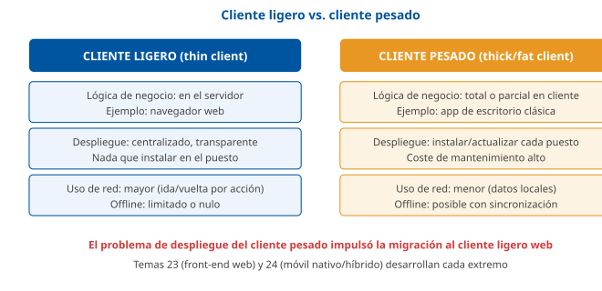
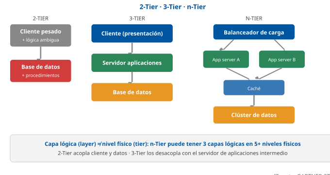
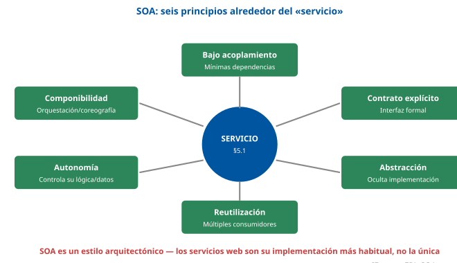
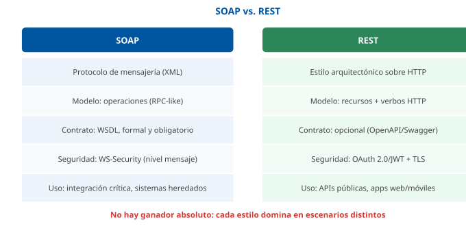
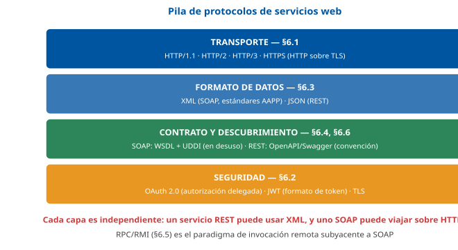
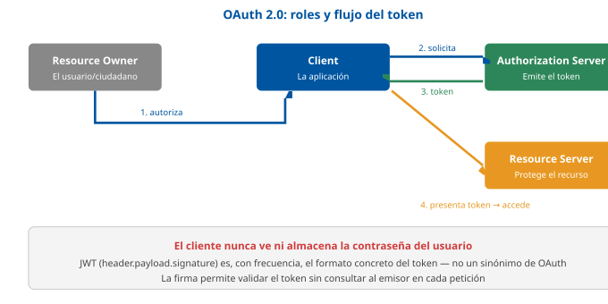
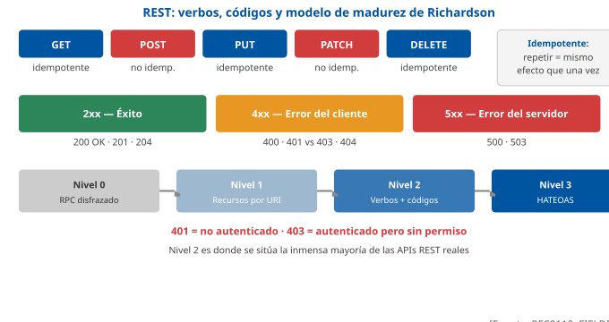
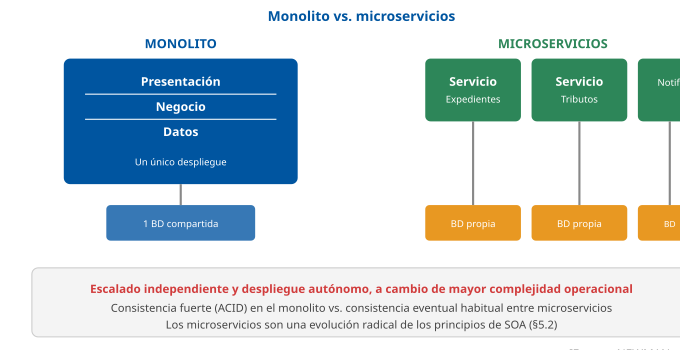

# Tema 22. Arquitectura de sistemas cliente/servidor y multicapas

**Bloque:** técnico  
**Enunciado oficial** (BOAM n.º 10.032, de 23 de diciembre de 2025): Arquitectura de sistemas cliente/servidor y multicapas: componentes y operación. Arquitecturas de servicios web y protocolos asociados.

Versión web: <https://ayuntamientomadrid.github.io/temario-tecnico-auxiliar/temas/tema-22.html> · PDF: [tema-22.pdf](tema-22.pdf) · Test: [../../../tests/tecnico/tema-22.md](../../../tests/tecnico/tema-22.md)

## Índice

- 1. Introducción a la arquitectura de sistemas
  - 1.1. Concepto de arquitectura de sistemas
  - 1.2. Evolución de los modelos centralizados a los sistemas distribuidos
- 2. Arquitectura cliente/servidor
  - 2.1. Definición y fundamentos
  - 2.2. Componentes principales
- 3. Modelos de arquitectura cliente/servidor
  - 3.1. Arquitectura de dos capas (2-Tier)
  - 3.2. Arquitectura de tres capas (3-Tier)
  - 3.3. Arquitecturas n-capas (n-Tier)
  - 3.4. Comparativa entre modelos
- 4. Arquitecturas multicapas
  - 4.1. Principios de separación de responsabilidades
  - 4.2. Capa de presentación
  - 4.3. Capa de lógica de negocio
  - 4.4. Capa de acceso a datos
  - 4.5. Flujo de procesamiento de una petición
  - 4.6. Beneficios en escalabilidad, mantenimiento y seguridad
- 5. Arquitecturas orientadas a servicios
  - 5.1. Concepto de servicio y reutilización funcional
  - 5.2. Arquitectura orientada a servicios (SOA)
  - 5.3. Servicios web: definición y características
  - 5.4. Tipologías de servicios web
- 6. Protocolos y estándares asociados
  - 6.1. HTTP y HTTPS
  - 6.2. Autenticación y autorización (OAuth 2.0 y JWT)
  - 6.3. XML y JSON
  - 6.4. SOAP, WSDL y UDDI
  - 6.5. RPC y RMI
  - 6.6. API REST y principios RESTful
- 7. Tendencias actuales en arquitecturas distribuidas
  - 7.1. Microservicios
  - 7.2. Arquitectura orientada a eventos (EDA)
  - 7.3. Contenedores y orquestación
  - 7.4. Computación en la nube

### Conceptos clave para memorizar

| Concepto | Dato clave |
|----|----|
| Arquitectura de sistemas | Organización de los componentes hardware/software de una aplicación y de las relaciones entre ellos y con su entorno; distinta de la arquitectura de red (cableado/topología) aunque ambas se apoyan mutuamente |
| Cliente/servidor | Modelo de cómputo distribuido en el que un proceso **cliente** solicita un servicio y un proceso **servidor** lo atiende, comunicados por red mediante un protocolo acordado |
| Cliente ligero vs pesado | El ligero (*thin client*) delega la lógica en el servidor y solo renderiza (navegador web); el pesado (*thick/fat client*) ejecuta lógica de negocio local, reduce tráfico de red pero complica el despliegue |
| Middleware | Software de conectividad entre capas/sistemas heterogéneos: oculta la complejidad de red, ofrece servicios transversales (transacciones, colas, seguridad) — ejemplos: ORB CORBA, MOM (JMS/MQ), ODBC/JDBC |
| 2-Tier vs 3-Tier | En 2 capas la lógica de negocio se reparte entre cliente y BD (procedimientos almacenados), acoplando fuerte; en 3 capas la lógica vive en un servidor de aplicaciones intermedio, desacoplando presentación de datos |
| n-Tier | Generalización de 3-Tier con más niveles físicos (balanceador, caché, colas, microservicios); las capas **lógicas** no siempre coinciden con niveles **físicos** de despliegue |
| Separación de responsabilidades | Cada capa expone una interfaz y oculta su implementación (encapsulación); las dependencias fluyen en una única dirección: presentación → negocio → datos |
| SOA | Estilo arquitectónico basado en servicios reutilizables, débilmente acoplados, descubribles y con contrato explícito; anterior y más amplio que "servicios web", que es su implementación más común |
| Servicio web | Componente de software identificado por URI, cuya interfaz es descubrible/invocable mediante mensajes en formatos estándar (XML/JSON) sobre protocolos de red comunes (HTTP principalmente) |
| SOAP vs REST | SOAP es un **protocolo** con envoltura XML, contrato formal (WSDL) y extensiones WS-\* (seguridad, transacciones); REST es un **estilo arquitectónico** sobre HTTP orientado a recursos, sin contrato obligatorio, con JSON como formato dominante |
| Restricciones REST | Cliente-servidor, sin estado (*stateless*), cacheable, interfaz uniforme, sistema en capas, código bajo demanda (opcional) — definidas por Fielding en su tesis de 2000 |
| Nivel de madurez de Richardson | 0 (RPC sobre HTTP) → 1 (recursos) → 2 (verbos HTTP + códigos de estado) → 3 (HATEOAS, hipermedia como motor del estado de la aplicación) |
| HTTP vs HTTPS | HTTPS = HTTP sobre TLS: cifrado del canal, integridad y autenticación del servidor (y opcionalmente del cliente) mediante certificados X.509 |
| OAuth 2.0 | Framework de **autorización delegada**: un cliente obtiene un *token* de acceso sin conocer las credenciales del usuario, mediante un servidor de autorización y distintos *grant types* |
| JWT | Formato de token autocontenido (*header.payload.signature* en Base64URL) que transporta reclamaciones (*claims*) firmadas; no es en sí un protocolo de autorización, sino un formato que OAuth 2.0/OIDC pueden usar como token |
| WSDL / UDDI | WSDL describe la interfaz de un servicio SOAP (operaciones, mensajes, *binding*, *endpoint*); UDDI es un registro para publicar y descubrir esos servicios — en la práctica, en desuso frente a catálogos de API (Swagger/OpenAPI) |
| RPC / RMI | RPC invoca procedimientos remotos como si fueran locales, ocultando la serialización y el transporte; RMI es la variante nativa de Java (objetos remotos, *stubs/skeletons*) |
| Microservicios | Evolución de SOA hacia servicios pequeños, autónomos, con base de datos propia y despliegue independiente; a cambio de flexibilidad, añaden complejidad operacional (observabilidad, consistencia eventual) |
| EDA | Arquitectura orientada a eventos: los componentes se comunican publicando y consumiendo eventos de forma asíncrona (broker de mensajería), desacoplando emisor y receptor en tiempo y espacio |
| Contenedores | Unidad de empaquetado ligera que virtualiza a nivel de SO (*namespaces*, *cgroups* en Linux), no de hardware; **orquestación** (Kubernetes) automatiza despliegue, escalado y recuperación de contenedores |
| Computación en la nube | Modelo de provisión de recursos bajo demanda (NIST SP 800-145): IaaS/PaaS/SaaS y nubes pública/privada/híbrida — desarrollado en profundidad en el Tema 31 |

## Contenido

### Convenciones del documento

Este tema incluye cuatro tipos de **cajas callout** para facilitar el estudio:

> **Dato clave.** Información de alta densidad memorística.

> **Ejercicio resuelto.** Problema + solución paso a paso (elección arquitectónica razonada, diseño de una interfaz de servicio).

> **Ejemplo de aplicación en el ayto.** Aplicación real de la teoría al entorno municipal (Sede Electrónica, Padrón, tributos, datos abiertos).

> **Relación con otros temas.** Enlace conceptual a otros temas del temario oficial.

Este tema es **agnóstico de lenguaje y plataforma**: a diferencia del Tema 21 (Java EE, donde el código Java tiene sentido porque el tema trata de esa plataforma concreta), aquí los ejemplos se expresan en los **formatos de intercambio propios del dominio** — peticiones HTTP, JSON, XML, fragmentos de WSDL — porque son los que un opositor debe reconocer con independencia de en qué lenguaje esté programado el cliente o el servidor. Las fuentes se citan con etiquetas breves tipo `[RFC9110]` o `[FIELDING, cap. 5]`; el registro completo está en la pestaña Fuentes.

**Caso de referencia usado en todo el tema** (contexto Ayuntamiento de Madrid, simplificado): la **arquitectura de la Sede Electrónica municipal**, en la que un ciudadano usa un navegador (cliente ligero) para iniciar un trámite; la petición llega a un servidor de presentación que delega en una capa de negocio (API REST propia, orientada a servicios) la validación del trámite; esa capa de negocio, a su vez, se integra con sistemas municipales heredados (Padrón, Registro, Tributos) mediante **servicios web** —algunos SOAP por antigüedad, otros REST de nueva construcción— y con un **bus de eventos** que notifica a otros departamentos cuando cambia el estado de un expediente.

------------------------------------------------------------------------

### 1. Introducción a la arquitectura de sistemas

#### 1.1. Concepto de arquitectura de sistemas

La **arquitectura de sistemas** es la organización estructural de los componentes hardware y software de una aplicación o de un conjunto de aplicaciones, junto con las **relaciones** que existen entre esos componentes y con el entorno en el que operan \[FOWLER-PEAA, cap. 1\]. No se trata únicamente de «dónde vive cada pieza», sino de **cómo se comunican, quién depende de quién y qué contrato respeta cada una** frente al resto.

Conviene distinguir con precisión dos nociones que se confunden con frecuencia en el lenguaje coloquial:

- **Arquitectura de sistemas** (objeto de este tema): la organización lógica de componentes software —capas, servicios, procesos— y su forma de cooperar para resolver un problema de negocio.
- **Arquitectura de red**: la topología física y lógica de los dispositivos de comunicaciones (cableado, conmutadores, encaminadores) que transportan los mensajes entre esos componentes — objeto de temas posteriores del bloque de comunicaciones (Temas 33-37).

Ambas nociones están relacionadas pero son independientes: una misma arquitectura de sistemas (por ejemplo, cliente/servidor de tres capas) puede desplegarse sobre topologías de red muy distintas, y viceversa.

> **Dato clave.** No confundir **arquitectura de sistemas** (organización de componentes software: capas, servicios) con **arquitectura de red** (topología física/lógica de dispositivos de comunicaciones).

Toda arquitectura de sistemas se diseña persiguiendo un conjunto de **atributos de calidad** (también llamados *requisitos no funcionales*), que son los que en la práctica determinan si una arquitectura es «buena» para un contexto dado: **escalabilidad** (capacidad de crecer en carga sin rediseñar), **disponibilidad** (tiempo de servicio), **mantenibilidad** (coste de modificar), **seguridad**, **rendimiento** y **interoperabilidad** (capacidad de comunicarse con sistemas de terceros mediante estándares). Este tema recorre precisamente los modelos arquitectónicos —cliente/servidor, multicapa, orientado a servicios— que la industria ha ido desarrollando para maximizar estos atributos.

#### 1.2. Evolución de los modelos centralizados a los sistemas distribuidos

##### 1.2.1. Sistemas centralizados: mainframe y terminales tontas

Hasta mediados de los años 80, el modelo dominante de computación empresarial era **centralizado**: un único **mainframe** (u ordenador central) concentraba toda la capacidad de proceso, almacenamiento y lógica de aplicación. Los usuarios accedían mediante **terminales tontos** (*dumb terminals*), dispositivos sin capacidad de procesamiento propio que se limitaban a enviar pulsaciones de teclado y a mostrar el texto que el mainframe les devolvía \[GARTNER-3TIER\].

Este modelo tenía ventajas de gestión notables —un único punto de administración, control total sobre los datos, seguridad centralizada— pero también limitaciones estructurales: el mainframe era un **punto único de fallo**, escalar significaba comprar hardware cada vez más caro (escalado *vertical*), y la experiencia de usuario estaba limitada por el paradigma de terminal de texto.

##### 1.2.2. La revolución cliente/servidor

La popularización del **PC** (ordenador personal) y de las **redes de área local** (LAN) a finales de los 80 y principios de los 90 hizo posible un cambio de paradigma: en lugar de que toda la capacidad de proceso residiera en un único equipo central, parte de la lógica y de la interfaz de usuario podía ejecutarse en el **puesto del usuario**, mientras que los recursos compartidos (bases de datos, ficheros, impresoras) seguían gestionados por **servidores** especializados \[GARTNER-3TIER; FOWLER-PEAA, cap. 1\].

Nace así el modelo **cliente/servidor**, que se desarrolla en profundidad en el §2 de este tema. Este modelo democratiza el desarrollo de aplicaciones (cualquier PC puede ser un cliente), aprovecha la capacidad de proceso distribuida entre múltiples máquinas y ofrece interfaces gráficas más ricas que el terminal de texto — pero introduce también nuevos problemas: la complejidad de coordinar múltiples clientes concurrentes contra un mismo servidor, la necesidad de proteger la comunicación en red y el llamado **problema de despliegue del cliente pesado**, que se aborda en el §2.2.1.

##### 1.2.3. De cliente/servidor a la computación distribuida y la nube

La evolución no se detiene en el cliente/servidor clásico. A medida que las aplicaciones empresariales crecen en complejidad y en número de usuarios, el modelo se refina en sucesivas oleadas, cada una abordada en un apartado propio de este tema:

| Década | Modelo dominante | Tratado en |
|----|----|----|
| Años 90 | Cliente/servidor de 2 capas | §3.1 |
| Finales 90 – 2000s | Arquitecturas de 3 capas y n-capas, con servidor de aplicaciones intermedio | §3.2, §3.3 |
| 2000s | Arquitectura orientada a servicios (SOA) y servicios web | §5 |
| 2010s | Microservicios, arquitectura orientada a eventos | §7.1, §7.2 |
| 2010s-actualidad | Contenedores, orquestación y computación en la nube | §7.3, §7.4 |

> **Relación con otros temas.** El **Tema 31** (paradigmas de computación distribuida y servicios en la nube: IaaS, PaaS, SaaS) desarrolla en profundidad el último eslabón de esta evolución. Este tema (22) sienta las bases arquitectónicas —cliente/servidor, capas, servicios— sobre las que se apoya todo lo que el Tema 31 trata a nivel de infraestructura de provisión.

------------------------------------------------------------------------

### 2. Arquitectura cliente/servidor

#### 2.1. Definición y fundamentos

La **arquitectura cliente/servidor** es un modelo de computación distribuida en el que las responsabilidades se reparten entre dos tipos de procesos que cooperan a través de una red:

- El **cliente** inicia la comunicación, **solicitando** un servicio o un recurso.
- El **servidor** permanece a la escucha, **atendiendo** peticiones de uno o varios clientes y devolviendo una respuesta.

Esta relación es **asimétrica**: el cliente conoce la dirección del servidor (o de un intermediario que lo localiza), pero el servidor, en el modelo clásico de petición-respuesta, no inicia comunicación por iniciativa propia hacia el cliente — solo responde a lo que se le pide \[FOWLER-PEAA, cap. 1\]. Este patrón de interacción se conoce como **petición-respuesta** (*request-response*) y es la base de HTTP (§6.1) y de la inmensa mayoría de los protocolos de aplicación estudiados en este tema.

Un mismo proceso puede desempeñar simultáneamente ambos roles frente a distintos interlocutores: un servidor de aplicaciones es «servidor» frente al navegador del usuario, pero actúa como «cliente» cuando consulta a un servidor de base de datos o invoca un servicio web externo. Este encadenamiento de relaciones cliente/servidor es precisamente lo que hace posible las arquitecturas multicapa del §4.

> **Dato clave.** La relación cliente/servidor es **asimétrica y basada en petición-respuesta**: el cliente inicia, el servidor responde. Un mismo componente puede ser cliente en una relación y servidor en otra — es la clave para entender por qué las arquitecturas n-capa (§3.3) son, en el fondo, **cadenas** de relaciones cliente/servidor.

#### 2.2. Componentes principales

Toda arquitectura cliente/servidor, con independencia de su complejidad, se construye a partir de cuatro elementos: el cliente, el servidor, el middleware que los conecta y la infraestructura de comunicaciones que transporta los mensajes.

##### 2.2.1. Cliente: cliente ligero y pesado

El **cliente** es el proceso que solicita el servicio y, habitualmente, presenta los resultados al usuario final. Según cuánta lógica de aplicación ejecute localmente, se distinguen dos extremos de un continuo:

- **Cliente ligero** (*thin client*): concentra en el servidor casi toda la lógica de negocio y de acceso a datos; el cliente se limita a **renderizar** la interfaz y a enviar/recibir datos. El caso paradigmático es el **navegador web**, que interpreta HTML/CSS/JavaScript pero no contiene lógica de negocio propia del dominio de la aplicación.
- **Cliente pesado** (*thick client* o *fat client*): ejecuta una parte sustancial de la lógica de negocio y, a veces, mantiene una copia local de los datos; se instala y actualiza en cada puesto (aplicaciones de escritorio clásicas tipo Visual Basic/Delphi de los 90, o aplicaciones de escritorio modernas basadas en Electron o frameworks nativos).

|  | Cliente ligero | Cliente pesado |
|----|----|----|
| Lógica de negocio | En el servidor | Total o parcialmente en el cliente |
| Despliegue/actualización | Centralizado, transparente al usuario | Hay que instalar/actualizar cada puesto |
| Uso de red | Mayor (cada acción implica ida y vuelta) | Menor (puede trabajar con datos locales) |
| Capacidad offline | Limitada o nula | Posible con sincronización posterior |
| Coste de mantenimiento | Bajo (un solo lugar que actualizar) | Alto (parque de puestos heterogéneo) |

> **Dato clave.** El **problema de despliegue del cliente pesado** (necesidad de instalar/actualizar software en cada puesto) fue uno de los motores históricos que impulsó la migración hacia **clientes ligeros basados en navegador** desde finales de los 90, y sigue siendo el argumento arquitectónico dominante a favor de las aplicaciones web frente a las de escritorio tradicionales.

> **Relación con otros temas.** El **Tema 23** (aplicaciones web: desarrollo front-end, HTML, navegadores, lenguajes de script) desarrolla en detalle la implementación concreta del cliente ligero. El **Tema 24** (desarrollo para dispositivos móviles) trata el caso particular de clientes nativos frente a híbridos, un continuo similar entre «pesado» (app nativa) y «ligero» (web app/PWA).

##### 2.2.2. Servidor: gestión de recursos y concurrencia

El **servidor** es el proceso que posee o controla el acceso a un recurso compartido —datos, ficheros, capacidad de cómputo, un servicio de negocio— y lo pone a disposición de los clientes que lo soliciten, respetando las reglas de acceso que correspondan (autenticación, autorización, integridad).

Dos responsabilidades son propias del servidor y no tienen equivalente en el cliente clásico:

- **Gestión de recursos compartidos**: el servidor debe evitar que el acceso concurrente de varios clientes corrompa el recurso (por ejemplo, dos actualizaciones simultáneas sobre el mismo registro de una base de datos). Esto exige mecanismos de **control de concurrencia** (bloqueos, control de concurrencia optimista, transacciones).
- **Escalabilidad ante múltiples clientes**: un servidor debe atender, en el caso general, a **muchos** clientes simultáneos. Las estrategias típicas incluyen el uso de **multihilo/multiproceso** (un hilo o proceso por conexión, o un *pool* de hilos reutilizado), **E/S asíncrona no bloqueante** (un único hilo que multiplexa muchas conexiones, como en servidores basados en eventos) y, a mayor escala, el **escalado horizontal** mediante varias instancias del servidor detrás de un balanceador de carga.

> **Dato clave.** Existen dos estrategias de **escalado**: **vertical** (añadir más CPU/memoria a una misma máquina, con un límite físico y de coste) y **horizontal** (añadir más máquinas/instancias en paralelo, coordinadas por un balanceador). Las arquitecturas modernas —n-capas, microservicios, cloud— priorizan el escalado horizontal precisamente porque no tiene techo físico y permite tolerancia a fallos (si una instancia cae, las demás siguen sirviendo).

> **Ejemplo de aplicación en el ayto.** En días de campaña de renovación del Padrón o de plazos fiscales, el servidor de la Sede Electrónica recibe picos de tráfico muy superiores a la media. Una arquitectura que solo permita escalado vertical obligaría a sobredimensionar permanentemente el hardware (coste ocioso el resto del año); una arquitectura preparada para escalado horizontal puede añadir instancias temporales del servidor de aplicaciones solo durante el pico, y retirarlas después.

##### 2.2.3. Middleware: conectividad y abstracción

El **middleware** («software intermedio») es la capa de software que se sitúa entre el sistema operativo/red y las aplicaciones, y que **oculta la complejidad de la comunicación distribuida** ofreciendo una interfaz de más alto nivel \[FOWLER-PEAA, cap. 1\]. Sin middleware, cada aplicación tendría que resolver por sí misma problemas como la serialización de datos, la localización de servicios remotos, la tolerancia a fallos de red o la gestión de transacciones distribuidas.

Se distinguen varias familias de middleware según el servicio que abstraen:

| Tipo de middleware | Qué abstrae | Ejemplos |
|----|----|----|
| **Middleware de acceso a datos** | El dialecto concreto de cada SGBD | ODBC, JDBC (Tema 15) |
| **Middleware orientado a objetos** (ORB) | La invocación de métodos en objetos remotos | CORBA, Java RMI (§6.5) |
| **Middleware orientado a mensajes** (MOM) | El envío de mensajes asíncronos entre aplicaciones | JMS, RabbitMQ, Apache Kafka |
| **Middleware de servicios web** | El descubrimiento e invocación de servicios remotos mediante estándares abiertos | Contenedores SOAP, *gateways* API REST |
| **Middleware transaccional** | La coordinación de transacciones que abarcan varios recursos | Gestores de transacciones distribuidas (protocolo de *commit* en dos fases) |

> **Relación con otros temas.** El middleware orientado a mensajes (MOM) es la base técnica de la **arquitectura orientada a eventos** (EDA), desarrollada en el §7.2 de este mismo tema, y de la integración asíncrona entre sistemas heredados que se ilustra en el caso de referencia de la Sede Electrónica.

##### 2.2.4. Infraestructura de comunicaciones

Por último, ningún componente cliente/servidor puede comunicarse sin una **infraestructura de comunicaciones** subyacente: la red física y lógica (cableado, conmutadores, encaminadores, direccionamiento IP) y la **pila de protocolos** que garantiza el transporte fiable de los mensajes entre cliente y servidor.

> **Relación con otros temas.** La infraestructura de comunicaciones —el modelo TCP/IP y el modelo OSI, los protocolos de nivel de transporte y de red— se desarrolla en profundidad en el **Tema 34**. Este tema (22) se sitúa deliberadamente en el **nivel de aplicación** de esa pila: los protocolos que aquí se estudian (HTTP, SOAP, REST) se apoyan sobre TCP/IP sin necesidad de conocer sus detalles internos, del mismo modo que una aplicación cliente/servidor no necesita saber cómo se enruta cada paquete.

------------------------------------------------------------------------

### 3. Modelos de arquitectura cliente/servidor

#### 3.1. Arquitectura de dos capas (2-Tier)

En la arquitectura de **dos capas** (2-Tier), la aplicación se divide en exactamente dos **niveles físicos**: el **cliente**, que concentra la presentación y, con frecuencia, buena parte de la lógica de negocio, y el **servidor de base de datos**, que además de almacenar los datos suele albergar parte de la lógica mediante **procedimientos almacenados y disparadores** \[GARTNER-3TIER\].

Es el modelo cliente/servidor «clásico» de finales de los 80 y los 90: un cliente pesado (§2.2.1) con una interfaz gráfica de escritorio que se conecta **directamente** al SGBD mediante un *driver* (ODBC/JDBC), sin ningún componente intermedio.

**Ventajas**: sencillez conceptual, buen rendimiento cuando el número de clientes es reducido y están en la misma red local, y aprovechamiento de las capacidades transaccionales del propio SGBD.

**Inconvenientes**, que motivaron la evolución hacia el modelo de 3 capas: **acoplamiento fuerte** entre el cliente y el esquema de la base de datos (cualquier cambio en el modelo de datos obliga a tocar el cliente); **escalabilidad limitada**, porque cada cliente mantiene una conexión directa y persistente al SGBD, cuyo número de conexiones concurrentes es un recurso finito; **problema de despliegue del cliente pesado** (§2.2.1); y **seguridad más difícil de centralizar**, porque las reglas de negocio ejecutadas en el cliente son, en última instancia, manipulables por quien controla ese puesto.

> **Dato clave.** En 2 capas, la lógica de negocio se reparte de forma **ambigua** entre el cliente (código de la aplicación) y el servidor de datos (procedimientos almacenados/disparadores) — no hay un lugar único y claro donde «vive» la regla de negocio. Esta ambigüedad es precisamente lo que resuelve el modelo de 3 capas.

> **Relación con otros temas.** Los **procedimientos almacenados y disparadores** que en 2 capas concentran parte de la lógica de negocio en el servidor de datos son objeto específico del **Tema 19** (lenguajes de interrogación de bases de datos, ANSI SQL, procedimientos almacenados, eventos y disparadores).

#### 3.2. Arquitectura de tres capas (3-Tier)

La arquitectura de **tres capas** introduce un nivel intermedio, el **servidor de aplicaciones**, entre el cliente y el servidor de datos. Cada capa asume una responsabilidad clara y se comunica solo con la capa adyacente:

1.  **Capa de presentación**: interfaz con la que interactúa el usuario (cliente ligero o pesado).
2.  **Capa de lógica de negocio** (o capa de aplicación): reglas, validaciones y procesos de negocio, ejecutados en el **servidor de aplicaciones**.
3.  **Capa de datos**: almacenamiento persistente, gestionado por el SGBD.

Esta separación —desarrollada con más detalle en el §4 de este tema, dedicado íntegramente a las arquitecturas multicapa— resuelve directamente los problemas del modelo de 2 capas: el cliente se **desacopla** del esquema de datos (solo conoce la interfaz que expone el servidor de aplicaciones), la lógica de negocio tiene un **lugar único y bien definido**, y el servidor de aplicaciones puede **agrupar y reutilizar conexiones** al SGBD mediante un *pool* de conexiones, en lugar de que cada cliente mantenga la suya propia — lo que mejora sustancialmente la escalabilidad.

> **Dato clave.** La ventaja arquitectónica central de pasar de 2 a 3 capas es el **desacoplamiento**: el cliente ya no conoce el esquema de la base de datos, sino únicamente el **contrato** (interfaz) que le ofrece la capa de negocio. Cambiar el modelo de datos, o incluso el motor de base de datos, no debería requerir tocar el cliente.

#### 3.3. Arquitecturas n-capas (n-Tier)

Las arquitecturas **n-capas** generalizan el modelo de 3 capas añadiendo **niveles adicionales**, tanto lógicos como físicos, según las necesidades de la aplicación: un balanceador de carga delante de varios servidores de aplicaciones, una capa de caché entre la capa de negocio y la de datos, una capa de integración que habla con sistemas externos mediante servicios web, o una capa de colas de mensajes para procesamiento asíncrono.

Es fundamental distinguir dos nociones:

- **Capa lógica** (*layer*): una agrupación de responsabilidades en el diseño del software (presentación, negocio, datos, integración…), independiente de dónde se despliegue físicamente.
- **Nivel físico** (*tier*): una máquina o proceso independiente donde se despliega una o varias capas lógicas.

No siempre coinciden: una aplicación puede tener **tres capas lógicas** (presentación, negocio, datos) desplegadas en **un único nivel físico** (todo en el mismo servidor, típico de un entorno de desarrollo), o **tres capas lógicas** repartidas en **cinco niveles físicos** (balanceador + dos servidores de aplicaciones + caché + clúster de base de datos), típico de un entorno de producción de alta disponibilidad.

> **Dato clave.** *Layer* (capa lógica de responsabilidad) ≠ *Tier* (nivel físico de despliegue). El número de capas lógicas de un diseño no tiene por qué coincidir con el número de servidores físicos en los que se despliega.

> **Ejemplo de aplicación en el ayto.** La Sede Electrónica del Ayuntamiento, en producción, no se despliega en una única máquina: un **balanceador de carga** reparte las peticiones entre varias instancias del **servidor de aplicaciones** (capa de negocio replicada por alta disponibilidad), que a su vez consultan una **capa de caché** para las operaciones de solo lectura más frecuentes (por ejemplo, el callejero) antes de llegar al **clúster de base de datos**. Son tres capas lógicas clásicas, desplegadas en bastantes más de tres niveles físicos.

#### 3.4. Comparativa entre modelos

|  | 2-Tier | 3-Tier | n-Tier |
|----|----|----|----|
| Niveles físicos | 2 | 3 | 3 o más |
| Ubicación de la lógica de negocio | Ambigua (cliente + SGBD) | Servidor de aplicaciones | Servidor(es) de aplicaciones/servicios |
| Acoplamiento cliente-datos | Fuerte | Débil | Débil |
| Escalabilidad | Limitada | Buena | Alta (horizontal en cada nivel) |
| Complejidad operativa | Baja | Media | Alta |
| Caso de uso típico | Aplicaciones departamentales pequeñas, herramientas internas | Aplicaciones empresariales estándar | Sistemas de alta disponibilidad y carga, integración con terceros |

------------------------------------------------------------------------

### 4. Arquitecturas multicapas

#### 4.1. Principios de separación de responsabilidades

La **arquitectura multicapa** (o *layered architecture*) organiza el software en **capas lógicas** apiladas, cada una responsable de un aspecto concreto del sistema, con dos reglas estructurales \[FOWLER-PEAA, cap. 1\]:

- **Encapsulación**: cada capa expone una **interfaz** hacia la capa adyacente y oculta los detalles internos de su implementación. La capa de negocio, por ejemplo, no necesita saber si los datos vienen de una base de datos relacional o de un servicio externo.
- **Dependencia unidireccional**: las dependencias fluyen en una única dirección, típicamente **de arriba hacia abajo** (presentación depende de negocio, negocio depende de datos), nunca al revés. Una capa inferior no debe conocer ni depender de una superior.

Esta disciplina, aparentemente sencilla, es la que permite **sustituir** una capa sin afectar a las demás: cambiar la interfaz de usuario (de web a app móvil) sin tocar la lógica de negocio, o cambiar el motor de base de datos sin tocar la capa de presentación, siempre que el contrato entre capas se respete.

> **Dato clave.** Las dos reglas de la arquitectura en capas son **encapsulación** (cada capa oculta su implementación tras una interfaz) y **dependencia unidireccional** (de arriba hacia abajo, nunca al revés). Violar la segunda regla —por ejemplo, que la capa de datos invoque directamente a la de presentación— es el antipatrón más habitual.

#### 4.2. Capa de presentación

La **capa de presentación** es responsable de la **interacción con el usuario**: recoger su entrada, mostrarle resultados y validar el formato de los datos introducidos (validaciones superficiales, no reglas de negocio). No debe contener lógica de negocio: su única responsabilidad es traducir entre el modelo interno de la aplicación y la interfaz que percibe el usuario.

En el caso de referencia de la Sede Electrónica, la capa de presentación es el conjunto de páginas y formularios web que el ciudadano ve en su navegador —el cliente ligero del §2.2.1— más el conjunto de controladores del lado servidor que reciben esas peticiones HTTP y las traducen a llamadas a la capa de negocio.

#### 4.3. Capa de lógica de negocio

La **capa de lógica de negocio** (o capa de aplicación) contiene las **reglas del dominio**: qué trámites puede iniciar un ciudadano, qué requisitos debe cumplir un expediente para pasar de un estado a otro, cómo se calcula la liquidación de una tasa. Es el «cerebro» de la aplicación, y es la capa que debería cambiar con menor frecuencia por motivos puramente técnicos (un cambio de framework de presentación o de motor de base de datos no debería obligar a tocarla).

> **Ejercicio resuelto.** *Un ciudadano presenta una solicitud de licencia de obra a través de la Sede Electrónica. ¿Qué capa decide si la documentación aportada es suficiente para admitir a trámite la solicitud?* — La **capa de negocio**, no la de presentación. La capa de presentación puede hacer validaciones superficiales (por ejemplo, que un campo obligatorio no esté vacío, o que un fichero adjunto no supere el tamaño máximo), pero la decisión de si la documentación aportada cumple los requisitos normativos para admitir a trámite es una **regla de negocio** —depende de la normativa urbanística vigente, no de la tecnología de la interfaz— y por tanto pertenece a la capa de lógica de negocio.

#### 4.4. Capa de acceso a datos

La **capa de acceso a datos** (o de persistencia) es responsable de **leer y escribir** el estado de la aplicación en un almacenamiento duradero —típicamente un SGBD relacional, aunque puede ser NoSQL, un sistema de ficheros o un servicio externo—, y de **traducir** entre el modelo de objetos/estructuras que usa la capa de negocio y el modelo de almacenamiento subyacente.

> **Relación con otros temas.** El diseño concreto de esta capa —modelo entidad-relación, normalización, SGBD relacionales frente a NoSQL— es objeto de los **Temas 15, 16 y 17**. Este tema (22) se limita a situar la capa de datos como el nivel más bajo de la arquitectura multicapa, sin entrar en el diseño interno del modelo de datos.

#### 4.5. Flujo de procesamiento de una petición

Un ejemplo concreto ayuda a fijar cómo cooperan las tres capas ante una única petición del usuario. Tomando el caso de referencia (un ciudadano consulta el estado de un expediente en la Sede Electrónica):

1.  El **navegador** (capa de presentación, cliente) envía una petición HTTP con el identificador del expediente.
2.  El **controlador** de la capa de presentación, en el servidor, recibe la petición, valida su formato (¿el identificador tiene el formato esperado?) y la traduce en una llamada a la capa de negocio.
3.  La **capa de negocio** aplica las reglas pertinentes (¿tiene el usuario autenticado permiso para consultar ese expediente concreto?) y solicita los datos a la capa de acceso a datos.
4.  La **capa de acceso a datos** ejecuta la consulta contra el SGBD y devuelve el resultado, ya traducido a estructuras que la capa de negocio entiende, sin exponer detalles del esquema relacional.
5.  La capa de negocio aplica cualquier transformación adicional (por ejemplo, calcular un texto descriptivo del estado) y devuelve el resultado a la capa de presentación.
6.  La capa de presentación formatea la respuesta (HTML o JSON, según el tipo de cliente) y la envía de vuelta al navegador.

Nótese que la petición **atraviesa las capas de arriba hacia abajo** y la respuesta las atraviesa **de abajo hacia arriba**, respetando en todo momento la regla de dependencia unidireccional del §4.1: en ningún punto la capa de datos invoca directamente a la de presentación, ni la salta.

#### 4.6. Beneficios en escalabilidad, mantenimiento y seguridad

La arquitectura multicapa no es solo una cuestión de «orden»: tiene consecuencias prácticas directas sobre tres atributos de calidad clave:

- **Escalabilidad**: al estar cada capa desacoplada, se puede **escalar de forma independiente** la capa que más lo necesite. Si el cuello de botella es la capa de presentación (muchos usuarios concurrentes navegando), se añaden más instancias de esa capa sin tocar la de datos, y viceversa.
- **Mantenimiento**: un cambio localizado en una capa (por ejemplo, rediseñar la interfaz de usuario) tiene un **radio de impacto limitado** a esa capa, siempre que el contrato con las capas adyacentes se mantenga estable. Esto reduce el riesgo y el coste de las modificaciones.
- **Seguridad**: centralizar las reglas de negocio y de autorización en una única capa (la de negocio) evita que la seguridad dependa de un cliente que el usuario controla y puede manipular; la capa de presentación puede ofrecer una experiencia amigable, pero la decisión de seguridad real se toma en el servidor.

> **Dato clave.** Nunca confiar en la **validación del lado cliente** como mecanismo de seguridad: un cliente ligero (navegador) es manipulable por el propio usuario (herramientas de desarrollador, peticiones directas a la API). La validación de negocio y de seguridad **siempre** debe repetirse, de forma autoritativa, en el servidor.

------------------------------------------------------------------------

### 5. Arquitecturas orientadas a servicios

#### 5.1. Concepto de servicio y reutilización funcional

Un **servicio**, en sentido arquitectónico, es una unidad de funcionalidad **autocontenida**, con una **interfaz explícita** y **débilmente acoplada** al resto del sistema, que puede ser **descubierta e invocada** por distintos consumidores sin que estos necesiten conocer su implementación interna \[ERL-SOA, cap. 2\].

La motivación de fondo es la **reutilización funcional**: en lugar de que cada aplicación reimplemente su propia lógica de «calcular una liquidación de tasa» o «validar un NIF», esa lógica se expone **una vez**, como servicio, y cualquier aplicación autorizada de la organización puede consumirla, garantizando además que **todas** las aplicaciones aplican exactamente la misma regla (evitando el problema clásico de lógica de negocio duplicada e inconsistente entre sistemas).

#### 5.2. Arquitectura orientada a servicios (SOA)

La **arquitectura orientada a servicios** (*Service-Oriented Architecture*, SOA) es un **estilo arquitectónico** —no una tecnología concreta— que estructura un sistema como un conjunto de **servicios** débilmente acoplados que se comunican mediante **contratos** explícitos \[ERL-SOA, cap. 2-3\]. Sus principios de diseño más citados son:

- **Bajo acoplamiento**: los servicios minimizan las dependencias entre sí; un cambio interno en un servicio no debería obligar a modificar a sus consumidores mientras el contrato se respete.
- **Contrato explícito**: la interfaz de un servicio (operaciones que ofrece, formato de los mensajes) se describe formalmente y es independiente de la implementación.
- **Abstracción**: el consumidor solo conoce el contrato, nunca los detalles internos (lenguaje de programación, base de datos) del proveedor del servicio.
- **Reutilización**: un servicio se diseña para ser consumido por múltiples aplicaciones, no para una única aplicación cliente.
- **Autonomía**: cada servicio controla su propia lógica y, en el diseño más maduro, sus propios datos.
- **Componibilidad** (*composability*): los servicios pueden combinarse (**orquestación** o **coreografía**) para construir procesos de negocio más complejos.

> **Dato clave.** SOA es un **estilo arquitectónico**, no un producto ni un protocolo concreto. Los **servicios web** (§5.3) son la implementación más habitual de SOA, pero no la única —conceptualmente, SOA es anterior y más amplio que «servicios web», del mismo modo que «arquitectura cliente/servidor» es anterior y más amplia que «aplicación web».

> **Relación con otros temas.** Los **microservicios** (§7.1) se presentan a menudo como una evolución o una reinterpretación moderna de SOA, con matices importantes que se explican en ese apartado: mientras SOA tiende a compartir infraestructura común (un **bus de servicios empresarial**, ESB), los microservicios enfatizan la autonomía total, incluida la de los datos.

#### 5.3. Servicios web: definición y características

Un **servicio web** es un servicio (§5.1) cuya interfaz está descrita en un **formato legible por máquina** (típicamente XML o, en el estilo REST, mediante las convenciones de HTTP) y que se invoca a través de **protocolos de red estándar y abiertos** —fundamentalmente HTTP— lo que garantiza **interoperabilidad** entre sistemas construidos con tecnologías distintas \[W3C-SOAP; FIELDING\].

Sus características definitorias son:

- **Interoperabilidad**: un cliente Java puede invocar un servicio implementado en Python, o un cliente móvil en Kotlin puede invocar un servicio en .NET, porque el contrato de comunicación se apoya en estándares abiertos, no en un mecanismo propietario de un fabricante o lenguaje concreto.
- **Uso de protocolos y formatos estándar**: HTTP como transporte, XML o JSON como formato de los datos.
- **Descubribilidad** (en mayor o menor grado según el estilo, §5.4): la interfaz del servicio puede describirse formalmente para que otros sistemas la consuman sin necesidad de conocimiento previo directo del equipo desarrollador.
- **Débil acoplamiento**: el consumidor no necesita conocer la implementación interna del servicio, solo su contrato público.

#### 5.4. Tipologías de servicios web

Existen dos estilos dominantes de servicios web, con filosofías de diseño distintas: **SOAP**, orientado a operaciones y con un contrato formal estricto, y **REST**, orientado a recursos y apoyado en las propias convenciones de HTTP.

##### 5.4.1. Servicios SOAP

**SOAP** (originalmente *Simple Object Access Protocol*, aunque el acrónimo se considera hoy obsoleto y se usa simplemente como nombre propio) es un **protocolo de mensajería** basado en **XML**, independiente del protocolo de transporte subyacente (aunque en la práctica se usa casi siempre sobre HTTP) \[W3C-SOAP\]. Un mensaje SOAP tiene una estructura formal en forma de **sobre** (*envelope*):

    <soap:Envelope xmlns:soap="http://www.w3.org/2003/05/soap-envelope">
      <soap:Header>
        <!-- metadatos: seguridad (WS-Security), transacción, correlación -->
      </soap:Header>
      <soap:Body>
        <ConsultarExpediente xmlns="http://sede.madrid.es/tributos">
          <NumeroExpediente>EXP-2026-004821</NumeroExpediente>
        </ConsultarExpediente>
      </soap:Body>
    </soap:Envelope>

Sus rasgos característicos son un **contrato formal y estricto**, descrito en WSDL (§6.4); un modelo de **operaciones nombradas** (RPC-like: `ConsultarExpediente`, `LiquidarTasa`) frente al modelo orientado a recursos de REST; y un ecosistema de extensiones estandarizadas conocido como **WS-\\**\* (WS-Security para seguridad a nivel de mensaje, WS-ReliableMessaging para entrega garantizada, WS-AtomicTransaction para transacciones distribuidas), que lo hacen especialmente robusto en escenarios empresariales exigentes —integración bancaria, sistemas de pago, transacciones distribuidas entre organismos— a cambio de mayor complejidad y verbosidad.

> **Dato clave.** SOAP no está «muerto»: sigue siendo el estándar de facto en integraciones empresariales que requieren **garantías formales fuertes** (transacciones distribuidas, seguridad a nivel de mensaje, contratos estrictos), típicas de banca, seguros y de muchos sistemas heredados de la Administración Pública. REST domina en APIs públicas y en aplicaciones web/móviles modernas, pero no ha sustituido a SOAP en todos los escenarios.

##### 5.4.2. Servicios REST

**REST** (*Representational State Transfer*) no es un protocolo, sino un **estilo arquitectónico** definido por Roy Fielding en su tesis doctoral de 2000, que aprovecha las capacidades ya existentes de **HTTP** en lugar de construir un protocolo de mensajería propio \[FIELDING, cap. 5\]. Un servicio REST expone **recursos** (identificados por una URI) que se manipulan mediante los **verbos HTTP** estándar:

    GET /api/expedientes/EXP-2026-004821 HTTP/1.1
    Host: sede.madrid.es
    Accept: application/json

    {
      "numeroExpediente": "EXP-2026-004821",
      "tipo": "licencia-obra",
      "estado": "en_tramitacion",
      "fechaAlta": "2026-06-02"
    }

Este estilo se desarrolla con detalle en el §6.6 (API REST y principios RESTful), junto con las restricciones formales que definen a un sistema como «RESTful». La comparativa directa entre ambos estilos se resume en la siguiente tabla:

|  | SOAP | REST |
|----|----|----|
| Naturaleza | Protocolo de mensajería | Estilo arquitectónico |
| Formato de datos | XML (estricto) | JSON habitual, también XML u otros |
| Modelo | Orientado a operaciones (RPC-like) | Orientado a recursos (URIs + verbos HTTP) |
| Contrato | Formal y obligatorio (WSDL) | Opcional, por convención (OpenAPI/Swagger) |
| Transporte | Independiente en teoría, HTTP en la práctica | HTTP de forma intrínseca |
| Seguridad avanzada | WS-Security (a nivel de mensaje) | OAuth 2.0/JWT (§6.2), TLS (a nivel de transporte) |
| Peso de los mensajes | Mayor (envoltorio XML) | Menor (JSON compacto) |
| Escenario típico | Integración empresarial crítica, sistemas heredados | APIs públicas, aplicaciones web/móviles |

> **Ejemplo de aplicación en el ayto.** En el caso de referencia de la Sede Electrónica, el sistema de **Tributos**, heredado y construido hace más de una década, expone su lógica de liquidación mediante un servicio **SOAP** con WSDL formal (integración estable y crítica, con garantías transaccionales). La nueva capa de negocio de la Sede, en cambio, expone hacia el navegador y hacia aplicaciones móviles una **API REST** en JSON, más ligera y natural para clientes web modernos. Ambos estilos conviven en la misma arquitectura, cada uno donde mejor encaja.

------------------------------------------------------------------------

### 6. Protocolos y estándares asociados

#### 6.1. HTTP y HTTPS

**HTTP** (*Hypertext Transfer Protocol*) es el protocolo de nivel de aplicación que sirve de transporte a la inmensa mayoría de los servicios web —tanto SOAP como REST— y es, en sí mismo, un ejemplo canónico de protocolo cliente/servidor de petición-respuesta \[RFC9110\]. Sus elementos esenciales son:

- **Método** (o verbo): indica la acción que se solicita sobre un recurso (`GET`, `POST`, `PUT`, `PATCH`, `DELETE`, entre otros; desarrollados en el §6.6 en su uso RESTful).
- **Cabeceras** (*headers*): metadatos de la petición o la respuesta (tipo de contenido, autenticación, caché).
- **Cuerpo** (*body*): los datos de la petición o la respuesta, en el formato que indique la cabecera `Content-Type` (JSON, XML, etc.).
- **Código de estado**: un número de tres dígitos que resume el resultado de la petición, agrupado por familias:

| Familia | Significado | Ejemplos |
|----|----|----|
| **1xx** | Informativa | `100 Continue` |
| **2xx** | Éxito | `200 OK`, `201 Created`, `204 No Content` |
| **3xx** | Redirección | `301 Moved Permanently`, `304 Not Modified` |
| **4xx** | Error del cliente | `400 Bad Request`, `401 Unauthorized`, `403 Forbidden`, `404 Not Found` |
| **5xx** | Error del servidor | `500 Internal Server Error`, `503 Service Unavailable` |

> **Dato clave.** Distinguir bien **401 Unauthorized** (el cliente no está autenticado, o su autenticación no es válida) de **403 Forbidden** (el cliente está autenticado, pero no tiene permiso para esa acción concreta).

**HTTPS** no es un protocolo distinto de HTTP, sino **HTTP transportado sobre una conexión cifrada con TLS** (*Transport Layer Security*) \[RFC9846\]. TLS aporta tres garantías sobre el canal de comunicación: **confidencialidad** (el contenido viaja cifrado, ilegible para un tercero que intercepte el tráfico), **integridad** (cualquier alteración del mensaje en tránsito es detectable) y **autenticación del servidor** (mediante un **certificado digital X.509**, el cliente verifica que se está comunicando realmente con el servidor que dice ser, no con un impostor).

> **Relación con otros temas.** El **Tema 35** (Internet: arquitectura de red, protocolos HTTP, HTTPS y SSL/TLS) desarrolla en profundidad el propio protocolo TLS —el proceso de negociación (*handshake*), las versiones históricas SSL/TLS y su papel en la pila de comunicaciones de Internet. Este tema (22) sitúa HTTP/HTTPS como el **protocolo de aplicación** sobre el que se construyen los servicios web, sin entrar en el detalle del cifrado. El **Tema 32** (seguridad de los sistemas de información: técnicas criptográficas, firma digital) completa la base criptográfica que sustenta TLS y la firma de tokens JWT (§6.2).

El propio protocolo HTTP ha evolucionado en varias versiones, relevantes para entender el rendimiento de los servicios web actuales: **HTTP/1.1** \[RFC9112\], vigente desde 1997 y aún el más extendido, procesa las peticiones de una conexión de forma esencialmente secuencial, lo que en páginas o APIs con muchas peticiones simultáneas provoca el problema conocido como *head-of-line blocking* (una petición lenta bloquea a las que la siguen en la misma conexión). **HTTP/2** \[RFC9113\] introduce la **multiplexación**: varias peticiones y respuestas viajan intercaladas sobre una **única conexión TCP**, eliminando ese bloqueo a nivel de aplicación y reduciendo la sobrecarga de abrir múltiples conexiones. **HTTP/3** \[RFC9114\] da un paso más y sustituye el transporte TCP por **QUIC** (sobre UDP), eliminando también el *head-of-line blocking* que persistía a nivel de transporte en HTTP/2 y acelerando la reconexión tras una pérdida de red — un cambio orientado especialmente a clientes móviles con conectividad inestable.

> **Dato clave.** La evolución HTTP/1.1 → HTTP/2 → HTTP/3 es, sobre todo, una evolución de **rendimiento del transporte** (multiplexación, menos bloqueo, menor latencia de reconexión), no un cambio en la semántica de la aplicación: los verbos, las cabeceras y los códigos de estado estudiados en este apartado son **los mismos** en las tres versiones \[RFC9110\].

#### 6.2. Autenticación y autorización (OAuth 2.0 y JWT)

En una arquitectura de servicios distribuidos, resolver **quién es el usuario** (autenticación) y **qué puede hacer** (autorización) de forma segura y escalable es uno de los problemas de diseño más recurrentes. Dos estándares dominan hoy este espacio en el mundo de los servicios web:

**OAuth 2.0** \[RFC6749\] es un *framework* de **autorización delegada**: permite que una aplicación (el *cliente*) acceda a un recurso protegido en nombre de un usuario, **sin que la aplicación llegue a conocer las credenciales** del usuario (su contraseña). El flujo típico distingue varios roles —*resource owner* (el usuario), *client* (la aplicación que solicita acceso), *authorization server* (quien emite los *tokens*) y *resource server* (quien protege el recurso)— y se apoya en distintos **tipos de concesión** (*grant types*) según el escenario: código de autorización (aplicaciones web con backend), credenciales de cliente (comunicación servicio-a-servicio, sin usuario humano de por medio), entre otros.

**JWT** (*JSON Web Token*) \[RFC7519\] es un **formato** de token —no un protocolo de autorización en sí mismo— compuesto por tres partes codificadas en Base64URL y separadas por puntos: `header.payload.signature`. El *payload* contiene **reclamaciones** (*claims*): datos sobre el sujeto del token (identificador de usuario, roles, fecha de expiración), y la *signature* permite verificar que el token no ha sido alterado desde que se emitió, sin necesidad de consultar una base de datos central en cada petición (el token es **autocontenido**).

    eyJhbGciOiJIUzI1NiJ9.        ← header (algoritmo de firma)
    eyJzdWIiOiIxMjM0Iiwicm9sIjoiY2l1ZGFkYW5vIn0.  ← payload (claims: sub, rol…)
    SflKxwRJSMeKKF2QT4fwpMeJf36POk6yJV_adQssw5c  ← signature

> **Dato clave.** OAuth 2.0 es un **framework de autorización**; JWT es un **formato de token**. No son alternativas entre sí ni sinónimos: OAuth 2.0 define **cómo se obtiene** un token de forma segura; JWT es, muy a menudo, **el formato concreto** que adopta ese token. Confundir «usar JWT» con «implementar OAuth 2.0» es un error frecuente.

> **Relación con otros temas.** El **Tema 32** (conceptos de seguridad de los sistemas de información: técnicas criptográficas y mecanismos de firma digital) desarrolla el fundamento criptográfico —firma digital, funciones *hash*, criptografía asimétrica— que hace posible verificar la *signature* de un JWT sin contactar al emisor en cada petición.

#### 6.3. XML y JSON

**XML** (*eXtensible Markup Language*) \[W3C-XML\] es un formato de marcado **extensible y autodescriptivo**, basado en etiquetas anidadas, que fue durante años el formato dominante de intercambio de datos entre sistemas —y sigue siendo obligatorio en SOAP (§5.4.1) y en muchos estándares de la Administración Pública—. **JSON** (*JavaScript Object Notation*) \[RFC8259\] es un formato más ligero, basado en pares clave-valor y estructuras anidadas de objetos y listas, que se ha convertido en el formato dominante de las APIs REST modernas por su menor verbosidad y su mapeo natural a las estructuras de datos de la mayoría de los lenguajes de programación.

    <expediente>
      <numero>EXP-2026-004821</numero>
      <estado>en_tramitacion</estado>
    </expediente>

    {"numero": "EXP-2026-004821", "estado": "en_tramitacion"}

|  | XML | JSON |
|----|----|----|
| Verbosidad | Alta (etiquetas de apertura/cierre) | Baja |
| Esquema/validación | Robusta (XSD) | Más ligera (JSON Schema) |
| Espacios de nombres | Sí (permite mezclar vocabularios) | No de forma nativa |
| Uso dominante | SOAP, documentos estructurados complejos, estándares Administración | APIs REST, configuración, intercambio ligero |

> **Relación con otros temas.** El **Esquema Nacional de Interoperabilidad** (ENI, desarrollado en el **Tema 39**) recoge un catálogo de estándares abiertos —entre ellos XML y JSON— de uso obligatorio en los sistemas de información de las Administraciones Públicas españolas para garantizar el intercambio de información entre organismos \[ENI\].

#### 6.4. SOAP, WSDL y UDDI

Completando la tríada de estándares clásicos del ecosistema de servicios web «pesados»:

- **SOAP** (§5.4.1): el protocolo de mensajería.
- **WSDL** (*Web Services Description Language*) \[W3C-WSDL\]: el documento XML que describe **formalmente el contrato** de un servicio SOAP — qué operaciones ofrece, qué mensajes espera y devuelve cada una, qué tipos de datos usa y a qué dirección de red (*endpoint*) hay que dirigir las peticiones.
- **UDDI** (*Universal Description, Discovery and Integration*) \[OASIS-UDDI\]: un **registro** pensado para publicar y **descubrir** servicios web —una especie de «páginas amarillas» de servicios—, en el que un proveedor publica su WSDL y un consumidor lo busca por categoría o funcionalidad.

&nbsp;

    <!-- Fragmento simplificado de WSDL: describe la operación ConsultarExpediente -->
    <wsdl:portType name="TributosPortType">
      <wsdl:operation name="ConsultarExpediente">
        <wsdl:input message="tns:ConsultarExpedienteRequest"/>
        <wsdl:output message="tns:ConsultarExpedienteResponse"/>
      </wsdl:operation>
    </wsdl:portType>

> **Dato clave.** **UDDI** es, en la práctica actual, un estándar en **desuso**: la promesa de un registro público universal de servicios nunca llegó a adoptarse a gran escala, y su función de «catálogo descubrible» ha sido sustituida por **catálogos de API modernos** (portales de desarrollador, especificaciones OpenAPI/Swagger) en el mundo REST. Conserva interés por su papel histórico y porque puede aparecer citado en sistemas heredados.

#### 6.5. RPC y RMI

**RPC** (*Remote Procedure Call*) \[RFC5531\] es un paradigma de comunicación en el que un programa invoca un procedimiento que se ejecuta en **otro espacio de direcciones** —habitualmente en otra máquina— **como si fuera una llamada local**, ocultando al programador los detalles de serialización de parámetros, transporte de red y deserialización de la respuesta. Es el paradigma conceptual subyacente a SOAP en su modelo de «operaciones» (§5.4.1) y a muchos middlewares orientados a objetos.

**RMI** (*Remote Method Invocation*) es la implementación nativa de este paradigma en la plataforma Java: permite invocar **métodos de objetos remotos** de forma transparente, apoyándose en *stubs* (representantes locales del objeto remoto, del lado del cliente) y *skeletons* (del lado del servidor), que se encargan de la serialización.

> **Dato clave.** RPC es el **paradigma general** («invocar algo remoto como si fuera local»); RMI es la **implementación específica de Java**. SOAP puede entenderse como una forma de RPC sobre HTTP con mensajes XML estandarizados y neutrales respecto al lenguaje, mientras que RMI está limitado a comunicación entre extremos Java.

> **Relación con otros temas.** El **Tema 21** (arquitectura Java EE) trata RMI y su papel histórico dentro de EJB (los *Enterprise JavaBeans* originalmente se invocaban de forma remota mediante RMI-IIOP) con mayor detalle de implementación; aquí se sitúa como uno de los paradigmas de comunicación remota que preceden y conviven con los servicios web.

#### 6.6. API REST y principios RESTful

Retomando el estilo REST introducido en el §5.4.2, Roy Fielding definió un conjunto de **restricciones arquitectónicas** que, aplicadas conjuntamente, caracterizan a un sistema como verdaderamente RESTful \[FIELDING, cap. 5\]:

| Restricción | Significado |
|----|----|
| **Cliente-servidor** | Separación de responsabilidades entre interfaz de usuario y almacenamiento/lógica (§2.1) |
| **Sin estado** (*stateless*) | Cada petición contiene **toda** la información necesaria para procesarla; el servidor no mantiene estado de sesión del cliente entre peticiones |
| **Cacheable** | Las respuestas deben indicar explícitamente si pueden almacenarse en caché, para mejorar rendimiento y escalabilidad |
| **Interfaz uniforme** | Un conjunto reducido y consistente de operaciones (los verbos HTTP) actúa sobre **recursos** identificados por URI |
| **Sistema en capas** | El cliente no puede saber, en general, si está hablando directamente con el servidor final o con un intermediario (proxy, *gateway*, balanceador) |
| **Código bajo demanda** (opcional) | El servidor puede, opcionalmente, enviar código ejecutable (por ejemplo, JavaScript) que el cliente ejecuta, extendiendo su funcionalidad |

Sobre la **interfaz uniforme**, los verbos HTTP se mapean de forma convencional a operaciones **CRUD** (crear, leer, actualizar, eliminar) sobre recursos:

| Verbo HTTP | Operación CRUD | Idempotente | Ejemplo |
|----|----|----|----|
| `GET` | Leer | Sí | `GET /expedientes/123` |
| `POST` | Crear | No | `POST /expedientes` |
| `PUT` | Actualizar (reemplazo completo) | Sí | `PUT /expedientes/123` |
| `PATCH` | Actualizar (parcial) | No (en general) | `PATCH /expedientes/123` |
| `DELETE` | Eliminar | Sí | `DELETE /expedientes/123` |

> **Dato clave.** **Idempotente** significa que ejecutar la misma operación varias veces produce el **mismo efecto** que ejecutarla una sola vez. `GET`, `PUT` y `DELETE` son idempotentes; `POST` no lo es (crear el mismo recurso dos veces produce, en general, dos recursos distintos). Es una propiedad con implicaciones prácticas: reintentar automáticamente una petición fallida solo es seguro sin efectos secundarios si el verbo es idempotente.

Por último, el **modelo de madurez de Richardson** —propuesto por Leonard Richardson, no por Fielding, aunque se aplica sobre las ideas de este último— clasifica en cuatro niveles cuán «RESTful» es realmente una API:

- **Nivel 0**: un único *endpoint*, todas las operaciones sobre `POST`, estilo RPC disfrazado de HTTP.
- **Nivel 1**: se introducen **recursos** identificados por URI distintas, pero se sigue usando mayormente un único verbo.
- **Nivel 2**: se usan correctamente los **verbos HTTP** y los **códigos de estado** — es el nivel en el que se sitúa la inmensa mayoría de las APIs REST reales en producción.
- **Nivel 3**: se añade **HATEOAS** (*Hypermedia as the Engine of Application State*): las respuestas incluyen enlaces a las acciones/recursos relacionados disponibles, de modo que el cliente puede navegar la API dinámicamente sin conocer de antemano todas las URIs — el nivel más purista y el menos adoptado en la práctica.

> **Ejemplo de aplicación en el ayto.** El **Portal de Datos Abiertos** del Ayuntamiento de Madrid (datos.madrid.es) expone su catálogo mediante una **API REST** en la que cada conjunto de datos es un recurso identificado por URI, consultable con `GET` y devuelto en JSON — un ejemplo público y accesible de nivel 2 del modelo de Richardson que cualquier ciudadano puede consultar sin autenticación \[MADRID-API\].

------------------------------------------------------------------------

### 7. Tendencias actuales en arquitecturas distribuidas

> **Material complementario.** El enunciado oficial de este tema no nombra este apartado. Se mantiene porque esta materia envejece deprisa y conviene conocer su estado actual, pero lo exigible es lo que enumera el título del tema.

#### 7.1. Microservicios

Los **microservicios** son un estilo arquitectónico que estructura una aplicación como un conjunto de **servicios pequeños, autónomos y desplegables de forma independiente**, cada uno organizado en torno a una **capacidad de negocio concreta** y comunicándose mediante mecanismos ligeros —típicamente APIs REST o mensajería asíncrona— \[NEWMAN, cap. 1\].

Se presentan habitualmente como una evolución de SOA (§5.2), llevando sus principios —bajo acoplamiento, autonomía— a un extremo más radical: mientras muchas implementaciones clásicas de SOA comparten infraestructura común a través de un **bus de servicios empresarial** (*Enterprise Service Bus*, ESB) que centraliza el enrutamiento y la transformación de mensajes, los microservicios evitan deliberadamente ese punto de coordinación central y enfatizan la **autonomía total**, incluida —a menudo— tener **cada servicio su propia base de datos**, para eliminar el acoplamiento a nivel de esquema de datos compartido.

|  | Monolito | Microservicios |
|----|----|----|
| Unidad de despliegue | Toda la aplicación junta | Cada servicio, independiente |
| Escalado | De toda la aplicación a la vez | Selectivo, servicio a servicio |
| Base de datos | Habitualmente compartida | Habitualmente una por servicio |
| Complejidad de desarrollo inicial | Menor | Mayor (hay que diseñar los límites de cada servicio) |
| Complejidad operativa | Menor | Mayor (observabilidad, despliegue, red entre servicios) |
| Consistencia de datos | Transaccional, fuerte (ACID) | Con frecuencia, **consistencia eventual** entre servicios |

> **Dato clave.** Los microservicios no son «gratis»: a cambio de flexibilidad de despliegue y escalado independiente, introducen **complejidad operacional** significativa —hay que monitorizar, desplegar y versionar muchos más componentes— y a menudo renuncian a la **consistencia transaccional fuerte** entre servicios en favor de la **consistencia eventual**, un cambio de mentalidad de diseño no trivial.

#### 7.2. Arquitectura orientada a eventos (EDA)

La **arquitectura orientada a eventos** (*Event-Driven Architecture*, EDA) estructura la comunicación entre componentes en torno a la **publicación y el consumo de eventos** —hechos que ya han ocurrido, como «expediente cambiado de estado»— en lugar de peticiones directas de un servicio a otro \[EDA-FOWLER\]. Un componente **productor** publica un evento en un **canal** (gestionado por un *broker* de mensajería, §2.2.3), sin conocer ni necesitar saber quién, si alguien, lo va a consumir; uno o varios componentes **consumidores** se suscriben a ese canal y reaccionan de forma asíncrona.

Esta forma de comunicación **desacopla emisor y receptor** en dos dimensiones simultáneamente: en el **espacio** (el productor no conoce la dirección de red de los consumidores, solo la del canal) y en el **tiempo** (el consumidor no necesita estar disponible en el instante exacto en que se publica el evento; el *broker* puede retener el mensaje hasta que el consumidor esté listo para procesarlo).

> **Ejemplo de aplicación en el ayto.** En el caso de referencia, cuando un expediente de licencia cambia a estado «resuelto», la capa de negocio de la Sede Electrónica **publica un evento** en el bus de mensajería, sin necesidad de conocer qué otros sistemas municipales están interesados. El sistema de **notificaciones** al ciudadano se suscribe a ese evento para enviar un aviso; el sistema de **estadísticas** de la Dirección General se suscribe para actualizar sus indicadores; si mañana se añade un tercer sistema interesado, no hay que modificar la capa de negocio en absoluto — solo dar de alta una nueva suscripción al mismo evento.

> **Relación con otros temas.** EDA se apoya técnicamente en el **middleware orientado a mensajes** (MOM) presentado en el §2.2.3 de este mismo tema como una de las familias de middleware.

#### 7.3. Contenedores y orquestación

Un **contenedor** es una unidad ligera de empaquetado y ejecución que virtualiza a **nivel del sistema operativo** —usando mecanismos del núcleo como los *namespaces* y los *cgroups* en Linux para aislar procesos, red y recursos—, en lugar de virtualizar hardware completo como hace una máquina virtual tradicional. Esto permite que un contenedor arranque en segundos (frente a los minutos de una máquina virtual) y que múltiples contenedores compartan el mismo núcleo de sistema operativo, siendo mucho más ligeros en consumo de recursos \[K8S-DOCS\].

Cuando una arquitectura de microservicios (§7.1) despliega decenas o cientos de contenedores, gestionarlos manualmente —arrancarlos, reiniciarlos si fallan, escalarlos según la carga, distribuirlos entre varias máquinas físicas— deja de ser viable. La **orquestación de contenedores**, con **Kubernetes** como estándar de facto de la industria, automatiza estas tareas: define de forma declarativa **cuántas réplicas** de cada servicio deben estar en ejecución, **reinicia automáticamente** los contenedores que fallan, **balancea la carga** entre las réplicas disponibles y **escala horizontalmente** añadiendo o quitando réplicas según reglas configuradas.

> **Relación con otros temas.** El **Tema 28** (virtualización de sistemas y virtualización de puestos de usuario) trata la virtualización de máquinas completas (hipervisores), un nivel de abstracción distinto y anterior al de los contenedores presentados aquí — conviene no confundir ambos conceptos: contenedor virtualiza el sistema operativo; máquina virtual virtualiza el hardware.

#### 7.4. Computación en la nube

La **computación en la nube** (*cloud computing*) es, según la definición de referencia del NIST, un modelo que permite el acceso **bajo demanda**, a través de la red, a un **conjunto compartido de recursos de cómputo configurables** (redes, servidores, almacenamiento, aplicaciones y servicios) que pueden **aprovisionarse y liberarse rápidamente** con un esfuerzo mínimo de gestión \[NIST800145\]. Sus modelos de servicio —**IaaS**, **PaaS** y **SaaS**— y sus modelos de despliegue —nube pública, privada e híbrida— son el objeto específico y detallado del **Tema 31** de este mismo temario.

En el contexto de este tema, la nube se cita como el **destino natural** de las arquitecturas distribuidas modernas: los servicios web (§5), los microservicios (§7.1) y los contenedores orquestados (§7.3) encuentran en las plataformas de nube pública el entorno de ejecución elástico —capaz de crecer y decrecer bajo demanda— que su diseño arquitectónico presupone.

> **Relación con otros temas.** El **Tema 31** (paradigmas de computación distribuida y servicios en la nube) desarrolla en profundidad IaaS/PaaS/SaaS y los modelos de despliegue de nube; este tema (22) se limita a situar la nube como el cierre lógico de la evolución arquitectónica trazada desde el §1.2.3: de los sistemas centralizados, al cliente/servidor, a los servicios, a los microservicios y contenedores desplegados de forma elástica en la nube.

## Diagramas

### Índice de diagramas

| ID | Título | Sección | Tipo |
|----|----|----|----|
| D1 | De los sistemas centralizados a la nube: línea de tiempo | §1.2 | Línea de tiempo |
| D2 | Componentes de la arquitectura cliente/servidor | §2.2 | Bloques |
| D3 | Cliente ligero frente a cliente pesado | §2.2.1 | Comparativa |
| D4 | 2-Tier, 3-Tier y n-Tier | §3 | Comparativa |
| D5 | Flujo de una petición en arquitectura multicapa | §4.5 | Flujo |
| D6 | Principios de SOA | §5.2 | Radial |
| D7 | SOAP frente a REST | §5.4 | Comparativa |
| D8 | Pila de protocolos y estándares de servicios web | §6 | Pila |
| D9 | OAuth 2.0: roles y flujo del token | §6.2 | Flujo |
| D10 | Verbos HTTP, códigos de estado y modelo de madurez de Richardson | §6.6 | Cheat sheet |
| D11 | Monolito frente a microservicios | §7.1 | Comparativa |
| D12 | Contenedores, orquestación y nube | §7.3-7.4 | Bloques apilados |

------------------------------------------------------------------------

### D1 · De los sistemas centralizados a la nube: línea de tiempo

**Sección**: §1.2 — Evolución de los modelos centralizados a los sistemas distribuidos **Propósito**: Fijar la secuencia histórica mainframe → cliente/servidor → 3 capas → SOA → microservicios/cloud.

------------------------------------------------------------------------

### D2 · Componentes de la arquitectura cliente/servidor

**Sección**: §2.2 — Componentes principales **Propósito**: Situar cliente, servidor, middleware e infraestructura de comunicaciones en una única imagen.

------------------------------------------------------------------------

### D3 · Cliente ligero frente a cliente pesado

**Sección**: §2.2.1 — Cliente: cliente ligero y pesado **Propósito**: Comparar en una sola vista dónde vive la lógica, el despliegue y el uso de red de cada modelo de cliente.

------------------------------------------------------------------------

### D4 · 2-Tier, 3-Tier y n-Tier

**Sección**: §3 — Modelos de arquitectura cliente/servidor **Propósito**: Visualizar cómo se añade el servidor de aplicaciones al pasar de 2 a 3 capas, y cómo n-Tier añade niveles físicos adicionales.

------------------------------------------------------------------------

### D5 · Flujo de una petición en arquitectura multicapa

**Sección**: §4.5 — Flujo de procesamiento de una petición **Propósito**: Trazar el recorrido de ida (arriba→abajo) y de vuelta (abajo→arriba) de una petición a través de las tres capas lógicas.

------------------------------------------------------------------------

### D6 · Principios de SOA

**Sección**: §5.2 — Arquitectura orientada a servicios (SOA) **Propósito**: Reunir en un esquema radial los seis principios de diseño de SOA en torno al concepto de «servicio».

------------------------------------------------------------------------

### D7 · SOAP frente a REST

**Sección**: §5.4 — Tipologías de servicios web **Propósito**: Comparativa directa de naturaleza, formato, modelo, contrato y seguridad entre ambos estilos.

------------------------------------------------------------------------

### D8 · Pila de protocolos y estándares de servicios web

**Sección**: §6 — Protocolos y estándares asociados **Propósito**: Ordenar en capas los estándares del §6: transporte, formato de datos, contrato/descubrimiento y seguridad.

------------------------------------------------------------------------

### D9 · OAuth 2.0: roles y flujo del token

**Sección**: §6.2 — Autenticación y autorización (OAuth 2.0 y JWT) **Propósito**: Mostrar los cuatro roles de OAuth 2.0 y la secuencia por la que el cliente obtiene y usa un token sin conocer la contraseña del usuario.

------------------------------------------------------------------------

### D10 · Verbos HTTP, códigos de estado y modelo de madurez de Richardson

**Sección**: §6.6 — API REST y principios RESTful **Propósito**: Cheat sheet de verbos/idempotencia, familias de códigos de estado y los cuatro niveles del modelo de Richardson.

------------------------------------------------------------------------

### D11 · Monolito frente a microservicios

**Sección**: §7.1 — Microservicios **Propósito**: Contrastar unidad de despliegue, escalado y base de datos entre el monolito y el microservicio.

------------------------------------------------------------------------

### D12 · Contenedores, orquestación y nube

**Sección**: §7.3-7.4 — Contenedores y orquestación · Computación en la nube **Propósito**: Situar en niveles apilados el contenedor, la orquestación y la nube como destino de despliegue.

## Casos prácticos

Los tres casos recorren el escenario de referencia **arquitectura de la Sede Electrónica** (ver la pestaña Contenido, «Convenciones»): el **Caso 1** trabaja el **diseño n-capas y la API REST** de cara al ciudadano (§3-4, §6.6); el **Caso 2**, la **integración de servicios web heredados** (SOAP/WSDL) con la nueva capa de negocio orientada a servicios (§5); y el **Caso 3**, la **evolución hacia microservicios, eventos y contenedores** del módulo de notificaciones (§7).

------------------------------------------------------------------------

### Caso 1 — Diseño n-capas y API REST de la Sede Electrónica

#### Enunciado

El Ayuntamiento va a modernizar el acceso ciudadano a la consulta de expedientes. Actualmente existe una aplicación de escritorio (cliente pesado) que se conecta directamente a la base de datos de expedientes; se quiere sustituirla por una **Sede Electrónica web**, capaz de soportar picos de tráfico en campañas de plazos y de escalar sin comprar hardware cada vez más caro.

#### Cuestiones

**Cuestión 1 — Modelo arquitectónico (2 puntos).** Justifique por qué se debe abandonar el modelo de 2 capas actual y adoptar un modelo de 3 o más capas para la nueva Sede Electrónica.

**Cuestión 2 — Estrategia de escalado (3 puntos).** Ante picos de tráfico en campañas de plazos fiscales, ¿qué estrategia de escalado recomienda para el nuevo servidor de aplicaciones, y por qué no basta con la estrategia usada por el modelo antiguo?

**Cuestión 3 — Diseño del recurso REST (3 puntos).** Diseñe, en términos de URI y verbo HTTP, cómo se consultaría el expediente `EXP-2026-004821` y cómo se marcaría como "revisado" desde el panel del gestor. Indique el nivel del modelo de madurez de Richardson que alcanza este diseño.

**Cuestión 4 — Separación de responsabilidades (2 puntos).** ¿En qué capa debe residir la comprobación de que el ciudadano autenticado es efectivamente el titular del expediente que consulta, y por qué no puede delegarse esa comprobación en el cliente web?

#### Solución orientativa

- **C1**: en el modelo de 2 capas actual, la lógica de negocio está repartida de forma ambigua entre el cliente pesado y la base de datos (procedimientos almacenados), lo que **acopla fuertemente** el cliente al esquema de datos y limita la escalabilidad, porque cada cliente mantiene una conexión directa al SGBD (§3.1). Un modelo de 3 capas introduce un **servidor de aplicaciones** que desacopla al cliente del esquema de datos y permite **agrupar conexiones** mediante un *pool*, mejorando sustancialmente la escalabilidad (§3.2).

&nbsp;

- **C2**: **escalado horizontal**: añadir instancias temporales del servidor de aplicaciones detrás de un balanceador de carga durante el pico, y retirarlas después (§2.2.2). El modelo antiguo, con el cliente conectado directamente al SGBD, solo permitía en la práctica **escalado vertical** del propio servidor de base de datos, con un límite físico y un coste ocioso el resto del año.

&nbsp;

    GET /api/expedientes/EXP-2026-004821 HTTP/1.1
    Host: sede.madrid.es
    Accept: application/json
    Authorization: Bearer <jwt>

    PATCH /api/expedientes/EXP-2026-004821 HTTP/1.1
    Host: sede.madrid.es
    Content-Type: application/json
    Authorization: Bearer <jwt>

    {"estado": "revisado"}

- **C3**: `GET /api/expedientes/{id}` para consultar (recurso identificado por URI) y `PATCH /api/expedientes/{id}` para la actualización parcial de estado, ambos con el código de estado adecuado en la respuesta (`200 OK`, `404 Not Found`). Este diseño —recursos por URI + verbos HTTP + códigos de estado, sin hipermedia— corresponde al **nivel 2** del modelo de madurez de Richardson (§6.6), el nivel donde se sitúa la inmensa mayoría de las APIs REST reales.

&nbsp;

- **C4**: en la **capa de lógica de negocio** (§4.3, §4.6): es una regla de negocio y de seguridad, no una validación de formato. Delegarla en el cliente web sería inseguro, porque un cliente ligero es manipulable por el propio usuario (herramientas de desarrollador, peticiones directas a la API); la comprobación debe repetirse siempre, de forma autoritativa, en el servidor.

#### Criterios de evaluación

| Criterio | Puntos |
|----|----|
| Justificación correcta del paso de 2 a 3 capas (desacoplamiento) | 2 |
| Escalado horizontal identificado y contrastado con la limitación del modelo 2-Tier | 3 |
| Diseño REST correcto (URI, verbos, nivel 2 de Richardson) | 3 |
| Ubicación de la comprobación de titularidad en la capa de negocio, justificada | 2 |

------------------------------------------------------------------------

#### Preguntas tipo test sobre este caso

##### 1. En el supuesto planteado, la aplicación de escritorio actual se conecta directamente a la base de datos de expedientes. ¿Cuál es el principal problema de ese modelo de 2 capas?

- a) Que el cliente es un navegador sin lógica propia, incapaz de mostrar los expedientes.
- b) Que el cliente queda acoplado al esquema de datos y cada uno mantiene su propia conexión al SGBD.
- c) Que la base de datos no puede albergar procedimientos almacenados ni disparadores.

**Respuesta correcta:** b) · **Referencia:** Caso 1, cuestión 1 · §3.1

En 2 capas cualquier cambio en el modelo de datos obliga a tocar el cliente, y la escalabilidad es limitada porque cada cliente mantiene una conexión directa al SGBD, un recurso finito.

##### 2. ¿Cuál es la ventaja arquitectónica central de pasar a un modelo de 3 capas en la nueva Sede Electrónica?

- a) Que se suprime la base de datos y los expedientes pasan a guardarse en el servidor web.
- b) Que la lógica de negocio se traslada al navegador del ciudadano, que la ejecuta localmente.
- c) El desacoplamiento: el cliente ya no conoce el esquema de datos, solo el contrato de la capa de negocio.

**Respuesta correcta:** c) · **Referencia:** Caso 1, cuestión 1 · §3.2

Con 3 capas, cambiar el modelo de datos o incluso el motor de base de datos no debería requerir tocar el cliente, que solo conoce la interfaz del servidor de aplicaciones.

##### 3. Además del desacoplamiento, ¿qué mejora de escalabilidad aporta el servidor de aplicaciones frente a la conexión directa de cada cliente al SGBD?

- a) Agrupa y reutiliza las conexiones a la base de datos mediante un pool de conexiones.
- b) Guarda en cada puesto una copia local de los datos para trabajar sin conexión.
- c) Elimina el uso de la red, porque cliente y base de datos pasan a la misma máquina.

**Respuesta correcta:** a) · **Referencia:** Caso 1, cuestión 1 · §3.2

El servidor de aplicaciones puede agrupar y reutilizar conexiones al SGBD mediante un pool, en lugar de que cada cliente mantenga la suya propia.

##### 4. Ante los picos de tráfico de las campañas de plazos fiscales, ¿qué estrategia de escalado conviene para el nuevo servidor de aplicaciones?

- a) Escalado vertical: dotar al servidor, de forma permanente, de más CPU y más memoria.
- b) Sustituir el servidor de base de datos por otro de mayor capacidad antes de cada campaña.
- c) Escalado horizontal: añadir instancias temporales tras un balanceador y retirarlas después.

**Respuesta correcta:** c) · **Referencia:** Caso 1, cuestión 2 · §2.2.2

El escalado horizontal añade instancias en paralelo coordinadas por un balanceador; permite crecer solo durante el pico y retirar la capacidad cuando ya no hace falta.

##### 5. ¿Por qué no basta con la estrategia que permitía el modelo antiguo, el escalado vertical?

- a) Porque el escalado vertical exige instalar un balanceador de carga delante del servidor.
- b) Porque tiene un límite físico y obliga a sobredimensionar el hardware con coste ocioso el resto del año.
- c) Porque el escalado vertical solo se aplica a los puestos cliente, no a los servidores.

**Respuesta correcta:** b) · **Referencia:** Caso 1, cuestión 2 · §2.2.2

Añadir CPU y memoria a una misma máquina tiene un techo físico y de coste; para cubrir los picos habría que mantener el hardware sobredimensionado todo el año.

##### 6. ¿Cómo se diseña, en una API REST, la consulta del expediente EXP-2026-004821?

- a) GET /api/expedientes/EXP-2026-004821
- b) POST /api/consultarExpediente, con el número en el cuerpo
- c) PUT /api/expedientes/EXP-2026-004821

**Respuesta correcta:** a) · **Referencia:** Caso 1, cuestión 3 · §6.6

En REST el expediente es un recurso identificado por su URI y se lee con GET; un único endpoint con POST para todo es el estilo RPC del nivel 0.

##### 7. Desde el panel del gestor hay que marcar ese expediente como «revisado», cambiando solo su estado. ¿Qué petición corresponde?

- a) PUT /api/expedientes/EXP-2026-004821, enviando solo el campo estado.
- b) PATCH /api/expedientes/EXP-2026-004821 con el cuerpo {"estado": "revisado"}.
- c) POST /api/expedientes con el cuerpo {"estado": "revisado"}.

**Respuesta correcta:** b) · **Referencia:** Caso 1, cuestión 3 · §6.6

PATCH es la actualización parcial de un recurso; PUT es un reemplazo completo y POST crea un recurso nuevo.

##### 8. Este diseño usa recursos identificados por URI, verbos HTTP y códigos de estado, pero sin hipermedia. ¿Qué nivel del modelo de madurez de Richardson alcanza?

- a) El nivel 2.
- b) El nivel 3.
- c) El nivel 0.

**Respuesta correcta:** a) · **Referencia:** Caso 1, cuestión 3 · §6.6

El nivel 2 usa correctamente los verbos HTTP y los códigos de estado; es el nivel de la inmensa mayoría de las APIs REST reales.

##### 9. ¿Qué le falta a ese diseño para alcanzar el nivel 3 del modelo de Richardson?

- a) Devolver los datos en XML en lugar de JSON, con un esquema formal.
- b) Usar un único verbo HTTP para todas las operaciones sobre el recurso.
- c) Incluir en las respuestas enlaces a las acciones disponibles (HATEOAS).

**Respuesta correcta:** c) · **Referencia:** Caso 1, cuestión 3 · §6.6

El nivel 3 añade HATEOAS: las respuestas incluyen enlaces a las acciones y recursos relacionados, para que el cliente navegue la API dinámicamente.

##### 10. ¿Dónde debe comprobarse que el ciudadano autenticado es el titular del expediente que consulta?

- a) En el cliente web, con JavaScript, antes de enviar la petición a la API.
- b) En la capa de lógica de negocio del servidor, porque el cliente es manipulable.
- c) En la capa de presentación, validando el formato del número de expediente.

**Respuesta correcta:** b) · **Referencia:** Caso 1, cuestión 4 · §4.3 y §4.6

Es una regla de negocio y de seguridad, no de formato; el navegador es manipulable por el usuario, así que la comprobación autoritativa debe hacerse siempre en el servidor.

### Caso 2 — Integración de un servicio SOAP heredado en la nueva arquitectura orientada a servicios

#### Enunciado

El sistema de **Tributos**, en producción desde hace más de una década, expone su lógica de liquidación mediante un servicio **SOAP** con contrato WSDL formal. La nueva capa de negocio de la Sede Electrónica necesita **reutilizar** esa lógica —sin reescribirla— para ofrecer al ciudadano, en su API REST propia, la consulta del importe pendiente de un tributo.

#### Cuestiones

**Cuestión 1 — Elección del estilo (2 puntos).** ¿Recomendaría sustituir el servicio SOAP de Tributos por uno REST antes de integrarlo? Justifique con los criterios de este tema.

**Cuestión 2 — Contrato del servicio (3 puntos).** ¿Qué documento describe formalmente las operaciones, mensajes y *endpoint* del servicio SOAP de Tributos, y qué papel jugaría un registro UDDI en este escenario?

**Cuestión 3 — Patrón de integración (3 puntos).** Describa, en términos arquitectónicos, cómo la capa de negocio de la Sede Electrónica actúa como intermediario entre el cliente REST del ciudadano y el servicio SOAP de Tributos, sin que el ciudadano tenga que conocer SOAP ni XML.

**Cuestión 4 — Seguridad del extremo REST (2 puntos).** El nuevo *endpoint* REST de consulta de tributos debe exigir que el ciudadano esté autenticado. ¿Qué estándar y qué formato de token usaría, y qué garantiza cada uno?

#### Solución orientativa

- **C1**: **no**, no se recomienda sustituirlo. SOAP no está "muerto": sigue siendo el estándar de facto en integraciones empresariales que requieren garantías formales fuertes (WS-Security, transacciones distribuidas), típicas de sistemas heredados de tributación (§5.4.1). Reescribirlo introduciría riesgo y coste sin beneficio funcional; lo correcto es **envolverlo**, no sustituirlo.

&nbsp;

- **C2**: el **WSDL** (§6.4), que describe las operaciones (p. ej. `ConsultarImportePendiente`), los mensajes de entrada/salida, los tipos de datos y el *endpoint* de red del servicio. Un registro **UDDI** sería, en teoría, el lugar donde publicar y descubrir ese WSDL, pero en la práctica actual UDDI está en **desuso**: el equipo ya conoce el WSDL del sistema de Tributos de forma directa, sin necesidad de un registro público de descubrimiento.

&nbsp;

    <wsdl:portType name="TributosPortType">
      <wsdl:operation name="ConsultarImportePendiente">
        <wsdl:input message="tns:ConsultaRequest"/>
        <wsdl:output message="tns:ConsultaResponse"/>
      </wsdl:operation>
    </wsdl:portType>

- **C3**: la capa de negocio actúa como **intermediario/adaptador**: recibe la petición REST del ciudadano (`GET /api/tributos/{id}/pendiente`), construye internamente el mensaje SOAP con el sobre XML correspondiente, invoca el servicio de Tributos, y **traduce la respuesta SOAP/XML a JSON** antes de devolverla al ciudadano. El ciudadano nunca ve XML ni SOAP; solo JSON sobre REST — este patrón de traducción entre estilos es precisamente lo que permite que ambos convivan en la misma arquitectura (§5.4.2).

&nbsp;

    GET /api/tributos/TRIB-2026-004821/pendiente HTTP/1.1
    Accept: application/json

    {"tributo": "TRIB-2026-004821", "importePendiente": 145.30, "moneda": "EUR"}

- **C4**: **OAuth 2.0** (§6.2) como *framework* de autorización delegada, con un **JWT** como formato de token: el ciudadano se autentica una vez ante el servidor de autorización y el cliente presenta el token en cada petición REST, sin que la API de tributos necesite conocer la contraseña del ciudadano. La firma del JWT permite verificar su validez sin consultar al emisor en cada petición.

#### Criterios de evaluación

| Criterio | Puntos |
|----|----|
| Decisión razonada de no sustituir SOAP por REST | 2 |
| WSDL identificado correctamente + papel (en desuso) de UDDI | 3 |
| Patrón de intermediación/traducción SOAP↔REST descrito correctamente | 3 |
| OAuth 2.0 + JWT identificados con su función respectiva | 2 |

------------------------------------------------------------------------

#### Preguntas tipo test sobre este caso

##### 1. En el supuesto planteado, ¿conviene sustituir el servicio SOAP de Tributos por uno REST antes de integrarlo?

- a) No: SOAP sigue vigente en integraciones con garantías formales; se envuelve, no se sustituye.
- b) Sí: SOAP es un protocolo obsoleto que ya no se usa en integraciones de la Administración.
- c) Sí: SOAP y REST no pueden convivir dentro de una misma arquitectura de sistemas.

**Respuesta correcta:** a) · **Referencia:** Caso 2, cuestión 1 · §5.4.1

SOAP no está «muerto»: es habitual en sistemas heredados de la Administración que exigen garantías formales. Reescribirlo añadiría riesgo y coste sin beneficio funcional.

##### 2. ¿Qué ecosistema de extensiones da a SOAP garantías como la seguridad a nivel de mensaje o las transacciones distribuidas?

- a) OpenAPI (Swagger), que describe el contrato del servicio en JSON o YAML.
- b) WS-*: WS-Security, WS-ReliableMessaging o WS-AtomicTransaction.
- c) HATEOAS, que añade enlaces a las acciones disponibles en cada respuesta.

**Respuesta correcta:** b) · **Referencia:** Caso 2, cuestión 1 · §5.4.1

Las extensiones WS-* (seguridad, entrega garantizada, transacciones distribuidas) hacen a SOAP especialmente robusto en escenarios empresariales exigentes.

##### 3. ¿Qué documento describe formalmente las operaciones, los mensajes, los tipos y el endpoint del servicio SOAP de Tributos?

- a) El registro UDDI de servicios.
- b) La especificación OpenAPI.
- c) El documento WSDL del servicio.

**Respuesta correcta:** c) · **Referencia:** Caso 2, cuestión 2 · §6.4

El WSDL es el documento XML que describe el contrato de un servicio SOAP: operaciones, mensajes de entrada y salida, tipos de datos y dirección de red.

##### 4. ¿Qué papel tendría un registro UDDI en esta integración?

- a) Es imprescindible: ningún servicio SOAP puede invocarse sin consultar antes un registro UDDI.
- b) Serviría para publicar y descubrir el WSDL, pero está en desuso y aquí el WSDL ya se conoce.
- c) Traduciría automáticamente los mensajes SOAP del sistema de Tributos a JSON para la API.

**Respuesta correcta:** b) · **Referencia:** Caso 2, cuestión 2 · §6.4

UDDI es un registro para publicar y descubrir servicios («páginas amarillas»), hoy en desuso; el equipo conoce directamente el WSDL del sistema de Tributos.

##### 5. En el WSDL de Tributos aparece ConsultarImportePendiente dentro de wsdl:portType, con wsdl:input y wsdl:output. ¿Qué representa?

- a) Una operación del servicio, con su mensaje de entrada y su mensaje de salida.
- b) Un recurso REST identificado por URI que se consulta con el verbo GET.
- c) Una reclamación (claim) firmada dentro del token del ciudadano.

**Respuesta correcta:** a) · **Referencia:** Caso 2, cuestión 2 · §6.4

SOAP sigue un modelo de operaciones nombradas; el WSDL declara cada operación con los mensajes que espera y devuelve.

##### 6. ¿Cómo actúa la capa de negocio de la Sede como intermediaria entre el ciudadano y el servicio SOAP de Tributos?

- a) Redirige el navegador del ciudadano al endpoint SOAP para que lo invoque directamente.
- b) Invoca el servicio SOAP y devuelve al ciudadano el mensaje XML tal como lo recibe.
- c) Recibe la petición REST, construye el mensaje SOAP, invoca el servicio y traduce el XML a JSON.

**Respuesta correcta:** c) · **Referencia:** Caso 2, cuestión 3 · §5.4.2

La capa de negocio traduce entre estilos: el ciudadano solo ve JSON sobre REST y nunca XML ni SOAP, lo que permite que ambos estilos convivan.

##### 7. ¿Qué estructura debe tener el mensaje que la capa de negocio construye para invocar el servicio de Tributos?

- a) Un sobre (Envelope) XML con una cabecera (Header) y un cuerpo (Body).
- b) Un token de tres partes separadas por puntos: header.payload.signature.
- c) Un objeto JSON de pares clave-valor enviado con el verbo PATCH.

**Respuesta correcta:** a) · **Referencia:** Caso 2, cuestión 3 · §5.4.1

Un mensaje SOAP tiene la estructura formal de un sobre XML: cabecera con metadatos (seguridad, transacción) y cuerpo con los datos de la operación.

##### 8. El nuevo endpoint REST de consulta de tributos debe exigir que el ciudadano esté autenticado. ¿Qué estándar y qué formato de token se usan?

- a) WS-Security, con el token incluido en la cabecera del sobre SOAP.
- b) UDDI, con un token publicado en el registro de servicios.
- c) OAuth 2.0, con un token de acceso en formato JWT.

**Respuesta correcta:** c) · **Referencia:** Caso 2, cuestión 4 · §6.2

Para APIs REST, la seguridad se resuelve con OAuth 2.0 y JWT; WS-Security es la seguridad a nivel de mensaje propia de SOAP.

##### 9. ¿Qué relación hay entre OAuth 2.0 y JWT en esa solución?

- a) Son sinónimos: dos nombres del mismo protocolo de autenticación.
- b) OAuth 2.0 define cómo obtener el token; JWT es el formato del token.
- c) JWT es el protocolo de autorización y OAuth 2.0, el formato del token.

**Respuesta correcta:** b) · **Referencia:** Caso 2, cuestión 4 · §6.2

OAuth 2.0 es un framework de autorización delegada; JWT es un formato de token. No son alternativas ni sinónimos.

##### 10. ¿Qué permite a la API de tributos comprobar que el JWT es válido sin consultar al emisor en cada petición?

- a) La firma (signature), que permite verificar que el token no se ha alterado.
- b) La contraseña del ciudadano, que viaja cifrada dentro del payload del token.
- c) La publicación del token en un registro UDDI consultable por todos los servicios.

**Respuesta correcta:** a) · **Referencia:** Caso 2, cuestión 4 · §6.2

El JWT es autocontenido: su firma permite verificar que no ha sido alterado sin consultar una base de datos central. OAuth 2.0 evita, además, que la aplicación conozca la contraseña.

### Caso 3 — Evolución del módulo de notificaciones hacia microservicios, eventos y contenedores

#### Enunciado

Cuando un expediente cambia de estado, hoy la propia capa de negocio de la Sede Electrónica invoca **directamente** —dentro del mismo proceso— la función que envía la notificación al ciudadano. Se quiere rediseñar este módulo para que, en el futuro, cualquier número de sistemas municipales (notificaciones, estadísticas, un futuro sistema de auditoría) pueda reaccionar a ese cambio de estado sin modificar la capa de negocio cada vez que se añada uno nuevo, y que el propio módulo de notificaciones se pueda desplegar y escalar de forma independiente del resto de la aplicación.

#### Cuestiones

**Cuestión 1 — Estilo de comunicación (3 puntos).** ¿Qué estilo arquitectónico recomienda para desacoplar la capa de negocio de los sistemas interesados en el cambio de estado, y qué papel juega el *middleware* en esa solución?

**Cuestión 2 — Unidad de despliegue (3 puntos).** ¿Recomendaría extraer el módulo de notificaciones como un microservicio independiente, con su propia base de datos? Razone ventajas e inconvenientes frente a mantenerlo dentro del monolito actual.

**Cuestión 3 — Empaquetado y escalado (2 puntos).** Si el módulo de notificaciones se extrae como microservicio independiente, ¿qué tecnología de empaquetado y qué mecanismo de automatización recomendaría para desplegarlo y escalarlo sin intervención manual constante?

**Cuestión 4 — Consistencia de datos (2 puntos).** Al pasar de una llamada directa dentro del mismo proceso a una comunicación asíncrona por eventos entre dos servicios con bases de datos separadas, ¿qué tipo de consistencia debe asumir el equipo, y por qué ya no es realista exigir consistencia transaccional fuerte entre ambos?

#### Solución orientativa

- **C1**: una **arquitectura orientada a eventos (EDA)** (§7.2): la capa de negocio **publica** un evento («expediente cambiado de estado») en un canal, sin conocer ni necesitar saber quién lo va a consumir; los sistemas interesados se **suscriben** a ese canal. El **middleware orientado a mensajes** (MOM, §2.2.3) es quien gestiona la entrega del evento a todos los suscriptores, desacoplando emisor y receptor en el espacio y en el tiempo. Añadir un futuro sistema de auditoría no requeriría modificar en absoluto la capa de negocio: solo dar de alta una nueva suscripción.

&nbsp;

- **C2**: **sí**, es razonable extraerlo como **microservicio** (§7.1) con base de datos propia, porque su ciclo de vida (frecuencia de cambios, patrón de carga) es distinto al del núcleo de tramitación, y así puede escalarse y desplegarse de forma independiente. El inconveniente es la **complejidad operacional** añadida —hay que monitorizar, desplegar y versionar un componente más— y la renuncia a la consistencia transaccional fuerte entre el módulo de expedientes y el de notificaciones, sustituida por consistencia eventual (§7.1).

&nbsp;

- **C3**: **contenedores** (Docker o equivalente) para empaquetar el microservicio de forma ligera y reproducible, y un **orquestador** tipo Kubernetes (§7.3) para automatizar su arranque, reinicio ante fallo, balanceo de carga y escalado horizontal según la demanda, sin intervención manual.

&nbsp;

- **C4**: **consistencia eventual**: el estado del expediente y el estado de la notificación pueden estar momentáneamente desincronizados (el expediente ya ha cambiado de estado, pero la notificación aún no se ha enviado), y se asume que **acabará** convergiendo. Ya no es realista exigir consistencia transaccional fuerte (ACID) entre ambos porque son **dos bases de datos independientes en dos servicios distintos**, comunicados de forma asíncrona por eventos — no existe una única transacción que abarque a ambos sin introducir un coordinador de transacciones distribuidas, que precisamente el diseño de microservicios busca evitar (§7.1).

#### Criterios de evaluación

| Criterio | Puntos |
|----|----|
| EDA identificada + papel del middleware orientado a mensajes | 3 |
| Decisión de extracción a microservicio razonada (ventajas e inconvenientes) | 3 |
| Contenedores + orquestación identificados como mecanismo de despliegue/escalado | 2 |
| Consistencia eventual identificada y justificada frente a consistencia fuerte | 2 |

#### Preguntas tipo test sobre este caso

##### 1. En el supuesto planteado, ¿qué estilo arquitectónico permite que cualquier número de sistemas reaccione al cambio de estado sin modificar la capa de negocio?

- a) Una arquitectura de 2 capas, con la lógica en procedimientos almacenados.
- b) Llamadas RPC síncronas desde la capa de negocio a cada sistema interesado.
- c) Una arquitectura orientada a eventos (EDA), con publicación y suscripción.

**Respuesta correcta:** c) · **Referencia:** Caso 3, cuestión 1 · §7.2

En EDA el productor publica el evento en un canal sin saber quién lo consumirá, y los sistemas interesados se suscriben a ese canal.

##### 2. ¿Qué papel juega el middleware en esa solución?

- a) El middleware orientado a mensajes entrega el evento a los suscriptores, desacoplándolos en espacio y tiempo.
- b) Un middleware orientado a objetos (ORB) invoca de forma síncrona los métodos de cada sistema.
- c) Un middleware de acceso a datos traduce el evento al dialecto SQL de cada base de datos.

**Respuesta correcta:** a) · **Referencia:** Caso 3, cuestión 1 · §2.2.3 y §7.2

El middleware orientado a mensajes (MOM) es la base técnica de EDA: gestiona la entrega del evento a todos los suscriptores.

##### 3. Si en el futuro se añade un sistema de auditoría interesado en el cambio de estado, ¿qué hay que hacer?

- a) Modificar la capa de negocio para que también llame al sistema de auditoría.
- b) Solo dar de alta una nueva suscripción al evento; la capa de negocio no cambia.
- c) Reconfigurar el productor del evento con la dirección de red del nuevo sistema.

**Respuesta correcta:** b) · **Referencia:** Caso 3, cuestión 1 · §7.2

Como el productor no conoce a los consumidores, un tercer sistema interesado se incorpora como nuevo suscriptor sin tocar la capa de negocio.

##### 4. Se dice que la comunicación por eventos desacopla emisor y receptor «en el tiempo». ¿Qué significa?

- a) Que el consumidor no tiene que estar disponible al publicarse el evento: el broker lo retiene.
- b) Que el productor conoce de antemano la dirección de red de cada uno de los consumidores.
- c) Que los eventos se procesan de forma síncrona, en el mismo instante en que se publican.

**Respuesta correcta:** a) · **Referencia:** Caso 3, cuestión 1 · §7.2

El desacoplamiento en el tiempo implica que el broker puede retener el mensaje hasta que el consumidor esté listo; en el espacio, que el productor solo conoce el canal.

##### 5. ¿Qué ventaja aporta extraer el módulo de notificaciones como microservicio con su propia base de datos?

- a) Que desaparece la complejidad operativa de desplegar y monitorizar la aplicación.
- b) Que se garantiza la consistencia ACID entre expedientes y notificaciones.
- c) Que puede desplegarse y escalarse de forma independiente del resto de la aplicación.

**Respuesta correcta:** c) · **Referencia:** Caso 3, cuestión 2 · §7.1

Los microservicios son desplegables de forma independiente y permiten escalar selectivamente, servicio a servicio, según su propio patrón de carga.

##### 6. ¿Qué inconveniente tiene esa extracción frente a mantener el módulo dentro del monolito?

- a) Que el microservicio ya no podrá comunicarse mediante APIs REST con el resto.
- b) Más complejidad operativa y la renuncia a la consistencia transaccional fuerte.
- c) Que el microservicio deberá compartir obligatoriamente la base de datos del monolito.

**Respuesta correcta:** b) · **Referencia:** Caso 3, cuestión 2 · §7.1

Los microservicios no son gratis: hay que monitorizar, desplegar y versionar más componentes, y se pasa a menudo de consistencia fuerte a consistencia eventual.

##### 7. ¿Qué tecnología de empaquetado se recomienda para desplegar el microservicio de notificaciones de forma ligera y reproducible?

- a) Una máquina virtual completa por servicio, que virtualiza el hardware mediante un hipervisor.
- b) Una aplicación de escritorio instalada en cada puesto que vaya a enviar notificaciones.
- c) Contenedores (por ejemplo, Docker), que virtualizan a nivel del sistema operativo.

**Respuesta correcta:** c) · **Referencia:** Caso 3, cuestión 3 · §7.3

El contenedor comparte el núcleo del sistema operativo, arranca en segundos y es mucho más ligero que una máquina virtual, que virtualiza el hardware completo.

##### 8. ¿Qué mecanismo automatiza el arranque, el reinicio ante fallo y el escalado de ese microservicio sin intervención manual?

- a) Scripts que el técnico de sistemas ejecuta a mano cuando detecta un pico de carga.
- b) Un orquestador como Kubernetes, que mantiene las réplicas y escala horizontalmente.
- c) Un registro UDDI que publica y descubre las instancias disponibles del servicio.

**Respuesta correcta:** b) · **Referencia:** Caso 3, cuestión 3 · §7.3

La orquestación de contenedores define de forma declarativa cuántas réplicas deben ejecutarse, reinicia las que fallan, balancea la carga y escala añadiendo o quitando réplicas.

##### 9. Con dos servicios y dos bases de datos comunicados por eventos asíncronos, ¿qué tipo de consistencia debe asumir el equipo?

- a) Consistencia eventual: los datos pueden estar desincronizados un tiempo y acaban convergiendo.
- b) Consistencia fuerte (ACID), garantizada por el broker de mensajería en cada entrega.
- c) Consistencia inmediata, porque el evento se publica dentro de la misma transacción.

**Respuesta correcta:** a) · **Referencia:** Caso 3, cuestión 4 · §7.1

El expediente puede haber cambiado ya de estado sin que la notificación se haya enviado todavía; se asume que ambos estados acabarán convergiendo.

##### 10. ¿Por qué ya no es realista exigir consistencia transaccional fuerte entre expedientes y notificaciones?

- a) Porque la arquitectura orientada a eventos prohíbe que los servicios usen bases de datos.
- b) Porque el formato JSON de los eventos no admite operaciones transaccionales.
- c) Porque son dos bases de datos en servicios distintos, sin una transacción única que las abarque.

**Respuesta correcta:** c) · **Referencia:** Caso 3, cuestión 4 · §7.1

Abarcar ambas bases de datos exigiría un coordinador de transacciones distribuidas, precisamente lo que el diseño de microservicios busca evitar.

## Fuentes

### Tier 1 — Fuentes canónicas (citadas inline)

| ID | Fuente |
|----|----|
| `[RFC9110]` | IETF [RFC 9110](https://www.rfc-editor.org/rfc/rfc9110) — HTTP Semantics (junio 2022, sustituye a [RFC 7230](https://www.rfc-editor.org/rfc/rfc7230)-7235) |
| `[RFC9112]` | IETF [RFC 9112](https://www.rfc-editor.org/rfc/rfc9112) — HTTP/1.1 |
| `[RFC9113]` | IETF [RFC 9113](https://www.rfc-editor.org/rfc/rfc9113) — HTTP/2 |
| `[RFC9114]` | IETF [RFC 9114](https://www.rfc-editor.org/rfc/rfc9114) — HTTP/3 |
| `[RFC9846]` | IETF [RFC 9846](https://www.rfc-editor.org/rfc/rfc9846) — The Transport Layer Security (TLS) Protocol Version 1.3 (julio de 2026). Obsoleta los [RFC 5077](https://www.rfc-editor.org/rfc/rfc5077), 5246, 6961, 7627, 8422 y 8446: es la especificación vigente de TLS 1.3 y sustituye a la de 2018 |
| `[RFC8446]` | IETF [RFC 8446](https://www.rfc-editor.org/rfc/rfc8446) — The Transport Layer Security (TLS) Protocol Version 1.3 (agosto de 2018). Obsoletado por el [RFC 9846](https://www.rfc-editor.org/rfc/rfc9846). Se conserva la referencia porque es la que recogen los temarios al uso |
| `[FIELDING]` | Fielding, R. — *Architectural Styles and the Design of Network-based Software Architectures* (tesis doctoral, UC Irvine, 2000) — origen de REST |
| `[RFC6749]` | IETF [RFC 6749](https://www.rfc-editor.org/rfc/rfc6749) — The OAuth 2.0 Authorization Framework |
| `[RFC7519]` | IETF [RFC 7519](https://www.rfc-editor.org/rfc/rfc7519) — JSON Web Token (JWT) |
| `[RFC8259]` | IETF [RFC 8259](https://www.rfc-editor.org/rfc/rfc8259) — The JavaScript Object Notation (JSON) Data Interchange Format |
| `[W3C-XML]` | W3C — [Extensible Markup Language (XML) 1.0](https://www.w3.org/TR/xml/) (Fifth Edition) |
| `[W3C-SOAP]` | W3C — [SOAP Version 1.2 Part 1: Messaging Framework](https://www.w3.org/TR/soap12-part1/) |
| `[W3C-WSDL]` | W3C — Web Services Description Language (WSDL) 1.1 / 2.0 |
| `[OASIS-UDDI]` | OASIS — UDDI Version 3.0.2 |
| `[RFC5531]` | IETF [RFC 5531](https://www.rfc-editor.org/rfc/rfc5531) — RPC: Remote Procedure Call Protocol Specification Version 2 (mayo de 2009). Obsoleta el [RFC 1831](https://www.rfc-editor.org/rfc/rfc1831): mismo título y mismo protocolo (RPC versión 2); es la especificación vigente |
| `[RFC1831]` | IETF [RFC 1831](https://www.rfc-editor.org/rfc/rfc1831) — RPC: Remote Procedure Call Protocol Specification Version 2 (agosto de 1995). Obsoletado por el [RFC 5531](https://www.rfc-editor.org/rfc/rfc5531). Se conserva la referencia porque es la que recogen los temarios al uso |
| `[GARTNER-3TIER]` | Sinha, A. — *Client-Server Computing: Current Technology Review* (Comm. ACM, 1992) — origen del modelo 2/3 capas |
| `[FOWLER-PEAA]` | Fowler, M. — *Patterns of Enterprise Application Architecture* (Addison-Wesley, 2002) — capas, patrones de acceso a datos |
| `[ERL-SOA]` | Erl, T. — *SOA: Principles of Service Design* (Prentice Hall, 2007) |
| `[NEWMAN]` | Newman, S. — *Building Microservices*, 2ª ed. (O'Reilly, 2021) |
| `[EDA-FOWLER]` | Fowler, M. — *What do you mean by "Event-Driven"* (martinfowler.com, 2017) |
| `[NIST800145]` | NIST SP 800-145 — The NIST Definition of Cloud Computing |
| `[K8S-DOCS]` | Kubernetes.io — Documentación oficial de conceptos (Pods, Services, orquestación) |
| `[ENI]` | [Real Decreto 4/2010](https://www.boe.es/buscar/act.php?id=BOE-A-2010-1331) — Esquema Nacional de Interoperabilidad, Anexo (catálogo de estándares) |
| `[MADRID-API]` | Ayuntamiento de Madrid — Portal de Datos Abiertos, documentación técnica API REST (datos.madrid.es) |

### Tier 2 — Referencias de apoyo (contexto, no citadas inline en todas las secciones)

- Richardson, L. & Ruby, S. — *RESTful Web Services* (O'Reilly, 2007) — modelo de madurez de Richardson
- Josuttis, N. — *SOA in Practice* (O'Reilly, 2007)
- OWASP — *REST Security Cheat Sheet* / *Authentication Cheat Sheet*
- MDN Web Docs — HTTP overview, HTTP caching, CORS
- Google Cloud Architecture Center — Microservices vs. monolith, event-driven architectures
- Documentación oficial Docker — arquitectura de contenedores (namespaces, cgroups)

### Tier 3 — Consultadas, no citadas directamente

- Tanenbaum, A. & Van Steen, M. — *Distributed Systems*, 3ª ed. — marco conceptual general de sistemas distribuidos
- Endpoints internos de la Sede Electrónica y del Portal de Transparencia del Ayuntamiento de Madrid (uso ilustrativo en casos prácticos, sin acceso a especificación interna real)

------------------------------------------------------------------------

*Convención de cita inline en la pestaña Contenido: `[ID, referencia concreta]`, p. ej. `[RFC9110, §9.3]`, `[FIELDING, cap. 5]`.*
