# Tema 23. Aplicaciones web

**Bloque:** técnico  
**Enunciado oficial** (BOAM n.º 10.032, de 23 de diciembre de 2025): Aplicaciones web. Desarrollo web front-end y en servidor, multiplataforma y multidispositivo. Lenguajes: HTML, XML y sus derivaciones. Navegadores y lenguajes de programación web. Lenguajes de script.

Versión web: <https://ayuntamientomadrid.github.io/temario-tecnico-auxiliar/temas/tema-23.html> · PDF: [tema-23.pdf](tema-23.pdf) · Test: [../../../tests/tecnico/tema-23.md](../../../tests/tecnico/tema-23.md)

## Índice

- 1. Introducción a las aplicaciones web
  - 1.1. Concepto y evolución de las aplicaciones web
  - 1.2. Características y ventajas frente a las aplicaciones de escritorio
  - 1.3. Arquitectura general de una aplicación web
- 2. Fundamentos de la World Wide Web
  - 2.1. Internet, web y servicios asociados
  - 2.2. URL, URI y localización de recursos
  - 2.3. Protocolos involucrados
- 3. Desarrollo web front-end
  - 3.1. Concepto y funciones del front-end
  - 3.2. Estructura, presentación y comportamiento
  - 3.3. Diseño adaptable y experiencia de usuario
  - 3.4. Mecanismos de almacenamiento local, sesión y caché
- 4. HTML y sus evoluciones
  - 4.1. Origen y características de HTML
  - 4.2. Estructura de un documento HTML
  - 4.3. HTML5 y nuevas capacidades
- 5. XML y sus derivaciones
  - 5.1. Concepto y objetivos de XML
  - 5.2. Estructura de documentos XML
  - 5.3. Validación de documentos XML
  - 5.4. Tecnologías derivadas de XML: XHTML, XSL/XSLT y SVG
- 6. Navegadores web
  - 6.1. Arquitectura y funcionamiento
  - 6.2. Motores de renderizado y ejecución
  - 6.3. Modelo de objetos del documento (DOM)
  - 6.4. Compatibilidad e interoperabilidad
- 7. Lenguajes de programación web y lenguajes de script
  - 7.1. Concepto y características de los lenguajes de script
  - 7.2. JavaScript en el lado cliente
  - 7.3. Lenguajes de programación en servidor: PHP, Java y Python
  - 7.4. Frameworks y bibliotecas para desarrollo web
- 8. Desarrollo web en servidor
  - 8.1. Funciones y componentes del back-end
  - 8.2. Generación dinámica de contenidos
  - 8.3. Acceso a bases de datos
  - 8.4. Gestión de sesiones, autenticación y autorización
  - 8.5. Servicios web y APIs
- 9. Aplicaciones web multiplataforma y multidispositivo
  - 9.1. Principios de compatibilidad entre plataformas
  - 9.2. Diseño adaptativo y diseño responsivo
  - 9.3. Aplicaciones web progresivas (PWA)
- 10. Seguridad en aplicaciones web. Principales vulnerabilidades
  - 10.1. El modelo de amenazas de una aplicación web
  - 10.2. OWASP Top 10: vulnerabilidades más críticas
  - 10.3. Buenas prácticas de desarrollo seguro

### Conceptos clave para memorizar

| Concepto | Dato clave |
|----|----|
| Aplicación web | Software accesible mediante un navegador sobre HTTP/HTTPS, sin instalación local, ejecutado en parte en el cliente y en parte en el servidor |
| Modelo cliente-servidor | El cliente (navegador) solicita recursos; el servidor los procesa y responde; el protocolo HTTP es **sin estado** (*stateless*) |
| URI vs URL | URI identifica un recurso (puede ser solo un nombre); URL además indica **cómo localizarlo** (esquema, host, ruta) — toda URL es una URI, no al revés |
| Métodos HTTP | GET (idempotente, sin efectos secundarios), POST (crea/procesa), PUT (reemplaza, idempotente), DELETE (elimina, idempotente), PATCH (modificación parcial) |
| Códigos de estado | 1xx informativo, 2xx éxito, 3xx redirección, 4xx error del cliente, 5xx error del servidor |
| Front-end vs back-end | Front-end: lo que se ejecuta en el navegador (HTML/CSS/JS) — capa de presentación; Back-end: lo que se ejecuta en el servidor — lógica de negocio y datos |
| HTML5 | Versión de HTML con etiquetas semánticas (`<header>`, `<nav>`, `<article>`), formularios enriquecidos, audio/vídeo nativos y APIs (Storage, Service Workers) sin plugins |
| XML | Metalenguaje de marcado **extensible**: no define etiquetas fijas, permite crear vocabularios propios validables con DTD o XML Schema |
| DOM | Representación en árbol de un documento HTML/XML que JavaScript puede leer y modificar dinámicamente |
| Motor de renderizado | Convierte HTML/CSS en píxeles en pantalla mediante el pipeline parsing → estilo → layout → paint → composición (Blink, Gecko, WebKit) |
| AJAX | *Asynchronous JavaScript And XML*: petición HTTP asíncrona desde JS sin recargar la página (hoy con `fetch`, formato habitual JSON) |
| PWA | Aplicación web que, mediante *Service Worker* + *Web App Manifest*, ofrece funcionamiento offline, instalación y notificaciones push |
| Responsive Web Design | Una única base de código que se adapta a cualquier tamaño de pantalla mediante *media queries*, unidades relativas y maquetación flexible (Flexbox/Grid) |
| OWASP Top 10 | Catálogo de referencia de los riesgos de seguridad más críticos en aplicaciones web (inyección, control de acceso roto, XSS, configuración incorrecta…) |
| Cookie de sesión | Mecanismo habitual para mantener estado sobre HTTP sin estado; debe marcarse `HttpOnly`, `Secure` y `SameSite` para mitigar XSS/CSRF |

## Contenido

### Convenciones del documento

Este tema incluye cuatro tipos de **cajas callout** para facilitar el estudio:

> **Dato clave.** Información de alta densidad memorística.

> **Ejercicio resuelto.** Problema + solución paso a paso (identificación de una tecnología, elección arquitectónica razonada).

> **Ejemplo de aplicación en el ayto.** Aplicación real de la teoría al entorno municipal (sede electrónica, trámites, notificaciones).

> **Relación con otros temas.** Enlace conceptual a otros temas del temario oficial.

Los ejemplos de **código** se escriben en **HTML, CSS, JavaScript, PHP y Python reales** (no en pseudocódigo neutro), porque este tema trata precisamente de esas tecnologías concretas — un pseudocódigo agnóstico perdería el sentido didáctico (mismo criterio que T21). Los fragmentos son deliberadamente breves e ilustrativos, no aplicaciones completas. Las fuentes se citan con etiquetas breves tipo `[WHATWG-HTML]` o `[MDN-JS]`; el registro completo está en la pestaña Fuentes.

**Caso de referencia usado en todo el tema** (contexto Ayuntamiento de Madrid, simplificado): la **sede electrónica** municipal, una aplicación web donde el ciudadano consulta y presenta trámites (por ejemplo, una solicitud de cita previa o de licencia), con un front-end HTML5/CSS/JavaScript responsivo y accesible, un back-end que genera contenido dinámico y expone una API, autenticación y sesión seguras, y una capa progresiva (PWA) que permite consultar el estado de un trámite incluso con conectividad intermitente.

------------------------------------------------------------------------

### 1. Introducción a las aplicaciones web

#### 1.1. Concepto y evolución de las aplicaciones web

Una **aplicación web** es un programa cuya lógica se ejecuta, total o parcialmente, en un **servidor remoto** y se consume a través de un **navegador web** mediante el protocolo HTTP/HTTPS, sin que el usuario tenga que instalar software específico en su equipo \[WHATWG-HTML\]. A diferencia de una página web estática, una aplicación web **procesa datos, mantiene estado y reacciona a la interacción del usuario**, ofreciendo funcionalidad equivalente —en muchos casos— a una aplicación de escritorio tradicional.

La evolución histórica suele describirse en generaciones:

| Generación | Periodo aproximado | Rasgos |
|----|----|----|
| **Web 1.0** | 1991-2000 | Documentos **estáticos** en HTML, enlazados por hipertexto; navegación de solo lectura, sin interacción rica. |
| **Web 2.0** | 2000-2010 | Contenido **generado por el usuario**, aplicaciones interactivas con **AJAX** (§7.2.2) que actualizan partes de la página sin recargarla completa, auge de redes sociales y wikis. |
| **Web moderna (SPA/PWA)** | 2010-presente | *Single Page Applications* con *frameworks* de front-end (§7.4), APIs REST (§8.5), y **Progressive Web Apps** (§9.3) que difuminan la frontera entre web y aplicación nativa. |

> **Dato clave.** La transición **Web 1.0 → Web 2.0** se marca por el paso de páginas **estáticas** a aplicaciones que usan **AJAX** para actualizar contenido sin recargar la página completa; la transición hacia la **web moderna** se marca por la separación clara entre front-end (SPA) y back-end (API REST), y por la aparición de las **PWA** \[WHATWG-HTML\].

#### 1.2. Características y ventajas frente a las aplicaciones de escritorio

Frente a una aplicación de escritorio (instalada localmente, ligada a un sistema operativo concreto), una aplicación web presenta:

- **Multiplataforma por naturaleza**: se ejecuta en cualquier dispositivo con un navegador compatible, sin recompilar para cada sistema operativo (véase §9).
- **Sin instalación ni actualización manual**: el servidor sirve siempre la última versión; el usuario no gestiona parches.
- **Acceso centralizado a datos**: la información reside en el servidor, facilitando el trabajo colaborativo y evitando la dispersión de copias locales.
- **Coste de despliegue reducido**: una sola versión de código sirve a todos los usuarios, frente a paquetes de instalación distintos por plataforma.

Como contrapartida, una aplicación web depende de la **conectividad de red** (mitigado parcialmente por las PWA, §9.3), tiene menos acceso directo al hardware del dispositivo que una aplicación nativa, y su rendimiento depende del motor de JavaScript del navegador (§6.2) además del propio hardware.

> **Ejemplo de aplicación en el ayto.** La sede electrónica del Ayuntamiento de Madrid es un ejemplo directo de esta ventaja: cualquier ciudadano, desde cualquier dispositivo con navegador, presenta una solicitud sin instalar software municipal específico ni preocuparse de qué sistema operativo usa su ordenador o móvil.

#### 1.3. Arquitectura general de una aplicación web

##### 1.3.1. Modelo cliente-servidor

El modelo **cliente-servidor** es el fundamento arquitectónico de toda aplicación web \[FIELDING2000\]: dos roles diferenciados que se comunican mediante un protocolo (HTTP/HTTPS), típicamente sobre una red (Internet o una intranet).

- **Cliente**: inicia la comunicación; solicita un recurso o una acción. En la web, el cliente habitual es el **navegador** (§6), aunque también puede ser una aplicación móvil o un script que consuma una API.
- **Servidor**: permanece a la escucha, recibe la petición, la procesa (puede acceder a una base de datos, ejecutar lógica de negocio) y **responde**.

Una característica esencial de HTTP, protocolo base de esta comunicación (§2.3), es que es **sin estado** (*stateless*): cada petición se procesa de forma independiente, sin memoria de peticiones anteriores por parte del servidor. Esta característica obliga a mecanismos explícitos de gestión de sesión (§3.4, §8.4) cuando la aplicación necesita «recordar» al usuario entre peticiones.

> **Dato clave.** HTTP es **sin estado** (*stateless*): el servidor no recuerda nada de una petición anterior por sí mismo. Toda «sesión de usuario» percibida en una aplicación web es una **ilusión construida** sobre mecanismos añadidos (cookies, tokens) — no una propiedad nativa del protocolo \[RFC9110\].

Sobre este modelo básico de dos niveles (*two-tier*), la arquitectura habitual de una aplicación web añade capas intermedias, dando lugar a arquitecturas **multicapa** (*n-tier*): presentación (front-end, §3) → lógica de negocio/aplicación (back-end, §8) → datos (§8.3). Esta separación de responsabilidades, descrita en detalle en el **Tema 22**, permite escalar y sustituir cada capa de forma independiente.

> **Relación con otros temas.** El **Tema 22** desarrolla en profundidad las arquitecturas cliente/servidor multicapa y los protocolos de servicios web asociados; este tema se centra en **cómo se construye** cada extremo de esa arquitectura: el front-end que corre en el navegador y el back-end que corre en el servidor.

------------------------------------------------------------------------

### 2. Fundamentos de la World Wide Web

#### 2.1. Internet, web y servicios asociados

Es un error frecuente **confundir Internet con la web**. **Internet** es la infraestructura global de redes interconectadas que permite el intercambio de paquetes de datos mediante el conjunto de protocolos **TCP/IP** (desarrollado en el **Tema 34**). La **World Wide Web** (WWW, o simplemente «la web») es **uno de los servicios** que se ejecutan sobre esa infraestructura: un sistema de documentos e información interconectados mediante **hipertexto**, accesible mediante el protocolo **HTTP/HTTPS** \[WHATWG-HTML\].

Internet aloja, además de la web, otros servicios con protocolos propios: correo electrónico (SMTP/IMAP/POP3), transferencia de ficheros (FTP), resolución de nombres (DNS) o mensajería en tiempo real. La web se distingue por combinar tres elementos inventados por Tim Berners-Lee en 1989-1991: el propio protocolo **HTTP**, el lenguaje de marcado **HTML** (§4) y el sistema de direccionamiento **URI/URL** (§2.2).

> **Dato clave.** **Internet ≠ Web**. Internet es la **red** (infraestructura TCP/IP); la Web es un **servicio** que corre sobre esa red, junto a otros (correo, FTP, DNS). Confundirlos es uno de los errores más comunes \[WHATWG-HTML\].

#### 2.2. URL, URI y localización de recursos

Un **URI** (*Uniform Resource Identifier*) es una cadena de caracteres que **identifica** un recurso de forma unívoca; no implica necesariamente cómo acceder a él \[RFC3986\]. Un **URL** (*Uniform Resource Locator*) es un tipo de URI que, además de identificar el recurso, especifica **cómo localizarlo**: el protocolo de acceso, el servidor y la ruta.

      https://sede.madrid.es/portal/tramites/cita-previa?ano=2026
      \____/   \_______________/\_______________________/\_______/
     esquema         host                  ruta            query

- **Esquema** (*scheme*): protocolo de acceso (`https`, `ftp`, `mailto`…).
- **Host**: nombre de dominio o dirección IP del servidor.
- **Puerto** (opcional): por defecto 443 para HTTPS, 80 para HTTP.
- **Ruta** (*path*): jerarquía de recursos dentro del servidor.
- **Query string**: parámetros clave-valor tras `?`, separados por `&`.
- **Fragmento** (opcional): tras `#`, referencia a una sección dentro del propio recurso, no se envía al servidor.

Existe también el concepto de **URN** (*Uniform Resource Name*), un URI que nombra un recurso de forma persistente **sin** indicar su ubicación (p. ej. un ISBN de libro): es la otra subcategoría de URI, junto a URL.

> **Dato clave.** **Toda URL es un URI, pero no todo URI es una URL.** URI = identifica (puede ser solo un nombre, como un URN); URL = identifica **y** localiza (indica cómo llegar al recurso) \[RFC3986\].

#### 2.3. Protocolos involucrados

El protocolo principal de la web es **HTTP** (*HyperText Transfer Protocol*), un protocolo de **petición-respuesta** de la capa de aplicación que se apoya en TCP (o en QUIC/UDP en su versión 3) \[RFC9110\]. Su versión segura, **HTTPS**, añade una capa de cifrado y autenticación mediante **TLS** (*Transport Layer Security*) \[RFC9846\], desarrollada con más detalle en el **Tema 35**.

| Versión | Año aprox. | Rasgo principal |
|----|----|----|
| HTTP/1.1 | 1997/2014 | Conexiones persistentes, *pipelining*; sigue siendo ampliamente usado \[RFC9112\]. |
| HTTP/2 | 2015 | Multiplexación de varias peticiones sobre una sola conexión TCP, cabeceras comprimidas (HPACK), *server push* \[RFC9113\]. |
| HTTP/3 | 2022 | Sustituye TCP por **QUIC** (sobre UDP), elimina el bloqueo de cabeza de línea a nivel de transporte \[RFC9114\]. |

##### 2.3.1. Métodos, cabeceras y códigos de estado

Cada petición HTTP especifica un **método** (o verbo), que indica la acción a realizar sobre el recurso identificado por la URL:

| Método | Efecto | Idempotente | Seguro (sin efectos secundarios) |
|----|----|----|----|
| `GET` | Obtiene una representación del recurso | Sí | Sí |
| `POST` | Envía datos para crear un recurso o procesar una acción | No | No |
| `PUT` | Reemplaza por completo el recurso indicado | Sí | No |
| `PATCH` | Modifica parcialmente el recurso | No (en general) | No |
| `DELETE` | Elimina el recurso | Sí | No |
| `HEAD` | Como GET, pero solo devuelve cabeceras (sin cuerpo) | Sí | Sí |

> **Dato clave.** **Idempotente** no significa «sin efectos secundarios», sino que **repetir la misma petición N veces produce el mismo resultado final que hacerla una vez** (`DELETE` repetido dos veces deja el recurso igual de eliminado que una vez; `POST` repetido puede crear N recursos distintos) \[RFC9110\].

Las **cabeceras** (*headers*) transportan metadatos de la petición o la respuesta sin formar parte del cuerpo: `Content-Type` (formato del cuerpo, p. ej. `application/json`), `Authorization` (credenciales), `Cache-Control` (directrices de caché, §3.4), `Set-Cookie` (§8.4). Los **códigos de estado** de la respuesta se agrupan en cinco familias:

| Rango | Categoría | Ejemplos |
|----|----|----|
| 1xx | Informativo | `100 Continue` |
| 2xx | Éxito | `200 OK`, `201 Created`, `204 No Content` |
| 3xx | Redirección | `301 Moved Permanently`, `304 Not Modified` |
| 4xx | Error del cliente | `400 Bad Request`, `401 Unauthorized`, `403 Forbidden`, `404 Not Found` |
| 5xx | Error del servidor | `500 Internal Server Error`, `503 Service Unavailable` |

> **Ejemplo de aplicación en el ayto.** Si un ciudadano intenta consultar un expediente sin haber iniciado sesión en la sede electrónica, el servidor responde `401 Unauthorized`; si ha iniciado sesión pero el expediente pertenece a otro ciudadano, la respuesta correcta es `403 Forbidden` (autenticado pero no autorizado).

------------------------------------------------------------------------

### 3. Desarrollo web front-end

#### 3.1. Concepto y funciones del front-end

El **front-end** (o «lado cliente») es la parte de una aplicación web que se **ejecuta en el navegador del usuario**: todo lo que este ve y con lo que interactúa directamente. Sus funciones son tres, tradicionalmente separadas en tres tecnologías distintas (§3.2.1): **presentar** la información (estructura y estilo), **capturar la interacción** del usuario y **comunicarse** con el back-end para obtener o enviar datos sin perder la experiencia de uso.

#### 3.2. Estructura, presentación y comportamiento

##### 3.2.1. HTML, CSS y JavaScript como tecnologías básicas

El front-end web clásico se construye sobre tres tecnologías con responsabilidades **deliberadamente separadas** \[WHATWG-HTML; W3C-CSS; ECMA262\]:

| Tecnología | Responsabilidad | Analogía |
|----|----|----|
| **HTML** (§4) | **Estructura** y contenido semántico del documento | El esqueleto |
| **CSS** | **Presentación**: color, tipografía, disposición espacial | La ropa/el estilo |
| **JavaScript** | **Comportamiento**: interactividad, lógica, comunicación con el servidor | Los músculos/reflejos |

> **Dato clave.** La separación **estructura/presentación/comportamiento** (HTML/CSS/JS) es un **principio de diseño**, no una obligación técnica: HTML permite estilos en línea y JavaScript puede generar HTML, pero mezclarlos degrada el mantenimiento. Es la aplicación web del principio de **separación de responsabilidades** \[W3C-CSS\].

CSS (*Cascading Style Sheets*) aplica reglas de estilo mediante **selectores** que apuntan a elementos HTML, con un modelo de **cascada** (varias reglas pueden aplicar al mismo elemento; gana la de mayor especificidad, y a igual especificidad, la declarada después) y de **herencia** (algunas propiedades, como la tipografía, se propagan de un elemento padre a sus hijos salvo que se sobrescriban) \[W3C-CSS\]. Los módulos de maquetación modernos, **Flexbox** (para disposiciones en una dimensión) y **CSS Grid** (para disposiciones bidimensionales), han sustituido a técnicas antiguas basadas en `float` o tablas para maquetar.

    .tramite-card {
      display: flex;
      flex-direction: column;
      gap: 12px;
      padding: 16px;
      border-radius: 8px;
    }

#### 3.3. Diseño adaptable y experiencia de usuario

##### 3.3.1. Responsive Web Design

El **Responsive Web Design** (RWD, «diseño web adaptable») es la técnica de construir **una única base de código HTML/CSS** que se reorganiza automáticamente según el tamaño y las características del dispositivo que la muestra, en lugar de mantener versiones separadas («web móvil» y «web de escritorio») \[MDN-CSS\]. Sus tres pilares técnicos son:

1.  **Maquetación flexible**: unidades relativas (`%`, `rem`, `vw`/`vh`) en lugar de píxeles fijos, combinadas con Flexbox/Grid.
2.  **Imágenes flexibles**: `max-width: 100%` y el atributo `srcset` para servir distintas resoluciones según el dispositivo.
3.  **Media queries**: reglas CSS condicionadas al ancho de la ventana gráfica (*viewport*), que reorganizan la disposición en puntos de ruptura (*breakpoints*).

&nbsp;

    @media (max-width: 600px) {
      .tramite-card { flex-direction: column; }
    }

> **Ejercicio resuelto.** *¿Qué etiqueta HTML es imprescindible en el `<head>` para que las media queries funcionen correctamente en un móvil?* — La metaetiqueta *viewport*: `<meta name="viewport" content="width=device-width, initial-scale=1.0">`. Sin ella, el navegador móvil renderiza la página a una anchura de escritorio simulada (normalmente 980px) y luego la reduce, haciendo inútiles las media queries basadas en el ancho real de pantalla.

##### 3.3.2. Accesibilidad y usabilidad

La **accesibilidad web** consiste en diseñar y desarrollar de forma que las personas con discapacidad (visual, auditiva, motriz, cognitiva) puedan **percibir, entender, navegar e interactuar** con la aplicación, habitualmente con ayuda de tecnologías de apoyo (lectores de pantalla, navegación por teclado). El estándar de referencia son las **WCAG** (*Web Content Accessibility Guidelines*), organizadas en cuatro principios memorizables por el acrónimo **POUR** \[WCAG22\]:

| Principio | Significado |
|----|----|
| **P**erceptible | La información debe presentarse de forma que los sentidos disponibles del usuario puedan percibirla (p. ej. texto alternativo en imágenes) |
| **O**perable | Los componentes de interfaz deben poder manejarse (p. ej. toda funcionalidad accesible por teclado, no solo con ratón) |
| **C**omprensible | La información y el manejo de la interfaz deben ser entendibles |
| **R**obusto | El contenido debe ser interpretable de forma fiable por una amplia variedad de agentes de usuario, incluidas tecnologías de apoyo |

La **usabilidad**, aunque relacionada, es un concepto más amplio: mide la **facilidad de uso** para cualquier usuario (eficacia, eficiencia y satisfacción al alcanzar sus objetivos), no solo para personas con discapacidad. Una aplicación puede ser accesible y a la vez poco usable (cumplir WCAG pero tener un flujo de trámite confuso), aunque en la práctica ambas disciplinas se refuerzan mutuamente.

> **Relación con otros temas.** El **Tema 25** desarrolla en profundidad la accesibilidad, el diseño universal y la usabilidad como disciplina completa, incluyendo la confidencialidad y disponibilidad en el puesto de usuario final; este tema se limita a su aplicación concreta al front-end web.

##### 3.3.3. Normativa aplicable a las administraciones públicas

En España, el **Real Decreto 1112/2018**, que transpone la Directiva (UE) 2016/2102, obliga a los sitios web y aplicaciones móviles del **sector público** —incluidos los ayuntamientos— a cumplir el nivel **AA** de las WCAG 2.1 (o superior), y a publicar una **declaración de accesibilidad** con un mecanismo de comunicación para que la ciudadanía reporte incumplimientos \[RD1112-2018\].

> **Dato clave.** El **RD 1112/2018** exige nivel **AA** de WCAG (no el máximo AAA, que es orientativo) para sitios y apps del sector público, y obliga a una **declaración de accesibilidad** pública y revisable \[RD1112-2018\].

#### 3.4. Mecanismos de almacenamiento local, sesión y caché

Además de las cookies (mecanismo clásico, desarrollado en §8.4), el navegador ofrece APIs de almacenamiento del lado cliente \[MDN-JS\]:

| Mecanismo | Persistencia | Capacidad aprox. | Envío automático al servidor |
|----|----|----|----|
| **Cookies** | Configurable (sesión o fecha de expiración) | ~4 KB | Sí, en cada petición HTTP al dominio |
| **`localStorage`** | Indefinida, hasta borrado explícito | ~5-10 MB | No |
| **`sessionStorage`** | Mientras dura la pestaña del navegador | ~5-10 MB | No |
| **IndexedDB** | Indefinida | Cientos de MB (según navegador) | No |
| **Caché HTTP** (`Cache-Control`, `ETag`) | Según cabeceras | Variable | No (evita la petición) |
| **Cache API (Service Worker)** | Controlada por el desarrollador | Variable | No |

`localStorage` y `sessionStorage` comparten API (`setItem`/`getItem`/`removeItem`) pero difieren en el ciclo de vida: `sessionStorage` desaparece al cerrar la pestaña, `localStorage` persiste indefinidamente. La **caché HTTP**, gobernada por cabeceras como `Cache-Control: max-age=3600` o validadores como `ETag`, evita que el navegador repita peticiones de recursos que no han cambiado, mejorando el rendimiento percibido; es la base técnica sobre la que se construye el funcionamiento offline de una PWA (§9.3), a través de la **Cache API** gestionada por el *Service Worker*.

------------------------------------------------------------------------

### 4. HTML y sus evoluciones

#### 4.1. Origen y características de HTML

**HTML** (*HyperText Markup Language*) fue creado por Tim Berners-Lee en 1991 como un lenguaje de marcado derivado de **SGML** (*Standard Generalized Markup Language*), pensado para estructurar documentos científicos enlazados por hipertexto. Su característica esencial es el uso de **etiquetas** (*tags*) que delimitan **elementos**, describiendo la **estructura semántica** del contenido (qué es un párrafo, qué es un encabezado, qué es un enlace), no su apariencia visual —responsabilidad que corresponde a CSS (§3.2.1).

Tras varias versiones (HTML 2.0 a 4.01, e incluso el intento de sustituirlo por **XHTML**, §5.4), el desarrollo pasó del W3C al **WHATWG** (*Web Hypertext Application Technology Working Group*), un consorcio formado por los fabricantes de navegadores. Desde 2019, el W3C y el WHATWG acordaron que el **WHATWG Living Standard** es la única fuente normativa de HTML, sustituyendo al modelo de versiones numeradas fijas por un estándar «vivo» en evolución continua \[WHATWG-HTML\].

> **Dato clave.** Desde **2019**, HTML ya no tiene «versiones» en sentido estricto: el **WHATWG Living Standard** es la única especificación de referencia, en evolución continua, sustituyendo al antiguo modelo de recomendaciones numeradas del W3C (HTML 4.01, XHTML, HTML5) \[WHATWG-HTML\].

#### 4.2. Estructura de un documento HTML

Todo documento HTML sigue un esqueleto mínimo:

    <!DOCTYPE html>
    <html lang="es">
    <head>
      <meta charset="UTF-8">
      <meta name="viewport" content="width=device-width, initial-scale=1.0">
      <title>Sede Electrónica — Cita previa</title>
    </head>
    <body>
      <h1>Solicitud de cita previa</h1>
      
Seleccione fecha y trámite.

    </body>
    </html>

##### 4.2.1. Elementos, atributos y metadatos

Un **elemento** se compone de una etiqueta de apertura, contenido y una etiqueta de cierre (`
texto
`); algunos elementos son de **contenido vacío** y no llevan cierre (``, ` `, `<input>`). Un **atributo** es un par nombre-valor dentro de la etiqueta de apertura que modifica o complementa el elemento (`<a href="...">`, ``).

Los **metadatos** del documento residen en `<head>` y no se muestran en el cuerpo visible de la página: `<title>`, `<meta charset>` (codificación de caracteres, habitualmente UTF-8), `<meta name="description">` (usado por buscadores), `<link rel="stylesheet">` (enlaza una hoja CSS externa) o `<meta name="viewport">` (imprescindible para RWD, §3.3.1).

> **Ejercicio resuelto.** *¿Por qué `<meta charset="UTF-8">` debe declararse lo antes posible dentro de `<head>`?* — El navegador empieza a interpretar los bytes del documento con una codificación por defecto hasta encontrar esta declaración; si aparece tarde (o después de contenido con caracteres no ASCII, como tildes o la «ñ»), el navegador puede haber empezado ya a interpretar mal esos caracteres y, en algunos casos, reiniciar el análisis del documento desde cero, penalizando el rendimiento.

#### 4.3. HTML5 y nuevas capacidades

HTML5 (nombre con el que aún se conoce coloquialmente al Living Standard, aunque ya no exista como versión cerrada) introdujo capacidades pensadas para reducir la dependencia de **plugins** de terceros (Flash, Java Applets, Silverlight) y para dotar de significado a la estructura de la página.

##### 4.3.1. Etiquetas semánticas

Frente al uso indiscriminado de `
` genéricos (habitual en HTML4), HTML5 incorpora elementos que **describen el papel** de cada bloque de la página:

| Elemento | Significado |
|----|----|
| `<header>` | Cabecera de la página o de una sección |
| `<nav>` | Bloque de enlaces de navegación principal |
| `<main>` | Contenido principal, único por página |
| `<article>` | Contenido autocontenido y distribuible (un trámite, una noticia) |
| `<section>` | Agrupación temática de contenido dentro de un documento |
| `<aside>` | Contenido relacionado pero secundario (barra lateral) |
| `<footer>` | Pie de página o de sección |

> **Dato clave.** Las etiquetas semánticas **no cambian la apariencia** por defecto (siguen pudiendo estilizarse como cualquier `
`), pero mejoran la **accesibilidad** (los lectores de pantalla anuncian «navegación», «contenido principal»…) y el **SEO**, al describir explícitamente la estructura del documento a máquinas, no solo a humanos \[WHATWG-HTML\].

##### 4.3.2. Formularios y contenidos multimedia

HTML5 amplió los tipos de `<input>` para incorporar **validación nativa del navegador** sin necesidad de JavaScript: `email`, `url`, `number`, `date`, `tel`, `range`, junto a atributos como `required`, `pattern` (expresión regular) o `min`/`max`.

    <form action="/tramites/cita" method="POST">
      <label for="dni">DNI/NIE:</label>
      <input type="text" id="dni" name="dni" pattern="[0-9]{8}[A-Za-z]" required>
      <label for="fecha">Fecha deseada:</label>
      <input type="date" id="fecha" name="fecha" required>
      <button type="submit">Solicitar cita</button>
    </form>

Para contenido multimedia, HTML5 introdujo los elementos nativos `<audio>` y `<video>`, con controles integrados y soporte de varios formatos alternativos mediante `<source>`, eliminando la necesidad de reproductores basados en plugins:

    <video controls width="480">
      <source src="tramite-explicativo.mp4" type="video/mp4">
      <source src="tramite-explicativo.webm" type="video/webm">
      Su navegador no soporta el elemento de vídeo.
    </video>

------------------------------------------------------------------------

### 5. XML y sus derivaciones

#### 5.1. Concepto y objetivos de XML

**XML** (*eXtensible Markup Language*), también derivado de SGML como HTML, es un **metalenguaje de marcado**: a diferencia de HTML, que define un conjunto **fijo** de etiquetas con significado predeterminado (`
`, `<table>`…), XML **no define ninguna etiqueta propia** — permite a cada aplicación **crear su propio vocabulario** de etiquetas, adaptado al dominio del problema \[XML10\]. Su objetivo principal es el **intercambio estructurado de datos** entre sistemas heterogéneos, de forma legible tanto por máquinas como por personas.

|  | HTML | XML |
|----|----|----|
| Propósito | Presentar documentos en un navegador | Estructurar e intercambiar datos |
| Etiquetas | Predefinidas por la especificación | Definidas libremente por el autor |
| Tolerancia a errores | Alta (el navegador «adivina» y corrige) | Nula: un documento mal formado se rechaza |
| Case-sensitive | No (`
` = `
`) | Sí (`<Tramite>` ≠ `<tramite>`) |

> **Dato clave.** La diferencia esencial no es «uno para web y otro para datos», sino que **HTML tiene un vocabulario fijo y tolera errores; XML permite vocabularios propios y exige rigor sintáctico total** — un documento XML «mal formado» (p. ej. una etiqueta sin cerrar) se considera **inválido en su totalidad**, sin la tolerancia que aplican los navegadores a HTML \[XML10\].

#### 5.2. Estructura de documentos XML

Un documento XML bien formado tiene un único **elemento raíz** que contiene todo el árbol de elementos:

    <?xml version="1.0" encoding="UTF-8"?>
    <tramite xmlns:mad="https://sede.madrid.es/ns/tramites">
      <mad:solicitante dni="12345678A">Juan Pérez</mad:solicitante>
      <mad:tipo>Cita previa</mad:tipo>
      <mad:fecha>2026-08-01</mad:fecha>
    </tramite>

##### 5.2.1. Elementos, atributos y espacios de nombres

Como en HTML, un documento XML se compone de **elementos** (con apertura y cierre obligatorios) y **atributos**; a diferencia de HTML, XML es **estricto**: todo elemento abierto debe cerrarse (incluidos los vacíos, como `<fecha/>`), los atributos siempre van entre comillas, y los elementos deben anidarse correctamente (sin solapamientos cruzados del tipo `<a><b></a></b>`).

Un **espacio de nombres** (*namespace*), declarado con el atributo `xmlns`, evita colisiones cuando dos vocabularios XML distintos definen una etiqueta con el mismo nombre pero significado diferente (p. ej. `<direccion>` como domicilio postal frente a `<direccion>` como sentido de circulación) \[XML-NAMESPACES\]. El prefijo (`mad:` en el ejemplo) asocia cada elemento a su espacio de nombres declarado.

#### 5.3. Validación de documentos XML

Que un documento XML esté **bien formado** (sintaxis correcta) no implica que sea **válido** (que respete una estructura de datos concreta y esperada). La validación comprueba esto último contra una **gramática** externa.

##### 5.3.1. DTD y XML Schema

|  | DTD | XML Schema (XSD) |
|----|----|----|
| Sintaxis propia | Sí, distinta de XML | No, es **XML válido** en sí mismo |
| Tipos de datos | Muy básicos (texto, ID) | Ricos: entero, fecha, decimal, enumeraciones, patrones |
| Espacios de nombres | Soporte limitado | Soporte completo |
| Expresividad | Baja | Alta (restricciones de rango, longitud, cardinalidad) |

**DTD** (*Document Type Definition*) es el mecanismo de validación heredado de SGML; sigue en uso en sistemas heredados, pero **XML Schema** \[XMLSCHEMA\] es el estándar moderno del W3C, con la ventaja añadida de estar escrito en el propio XML y de permitir tipos de datos ricos (como restringir un campo `<fecha>` al formato `date` de ISO 8601, o un `<dni>` a un patrón de expresión regular).

> **Dato clave.** **Bien formado ≠ Válido.** Bien formado = cumple la sintaxis general de XML (etiquetas cerradas, anidamiento correcto); válido = además cumple una gramática concreta (DTD o XSD) que define qué elementos, atributos y tipos son legítimos en ese documento \[XML10; XMLSCHEMA\].

#### 5.4. Tecnologías derivadas de XML: XHTML, XSL/XSLT y SVG

Varias tecnologías web se construyen **aplicando las reglas de XML** a dominios concretos:

- **XHTML** (*eXtensible HyperText Markup Language*): reformulación de HTML como una aplicación XML, exigiendo el rigor sintáctico de XML (etiquetas siempre cerradas y en minúsculas, atributos entrecomillados) \[XHTML10\]. Fue un intento (1998-2009) de forzar mayor disciplina en el marcado web; perdió tracción frente a la flexibilidad de HTML5 y su Living Standard, aunque su disciplina sigue influyendo en las buenas prácticas de escritura de HTML actual.
- **XSL/XSLT** (*eXtensible Stylesheet Language / Transformations*): lenguaje declarativo, escrito en XML, para **transformar** un documento XML en otro formato (otro XML, HTML, texto plano) mediante plantillas de coincidencia de patrones \[XSLT30\]. Se usa, por ejemplo, para convertir datos XML de un sistema legado en HTML presentable, o en un formato XML distinto esperado por otra administración.
- **SVG** (*Scalable Vector Graphics*): formato de gráficos **vectoriales** descrito íntegramente en XML, con elementos propios (`<circle>`, `<path>`, `<rect>`) que definen formas matemáticamente, por lo que **escalan sin perder calidad** a cualquier resolución —a diferencia de un mapa de bits (PNG/JPEG)— y pueden manipularse con CSS y JavaScript como cualquier otro nodo del DOM \[SVG11\]. Los propios diagramas de la pestaña Diagramas son documentos SVG embebidos.

> **Relación con otros temas.** El uso de SVG como formato de intercambio de gráficos vectoriales conecta con el **Tema 13** (formatos de información y ficheros): SVG es un ejemplo de formato **basado en texto y vectorial**, frente a formatos binarios de mapa de bits.

------------------------------------------------------------------------

### 6. Navegadores web

#### 6.1. Arquitectura y funcionamiento

Un **navegador web** (*browser*) es la aplicación cliente que interpreta URLs, realiza peticiones HTTP/HTTPS, y **renderiza** la respuesta (típicamente HTML/CSS/JS) como una interfaz visual navegable. Internamente, un navegador moderno se organiza en varios procesos y componentes principales \[CHROMIUM-BLINK\]:

- **Interfaz de usuario**: barra de direcciones, pestañas, botones de navegación.
- **Gestor de red**: realiza las peticiones HTTP/HTTPS, gestiona la caché (§3.4) y las cookies.
- **Motor de renderizado** (*rendering engine*, §6.2): interpreta HTML/CSS y construye la representación visual.
- **Intérprete/motor de JavaScript** (§6.2): ejecuta el código de comportamiento de la página.
- **Backend de datos**: almacena localmente cookies, `localStorage`, historial, marcadores.

> **Ejemplo de aplicación en el ayto.** Chrome, Firefox, Safari y Edge ejecutan cada pestaña en un **proceso separado** (aislamiento de procesos, *sandboxing*): si la pestaña de la sede electrónica se cuelga o es comprometida por un script malicioso, el resto de pestañas del navegador —y el sistema operativo— quedan protegidos.

#### 6.2. Motores de renderizado y ejecución

El **motor de renderizado** convierte el árbol DOM (§6.3) y las reglas CSS en píxeles en pantalla mediante un **pipeline** de fases: *parsing* (construcción del DOM y el CSSOM) → *estilo* (combinación de ambos árboles) → *layout*/*reflow* (cálculo de posición y tamaño de cada elemento) → *paint* (pintado de píxeles) → *composición* (ensamblado de capas, aprovechando la GPU) \[CHROMIUM-BLINK\].

| Motor de renderizado | Navegador(es) principal(es) | Motor JS asociado |
|----|----|----|
| **Blink** | Chrome, Edge, Opera, Brave (basados en Chromium) | **V8** |
| **Gecko** | Firefox | **SpiderMonkey** |
| **WebKit** | Safari | **JavaScriptCore** |

El **motor de JavaScript** es un componente independiente del motor de renderizado, responsable de **ejecutar** el código de comportamiento de la página: analiza (*parsing*) el código, lo compila mediante técnicas JIT (*Just-In-Time*, compilación en el momento de ejecución para acelerar el código «caliente») y lo ejecuta en un modelo de **hilo único** (*single-threaded*) con un **bucle de eventos** (*event loop*) que gestiona operaciones asíncronas (§7.2.2) sin bloquear la interfaz \[V8-DOC\].

> **Dato clave.** JavaScript en el navegador es **de un solo hilo**: solo puede ejecutar una pieza de código a la vez. La sensación de «paralelismo» al hacer una petición de red (§7.2.2) se logra mediante el **bucle de eventos** y una cola de tareas, no mediante hilos reales concurrentes \[V8-DOC\].

#### 6.3. Modelo de objetos del documento (DOM)

El **DOM** (*Document Object Model*) es una representación en memoria, en forma de **árbol de nodos**, del documento HTML (o XML) cargado, e independiente de cualquier lenguaje de programación concreto: es una **interfaz** (API) que JavaScript (u otro lenguaje) usa para leer y **modificar dinámicamente** la estructura, el contenido y el estilo de la página después de que el navegador la haya cargado \[W3C-DOM4\].

    // Modificar el DOM tras el evento de clic de un botón
    document.getElementById('btn-cita').addEventListener('click', () => {
      const estado = document.querySelector('.estado-tramite');
      estado.textContent = 'Cita solicitada correctamente';
      estado.classList.add('exito');
    });

> **Dato clave.** El DOM es una **API**, no un lenguaje: la misma estructura de árbol de nodos puede manipularse desde JavaScript, pero también desde otros lenguajes que implementen la interfaz DOM. Confundir «DOM» con «JavaScript» es un error frecuente \[W3C-DOM4\].

#### 6.4. Compatibilidad e interoperabilidad

Aunque todos los navegadores modernos siguen, en teoría, las mismas especificaciones (WHATWG, W3C, Ecma), la **implementación** de cada motor puede diferir en detalles: soporte de APIs experimentales, tiempos de adopción de nuevas características o comportamientos ante código «al límite» de la especificación. Esto obliga, en el desarrollo profesional, a:

- **Comprobar la compatibilidad** de cada API antes de usarla en producción (herramientas como *Can I Use*).
- Aplicar **mejora progresiva** (*progressive enhancement*): construir primero una experiencia funcional básica, y añadir capacidades avanzadas solo donde el navegador las soporte, sin que su ausencia rompa la funcionalidad esencial.
- Usar **prefijos de proveedor** (históricamente `-webkit-`, `-moz-`) para propiedades CSS experimentales, hoy en desuso a medida que las especificaciones se estabilizan más rápido.
- Recurrir a **polyfills** (código JavaScript que reproduce una API moderna en navegadores que no la soportan nativamente) cuando el soporte de un público amplio lo exige.

------------------------------------------------------------------------

### 7. Lenguajes de programación web y lenguajes de script

#### 7.1. Concepto y características de los lenguajes de script

Un **lenguaje de script** (o de guion) es un lenguaje de programación diseñado para **automatizar tareas dentro de un entorno anfitrión** (un navegador, un servidor, un sistema operativo), habitualmente **interpretado** (o compilado *just-in-time*) en lugar de compilado por adelantado a código máquina, con una sintaxis orientada a la productividad y la integración rápida más que al máximo rendimiento en bruto \[ECMA262\]. JavaScript es, con diferencia, el lenguaje de script más relevante en el contexto web, tanto en el cliente (§7.2) como, cada vez más, en el servidor (Node.js, §7.3).

> **Relación con otros temas.** El **Tema 18** desarrolla los fundamentos generales de los lenguajes de programación (tipos de datos, estructuras de control, funciones); este tema se centra en cómo esos fundamentos se aplican específicamente al **entorno web**, tanto en scripting de cliente como de servidor.

#### 7.2. JavaScript en el lado cliente

**JavaScript** es el único lenguaje de programación ejecutado de forma nativa por todos los navegadores web sin necesidad de plugins, lo que lo convierte en el lenguaje universal del front-end \[ECMA262; MDN-JS\]. Aunque nació en 1995 como un lenguaje ligero para pequeñas interacciones, hoy soporta programación orientada a objetos basada en **prototipos** (con azúcar sintáctico de `class` desde ES2015, relacionado con el **Tema 20**), funciones de primera clase, cierres (*closures*) y un modelo de concurrencia asíncrono (§7.2.2).

##### 7.2.1. Manipulación del DOM y gestión de eventos

La forma más habitual de dotar de interactividad a una página es **escuchar eventos** del usuario (clic, envío de formulario, cambio de un campo) y, en respuesta, **leer o modificar el DOM** (§6.3):

    const form = document.querySelector('#form-cita');
    form.addEventListener('submit', (evento) => {
      evento.preventDefault(); // evita el envío tradicional y la recarga de página
      const dni = form.dni.value;
      if (!/^\d{8}[A-Za-z]$/.test(dni)) {
        alert('DNI/NIE no válido');
        return;
      }
      // continuar con envío asíncrono, ver §7.2.2
    });

El patrón `addEventListener` (frente a asignar un manejador directamente a un atributo HTML como `onclick`) permite **registrar varios manejadores** para el mismo evento sin sobrescribirse, y separa mejor el comportamiento (JS) de la estructura (HTML), reforzando el principio de §3.2.1.

##### 7.2.2. Comunicación asíncrona y AJAX

**AJAX** (*Asynchronous JavaScript And XML*, aunque hoy el formato habitual es **JSON**, no XML —el nombre es historia, no descripción literal actual) es la técnica de realizar peticiones HTTP **desde JavaScript, en segundo plano**, sin recargar la página completa, actualizando después solo la porción del DOM afectada \[MDN-JS\]. Es la base técnica que hizo posible la Web 2.0 (§1.1).

La API moderna para esto es `fetch`, que devuelve una **promesa** (*Promise*), un objeto que representa un valor que estará disponible en el futuro (cuando la petición de red se complete), permitiendo encadenar el manejo del resultado sin bloquear el hilo único de ejecución (§6.2):

    async function consultarEstadoTramite(id) {
      const respuesta = await fetch(`/api/tramites/${id}`);
      if (!respuesta.ok) throw new Error(`Error ${respuesta.status}`);
      const datos = await respuesta.json();
      document.querySelector('.estado-tramite').textContent = datos.estado;
    }

> **Dato clave.** El nombre **AJAX** es histórico: en su formulación original (2005) usaba XML como formato de intercambio; hoy la práctica casi universal es **JSON** (*JavaScript Object Notation*), más ligero y nativo del propio lenguaje JavaScript. El término «AJAX» ha sobrevivido como sinónimo genérico de «petición asíncrona desde el cliente», independientemente del formato real usado \[MDN-JS\].

> **Ejemplo de aplicación en el ayto.** En la sede electrónica, al comprobar la disponibilidad de una franja horaria para cita previa, el formulario **no recarga la página**: una petición AJAX consulta al back-end (§8) y actualiza solo el desplegable de horas disponibles, manteniendo el resto del formulario ya rellenado por el ciudadano.

#### 7.3. Lenguajes de programación en servidor: PHP, Java y Python

En el lado servidor, cualquier lenguaje de programación de propósito general puede procesar peticiones HTTP y generar respuestas; tres de los más extendidos históricamente en el ecosistema web son:

| Lenguaje | Rasgo distintivo en contexto web | Frameworks/entornos habituales |
|----|----|----|
| **PHP** | Diseñado específicamente para la web desde su origen (1994); se embebe directamente en HTML; ejecución típica **por petición** (sin estado persistente entre peticiones salvo mecanismos explícitos) | Laravel, Symfony \[PHP-DOC\] |
| **Java** | Tipado estático, orientado a objetos, entornos empresariales robustos; en el ámbito web se apoya en la especificación **Jakarta EE** | Spring, Jakarta EE — ver **Tema 21** \[JAKARTA-PLAT\] |
| **Python** | Sintaxis concisa y legible; muy usado también en análisis de datos e IA además de en web | Django (framework «con pilas incluidas»), Flask (minimalista) \[PYTHON-DOC; DJANGO-DOC\] |

    <?php
    // PHP se embebe directamente en el flujo HTML
    $dni = $_POST['dni'] ?? '';
    if (preg_match('/^\d{8}[A-Za-z]$/', $dni)) {
        echo "
Cita registrada para $dni
";
    } else {
        echo "
DNI no válido
";
    }
    ?>

    # Python (Flask) — una ruta que procesa el formulario de cita previa
    @app.route('/tramites/cita', methods=['POST'])
    def crear_cita():
        dni = request.form.get('dni')
        if not re.match(r'^\d{8}[A-Za-z]$', dni):
            return jsonify(error='DNI no válido'), 400
        return jsonify(estado='confirmada'), 201

> **Relación con otros temas.** El **Tema 21** desarrolla en profundidad la arquitectura **Java EE/Jakarta EE** como plataforma de servidor completa (Servlets, JSF, EJB, CDI, JPA); este tema sitúa Java como una de las opciones de lenguaje de servidor, junto a PHP y Python, sin repetir ese detalle.

También **JavaScript** ha cruzado al servidor gracias a **Node.js**, un entorno de ejecución que emplea el motor **V8** (§6.2) fuera del navegador, con un modelo de E/S **no bloqueante** especialmente adecuado para aplicaciones con muchas conexiones concurrentes de corta duración \[NODE-DOC\].

#### 7.4. Frameworks y bibliotecas para desarrollo web

Un **framework** impone una estructura y un flujo de control al desarrollador (*inversión de control*, como en el **Tema 21**); una **biblioteca** (*library*) es un conjunto de funciones que el propio código del desarrollador invoca cuando lo necesita, sin imponer la arquitectura global. En el front-end, destacan bibliotecas/frameworks basados en **componentes**, como **React** \[REACT-DOC\], que reutilizan y encapsulan estructura, estilo y comportamiento en una sola unidad reutilizable — una evolución directa de la separación de responsabilidades de §3.2.1, ahora organizada por componente en lugar de por tecnología. En el back-end, frameworks como **Express** (Node.js) \[EXPRESS-DOC\], **Django/Flask** (Python) o **Laravel** (PHP) proporcionan enrutado de peticiones, plantillas y acceso a datos ya resueltos, evitando reimplementar mecanismos comunes en cada proyecto.

------------------------------------------------------------------------

### 8. Desarrollo web en servidor

#### 8.1. Funciones y componentes del back-end

El **back-end** (o «lado servidor») es responsable de la lógica que no debe —o no puede— ejecutarse en el navegador del cliente: acceso a datos persistentes, reglas de negocio, autenticación, y todo aquello que requiera confianza o recursos que el cliente no puede garantizar. Sus componentes habituales son un **servidor de aplicaciones** (o un entorno de ejecución como Node.js, PHP-FPM o un servidor de aplicaciones Java EE, **Tema 21**), la **lógica de negocio** propiamente dicha, y la conexión a un **sistema de gestión de bases de datos** (§8.3, desarrollado en los **Temas 15, 17 y 19**).

#### 8.2. Generación dinámica de contenidos

Frente a servir un fichero HTML estático idéntico para todos los usuarios, la **generación dinámica de contenidos** construye la respuesta HTML (o JSON) **en el momento de la petición**, combinando una plantilla con datos específicos de esa petición (el usuario autenticado, los parámetros de la consulta, el estado en la base de datos). Existen dos enfoques principales:

- **Renderizado en servidor** (*Server-Side Rendering*, SSR): el servidor genera el HTML completo antes de enviarlo; el navegador solo tiene que pintarlo. Es el modelo clásico (PHP, JSP/JSF de Java EE) y el que mejor rendimiento inicial y compatibilidad ofrece.
- **Renderizado en cliente** (*Client-Side Rendering*, CSR): el servidor envía un documento HTML mínimo y un paquete de JavaScript; es este último el que construye el contenido visible en el navegador, típico de las SPA basadas en frameworks (§7.4).

Muchas aplicaciones modernas combinan ambos (*renderizado híbrido*), sirviendo HTML ya generado para la primera carga (mejor rendimiento y SEO) y luego actuando como una SPA para la navegación posterior.

#### 8.3. Acceso a bases de datos

El back-end recupera y persiste datos consultando un **sistema de gestión de bases de datos** (SGBD), sea relacional (con SQL, **Tema 19**) o no relacional (**Tema 15**). Para evitar reescribir consultas repetidas y, sobre todo, para evitar vulnerabilidades de inyección (§10.2.1), el acceso a datos se realiza habitualmente mediante **consultas parametrizadas** o un **ORM** (*Object-Relational Mapping*, mapeo objeto-relacional, ya visto en Java/JPA en el **Tema 21**), que traduce objetos del lenguaje de programación a filas de tablas relacionales de forma transparente.

    # Consulta parametrizada (NUNCA concatenar el DNI directamente en la cadena SQL)
    cursor.execute("SELECT * FROM expediente WHERE dni = %s", (dni,))

> **Relación con otros temas.** Los **Temas 15, 17 y 19** desarrollan en profundidad los SGBD, el diseño de bases de datos y el lenguaje SQL; este tema se limita a cómo el back-end web **usa** esa capa de datos desde la lógica de la aplicación.

#### 8.4. Gestión de sesiones, autenticación y autorización

Dado que HTTP no tiene estado (§1.3.1), «recordar» a un usuario entre peticiones exige un mecanismo explícito. El más habitual es la **cookie de sesión**: al autenticarse, el servidor genera un identificador de sesión único, lo guarda en su propio almacén (memoria, base de datos, caché distribuida) junto a los datos del usuario, y envía ese identificador al navegador mediante la cabecera `Set-Cookie`; en cada petición posterior, el navegador reenvía automáticamente esa cookie, permitiendo al servidor recuperar el estado asociado.

    Set-Cookie: sesion=8f14e45; HttpOnly; Secure; SameSite=Strict; Max-Age=3600

| Atributo de la cookie | Efecto de seguridad |
|----|----|
| `HttpOnly` | JavaScript no puede leer la cookie desde el DOM, mitigando el robo mediante XSS (§10.2.2) |
| `Secure` | Solo se envía sobre HTTPS, nunca en texto plano por HTTP |
| `SameSite=Strict/Lax` | Restringe el envío de la cookie en peticiones originadas desde otro dominio, mitigando CSRF (§10.2.2) |

Conviene distinguir dos conceptos que se confunden con frecuencia:

- **Autenticación**: verificar **quién es** el usuario (usuario/contraseña, certificado digital, `Cl@ve` en el caso de las administraciones públicas españolas).
- **Autorización**: determinar **qué puede hacer** ese usuario ya identificado (qué trámites, qué expedientes, con qué rol).

> **Dato clave.** Un `401 Unauthorized` (§2.3.1) en realidad señala un fallo de **autenticación** (el servidor no sabe quién eres, o tus credenciales no son válidas); un `403 Forbidden` señala un fallo de **autorización** (el servidor sabe quién eres, pero no tienes permiso para esa acción concreta). El nombre del código 401 resulta contraintuitivo.

Como alternativa a las cookies de sesión con estado en el servidor, muchas APIs (§8.5) usan **tokens** autocontenidos (como **JWT**, *JSON Web Token*), que incluyen la identidad y los permisos firmados digitalmente, sin que el servidor tenga que mantener un almacén de sesiones — a costa de la dificultad añadida de revocar un token individual antes de su expiración.

#### 8.5. Servicios web y APIs

Una **API** (*Application Programming Interface*) web expone funcionalidad del back-end para que otros programas —no solo el propio front-end de la aplicación— la consuman de forma estructurada, habitualmente devolviendo **JSON**. El estilo arquitectónico dominante hoy es **REST** (*Representational State Transfer*), formulado por Fielding en el año 2000 \[FIELDING2000\], que trata cada entidad de negocio como un **recurso** identificado por una URL y manipulado mediante los métodos HTTP estándar (§2.3.1):

    GET    /api/tramites/1234        → obtener el trámite 1234
    POST   /api/tramites             → crear un nuevo trámite
    PUT    /api/tramites/1234        → reemplazar el trámite 1234
    DELETE /api/tramites/1234        → eliminar el trámite 1234

Frente a REST, el estilo más antiguo **SOAP** (*Simple Object Access Protocol*) envuelve cada mensaje en un sobre XML con un contrato formal descrito en **WSDL**, independiente del protocolo de transporte subyacente; sigue vigente en integraciones administrativas heredadas, aunque REST domina el desarrollo de APIs nuevas por su simplicidad y su alineamiento natural con HTTP.

> **Relación con otros temas.** El **Tema 22** desarrolla en detalle las arquitecturas de servicios web (REST y SOAP) y sus protocolos asociados; este tema se limita a situar la API como el **punto de contacto** entre el front-end (que la consume, §7.2.2) y el back-end (que la implementa sobre su lógica de negocio y sus datos).

------------------------------------------------------------------------

### 9. Aplicaciones web multiplataforma y multidispositivo

#### 9.1. Principios de compatibilidad entre plataformas

Una aplicación web es, por construcción, **multiplataforma**: el mismo HTML/CSS/JS (§3) se ejecuta en cualquier sistema operativo con un navegador compatible (§6.4), sin recompilar código nativo específico para cada uno — la ventaja descrita ya en §1.2 frente a las aplicaciones de escritorio. Ser **multidispositivo**, además, exige que esa misma base funcione razonablemente bien en pantallas y capacidades de entrada muy distintas (ratón/teclado frente a pantalla táctil, alta resolución frente a conexiones lentas).

#### 9.2. Diseño adaptativo y diseño responsivo

Conviene distinguir dos estrategias, a menudo confundidas:

|  | Diseño **adaptativo** (*adaptive*) | Diseño **responsivo** (*responsive*, §3.3.1) |
|----|----|----|
| Técnica | Varias **maquetaciones fijas** predefinidas (p. ej. móvil/tablet/escritorio); el servidor o el CSS elige la más cercana al dispositivo detectado | Una **única maquetación fluida**, que se reorganiza de forma continua mediante unidades relativas y media queries |
| Puntos de ruptura | Discretos (saltos entre diseños fijos) | Continuos (la interfaz se ajusta en cualquier ancho intermedio) |
| Mantenimiento | Más plantillas que mantener | Una sola base de código |

En la práctica, la mayoría de aplicaciones web modernas combinan ambas ideas: una base responsiva con algunos puntos de ruptura donde el diseño cambia de forma más adaptativa (p. ej. un menú que pasa de barra horizontal a menú hamburguesa por debajo de cierto ancho).

#### 9.3. Aplicaciones web progresivas (PWA)

Una **Progressive Web App** (PWA) es una aplicación web que incorpora un conjunto de tecnologías estándar para ofrecer una experiencia próxima a la de una aplicación nativa, sin pasar por una tienda de aplicaciones \[MDN-PWA\]. Sus tres pilares técnicos son:

1.  **Service Worker**: un script que el navegador ejecuta en segundo plano, **independiente de la página** y de su ciclo de vida, capaz de interceptar peticiones de red, servir contenido desde caché (§3.4) cuando no hay conexión, y recibir notificaciones push \[SERVICE-WORKERS\].
2.  **Web App Manifest**: un fichero JSON que describe metadatos de la aplicación (nombre, icono, color de tema, pantalla de inicio) para que el navegador ofrezca «instalarla» en la pantalla de inicio del dispositivo \[WEB-APP-MANIFEST\].
3.  **Servido por HTTPS**: requisito de seguridad obligatorio para registrar un *Service Worker*, dado el nivel de control que este obtiene sobre el tráfico de red de la aplicación.

&nbsp;

    {
      "name": "Sede Electrónica — Ayuntamiento de Madrid",
      "short_name": "Sede Madrid",
      "start_url": "/portal/",
      "display": "standalone",
      "background_color": "#ffffff",
      "theme_color": "#0055a0",
      "icons": [{ "src": "/icon-192.png", "sizes": "192x192", "type": "image/png" }]
    }

    // Registro del Service Worker desde la página principal
    if ('serviceWorker' in navigator) {
      navigator.serviceWorker.register('/sw.js');
    }

> **Dato clave.** El **Service Worker** se ejecuta en un **hilo separado** de la página y **no tiene acceso al DOM** (§6.3): se comunica con la página mediante paso de mensajes. Esta separación es precisamente lo que le permite seguir funcionando (sirviendo contenido cacheado) aunque la pestaña de la aplicación esté cerrada o no exista conexión de red \[SERVICE-WORKERS\].

> **Ejemplo de aplicación en el ayto.** Una sede electrónica convertida en PWA permite que un ciudadano, tras haber consultado una vez el estado de su expediente, pueda **volver a verlo sin conexión** (por ejemplo, en el metro) gracias al contenido cacheado por el Service Worker, aunque la actualización a un estado más reciente exija conectividad.

------------------------------------------------------------------------

### 10. Seguridad en aplicaciones web. Principales vulnerabilidades

#### 10.1. El modelo de amenazas de una aplicación web

Una aplicación web amplía su **superficie de ataque** respecto a una aplicación de escritorio precisamente por lo que la hace valiosa: es accesible desde cualquier punto de Internet, procesa entrada de usuarios no confiables por definición, y mantiene sesiones (§8.4) que un atacante puede intentar suplantar. El punto de partida de cualquier estrategia de seguridad es asumir que **toda entrada del cliente es potencialmente hostil**, se presente como parámetro de URL, cuerpo de formulario, cabecera HTTP o cookie — nunca como un dato ya validado por el simple hecho de llegar del navegador.

> **Relación con otros temas.** El **Tema 32** desarrolla los conceptos generales de seguridad de los sistemas de información (criptografía, firma digital, amenazas); el **Tema 25** trata la confidencialidad y disponibilidad en el puesto de usuario final; este tema se centra en las vulnerabilidades **específicas del desarrollo de aplicaciones web**.

#### 10.2. OWASP Top 10: vulnerabilidades más críticas

El **OWASP Top 10** es el catálogo de referencia, mantenido por la fundación sin ánimo de lucro *Open Worldwide Application Security Project*, de los riesgos de seguridad más críticos y frecuentes en aplicaciones web, actualizado periódicamente a partir de datos reales de la industria \[OWASP-TOP10\].

##### 10.2.1. Inyección y control de acceso roto

Una **inyección** ocurre cuando datos no confiables del usuario se incorporan a un comando o consulta (SQL, del sistema operativo, LDAP…) sin la separación adecuada entre código y datos, permitiendo al atacante alterar la intención original de esa instrucción. La **inyección SQL** es el ejemplo más citado:

    # VULNERABLE: concatena directamente la entrada del usuario en el SQL
    consulta = "SELECT * FROM usuario WHERE dni = '" + dni + "'"
    # Si dni = "' OR '1'='1", la condición se vuelve siempre verdadera

La mitigación estándar es la **consulta parametrizada** (§8.3), donde el motor de base de datos recibe el dato del usuario siempre como un **valor**, nunca como parte de la sintaxis del comando, sea cual sea su contenido.

El **control de acceso roto** (*broken access control*) ocurre cuando la aplicación no verifica correctamente, en el servidor, que el usuario autenticado tiene permiso sobre el recurso concreto que solicita —por ejemplo, cambiando el identificador de expediente en la URL para acceder al de otro ciudadano (una variante conocida como **IDOR**, *Insecure Direct Object Reference*)—. Es el riesgo situado en el **primer** puesto del OWASP Top 10 2021, precisamente por su frecuencia y su impacto directo sobre la confidencialidad de datos de terceros \[OWASP-TOP10\].

> **Dato clave.** La inyección SQL se **mitiga en el código del back-end** (consultas parametrizadas u ORM), nunca confiando en la validación del front-end (§10.3.1): cualquier validación de cliente puede eludirse manipulando directamente la petición HTTP, sin pasar por el formulario ni el JavaScript de la página \[OWASP-TOP10\].

##### 10.2.2. Cross-Site Scripting (XSS) y Cross-Site Request Forgery (CSRF)

**XSS** (*Cross-Site Scripting*) ocurre cuando una aplicación incluye, en el HTML que sirve a otros usuarios, contenido no confiable sin **escapar** los caracteres especiales de HTML (`<`, `>`, `"`), permitiendo que un atacante inyecte y ejecute JavaScript arbitrario en el navegador de la víctima, en el contexto del propio dominio de confianza:

    <!-- Si un comentario de usuario se inserta sin escapar -->
    
Comentario: 

| Variante de XSS | Cómo se produce |
|----|----|
| **Almacenado** (*stored*) | El script malicioso queda guardado en el servidor (p. ej. en un campo de comentarios) y se sirve a todos los usuarios que visitan esa página |
| **Reflejado** (*reflected*) | El script viaja en la propia petición (p. ej. un parámetro de URL) y se refleja de vuelta sin escapar en la respuesta inmediata |
| **Basado en DOM** | La manipulación insegura ocurre enteramente en el navegador, mediante JavaScript del lado cliente que inserta datos no confiables en el DOM (§6.3) sin pasar por el servidor |

La mitigación principal es **escapar toda salida** que incluya datos no controlados por el propio desarrollador (los frameworks modernos de front-end, §7.4, lo hacen por defecto al renderizar variables), reforzada con la cabecera **CSP** (*Content Security Policy*), que restringe explícitamente desde qué orígenes puede cargarse y ejecutarse script en la página. La cookie `HttpOnly` (§8.4) no evita el XSS en sí, pero limita su impacto al impedir que el script inyectado lea directamente la cookie de sesión.

**CSRF** (*Cross-Site Request Forgery*) es un ataque distinto: engaña al **navegador ya autenticado** de la víctima para que envíe, sin su conocimiento, una petición a la aplicación vulnerable —por ejemplo, visitando una página maliciosa que incluye un formulario oculto que se autoenvía hacia la sede electrónica, aprovechando que el navegador adjunta automáticamente la cookie de sesión válida a cualquier petición hacia ese dominio—. Se mitiga con **tokens CSRF** (un valor secreto, único por sesión o por formulario, que el atacante no puede conocer ni predecir) y con el atributo de cookie `SameSite` (§8.4), que impide que el navegador adjunte la cookie de sesión en peticiones originadas desde otro dominio.

> **Dato clave.** **XSS** explota la **confianza del usuario en el sitio** (el script se ejecuta como si fuera del propio dominio); **CSRF** explota la **confianza del sitio en el navegador ya autenticado del usuario** (la petición parece legítima porque lleva la cookie de sesión válida, aunque el usuario nunca la iniciase conscientemente). Distinguir estas dos direcciones de confianza es la clave para no confundirlas \[OWASP-TOP10\].

##### 10.2.3. Configuración incorrecta y componentes vulnerables

La **configuración de seguridad incorrecta** (*security misconfiguration*) agrupa errores como dejar activados mensajes de error detallados en producción (que revelan rutas internas o versiones de software al atacante), mantener credenciales o cuentas por defecto sin cambiar, o servir cabeceras de seguridad ausentes o mal ajustadas. El uso de **componentes con vulnerabilidades conocidas** (bibliotecas de terceros, frameworks, dependencias de servidor) desactualizadas es otro riesgo recurrente del Top 10, mitigado mediante un inventario de dependencias y un proceso sistemático de actualización.

#### 10.3. Buenas prácticas de desarrollo seguro

##### 10.3.1. Validación de entrada, cabeceras de seguridad y HTTPS/TLS

Toda entrada de usuario debe **validarse siempre en el servidor**, con independencia de la validación que ya ofrezca el front-end (formularios HTML5, §4.3.2, o JavaScript, §7.2.1) — esta última mejora la experiencia de uso (feedback inmediato), pero un atacante puede eludirla enviando peticiones directamente al back-end sin pasar por el navegador ni por el formulario. Junto a la validación, un conjunto de **cabeceras HTTP de seguridad** refuerza la aplicación desde el propio protocolo: `Content-Security-Policy` (mitiga XSS, §10.2.2), `Strict-Transport-Security` (fuerza HTTPS en visitas futuras), `X-Content-Type-Options: nosniff` (impide que el navegador reinterprete el tipo de un fichero de forma insegura).

El transporte de toda comunicación debe cifrarse mediante **HTTPS/TLS** (§2.3, desarrollado en el **Tema 35**), que garantiza tanto la **confidencialidad** (nadie puede leer el tráfico interceptado) como la **integridad** y la **autenticidad** del servidor (mediante su certificado digital) frente a ataques de intermediario (*man-in-the-middle*).

##### 10.3.2. Gestión segura de sesiones, cookies y autenticación

Además de los atributos de cookie ya vistos en §8.4 (`HttpOnly`, `Secure`, `SameSite`), una gestión segura de sesiones exige **regenerar el identificador de sesión** tras un cambio de privilegio (típicamente, tras el inicio de sesión, para evitar la *fijación de sesión*, *session fixation*), establecer una **expiración razonable**, y almacenar contraseñas **nunca en texto plano** sino mediante funciones de resumen (*hash*) diseñadas específicamente para contraseñas (con coste computacional ajustable), no con algoritmos de propósito general.

> **Ejercicio resuelto.** *Un formulario de la sede electrónica valida el DNI con una expresión regular en JavaScript antes de enviarlo. ¿Es esto suficiente medida de seguridad?* — No. Esa validación mejora la experiencia de usuario (feedback inmediato sin esperar al servidor), pero un atacante puede enviar la petición HTTP directamente (por ejemplo, con una herramienta de línea de comandos), sin pasar por el formulario ni por el JavaScript de la página. La validación **de seguridad** real debe repetirse siempre en el servidor, que es el único punto de confianza (§10.3.1).

## Diagramas

### Índice de diagramas

| ID | Título | Sección | Tipo |
|----|----|----|----|
| D1 | Modelo cliente-servidor y ciclo petición-respuesta | §1.3.1 | Flujo |
| D2 | Anatomía de una URL | §2.2 | Esquema anotado |
| D3 | Métodos HTTP y familias de códigos de estado | §2.3.1 | Cheat sheet |
| D4 | HTML + CSS + JS: separación de responsabilidades | §3.2.1 | Bloques |
| D5 | Responsive Web Design: mobile-first y breakpoints | §3.3.1 | Comparativa |
| D6 | Mecanismos de almacenamiento en el cliente | §3.4 | Tabla visual |
| D7 | HTML5: etiquetas semánticas de layout | §4.3.1 | Layout anotado |
| D8 | XML: bien formado, válido y validación | §5.1, §5.3 | Flujo |
| D9 | Pipeline de renderizado del navegador | §6.2 | Flujo |
| D10 | El DOM como árbol de nodos | §6.3 | Árbol |
| D11 | AJAX/fetch y el bucle de eventos | §7.2.2 | Flujo |
| D12 | Arquitectura front-end/back-end y API REST | §8.5 | Bloques |
| D13 | PWA: Service Worker, Manifest y Cache | §9.3 | Bloques |
| D14 | XSS frente a CSRF: direcciones de la confianza explotada | §10.2.2 | Comparativa |

------------------------------------------------------------------------

### D1 · Modelo cliente-servidor y ciclo petición-respuesta

**Sección**: §1.3.1 — Modelo cliente-servidor **Propósito**: Mostrar el ciclo petición-respuesta HTTP entre cliente y servidor, y remarcar el carácter *stateless* del protocolo.

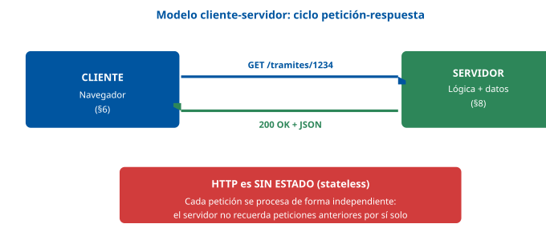

------------------------------------------------------------------------

### D2 · Anatomía de una URL

**Sección**: §2.2 — URL, URI y localización de recursos **Propósito**: Descomponer una URL real de la sede electrónica en sus partes constitutivas.

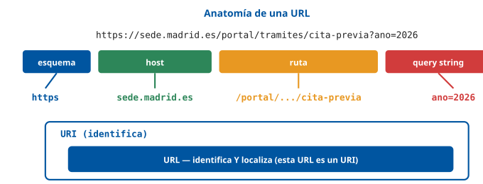

------------------------------------------------------------------------

### D3 · Métodos HTTP y familias de códigos de estado

**Sección**: §2.3.1 — Métodos, cabeceras y códigos de estado **Propósito**: Cheat sheet de los métodos HTTP con su idempotencia y de las cinco familias de códigos de estado.

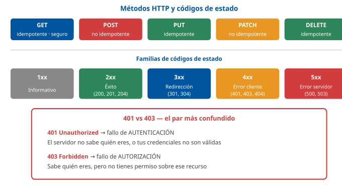

------------------------------------------------------------------------

### D4 · HTML + CSS + JS: separación de responsabilidades

**Sección**: §3.2.1 — HTML, CSS y JavaScript como tecnologías básicas **Propósito**: Visualizar el principio de separación estructura/presentación/comportamiento.

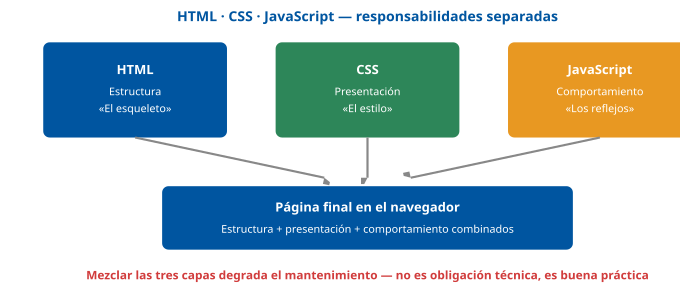

------------------------------------------------------------------------

### D5 · Responsive Web Design: mobile-first y breakpoints

**Sección**: §3.3.1 — Responsive Web Design **Propósito**: Mostrar la misma base de código reorganizándose en tres anchos de pantalla mediante media queries.

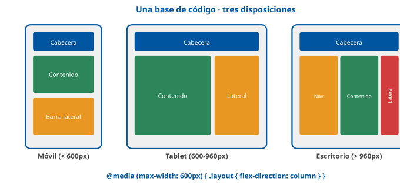

------------------------------------------------------------------------

### D6 · Mecanismos de almacenamiento en el cliente

**Sección**: §3.4 — Mecanismos de almacenamiento local, sesión y caché **Propósito**: Comparar cookies, localStorage, sessionStorage e IndexedDB por persistencia y envío automático.

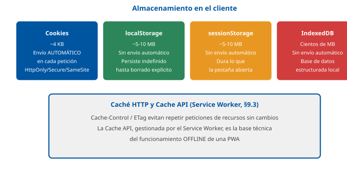

------------------------------------------------------------------------

### D7 · HTML5: etiquetas semánticas de layout

**Sección**: §4.3.1 — Etiquetas semánticas **Propósito**: Mapear visualmente `<header>`, `<nav>`, `<main>`, `<article>`, `<aside>` y `<footer>` sobre una página típica.

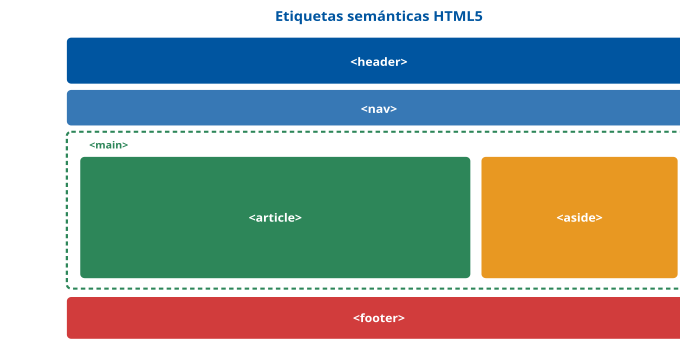

------------------------------------------------------------------------

### D8 · XML: bien formado, válido y validación

**Sección**: §5.1, §5.3 — Concepto de XML y validación de documentos **Propósito**: Distinguir sintaxis bien formada de validación contra DTD/XSD.

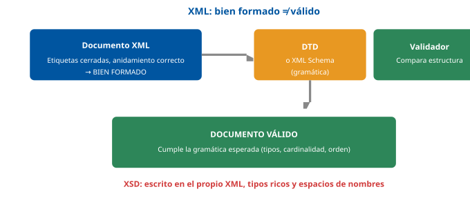

------------------------------------------------------------------------

### D9 · Pipeline de renderizado del navegador

**Sección**: §6.2 — Motores de renderizado y ejecución **Propósito**: Mostrar las fases de parsing → estilo → layout → paint → composición.

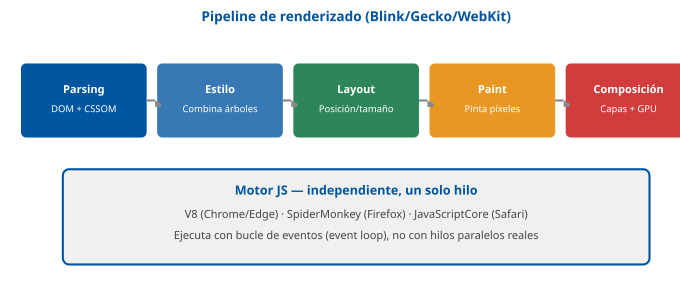

------------------------------------------------------------------------

### D10 · El DOM como árbol de nodos

**Sección**: §6.3 — Modelo de objetos del documento (DOM) **Propósito**: Representar el árbol DOM correspondiente a un documento HTML simple.

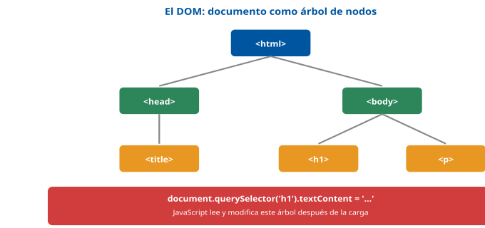

------------------------------------------------------------------------

### D11 · AJAX/fetch y el bucle de eventos

**Sección**: §7.2.2 — Comunicación asíncrona y AJAX **Propósito**: Ilustrar cómo una petición `fetch` no bloquea el hilo único de JavaScript.

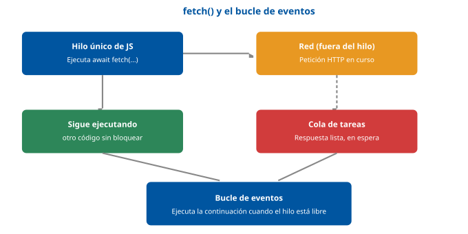

------------------------------------------------------------------------

### D12 · Arquitectura front-end/back-end y API REST

**Sección**: §8.5 — Servicios web y APIs **Propósito**: Situar la API REST como punto de contacto entre front-end y back-end.

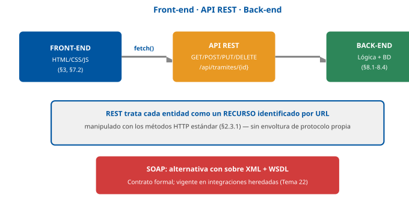

------------------------------------------------------------------------

### D13 · PWA: Service Worker, Manifest y Cache

**Sección**: §9.3 — Aplicaciones web progresivas (PWA) **Propósito**: Mostrar los tres pilares técnicos de una PWA y el papel del Service Worker como intermediario de red.

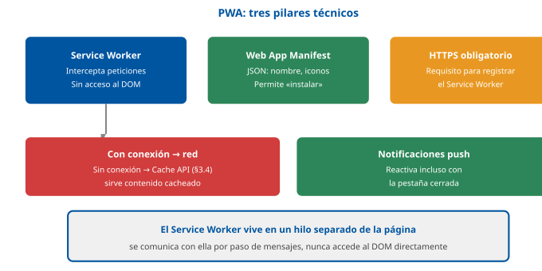

------------------------------------------------------------------------

### D14 · XSS frente a CSRF: direcciones de la confianza explotada

**Sección**: §10.2.2 — Cross-Site Scripting (XSS) y Cross-Site Request Forgery (CSRF) **Propósito**: Contrastar las dos direcciones de confianza que explota cada ataque.

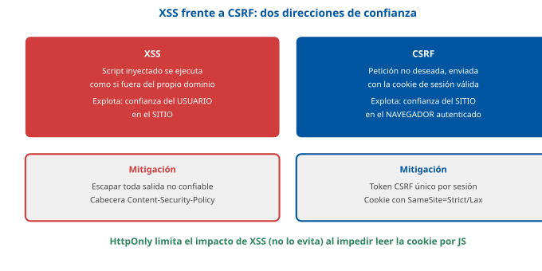

## Casos prácticos

Los tres casos recorren la aplicación de referencia **sede electrónica** (ver la pestaña Contenido, «Convenciones»): el **Caso 1** trabaja el **front-end** (formulario HTML5 responsivo y accesible); el **Caso 2**, el **back-end** (API REST, sesión y acceso a datos); y el **Caso 3**, la **capa progresiva y de seguridad** (PWA y mitigación de XSS/CSRF).

------------------------------------------------------------------------

### Caso 1 — Formulario de cita previa: HTML5, RWD y accesibilidad

#### Enunciado

El área de Atención al Ciudadano necesita un formulario de **solicitud de cita previa** en la sede electrónica, usable tanto desde un ordenador de oficina como desde el móvil de un ciudadano en la calle, y accesible para personas que navegan únicamente con teclado o con lector de pantalla.

#### Cuestiones

**Cuestión 1 — Validación nativa (2 puntos).** Anote el campo de DNI/NIE del formulario usando validación **nativa de HTML5** (sin JavaScript), exigiendo 8 dígitos seguidos de una letra, y marcándolo como obligatorio.

**Cuestión 2 — Metaetiqueta viewport (2 puntos).** Indique la etiqueta imprescindible en `<head>` para que el formulario se muestre correctamente adaptado en un móvil, y explique qué ocurre si se omite.

**Cuestión 3 — Media query (3 puntos).** El formulario se maqueta con Flexbox en fila (`row`) para escritorio. Escriba la media query que lo reorganiza en columna (`column`) por debajo de 600px de ancho.

**Cuestión 4 — Accesibilidad (3 puntos).** Un campo de texto no tiene una etiqueta `<label>` visible por razones de diseño, solo un icono. ¿Cómo se etiqueta correctamente para que un lector de pantalla anuncie su propósito, cumpliendo el principio POUR «Perceptible» de WCAG?

#### Solución orientativa

- **C1**: atributo `pattern` con expresión regular, `required` para obligatoriedad (§4.3.2).

&nbsp;

    <label for="dni">DNI/NIE:</label>
    <input type="text" id="dni" name="dni" pattern="[0-9]{8}[A-Za-z]" required>

- **C2**: `<meta name="viewport" content="width=device-width, initial-scale=1.0">` (§3.3.1). Sin ella, el navegador móvil renderiza a una anchura de escritorio simulada (≈980px) y luego reduce la imagen, haciendo inútiles las media queries basadas en ancho real de pantalla.

&nbsp;

- **C3**: media query sobre el ancho de la ventana gráfica (§3.3.1).

&nbsp;

    .formulario-cita { display: flex; flex-direction: row; }
    @media (max-width: 600px) {
      .formulario-cita { flex-direction: column; }
    }

- **C4**: usar el atributo `aria-label` (o un `<label>` visualmente oculto con una clase que lo saque del flujo visual sin usar `display:none`, que también lo ocultaría a tecnologías de apoyo), de forma que el lector de pantalla anuncie el propósito del campo aunque no haya texto visible. El fundamento es el principio «Perceptible» de las WCAG (§3.3.2); la técnica concreta no se desarrolla en el tema y procede de las técnicas WCAG del W3C (ARIA14, «Using aria-label to provide an invisible label where a visible label cannot be used»).

&nbsp;

    <input type="search" aria-label="Buscar trámite" placeholder="Buscar...">

#### Criterios de evaluación

| Criterio | Puntos |
|----|----|
| Validación nativa `pattern`/`required` correctamente anotada | 2 |
| Metaetiqueta viewport correcta, con justificación del efecto de omitirla | 2 |
| Media query correcta, con `max-width` y cambio de `flex-direction` | 3 |
| Etiquetado accesible correcto (`aria-label` o equivalente), justificando el problema de `display:none` | 3 |

------------------------------------------------------------------------

#### Preguntas tipo test sobre este caso

##### 1. En el supuesto planteado, el campo de DNI/NIE debe exigir 8 dígitos seguidos de una letra mediante validación nativa de HTML5, sin JavaScript. ¿Qué atributo se usa?

- a) type="email", que obliga al navegador a comprobar el formato del dato.
- b) maxlength="9", que limita el campo a nueve caracteres en total.
- c) pattern="[0-9]{8}[A-Za-z]", con la expresión regular del formato.

**Respuesta correcta:** c) · **Referencia:** Caso 1, cuestión 1 · §4.3.2

El atributo pattern aplica una expresión regular como validación nativa del navegador; maxlength solo limita la longitud y type="email" valida direcciones de correo.

##### 2. ¿Qué atributo marca el campo de DNI/NIE como obligatorio, también sin JavaScript?

- a) El atributo placeholder="Obligatorio".
- b) El atributo required.
- c) El atributo min="1".

**Respuesta correcta:** b) · **Referencia:** Caso 1, cuestión 1 · §4.3.2

HTML5 incorporó atributos de validación nativa como required (obligatoriedad), pattern o min/max; el placeholder es solo un texto de ayuda.

##### 3. Con pattern y required ya puestos, ¿basta esa validación del formulario como medida de seguridad?

- a) No: mejora la experiencia de uso, pero un atacante puede enviar la petición directamente al servidor.
- b) Sí: el navegador rechaza cualquier petición que no haya pasado la validación del formulario.
- c) Sí, siempre que el formulario envíe los datos con el método POST en lugar de con GET.

**Respuesta correcta:** a) · **Referencia:** Caso 1, cuestión 1 · §10.3.1

La validación del front-end puede eludirse enviando peticiones HTTP sin pasar por el formulario; toda entrada debe validarse siempre también en el servidor.

##### 4. ¿Qué etiqueta es imprescindible en el <head> para que el formulario se muestre adaptado en un móvil?

- a) <meta charset="UTF-8">
- b) <meta name="viewport" content="width=device-width, initial-scale=1.0">
- c) <meta name="description" content="Cita previa en la sede electrónica">

**Respuesta correcta:** b) · **Referencia:** Caso 1, cuestión 2 · §3.3.1

La metaetiqueta viewport hace que el navegador móvil use el ancho real del dispositivo; charset fija la codificación y description la usan los buscadores.

##### 5. ¿Qué ocurre en el móvil del ciudadano si se omite esa metaetiqueta?

- a) El navegador no muestra la página y avisa de que no está adaptada al dispositivo.
- b) Las media queries se aplican igual, pero el texto aparece con un tamaño mayor.
- c) Se renderiza a un ancho de escritorio simulado (unos 980 px) y luego se reduce.

**Respuesta correcta:** c) · **Referencia:** Caso 1, cuestión 2 · §3.3.1

Sin viewport, el navegador móvil simula un ancho de escritorio y reduce la página, lo que deja sin efecto las media queries basadas en el ancho real de la pantalla.

##### 6. El formulario se maqueta con Flexbox en fila. ¿Qué media query lo pasa a columna por debajo de 600 px de ancho?

- a) @media (max-width: 600px) { .formulario-cita { flex-direction: column; } }
- b) @media (min-width: 600px) { .formulario-cita { flex-direction: column; } }
- c) @media (max-width: 600px) { .formulario-cita { flex-direction: row; } }

**Respuesta correcta:** a) · **Referencia:** Caso 1, cuestión 3 · §3.3.1

La condición max-width: 600px se cumple en anchos de hasta 600 px y, dentro de ella, flex-direction: column apila los elementos; min-width haría lo contrario.

##### 7. ¿A qué responde la condición de esa media query?

- a) Al sistema operativo del dispositivo, móvil o de escritorio, que el servidor detecta.
- b) A la resolución de las imágenes del formulario, indicada mediante el atributo srcset.
- c) Al ancho de la ventana gráfica (viewport) del navegador en el que se muestra la página.

**Respuesta correcta:** c) · **Referencia:** Caso 1, cuestión 3 · §3.3.1

Las media queries son reglas CSS condicionadas al ancho de la ventana gráfica, que reorganizan la disposición en puntos de ruptura.

##### 8. Un campo de búsqueda no tiene <label> visible, solo un icono. ¿Cómo se etiqueta para que el lector de pantalla anuncie su propósito?

- a) Con el atributo aria-label, por ejemplo aria-label="Buscar trámite".
- b) No hace falta: el lector de pantalla describe el icono de forma automática.
- c) Con un comentario HTML junto al campo que explique para qué sirve.

**Respuesta correcta:** a) · **Referencia:** Caso 1, cuestión 4 · §3.3.2 (principio Perceptible) y técnica ARIA14 del W3C

aria-label da al campo un nombre accesible que el lector de pantalla anuncia aunque no haya texto visible; un comentario HTML no llega al usuario.

##### 9. Otra opción es mantener un <label> pero ocultarlo visualmente. ¿Por qué NO debe ocultarse con display:none?

- a) Porque display:none está prohibido dentro de los formularios de HTML5.
- b) Porque display:none también lo oculta a las tecnologías de apoyo.
- c) Porque display:none borra el valor que el ciudadano haya escrito.

**Respuesta correcta:** b) · **Referencia:** Caso 1, cuestión 4 (solución orientativa)

Un elemento con display:none desaparece también para los lectores de pantalla; la etiqueta debe sacarse del flujo visual con una clase que la mantenga accesible.

##### 10. Para las personas que navegan solo con teclado, ¿qué principio POUR de las WCAG exige que todo el formulario pueda manejarse sin ratón?

- a) Perceptible.
- b) Comprensible.
- c) Operable.

**Respuesta correcta:** c) · **Referencia:** Caso 1, enunciado · §3.3.2

Operable significa que los componentes de la interfaz deben poder manejarse; por ejemplo, que toda la funcionalidad sea accesible por teclado y no solo con ratón.

### Caso 2 — API REST de consulta de expedientes con sesión segura

#### Enunciado

El back-end de la sede electrónica debe exponer una **API REST** para que el front-end consulte el estado de los expedientes del ciudadano **ya autenticado**, evitando que un ciudadano pueda consultar expedientes ajenos simplemente cambiando un identificador en la URL.

#### Cuestiones

**Cuestión 1 — Endpoint REST (2 puntos).** Indique el método HTTP y la ruta adecuados para «obtener el expediente número 1234», siguiendo el estilo REST.

**Cuestión 2 — Consulta segura a la base de datos (3 puntos).** Escriba, en pseudocódigo de servidor, la consulta que recupera el expediente por su identificador, evitando la vulnerabilidad de inyección SQL.

**Cuestión 3 — Control de acceso (3 puntos).** Explique qué comprobación adicional, más allá de la autenticación, debe hacer el servidor antes de devolver el expediente, para no ser vulnerable a un **IDOR** (*Insecure Direct Object Reference*).

**Cuestión 4 — Cookie de sesión (2 puntos).** Indique los tres atributos de la cookie de sesión que mitigan, respectivamente, el robo por XSS y el uso indebido por CSRF.

#### Solución orientativa

- **C1**: `GET /api/expedientes/1234` (§8.5) — GET porque es una operación de lectura, idempotente y sin efectos secundarios (§2.3.1).

&nbsp;

- **C2**: consulta **parametrizada**, nunca concatenando el identificador directamente en la cadena SQL (§8.3, §10.2.1).

&nbsp;

    cursor.execute("SELECT * FROM expediente WHERE id = %s", (id_expediente,))

- **C3**: no basta con comprobar que el usuario **está autenticado** (§8.4): el servidor debe verificar además que el expediente solicitado **pertenece** al ciudadano autenticado (o que su rol tiene permiso explícito sobre él), devolviendo `403 Forbidden` si no es así. Confiar en que «si conoce el identificador es porque tiene derecho a verlo» es precisamente el fallo de control de acceso (§10.2.1) que hace posible el ataque IDOR.

&nbsp;

    expediente = obtener_expediente(id_expediente)
    if expediente.dni_titular != usuario_autenticado.dni:
        return jsonify(error="No autorizado"), 403

- **C4**: `HttpOnly` (JavaScript no puede leerla, mitiga el robo por XSS), `Secure` (solo se envía por HTTPS) y `SameSite=Strict` o `Lax` (no se envía en peticiones originadas desde otro dominio, mitiga CSRF) (§8.4, §10.2.2, §10.3.2).

#### Criterios de evaluación

| Criterio | Puntos |
|----|----|
| Método y ruta REST correctos (GET, recurso identificado en la ruta) | 2 |
| Consulta parametrizada, sin concatenación insegura | 3 |
| Verificación de pertenencia del expediente al usuario autenticado, con 403 correcto | 3 |
| Los tres atributos de cookie correctamente identificados y asociados a su mitigación | 2 |

------------------------------------------------------------------------

#### Preguntas tipo test sobre este caso

##### 1. En el supuesto planteado, ¿qué método HTTP y qué ruta corresponden, en estilo REST, a «obtener el expediente número 1234»?

- a) POST /api/expedientes/1234
- b) GET /api/expedientes/1234
- c) PUT /api/expedientes/1234

**Respuesta correcta:** b) · **Referencia:** Caso 2, cuestión 1 · §8.5

En REST cada expediente es un recurso identificado en la ruta y se obtiene con GET; PUT lo reemplazaría y POST se usa para crear.

##### 2. ¿Por qué el método adecuado para esa consulta es GET?

- a) Porque es una operación de lectura, idempotente y sin efectos secundarios.
- b) Porque GET cifra los parámetros de la URL antes de enviarlos al servidor.
- c) Porque GET crea el recurso en el servidor si todavía no existía.

**Respuesta correcta:** a) · **Referencia:** Caso 2, cuestión 1 · §2.3.1

GET obtiene una representación del recurso; según la tabla de métodos, es idempotente y seguro (sin efectos secundarios).

##### 3. ¿Cómo debe escribir el back-end la consulta que recupera el expediente por su identificador?

- a) Concatenando el identificador en la cadena SQL, tras validarlo antes con JavaScript.
- b) "SELECT * FROM expediente WHERE id = '" + id_expediente + "'"
- c) cursor.execute("SELECT * FROM expediente WHERE id = %s", (id_expediente,))

**Respuesta correcta:** c) · **Referencia:** Caso 2, cuestión 2 · §8.3 y §10.2.1

La consulta parametrizada evita la inyección SQL; concatenar el dato en la cadena es lo vulnerable, y la validación en JavaScript puede eludirse.

##### 4. ¿Por qué la consulta parametrizada protege frente a la inyección SQL?

- a) Porque el motor recibe el dato siempre como un valor, nunca como parte de la sintaxis.
- b) Porque cifra el identificador del expediente antes de enviarlo a la base de datos.
- c) Porque solo admite identificadores numéricos y rechaza cualquier otro carácter.

**Respuesta correcta:** a) · **Referencia:** Caso 2, cuestión 2 · §10.2.1

En la consulta parametrizada el dato del usuario se trata como un valor, sea cual sea su contenido, y no puede alterar la estructura del comando.

##### 5. Un ciudadano autenticado cambia en la URL el número de su expediente por otro y obtiene un expediente ajeno. ¿Qué vulnerabilidad es?

- a) Un XSS reflejado, porque el dato viaja en la propia URL de la petición.
- b) Un IDOR, una variante del control de acceso roto.
- c) Un CSRF, porque la petición lleva la cookie de sesión válida.

**Respuesta correcta:** b) · **Referencia:** Caso 2, cuestión 3 · §10.2.1

Cambiar el identificador en la URL para acceder al recurso de otro ciudadano es un IDOR (Insecure Direct Object Reference), variante del control de acceso roto.

##### 6. Para no ser vulnerable a ese IDOR, ¿qué comprobación debe hacer el servidor antes de devolver el expediente?

- a) Que el usuario está autenticado, lo que basta para servir cualquier expediente.
- b) Que el identificador recibido tiene un formato numérico válido y existe.
- c) Que el expediente pertenece al ciudadano autenticado o que su rol tiene permiso.

**Respuesta correcta:** c) · **Referencia:** Caso 2, cuestión 3 · §8.4 y §10.2.1

La autenticación dice quién es el usuario; la autorización decide si puede acceder a ese recurso concreto, y debe verificarse en el servidor.

##### 7. Si el expediente pertenece a otro ciudadano, ¿qué código de estado debe devolver la API?

- a) 401 Unauthorized.
- b) 403 Forbidden.
- c) 400 Bad Request.

**Respuesta correcta:** b) · **Referencia:** Caso 2, cuestión 3 · §2.3.1 y §8.4

403 Forbidden indica un fallo de autorización: el servidor sabe quién es el usuario, pero no tiene permiso. 401 indica un fallo de autenticación.

##### 8. ¿Qué atributo de la cookie de sesión mitiga su robo mediante XSS?

- a) SameSite, que impide enviarla desde otro dominio.
- b) Secure, que impide enviarla por HTTP sin cifrar.
- c) HttpOnly, que impide que JavaScript la lea.

**Respuesta correcta:** c) · **Referencia:** Caso 2, cuestión 4 · §8.4

Con HttpOnly, JavaScript no puede leer la cookie desde el DOM, de modo que un script inyectado no puede robarla directamente.

##### 9. ¿Qué atributo de la cookie de sesión mitiga el uso indebido por CSRF?

- a) El atributo SameSite=Strict o Lax.
- b) El atributo HttpOnly.
- c) El atributo Max-Age=3600.

**Respuesta correcta:** a) · **Referencia:** Caso 2, cuestión 4 · §8.4 y §10.2.2

SameSite restringe el envío de la cookie en peticiones originadas desde otro dominio, que es justo lo que aprovecha un ataque CSRF.

##### 10. ¿Qué aporta el atributo Secure en la cookie de sesión?

- a) Impide que JavaScript pueda leer la cookie desde el DOM.
- b) Hace que la cookie solo se envíe por HTTPS, nunca por HTTP.
- c) Impide que la cookie se adjunte a peticiones de otro dominio.

**Respuesta correcta:** b) · **Referencia:** Caso 2, cuestión 4 · §8.4

Secure garantiza que la cookie solo viaja sobre HTTPS, nunca en texto plano por HTTP.

### Caso 3 — Conversión a PWA y mitigación de XSS en un formulario de contacto

#### Enunciado

La sede electrónica debe ofrecer, además, la posibilidad de **consultar el estado de un trámite sin conexión** (por ejemplo, en el metro), y su formulario de contacto —que muestra los últimos mensajes enviados por el propio ciudadano en la misma sesión— debe protegerse frente a inyección de script.

#### Cuestiones

**Cuestión 1 — Registro del Service Worker (2 puntos).** Escriba el código JavaScript, ejecutado desde la página principal, que registra un Service Worker ubicado en `/sw.js`.

**Cuestión 2 — Requisito de despliegue (2 puntos).** ¿Bajo qué condición de protocolo puede registrarse un Service Worker en producción, y por qué es un requisito de seguridad, no solo una recomendación?

**Cuestión 3 — Manifest de instalación (2 puntos).** Indique dos propiedades imprescindibles del fichero `manifest.json` para que el navegador ofrezca «instalar» la sede electrónica en la pantalla de inicio.

**Cuestión 4 — Mitigación de XSS (4 puntos).** El formulario de contacto muestra el último mensaje del ciudadano insertándolo en el DOM con `innerHTML`. Explique por qué esto es vulnerable a XSS y cómo corregirlo.

#### Solución orientativa

- **C1**: registro condicionado a que el navegador soporte la API (§9.3).

&nbsp;

    if ('serviceWorker' in navigator) {
      navigator.serviceWorker.register('/sw.js');
    }

- **C2**: solo puede registrarse servido por **HTTPS** (§9.3, §10.3.1). Es un requisito de seguridad, no una recomendación, porque el Service Worker obtiene un control extenso sobre el tráfico de red de la aplicación (puede interceptar y modificar cualquier petición y respuesta); permitirlo sobre HTTP sin cifrar expondría ese control a un atacante interceptando la red.

&nbsp;

- **C3**: por ejemplo, `name` (o `short_name`) y `start_url`, junto con al menos un icono en `icons` (§9.3).

&nbsp;

    { "name": "Sede Electrónica", "start_url": "/portal/", "icons": [{"src": "/icon-192.png", "sizes": "192x192", "type": "image/png"}] }

- **C4**: `innerHTML` inserta la cadena recibida **interpretándola como HTML**; si el mensaje del ciudadano contiene marcado con código, como `` (introducido por error o, en el caso general, por un atacante mediante otro campo mal protegido), el navegador **ejecutaría** ese JavaScript en el contexto del propio dominio de la sede electrónica. Es un XSS **basado en DOM** (§10.2.2): la inserción insegura la hace el JavaScript del cliente, sin que el servidor devuelva el código en su respuesta. (Un ` incluido en el <head> de la página

**Respuesta correcta:** a) · **Referencia:** Caso 3, cuestión 1 · §9.3

El Service Worker se registra con navigator.serviceWorker.register(); cargar el fichero como un script normal lo ejecutaría en la página, no como Service Worker.

##### 2. ¿Para qué sirve la comprobación 'serviceWorker' in navigator antes del registro?

- a) Para verificar que la página se está sirviendo por HTTPS.
- b) Para confirmar que el ciudadano ya ha iniciado sesión.
- c) Para comprobar que el navegador admite esa API (mejora progresiva).

**Respuesta correcta:** c) · **Referencia:** Caso 3, cuestión 1 · §6.4 y §9.3

El registro se condiciona a que el navegador soporte la API: si no la tiene, la página sigue funcionando sin capacidad offline, como pide la mejora progresiva.

##### 3. ¿Bajo qué condición de protocolo puede registrarse el Service Worker en producción?

- a) Con cualquier protocolo, siempre que sw.js esté en la raíz.
- b) Solo si la sede electrónica se sirve por HTTPS.
- c) Solo si el servidor web utiliza la versión HTTP/3.

**Respuesta correcta:** b) · **Referencia:** Caso 3, cuestión 2 · §9.3

Servir la aplicación por HTTPS es requisito obligatorio para registrar un Service Worker; es uno de los tres pilares de una PWA.

##### 4. ¿Por qué HTTPS es un requisito de seguridad y no una simple recomendación para el Service Worker?

- a) Porque HTTPS acelera la carga del Service Worker y de la caché sin conexión.
- b) Porque el Service Worker guarda las contraseñas del ciudadano en la caché.
- c) Porque el Service Worker controla el tráfico de red y, sin cifrar, quedaría expuesto.

**Respuesta correcta:** c) · **Referencia:** Caso 3, cuestión 2 · §9.3

El Service Worker puede interceptar y modificar peticiones y respuestas; permitirlo sobre HTTP expondría ese control a quien intercepte la red.

##### 5. ¿Qué propiedades del fichero manifest.json son necesarias para que el navegador ofrezca «instalar» la sede electrónica?

- a) name (o short_name) y start_url, junto con al menos un icono en icons.
- b) HttpOnly y SameSite, que protegen la sesión de la aplicación instalada.
- c) Cache-Control y ETag, que controlan la caché de la aplicación instalada.

**Respuesta correcta:** a) · **Referencia:** Caso 3, cuestión 3 · §9.3

El Web App Manifest es un JSON con los metadatos de la aplicación (nombre, iconos, URL de inicio…); HttpOnly, SameSite, Cache-Control y ETag son atributos de cookie y cabeceras HTTP.

##### 6. Un ciudadano consultó ayer el estado de su trámite y hoy quiere verlo en el metro, sin conexión. ¿Qué pieza de la PWA lo hace posible?

- a) El fichero manifest.json, que guarda una copia del último estado consultado.
- b) El Service Worker, que sirve desde la caché el contenido ya consultado.
- c) La cookie de sesión, que almacena el estado del trámite en el navegador.

**Respuesta correcta:** b) · **Referencia:** Caso 3, enunciado · §9.3

El Service Worker intercepta las peticiones y sirve contenido desde la caché cuando no hay conexión; obtener un estado más reciente exigirá conectividad.

##### 7. El formulario de contacto muestra el último mensaje con elemento.innerHTML = ultimoMensaje. ¿Por qué es vulnerable a XSS?

- a) Porque innerHTML interpreta la cadena como HTML y ejecutaría el código de un atributo de evento inyectado (p. ej. onerror) en el dominio de la sede.
- b) Porque innerHTML envía el mensaje al servidor sin cifrar, y un atacante puede leerlo por el camino.
- c) Porque innerHTML no admite caracteres con tilde y deja el mensaje del ciudadano sin escapar.

**Respuesta correcta:** a) · **Referencia:** Caso 3, cuestión 4 · §10.2.2

Insertar contenido no confiable como HTML sin escapar permite ejecutar JavaScript arbitrario (p. ej. con ) en el contexto del propio dominio de confianza; es un XSS basado en DOM porque la inserción la hace el JavaScript del cliente.

##### 8. Si el mensaje es texto plano, ¿cuál es la corrección adecuada?

- a) Mantener innerHTML y marcar la cookie de sesión como HttpOnly.
- b) Usar elemento.textContent = ultimoMensaje en lugar de innerHTML.
- c) Limitar con JavaScript la longitud máxima del mensaje del ciudadano.

**Respuesta correcta:** b) · **Referencia:** Caso 3, cuestión 4 · §10.2.2

textContent inserta el contenido como texto, sin interpretarlo como HTML. HttpOnly no evita el XSS: solo limita su impacto sobre la cookie.

##### 9. Si hubiera que insertar marcado en lugar de texto plano, ¿cómo se protege la página?

- a) Insertando el mensaje con innerHTML tal como lo escribió el ciudadano.
- b) Desactivando el Service Worker mientras se muestra el mensaje en pantalla.
- c) Escapando los caracteres especiales (<, >, &) antes de insertarlo, con una CSP de refuerzo.

**Respuesta correcta:** c) · **Referencia:** Caso 3, cuestión 4 · §10.2.2

La mitigación principal del XSS es escapar toda salida con datos no controlados por el desarrollador, reforzada con la cabecera Content-Security-Policy.

##### 10. ¿Qué añade la cabecera Content-Security-Policy como refuerzo frente al XSS?

- a) Restringe desde qué orígenes puede cargarse y ejecutarse script en la página.
- b) Cifra la cookie de sesión para que un script no pueda descifrarla.
- c) Obliga al navegador a usar HTTPS en todas las visitas futuras.

**Respuesta correcta:** a) · **Referencia:** Caso 3, cuestión 4 · §10.2.2 y §10.3.1

CSP limita qué script puede ejecutarse en la página; forzar HTTPS en visitas futuras es la función de otra cabecera, Strict-Transport-Security.

## Fuentes

### Tier 1 — Especificaciones oficiales y obras canónicas

| ID | Referencia |
|----|----|
| `[WHATWG-HTML]` | WHATWG. *HTML Living Standard*. [html.spec.whatwg.org](https://html.spec.whatwg.org/). Especificación viva y de referencia de HTML5, mantenida por el WHATWG (Apple, Google, Mozilla, Microsoft) desde 2019 tras el fin del desarrollo paralelo con el W3C. |
| `[W3C-HTML5]` | W3C. *HTML5.2/5.3* (última recomendación formal del W3C antes de adoptar el Living Standard del WHATWG como fuente única en 2019). [w3.org/TR/html5](https://www.w3.org/TR/html5/). |
| `[W3C-CSS]` | W3C CSS Working Group. *CSS Snapshot* y módulos CSS3 (Selectors, Box Model, Flexible Box, Grid Layout, Media Queries). [w3.org/Style/CSS](https://www.w3.org/Style/CSS/). |
| `[ECMA262]` | Ecma International. *ECMA-262: ECMAScript Language Specification* (edición vigente, ES2015+). Especificación normativa del lenguaje JavaScript. |
| `[W3C-DOM4]` | W3C / WHATWG. *DOM Living Standard* (DOM4 y sucesivas). [dom.spec.whatwg.org](https://dom.spec.whatwg.org/). Define el Modelo de Objetos del Documento como API independiente del lenguaje. |
| `[RFC3986]` | Berners-Lee, T.; Fielding, R.; Masinter, L. *[RFC 3986](https://www.rfc-editor.org/rfc/rfc3986): Uniform Resource Identifier (URI): Generic Syntax* (IETF, 2005). Especificación normativa de URI/URL. |
| `[RFC9110]` | IETF HTTP Working Group. *[RFC 9110](https://www.rfc-editor.org/rfc/rfc9110): HTTP Semantics* (2022, sustituye a [RFC 7230](https://www.rfc-editor.org/rfc/rfc7230)-7235). Métodos, cabeceras y códigos de estado HTTP. |
| `[RFC9112]` | IETF. *[RFC 9112](https://www.rfc-editor.org/rfc/rfc9112): HTTP/1.1*. Sintaxis de mensajes HTTP/1.1. |
| `[RFC9113]` | IETF. *[RFC 9113](https://www.rfc-editor.org/rfc/rfc9113): HTTP/2*. |
| `[RFC9114]` | IETF. *[RFC 9114](https://www.rfc-editor.org/rfc/rfc9114): HTTP/3* (sobre QUIC/[RFC 9000](https://www.rfc-editor.org/rfc/rfc9000)). |
| `[RFC9846]` | IETF. *[RFC 9846](https://www.rfc-editor.org/rfc/rfc9846): The Transport Layer Security (TLS) Protocol Version 1.3* (julio de 2026). Obsoleta los [RFC 5077](https://www.rfc-editor.org/rfc/rfc5077), 5246, 6961, 7627, 8422 y 8446: es la especificación vigente de TLS 1.3 y sustituye a la de 2018. |
| `[RFC8446]` | IETF. *[RFC 8446](https://www.rfc-editor.org/rfc/rfc8446): The Transport Layer Security (TLS) Protocol Version 1.3* (agosto de 2018). Obsoletado por el [RFC 9846](https://www.rfc-editor.org/rfc/rfc9846). Se conserva la referencia porque es la que recogen los temarios al uso. |
| `[FIELDING2000]` | Fielding, R. T. *Architectural Styles and the Design of Network-based Software Architectures* (tesis doctoral, UC Irvine, 2000). Origen del estilo arquitectónico cliente-servidor por capas y de REST. |
| `[XML10]` | W3C. *[Extensible Markup Language (XML) 1.0](https://www.w3.org/TR/xml/)* (5.ª edición). w3.org/TR/xml. |
| `[XML-NAMESPACES]` | W3C. *Namespaces in XML 1.0*. [w3.org/TR/xml-names](https://www.w3.org/TR/xml-names/). |
| `[XMLSCHEMA]` | W3C. *XML Schema Definition Language (XSD) 1.1*. [w3.org/TR/xmlschema11-1](https://www.w3.org/TR/xmlschema11-1/). |
| `[XHTML10]` | W3C. *XHTML 1.0: The Extensible HyperText Markup Language* (2.ª edición). [w3.org/TR/xhtml1](https://www.w3.org/TR/xhtml1/). |
| `[XSLT30]` | W3C. *XSL Transformations (XSLT) Version 3.0*. [w3.org/TR/xslt-30](https://www.w3.org/TR/xslt-30/). |
| `[SVG11]` | W3C. *Scalable Vector Graphics (SVG) 1.1* (2.ª edición) y *SVG 2* (borrador de referencia). [w3.org/TR/SVG11](https://www.w3.org/TR/SVG11/). |
| `[WCAG22]` | W3C WAI. *Web Content Accessibility Guidelines (WCAG) 2.2*. [w3.org/TR/WCAG22](https://www.w3.org/TR/WCAG22/). Estándar de accesibilidad web, base del [RD 1112/2018](https://www.boe.es/buscar/act.php?id=BOE-A-2018-12699). |
| `[SERVICE-WORKERS]` | W3C. *Service Workers* Specification. [w3.org/TR/service-workers](https://www.w3.org/TR/service-workers/). Fundamento técnico de las PWA. |
| `[WEB-APP-MANIFEST]` | W3C. *Web Application Manifest*. [w3.org/TR/appmanifest](https://www.w3.org/TR/appmanifest/). |
| `[OWASP-TOP10]` | OWASP Foundation. *OWASP Top 10:2021 — The Ten Most Critical Web Application Security Risks*. owasp.org/Top10. Referencia canónica de vulnerabilidades web. |
| `[FOWLER-EAA]` | Fowler, M. *Patterns of Enterprise Application Architecture* (Addison-Wesley, 2002). Patrones de arquitectura multicapa (*Layers*, *Front Controller*, *MVC*) aplicables al front-end y al back-end web. |

### Tier 2 — Documentación de lenguajes, motores y herramientas

| ID | Referencia |
|----|----|
| `[MDN-JS]` | Mozilla Developer Network. *JavaScript Guide y Reference*. developer.mozilla.org/en-US/docs/Web/JavaScript. |
| `[MDN-HTTP]` | Mozilla Developer Network. *HTTP*. developer.mozilla.org/en-US/docs/Web/HTTP. |
| `[MDN-CSS]` | Mozilla Developer Network. *CSS*. developer.mozilla.org/en-US/docs/Web/CSS. |
| `[MDN-PWA]` | Mozilla Developer Network. *Progressive web apps*. developer.mozilla.org/en-US/docs/Web/Progressive_web_apps. |
| `[V8-DOC]` | Google. *V8 JavaScript Engine — Documentación de arquitectura* (parser, Ignition, TurboFan, recolector de basura generacional). v8.dev/docs. |
| `[CHROMIUM-BLINK]` | The Chromium Project. *Blink Rendering Engine* — documentación de arquitectura (pipeline de renderizado: parsing, estilo, layout, paint, composición). www.chromium.org/blink. |
| `[GECKO-DOC]` | Mozilla. *Gecko / Servo — arquitectura del motor de renderizado de Firefox*. firefox-source-docs.mozilla.org. |
| `[WEBKIT-DOC]` | Apple/The WebKit Project. *WebKit — arquitectura* (WebCore + JavaScriptCore). webkit.org. |
| `[NODE-DOC]` | OpenJS Foundation. *Node.js Documentation* — bucle de eventos, E/S no bloqueante sobre V8. nodejs.org/docs. |
| `[PHP-DOC]` | The PHP Group. *PHP Manual*. php.net/manual. |
| `[PYTHON-DOC]` | Python Software Foundation. *The Python Standard Library* y documentación de WSGI (PEP 3333). docs.python.org. |
| `[DJANGO-DOC]` | Django Software Foundation. *Django Documentation*. docs.djangoproject.com. |
| `[EXPRESS-DOC]` | OpenJS Foundation. *Express.js — Guía*. expressjs.com. |
| `[REACT-DOC]` | Meta. *React Documentation*. react.dev. |
| `[MDN-SERVICEWORKER]` | Mozilla Developer Network. *Service Worker API — Guía práctica*. developer.mozilla.org/en-US/docs/Web/API/Service_Worker_API. |
| `[LIGHTHOUSE-DOC]` | Google. *Lighthouse — PWA y rendimiento web*. developer.chrome.com/docs/lighthouse. |

### Tier 3 — Marco normativo y del puesto (contexto, no contenido técnico)

| ID | Referencia |
|----|----|
| `[RD1112-2018]` | [Real Decreto 1112/2018](https://www.boe.es/buscar/act.php?id=BOE-A-2018-12699), de 7 de septiembre, sobre accesibilidad de los sitios web y aplicaciones para dispositivos móviles del sector público. Transpone la [Directiva (UE) 2016/2102](https://eur-lex.europa.eu/legal-content/ES/TXT/?uri=CELEX:32016L2102). Base normativa de §3.4.3. |
| `[ENS]` | [Real Decreto 311/2022](https://www.boe.es/buscar/act.php?id=BOE-A-2022-7191), Esquema Nacional de Seguridad — requisitos de autenticación, cifrado en tránsito y trazabilidad aplicables al desarrollo seguro de aplicaciones web municipales. |
| `[RGPD]` | [Reglamento (UE) 2016/679](https://eur-lex.europa.eu/legal-content/ES/TXT/?uri=CELEX:32016R0679) (RGPD) y [LO 3/2018](https://www.boe.es/buscar/act.php?id=BOE-A-2018-16673) (LOPDGDD) — base legal de la gestión de cookies, sesiones y datos personales en aplicaciones web (§3.5, §8.4). |
| `[BOAM10032]` | BOAM 10.032 (23-dic-2025). Bases específicas TIC C1 Ayto. Madrid — temario oficial. |

------------------------------------------------------------------------

*Las referencias Tier 1 fijan el fundamento normativo de los estándares abiertos de la web (WHATWG, W3C, IETF, Ecma, OWASP) y son la base de todo el contenido; Tier 2 documenta lenguajes, motores de navegador y frameworks concretos citados como ejemplo (V8/Blink, Node, PHP, Python/Django, React) sin que el tema dependa de ninguno en particular; Tier 3 enmarca la normativa de accesibilidad, seguridad y protección de datos aplicable a una aplicación web del Ayuntamiento de Madrid.*
