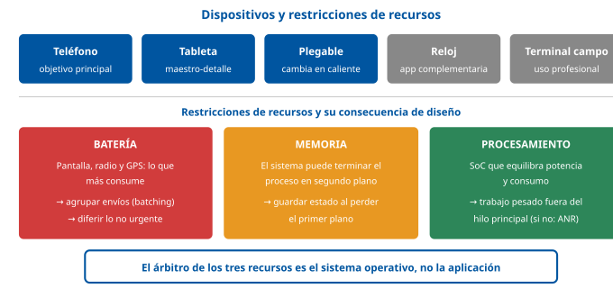
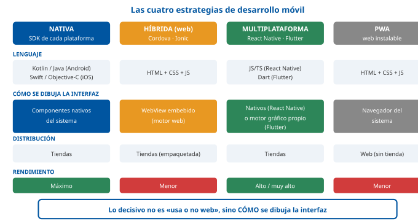
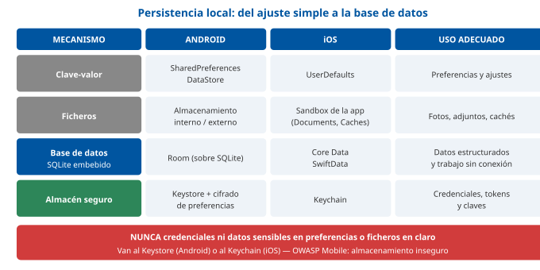
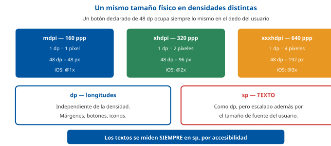
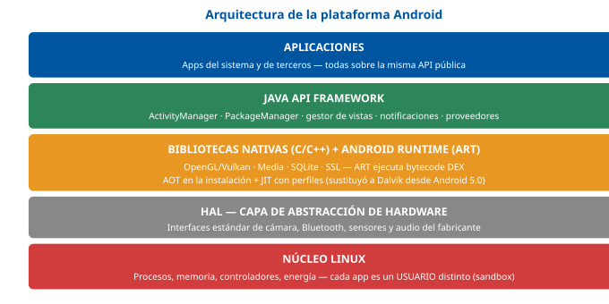
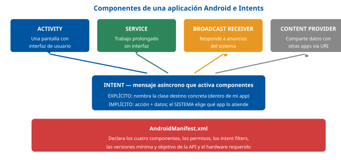
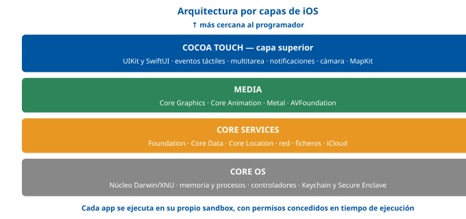
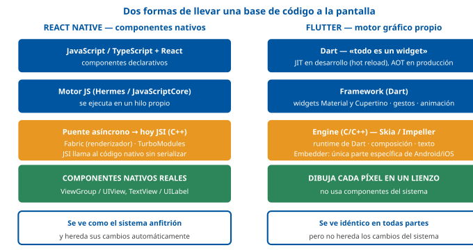

# Tema 24. Desarrollo para dispositivos móviles

**Bloque:** técnico  
**Enunciado oficial** (BOAM n.º 10.032, de 23 de diciembre de 2025): Desarrollo para dispositivos móviles. Frameworks nativos e híbridos.

Versión web: <https://ayuntamientomadrid.github.io/temario-tecnico-auxiliar/temas/tema-24.html> · PDF: [tema-24.pdf](tema-24.pdf) · Test: [../../../tests/tecnico/tema-24.md](../../../tests/tecnico/tema-24.md)

## Índice

- 1. Introducción al desarrollo para dispositivos móviles
  - 1.1. Caracterización y evolución del ecosistema móvil
  - 1.2. Estrategias y paradigmas de desarrollo
- 2. Arquitectura y fundamentos de aplicaciones móviles
  - 2.1. Ciclo de vida de las aplicaciones
  - 2.2. Interfaz y experiencia de usuario (UI/UX)
  - 2.3. Comunicación y conectividad
- 3. Frameworks y desarrollo nativo
  - 3.1. Plataforma Android
  - 3.2. Plataforma iOS
- 4. Frameworks y desarrollo híbrido
  - 4.1. Soluciones basadas en contenedores web
  - 4.2. Soluciones de compilación y renderizado nativo
- 5. Comparativa tecnológica y criterios de selección
  - 5.1. Evaluación de rendimiento, consumo de recursos y seguridad
  - 5.2. Reutilización de código, mantenibilidad y costes de desarrollo
  - 5.3. Publicación, distribución en tiendas de aplicaciones y despliegue

### Conceptos clave para memorizar

| Concepto | Dato clave |
|----|----|
| Aplicación nativa | Se compila a código máquina de la plataforma y usa su SDK oficial (Android/Kotlin, iOS/Swift): **máximo rendimiento y acceso al hardware**, pero **una base de código por plataforma** |
| Aplicación híbrida (contenedor web) | HTML/CSS/JS ejecutados dentro de un **WebView** empaquetado como app; el acceso al hardware pasa por un **puente de plugins** (Cordova, Ionic/Capacitor) |
| Multiplataforma compilada | Una base de código que **se compila o renderiza de forma nativa**: React Native (componentes nativos vía puente/JSI) y Flutter (motor gráfico propio que pinta cada píxel) |
| PWA | Aplicación web instalable con **Service Worker** + **Web App Manifest**: funciona offline y admite push, pero con acceso limitado al hardware y **fuera de las tiendas** (en iOS con más restricciones) |
| Ciclo de vida | El **sistema operativo**, no el programador, decide cuándo pausar o destruir la app: hay que **guardar el estado antes de perder el foco** |
| Activity / UIViewController | Unidad de pantalla de Android / de iOS; ambas tienen callbacks de ciclo de vida (`onCreate`/`onPause`; `viewDidLoad`/`viewWillDisappear`) |
| Intent | Mensaje asíncrono de Android que activa componentes: **explícito** (clase concreta) o **implícito** (acción + datos, resuelto por el sistema) |
| ART | *Android Runtime*: entorno de ejecución de Android, con compilación **AOT + JIT** y formato **DEX**; sustituyó a Dalvik desde Android 5.0 |
| SQLite | Motor de base de datos **embebido, sin servidor**, base de la persistencia estructurada local tanto en Android (Room) como en iOS (Core Data) |
| Hilo principal (UI thread) | **Toda** operación de red o E/S debe salir del hilo principal; bloquearlo provoca ANR en Android o congelación de la interfaz en iOS |
| Notificación push | El servidor **no** habla con la app: envía el mensaje a **FCM** (Android) o **APNs** (iOS), que lo entregan al dispositivo mediante un *token* de registro |
| Densidad de pantalla | Android usa unidades **dp/sp** independientes de densidad; iOS usa **puntos** con factor de escala @1x/@2x/@3x |
| Diseño responsivo móvil | Un mismo diseño se adapta a tamaños, orientaciones y densidades; la accesibilidad del sector público la exige el **RD 1112/2018** (norma EN 301 549, WCAG 2.2 nivel AA) |
| Firma digital de la app | Android firma el APK/AAB con la clave del desarrollador (Play App Signing); iOS exige certificado + *provisioning profile* emitidos por Apple |
| Formato de publicación | Google Play distribuye **AAB** (*Android App Bundle*, obligatorio para apps nuevas desde agosto de 2021); App Store distribuye **IPA** enviado con Xcode/Transporter |

## Contenido

### Convenciones del documento

Este tema incluye cuatro tipos de **cajas callout** para facilitar el estudio:

> **Dato clave.** Información de alta densidad memorística.

> **Ejercicio resuelto.** Problema + solución paso a paso (identificación de una tecnología, elección arquitectónica razonada).

> **Ejemplo de aplicación en el ayto.** Aplicación real de la teoría al entorno municipal (avisos ciudadanos, sede electrónica, trámites).

> **Relación con otros temas.** Enlace conceptual a otros temas del temario oficial.

Los ejemplos de **código** se escriben en **Kotlin, Swift, Dart y JavaScript reales** (no en pseudocódigo neutro), porque este tema trata precisamente de comparar esas plataformas concretas: un pseudocódigo agnóstico impediría apreciar las diferencias entre ellas, que es justo el objeto del tema (mismo criterio que el Tema 21 con Java/Jakarta y el Tema 23 con HTML/JS/PHP). Los fragmentos son deliberadamente breves e ilustrativos, no aplicaciones completas. Las fuentes se citan con etiquetas breves tipo `[ANDROID-DEV]` o `[FLUTTER-DOC]`; el registro completo está en la pestaña Fuentes.

**Caso de referencia usado en todo el tema** (contexto Ayuntamiento de Madrid, supuesto simplificado): una **aplicación municipal de avisos ciudadanos**, con la que un vecino comunica una incidencia en la vía pública (una farola apagada, un socavón, un contenedor dañado) adjuntando **una fotografía y su geolocalización**, consulta el estado de sus avisos anteriores y recibe una **notificación push** cuando el aviso se resuelve. Este supuesto concentra casi todas las dificultades características del desarrollo móvil: acceso a hardware (cámara y GPS), permisos, conectividad intermitente, trabajo en segundo plano, sincronización diferida, notificaciones, accesibilidad obligatoria y publicación en dos tiendas distintas.

------------------------------------------------------------------------

### 1. Introducción al desarrollo para dispositivos móviles

#### 1.1. Caracterización y evolución del ecosistema móvil

El desarrollo para dispositivos móviles es la disciplina de construir software destinado a ejecutarse en equipos **personales, portátiles, alimentados por batería y conectados de forma inalámbrica**, con interfaces basadas principalmente en pantalla táctil y con un conjunto de sensores integrados que no existe en un ordenador de sobremesa \[ANDROID-DEV\] \[APPLE-DEV\].

Su evolución puede resumirse en cuatro etapas:

| Etapa | Periodo aproximado | Rasgos |
|----|----|----|
| **Telefonía con software cerrado** | 1995-2000 | Terminales con firmware propietario; el usuario no instala aplicaciones. Primeras plataformas de microaplicaciones (WAP, Java ME/MIDlets). |
| **Primeros sistemas abiertos** | 2000-2007 | Symbian, Windows Mobile, BlackBerry OS; SDK disponibles, pero distribución fragmentada y sin tienda unificada. |
| **Era de las tiendas y los ecosistemas** | 2008-2015 | Lanzamiento de la App Store (2008) y de Android Market/Google Play (2008); el modelo pasa a ser *SDK oficial + tienda centralizada + revisión*. Nace el desarrollo móvil tal como se entiende hoy. |
| **Convergencia y multiplataforma** | 2015-presente | Duopolio **Android/iOS**; maduración de los enfoques multiplataforma (React Native 2015, Flutter 2018), de las PWA y de los lenguajes modernos de plataforma (Swift 2014, Kotlin oficial en Android 2017 y preferente desde 2019). |

> **Dato clave.** El ecosistema móvil actual es un **duopolio de facto**: **Android** (Google/AOSP, licencia libre, múltiples fabricantes, alta fragmentación de dispositivos y versiones) e **iOS** (Apple, ecosistema cerrado, hardware propio, baja fragmentación). Toda la disciplina de desarrollo móvil se articula sobre esa dualidad \[ANDROID-ARCH\] \[APPLE-ARCH\].

La diferencia estructural entre ambas plataformas condiciona todo el tema:

- **Android** es un sistema **abierto** (AOSP) que fabricantes distintos adaptan a hardware muy diverso: la consecuencia es la **fragmentación** —cientos de combinaciones de tamaño de pantalla, densidad, versión del sistema y capa del fabricante— que el desarrollador debe absorber mediante recursos alternativos, comprobaciones de versión y bibliotecas de compatibilidad \[ANDROID-DEV\].
- **iOS** es un sistema **cerrado y verticalmente integrado**: Apple controla hardware, sistema operativo, lenguaje, herramienta de desarrollo (Xcode) y canal de distribución. El resultado es un catálogo de dispositivos reducido y una adopción de versiones muy rápida, a costa de una **libertad menor** (solo se puede desarrollar con Xcode sobre macOS, y toda app pasa por revisión de Apple) \[APPLE-DEV\] \[APPSTORE-REVIEW\].

> **Relación con otros temas.** Los **sistemas operativos para dispositivos móviles** como tales (arquitectura de Android e iOS en cuanto sistemas, gestión de procesos y memoria) se desarrollan en el **Tema 14**. Este tema los aborda solo como **plataformas de desarrollo**: qué SDK, qué modelo de aplicación y qué ciclo de vida ofrecen al programador.

##### 1.1.1. Tipos de dispositivos y capacidades hardware

Bajo la etiqueta «dispositivo móvil» conviven familias con restricciones distintas, y una aplicación municipal moderna debe decidir explícitamente cuáles soporta:

| Familia | Rasgos y consecuencias para el desarrollo |
|----|----|
| **Teléfono inteligente** (*smartphone*) | Objetivo principal. Pantalla de 5-7", uso a una mano, orientación vertical dominante, conectividad móvil permanente. |
| **Tableta** | Pantalla de 8-13", más espacio: exige diseños **adaptativos** (paneles maestro-detalle) y no un simple estirado del diseño de teléfono. |
| **Dispositivo plegable** | Cambia de tamaño y proporción **en caliente**: obliga a soportar cambios de configuración sin perder estado (§2.1.1). |
| **Reloj inteligente** (*wearable*) | Pantalla mínima, interacción de segundos, batería muy limitada; aplicaciones complementarias, no principales. |
| **Terminal industrial o de campo** | Uso profesional (por ejemplo, un inspector municipal): lector de códigos, carcasa reforzada, gestión centralizada de dispositivos (MDM) y distribución **privada**, fuera de la tienda pública. |

El elemento diferenciador respecto a un equipo de escritorio no es solo el tamaño, sino el **conjunto de sensores y periféricos integrados** que la aplicación puede consumir a través del SDK, siempre bajo el sistema de **permisos** de la plataforma:

- **Cámara** (fotografía y vídeo, lectura de códigos QR).
- **GPS y servicios de localización** (posición, geovallas o *geofencing*).
- **Acelerómetro, giroscopio y magnetómetro** (orientación, detección de movimiento, brújula).
- **NFC** (pagos, lectura de tarjetas y etiquetas), **Bluetooth de baja energía** (BLE).
- **Sensores biométricos** (huella dactilar, reconocimiento facial) usados para autenticación local.
- **Micrófono y altavoz**, **conectividad móvil y Wi-Fi**.

> **Ejemplo de aplicación en el ayto.** La app de avisos ciudadanos necesita **cámara** (fotografía de la incidencia), **GPS** (localizar el aviso sin que el vecino escriba una dirección), **red** (envío al servidor) y **notificaciones**. Cada uno de estos accesos requiere solicitar un **permiso en tiempo de ejecución** y justificar su finalidad, tanto por exigencia de las plataformas como por el principio de **minimización de datos** del RGPD \[RGPD\] \[ANDROID-DEV\].

> **Dato clave.** Desde Android 6.0 (API 23) y en todas las versiones modernas de iOS, los permisos sensibles (cámara, localización, micrófono, contactos) se conceden **en tiempo de ejecución**, no en la instalación, y el usuario **puede revocarlos en cualquier momento**. La aplicación debe funcionar de forma degradada, sin fallar, cuando un permiso es denegado \[ANDROID-DEV\] \[APPLE-DEV\].

##### 1.1.2. Limitaciones de recursos: batería, memoria y procesamiento

Un dispositivo móvil es un sistema con **recursos escasos y compartidos** cuyo árbitro es el sistema operativo. Las tres restricciones que gobiernan el diseño de una app son:

**1. Energía.** La batería es el recurso más crítico y el más visible para el usuario. Los mayores consumidores son la **pantalla**, la **radio** (móvil y Wi-Fi) y el **GPS**. Encender la radio para transmitir tiene un coste fijo elevado y la mantiene en estado activo unos segundos después, de modo que **muchas transferencias pequeñas y dispersas consumen mucho más que una sola agrupada**: de ahí las técnicas de **agrupación de peticiones** (*batching*), diferimiento del trabajo no urgente y uso de planificadores del sistema como `WorkManager` en Android \[JETPACK\] o `BGTaskScheduler` en iOS \[APPLE-DEV\]. Los sistemas modernos, además, limitan agresivamente lo que una app puede hacer en segundo plano (Doze y App Standby en Android; suspensión de la app en iOS).

**2. Memoria.** La memoria RAM disponible es limitada y no hay, en la práctica, memoria de intercambio tradicional en iOS. El sistema puede **terminar procesos en segundo plano** para liberar memoria: en Android existe un *low memory killer* que sacrifica procesos según su importancia; en iOS el sistema envía un aviso de memoria y, si no se libera, finaliza la app. Consecuencia directa para el programador: **la aplicación puede ser destruida en cualquier momento mientras no está en primer plano**, por lo que debe guardar y restaurar su estado (§2.1.1).

**3. Procesamiento y almacenamiento.** Los SoC móviles equilibran rendimiento y consumo (arquitecturas con núcleos de alta eficiencia y de alto rendimiento), y el almacenamiento es finito y compartido con fotos, vídeos y otras apps. Los cálculos intensivos y la E/S deben ejecutarse **fuera del hilo principal** (§2.1.1) y, cuando sea posible, delegarse en el servidor.

> **Dato clave.** Tres limitaciones y su consecuencia inmediata: **batería** → agrupar transferencias y diferir el trabajo no urgente; **memoria** → la app puede ser **destruida por el sistema** en segundo plano y debe poder restaurar su estado; **procesamiento** → toda operación larga fuera del hilo principal, para no provocar un **ANR** en Android ni congelar la interfaz en iOS \[ANDROID-DEV\] \[APPLE-DEV\].

> **Relación con otros temas.** La **arquitectura de los ordenadores y sus componentes internos** se estudia en el **Tema 11**, y los **periféricos y elementos de almacenamiento** en el **Tema 12**; aquí solo interesa cómo esas limitaciones físicas condicionan las decisiones de diseño de una aplicación móvil.

#### 1.2. Estrategias y paradigmas de desarrollo

Ante la necesidad de estar presente en dos plataformas incompatibles entre sí, existen **cuatro estrategias** de desarrollo. Distinguirlas con precisión es el núcleo conceptual de este tema.

| Estrategia | Lenguaje / tecnología | Cómo se dibuja la interfaz | Distribución |
|----|----|----|----|
| **Nativa** | Kotlin/Java (Android), Swift/Objective-C (iOS) | Componentes nativos del sistema | Tiendas |
| **Híbrida (contenedor web)** | HTML, CSS, JavaScript dentro de un WebView | Motor de renderizado web embebido | Tiendas (empaquetada) |
| **Multiplataforma compilada** | JavaScript/TypeScript (React Native), Dart (Flutter), C# (.NET MAUI), Kotlin (KMP) | Componentes nativos (React Native) o motor gráfico propio (Flutter) | Tiendas |
| **PWA** | HTML, CSS, JavaScript | Navegador del sistema | **Web** (instalable desde el navegador) |

> **Dato clave.** La frontera decisiva **no** es «usa o no usa tecnologías web», sino **cómo se dibuja la interfaz**: con **componentes nativos** (nativo puro y React Native), con un **WebView** (híbrido de contenedor web y PWA) o con un **motor gráfico propio que pinta cada píxel** (Flutter). Esa diferencia explica casi todas las consecuencias de rendimiento y de aspecto visual \[RN-DOC\] \[FLUTTER-DOC\] \[CORDOVA-DOC\].

##### 1.2.1. Enfoque nativo

Una **aplicación nativa** se desarrolla con el SDK oficial de cada plataforma y se compila a código ejecutable por ella: Kotlin o Java sobre Android Studio para Android, Swift u Objective-C sobre Xcode para iOS \[ANDROID-DEV\] \[APPLE-DEV\].

Ventajas:

- **Rendimiento máximo**: no hay capas de traducción ni intérpretes intermedios entre la app y el sistema.
- **Acceso inmediato y completo al hardware y a las API nuevas**: cuando una plataforma publica una capacidad (un nuevo sensor, un modo de pantalla), está disponible el mismo día sin esperar a que un tercero la envuelva en un plugin.
- **Coherencia visual y de interacción** con el sistema, siguiendo Material Design en Android \[MATERIAL\] y las Human Interface Guidelines en iOS \[HIG\].
- **Mejor soporte de accesibilidad**: los componentes nativos ya están integrados con TalkBack (Android) y VoiceOver (iOS) \[ANDROID-A11Y\].

Inconvenientes:

- **Duplicación del esfuerzo**: dos bases de código, dos equipos con perfiles distintos, dos ciclos de prueba y dos versiones que mantener sincronizadas funcionalmente.
- **Coste y plazo mayores**, tanto de desarrollo inicial como de mantenimiento evolutivo.
- **Dependencia de macOS** para poder compilar y firmar la versión de iOS.

##### 1.2.2. Enfoque híbrido y multiplataforma

Bajo el rótulo «híbrido» se agrupan, en sentido amplio, todas las soluciones que permiten **una sola base de código para varias plataformas**. Conviene, sin embargo, separar dos familias que funcionan de forma radicalmente distinta y que conviene no confundir:

**a) Híbrido de contenedor web** (Apache Cordova, Ionic, Capacitor). La aplicación es, en realidad, una **aplicación web** (HTML/CSS/JS) empaquetada dentro de una aplicación nativa mínima cuyo único contenido es un **WebView** a pantalla completa. El acceso al hardware se consigue mediante **plugins**: piezas nativas que exponen una función JavaScript al código web a través de un **puente** (§4.1.1) \[CORDOVA-DOC\].

**b) Multiplataforma compilada o de renderizado nativo** (React Native, Flutter, .NET MAUI, Kotlin Multiplatform). No hay WebView. El código escrito una vez se traduce en **interfaz nativa real** —React Native instancia componentes nativos del sistema desde JavaScript \[RN-DOC\]— o se **pinta directamente sobre un lienzo** mediante un motor gráfico propio compilado a código máquina —Flutter con Skia/Impeller \[FLUTTER-DOC\]—.

> **Dato clave.** **«Híbrido» ≠ «multiplataforma»** en sentido estricto. El *híbrido clásico* (Cordova/Ionic) ejecuta **HTML dentro de un WebView**; React Native y Flutter **no usan WebView**: el primero maneja componentes nativos desde JavaScript, y el segundo dibuja su propia interfaz con un motor gráfico. Confundirlos es el error más frecuente en este tema \[CORDOVA-DOC\] \[RN-DOC\] \[FLUTTER-DOC\].

Ventajas comunes a todo el grupo: **una sola base de código**, un equipo, coste y plazo menores, y coherencia funcional automática entre plataformas. Inconvenientes comunes: **dependencia de un tercero** (si el framework abandona el proyecto o tarda en soportar una versión nueva del sistema, el proyecto queda expuesto), **retraso en el acceso a API novedosas**, un cierto sobrecoste de rendimiento y de tamaño del paquete, y la necesidad de escribir **código nativo específico** para las funcionalidades que el framework no cubre.

##### 1.2.3. Aplicaciones Web Progresivas (PWA)

Una **PWA** (*Progressive Web App*) es una aplicación web que, mediante dos piezas estándar, se comporta como una aplicación instalada \[MDN-PWA\]:

- El **Service Worker**: un script que el navegador ejecuta **en segundo plano**, independiente de la página, y que actúa como **proxy de red** interceptando las peticiones. Es lo que permite servir contenido desde una caché y, por tanto, **funcionar sin conexión** \[SERVICE-WORKERS\].
- El **Web App Manifest**: un fichero JSON con los metadatos de instalación (nombre, iconos, color de tema, orientación, modo de visualización `standalone`) que permite **añadir la app a la pantalla de inicio** sin barra de navegador \[WEB-APP-MANIFEST\].

&nbsp;

    {
      "name": "Avisos Madrid",
      "short_name": "Avisos",
      "start_url": "/avisos/",
      "display": "standalone",
      "background_color": "#ffffff",
      "theme_color": "#0055a0",
      "icons": [{ "src": "/icons/icon-512.png", "sizes": "512x512", "type": "image/png" }]
    }

Requisitos y límites de una PWA:

- Debe servirse obligatoriamente por **HTTPS** (los Service Workers solo se registran en contextos seguros) \[SERVICE-WORKERS\].
- **No pasa por las tiendas**: se instala desde el propio navegador, lo que elimina la revisión y los plazos de publicación, pero también la visibilidad del catálogo de la tienda.
- El **acceso al hardware es limitado** y depende del navegador: cámara y geolocalización sí, pero sensores avanzados, NFC o integración profunda con el sistema, no o solo parcialmente. En **iOS** las restricciones son históricamente mayores que en Android (soporte más tardío y limitado de notificaciones push web, cuotas de almacenamiento más estrictas).

> **Dato clave.** Las dos piezas que convierten una web en **PWA** son el **Service Worker** (funcionamiento offline, interceptación de red, push) y el **Web App Manifest** (instalación en la pantalla de inicio). Ambas exigen **HTTPS** \[SERVICE-WORKERS\] \[WEB-APP-MANIFEST\].

> **Relación con otros temas.** El desarrollo web en sí —HTML, CSS, JavaScript, front-end y back-end, y las PWA como capa de la web— corresponde al **Tema 23**. Aquí las PWA se tratan únicamente como **una de las cuatro estrategias** para llegar al dispositivo móvil, comparándolas con las otras tres.

> **Ejercicio resuelto.** *Problema*: el Ayuntamiento quiere que los ciudadanos consulten el **estado de un expediente** desde el móvil. La funcionalidad es de solo lectura, no necesita cámara ni sensores, y se desea publicarla en dos semanas sin depender de la revisión de dos tiendas. ¿Qué estrategia procede? *Solución*: una **PWA**. No requiere hardware más allá de la red, la distribución es inmediata y sin revisión, se actualiza publicando en el servidor (sin esperar a que el usuario actualice) y una sola base de código sirve a Android, iOS y escritorio. Si más adelante se exigiera lectura de NFC del DNI o notificaciones push fiables en iOS, la decisión debería revisarse hacia un enfoque nativo o multiplataforma compilado.

------------------------------------------------------------------------

### 2. Arquitectura y fundamentos de aplicaciones móviles

Independientemente del enfoque elegido, toda aplicación móvil se enfrenta a los mismos cuatro problemas estructurales: **no controla cuándo se ejecuta** (ciclo de vida), **debe conservar información entre ejecuciones** (persistencia), **debe presentarse en pantallas muy distintas y ser accesible** (UI/UX) y **debe comunicarse con un servidor por una red poco fiable** (conectividad).

#### 2.1. Ciclo de vida de las aplicaciones

La diferencia conceptual más importante frente al desarrollo de escritorio es que, en móvil, **el programa no es dueño de su propia ejecución**. Una aplicación de escritorio arranca en `main()`, se ejecuta hasta que el usuario la cierra y termina. Una aplicación móvil, en cambio, es **interrumpida constantemente** por llamadas entrantes, notificaciones, cambios de orientación, bloqueo de pantalla o simple cambio a otra app, y puede ser **finalizada por el sistema** sin previo aviso para recuperar memoria \[ANDROID-LIFECYCLE\] \[APPLE-DEV\].

> **Dato clave.** En móvil, **el sistema operativo decide** cuándo la aplicación se detiene o se destruye; el programador solo **reacciona** a esa decisión implementando los métodos de ciclo de vida. La regla práctica es: **guardar el estado cuando se pierde el primer plano**, no cuando se destruye la app, porque puede no haber aviso de destrucción \[ANDROID-LIFECYCLE\].

##### 2.1.1. Estados de ejecución y gestión de eventos

**Android — ciclo de vida de una `Activity`.** Una *Activity* es una pantalla con la que el usuario interactúa. Su ciclo de vida se define mediante *callbacks* que el sistema invoca en un orden previsible \[ANDROID-LIFECYCLE\]:

| Callback | Cuándo se invoca | Uso típico |
|----|----|----|
| `onCreate()` | Al crearse la Activity (una sola vez por instancia) | Inflar el diseño, inicializar variables, restaurar el estado guardado |
| `onStart()` | La Activity pasa a ser visible | Registrar observadores de datos |
| `onResume()` | La Activity está en primer plano y recibe interacción | Reanudar animaciones, cámara, sensores |
| `onPause()` | Se pierde el foco (otra Activity delante) | **Liberar recursos exclusivos** (cámara, GPS); debe ser muy breve |
| `onStop()` | Ya no es visible | Guardar datos, liberar recursos pesados |
| `onDestroy()` | Antes de destruirse | Limpieza final (puede no llegar a ejecutarse si el sistema mata el proceso) |

    class AvisoActivity : AppCompatActivity() {

        override fun onCreate(savedInstanceState: Bundle?) {
            super.onCreate(savedInstanceState)
            setContentView(R.layout.activity_aviso)
            // Restaurar el borrador del aviso tras un cambio de configuración
            savedInstanceState?.getString("descripcion")?.let { textoAviso.setText(it) }
        }

        override fun onSaveInstanceState(outState: Bundle) {
            super.onSaveInstanceState(outState)
            outState.putString("descripcion", textoAviso.text.toString())
        }

        override fun onPause() {
            super.onPause()
            localizador.detener()   // liberar el GPS: consume batería y es un recurso compartido
        }
    }

Un caso característico de Android son los **cambios de configuración** (girar el dispositivo, cambiar el idioma o el tamaño de fuente, desplegar un dispositivo plegable): por defecto **destruyen y recrean la Activity**. El estado transitorio se conserva con `onSaveInstanceState()`, que guarda un `Bundle` de datos ligeros; el estado más amplio se conserva hoy en un `ViewModel`, que sobrevive a la recreación \[JETPACK\].

> **Dato clave.** En Android, **girar la pantalla destruye y recrea la Activity** por defecto. Si el estado no se guarda en `onSaveInstanceState()` (o en un `ViewModel`), **se pierde lo que el usuario había escrito**. Es la causa clásica del error «al girar el móvil se borra el formulario» \[ANDROID-LIFECYCLE\] \[JETPACK\].

**iOS — ciclo de vida de la app y del `UIViewController`.** iOS distingue el ciclo de vida de **la aplicación** (estados *Not running*, *Inactive*, *Active*, *Background*, *Suspended*) del ciclo de vida de **cada controlador de vista** \[APPLE-DEV\]:

| Estado de la app | Significado |
|----|----|
| *Not running* | No se ha lanzado o ha sido terminada |
| *Inactive* | En primer plano pero sin recibir eventos (por ejemplo, durante una llamada entrante) |
| *Active* | En primer plano y recibiendo eventos: estado normal de uso |
| *Background* | Fuera de pantalla, ejecutando código durante un tiempo limitado |
| *Suspended* | En memoria pero **sin ejecutar código**; el sistema puede terminarla sin aviso para liberar memoria |

    final class AvisoViewController: UIViewController {

        override func viewDidLoad() {
            super.viewDidLoad()          // se ejecuta una sola vez: configuración inicial
            configurarFormulario()
        }

        override func viewWillAppear(_ animated: Bool) {
            super.viewWillAppear(animated) // cada vez que la vista va a mostrarse
            recargarAvisosPendientes()
        }

        override func viewDidDisappear(_ animated: Bool) {
            super.viewDidDisappear(animated)
            localizador.detener()
        }
    }

> **Dato clave.** El estado **Suspended** de iOS significa «la app está en memoria pero **no ejecuta ni una línea de código**». Desde ahí el sistema puede terminarla en silencio: es el motivo por el que el estado debe persistirse **al pasar a segundo plano**, y no confiar en un evento de cierre \[APPLE-DEV\].

**Concurrencia y hilo principal.** Ambas plataformas imponen la misma regla: **la interfaz solo puede manipularse desde el hilo principal**, y ese hilo **nunca debe bloquearse**. Si en Android el hilo principal permanece bloqueado unos segundos, el sistema muestra el diálogo **ANR** (*Application Not Responding*); en iOS la aplicación aparece congelada y el *watchdog* del sistema puede matarla \[ANDROID-DEV\] \[APPLE-DEV\]. Las herramientas modernas para respetar esta regla son las **corrutinas** de Kotlin (`suspend`, `Dispatchers.IO`) y el modelo `async/await` de Swift.

##### 2.1.2. Persistencia de datos local

Como la aplicación puede destruirse en cualquier momento y la red puede faltar, **el almacenamiento local no es un lujo, sino una pieza estructural**. Las plataformas ofrecen una escala de mecanismos, del más simple al más completo:

| Mecanismo | Android | iOS | Uso adecuado |
|----|----|----|----|
| **Pares clave-valor** | `SharedPreferences` / `DataStore` \[JETPACK\] | `UserDefaults` | Preferencias, ajustes, banderas. **Nunca** para datos sensibles |
| **Ficheros** | Almacenamiento interno (privado) o externo (compartido) | *Sandbox* de la app (`Documents`, `Caches`) | Fotografías, adjuntos, cachés de contenido |
| **Base de datos relacional embebida** | **SQLite**, normalmente vía `Room` \[JETPACK\] | **SQLite**, normalmente vía `Core Data` / `SwiftData` \[COREDATA\] | Datos estructurados, consultas, relaciones, trabajo offline |
| **Almacén seguro** | `Keystore` + `EncryptedSharedPreferences` | **Keychain** | Credenciales, tokens de sesión, claves |

**SQLite** es la pieza común: un motor de base de datos relacional **embebido**, sin proceso servidor, que guarda toda la base de datos en un único fichero y no requiere configuración \[SQLITE\]. Tanto Room (Android) como Core Data (iOS) se apoyan en él, añadiendo una capa de mapeo objeto-relacional y verificación en tiempo de compilación.

    @Entity(tableName = "avisos")
    data class Aviso(
        @PrimaryKey val id: String,
        val descripcion: String,
        val latitud: Double,
        val longitud: Double,
        val sincronizado: Boolean = false   // clave del funcionamiento offline
    )

    @Dao
    interface AvisoDao {
        @Query("SELECT * FROM avisos WHERE sincronizado = 0")
        suspend fun pendientesDeEnviar(): List<Aviso>

        @Insert
        suspend fun guardar(aviso: Aviso)
    }

> **Dato clave.** **Nunca** se almacenan credenciales, tokens ni datos personales sensibles en `SharedPreferences`/`UserDefaults` ni en ficheros en claro: van al **Keystore** (Android) o al **Keychain** (iOS). «Almacenamiento inseguro de datos» es uno de los riesgos históricos del **OWASP Mobile Top 10** \[OWASP-MOBILE\] \[OWASP-MASVS\].

Cada aplicación vive además en un ***sandbox***: un espacio de almacenamiento **privado y aislado** al que otras aplicaciones no acceden, y que se elimina al desinstalar la app. En Android, además, el acceso al almacenamiento compartido está mediado desde Android 10 por el **almacenamiento con ámbito** (*scoped storage*), que impide leer libremente ficheros de otras aplicaciones \[ANDROID-DEV\].

> **Ejemplo de aplicación en el ayto.** En la app de avisos, el vecino puede redactar una incidencia en un sótano sin cobertura. La app **guarda el aviso en SQLite con `sincronizado = false`**, junto con la fotografía en el almacenamiento privado, y programa un trabajo diferido (`WorkManager`) que lo enviará en cuanto haya red. El ciudadano percibe que la app «siempre funciona»; en realidad, la persistencia local está absorbiendo la falta de conectividad.

#### 2.2. Interfaz y experiencia de usuario (UI/UX)

##### 2.2.1. Principios de diseño adaptativo y accesibilidad

**Diseño adaptativo.** El desarrollador no diseña «para una pantalla», sino para un **rango continuo** de tamaños, proporciones, orientaciones y densidades. Los mecanismos son:

- **Unidades independientes de la densidad.** Android expresa las dimensiones en **dp** (*density-independent pixels*) y los tamaños de texto en **sp** (*scale-independent pixels*, que además respetan el tamaño de fuente elegido por el usuario en los ajustes del sistema, lo que es un requisito de accesibilidad). iOS trabaja en **puntos**, con factores de escala **@1x/@2x/@3x** según el dispositivo \[ANDROID-UI\] \[APPLE-DEV\].
- **Diseños flexibles**: `ConstraintLayout` y Jetpack Compose en Android; *Auto Layout* con restricciones y SwiftUI en iOS. En ambos casos, posiciones **relativas** entre elementos en lugar de coordenadas absolutas.
- **Recursos alternativos por calificador.** Android selecciona automáticamente el recurso adecuado según el directorio: `res/layout-sw600dp/` para pantallas de al menos 600 dp de ancho mínimo (tabletas), `res/values-es/` para castellano, `res/drawable-xxhdpi/` para densidades altas \[ANDROID-UI\].
- **Puntos de ruptura**: por debajo de cierto ancho, una lista y su detalle se muestran como **dos pantallas sucesivas**; por encima, como **dos paneles simultáneos** (maestro-detalle).

> **Dato clave.** **dp** = unidad de longitud independiente de la densidad (1 dp = 1 px a 160 ppp); **sp** = como dp pero **escalada además por la preferencia de tamaño de fuente del usuario**. Los textos se miden **siempre en sp**, no en dp, precisamente por accesibilidad \[ANDROID-UI\].

**Accesibilidad.** En una aplicación del sector público la accesibilidad **no es una buena práctica opcional, sino una obligación legal**: el **RD 1112/2018** extiende expresamente los requisitos de accesibilidad a las **aplicaciones para dispositivos móviles** del sector público, tomando como referencia técnica la norma **EN 301 549**, que a su vez incorpora las **WCAG 2.x en nivel AA** \[RD1112-2018\] \[EN301549\] \[WCAG22\]. Las obligaciones incluyen publicar una **declaración de accesibilidad** y ofrecer un mecanismo de comunicación y reclamación.

En la práctica del desarrollo, esto se traduce en:

- **Etiquetas para lectores de pantalla**: `contentDescription` en Android (TalkBack), `accessibilityLabel` en iOS (VoiceOver). Un icono sin etiqueta es invisible para una persona ciega \[ANDROID-A11Y\] \[APPLE-DEV\].
- **Áreas táctiles suficientes**: mínimo recomendado de **48×48 dp** en Android y **44×44 puntos** en iOS \[MATERIAL\] \[HIG\].
- **Contraste** de color suficiente entre texto y fondo (mínimo 4,5:1 para texto normal en WCAG 2.2 nivel AA) y **no transmitir información solo por color** \[WCAG22\].
- **Respetar el tamaño de fuente del sistema** (texto en sp / *Dynamic Type*), sin cortar el diseño cuando el usuario amplía la letra.
- **Orden de foco lógico** para navegación con teclado externo o *switch control*.

> **Ejemplo de aplicación en el ayto.** En la app de avisos, el botón de la cámara es un simple icono. Sin `contentDescription="Adjuntar fotografía de la incidencia"`, TalkBack lo lee como «botón» y la funcionalidad resulta inutilizable para un vecino ciego, lo que además incumple el **RD 1112/2018**, aplicable a la app municipal por ser del sector público.

> **Relación con otros temas.** La **accesibilidad, el diseño universal y la usabilidad** como disciplinas completas, junto con los conceptos de seguridad en el desarrollo, corresponden al **Tema 25**. Este tema recoge solo su traducción concreta a la interfaz de una aplicación móvil.

##### 2.2.2. Componentes gráficos y maquetación

Las interfaces móviles se construyen a partir de un catálogo de **componentes** (o *widgets*) organizados en un **árbol de vistas**: contenedores que agrupan y posicionan, y elementos hoja que muestran o reciben datos.

| Familia | Android | iOS |
|----|----|----|
| Texto y entrada | `TextView`, `EditText` | `UILabel`, `UITextField` |
| Acción | `Button`, `FloatingActionButton` | `UIButton` |
| Listas eficientes | `RecyclerView` | `UITableView`, `UICollectionView` |
| Contenedores de maquetación | `LinearLayout`, `ConstraintLayout` | *Stack views* + Auto Layout |
| Navegación | `Navigation Component`, barra inferior | `UINavigationController`, `UITabBarController` |

Un principio de rendimiento común a ambas plataformas es la **reutilización de vistas en listas largas**: `RecyclerView` y `UITableView` **reciclan** las celdas que salen de pantalla en lugar de crear un objeto por elemento, lo que permite recorrer miles de registros con memoria constante.

En cuanto al **paradigma de construcción**, ambas plataformas han evolucionado de lo imperativo a lo declarativo:

- **Imperativo clásico**: la interfaz se describe en **XML** (Android) o en *storyboards*/XIB (iOS), y el código la manipula elemento a elemento.
- **Declarativo moderno**: **Jetpack Compose** (Android) y **SwiftUI** (iOS) describen la interfaz **en función del estado**; cuando el estado cambia, el framework recompone automáticamente lo que corresponde \[ANDROID-UI\] \[SWIFTUI-DOC\]. Es el mismo cambio de paradigma que introdujo React en la web, y explica por qué React Native y Flutter encajan de forma natural con las plataformas actuales.

&nbsp;

    struct ListaAvisos: View {
        @State private var avisos: [Aviso] = []

        var body: some View {
            List(avisos) { aviso in
                VStack(alignment: .leading) {
                    Text(aviso.descripcion).font(.headline)
                    Text(aviso.estado).font(.subheadline).foregroundStyle(.secondary)
                }
                .accessibilityLabel("Aviso: \(aviso.descripcion). Estado: \(aviso.estado)")
            }
            .task { avisos = await servicio.cargarAvisos() }
        }
    }

> **Dato clave.** **Jetpack Compose** (Android, Kotlin) y **SwiftUI** (iOS, Swift) son los frameworks **declarativos** actuales de cada plataforma; sustituyen respectivamente a los diseños XML con `View` y a UIKit con *storyboards*. Ambos siguen siendo **desarrollo nativo**: no son multiplataforma \[ANDROID-UI\] \[SWIFTUI-DOC\].

Sobre esos componentes se construyen unos **patrones de navegación** comunes a las dos plataformas, que el usuario ya conoce y que conviene respetar antes que inventar:

| Patrón | Descripción | Uso adecuado |
|----|----|----|
| **Pila** (*stack*) | Cada pantalla se apila sobre la anterior y se vuelve con «atrás» | Recorridos jerárquicos: lista → detalle → edición |
| **Pestañas inferiores** | Barra fija con 3-5 secciones principales de igual rango | Secciones independientes: «Nuevo aviso», «Mis avisos», «Ayuda» |
| **Cajón lateral** (*drawer*) | Menú desplegable desde el lateral | Muchas secciones secundarias o de configuración |
| **Modal** | Pantalla superpuesta que interrumpe el flujo y exige una decisión | Confirmaciones, formularios cortos, selección |

Una diferencia de plataforma que suele generar defectos: **Android tiene un gesto y un botón de retroceso del sistema** que la aplicación debe gestionar correctamente (por ejemplo, preguntando si se descarta un borrador), mientras que **iOS no lo tiene**: allí el retroceso se ofrece dentro de la propia interfaz (botón de la barra de navegación y gesto de deslizar desde el borde). Una app multiplataforma mal diseñada suele fallar exactamente en este punto \[MATERIAL\] \[HIG\].

#### 2.3. Comunicación y conectividad

##### 2.3.1. Consumo de servicios web y APIs RESTful

La aplicación móvil es, en la inmensa mayoría de los casos, un **cliente** de servicios expuestos por un servidor. El patrón dominante es el consumo de una **API REST** sobre HTTPS con intercambio en **JSON** \[FIELDING2000\] \[RFC9110\].

| Método HTTP           | Uso en la app de avisos                      |
|-----------------------|----------------------------------------------|
| `GET /avisos`         | Listar los avisos del ciudadano autenticado  |
| `GET /avisos/{id}`    | Consultar el detalle y el estado de un aviso |
| `POST /avisos`        | Crear un aviso nuevo                         |
| `PUT /avisos/{id}`    | Reemplazar por completo un aviso existente   |
| `DELETE /avisos/{id}` | Anular un aviso                              |

Reglas prácticas que todo cliente móvil debe cumplir:

- **Nunca en el hilo principal**: la petición se ejecuta en un hilo secundario (corrutina con `Dispatchers.IO` en Kotlin, `async/await` en Swift) y solo el resultado vuelve al hilo de interfaz.
- **HTTPS obligatorio con TLS actual**: ambas plataformas bloquean por defecto el tráfico en claro (*App Transport Security* en iOS; *cleartext traffic* deshabilitado desde Android 9) \[RFC9846\] \[APPLE-DEV\] \[ANDROID-DEV\].
- **Gestionar los tres finales posibles**: éxito, error del servidor (códigos 4xx/5xx) y **ausencia de red o tiempo de espera agotado**. Este tercer caso, marginal en escritorio, es **habitual** en móvil.
- **Diseñar cargas útiles pequeñas**: paginar las listas, comprimir, no descargar imágenes a tamaño completo y aprovechar cachés y cabeceras condicionales (`ETag`, `If-None-Match`) para no repetir descargas \[RFC9110\].
- **Autenticación segura**: el patrón recomendado es **OAuth 2.0 con PKCE**, abriendo el navegador del sistema en lugar de un WebView embebido, precisamente para que la app nunca vea las credenciales del usuario \[RFC8252\] \[RFC7636\].

&nbsp;

    // Kotlin + corrutinas: la red fuera del hilo principal, el resultado dentro
    suspend fun enviarAviso(aviso: Aviso): Resultado = withContext(Dispatchers.IO) {
        try {
            val respuesta = api.crearAviso(aviso)          // POST /avisos sobre HTTPS
            if (respuesta.isSuccessful) Resultado.Exito(respuesta.body()!!)
            else Resultado.ErrorServidor(respuesta.code())
        } catch (e: IOException) {
            Resultado.SinRed                                // caso habitual en móvil, no excepcional
        }
    }

> **Dato clave.** Para autenticar una app móvil contra un servicio corporativo, la buena práctica normativa (**RFC 8252**, BCP 212) es **usar el navegador del sistema y el flujo de código de autorización con PKCE**, **no** un WebView embebido: el WebView permitiría a la app leer las credenciales del usuario y rompe el aislamiento de sesión \[RFC8252\] \[RFC7636\].

> **Relación con otros temas.** Las **arquitecturas cliente/servidor multicapa y los servicios web** (REST, SOAP, WSDL) se desarrollan en el **Tema 22**; los protocolos **HTTP, HTTPS y TLS** en detalle, en el **Tema 35**; el modelo **TCP/IP**, en el **Tema 34**. Aquí interesa exclusivamente el papel del móvil como **cliente** de esos servicios y las restricciones que le impone la red inalámbrica.

##### 2.3.2. Notificaciones push y sincronización de datos

**Notificaciones push.** Una app en segundo plano está suspendida y no puede sondear el servidor periódicamente sin arruinar la batería. La solución del ecosistema móvil es que el servidor **no habla con la aplicación**, sino con un **servicio de mensajería de la plataforma** que mantiene una única conexión persistente con el dispositivo \[FCM\] \[APNS\]:

1.  La app se registra al arrancar y recibe un **token** único de ese dispositivo e instalación.
2.  La app envía ese token al **servidor del Ayuntamiento**, que lo asocia al ciudadano.
3.  Cuando el aviso cambia de estado, el servidor envía el mensaje a **FCM** (Android) o **APNs** (iOS) indicando el token de destino.
4.  El servicio entrega la notificación al dispositivo, que la muestra **aunque la app esté cerrada**.

| Plataforma | Servicio | Nota |
|----|----|----|
| Android | **FCM** (*Firebase Cloud Messaging*) | Sustituyó a GCM; puede transportar notificaciones visibles o mensajes de datos |
| iOS | **APNs** (*Apple Push Notification service*) | Vía obligatoria; requiere clave/certificado emitido por Apple |

> **Dato clave.** El servidor de la aplicación **nunca** entrega la notificación directamente al dispositivo: la envía a **FCM** (Android) o **APNs** (iOS), que son quienes la entregan usando el **token de registro** del dispositivo. Además, en las versiones modernas de ambos sistemas el usuario debe **autorizar expresamente** las notificaciones, y puede revocarlas \[FCM\] \[APNS\].

Conviene no confundir la notificación push con la **notificación local**: esta última la programa **la propia aplicación** en el dispositivo, sin intervención de ningún servidor ni de la red (por ejemplo, «recuérdame mañana que revise el aviso»). Ambas se muestran igual al usuario, pero su origen y sus requisitos técnicos son distintos. Existe además el **mensaje de datos silencioso**, que despierta la app en segundo plano para que sincronice sin mostrar nada al usuario; ambos sistemas lo limitan estrictamente en frecuencia para proteger la batería \[FCM\] \[APNS\].

| Tipo | Origen | Requiere red | Uso típico |
|----|----|----|----|
| **Push** | Servidor → FCM/APNs → dispositivo | Sí | Cambio de estado de un aviso, mensaje del Ayuntamiento |
| **Local** | La propia app, programada en el dispositivo | No | Recordatorios, alarmas, avisos de cita próxima |
| **Silenciosa (datos)** | Servidor → FCM/APNs, sin mostrar nada | Sí | Despertar la app para sincronizar en segundo plano |

**Sincronización de datos y funcionamiento offline.** La conectividad móvil es intermitente por naturaleza, de modo que el patrón correcto no es «pedir los datos cuando hagan falta», sino **trabajar contra una copia local y sincronizar cuando se pueda**. Este patrón, conocido como *offline-first*, se articula en tres piezas:

- Un **repositorio local** (SQLite/Room/Core Data) que es la **única fuente de verdad** para la interfaz: la pantalla siempre pinta lo que hay en local, nunca espera a la red.
- Una **cola de operaciones pendientes** con marca de estado (`sincronizado = false`) que registra lo que aún no ha llegado al servidor.
- Un **planificador de trabajo diferido** del sistema (`WorkManager` en Android, `BGTaskScheduler`/*background fetch* en iOS) que ejecuta la sincronización cuando se cumplan las condiciones: hay red, hay batería suficiente y el sistema lo considera oportuno \[JETPACK\] \[APPLE-DEV\].

Un problema inherente a este patrón es la **resolución de conflictos**: si el mismo dato se modificó en el dispositivo y en el servidor, hay que decidir una política (*última escritura gana* por marca de tiempo, prioridad del servidor, o resolución manual por el usuario). También conviene enviar un **identificador de operación único** con cada envío para que un reintento tras un corte de red **no duplique el aviso** en el servidor (idempotencia del lado del servidor).

> **Ejercicio resuelto.** *Problema*: los ciudadanos se quejan de que, cuando envían un aviso con mala cobertura, a veces aparece **duplicado** en la sede. *Solución*: el cliente reintenta un `POST` que sí había llegado al servidor pero cuya respuesta se perdió. La corrección tiene dos partes: (1) el cliente genera un **identificador único de operación** (UUID) al crear el aviso y lo envía en todos los reintentos; (2) el servidor trata ese identificador como **clave de idempotencia** y, si ya existe, devuelve el aviso creado en lugar de crear otro. Reintentar deja de ser peligroso, que es la condición para que el modo offline sea viable.

------------------------------------------------------------------------

### 3. Frameworks y desarrollo nativo

El desarrollo nativo es la referencia contra la que se miden todos los demás enfoques: define qué rendimiento, qué acceso al hardware y qué experiencia de usuario son alcanzables en cada plataforma. Conocer su arquitectura es imprescindible incluso para quien vaya a desarrollar en híbrido, porque **todo framework multiplataforma acaba apoyándose en estos mismos cimientos**.

#### 3.1. Plataforma Android

##### 3.1.1. Arquitectura del sistema y entorno de ejecución

Android es una **pila de software de código abierto** (AOSP) organizada en capas, desde el hardware hasta las aplicaciones \[ANDROID-ARCH\]:

| Capa (de abajo arriba) | Contenido |
|----|----|
| **Núcleo Linux** | Kernel Linux modificado: gestión de procesos y memoria, controladores, seguridad basada en usuarios (**cada app es un usuario de Linux distinto**), gestión de energía |
| **HAL** (*Hardware Abstraction Layer*) | Interfaces estándar que exponen el hardware del fabricante (cámara, Bluetooth, sensores) al resto del sistema |
| **Bibliotecas nativas y ART** | Bibliotecas en C/C++ (OpenGL/Vulkan, Media, SQLite, SSL) y el **entorno de ejecución Android Runtime** |
| ***Java API Framework*** | Servicios del sistema y API que usa el programador: `ActivityManager`, `PackageManager`, gestor de vistas, proveedores de contenido, gestor de notificaciones |
| **Aplicaciones** | Apps del sistema y de terceros, todas sobre la misma API |

El **entorno de ejecución** merece atención propia:

- El código Kotlin/Java se compila a **bytecode** y este se transforma al formato **DEX** (*Dalvik Executable*), optimizado para dispositivos con poca memoria.
- Hasta Android 4.4, ese DEX lo ejecutaba la máquina virtual **Dalvik**, con compilación **JIT** (*Just-In-Time*, en tiempo de ejecución).
- Desde Android 5.0, el entorno es **ART** (*Android Runtime*), que combina compilación **AOT** (*Ahead-Of-Time*, en la instalación), **JIT** y **perfiles de uso** para compilar de forma selectiva lo que más se ejecuta. ART aporta además una recolección de basura mejorada y mejor depuración \[ANDROID-ARCH\].
- Cada aplicación se ejecuta en **su propio proceso**, con **su propia instancia de ART** y bajo un **identificador de usuario Linux propio**: ese es el fundamento técnico del *sandbox* de Android.

> **Dato clave.** **Dalvik → ART**: Dalvik (hasta Android 4.4) compilaba **JIT** en cada ejecución; **ART** (desde Android 5.0) usa **AOT en la instalación combinado con JIT y perfiles**. El formato de bytecode es **DEX** en ambos casos. El aislamiento entre apps se apoya en que **cada aplicación es un usuario distinto del kernel Linux** \[ANDROID-ARCH\].

##### 3.1.2. Componentes fundamentales de la aplicación

Una aplicación Android **no tiene un `main()`**: se compone de **cuatro tipos de componentes** que el sistema instancia y destruye según convenga, declarados en el fichero de manifiesto `AndroidManifest.xml` \[ANDROID-DEV\]:

| Componente | Función | Ejemplo en la app de avisos |
|----|----|----|
| **Activity** | Una pantalla con interfaz de usuario | Formulario de nuevo aviso; lista de avisos |
| **Service** | Trabajo prolongado **sin interfaz** (hoy, mayoritariamente sustituido por `WorkManager` para trabajo diferido) | Subida en segundo plano de la fotografía adjunta |
| **Broadcast Receiver** | Responde a **anuncios del sistema o de otras apps** | Reaccionar a «la conectividad se ha restablecido» para lanzar la sincronización |
| **Content Provider** | Expone datos de la app a otras aplicaciones de forma controlada, mediante URI | Acceso a los contactos o a la galería del dispositivo desde la app |

El pegamento que activa estos componentes es el ***Intent***: un objeto de mensaje asíncrono que describe una operación a realizar \[ANDROID-DEV\]:

- **Intent explícito**: nombra la clase concreta que debe atender la petición. Es el que se usa dentro de la propia app.
- **Intent implícito**: describe una **acción** y unos datos (por ejemplo, «capturar una imagen» o «ver esta ubicación») y **es el sistema quien decide** qué aplicación instalada puede atenderla, mostrando un selector si hay varias. Los *intent filters* declarados en el manifiesto son los que anuncian qué intents implícitos sabe atender una app.

&nbsp;

    // Intent explícito: abrir una pantalla de mi propia app
    startActivity(Intent(this, DetalleAvisoActivity::class.java))

    // Intent implícito: pedir al sistema una fotografía, sin saber qué app la tomará
    val foto = Intent(MediaStore.ACTION_IMAGE_CAPTURE)
    startActivityForResult(foto, CODIGO_FOTO)

El **manifiesto** (`AndroidManifest.xml`) es la declaración formal de la aplicación ante el sistema: nombre del paquete, componentes, **permisos solicitados**, versiones mínima y objetivo de la API (`minSdkVersion`, `targetSdkVersion`), *intent filters* y características de hardware requeridas.

    <manifest xmlns:android="http://schemas.android.com/apk/res/android">
        <uses-permission android:name="android.permission.CAMERA" />
        <uses-permission android:name="android.permission.ACCESS_FINE_LOCATION" />
        <uses-permission android:name="android.permission.INTERNET" />
        <application android:label="Avisos Madrid">
            <activity android:name=".AvisoActivity" android:exported="true">
                <intent-filter>
                    <action android:name="android.intent.action.MAIN" />
                    <category android:name="android.intent.category.LAUNCHER" />
                </intent-filter>
            </activity>
        </application>
    </manifest>

> **Dato clave.** Los **cuatro componentes** de una aplicación Android son **Activity, Service, Broadcast Receiver y Content Provider**, y todos se declaran en el **AndroidManifest.xml**. Se activan mediante **Intents**, que pueden ser **explícitos** (clase destino concreta) o **implícitos** (acción + datos, resueltos por el sistema) \[ANDROID-DEV\].

**El modelo de permisos de Android** merece detalle propio. Los permisos se declaran en el manifiesto y el sistema los clasifica en \[ANDROID-DEV\]:

- **Normales**: bajo riesgo (acceso a Internet, vibración, estado de la red). El sistema los concede automáticamente en la instalación; el usuario no interviene.
- **Peligrosos**: afectan a datos personales o a capacidades sensibles (cámara, localización, micrófono, contactos, almacenamiento). Deben solicitarse **en tiempo de ejecución**, agrupados por categoría, y el usuario puede conceder acceso permanente, **solo mientras se usa la app** o **solo esta vez**, y revocarlo después.
- **De firma**: solo se conceden a aplicaciones firmadas con el mismo certificado que la que declara el permiso.
- **Especiales**: requieren que el usuario los active manualmente en los ajustes del sistema (dibujar sobre otras apps, alarmas exactas, acceso a todos los ficheros).

&nbsp;

    // Permiso peligroso: comprobar y solicitar en tiempo de ejecución, y degradar si se deniega
    if (ContextCompat.checkSelfPermission(this, Manifest.permission.ACCESS_FINE_LOCATION)
            != PackageManager.PERMISSION_GRANTED) {
        solicitarPermiso.launch(Manifest.permission.ACCESS_FINE_LOCATION)
    } else {
        localizador.iniciar()
    }

En cuanto a herramientas, el entorno oficial es **Android Studio** (basado en IntelliJ IDEA), con **Gradle** como sistema de construcción, el **SDK Manager** y el **AVD Manager** (emuladores), además de utilidades de línea de órdenes como `adb` (puente de depuración) y perfiladores de memoria, CPU y energía. Gradle permite además definir **variantes de compilación** (`buildTypes` y `productFlavors`): la misma base de código genera, por ejemplo, una versión de **desarrollo** apuntando al servidor de pruebas y otra de **producción** firmada para la tienda, sin duplicar código.

##### 3.1.3. Lenguajes de programación: Kotlin y Java

Android nació con **Java** como lenguaje de aplicación, sobre el bytecode de la máquina virtual Dalvik. Desde 2017 **Kotlin** es lenguaje oficial y, desde 2019, **preferente** (*Kotlin-first*): la documentación, las bibliotecas Jetpack y las nuevas API se diseñan primero para Kotlin \[ANDROID-DEV\] \[KOTLIN-DOC\].

Kotlin es un lenguaje de JetBrains que compila al mismo bytecode y es **100 % interoperable con Java** —pueden convivir en el mismo proyecto, e incluso en el mismo módulo—. Sus rasgos diferenciales:

| Rasgo de Kotlin | Qué aporta |
|----|----|
| **Seguridad frente a nulos** (*null safety*) | El sistema de tipos distingue `String` de `String?`; el compilador impide desreferenciar un nulo. Ataca directamente la excepción `NullPointerException`, el error más común en Java |
| **Concisión** | `data class` genera constructor, `equals`, `hashCode` y `toString`; inferencia de tipos; menos código repetitivo |
| **Corrutinas** | Concurrencia asíncrona legible (`suspend`, `withContext`) sin anidar retrollamadas: la vía natural para sacar la red del hilo principal |
| **Funciones de extensión** | Añadir métodos a clases existentes sin heredar |
| **Interoperabilidad total con Java** | Permite migrar una app existente clase a clase, sin reescribirla de golpe |

    // Seguridad frente a nulos: el compilador obliga a tratar la ausencia de valor
    val direccion: String? = aviso.direccion          // puede ser nula
    val texto = direccion ?: "Ubicación no disponible" // operador Elvis: valor por defecto
    val longitud = direccion?.length                   // llamada segura: null si direccion es null

> **Dato clave.** **Kotlin** es el lenguaje **preferente** de Android desde 2019 (oficial desde 2017); **Java** sigue plenamente soportado y ambos son **interoperables** porque compilan al mismo bytecode. La aportación más citada de Kotlin es la **seguridad frente a nulos** en el sistema de tipos, seguida de las **corrutinas** para concurrencia \[KOTLIN-DOC\] \[ANDROID-DEV\].

> **Relación con otros temas.** Los conceptos generales de **lenguajes de programación** (tipos, operadores, bucles, funciones) corresponden al **Tema 18**; la **programación orientada a objetos, la herencia, la sobrecarga y los patrones de diseño**, al **Tema 20**; la plataforma **Java EE / Jakarta EE** del lado servidor, al **Tema 21**. Aquí solo se comparan los lenguajes en cuanto **lenguajes de plataforma móvil**.

#### 3.2. Plataforma iOS

##### 3.2.1. Arquitectura del sistema y capas Cocoa Touch

iOS es el sistema operativo de los dispositivos móviles de Apple. Comparte núcleo con macOS —el sistema **Darwin**, con el kernel híbrido **XNU** basado en Mach y BSD— y se documenta clásicamente en **cuatro capas**, de la más cercana al hardware a la más cercana al programador \[APPLE-ARCH\]:

| Capa | Contenido |
|----|----|
| **Core OS** | Núcleo Darwin/XNU, gestión de memoria y procesos, sistema de ficheros, controladores, seguridad (Keychain, *Secure Enclave*), redes de bajo nivel |
| **Core Services** | Servicios fundamentales sin interfaz: Foundation, Core Data (persistencia), Core Location (GPS), red, gestión de ficheros, iCloud |
| **Media** | Gráficos, audio y vídeo: Core Graphics, Core Animation, Metal, AVFoundation |
| **Cocoa Touch** | Capa superior: **UIKit** y **SwiftUI**, gestión de eventos táctiles, multitarea, notificaciones, cámara, MapKit. Es la capa con la que el programador construye la interfaz |

> **Dato clave.** Las cuatro capas de iOS de abajo arriba son **Core OS → Core Services → Media → Cocoa Touch**. **Cocoa Touch** es la capa **superior**, donde vive **UIKit** (y hoy también SwiftUI): es la adaptación táctil del entorno Cocoa de macOS \[APPLE-ARCH\].

Como en Android, cada app se ejecuta en un ***sandbox*** con su propio sistema de ficheros aislado, y el acceso a recursos sensibles requiere permiso explícito del usuario, además de una **cadena de descripción de uso** obligatoria en el fichero `Info.plist` que explique por qué se pide (si falta, la app se rechaza en la revisión) \[APPLE-DEV\] \[APPSTORE-REVIEW\].

##### 3.2.2. Componentes fundamentales de la aplicación

La estructura de una app iOS clásica con UIKit gira en torno a estas piezas \[APPLE-DEV\]:

| Pieza | Función |
|----|----|
| `UIApplication` | Objeto único que representa la aplicación y su bucle de eventos |
| `UIApplicationDelegate` / `UISceneDelegate` | Reciben los eventos de ciclo de vida de la app y de cada escena (ventana) |
| `UIViewController` | Controla **una pantalla**: coordina las vistas y los datos. Equivalente funcional de la `Activity` de Android |
| `UIView` | Elemento visual; se organizan en un **árbol de vistas** |
| **Storyboard / XIB** | Descripción visual de pantallas y transiciones (*segues*); alternativa a construir la interfaz por código |
| `Info.plist` | Fichero de propiedades con la configuración de la app: identificador, versión, capacidades, **descripciones de uso de permisos** |

El patrón arquitectónico tradicional de UIKit es **MVC** (*Model-View-Controller*), con el `UIViewController` como controlador; en proyectos modernos son frecuentes variantes como MVVM, especialmente con SwiftUI, donde la interfaz es una **función del estado** \[SWIFTUI-DOC\].

> **Dato clave.** Correspondencia entre plataformas que conviene tener memorizada: `Activity` (Android) ↔ `UIViewController` (iOS); `AndroidManifest.xml` ↔ `Info.plist`; `Intent` ↔ (no hay equivalente exacto; lo más próximo son los *URL schemes*, los *Universal Links* y las extensiones); `RecyclerView` ↔ `UITableView`/`UICollectionView`; Jetpack Compose ↔ SwiftUI \[ANDROID-DEV\] \[APPLE-DEV\].

En iOS, los permisos sensibles funcionan siempre **en tiempo de ejecución** y exigen dos elementos: una **cadena de descripción de uso** en `Info.plist` (`NSCameraUsageDescription`, `NSLocationWhenInUseUsageDescription`…) que se muestra literalmente al usuario en el diálogo de consentimiento, y —para ciertas funcionalidades del sistema como notificaciones push, HealthKit, iCloud o Apple Pay— la activación de la **capacidad** (*capability*) correspondiente, que se materializa en el fichero de ***entitlements*** firmado junto a la aplicación. Un permiso solicitado sin su descripción de uso no solo falla en ejecución: **es motivo de rechazo en la revisión** de la App Store \[APPLE-DEV\] \[APPSTORE-REVIEW\].

El entorno de desarrollo es **Xcode**, exclusivo de **macOS**, que integra editor, *Interface Builder*, simulador, depurador e **Instruments** (perfilado de rendimiento, memoria y energía). La gestión de dependencias se realiza con **Swift Package Manager**, CocoaPods o Carthage. Para poder ejecutar la app en un dispositivo físico y publicarla se necesita una cuenta del **Apple Developer Program**, con sus certificados y **perfiles de aprovisionamiento** (§5.3).

##### 3.2.3. Lenguajes de programación: Swift y Objective-C

**Objective-C** fue durante décadas el lenguaje de las plataformas Apple: un superconjunto de C con orientación a objetos basada en **paso de mensajes** de estilo Smalltalk, de sintaxis muy característica (`[objeto mensaje:parametro]`). Sigue soportado y presente en bibliotecas y proyectos heredados, pero **ya no es el lenguaje recomendado** para desarrollo nuevo.

**Swift**, presentado por Apple en 2014 y de código abierto desde 2015, es el lenguaje actual \[SWIFT-DOC\]. Sus rasgos clave:

| Rasgo de Swift | Qué aporta |
|----|----|
| **Opcionales** (`String?`) | Igual que en Kotlin: la ausencia de valor forma parte del sistema de tipos, y el compilador obliga a desenvolverla (`if let`, `guard let`, `??`) |
| **Seguridad de tipos e inferencia** | Comprobación estricta en compilación con sintaxis concisa |
| **ARC** (*Automatic Reference Counting*) | Gestión automática de memoria por **conteo de referencias en tiempo de compilación**, no por recolector de basura en ejecución: sin pausas de GC, pero exige evitar **ciclos de retención** con referencias `weak`/`unowned` |
| **Estructuras y tipos por valor** | `struct` y `enum` potentes con semántica de valor, muy usados en SwiftUI |
| **Concurrencia `async/await`** y actores | Modelo moderno de asincronía, equivalente funcional de las corrutinas de Kotlin |
| **Interoperabilidad con Objective-C** | Ambos conviven en el mismo proyecto, lo que permite migraciones progresivas |

    // Opcionales en Swift: la ausencia de valor está en el sistema de tipos
    let direccion: String? = aviso.direccion
    let texto = direccion ?? "Ubicación no disponible"   // valor por defecto
    if let d = direccion { print("Aviso en \(d)") }      // desenvuelto seguro

> **Dato clave.** Diferencia de gestión de memoria: **Android/Kotlin/Java usan recolector de basura** (*garbage collector*) en el entorno ART; **iOS/Swift/Objective-C usan ARC**, conteo automático de referencias resuelto **en compilación**. ARC evita las pausas del recolector, pero el programador debe romper los **ciclos de retención** con referencias `weak` \[SWIFT-DOC\] \[ANDROID-ARCH\].

> **Ejercicio resuelto.** *Problema*: identifique la plataforma y la tecnología a partir de estas tres pistas de un proyecto: (a) el proyecto se construye con **Gradle**; (b) hay un fichero `strings.xml` dentro de `res/values-es/`; (c) el código usa `suspend fun` y `Dispatchers.IO`. *Solución*: es una app **Android nativa escrita en Kotlin**. Gradle es su sistema de construcción; `res/values-es/` es la carpeta de **recursos alternativos** por calificador de idioma (castellano) característica de Android; y `suspend`/`Dispatchers.IO` son **corrutinas** de Kotlin para ejecutar trabajo fuera del hilo principal. Si en lugar de eso se hubiera visto `Info.plist`, `viewDidLoad()` y `async/await`, se trataría de una app **iOS nativa en Swift**.

------------------------------------------------------------------------

### 4. Frameworks y desarrollo híbrido

El desarrollo híbrido responde a una pregunta económica: **¿cómo llegar a Android y a iOS sin escribir y mantener dos aplicaciones completas?** Las respuestas se agrupan en dos familias tecnológicamente muy distintas, que conviene no mezclar.

#### 4.1. Soluciones basadas en contenedores web

##### 4.1.1. Arquitectura y componentes de Apache Cordova e Ionic

**Apache Cordova** (originalmente PhoneGap, donado a la Apache Software Foundation en 2011) es el representante clásico del enfoque de contenedor web. Su arquitectura tiene tres piezas \[CORDOVA-DOC\]:

| Pieza | Función |
|----|----|
| **Aplicación contenedora nativa** | Un proyecto nativo mínimo (Android/iOS) cuya única pantalla es un **WebView** a pantalla completa, sin barra de direcciones |
| **Aplicación web** | Los ficheros HTML, CSS y JavaScript de la aplicación, **empaquetados dentro del binario** (no se descargan de un servidor, a diferencia de una web normal) |
| **Plugins y puente nativo** | Módulos con una parte nativa (Kotlin/Java, Swift/Objective-C) y una interfaz JavaScript; el **puente** (*bridge*) traslada las llamadas del código web al código nativo y devuelve el resultado de forma **asíncrona** |

El fichero `config.xml` describe la aplicación (nombre, identificador, iconos, permisos, plugins) y la herramienta de línea de órdenes de Cordova genera a partir de él los proyectos nativos de cada plataforma.

    // Cordova: acceso al hardware siempre a través de un plugin y del puente nativo
    navigator.geolocation.getCurrentPosition(
      pos => enviarAviso(pos.coords.latitude, pos.coords.longitude),
      err => mostrarError('No se pudo obtener la ubicación'),
      { enableHighAccuracy: true, timeout: 10000 }
    );

**Ionic** es un *framework* de interfaz construido sobre esta idea: aporta un **catálogo de componentes web** (botones, listas, pestañas, diálogos) que **imitan el aspecto nativo de cada plataforma** —se muestran al estilo Material en Android y al estilo iOS en Apple— e integra frameworks web como Angular, React o Vue \[IONIC-DOC\]. Para la capa nativa, Ionic impulsa hoy **Capacitor**, un *runtime* moderno que sustituye a Cordova manteniendo la misma idea de WebView + plugins, pero con mejor integración con los proyectos nativos y compatibilidad con muchos plugins de Cordova \[CAPACITOR-DOC\].

**Ventajas del contenedor web:**

- Aprovecha **conocimiento y equipo web ya existentes** (HTML/CSS/JS), lo que en una administración con un equipo web consolidado es un argumento de peso.
- **Máxima reutilización**: el mismo código puede servir para la app móvil, para una PWA y para la web de escritorio.
- Desarrollo y prototipado muy rápidos, con herramientas web conocidas.

**Inconvenientes:**

- **Rendimiento inferior**: toda la interfaz se renderiza en un WebView y toda llamada a hardware atraviesa el puente. Se nota especialmente en listas largas, animaciones complejas y gráficos.
- **Sensación «no nativa»** si no se cuida el diseño: transiciones, respuesta al gesto y comportamiento del desplazamiento difieren de los componentes del sistema.
- **Dependencia de plugins de terceros** para cada capacidad del dispositivo: si un plugin queda sin mantenimiento, la funcionalidad se rompe con la siguiente versión del sistema.
- **Riesgo de superficie web**: heredan las vulnerabilidades típicas de la web (XSS) dentro de una aplicación con acceso a capacidades del dispositivo, lo que agrava el impacto \[OWASP-MOBILE\].

> **Dato clave.** En una app **híbrida de contenedor web** (Cordova/Ionic/Capacitor), la interfaz se dibuja en un **WebView** y el acceso al hardware pasa **obligatoriamente por un plugin** con parte nativa, a través de un **puente asíncrono**. Los ficheros web van **empaquetados en el binario**, no se descargan del servidor como una web normal \[CORDOVA-DOC\] \[CAPACITOR-DOC\].

#### 4.2. Soluciones de compilación y renderizado nativo

Esta segunda familia elimina el WebView. Comparte con la anterior el objetivo (una sola base de código) pero no la técnica, y por eso alcanza un rendimiento y una calidad de interfaz muy superiores.

##### 4.2.1. React Native: arquitectura, puente de comunicación y componentes

**React Native** (Meta, 2015) permite escribir la aplicación en **JavaScript/TypeScript** con el modelo de componentes de **React**, pero **la interfaz que se muestra está compuesta por componentes nativos reales** del sistema: un `<View>` de React Native se convierte en un `ViewGroup` de Android o en un `UIView` de iOS, y un `<Text>`, en un `TextView` o un `UILabel` \[RN-DOC\].

Su arquitectura ha vivido una transformación importante:

- **Arquitectura clásica (*bridge*)**: el código JavaScript se ejecuta en un motor propio (JavaScriptCore o Hermes) en un hilo separado, y se comunica con el lado nativo mediante un **puente asíncrono** que serializa los mensajes en JSON por lotes. Ese puente era el cuello de botella típico: listas muy largas o gestos continuos generaban demasiado tráfico serializado.
- **Nueva arquitectura**: sustituye el puente por **JSI** (*JavaScript Interface*), una capa en C++ que permite al código JavaScript **invocar directamente** objetos nativos, sin serializar. Sobre ella se apoyan **Fabric** (nuevo renderizador de interfaz), los **TurboModules** (módulos nativos de carga perezosa) y **Codegen** (generación de código de interoperabilidad tipada) \[RN-DOC\].

&nbsp;

    // React Native: componentes que se traducen a widgets NATIVOS reales
    import { View, Text, Button, FlatList } from 'react-native';

    export default function ListaAvisos({ avisos, onNuevo }) {
      return (
        <View style={{ flex: 1, padding: 16 }}>
          <Text accessibilityRole="header">Mis avisos</Text>
          <FlatList
            data={avisos}
            keyExtractor={a => a.id}
            renderItem={({ item }) => <Text>{item.descripcion} — {item.estado}</Text>}
          />
          <Button title="Nuevo aviso" onPress={onNuevo} />
        </View>
      );
    }

Rasgos característicos de React Native: **recarga rápida** (*fast refresh*) que muestra los cambios de código al instante durante el desarrollo; un ecosistema npm enorme; la posibilidad de escribir **módulos nativos propios** cuando falta una capacidad; y el hecho de que la app **hereda automáticamente el aspecto de cada plataforma**, porque los componentes son los del sistema.

> **Dato clave.** **React Native NO usa WebView.** El código JavaScript **maneja componentes nativos reales** del sistema. En la arquitectura clásica la comunicación pasaba por un **puente asíncrono con serialización JSON**; en la nueva arquitectura se sustituye por **JSI** (llamada directa desde C++), con **Fabric** y **TurboModules** \[RN-DOC\].

##### 4.2.2. Flutter: motor gráfico, lenguaje Dart y arquitectura de widgets

**Flutter** (Google, estable desde 2018) adopta la estrategia opuesta a React Native: en lugar de usar los componentes del sistema, **trae su propio motor de renderizado y dibuja cada píxel de la interfaz** sobre un lienzo \[FLUTTER-DOC\].

Su arquitectura se organiza en tres capas:

| Capa | Contenido |
|----|----|
| ***Framework*** (en Dart) | Widgets (Material y Cupertino), animaciones, gestos, *rendering* y capa de pintura. Es lo que usa el programador |
| ***Engine*** (en C/C++) | Motor de renderizado (**Skia**, y su sucesor **Impeller**), *runtime* de Dart, composición de capas, texto y accesibilidad |
| ***Embedder*** (nativo de cada plataforma) | Integración con el sistema anfitrión: superficie de dibujo, ciclo de vida, entrada, hilos. Es la única parte específica de Android/iOS |

El lenguaje es **Dart**, que aporta una característica muy citada: **compila JIT durante el desarrollo** —lo que hace posible la **recarga en caliente** (*hot reload*) en menos de un segundo— y **AOT a código máquina en producción**, obteniendo un rendimiento cercano al nativo \[DART-DOC\].

El modelo de interfaz se resume en el lema «**todo es un widget**»: no solo los botones o los textos, sino también el espaciado, la alineación o el tema son widgets combinados en un **árbol** declarativo e inmutable, que se reconstruye cuando cambia el estado.

    class ListaAvisos extends StatelessWidget {
      final List<Aviso> avisos;
      const ListaAvisos({super.key, required this.avisos});

      @override
      Widget build(BuildContext context) {
        return Scaffold(
          appBar: AppBar(title: const Text('Mis avisos')),
          body: ListView.builder(
            itemCount: avisos.length,
            itemBuilder: (context, i) => Semantics(
              label: 'Aviso: ${avisos[i].descripcion}. Estado: ${avisos[i].estado}',
              child: ListTile(
                title: Text(avisos[i].descripcion),
                subtitle: Text(avisos[i].estado),
              ),
            ),
          ),
        );
      }
    }

La consecuencia más importante de dibujar la interfaz por cuenta propia es doble:

- **A favor**: **coherencia visual absoluta** entre plataformas y entre versiones del sistema (la app se ve exactamente igual en todas partes), rendimiento alto sin puente de comunicación, y control total del diseño, incluidas animaciones complejas.
- **En contra**: la app **no hereda automáticamente** los cambios de aspecto o comportamiento que introduce una versión nueva del sistema —hay que esperar a que Flutter los replique—, el **tamaño del paquete** es mayor porque incorpora el motor, y la **accesibilidad** debe apoyarse en el puente de accesibilidad del propio Flutter (widget `Semantics`) en lugar de en los componentes nativos.

> **Dato clave.** **React Native vs Flutter**: React Native escribe en **JavaScript** y **renderiza con componentes nativos** del sistema; Flutter escribe en **Dart** y **renderiza con su propio motor gráfico** (Skia/Impeller), dibujando cada píxel. De ahí que Flutter garantice una apariencia idéntica en todas las plataformas y React Native, una apariencia idéntica a la del sistema anfitrión \[RN-DOC\] \[FLUTTER-DOC\].

Junto a estos dos dominantes conviene conocer, al menos por nombre, dos alternativas presentes en el sector público: **.NET MAUI** (Microsoft, sucesor de Xamarin.Forms), que usa **C#** y renderiza con controles nativos, atractivo cuando la organización ya trabaja sobre .NET \[MAUI-DOC\]; y **Kotlin Multiplatform**, que **comparte la lógica de negocio** en Kotlin pero mantiene **interfaz nativa** en cada plataforma, un compromiso intermedio entre nativo puro y multiplataforma total \[KMP-DOC\].

> **Ejemplo de aplicación en el ayto.** Si el Ayuntamiento quisiera que la app de avisos tuviera **exactamente la misma imagen de marca** en Android y en iOS, con animaciones propias y un único equipo, **Flutter** sería una elección coherente. Si, por el contrario, prioriza que cada ciudadano perciba la app como **propia de su sistema** (gestos, tipografías y componentes del sistema) reutilizando un equipo con experiencia en React, la elección natural sería **React Native**. Y si el requisito dominante fuera el uso intensivo de **NFC del DNI electrónico** y de capacidades muy recientes del sistema, la elección sería **nativa**.

------------------------------------------------------------------------

### 5. Comparativa tecnológica y criterios de selección

La elección de enfoque no tiene una respuesta universal: **depende de los requisitos**. Lo que sí puede sistematizarse son los **criterios** con los que decidir, que se corresponden en buena medida con las características de calidad del producto software de la norma **ISO/IEC 25010:2023** (eficiencia de desempeño, seguridad, mantenibilidad, flexibilidad —la antigua «portabilidad»— y capacidad de interacción —la antigua «usabilidad»—) \[ISO25010\].

#### 5.1. Evaluación de rendimiento, consumo de recursos y seguridad

**Rendimiento y consumo.** El orden habitual, de mejor a peor, es:

| Enfoque | Rendimiento | Motivo técnico |
|----|----|----|
| **Nativo** | Máximo | Código compilado a la plataforma, componentes del sistema, sin capas intermedias |
| **Flutter** | Muy alto | Dart compilado **AOT** a código máquina y motor gráfico propio; sin puente para la interfaz |
| **React Native** | Alto | Componentes nativos reales, pero comunicación JavaScript↔nativo (mitigada por **JSI** en la nueva arquitectura) |
| **Híbrido de contenedor web / PWA** | Menor | Interfaz renderizada en un **WebView** y hardware accesible solo a través del puente de plugins |

En **consumo de batería y memoria** el orden es equivalente: cuantas más capas intermedias e interpretación existan, más ciclos de CPU y más memoria se consumen para el mismo resultado. El **tamaño del paquete** matiza esta escala: una app nativa sencilla suele ser la más ligera, mientras que Flutter incorpora su motor de renderizado y React Native su motor de JavaScript, lo que añade varios megabytes de base.

**Seguridad.** Los riesgos son en su mayoría **independientes del enfoque** y están catalogados en el **OWASP Mobile Top 10** y verificables con el **MASVS** \[OWASP-MOBILE\] \[OWASP-MASVS\]. Los principales:

- **Almacenamiento inseguro de datos**: credenciales o datos personales en preferencias, ficheros o registros de depuración en lugar de en Keystore/Keychain.
- **Comunicación insegura**: HTTP en claro, aceptación de certificados no válidos o desactivación de la validación TLS «para pruebas» que llega a producción \[RFC9846\].
- **Autenticación y autorización deficientes**: confiar la comprobación de permisos al cliente (que es manipulable) en lugar de al servidor.
- **Código y binario manipulables**: ingeniería inversa del paquete, extracción de **claves de API incrustadas en el código** —un error muy frecuente: todo secreto embarcado en la app debe considerarse público— y aplicaciones modificadas y redistribuidas por canales no oficiales.
- **Superficie propia del enfoque**: el híbrido de contenedor web añade la posibilidad de **XSS dentro de una app con permisos de dispositivo**; los enfoques multiplataforma añaden la **cadena de suministro** de las dependencias de terceros (npm, pub.dev) como vector de riesgo.

A ello se suman, en el sector público, los requisitos del **ENS** (autenticación, cifrado en tránsito, trazabilidad, gestión del ciclo de vida) \[ENS\] y del **RGPD**: minimización de datos, base jurídica para tratar la geolocalización, información transparente en la ficha de la tienda y gestión de los identificadores del dispositivo \[RGPD\].

> **Dato clave.** Regla de seguridad móvil: **cualquier secreto incrustado en la aplicación (clave de API, contraseña, certificado) debe considerarse comprometido**, porque el paquete instalado es analizable por ingeniería inversa. Las comprobaciones de seguridad decisivas se hacen **siempre en el servidor**, nunca en el cliente \[OWASP-MASVS\] \[OWASP-MOBILE\].

> **Relación con otros temas.** La **seguridad de los sistemas de información** (amenazas, criptografía, firma digital) corresponde al **Tema 32**; los **principios del ENS y el ENI**, al **Tema 39**; la **seguridad en el puesto de usuario**, al **Tema 25**; la **seguridad perimetral y el acceso remoto seguro (VPN)**, al **Tema 36**. Aquí solo se tratan los riesgos **específicos de una aplicación móvil**.

#### 5.2. Reutilización de código, mantenibilidad y costes de desarrollo

| Criterio | Nativo | Multiplataforma compilado | Híbrido web / PWA |
|----|----|----|----|
| **Bases de código** | 2 (Android + iOS) | 1 (más ajustes puntuales) | 1 |
| **Reutilización de código** | Baja (0-20 %, solo diseño y lógica documental) | Alta (70-95 %) | Muy alta (95-100 %, compartible con la web) |
| **Perfil del equipo** | Dos especialistas: Kotlin y Swift | Un perfil (JS/TS o Dart) | Perfil web ya existente |
| **Coste y plazo inicial** | Los mayores | Intermedios | Los menores |
| **Coste de mantenimiento** | Doble evolución, pero sin dependencias externas | Único, pero sujeto a las migraciones del framework | Único, con riesgo de plugins abandonados |
| **Acceso a API nuevas del sistema** | Inmediato | Con retraso (esperar al framework o escribir módulo nativo) | Con retraso y dependiente de plugins |
| **Riesgo tecnológico** | Bajo (plataforma respaldada por el propio fabricante) | Medio (dependencia de un tercero) | Medio-alto |

Dos matices que suelen pasarse por alto y conviene razonar:

- **«Una sola base de código» no significa «la mitad de trabajo»**. Sigue siendo necesario probar en ambas plataformas, adaptar comportamientos específicos (permisos, notificaciones, gestos), gestionar dos procesos de publicación y, con frecuencia, escribir algún módulo nativo. El ahorro real es significativo, pero no del 50 %.
- **El coste dominante a medio plazo es el mantenimiento**, no el desarrollo inicial: cada año hay versiones nuevas de Android y de iOS, requisitos nuevos de las tiendas (por ejemplo, elevar la versión objetivo de la API) y bibliotecas que quedan obsoletas. Un enfoque con menor riesgo de abandono tecnológico puede compensar un coste inicial mayor, criterio especialmente relevante en una contratación pública con vida útil larga.

**Pruebas y verificación.** La mantenibilidad de un proyecto móvil depende en buena medida de su estrategia de pruebas, que tiene particularidades propias del medio:

| Nivel | Qué comprueba | Herramientas típicas |
|----|----|----|
| **Unitarias** | Lógica de negocio aislada, sin interfaz ni dispositivo; se ejecutan en la máquina de desarrollo | JUnit (Android), XCTest (iOS) |
| **De integración / instrumentadas** | Componentes que necesitan el sistema real (base de datos, permisos, ciclo de vida) | Espresso y pruebas instrumentadas (Android), XCTest en simulador (iOS) |
| **De interfaz de extremo a extremo** | Recorridos completos del usuario sobre la app instalada | Espresso, XCUITest, Appium (multiplataforma) |
| **Manuales y de accesibilidad** | Comportamiento real con lector de pantalla, tamaño de fuente ampliado y contraste | TalkBack, VoiceOver, Accessibility Scanner |

Dos advertencias específicas del desarrollo móvil: **el emulador no sustituye al dispositivo real** —no reproduce fielmente el rendimiento, la cámara, los sensores, la calidad de la red ni el consumo de batería—, y la **fragmentación de Android** obliga a probar sobre una matriz representativa de tamaños, densidades y versiones del sistema, para lo que se usan granjas de dispositivos en la nube cuando no se dispone del parque físico.

> **Ejercicio resuelto.** *Problema*: seleccione enfoque para tres proyectos municipales. (a) App interna de **inspección en campo** que lee códigos de barras con un terminal industrial y funciona sin cobertura; (b) app ciudadana de **avisos** con foto, GPS y notificaciones, con presupuesto y plazo ajustados; (c) **consulta del estado de un expediente**, solo lectura. *Solución*: (a) **nativa** —hardware específico, uso intensivo offline, distribución privada por MDM y necesidad de aprovechar API del terminal—; (b) **multiplataforma compilado** (React Native o Flutter) —las capacidades necesarias están bien cubiertas por plugins maduros y el ahorro de una sola base de código es decisivo con ese presupuesto—; (c) **PWA** —sin hardware, sin tiendas, actualización inmediata y máxima reutilización con la sede electrónica existente—.

#### 5.3. Publicación, distribución en tiendas de aplicaciones y despliegue

La publicación es una fase con reglas propias que **no depende del enfoque elegido**: una app hecha en Flutter y una nativa pasan exactamente por el mismo procedimiento en cada tienda.

**Google Play** \[PLAY-CONSOLE\]:

- Formato de publicación: **AAB** (*Android App Bundle*), obligatorio para las aplicaciones nuevas desde agosto de 2021; Google Play genera a partir de él los APK optimizados para cada dispositivo (densidad, arquitectura, idioma), reduciendo el tamaño de descarga.
- **Firma digital** obligatoria: con **Play App Signing**, Google custodia la clave de firma de la aplicación y el desarrollador conserva una clave de subida. **Perder la clave de firma impide publicar actualizaciones** de esa misma aplicación.
- Cuenta de desarrollador con **pago único**; revisión automatizada y manual, normalmente rápida.
- **Canales de publicación** (*tracks*): interno, cerrado (alfa), abierto (beta) y producción, con **publicación por fases** (*staged rollout*) a un porcentaje creciente de usuarios.
- Requisitos periódicos: elevar la **versión objetivo de la API** dentro de los plazos marcados, declarar la **sección de seguridad de los datos** y cumplir las políticas de contenido y privacidad.

**App Store** \[APPSTORE-REVIEW\]:

- Formato **IPA**, generado y enviado desde **Xcode** o Transporter a **App Store Connect**.
- Requiere pertenecer al **Apple Developer Program** (cuota **anual**), con **certificados de firma** y **perfiles de aprovisionamiento** que vinculan app, dispositivos y capacidades.
- **Revisión humana** de todas las aplicaciones contra las *App Store Review Guidelines*: motivos frecuentes de rechazo son la falta de justificación de un permiso, la ausencia de política de privacidad, la funcionalidad incompleta o el uso de API privadas.
- **TestFlight** para pruebas con usuarios internos y externos antes de publicar; publicación por fases también disponible.
- **Etiquetas de privacidad** (*privacy nutrition labels*) obligatorias, declarando qué datos recoge la app y con qué finalidad.

> **Dato clave.** Diferencias de publicación: **Google Play** distribuye **AAB** (obligatorio para apps nuevas desde 2021), cuota de desarrollador de **pago único** y revisión mayoritariamente automatizada; **App Store** distribuye **IPA**, exige cuota **anual** del Apple Developer Program y somete **toda** aplicación a **revisión humana**. Ambas exigen **firma digital** del paquete \[PLAY-CONSOLE\] \[APPSTORE-REVIEW\].

**Distribución fuera de las tiendas públicas.** Una administración necesita a menudo distribuir aplicaciones **internas** que no deben aparecer en el catálogo público: para ello existen los canales de empresa (distribución gestionada de Google Play, Apple Business Manager y programa de empresa de Apple) y las plataformas de **gestión de dispositivos móviles (MDM)**, que instalan y actualizan las apps en los terminales corporativos y aplican políticas de seguridad. En Android es técnicamente posible instalar un APK directamente (*sideloading*), práctica desaconsejada para uso corporativo por sus riesgos de seguridad y por la falta de control de versiones.

**Despliegue continuo y ciclo de vida.** Las buenas prácticas de entrega aplicables a un proyecto móvil incluyen: **integración continua** que compile y pruebe cada cambio, **versionado semántico** con número de versión visible y código de versión incremental, distribución de compilaciones de prueba (canal interno o TestFlight), **publicación por fases** vigilando los indicadores de fallos, y capacidad de **desactivar funcionalidades en caliente** (banderas de característica) para no depender de una actualización de la tienda ante un incidente. Conviene recordar que, a diferencia de la web, **el usuario puede tardar semanas en actualizar**, o no actualizar nunca: la app debe tolerar versiones antiguas conviviendo con el servidor, lo que obliga a **versionar la API** y a mantener compatibilidad hacia atrás.

> **Ejemplo de aplicación en el ayto.** Un despliegue prudente de la app de avisos sería: publicar la versión candidata en el **canal interno** de Google Play y en **TestFlight** para el equipo del Ayuntamiento y de la empresa adjudicataria; abrir después una **beta cerrada** con un grupo de vecinos voluntarios; y finalmente activar una **publicación por fases** al 5 %, 20 % y 100 %, vigilando la tasa de fallos y las valoraciones. Si aparece un fallo grave, se detiene el despliegue sin haber afectado a toda la ciudadanía. Y como en iOS toda actualización pasa por **revisión humana**, el calendario del proyecto debe reservar días de margen para ese trámite, algo que suele olvidarse en la planificación.

> **Dato clave.** Resumen de criterios de selección, en el orden en que conviene aplicarlos: **1)** ¿necesita hardware o API muy específicas o de última hora? → **nativo**; **2)** ¿necesita máximo rendimiento gráfico o de interacción? → **nativo o Flutter**; **3)** ¿hay que llegar a las dos plataformas con un solo equipo y presupuesto ajustado? → **multiplataforma compilado**; **4)** ¿el equipo es web y las necesidades de dispositivo son básicas? → **híbrido de contenedor web**; **5)** ¿no hace falta hardware ni tienda y se prioriza la actualización inmediata? → **PWA** \[ISO25010\].

## Diagramas

### Índice de diagramas

| ID | Título | Sección | Tipo |
|----|----|----|----|
| D1 | Familias de dispositivos y restricciones de recursos | §1.1 | Esquema |
| D2 | Las cuatro estrategias de desarrollo móvil | §1.2 | Comparativa |
| D3 | Ciclo de vida: Activity de Android frente a app de iOS | §2.1.1 | Flujo comparado |
| D4 | Mecanismos de persistencia local | §2.1.2 | Tabla visual |
| D5 | Densidades de pantalla: dp, sp y factores @1x/@2x/@3x | §2.2.1 | Esquema anotado |
| D6 | Hilo principal y trabajo en segundo plano | §2.3.1 | Flujo temporal |
| D7 | Arquitectura de las notificaciones push (FCM/APNs) | §2.3.2 | Flujo |
| D8 | Patrón *offline-first* y cola de sincronización | §2.3.2 | Flujo |
| D9 | La pila de la plataforma Android | §3.1.1 | Capas |
| D10 | Los cuatro componentes de Android y el Intent | §3.1.2 | Bloques |
| D11 | Las cuatro capas de iOS | §3.2.1 | Capas |
| D12 | Híbrido de contenedor web: WebView y puente de plugins | §4.1.1 | Bloques |
| D13 | React Native frente a Flutter: dos formas de renderizar | §4.2 | Flujo comparado |
| D14 | Árbol de decisión del enfoque y publicación en tiendas | §5 | Árbol + comparativa |

------------------------------------------------------------------------

### D1 · Familias de dispositivos y restricciones de recursos

**Sección**: §1.1 — Caracterización y evolución del ecosistema móvil **Propósito**: Situar las familias de dispositivos que el desarrollador debe soportar y las tres restricciones de recursos que gobiernan todas sus decisiones de diseño.

------------------------------------------------------------------------

### D2 · Las cuatro estrategias de desarrollo móvil

**Sección**: §1.2 — Estrategias y paradigmas de desarrollo **Propósito**: Comparar de un vistazo las cuatro estrategias, destacando que lo decisivo es **cómo se dibuja la interfaz**.

------------------------------------------------------------------------

### D3 · Ciclo de vida: Activity de Android frente a app de iOS

**Sección**: §2.1.1 — Estados de ejecución y gestión de eventos **Propósito**: Contraponer la secuencia de *callbacks* de una `Activity` de Android con los estados de ejecución de una aplicación de iOS.

------------------------------------------------------------------------

### D4 · Mecanismos de persistencia local

**Sección**: §2.1.2 — Persistencia de datos local **Propósito**: Ordenar las opciones de almacenamiento local de menor a mayor capacidad, con su equivalencia entre plataformas y la advertencia sobre datos sensibles.

------------------------------------------------------------------------

### D5 · Densidades de pantalla: dp, sp y factores @1x/@2x/@3x

**Sección**: §2.2.1 — Principios de diseño adaptativo y accesibilidad **Propósito**: Explicar por qué un botón de 48 dp mide lo mismo físicamente en pantallas de densidad distinta, y la diferencia entre dp y sp.

------------------------------------------------------------------------

### D6 · Hilo principal y trabajo en segundo plano

**Sección**: §2.3.1 — Consumo de servicios web y APIs RESTful **Propósito**: Mostrar por qué la petición de red debe salir del hilo principal y qué ocurre si no lo hace.

------------------------------------------------------------------------

### D7 · Arquitectura de las notificaciones push (FCM/APNs)

**Sección**: §2.3.2 — Notificaciones push y sincronización de datos **Propósito**: Dejar claro que el servidor de la aplicación no entrega la notificación al dispositivo: lo hace el servicio de la plataforma mediante el token de registro.

------------------------------------------------------------------------

### D8 · Patrón *offline-first* y cola de sincronización

**Sección**: §2.3.2 — Notificaciones push y sincronización de datos **Propósito**: Describir el flujo que permite que la app funcione sin cobertura y sincronice después sin duplicar registros.

------------------------------------------------------------------------

### D9 · La pila de la plataforma Android

**Sección**: §3.1.1 — Arquitectura del sistema y entorno de ejecución **Propósito**: Presentar las capas de Android de abajo arriba y situar el entorno de ejecución ART.

------------------------------------------------------------------------

### D10 · Los cuatro componentes de Android y el Intent

**Sección**: §3.1.2 — Componentes fundamentales de la aplicación **Propósito**: Fijar los cuatro tipos de componente, su activación mediante Intents y el papel del manifiesto.

------------------------------------------------------------------------

### D11 · Las cuatro capas de iOS

**Sección**: §3.2.1 — Arquitectura del sistema y capas Cocoa Touch **Propósito**: Fijar el orden de las capas de iOS y situar Cocoa Touch como la capa superior con la que trabaja el programador.

------------------------------------------------------------------------

### D12 · Híbrido de contenedor web: WebView y puente de plugins

**Sección**: §4.1.1 — Arquitectura y componentes de Apache Cordova e Ionic **Propósito**: Mostrar las tres piezas del enfoque de contenedor web y por qué todo acceso al hardware pasa por el puente.

------------------------------------------------------------------------

### D13 · React Native frente a Flutter: dos formas de renderizar

**Sección**: §4.2 — Soluciones de compilación y renderizado nativo **Propósito**: Contraponer las dos arquitecturas multiplataforma dominantes y explicar la consecuencia visual de cada una.

------------------------------------------------------------------------

### D14 · Árbol de decisión del enfoque y publicación en tiendas

**Sección**: §5 — Comparativa tecnológica y criterios de selección **Propósito**: Ofrecer una regla de decisión aplicable en orden y resumir las diferencias de publicación entre las dos tiendas.

------------------------------------------------------------------------

## Casos prácticos

Los tres casos recorren la aplicación de referencia **avisos ciudadanos** (ver la pestaña Contenido, «Convenciones»): el **Caso 1** trabaja la **elección de enfoque tecnológico**; el **Caso 2**, el **ciclo de vida, la persistencia local y la sincronización**; y el **Caso 3**, la **accesibilidad, los permisos, la seguridad y la publicación**.

------------------------------------------------------------------------

### Caso 1 — Elección de enfoque para la app de avisos ciudadanos

#### Enunciado

El Área de Obras y Equipamientos quiere una **aplicación móvil de avisos ciudadanos**: el vecino comunica una incidencia en la vía pública (farola apagada, socavón, contenedor dañado) adjuntando **una fotografía y su ubicación**, consulta el estado de sus avisos y recibe una **notificación** cuando se resuelven. Debe estar disponible en **Android y iOS**, el presupuesto es ajustado, el plazo es de seis meses y el Ayuntamiento dispone de un equipo con experiencia en desarrollo web pero no en Kotlin ni en Swift.

#### Cuestiones

**Cuestión 1 — Enfoques posibles (3 puntos).** Enumere las cuatro estrategias de desarrollo móvil disponibles e indique, para cada una, **cómo se dibuja la interfaz**.

**Cuestión 2 — Descarte razonado de la PWA (2 puntos).** El proveedor propone resolverlo con una PWA para ahorrar costes. Indique **dos motivos técnicos** por los que esta propuesta es arriesgada para este supuesto concreto.

**Cuestión 3 — Elección y justificación (3 puntos).** Elija el enfoque que recomendaría y justifíquelo con **tres criterios** aplicados a los datos del enunciado.

**Cuestión 4 — Riesgo de la decisión (2 puntos).** Señale el principal **riesgo a medio plazo** del enfoque elegido y una medida para mitigarlo.

#### Solución orientativa

- **C1**: (§1.2)

| Estrategia | Cómo se dibuja la interfaz |
|----|----|
| Nativa | Componentes nativos del sistema (Kotlin/Swift) |
| Híbrida de contenedor web | WebView embebido que renderiza HTML/CSS/JS |
| Multiplataforma compilada | Componentes nativos manejados desde JavaScript (React Native) o motor gráfico propio que dibuja cada píxel (Flutter) |
| PWA | Navegador del sistema |

- **C2**: (§1.2.3) Dos motivos suficientes: (a) las **notificaciones push** en iOS han tenido históricamente soporte tardío y limitado en la web, y son un requisito funcional explícito del enunciado; (b) la PWA **no se distribuye por las tiendas**, lo que resta visibilidad a una app dirigida a toda la ciudadanía, y su acceso a cámara y ubicación en segundo plano es más limitado y desigual entre plataformas. También sería válido señalar la dificultad de garantizar el trabajo offline con adjuntos pesados dentro de las cuotas de almacenamiento del navegador.

&nbsp;

- **C3**: (§5.2) **Multiplataforma compilado** (React Native o Flutter). Criterios: (a) **presupuesto y plazo ajustados** con necesidad de dos plataformas → una sola base de código y un solo equipo; (b) las capacidades necesarias —cámara, ubicación, notificaciones push, almacenamiento local— están **cubiertas por bibliotecas maduras**, no son API exóticas ni de última hora; (c) el **perfil del equipo** es web, por lo que React Native reaprovecha directamente su conocimiento de JavaScript y del modelo de componentes de React. Un híbrido de contenedor web sería defendible por el perfil del equipo, pero penalizaría el rendimiento con listas de avisos y fotografías; el nativo, siendo la opción de mayor calidad, no encaja con el presupuesto ni con el perfil disponible.

&nbsp;

- **C4**: (§5.2) Riesgo principal: **dependencia de un tercero**: si el framework tarda en soportar una versión nueva de Android o de iOS, o si una biblioteca clave queda sin mantenimiento, el proyecto queda expuesto. Mitigación: elegir un framework con respaldo corporativo y comunidad amplia, **limitar el número de dependencias de terceros**, exigir contractualmente el mantenimiento evolutivo y verificar que existe la posibilidad de escribir módulos nativos propios para las funcionalidades críticas.

#### Criterios de evaluación

| Criterio | Puntos |
|----|----|
| Las cuatro estrategias correctamente enumeradas, con el mecanismo de renderizado de cada una | 3 |
| Dos motivos técnicos válidos para descartar la PWA en este supuesto | 2 |
| Elección coherente con el enunciado y justificada con tres criterios aplicados a sus datos | 3 |
| Riesgo a medio plazo correctamente identificado, con una medida de mitigación | 2 |

------------------------------------------------------------------------

#### Preguntas tipo test sobre este caso

##### 1. Al comparar las cuatro estrategias para la app de avisos, ¿en cuál de ellas la interfaz la dibuja un motor gráfico propio que pinta cada píxel?

- a) En la multiplataforma compilada con Flutter, que renderiza con su propio motor (Skia/Impeller).
- b) En la híbrida de contenedor web, que renderiza la interfaz con el motor del WebView embebido.
- c) En la nativa, que pinta cada píxel con Kotlin en Android y con Swift en iOS sin usar componentes.

**Respuesta correcta:** a) · **Referencia:** Caso 1, cuestión 1 · §1.2

Flutter no usa los componentes del sistema: trae su propio motor gráfico y dibuja cada píxel sobre un lienzo.

##### 2. Si el proveedor desarrollara la app de avisos con React Native, ¿cómo se dibujaría su interfaz?

- a) Con HTML, CSS y JavaScript renderizados dentro de un WebView a pantalla completa.
- b) Con componentes nativos reales del sistema, manejados desde el código JavaScript.
- c) Con un motor gráfico propio que dibuja cada píxel sin usar los componentes del sistema.

**Respuesta correcta:** b) · **Referencia:** Caso 1, cuestión 1 · §4.2.1

React Native no usa WebView: un <View> se convierte en un ViewGroup de Android o en un UIView de iOS.

##### 3. Si la app de avisos se construyera como híbrida de contenedor web (Cordova, Ionic o Capacitor), ¿qué dibujaría la interfaz?

- a) El navegador del sistema, sin aplicación nativa que la empaquete ni paso por las tiendas.
- b) Los componentes nativos de Android y de iOS, a los que se traduce el HTML al compilar.
- c) Un WebView embebido en una app nativa mínima, que renderiza el HTML, el CSS y el JavaScript.

**Respuesta correcta:** c) · **Referencia:** Caso 1, cuestión 1 · §1.2.2

En el híbrido de contenedor web la app es una web empaquetada dentro de una app nativa cuyo único contenido es un WebView.

##### 4. El proveedor propone una PWA para ahorrar costes. ¿Qué requisito funcional del supuesto la hace arriesgada?

- a) El envío del aviso por HTTPS, que los Service Workers de una PWA no permiten utilizar.
- b) Las notificaciones push al resolverse el aviso, con soporte web históricamente tardío y limitado en iOS.
- c) La consulta del estado de los avisos, porque una PWA no puede hacer peticiones al servidor.

**Respuesta correcta:** b) · **Referencia:** Caso 1, cuestión 2 · §1.2.3

El vecino debe recibir una notificación cuando se resuelve su aviso, y en iOS las notificaciones push web han tenido un soporte más tardío y limitado.

##### 5. Además de las notificaciones, ¿qué otro inconveniente tiene la PWA para una app de avisos dirigida a toda la ciudadanía?

- a) Que no se distribuye por las tiendas, lo que le resta visibilidad ante los vecinos.
- b) Que solo puede instalarse en terminales corporativos gestionados mediante una plataforma MDM.
- c) Que debe pasar la revisión humana de Apple antes de cada actualización publicada en el servidor.

**Respuesta correcta:** a) · **Referencia:** Caso 1, cuestión 2 · §1.2.3

La PWA se instala desde el navegador: se ahorra la revisión de las tiendas, pero pierde la visibilidad de su catálogo.

##### 6. Con dos plataformas, presupuesto ajustado, seis meses de plazo y un equipo web sin Kotlin ni Swift, ¿qué enfoque procede?

- a) Nativo, con dos equipos especializados, porque es el único que da acceso a cámara y ubicación.
- b) PWA, porque es la única estrategia que puede llegar a Android y a iOS con un solo código.
- c) Multiplataforma compilado (React Native o Flutter): una sola base de código y un solo equipo.

**Respuesta correcta:** c) · **Referencia:** Caso 1, cuestión 3 · §5.2

Llegar a las dos plataformas con un solo equipo y presupuesto ajustado apunta al multiplataforma compilado; las capacidades que necesita están cubiertas por bibliotecas maduras.

##### 7. Dentro del multiplataforma compilado, ¿qué framework aprovecha directamente la experiencia del equipo municipal?

- a) Flutter, porque Dart es el mismo lenguaje que el JavaScript que ya domina el equipo web.
- b) .NET MAUI, porque se programa en TypeScript con el modelo de componentes de React.
- c) React Native, que reutiliza su conocimiento de JavaScript y del modelo de componentes de React.

**Respuesta correcta:** c) · **Referencia:** Caso 1, cuestión 3 · §4.2.1

React Native se escribe en JavaScript/TypeScript con el modelo de componentes de React; Flutter usa Dart y .NET MAUI, C#.

##### 8. El perfil web del equipo haría defendible un híbrido de contenedor web. ¿Por qué se descarta en este supuesto?

- a) Porque penalizaría el rendimiento con las listas de avisos y las fotografías.
- b) Porque un híbrido de contenedor web no puede publicarse en Google Play ni en la App Store.
- c) Porque un híbrido de contenedor web no tiene ninguna forma de acceder a la cámara del móvil.

**Respuesta correcta:** a) · **Referencia:** Caso 1, cuestión 3 · §4.1.1

Toda la interfaz se renderiza en un WebView y cada llamada al hardware atraviesa el puente, lo que se nota en listas largas y gráficos.

##### 9. ¿Cuál es el principal riesgo a medio plazo del enfoque multiplataforma elegido para la app de avisos?

- a) La duplicación del esfuerzo, al tener que mantener dos bases de código sincronizadas funcionalmente.
- b) La dependencia de un tercero: que el framework tarde en soportar una versión nueva de Android o de iOS.
- c) La falta de soporte de los componentes nativos, que React Native sustituye por un WebView propio.

**Respuesta correcta:** b) · **Referencia:** Caso 1, cuestión 4 · §5.2

Si el framework tarda en soportar una versión nueva del sistema o una biblioteca clave queda sin mantenimiento, el proyecto queda expuesto.

##### 10. ¿Qué medida mitiga ese riesgo en la contratación de la app de avisos?

- a) Elegir un framework con respaldo corporativo y comunidad amplia, y limitar las dependencias de terceros.
- b) Congelar la versión objetivo de la API de Android para no tener que adaptar nunca la aplicación.
- c) Prever la conversión de la app en PWA en cuanto aparezca una versión nueva de iOS.

**Respuesta correcta:** a) · **Referencia:** Caso 1, cuestión 4 · §5.2

Un framework respaldado y con comunidad, pocas dependencias, mantenimiento evolutivo exigido en el contrato y la opción de escribir módulos nativos reducen la exposición.

### Caso 2 — Ciclo de vida, trabajo sin conexión y sincronización

#### Enunciado

Durante las pruebas de la app de avisos aparecen tres incidencias reportadas por los usuarios:

1.  Un vecino redacta un aviso largo, **gira el móvil** para ver mejor el mapa y **el texto escrito desaparece**.
2.  Otro vecino envía un aviso desde un aparcamiento subterráneo **sin cobertura**; la app muestra un error y le obliga a repetirlo todo al salir a la calle.
3.  Un tercero, con mala cobertura, pulsa «Enviar» y el aviso aparece **duplicado** en la sede.

#### Cuestiones

**Cuestión 1 — Diagnóstico del giro de pantalla (2 puntos).** Explique la causa técnica de la primera incidencia en Android e indique los dos mecanismos que la resuelven.

**Cuestión 2 — Diseño offline (3 puntos).** Describa las tres piezas del patrón *offline-first* que resuelven la segunda incidencia.

**Cuestión 3 — Duplicados (3 puntos).** Explique por qué se produce la tercera incidencia y proponga la corrección, indicando qué hace el cliente y qué hace el servidor.

**Cuestión 4 — Hilo principal (2 puntos).** El envío del aviso se implementó llamando a la API directamente desde el manejador del botón. Indique qué problema provoca y cómo se corrige en Kotlin y en Swift.

#### Solución orientativa

- **C1**: (§2.1.1) Girar el dispositivo es un **cambio de configuración** que, por defecto, **destruye y recrea la Activity**; el estado no persistido se pierde. Se resuelve guardando el estado transitorio en `onSaveInstanceState()` mediante un `Bundle` y restaurándolo en `onCreate()`, y/o conservando el estado en un **`ViewModel`**, que sobrevive a la recreación.

&nbsp;

- **C2**: (§2.3.2) Tres piezas: (a) un **repositorio local** (SQLite vía Room o Core Data) que es la **única fuente de verdad** de la interfaz, de modo que la pantalla nunca espera a la red; (b) una **cola de operaciones pendientes**, con los registros marcados como `sincronizado = false`; (c) un **planificador de trabajo diferido** del sistema (`WorkManager` en Android, `BGTaskScheduler` en iOS) que envía lo pendiente cuando hay red, batería y el sistema lo permite.

&nbsp;

    @Entity(tableName = "avisos")
    data class Aviso(
        @PrimaryKey val id: String,      // UUID generado en el cliente
        val descripcion: String,
        val latitud: Double,
        val longitud: Double,
        val sincronizado: Boolean = false
    )

- **C3**: (§2.3.2) El `POST` sí llegó al servidor, pero la **respuesta se perdió** por el corte de red; el cliente lo interpretó como fallo y reintentó, creando un segundo aviso. Corrección en dos partes: el **cliente** genera un **identificador único de operación (UUID)** al crear el aviso y lo envía **idéntico en todos los reintentos**; el **servidor** trata ese identificador como **clave de idempotencia** y, si ya existe, devuelve el aviso previamente creado en lugar de crear otro. Con ello reintentar deja de ser peligroso, que es la condición para que el modo offline sea viable.

&nbsp;

- **C4**: (§2.3.1) Llamar a la API desde el manejador del botón ejecuta la **petición de red en el hilo principal**, que queda bloqueado: en Android provoca el diálogo **ANR** y en iOS congela la interfaz, con riesgo de cierre por el *watchdog*. Se corrige lanzando el trabajo en un hilo secundario y devolviendo solo el resultado a la interfaz:

&nbsp;

    suspend fun enviarAviso(aviso: Aviso) = withContext(Dispatchers.IO) { api.crearAviso(aviso) }

    Task { let resultado = await servicio.enviarAviso(aviso); actualizarInterfaz(resultado) }

#### Criterios de evaluación

| Criterio | Puntos |
|----|----|
| Causa del giro de pantalla correctamente explicada, con los dos mecanismos de solución | 2 |
| Las tres piezas del patrón offline-first, con el papel de cada una | 3 |
| Causa del duplicado bien razonada y corrección repartida entre cliente (UUID) y servidor (idempotencia) | 3 |
| Problema del hilo principal identificado (ANR/congelación) y corregido en ambas plataformas | 2 |

------------------------------------------------------------------------

#### Preguntas tipo test sobre este caso

##### 1. Un vecino gira el móvil mientras redacta el aviso y el texto desaparece. ¿Cuál es la causa técnica en Android?

- a) El giro pasa la app al estado Suspended y el sistema la termina para liberar memoria.
- b) El giro es un cambio de configuración que, por defecto, destruye y recrea la Activity.
- c) El giro dispara onPause(), cuya función es vaciar los campos de texto de la pantalla.

**Respuesta correcta:** b) · **Referencia:** Caso 2, cuestión 1 · §2.1.1

Girar el dispositivo es un cambio de configuración que destruye y recrea la Activity; el estado no guardado se pierde.

##### 2. ¿Qué mecanismos evitan que se borre el texto del aviso al girar el dispositivo?

- a) Guardarlo en onDestroy(), que se ejecuta siempre antes de recrear la Activity, y releerlo en onResume().
- b) Declarar la orientación en el AndroidManifest.xml como permiso peligroso concedido en tiempo de ejecución.
- c) Guardarlo en onSaveInstanceState() con un Bundle y restaurarlo en onCreate(), o conservarlo en un ViewModel.

**Respuesta correcta:** c) · **Referencia:** Caso 2, cuestión 1 · §2.1.1

El estado transitorio se guarda en un Bundle con onSaveInstanceState() y se restaura en onCreate(); el ViewModel sobrevive a la recreación. onDestroy() puede no llegar a ejecutarse.

##### 3. Para que el vecino del aparcamiento subterráneo no pierda su aviso, ¿de dónde debe leer y escribir siempre la pantalla?

- a) Del repositorio local (SQLite vía Room o Core Data), que es la única fuente de verdad de la interfaz.
- b) De la respuesta más reciente del servidor, guardada en memoria hasta que vuelva la cobertura.
- c) De la caché HTTP del sistema operativo, que almacena los POST pendientes de enviar.

**Respuesta correcta:** a) · **Referencia:** Caso 2, cuestión 2 · §2.3.2

En el patrón offline-first la interfaz trabaja siempre contra la copia local y nunca espera a la red.

##### 4. ¿Cómo sabe la app qué avisos redactados sin cobertura quedan aún por enviar al servidor?

- a) Porque el servidor los reclama al dispositivo mediante una notificación push en cuanto hay red.
- b) Porque permanecen en el hilo principal, bloqueados, hasta que el sistema detecta la conexión.
- c) Porque forman una cola de operaciones pendientes, con los registros marcados como sincronizado = false.

**Respuesta correcta:** c) · **Referencia:** Caso 2, cuestión 2 · §2.3.2

La cola de operaciones pendientes registra con una marca de estado lo que aún no ha llegado al servidor.

##### 5. ¿Qué pieza envía los avisos pendientes cuando hay red, batería y el sistema lo permite?

- a) Un Broadcast Receiver en Android y un segue en iOS, que reenvían el aviso al recuperar cobertura.
- b) Un planificador de trabajo diferido del sistema: WorkManager en Android y BGTaskScheduler en iOS.
- c) Un Content Provider en Android y Core Data en iOS, que publican el aviso directamente en la sede.

**Respuesta correcta:** b) · **Referencia:** Caso 2, cuestión 2 · §2.3.2

WorkManager y BGTaskScheduler ejecutan la sincronización cuando se cumplen las condiciones de red, batería y oportunidad del sistema.

##### 6. Un vecino con mala cobertura pulsa «Enviar» y su aviso aparece duplicado en la sede. ¿Qué ha ocurrido?

- a) El POST llegó al servidor, pero la respuesta se perdió y el cliente reintentó, creando un segundo aviso.
- b) El POST nunca llegó al servidor, que generó por su cuenta dos avisos al recibir la reconexión.
- c) El servidor repite cada POST por diseño para garantizar la entrega a través de redes inalámbricas.

**Respuesta correcta:** a) · **Referencia:** Caso 2, cuestión 3 · §2.3.2

El cliente interpretó como fallo la falta de respuesta a una petición que sí se había procesado, y al reintentarla creó otro aviso.

##### 7. En la corrección de los duplicados, ¿qué debe hacer la app (el cliente)?

- a) Generar un UUID nuevo en cada reintento, para que el servidor distinga cada intento de envío.
- b) Generar un UUID de operación al crear el aviso y enviarlo idéntico en todos los reintentos.
- c) Dejar de reintentar y pedir al vecino que repita el aviso completo al recuperar la cobertura.

**Respuesta correcta:** b) · **Referencia:** Caso 2, cuestión 3 · §2.3.2

El identificador debe ser el mismo en todos los reintentos para que el servidor reconozca que se trata de la misma operación.

##### 8. ¿Y qué debe hacer el servidor municipal cuando recibe un aviso con un identificador de operación que ya tiene registrado?

- a) Crear el aviso de nuevo y borrar el duplicado más antiguo mediante un proceso nocturno.
- b) Responder con un error para que la app muestre al vecino que el envío ha fallado.
- c) Tratarlo como clave de idempotencia y devolver el aviso ya creado en lugar de crear otro.

**Respuesta correcta:** c) · **Referencia:** Caso 2, cuestión 3 · §2.3.2

Con la idempotencia en el servidor, reintentar deja de ser peligroso, que es la condición para que el modo offline sea viable.

##### 9. El envío del aviso se programó llamando a la API desde el manejador del botón. ¿Qué efecto tiene?

- a) Bloquea el hilo principal: en Android aparece el diálogo ANR y en iOS la interfaz se congela.
- b) Obliga a solicitar de nuevo el permiso de red cada vez que el vecino pulsa el botón de envío.
- c) Provoca el rechazo de la app en la revisión de las tiendas por usar una API privada del sistema.

**Respuesta correcta:** a) · **Referencia:** Caso 2, cuestión 4 · §2.1.1

La interfaz solo puede tocarse desde el hilo principal y este nunca debe bloquearse; si se bloquea, Android muestra el ANR y en iOS el watchdog puede matar la app.

##### 10. ¿Cómo se corrige ese envío en Kotlin y en Swift?

- a) Moviendo la llamada a onPause() en Kotlin y a viewDidLoad() en Swift, que no bloquean la interfaz.
- b) Sustituyendo la llamada REST por un Intent implícito en Kotlin y por un segue en Swift.
- c) Con una corrutina en Dispatchers.IO en Kotlin y con async/await en Swift, devolviendo solo el resultado a la interfaz.

**Respuesta correcta:** c) · **Referencia:** Caso 2, cuestión 4 · §2.3.1

La petición se ejecuta en un hilo secundario (withContext(Dispatchers.IO) o Task con await) y solo el resultado vuelve al hilo de interfaz.

### Caso 3 — Accesibilidad, permisos, seguridad y publicación

#### Enunciado

La app de avisos está terminada y va a publicarse. Antes de subirla a las tiendas, la Dirección General de Transparencia y Atención a la Ciudadanía solicita una revisión de **accesibilidad, permisos, seguridad y despliegue**, dado que se trata de una aplicación del sector público dirigida a toda la ciudadanía.

#### Cuestiones

**Cuestión 1 — Obligación de accesibilidad (2 puntos).** Indique la norma que obliga a esta aplicación a ser accesible y **dos medidas concretas** que deban comprobarse en la interfaz.

**Cuestión 2 — Permisos (2 puntos).** La app solicita cámara y ubicación. Indique cómo debe gestionarse cada permiso en Android y qué elemento adicional exige iOS, y qué debe hacer la aplicación si el usuario **deniega** el permiso de ubicación.

**Cuestión 3 — Seguridad (3 puntos).** El proveedor entrega el código con: el *token* de sesión guardado en `SharedPreferences`, la clave de la API de mapas incrustada en una constante del código y la validación de que el aviso pertenece al ciudadano hecha en la aplicación. Corrija los **tres** defectos.

**Cuestión 4 — Publicación (3 puntos).** Describa el procedimiento de publicación en ambas tiendas, señalando dos diferencias relevantes, y proponga una estrategia de despliegue prudente.

#### Solución orientativa

- **C1**: (§2.2.1) Obliga el **Real Decreto 1112/2018**, que extiende la accesibilidad del sector público a las **aplicaciones para dispositivos móviles**, con la norma **EN 301 549** (que incorpora las WCAG en nivel AA) como referencia técnica; incluye publicar una **declaración de accesibilidad** y un mecanismo de reclamación. Dos medidas concretas (bastan dos): etiquetar los iconos sin texto con `contentDescription` (Android) o `accessibilityLabel` (iOS) para TalkBack y VoiceOver; **medir el texto en sp** y respetar el tamaño de fuente del sistema sin que el diseño se rompa; garantizar un **contraste** mínimo de 4,5:1; y áreas táctiles de al menos **48×48 dp** (Android) o **44×44 puntos** (iOS).

&nbsp;

- **C2**: (§1.1.1, §3.1.2, §3.2.2) Cámara y ubicación son **permisos peligrosos**: se declaran en el `AndroidManifest.xml` y se **solicitan en tiempo de ejecución**, comprobando antes si ya están concedidos; el usuario puede concederlos de forma permanente, solo mientras usa la app o solo una vez, y revocarlos después. En **iOS** se exige además la **cadena de descripción de uso** en `Info.plist` (`NSCameraUsageDescription`, `NSLocationWhenInUseUsageDescription`), que se muestra literalmente al usuario y cuya ausencia es motivo de rechazo en la revisión. Si el usuario **deniega** la ubicación, la app **no debe fallar**: debe degradarse ofreciendo la introducción manual de la dirección y explicando para qué serviría el permiso, sin bloquear el envío del aviso.

&nbsp;

- **C3**: (§2.1.2, §5.1) Tres correcciones:

| Defecto | Corrección |
|----|----|
| Token de sesión en `SharedPreferences` | Trasladarlo al **Keystore** de Android (o al **Keychain** en iOS); las preferencias no son almacenamiento seguro (OWASP Mobile: almacenamiento inseguro) |
| Clave de API incrustada en el código | Todo secreto embarcado en la app **debe considerarse público**: se elimina del cliente y las llamadas se enrutan por el **servidor municipal**, que custodia la clave; si la API exige clave en cliente, restringirla por aplicación firmada y dominio, y rotarla |
| Validación de propiedad del aviso en el cliente | La comprobación de **autorización se hace siempre en el servidor**: el cliente es manipulable. En caso contrario existe una vulnerabilidad de referencia directa insegura a objetos (IDOR) |

- **C4**: (§5.3) **Google Play**: subir un **AAB** (obligatorio para apps nuevas desde agosto de 2021) firmado, con **Play App Signing**, declarar la sección de seguridad de los datos y publicar por canales (interno, cerrado, abierto, producción). **App Store**: generar el **IPA** desde Xcode y enviarlo a App Store Connect con el **certificado y el perfil de aprovisionamiento** del Apple Developer Program, cumplimentar las **etiquetas de privacidad** y pasar la revisión. Dos diferencias relevantes (bastan dos): la cuota es de **pago único** en Google Play frente a **cuota anual** en Apple; la revisión es **mayoritariamente automatizada** en Google Play frente a **revisión humana siempre** en la App Store; y el formato es **AAB** frente a **IPA**. Estrategia prudente: canal **interno** y **TestFlight** para el equipo → **beta cerrada** con vecinos voluntarios → **publicación por fases** al 5 %, 20 % y 100 % vigilando la tasa de fallos, con capacidad de detener el despliegue; reservar días de margen en el calendario para la revisión humana de Apple y **versionar la API** del servidor, porque muchos usuarios tardarán semanas en actualizar.

#### Criterios de evaluación

| Criterio | Puntos |
|----|----|
| Norma de accesibilidad correcta (RD 1112/2018, EN 301 549) y dos medidas concretas de interfaz | 2 |
| Gestión correcta de permisos peligrosos en ambas plataformas y degradación adecuada ante la denegación | 2 |
| Los tres defectos de seguridad corregidos: almacén seguro, secreto fuera del cliente y autorización en el servidor | 3 |
| Procedimiento de publicación en ambas tiendas, dos diferencias y estrategia de despliegue por fases | 3 |

#### Preguntas tipo test sobre este caso

##### 1. ¿Qué norma obliga a la app municipal de avisos a ser accesible?

- a) El Reglamento General de Protección de Datos, por su principio de minimización de datos.
- b) El Esquema Nacional de Seguridad, que exige el nivel AA a las aplicaciones del sector público.
- c) El Real Decreto 1112/2018, con la norma EN 301 549 (WCAG en nivel AA) como referencia técnica.

**Respuesta correcta:** c) · **Referencia:** Caso 3, cuestión 1 · §2.2.1

El RD 1112/2018 extiende la accesibilidad del sector público a las aplicaciones para dispositivos móviles y toma como referencia la EN 301 549.

##### 2. El botón para adjuntar la fotografía es un simple icono. ¿Qué hay que comprobar para que lo use un vecino ciego?

- a) Que tenga contentDescription en Android y accessibilityLabel en iOS, para TalkBack y VoiceOver.
- b) Que el icono tenga un contraste de al menos 4,5:1, que es lo que leen TalkBack y VoiceOver.
- c) Que el icono mida al menos 48×48 dp, tamaño a partir del cual el lector de pantalla lo anuncia.

**Respuesta correcta:** a) · **Referencia:** Caso 3, cuestión 1 · §2.2.1

Un icono sin etiqueta es invisible para un lector de pantalla: TalkBack lo leería solo como «botón».

##### 3. ¿Cómo deben gestionarse en Android los permisos de cámara y de ubicación de la app?

- a) Son normales: se declaran en el AndroidManifest.xml y el sistema los concede al instalar la app.
- b) Son peligrosos: se declaran en el AndroidManifest.xml y se solicitan en tiempo de ejecución.
- c) Son especiales: el vecino debe activarlos a mano en los ajustes, sin diálogo dentro de la app.

**Respuesta correcta:** b) · **Referencia:** Caso 3, cuestión 2 · §3.1.2

Cámara y localización afectan a datos personales: se piden en ejecución, comprobando antes si ya están concedidos, y el usuario puede revocarlos.

##### 4. ¿Qué elemento adicional exige iOS para pedir la cámara y la ubicación?

- a) Una cadena de descripción de uso en Info.plist, como NSCameraUsageDescription.
- b) Una capability de notificaciones push en el fichero de entitlements firmado con la app.
- c) Una declaración de cada permiso en el AndroidManifest.xml compartido con la versión de Android.

**Respuesta correcta:** a) · **Referencia:** Caso 3, cuestión 2 · §3.2.2

La descripción de uso se muestra literalmente al usuario en el diálogo de consentimiento y, si falta, la app se rechaza en la revisión.

##### 5. Un vecino deniega el permiso de ubicación. ¿Cómo debe comportarse la app de avisos?

- a) Bloquear el envío del aviso hasta que el vecino conceda el permiso desde los ajustes.
- b) Cerrarse y mostrar un mensaje que invite a reinstalarla para volver a solicitar el permiso.
- c) Degradarse: ofrecer la introducción manual de la dirección, sin bloquear el envío del aviso.

**Respuesta correcta:** c) · **Referencia:** Caso 3, cuestión 2 · §1.1.1

La app debe funcionar de forma degradada, sin fallar, cuando se deniega un permiso, y explicar para qué serviría.

##### 6. El proveedor guarda el token de sesión en SharedPreferences. ¿Cómo se corrige?

- a) Trasladándolo a UserDefaults en iOS y a un fichero del almacenamiento externo en Android.
- b) Trasladándolo al Keystore de Android (o al Keychain en iOS), que es almacenamiento seguro.
- c) Manteniéndolo en SharedPreferences, pero cifrando el nombre de la clave con que se guarda.

**Respuesta correcta:** b) · **Referencia:** Caso 3, cuestión 3 · §2.1.2

Las preferencias no son almacenamiento seguro; credenciales y tokens van al Keystore o al Keychain («almacenamiento inseguro», OWASP Mobile).

##### 7. La clave de la API de mapas está incrustada en una constante del código. ¿Cuál es la corrección adecuada?

- a) Ofuscar el código antes de compilar, para que la clave no pueda leerse en el paquete.
- b) Sacarla del cliente y enrutar las llamadas por el servidor municipal, que custodia la clave.
- c) Moverla a un fichero de recursos de la app, separado del código fuente compilado.

**Respuesta correcta:** b) · **Referencia:** Caso 3, cuestión 3 · §5.1

Todo secreto embarcado en la app debe considerarse público, porque el paquete instalado es analizable por ingeniería inversa.

##### 8. La comprobación de que el aviso pertenece al ciudadano se hace en la app. ¿Qué problema crea y cómo se resuelve?

- a) Una referencia directa insegura a objetos (IDOR); la autorización se comprueba en el servidor.
- b) Un XSS dentro del WebView; la comprobación se mueve a un plugin nativo de la propia app.
- c) Un almacenamiento inseguro; la comprobación se guarda cifrada en el Keychain del móvil.

**Respuesta correcta:** a) · **Referencia:** Caso 3, cuestión 3 · §5.1

El cliente es manipulable: las comprobaciones de autorización decisivas se hacen siempre en el servidor.

##### 9. ¿Qué paquete se envía a cada tienda para publicar la app de avisos?

- a) Un IPA a Google Play y un AAB a App Store Connect, ambos firmados con Play App Signing.
- b) Un AAB firmado a Google Play y un IPA generado en Xcode a App Store Connect.
- c) El mismo APK firmado a las dos tiendas, porque la app es multiplataforma compilada.

**Respuesta correcta:** b) · **Referencia:** Caso 3, cuestión 4 · §5.3

Google Play exige AAB para las apps nuevas desde agosto de 2021; la App Store recibe un IPA enviado desde Xcode a App Store Connect.

##### 10. ¿Qué estrategia de despliegue es la más prudente para la app de avisos?

- a) Publicación simultánea al 100 % en ambas tiendas, para que todos los vecinos actualicen a la vez.
- b) Beta abierta en Google Play y, sin pasar por TestFlight, publicación directa al 100 % en la App Store.
- c) Canal interno y TestFlight, beta cerrada con vecinos y publicación por fases al 5 %, 20 % y 100 %.

**Respuesta correcta:** c) · **Referencia:** Caso 3, cuestión 4 · §5.3

Desplegar por fases vigilando la tasa de fallos permite detener el despliegue sin afectar a toda la ciudadanía; además hay que reservar margen para la revisión humana de Apple.

## Fuentes

### Tier 1 — Documentación oficial de plataforma y especificaciones

| ID | Referencia |
|----|----|
| `[ANDROID-DEV]` | Google. *Android Developers — Guides: Application Fundamentals, Activities, Services, Broadcast Receivers, Content Providers, Intents and Intent Filters*. developer.android.com/guide. Documentación normativa del modelo de aplicación de Android. |
| `[ANDROID-ARCH]` | Android Open Source Project (AOSP). *Platform Architecture* — kernel Linux, HAL, ART, bibliotecas nativas, *Java API Framework*. source.android.com y developer.android.com/guide/platform. |
| `[ANDROID-LIFECYCLE]` | Google. *The Activity Lifecycle* y *Guide to app architecture*. developer.android.com/guide/components/activities/activity-lifecycle. |
| `[ANDROID-UI]` | Google. *Android Developers — UI layouts, resource qualifiers, densidades de pantalla (dp/sp), Jetpack Compose*. developer.android.com/develop/ui. |
| `[ANDROID-A11Y]` | Google. *Android Accessibility — Principles and testing*. developer.android.com/guide/topics/ui/accessibility. |
| `[KOTLIN-DOC]` | JetBrains. *Kotlin Language Documentation* (null safety, corrutinas, interoperabilidad con Java). kotlinlang.org/docs. Kotlin es lenguaje preferente de Android desde 2019 \[ANDROID-DEV\]. |
| `[APPLE-DEV]` | Apple. *Developer Documentation — UIKit, App Life Cycle, View Controller Programming Guide*. developer.apple.com/documentation. |
| `[APPLE-ARCH]` | Apple. *iOS Technology Overview / arquitectura por capas* (Core OS, Core Services, Media, Cocoa Touch) y *Darwin/XNU*. developer.apple.com. |
| `[SWIFT-DOC]` | Apple. *The Swift Programming Language* (opcionales, ARC, protocolos, concurrencia `async/await`). docs.swift.org. |
| `[SWIFTUI-DOC]` | Apple. *SwiftUI — Declarative UI framework*. developer.apple.com/documentation/swiftui. |
| `[HIG]` | Apple. *Human Interface Guidelines* — principios de diseño de interfaz de las plataformas Apple. developer.apple.com/design/human-interface-guidelines. |
| `[MATERIAL]` | Google. *Material Design 3* — sistema de diseño de referencia de Android. m3.material.io. |
| `[WCAG22]` | W3C WAI. *Web Content Accessibility Guidelines (WCAG) 2.2*. [w3.org/TR/WCAG22](https://www.w3.org/TR/WCAG22/). Criterios de accesibilidad aplicables también a aplicaciones móviles vía EN 301 549. |
| `[SERVICE-WORKERS]` | W3C. *Service Workers Specification*. [w3.org/TR/service-workers](https://www.w3.org/TR/service-workers/). Fundamento técnico del funcionamiento offline de las PWA. |
| `[WEB-APP-MANIFEST]` | W3C. *Web Application Manifest*. [w3.org/TR/appmanifest](https://www.w3.org/TR/appmanifest/). Metadatos de instalación de una PWA. |
| `[ECMA262]` | Ecma International. *ECMA-262: ECMAScript Language Specification*. Base de JavaScript en contenedores web, React Native y PWA. |
| `[RFC9110]` | IETF HTTP Working Group. *[RFC 9110](https://www.rfc-editor.org/rfc/rfc9110): HTTP Semantics* (2022). Métodos, cabeceras y códigos de estado usados por el cliente móvil al consumir una API. |
| `[RFC9846]` | IETF. *[RFC 9846](https://www.rfc-editor.org/rfc/rfc9846): The Transport Layer Security (TLS) Protocol Version 1.3* (julio de 2026). Obsoleta los [RFC 5077](https://www.rfc-editor.org/rfc/rfc5077), 5246, 6961, 7627, 8422 y 8446: es la especificación vigente de TLS 1.3 y sustituye a la de 2018. Cifrado del tráfico app-servidor. |
| `[RFC8446]` | IETF. *[RFC 8446](https://www.rfc-editor.org/rfc/rfc8446): The Transport Layer Security (TLS) Protocol Version 1.3* (agosto de 2018). Obsoletado por el [RFC 9846](https://www.rfc-editor.org/rfc/rfc9846). Se conserva la referencia porque es la que recogen los temarios al uso. |
| `[RFC6749]` | IETF. *[RFC 6749](https://www.rfc-editor.org/rfc/rfc6749): The OAuth 2.0 Authorization Framework*. |
| `[RFC8252]` | IETF. *[RFC 8252](https://www.rfc-editor.org/rfc/rfc8252): OAuth 2.0 for Native Apps* (BCP 212). Recomienda el navegador del sistema y **PKCE** frente a WebView embebido para la autorización en apps móviles. |
| `[RFC7636]` | IETF. *[RFC 7636](https://www.rfc-editor.org/rfc/rfc7636): Proof Key for Code Exchange (PKCE)*. Protección del flujo de código de autorización en clientes públicos como una app móvil. |
| `[FIELDING2000]` | Fielding, R. T. *Architectural Styles and the Design of Network-based Software Architectures* (UC Irvine, 2000). Origen del estilo REST consumido por el cliente móvil. |
| `[OWASP-MASVS]` | OWASP Foundation. *Mobile Application Security Verification Standard (MASVS)* y *Mobile Application Security Testing Guide (MASTG)*. mas.owasp.org. Referencia canónica de seguridad en aplicaciones móviles. |
| `[OWASP-MOBILE]` | OWASP Foundation. *OWASP Mobile Top 10* — riesgos más críticos en aplicaciones móviles (almacenamiento inseguro, comunicación insegura, autenticación inadecuada…). owasp.org/www-project-mobile-top-10. |
| `[ISO25010]` | ISO/IEC 25010:2023 (SQuaRE). *Modelo de calidad del producto software*, edición vigente, que anula y sustituye a la de 2011 — nueve características: adecuación funcional, eficiencia de desempeño, compatibilidad, capacidad de interacción (antes «usabilidad»), fiabilidad, seguridad, mantenibilidad, flexibilidad (antes «portabilidad») y protección (*safety*, nueva). Marco de los criterios comparativos de §5. |
| `[ISO25010-2011]` | ISO/IEC 25010:2011 (SQuaRE). *System and software quality models* — ocho características (adecuación funcional, eficiencia de desempeño, compatibilidad, usabilidad, fiabilidad, seguridad, mantenibilidad y portabilidad). Anulada y sustituida por la ISO/IEC 25010:2023. Se conserva la referencia porque es la que recogen los temarios al uso. |
| `[SQLITE]` | SQLite Consortium. *SQLite Documentation — About SQLite, serverless, zero-configuration*. sqlite.org. Motor embebido usado por Android e iOS. |

### Tier 2 — Frameworks, motores y servicios concretos

| ID | Referencia |
|----|----|
| `[JETPACK]` | Google. *Android Jetpack* — Room (persistencia), WorkManager (trabajo diferido), DataStore (preferencias), Navigation. developer.android.com/jetpack. |
| `[COREDATA]` | Apple. *Core Data Programming Guide* y *SwiftData*. developer.apple.com/documentation/coredata. |
| `[FCM]` | Google. *Firebase Cloud Messaging — Architectural Overview*. firebase.google.com/docs/cloud-messaging. Servicio de entrega de notificaciones push en Android. |
| `[APNS]` | Apple. *Apple Push Notification service (APNs) — Sending notification requests to APNs*. developer.apple.com/documentation/usernotifications. |
| `[CORDOVA-DOC]` | The Apache Software Foundation. *Apache Cordova Documentation* — arquitectura WebView + plugins, `config.xml`. cordova.apache.org/docs. |
| `[IONIC-DOC]` | Ionic. *Ionic Framework Documentation* — componentes de interfaz web adaptados a cada plataforma. ionicframework.com/docs. |
| `[CAPACITOR-DOC]` | Ionic. *Capacitor Documentation* — runtime nativo sucesor de Cordova en el ecosistema Ionic. capacitorjs.com/docs. |
| `[RN-DOC]` | Meta. *React Native Documentation* — arquitectura clásica (*bridge* asíncrono) y nueva arquitectura (**JSI**, **Fabric**, **TurboModules**, Codegen). reactnative.dev. |
| `[FLUTTER-DOC]` | Google. *Flutter Documentation — Architectural overview*: capas Framework/Engine/Embedder, motor de renderizado (Skia e Impeller), árbol de widgets. docs.flutter.dev. |
| `[DART-DOC]` | Google. *Dart Language Documentation* — compilación JIT en desarrollo (*hot reload*) y AOT en producción. dart.dev. |
| `[MAUI-DOC]` | Microsoft. *.NET MAUI Documentation* (sucesor de Xamarin.Forms). learn.microsoft.com/dotnet/maui. |
| `[KMP-DOC]` | JetBrains. *Kotlin Multiplatform* — compartición de lógica de negocio manteniendo interfaz nativa. kotlinlang.org/docs/multiplatform.html. |
| `[MDN-PWA]` | Mozilla Developer Network. *Progressive web apps*. developer.mozilla.org/en-US/docs/Web/Progressive_web_apps. |
| `[PLAY-CONSOLE]` | Google. *Google Play Console Help — Publish, App Bundle, release tracks, staged rollout, Play App Signing*. support.google.com/googleplay/android-developer. |
| `[APPSTORE-REVIEW]` | Apple. *App Store Review Guidelines* y *App Store Connect Help* — TestFlight, revisión, publicación por fases. developer.apple.com/app-store/review/guidelines. |
| `[LIGHTHOUSE-DOC]` | Google. *Lighthouse — auditoría de PWA y rendimiento*. developer.chrome.com/docs/lighthouse. |

### Tier 3 — Marco normativo y del puesto (contexto, no contenido técnico)

| ID | Referencia |
|----|----|
| `[RD1112-2018]` | [Real Decreto 1112/2018](https://www.boe.es/buscar/act.php?id=BOE-A-2018-12699), de 7 de septiembre, sobre accesibilidad de los sitios web y **aplicaciones para dispositivos móviles** del sector público. Transpone la [Directiva (UE) 2016/2102](https://eur-lex.europa.eu/legal-content/ES/TXT/?uri=CELEX:32016L2102). Aplicable directamente a una app municipal. |
| `[EN301549]` | Norma EN 301 549 (*Requisitos de accesibilidad para productos y servicios TIC*), estándar armonizado de referencia del [RD 1112/2018](https://www.boe.es/buscar/act.php?id=BOE-A-2018-12699); incorpora WCAG 2.x y añade el capítulo 11 sobre software, con criterios específicos para aplicaciones móviles. |
| `[ENS]` | [Real Decreto 311/2022](https://www.boe.es/buscar/act.php?id=BOE-A-2022-7191), Esquema Nacional de Seguridad — requisitos de autenticación, cifrado en tránsito, trazabilidad y gestión del ciclo de vida aplicables a una app del sector público. |
| `[RGPD]` | [Reglamento (UE) 2016/679](https://eur-lex.europa.eu/legal-content/ES/TXT/?uri=CELEX:32016R0679) (RGPD) y [LO 3/2018](https://www.boe.es/buscar/act.php?id=BOE-A-2018-16673) (LOPDGDD) — base legal del tratamiento de datos personales, geolocalización e identificadores del dispositivo en una aplicación móvil. |
| `[BOAM10032]` | BOAM 10.032 (23-dic-2025). Bases específicas TIC C1 Ayto. Madrid — temario oficial. |

------------------------------------------------------------------------

*Las referencias Tier 1 fijan el fundamento del tema: la documentación oficial de las dos plataformas dominantes (Android/AOSP y Apple), las especificaciones de estándares abiertos implicadas (W3C para PWA y accesibilidad, IETF para HTTP/TLS/OAuth, Ecma para JavaScript), el catálogo de seguridad móvil de OWASP y el modelo de calidad ISO/IEC 25010:2023 que estructura la comparativa. Tier 2 documenta frameworks y servicios concretos citados como ejemplo (Cordova/Ionic, React Native, Flutter, FCM/APNs, tiendas) sin que el tema dependa de ninguno en particular. Tier 3 enmarca la normativa de accesibilidad, seguridad y protección de datos que condiciona el desarrollo de una aplicación móvil del Ayuntamiento de Madrid.*
