# Tema 26. Almacenamiento, virtualización y copias de seguridad

**Bloque:** técnico  
**Enunciado oficial** (BOAM n.º 10.032, de 23 de diciembre de 2025): Sistemas de almacenamiento y su virtualización. Políticas, sistemas y procedimientos de backup y su recuperación. Backup de sistemas físicos y virtuales.

Versión web: <https://ayuntamientomadrid.github.io/temario-tecnico-auxiliar/temas/tema-26.html> · PDF: [tema-26.pdf](tema-26.pdf) · Test: [../../../tests/tecnico/tema-26.md](../../../tests/tecnico/tema-26.md)

## Índice

- 1. Sistemas de almacenamiento de información
  - 1.1. Arquitecturas de almacenamiento físico
  - 1.2. Protocolos y tolerancias en almacenamiento
- 2. Virtualización del almacenamiento
  - 2.1. Conceptos y modelos de virtualización
  - 2.2. Arquitecturas avanzadas de virtualización
- 3. Políticas, sistemas y procedimientos de backup y su recuperación
  - 3.1. Políticas y planificación de copias de seguridad
  - 3.2. Tipos y soportes de backup
  - 3.3. Sistemas y procedimientos de recuperación
- 4. Backup de sistemas físicos y virtuales
  - 4.1. Backup en entornos físicos
  - 4.2. Backup en entornos virtuales
- 5. Normativa y marco legal en la Administración Pública
  - 5.1. Esquema Nacional de Seguridad (ENS)
  - 5.2. Protección de datos personales (RGPD y LOPDGDD)
- Cierre: las diez ideas que hay que llevarse

### Conceptos clave para memorizar

| Concepto | Dato clave |
|----|----|
| DAS | Almacenamiento **conectado directamente** a un único servidor por un bus (SAS, SATA, NVMe): sin red de por medio, no se comparte y el sistema de ficheros lo gestiona el servidor |
| NAS | Cabina que sirve **ficheros** por la red IP con NFS o SMB: **el sistema de ficheros vive en la cabina**, y el cliente ve carpetas y ficheros |
| SAN | Red dedicada que sirve **bloques** (LUN) por Fibre Channel, iSCSI o NVMe-oF: **el sistema de ficheros lo pone el servidor**, que ve el LUN como si fuera un disco propio |
| Regla mnemotécnica NAS/SAN | **NAS = fichero** (carpeta compartida) · **SAN = bloque** (disco en bruto). Es la distinción central |
| Almacenamiento de objetos | Espacio de nombres **plano** (contenedores/*buckets*), objeto = dato + **metadatos** + identificador único, acceso por **API REST sobre HTTP**; ideal para archivo y copias, no para bases de datos transaccionales |
| LUN | *Logical Unit Number*: unidad lógica de bloque que una cabina presenta a un servidor; es la unidad de aprovisionamiento en una SAN |
| iSCSI | Comandos SCSI encapsulados en **TCP/IP**, puerto **3260**, nombres **IQN**, autenticación **CHAP**. SAN sobre red Ethernet convencional |
| Fibre Channel | Red de almacenamiento **dedicada** con HBA, conmutadores y **WWN**; el aislamiento lógico se hace con ***zoning*** (en el switch) y ***LUN masking*** (en la cabina) |
| RAID 5 / RAID 6 | Paridad distribuida: RAID 5 tolera **1** disco caído (capacidad útil n−1); RAID 6, **2** discos (capacidad útil n−2). RAID 6 es hoy el mínimo recomendable con discos grandes por el riesgo durante la reconstrucción |
| RAID 0 / 1 / 10 | RAID 0 = *striping* **sin** redundancia (0 tolerancia); RAID 1 = espejo (50 % de capacidad útil); RAID 10 = espejo + *striping*: máximo rendimiento en escritura y mejor reconstrucción |
| RAID ≠ copia de seguridad | El RAID protege del **fallo de un disco**, no del borrado, del cifrado por ransomware ni del error humano: no sustituye al backup |
| Thin provisioning | Se presenta al servidor más capacidad de la asignada físicamente; el espacio se consume **según se escribe**. Exige vigilar el llenado real del pool |
| Deduplicación | Elimina bloques repetidos guardando una sola copia y referencias. **En origen** (menos tráfico de red) o **en destino**; **en línea** (*inline*) o **posproceso** |
| Virtualización de almacenamiento | Tres modelos según dónde se hace: en el **host** (LVM), en la **red** (appliance o switch, típicamente *in-band*) o en la **cabina** (controladora, incluida la virtualización de cabinas de terceros) |
| SDS | Almacenamiento definido por software: separa el **plano de control** (políticas) del **plano de datos**, sobre hardware estándar (Ceph, vSAN, Storage Spaces Direct) |
| HCI | Hiperconvergencia: cómputo + almacenamiento + red **en el mismo nodo**, con una capa de almacenamiento distribuida por software; se crece **añadiendo nodos** (*scale-out*) |
| RPO | *Recovery Point Objective*: **cuántos datos** puedo permitirme perder → determina la **frecuencia** de las copias |
| RTO | *Recovery Time Objective*: **cuánto tiempo** puedo estar caído → determina la **tecnología** de recuperación (réplica, copia en disco, cinta) |
| Regla 3-2-1 | **3** copias de los datos, en **2** soportes distintos, con **1** fuera de la ubicación. Evolución **3-2-1-1-0**: 1 copia **inmutable o desconectada** y **0** errores tras la verificación |
| GFS | *Grandfather-Father-Son*: esquema de retención con copias diarias, semanales, mensuales y anuales de vigencia creciente |
| Copia completa / incremental / diferencial | **Completa**: todo. **Incremental**: lo cambiado desde **la copia anterior** (cadena larga, restauración lenta). **Diferencial**: lo cambiado desde **la última completa** (crece cada día, restauración con solo 2 piezas) |
| Copia sintética | El software **fabrica** una copia completa nueva combinando la completa anterior con los incrementales, **sin volver a leer** el sistema de origen |
| Copia inmutable (WORM) | Escrita una vez y no modificable ni borrable durante un periodo de retención (cinta WORM, *Object Lock*): la defensa principal frente al **ransomware**, que ataca también a las copias |
| VSS | *Volume Shadow Copy Service* de Windows: coordina solicitante, escritores y proveedor para lograr una copia **consistente con la aplicación** (base de datos coherente, no solo los ficheros) |
| Bare-Metal Recovery | Restauración completa de un sistema físico —incluidos sistema operativo, controladores y configuración— sobre hardware vacío, arrancando desde un soporte de rescate |
| Copia sin agente | En entornos virtuales, el software copia el **disco virtual desde el hipervisor** mediante su API (VADP en vSphere, RCT en Hyper-V), sin instalar nada dentro de cada máquina virtual |
| Snapshot vs backup | La instantánea vive en la **misma cabina o el mismo almacén** que el dato original y depende de él: es un punto de retorno rápido, **no una copia de seguridad** |
| CBT | *Changed Block Tracking*: el hipervisor lleva la cuenta de los bloques modificados desde la copia anterior, y el incremental se hace **sin recorrer todo el disco virtual** |
| Réplica de VM | Copia arrancable y actualizada de la máquina virtual en otro emplazamiento: **RTO muy bajo** (encender la réplica), frente a la copia de seguridad, que hay que restaurar |
| ENS | RD 311/2022: **artículo 26** (continuidad de la actividad), medida **`[mp.info.6]` Copias de seguridad** y grupo **`[op.cont]`** (análisis de impacto, plan de continuidad, pruebas periódicas y medios alternativos) |
| RGPD art. 32 | Exige garantizar la **disponibilidad y resiliencia** permanentes, la **capacidad de restaurar** el acceso a los datos rápidamente ante un incidente y la **verificación regular** de la eficacia de las medidas |

## Contenido

### Convenciones del documento

Este tema incluye cuatro tipos de **cajas callout** para facilitar el estudio:

> **Dato clave.** Información de alta densidad memorística.

> **Ejercicio resuelto.** Problema + solución paso a paso (cálculo de capacidad útil, dimensionado de una ventana de copia, elección de una estrategia).

> **Ejemplo de aplicación en el ayto.** Aplicación real de la teoría al entorno municipal (Padrón, sede electrónica, gestor de expedientes, archivo electrónico).

> **Relación con otros temas.** Enlace conceptual a otros temas del temario oficial.

Los ejemplos de **órdenes y ficheros de configuración** se escriben con la sintaxis real de las herramientas correspondientes (Linux, LVM, iSCSI, Windows, `rsync`, `tar`), porque este tema es eminentemente operativo: un pseudocódigo neutro impediría reconocer las herramientas reales. Los fragmentos son deliberadamente breves e ilustrativos. Las fuentes se citan con etiquetas breves tipo `[SNIA-DICT]` o `[ENS]`; el registro completo está en la pestaña Fuentes.

**Caso de referencia usado en todo el tema** (contexto Ayuntamiento de Madrid, supuesto simplificado): el **centro de proceso de datos municipal** aloja, sobre una **cabina de almacenamiento compartida** y un clúster de virtualización, cuatro cargas de trabajo con exigencias muy distintas: la **base de datos del Padrón municipal de habitantes**, el **gestor de expedientes** con su repositorio documental, la **sede electrónica** de cara a la ciudadanía y el **archivo electrónico** de documentos de procedimientos ya finalizados. Existe además un **segundo emplazamiento** al que se replican los sistemas críticos. Este supuesto concentra casi todas las dificultades del tema: convivencia de acceso a bloque y a fichero, virtualización del almacenamiento, distintos RPO y RTO por servicio, copias de sistemas físicos y virtuales, conservación a muy largo plazo del documento electrónico y obligaciones del ENS y del RGPD.

------------------------------------------------------------------------

### 1. Sistemas de almacenamiento de información

#### 1.1. Arquitecturas de almacenamiento físico

El almacenamiento es la capa del sistema de información que **conserva los datos de forma persistente**, es decir, que sobrevive al apagado del equipo. La forma en que ese almacenamiento se conecta al servidor que lo consume determina qué se comparte, quién gestiona el sistema de ficheros y cómo se protege el conjunto \[SNIA-DICT\] \[SNIA-SSM\].

El modelo de referencia de SNIA describe el almacenamiento compartido como una pila de capas: los **dispositivos físicos** (discos, unidades de estado sólido, cintas), una capa de **agregación por bloque** que los combina y presenta como volúmenes lógicos, una capa de **sistema de ficheros o base de datos** que da estructura a esos bloques, y finalmente la **aplicación**. La diferencia esencial entre las arquitecturas que siguen es **en qué punto de esa pila se traza la frontera de la red** \[SNIA-SSM\].

> **Dato clave.** Las tres arquitecturas clásicas se distinguen por **qué sirven y a través de qué**: **DAS** sirve **bloques** por un **bus local** a un único servidor; **SAN** sirve **bloques** por una **red dedicada** a muchos servidores; **NAS** sirve **ficheros** por la **red IP** a muchos clientes. Si sirve bloques, el sistema de ficheros lo pone el **servidor**; si sirve ficheros, el sistema de ficheros lo pone la **cabina** \[SNIA-DICT\].

Sobre esa tríada se han añadido después el **almacenamiento de objetos** —pensado para grandes volúmenes de datos no estructurados accedidos por HTTP— y las **cabinas unificadas**, que ofrecen simultáneamente varios de esos modos de acceso.

Un cuarto criterio, transversal, es el **medio físico** empleado, porque condiciona el rendimiento y el coste de cualquiera de las arquitecturas anteriores:

| Medio | Rasgos | Uso típico |
|----|----|----|
| **Disco duro magnético (HDD)** | Partes móviles, latencia de milisegundos, coste por terabyte muy bajo, gran capacidad | Capacidad masiva, repositorios de copia, archivo activo |
| **Unidad de estado sólido (SSD) SATA/SAS** | Sin partes móviles, latencia de decenas de microsegundos, sin penalización por acceso aleatorio | Cargas mixtas, nivel intermedio de rendimiento |
| **SSD NVMe** | Conexión directa al bus PCI Express, colas paralelas, latencia mínima | Bases de datos y virtualización de alto rendimiento |
| **Memoria persistente / caché** | Latencia de nanosegundos a microsegundos, capacidad reducida | Aceleración de escrituras y de metadatos en la cabina |
| **Cinta magnética (LTO)** | Acceso **secuencial**, coste por terabyte mínimo, consumo nulo en reposo, soporte extraíble | Archivo a largo plazo y copias fuera de línea |

> **Relación con otros temas.** Los **elementos de almacenamiento** en cuanto dispositivos (discos, unidades ópticas, cintas, interfaces SATA/SAS/NVMe y sus características físicas) se estudian en el **Tema 12**, y la **arquitectura del ordenador** que los aloja, en el **Tema 11**. Este tema parte de ahí y estudia cómo esos dispositivos se **organizan en sistemas de almacenamiento compartido**, se virtualizan y se respaldan.

##### 1.1.1. Almacenamiento de conexión directa (DAS)

El **almacenamiento de conexión directa** (*Direct Attached Storage*, DAS) es el modelo más simple: los dispositivos están conectados **directamente al servidor** mediante un bus o una interfaz punto a punto —SATA, SAS, NVMe— sin ninguna red de almacenamiento entre medias \[SNIA-DICT\].

Formas habituales de DAS:

- Discos **internos** del propio servidor, gobernados por su controladora RAID.
- **Cajones de expansión** (*JBOD*, *Just a Bunch Of Disks*) conectados por SAS a una o dos controladoras del servidor.
- Cabinas pequeñas de conexión directa, sin conmutador de por medio, atadas a uno o dos servidores.

Características que se derivan de esa conexión directa:

| Aspecto | Consecuencia |
|----|----|
| **Propiedad** | El almacenamiento **pertenece a un servidor**. Si el servidor se apaga, sus datos dejan de estar accesibles para el resto |
| **Tipo de acceso** | **Bloque**: el servidor ve dispositivos en bruto y les aplica su propio sistema de ficheros (NTFS, ext4, XFS, ZFS) |
| **Rendimiento** | Excelente y muy predecible: no hay saltos de red ni contención con otros servidores |
| **Coste y complejidad** | Los más bajos: no requiere conmutadores, adaptadores especializados ni personal especializado en redes de almacenamiento |
| **Escalabilidad** | Limitada al número de bahías y de puertos de la controladora; se crece «hacia dentro» (*scale-up*) |
| **Compartición** | Nula por sí misma: para compartir hay que publicar el volumen por red desde el servidor (con SMB o NFS), y entonces el servidor pasa a ser un cuello de botella y un punto único de fallo |

> **Dato clave.** El DAS **no se comparte entre servidores**. Esa limitación —y no el rendimiento, que es excelente— es la razón por la que la virtualización de servidores en clúster, que exige que **varios anfitriones vean el mismo volumen a la vez** para poder mover máquinas virtuales entre ellos, empujó a las organizaciones hacia la SAN y el NAS \[SNIA-DICT\].

El DAS conserva hoy dos nichos importantes: los servidores pequeños o de sucursal, donde no compensa una infraestructura de red de almacenamiento; y, paradójicamente, las modernas arquitecturas de **almacenamiento definido por software** e **hiperconvergencia** (§2), que emplean discos locales —es decir, DAS— en cada nodo y construyen por software la capa compartida que antes aportaba la cabina.

> **Ejemplo de aplicación en el ayto.** El servidor de una **oficina de atención a la ciudadanía** de un distrito, con dos discos en espejo internos, es DAS puro. En el CPD municipal, en cambio, los anfitriones de virtualización que ejecutan la sede electrónica **no pueden** usar DAS para los discos de las máquinas virtuales, porque el clúster necesita que todos los anfitriones vean el mismo almacén de datos para poder migrar máquinas en caliente y arrancarlas en otro nodo si uno cae.

##### 1.1.2. Redes de área de almacenamiento (SAN) y almacenamiento conectado a red (NAS)

Estas dos arquitecturas resuelven el mismo problema —compartir almacenamiento entre muchos servidores— con dos filosofías opuestas. Distinguirlas con precisión es el punto central de la primera parte del tema.

**Red de área de almacenamiento (SAN).** Una *Storage Area Network* es una **red especializada y normalmente dedicada** cuyo único tráfico es el de almacenamiento. La cabina expone **unidades lógicas de bloque** llamadas **LUN** (*Logical Unit Number*), y cada servidor ve el LUN que le corresponde **como si fuera un disco propio**: le aplica su tabla de particiones, lo formatea con su sistema de ficheros y escribe en él con comandos de bloque \[SNIA-DICT\] \[T10-SCSI\].

Sus componentes son:

- **Iniciadores**: los adaptadores del servidor que emiten los comandos SCSI o NVMe. Pueden ser **HBA** de Fibre Channel, tarjetas de red con iSCSI por software o hardware, o adaptadores NVMe-oF.
- **Fabric**: los conmutadores que forman la red de almacenamiento (conmutadores FC o conmutadores Ethernet en el caso de iSCSI, FCoE o NVMe/TCP).
- **Objetivos** (*targets*): los puertos frontales de la cabina que atienden esos comandos.
- **Cabina**: controladoras (normalmente dos, en alta disponibilidad), caché, y los grupos RAID o pools de discos de los que se tallan los LUN.

El aislamiento entre servidores se consigue con dos mecanismos complementarios: el ***zoning***, configurado en el conmutador, que decide qué iniciador puede «ver» qué objetivo; y el ***LUN masking***, configurado en la cabina, que decide qué LUN se presenta a qué servidor \[T11-FC\] \[NIST-SP800-209\].

> **Dato clave.** ***Zoning* se configura en el conmutador de la SAN; *LUN masking*, en la cabina.** El primero controla la visibilidad entre puertos; el segundo, qué unidad lógica concreta ve cada servidor. Ambos son medidas de seguridad y también de prevención de corrupción: si dos servidores no preparados escriben a la vez sobre el mismo LUN, el sistema de ficheros se destruye \[NIST-SP800-209\].

**Almacenamiento conectado a red (NAS).** Un *Network Attached Storage* es un **sistema completo con su propio sistema operativo y su propio sistema de ficheros** que publica carpetas compartidas por la red IP mediante protocolos de fichero: **NFS**, tradicional del mundo Unix/Linux, y **SMB**, tradicional del mundo Windows \[RFC8881\] \[MS-SMB2\]. El cliente no ve bloques ni discos: ve **rutas, carpetas y ficheros**, y pide operaciones de alto nivel («abre este fichero», «lee estos bytes de él»).

La diferencia estructural puede resumirse en una frase: **en la SAN el sistema de ficheros lo pone el servidor; en el NAS lo pone la cabina**. De ahí se derivan casi todas las demás diferencias:

| Criterio | SAN | NAS |
|----|----|----|
| **Unidad servida** | Bloque (LUN) | Fichero (recurso compartido) |
| **Protocolos** | Fibre Channel/FCP, iSCSI, FCoE, NVMe-oF | NFS, SMB |
| **Quién gestiona el sistema de ficheros** | El **servidor** cliente | La **cabina** |
| **Red** | Dedicada (FC) o IP segregada (iSCSI) | Red IP corporativa |
| **Compartición simultánea** | Un LUN, un servidor (salvo sistema de ficheros de clúster: VMFS, GFS2, OCFS2) | Nativa: muchos clientes sobre la misma carpeta, con bloqueos gestionados por la cabina |
| **Caso de uso típico** | Bases de datos, discos de máquinas virtuales, cargas de baja latencia | Carpetas departamentales, repositorios documentales, directorios de usuario |
| **Coste y complejidad** | Altos (fabric FC, HBA, personal especializado) | Moderados (aprovecha la red IP existente) |

> **Ejercicio resuelto.** *Un servicio municipal necesita (a) alojar los discos de 40 máquinas virtuales de la sede electrónica y (b) publicar una carpeta compartida donde 300 empleados guarden documentos ofimáticos. ¿SAN o NAS para cada uno?* **Solución.** (a) **SAN** (o NAS con NFS, que también admite almacenes de datos, pero típicamente SAN por latencia): el hipervisor necesita acceso de **bloque** de baja latencia, y varios anfitriones deben ver el mismo LUN a la vez para migrar máquinas; sobre ese LUN el hipervisor pone su propio sistema de ficheros de clúster. (b) **NAS**: lo que se comparte son **ficheros**, con muchos usuarios concurrentes, permisos por usuario y bloqueo de ficheros; poner un LUN sería inútil, porque un LUN no se comparte entre 300 puestos.

> **Dato clave.** Regla mnemotécnica: **NAS = fichero** (el cliente ve una carpeta) · **SAN = bloque** (el cliente ve un disco). Y un aviso frecuente: **una cabina NAS conectada a la red no es una SAN por el hecho de estar en red**; lo que define a la SAN es que sirve **bloques** por una red **dedicada** al almacenamiento \[SNIA-DICT\].

##### 1.1.3. Almacenamiento de objetos y almacenamiento unificado

**Almacenamiento de objetos.** Es el tercer modo de acceso, nacido para almacenar cantidades masivas de **datos no estructurados** (documentos escaneados, fotografías, vídeo, registros, copias de seguridad) con una escalabilidad que el sistema de ficheros jerárquico no alcanza. Sus rasgos definitorios \[SNIA-DICT\] \[RFC9110\]:

- El dato se guarda como un **objeto** compuesto por tres piezas: el **contenido**, un conjunto de **metadatos** enriquecido y definible por el usuario (autor, expediente, fecha de captura, política de retención) y un **identificador único**.
- El espacio de nombres es **plano**: hay **contenedores** o *buckets* y objetos dentro de ellos, pero **no hay jerarquía real de directorios** (lo que parece una carpeta es solo un prefijo del nombre).
- El acceso se hace mediante una **API REST sobre HTTP/HTTPS** —`PUT` para escribir, `GET` para leer, `DELETE` para borrar—, no mediante llamadas del sistema de ficheros \[RFC9110\].
- Los objetos son típicamente **inmutables**: no se modifica un objeto «por dentro», se escribe una **versión nueva**. De ahí que el modelo case de forma natural con el **versionado** y con la **retención WORM** (§3.2.2) \[S3-LOCK\].
- La protección del dato no suele apoyarse en RAID clásico, sino en **réplica de n copias** o en **codificación de borrado** (*erasure coding*), que trocea el objeto en fragmentos de datos y de paridad repartidos entre nodos y ubicaciones \[CEPH\].

| Criterio | Bloque | Fichero | Objeto |
|----|----|----|----|
| **Unidad** | Bloque de un LUN | Fichero en un árbol de directorios | Objeto en un contenedor plano |
| **Acceso** | SCSI/NVMe sobre FC, iSCSI, NVMe-oF | NFS, SMB | API REST sobre HTTP |
| **Metadatos** | Ninguno (los pone el sistema de ficheros del servidor) | Fijos: nombre, fechas, permisos | **Ricos y extensibles** por el usuario |
| **Modificación parcial** | Sí | Sí | No: se escribe una versión nueva |
| **Escalabilidad** | Media | Media-alta | **Muy alta** (miles de millones de objetos) |
| **Latencia** | Muy baja | Baja | Mayor (HTTP) |
| **Uso idóneo** | Bases de datos, VM | Carpetas compartidas, directorios de usuario | Archivo, contenidos, copias de seguridad, datos de aplicaciones nativas de nube |

> **Dato clave.** El almacenamiento de objetos **no sirve** para alojar una base de datos transaccional ni el disco de una máquina virtual en producción: no permite modificación parcial y su latencia es la de una petición HTTP. Su terreno es el **dato que se escribe una vez y se lee muchas** —o casi nunca—: archivo, contenidos multimedia y, muy señaladamente, **repositorios de copias de seguridad inmutables** \[S3-LOCK\] \[NIST-SP800-209\].

**Almacenamiento unificado.** Una **cabina unificada** es la que ofrece **varios modos de acceso simultáneos sobre el mismo hardware y el mismo pool de discos**: LUN por iSCSI o Fibre Channel para los servidores, recursos compartidos por NFS y SMB para los usuarios y, en los modelos más recientes, una pasarela de objetos compatible con la API de S3 \[SNIA-DICT\] \[CEPH\].

Sus ventajas son la **consolidación** (un solo equipo, una sola consola, un solo contrato de mantenimiento, un único conjunto de discos que se reparte según haga falta) y el aprovechamiento común de las funciones de la cabina —instantáneas, réplica, deduplicación, cifrado— por parte de los tres modos de acceso. Su riesgo es la **concentración**: la cabina unificada se convierte en un punto único de fallo de servicios muy distintos y en un objetivo de altísimo valor para un atacante, lo que obliga a extremar la alta disponibilidad, la segmentación de la gestión y, sobre todo, a que las copias de seguridad **no residan en la propia cabina** (§3.1.2).

> **Ejemplo de aplicación en el ayto.** Una cabina unificada del CPD municipal puede servir, con el mismo hardware: los **LUN** de los almacenes de datos donde viven las máquinas virtuales de la sede electrónica y del gestor de expedientes; un recurso **SMB** con las carpetas departamentales de las áreas de gobierno; y un **contenedor de objetos** donde el archivo electrónico deposita los documentos de expedientes finalizados, con metadatos de expediente y política de retención asociada. Los tres modos comparten los mismos discos, las mismas instantáneas y el mismo cifrado en reposo.

#### 1.2. Protocolos y tolerancias en almacenamiento

##### 1.2.1. Protocolos de acceso a bloque (iSCSI, Fibre Channel) y archivo (NFS, SMB)

**Fibre Channel (FC).** Es la tecnología clásica de SAN: una **red dedicada** de alta velocidad, con su propia pila de protocolos (capas FC-0 a FC-4), diseñada para transportar comandos SCSI con pérdidas prácticamente nulas y latencia muy estable \[T11-FC\].

- Cada puerto se identifica con un **WWN** (*World Wide Name*), un identificador único de 64 bits, análogo funcional de la dirección MAC.
- La topología habitual es *switched fabric*: HBA de los servidores y puertos de la cabina conectados a conmutadores FC, normalmente **duplicados en dos fabrics independientes** para que ningún fallo deje a un servidor sin camino. El software de **multipathing** del servidor gestiona esos varios caminos, repartiendo carga y sobreviviendo a la caída de uno.
- Velocidades habituales: 8, 16, 32 y 64 Gbit/s, con negociación automática y compatibilidad hacia atrás.
- **FCoE** (*Fibre Channel over Ethernet*) encapsula tramas FC dentro de Ethernet para converger ambas redes en un mismo cableado; exige una Ethernet «sin pérdidas» (*Data Center Bridging*) y su adopción ha sido minoritaria frente a iSCSI y NVMe/TCP \[T11-FC\].

**iSCSI.** Encapsula los mismos comandos SCSI dentro de **TCP/IP**, de modo que la SAN puede construirse sobre la red Ethernet convencional, sin HBA ni conmutadores especializados \[RFC7143\].

- Puerto **3260/TCP**; los extremos se nombran con **IQN** (*iSCSI Qualified Name*), de la forma `iqn.2026-01.es.madrid.cpd:cabina1-lun-padron`.
- La autenticación estándar es **CHAP**, uni- o bidireccional; para la confidencialidad, al ir sobre IP, se puede emplear IPsec, y en cualquier caso se recomienda **segregar el tráfico iSCSI en una VLAN o una red física propia**, sin encaminamiento hacia la red de usuarios \[RFC7143\] \[NIST-SP800-209\].
- Ventaja: coste y familiaridad —es red IP—. Inconveniente: comparte la naturaleza de la red IP (posible congestión, mayor latencia y sobrecarga de TCP), mitigable con redes de 10/25 Gbit/s dedicadas, tramas *jumbo* y descarga de TCP en la tarjeta.

**NVMe over Fabrics (NVMe-oF).** Es la evolución natural: en vez de transportar el juego de comandos SCSI, transporta el de **NVMe**, diseñado para memoria flash, con **miles de colas paralelas** en lugar de la cola única del modelo SCSI. Puede circular sobre RDMA (RoCE, iWARP), sobre Fibre Channel (**FC-NVMe**) o sobre **TCP**, esta última opción sin hardware especial. Reduce drásticamente la latencia y el consumo de CPU por operación \[NVME-OF\].

**NFS.** Protocolo de fichero del mundo Unix/Linux. La versión 3 \[RFC1813\] es **sin estado** y se apoya en protocolos auxiliares (`mountd`, `lockd`, `portmap`); la versión 4, cuya revisión menor 4.1 se define en el RFC 8881, es **con estado**, integra el bloqueo y el montaje en un único protocolo sobre el **puerto 2049**, incorpora seguridad fuerte con Kerberos (`RPCSEC_GSS`) y añade **pNFS**, que permite separar el tráfico de metadatos del de datos para escalar en paralelo \[RFC8881\].

**SMB.** Protocolo de fichero del mundo Windows (antes CIFS), sobre el **puerto 445/TCP**. Las versiones modernas (SMB 3.x) añaden **cifrado en tránsito**, firma de mensajes, *multichannel* (uso simultáneo de varias tarjetas de red), continuidad transparente ante caída de un nodo del clúster y SMB Direct sobre RDMA \[MS-SMB2\]. Se integra con la autenticación del dominio (Kerberos) y con las listas de control de acceso del sistema de ficheros.

| Protocolo | Tipo de acceso | Transporte | Puerto / identificador | Nota característica |
|----|----|----|----|----|
| **FCP (Fibre Channel)** | Bloque | Red FC dedicada | WWN | Máximo rendimiento y previsibilidad; coste alto |
| **FCoE** | Bloque | Ethernet sin pérdidas | WWN sobre MAC | Convergencia de redes; adopción minoritaria |
| **iSCSI** | Bloque | TCP/IP | 3260 · IQN | SAN sobre Ethernet estándar; CHAP e IPsec |
| **NVMe-oF** | Bloque | RDMA, FC o TCP | NQN | Colas paralelas; latencia mínima |
| **NFS** | Fichero | TCP/IP | 2049 | Unix/Linux; v4.1 con estado, Kerberos y pNFS |
| **SMB 3.x** | Fichero | TCP/IP | 445 | Windows; cifrado, *multichannel*, ACL de dominio |
| **HTTP/S (S3)** | Objeto | TCP/IP | 80/443 | REST; metadatos ricos, versionado e inmutabilidad |

> **Dato clave.** Cuatro números clave: **iSCSI 3260**, **NFS 2049**, **SMB 445**, **objeto 443 (HTTPS)**. Y una asociación: **IQN** identifica extremos iSCSI, **WWN** identifica puertos Fibre Channel, **NQN** identifica extremos NVMe-oF \[RFC7143\] \[T11-FC\] \[NVME-OF\].

> **Relación con otros temas.** Los fundamentos de **TCP/IP y del modelo OSI** están en el **Tema 34**; **HTTP, HTTPS y TLS**, en el **Tema 35**; el diseño y la administración de **redes locales** y su segmentación en VLAN, en los **Temas 37 y 30**. Aquí solo se consideran en la medida en que transportan el tráfico de almacenamiento.

##### 1.2.2. Niveles RAID y técnicas de optimización (deduplicación, thin provisioning)

**RAID.** El acrónimo *Redundant Array of Independent (originalmente Inexpensive) Disks* designa la técnica de combinar varios discos físicos en un **conjunto lógico** que ofrece, según el nivel elegido, mayor **rendimiento**, mayor **capacidad** o **tolerancia al fallo de uno o más discos**. Fue formalizado y numerado por Patterson, Gibson y Katz en Berkeley en **1988** \[PATTERSON88\]; el formato común de metadatos que permite mover un conjunto entre controladoras distintas lo normaliza SNIA en el DDF \[SNIA-DDF\].

Tres mecanismos básicos se combinan en todos los niveles:

- ***Striping*** (división en bandas): los datos se reparten en franjas entre varios discos, de modo que las lecturas y escrituras se paralelizan. Aporta **rendimiento**, no redundancia.
- ***Mirroring*** (espejo): cada bloque se escribe idéntico en dos discos. Aporta **redundancia** con el máximo coste de capacidad.
- **Paridad**: se calcula un bloque de comprobación (con la operación lógica XOR) que permite reconstruir cualquier bloque perdido. Aporta **redundancia barata** a costa de cálculo y de penalización en la escritura.

| Nivel | Mecanismo | Discos mínimos | Capacidad útil | Tolerancia a fallos | Uso típico |
|----|----|----|----|----|----|
| **RAID 0** | *Striping* | 2 | **100 %** (n) | **Ninguna**: si cae un disco se pierde todo | Datos temporales, caché, contenido reconstruible |
| **RAID 1** | Espejo | 2 | **50 %** (n/2) | 1 disco (por espejo) | Discos de sistema operativo, volúmenes pequeños y críticos |
| **RAID 5** | *Striping* + paridad distribuida | 3 | **n−1** discos | **1** disco | Uso general con lectura dominante; hoy desaconsejado con discos muy grandes |
| **RAID 6** | *Striping* + doble paridad | 4 | **n−2** discos | **2** discos | Estándar actual en cabinas con discos de gran capacidad |
| **RAID 10 (1+0)** | Espejo + *striping* | 4 | **50 %** (n/2) | 1 disco por cada espejo (hasta n/2 en el mejor caso) | Bases de datos y cargas con mucha escritura |
| **RAID 50 / 60** | Varios grupos 5 o 6 en *striping* | 6 / 8 | n−(grupos) / n−2(grupos) | 1 o 2 discos **por grupo** | Cabinas grandes, equilibrio entre reconstrucción y capacidad |

Dos consideraciones prácticas que separan al técnico del memorizador:

**1. Penalización de escritura.** Escribir un bloque en RAID 5 exige, en el caso general, **cuatro** operaciones físicas (leer el dato antiguo, leer la paridad antigua, escribir el dato nuevo, escribir la paridad nueva); en RAID 6 son **seis**; en RAID 1 y 10, solo **dos**. Por eso una base de datos con mucha escritura se coloca en RAID 10 y no en RAID 5, aunque el RAID 5 «desperdicie menos disco» \[PATTERSON88\].

**2. Riesgo durante la reconstrucción.** Cuando un disco falla, el conjunto entra en estado **degradado** y debe **reconstruirse** sobre un disco de repuesto (*hot spare*). Con discos de decenas de terabytes, esa reconstrucción dura muchas horas o días, durante los cuales el rendimiento cae y —lo decisivo— **un segundo fallo destruye el conjunto**. De ahí que RAID 6 (o esquemas de codificación de borrado y de reconstrucción distribuida) se haya convertido en el mínimo razonable para discos de gran capacidad.

> **Ejercicio resuelto.** *Una cabina tiene 10 discos de 8 TB. Calcule la capacidad útil aproximada y la tolerancia a fallos en RAID 0, 1, 5, 6 y 10.* **Solución.** Capacidad bruta = 10 × 8 = **80 TB**. · **RAID 0**: 80 TB útiles, tolerancia **0** discos. · **RAID 1** (5 espejos de 2): 40 TB útiles, tolera **1 disco por espejo**. · **RAID 5**: (10−1) × 8 = **72 TB**, tolera **1** disco. · **RAID 6**: (10−2) × 8 = **64 TB**, tolera **2** discos. · **RAID 10**: 40 TB útiles, tolera 1 disco por espejo (hasta 5 si caen uno de cada pareja; 2 mal repartidos ya destruyen el conjunto). Elección razonable para una base de datos con escritura intensa: **RAID 10**; para un repositorio documental de lectura dominante: **RAID 6**.

> **Dato clave.** **El RAID no es una copia de seguridad.** Protege frente al **fallo físico de un disco**, pero replica instantáneamente el borrado accidental, la corrupción lógica, el error de la aplicación y el cifrado por *ransomware*. Un sistema en RAID 6 y sin copias está **completamente desprotegido** frente a los incidentes más frecuentes \[ISO27002\] \[NIST-SP800-209\].

**Técnicas de optimización.** Las cabinas modernas añaden sobre el RAID (o sobre el pool que lo sustituye) un conjunto de funciones que reducen el espacio consumido y mejoran el aprovechamiento:

- ***Thin provisioning*** (aprovisionamiento fino): se presenta al servidor un volumen de, por ejemplo, 2 TB, pero la cabina **solo consume espacio físico según se escribe**. Frente al aprovisionamiento **grueso** (*thick*), que reserva todo desde el principio, permite **sobreaprovisionar** —comprometer más capacidad de la que hay— y aplazar la compra de discos. Su riesgo es exactamente ese: si el pool se llena de verdad, **todos** los volúmenes que dependen de él se quedan sin espacio a la vez. Exige umbrales de alerta y un procedimiento de ampliación. La orden `UNMAP`/TRIM permite al sistema de ficheros devolver al pool el espacio de los ficheros borrados \[SNIA-DICT\] \[T10-SCSI\].
- **Deduplicación**: detecta bloques (o segmentos de tamaño variable) **idénticos** y guarda uno solo, sustituyendo el resto por referencias. Se clasifica según **dónde** ocurre —**en origen**, en el cliente, ahorrando también tráfico de red; o **en destino**, en la cabina o el repositorio— y según **cuándo** —**en línea** (*inline*), antes de escribir, que ahorra espacio desde el primer momento a costa de CPU; o **posproceso**, después de escribir, que no penaliza la ventana de copia pero exige espacio transitorio—. Su rendimiento es espectacular en entornos virtualizados y en repositorios de copias, donde decenas de máquinas comparten el mismo sistema operativo: ratios de 5:1 a 20:1 son habituales \[SNIA-DICT\] \[VTL\].
- **Compresión**: reduce el tamaño de cada bloque mediante algoritmos sin pérdida. Se combina con la deduplicación (primero deduplicar, después comprimir) y hoy se ejecuta en hardware con impacto despreciable.
- ***Tiering* automático**: la cabina clasifica los datos por frecuencia de uso y mueve los bloques calientes a SSD y los fríos a disco magnético, de forma transparente.
- **Instantáneas (*snapshots*) de cabina**: puntos de retorno casi instantáneos y de coste inicial nulo, implementados por **copia en escritura** (*copy-on-write*) o por **redirección en escritura** (*redirect-on-write*). Son utilísimas, pero **dependen del volumen original**: no son copia de seguridad (§4.2.2) \[SNIA-DICT\] \[VMW-SNAP\].
- **Cifrado en reposo**: bien en los propios discos (*self-encrypting drives*), bien en la controladora. Protege frente a la **sustracción o el desecho de un disco**, y es la razón por la que un disco retirado debe además someterse a saneamiento conforme a criterios como los del NIST \[NIST-SP800-88\] \[ISO27040\].

> **Ejemplo de aplicación en el ayto.** El almacén de datos que aloja las **120 máquinas virtuales** del CPD municipal, casi todas con la misma imagen base del sistema operativo, es el escenario ideal para la deduplicación: los bloques del sistema operativo se guardan **una vez**. Con *thin provisioning*, además, cada máquina virtual declara 100 GB de disco y consume 30 GB reales. La contrapartida operativa es inevitable: **hay que vigilar el llenado real del pool**, porque 120 discos «de 100 GB» sobre un pool de 5 TB funcionan solo mientras nadie los llene de verdad.

------------------------------------------------------------------------

### 2. Virtualización del almacenamiento

#### 2.1. Conceptos y modelos de virtualización

**Virtualizar el almacenamiento** consiste en interponer una capa de abstracción entre los **recursos físicos** (discos, controladoras, cabinas) y los **consumidores lógicos** (servidores, máquinas virtuales, aplicaciones), de modo que estos vean **volúmenes lógicos** cuyas características —tamaño, rendimiento, protección, ubicación— pueden cambiar sin que la aplicación se entere y sin detener el servicio \[SNIA-DICT\] \[SNIA-SSM\].

La definición canónica de SNIA la formula como el **acto de abstraer, ocultar o aislar** la complejidad interna del almacenamiento respecto de las aplicaciones y de la gestión. Los beneficios que se persiguen son cuatro:

| Beneficio | En qué se traduce |
|----|----|
| **Agregación** | Discos y cabinas heterogéneos se presentan como **un único conjunto** de capacidad del que se sirven los volúmenes |
| **Independencia del hardware** | El volumen lógico deja de estar atado a un disco o una cabina concretos: se puede migrar el dato **en caliente** al renovar el equipamiento |
| **Aprovisionamiento ágil** | Crear, ampliar, clonar o proteger un volumen es una operación de software, en minutos y sin tocar cables |
| **Funciones avanzadas comunes** | Instantáneas, réplica, *tiering*, deduplicación y cifrado se aplican de forma homogénea sobre recursos de procedencia distinta |

> **Dato clave.** No hay que confundir **virtualización del almacenamiento** (abstraer discos y cabinas en volúmenes lógicos) con **virtualización de servidores** (ejecutar varios sistemas operativos sobre un mismo anfitrión mediante un hipervisor). Son disciplinas distintas que se necesitan mutuamente: la virtualización de servidores es, de hecho, **el principal consumidor** de almacenamiento virtualizado \[SNIA-DICT\].

> **Relación con otros temas.** La **virtualización de sistemas y de puestos de usuario** —hipervisores de tipo 1 y 2, máquinas virtuales, contenedores, VDI— es objeto del **Tema 28**. Los **paradigmas de computación distribuida y los servicios en la nube** (IaaS, PaaS, SaaS; nube pública, privada e híbrida), del **Tema 31**. Este tema se ocupa solo de la virtualización **del almacenamiento** y de sus consecuencias para el respaldo.

Un concepto instrumental atraviesa todos los modelos: el ***pool*** **de almacenamiento**, un conjunto de capacidad física agregada —normalmente ya protegida con RAID o codificación de borrado— del que se **tallan** los volúmenes lógicos bajo demanda, con aprovisionamiento fino y, en muchas cabinas, con **niveles** (*tiers*) de distinto rendimiento dentro del mismo pool.

Otra distinción clásica es la del **camino que siguen los datos** respecto de la capa de virtualización:

- **En banda** (*in-band*, simétrica): la capa de virtualización está **en el camino de los datos**; todas las lecturas y escrituras pasan por ella. Permite ofrecer funciones avanzadas sobre cualquier cabina, pero **añade latencia** y se convierte en un punto crítico que hay que duplicar.
- **Fuera de banda** (*out-of-band*, asimétrica): la capa de virtualización gestiona **solo los metadatos** y le dice a cada servidor dónde están sus bloques; los datos van **directamente** del servidor a la cabina. No añade latencia, pero exige software específico en cada servidor.

##### 2.1.1. Virtualización basada en host, en red y en array de almacenamiento

La clasificación estándar responde a la pregunta **dónde se ejecuta la capa de virtualización** \[SNIA-DICT\] \[SNIA-SSM\]:

**1. Basada en host (en el servidor).** El software vive en el sistema operativo del servidor. Sus ejemplos canónicos son el **gestor de volúmenes lógicos** —**LVM** en Linux, *Storage Spaces* o el antiguo *Dynamic Disks* en Windows, ZFS en sistemas Unix— y el propio hipervisor, que agrupa almacenes de datos y presenta discos virtuales a las máquinas virtuales.

En LVM, la terminología describe con precisión las tres capas de la abstracción \[LVM-LINUX\]:

    # 1. Los discos o particiones se marcan como volúmenes físicos (PV)
    pvcreate /dev/sdb /dev/sdc

    # 2. Los PV se agregan en un grupo de volúmenes (VG): el "pool"
    vgcreate vg_datos /dev/sdb /dev/sdc

    # 3. Del VG se tallan volúmenes lógicos (LV) del tamaño que se quiera
    lvcreate -L 500G -n lv_expedientes vg_datos

    # El LV se puede ampliar en caliente, con el sistema de ficheros montado
    lvextend -L +200G /dev/vg_datos/lv_expedientes
    resize2fs /dev/vg_datos/lv_expedientes

Ventajas: coste nulo (viene con el sistema operativo), independencia total del fabricante de la cabina y funciones útiles como la **ampliación en caliente** o las **instantáneas de volumen**. Inconvenientes: la abstracción **no se comparte** entre servidores —cada uno tiene la suya—, consume CPU del servidor y multiplica los puntos de administración.

**2. Basada en red (en el fabric).** La capa de virtualización se ejecuta en un **dispositivo intermedio** situado en la red de almacenamiento: un *appliance* dedicado o un conmutador con capacidades de virtualización. Ese dispositivo **descubre** las cabinas que hay detrás —posiblemente de fabricantes distintos y de distintas generaciones— y presenta a los servidores volúmenes virtuales cuyos bloques puede estar sirviendo cualquiera de ellas.

Es el modelo que resuelve mejor el escenario de **heterogeneidad**: permite migrar datos de una cabina antigua a una nueva **sin parar el servicio** y aplicar funciones comunes (réplica, instantáneas, *tiering*) sobre cabinas que no las tienen o que no son compatibles entre sí. Su precio: normalmente funciona **en banda**, con lo que añade latencia y obliga a desplegar el dispositivo en pareja, ya que su caída dejaría sin datos a todos los servidores.

**3. Basada en cabina (*array-based*).** La capa vive en las **controladoras de la propia cabina**, que agrupan sus discos en pools y sirven LUN virtuales con instantáneas, réplica, deduplicación y *tiering*. Es el modelo **más extendido**, porque es el que llega «de fábrica» al comprar la cabina y el que mejor rendimiento ofrece, al ejecutarse en hardware diseñado para ello.

Una variante importante es la **virtualización de cabinas externas**: una cabina de gama alta adopta bajo su control los discos de **otras cabinas**, típicamente más antiguas o de otro fabricante, y las presenta como capacidad propia. Es la vía habitual para consolidar y migrar sin interrupción.

| Modelo | Dónde se ejecuta | Ventaja principal | Inconveniente principal | Ejemplo |
|----|----|----|----|----|
| **Host** | Sistema operativo del servidor | Coste nulo, independiente del fabricante | No se comparte entre servidores; consume CPU | LVM, Storage Spaces, ZFS, hipervisor |
| **Red** | *Appliance* o conmutador de la SAN | Unifica cabinas **heterogéneas**; migración sin parada | Latencia añadida (en banda) y punto crítico a duplicar | Virtualizador de almacenamiento en el fabric |
| **Cabina** | Controladoras de la cabina | Máximo rendimiento; funciones integradas | Atado al fabricante; alcance limitado a esa cabina | Pools, LUN virtuales y *snapshots* de la cabina |

> **Dato clave.** Los **tres modelos** de virtualización del almacenamiento son **host, red y cabina**. Regla rápida: si el enunciado habla de **LVM o de gestor de volúmenes** → host; si habla de **unificar cabinas de distintos fabricantes o migrar sin parada** → red; si habla de **pools, LUN, instantáneas y réplica de la propia cabina** → cabina \[SNIA-DICT\].

> **Ejemplo de aplicación en el ayto.** En la renovación de la cabina principal del CPD municipal, la virtualización **basada en red** o la **virtualización de cabina externa** permiten que la cabina nueva adopte los volúmenes de la antigua y migre los bloques en segundo plano mientras la sede electrónica sigue funcionando. La alternativa —parar los servicios, copiar y volver a arrancar— exigiría una ventana de indisponibilidad de fin de semana difícil de justificar en un servicio público de atención continua.

##### 2.1.2. Almacenamiento definido por software (SDS)

El **almacenamiento definido por software** (*Software Defined Storage*, SDS) lleva la virtualización un paso más allá: **desacopla por completo la inteligencia del almacenamiento del hardware que guarda los datos**, de modo que las funciones —protección, distribución, instantáneas, réplica, calidad de servicio— se ejecutan como **software sobre servidores estándar** con discos internos, sin necesidad de una cabina propietaria \[SNIA-SDS\].

Sus rasgos definitorios:

- **Separación del plano de control y del plano de datos.** El plano de control decide *dónde* y *cómo* se guarda cada dato conforme a **políticas** («este volumen necesita tres réplicas, cifrado y un mínimo de 5.000 operaciones por segundo»); el plano de datos se limita a leer y escribir. Esa separación es la que permite automatizar y orquestar el almacenamiento como se orquesta el cómputo.
- **Hardware estándar** (*commodity*): servidores x86 con discos SAS, SATA o NVMe, sin controladoras propietarias.
- **Arquitectura de escalado horizontal** (*scale-out*): la capacidad y el rendimiento crecen **añadiendo nodos**, no sustituyendo la cabina por otra mayor.
- **Distribución del dato y protección por software**: en lugar de RAID dentro de una controladora, réplica de *n* copias entre nodos o **codificación de borrado**, con tolerancia definida a la caída de discos, de nodos e incluso de armarios o salas enteras. En Ceph, el algoritmo **CRUSH** calcula la ubicación de cada objeto sin necesidad de un catálogo central, lo que evita el cuello de botella de los metadatos \[CEPH\].
- **Interfaz programable** (API) y gestión por políticas, que lo hace apto para entornos automatizados y de nube privada.

Ejemplos representativos: **Ceph** (con sus tres interfaces: bloque RBD, fichero CephFS y objeto compatible con S3) \[CEPH\], **VMware vSAN** integrado en el hipervisor \[VSAN\] y **Storage Spaces Direct** en Windows Server \[S2D\].

| Criterio | Cabina tradicional | SDS |
|----|----|----|
| **Hardware** | Propietario, con controladoras específicas | Servidores estándar |
| **Crecimiento** | Vertical (*scale-up*): añadir bandejas hasta el límite de la controladora | **Horizontal** (*scale-out*): añadir nodos |
| **Protección** | RAID en la controladora | Réplica o codificación de borrado por software, entre nodos |
| **Coste** | CAPEX alto, precio por terabyte elevado | Menor coste de hardware; el coste se desplaza al **software y al conocimiento** |
| **Gestión** | Consola del fabricante | API y **políticas**; se integra con la orquestación del centro de datos |
| **Riesgo** | Dependencia del fabricante | Complejidad operativa y exigencia de personal cualificado; la red pasa a ser crítica |

> **Dato clave.** El rasgo que define al SDS es la **separación del plano de control (políticas) y el plano de datos**, sobre **hardware estándar** y con **crecimiento horizontal**. No basta con que un producto sea software: una cabina también se gobierna por software. Lo distintivo es que **la inteligencia deja de residir en un hardware propietario** \[SNIA-SDS\].

Conviene subrayar una consecuencia operativa poco intuitiva: en SDS y en hiperconvergencia, **la red interna se convierte en parte del almacenamiento**. Si la red entre nodos se degrada, se degrada el almacenamiento entero, porque cada escritura debe confirmarse en varios nodos antes de darse por buena. Por eso estos diseños exigen redes de 10/25 Gbit/s o superiores, redundantes y dedicadas.

#### 2.2. Arquitecturas avanzadas de virtualización

##### 2.2.1. Infraestructuras hiperconvergentes (HCI) y gestión de pools de recursos

**De la arquitectura de tres capas a la hiperconvergencia.** El centro de datos clásico se organiza en **tres capas separadas**: servidores de cómputo, red de almacenamiento y cabinas. Cada capa se compra, se dimensiona, se administra y se renueva por separado, a menudo por equipos distintos.

Un primer paso de integración fue la **infraestructura convergente** (CI): el fabricante entrega un bloque preintegrado y validado con servidores, conmutadores y cabina, pero **los componentes siguen siendo distinguibles** y se pueden sustituir por separado.

La **infraestructura hiperconvergente** (*Hyper-Converged Infrastructure*, HCI) da el salto conceptual: **elimina la cabina**. Cada nodo del clúster aporta simultáneamente **cómputo, memoria y discos locales**, y una capa de **almacenamiento distribuido por software** (SDS) integrada en el hipervisor agrega los discos de todos los nodos en un **pool único** accesible por todos ellos \[VSAN\] \[NUTANIX\] \[S2D\].

Sus características:

- **Unidad de crecimiento = el nodo.** Se amplía el sistema añadiendo nodos, y con cada uno crecen a la vez cómputo, memoria y capacidad. Es su gran virtud —crecimiento **incremental y predecible**, sin una compra inicial sobredimensionada— y también su principal limitación: si solo falta capacidad, se paga también cómputo (los diseños modernos mitigan esto con **nodos solo de almacenamiento**).
- **Gestión unificada**: una sola consola para máquinas virtuales, almacenamiento y protección, con políticas por máquina virtual (número de réplicas, tolerancia a fallos, cifrado, límites de rendimiento).
- **Localidad del dato**: algunas implementaciones procuran mantener una copia de los bloques en el mismo nodo que ejecuta la máquina virtual, para reducir el tráfico de red \[NUTANIX\].
- **Tolerancia a fallos definida por política**: el parámetro habitual expresa cuántos fallos simultáneos de nodo o de disco debe soportar el dato; a más tolerancia, más espacio consumido.
- **Simplificación operativa**: desaparecen el fabric FC, el *zoning*, el *LUN masking* y la administración separada de la cabina.

| Criterio | Tres capas | Convergente (CI) | Hiperconvergente (HCI) |
|----|----|----|----|
| **Almacenamiento** | Cabina dedicada (SAN/NAS) | Cabina dedicada, preintegrada | **Discos locales** de los nodos, agregados por software |
| **Crecimiento** | Cada capa por separado | Por bloques validados | **Por nodos** |
| **Gestión** | Equipos y consolas separados | Consola del bloque | **Una sola consola** |
| **Red de almacenamiento** | FC o iSCSI dedicada | FC o iSCSI dedicada | Red **Ethernet** entre nodos (crítica) |
| **Punto fuerte** | Máximo control y ajuste fino por capa | Compra y soporte simplificados | Simplicidad y crecimiento incremental |
| **Punto débil** | Complejidad y silos organizativos | Rigidez del bloque | Cómputo y capacidad crecen acoplados; dependencia de la red |

**Gestión de pools de recursos.** Tanto en SDS como en HCI, la administración deja de girar en torno a discos y LUN para girar en torno a **pools y políticas**. Los conceptos operativos que hay que dominar son:

- **Pool de capacidad**: la suma del espacio de todos los nodos o bandejas, del que se sirven los volúmenes con aprovisionamiento fino.
- **Niveles (*tiers*)**: dentro del pool, discos rápidos (NVMe/SSD) para caché y datos calientes y discos de capacidad para el resto, con movimiento automático entre ellos.
- **Política de protección por volumen o por máquina virtual**: número de réplicas o esquema de codificación de borrado, aplicable **individualmente** —el Padrón con la máxima tolerancia; un entorno de pruebas, con la mínima—.
- **Calidad de servicio (QoS)**: límites y garantías de operaciones por segundo y de ancho de banda por volumen, para que una carga «ruidosa» no degrade a las demás.
- **Reserva de holgura** (*slack space*): espacio libre que **no debe consumirse**, reservado para poder reconstruir los datos cuando cae un nodo o un disco. Es el error de dimensionamiento más frecuente en HCI: llenar el pool al 95 % deja al sistema **sin sitio para autorrepararse**.

> **Dato clave.** En HCI, el crecimiento es **por nodos** (*scale-out*), la unidad de gestión es la **política por máquina virtual** y la red entre nodos forma parte del almacenamiento. Y una regla de dimensionado: hay que **reservar espacio libre suficiente para la reconstrucción** tras la caída de un nodo; un pool lleno no puede autorrepararse \[VSAN\] \[NUTANIX\].

> **Ejemplo de aplicación en el ayto.** Un clúster hiperconvergente de cuatro nodos en el CPD municipal alojaría las máquinas virtuales de la sede electrónica con una política de **tolerancia a un fallo** (dos copias de cada bloque), y las del entorno de preproducción sin réplica. Al llegar un pico de demanda —por ejemplo, la apertura de un plazo de solicitud de escolarización—, ampliar el clúster consiste en **añadir un quinto nodo**, con lo que crecen a la vez la CPU, la memoria y la capacidad, sin ventana de parada y sin renegociar la cabina.

> **Relación con otros temas.** La **administración del sistema operativo y del software de base** que se ejecuta en esos nodos —parcheado, mantenimiento, actualización— corresponde al **Tema 27**; la **monitorización y el control del tráfico** de la red que los une, al **Tema 30**. La perspectiva de **nube privada** que estas arquitecturas habilitan se desarrolla en el **Tema 31**.

------------------------------------------------------------------------

### 3. Políticas, sistemas y procedimientos de backup y su recuperación

#### 3.1. Políticas y planificación de copias de seguridad

Una **copia de seguridad** (*backup*) es una copia de los datos —y, cuando procede, de la configuración y del propio sistema— **guardada de forma independiente del original**, con el fin de poder **restaurarla** tras una pérdida. Las tres palabras decisivas de esa definición son *independiente* (si comparte suerte con el original, no protege), *restaurarla* (una copia que no se ha probado a restaurar no es una copia, es una esperanza) y *pérdida*, porque las causas de pérdida son mucho más variadas de lo que sugiere la intuición \[ISO27002\] \[NIST-SP800-34\]:

| Causa de pérdida | Frecuencia relativa | ¿Lo cubre el RAID o la alta disponibilidad? |
|----|----|----|
| **Error humano** (borrado, sobrescritura, `DROP TABLE` en producción) | Muy alta | **No** |
| **Error de software o corrupción lógica** | Alta | **No** |
| **Código dañino / *ransomware*** | Alta y creciente | **No**: además, ataca deliberadamente a las copias |
| **Fallo de hardware** (disco, controladora, nodo) | Media | Sí (es exactamente para lo que sirve) |
| **Desastre en la instalación** (incendio, inundación, corte prolongado) | Baja | Solo si hay un segundo emplazamiento |
| **Ataque interno o sustracción** | Baja | No |
| **Obligación legal de recuperar el pasado** (auditoría, recurso, litigio) | Constante en la Administración | No: solo lo cubre la **retención** de copias |

> **Dato clave.** **Alta disponibilidad ≠ copia de seguridad.** Un clúster, un RAID o una réplica síncrona protegen frente al **fallo de un componente** y replican al instante cualquier borrado o cifrado malicioso. La copia de seguridad protege frente al **contenido erróneo**, porque conserva **estados anteriores en el tiempo** \[ISO27002\] \[NIST-SP800-34\].

**La política de copias de seguridad.** Toda organización sujeta al ENS debe tener una política documentada y aprobada que responda, servicio por servicio, a siete preguntas \[ENS\] \[ISO27002\]:

1.  **Qué** se copia (datos, bases de datos, configuraciones, sistemas completos, buzones, código, claves de cifrado).
2.  **Con qué frecuencia** (derivado del **RPO**).
3.  **En qué momento** (la ventana de copia).
4.  **Dónde** se guarda (soporte, ubicación, número de copias).
5.  **Cuánto tiempo** se conserva (retención) y **cómo se destruye** al vencer.
6.  **Quién** es responsable de ejecutarla, supervisarla y de autorizar una restauración.
7.  **Cómo se verifica** que funciona (pruebas de restauración periódicas y su registro).

Esa política no se escribe en abstracto: se deriva de un **análisis de impacto en el negocio** (*Business Impact Analysis*, BIA) que clasifica cada servicio por la gravedad de su interrupción y de su pérdida de datos \[ISO22301\] \[NIST-SP800-34\]. El BIA es, literalmente, lo que traduce «el Padrón es crítico» en dos números concretos: RTO y RPO.

##### 3.1.1. Parámetros RTO y RPO en la planificación de respaldos

Son los dos parámetros centrales del tema. Se definen sobre la línea temporal de un incidente:

- **RPO** (*Recovery Point Objective*, objetivo de punto de recuperación): **cuántos datos**, medidos en tiempo, puede permitirse perder la organización. Se mide **hacia atrás** desde el incidente, hasta el último punto de recuperación válido. Un RPO de 4 horas significa que, tras el desastre, se aceptará haber perdido como mucho el trabajo de las últimas 4 horas. **Determina la frecuencia de las copias**: si el RPO es de 4 horas, no puede copiarse una vez al día.
- **RTO** (*Recovery Time Objective*, objetivo de tiempo de recuperación): **cuánto tiempo** puede estar el servicio interrumpido. Se mide **hacia delante** desde el incidente hasta que el servicio vuelve a estar operativo. **Determina la tecnología** de recuperación: un RTO de 15 minutos no se alcanza restaurando 4 TB desde cinta; exige una réplica encendible o una restauración instantánea desde disco.

Junto a ellos aparecen otros parámetros que conviene distinguir:

| Parámetro | Significado |
|----|----|
| **RTO / RPO** | Objetivos **acordados** con el responsable del servicio (lo que se quiere y se ha comprometido) |
| **RTA / RPA** (*actual*) | Lo realmente **conseguido** en la última prueba o incidente. La brecha entre objetivo y realidad es el hallazgo típico de una auditoría |
| **MTD / MTPD** | *Maximum Tolerable Downtime / Period of Disruption*: el máximo absoluto que el servicio puede estar caído antes de que el daño sea inasumible. **RTO \< MTD**, siempre |
| **MTTR** | *Mean Time To Repair*: tiempo medio de reparación de un componente; es un dato de mantenimiento, no un objetivo de continuidad |
| **Ventana de copia** | Intervalo disponible para ejecutar la copia sin degradar el servicio |
| **Ventana de restauración** | Tiempo que se tarda en restaurar; es la parte técnica del RTO |

> **Dato clave.** **RPO mira al pasado (datos perdidos) y fija la FRECUENCIA de la copia; RTO mira al futuro (tiempo de parada) y fija la TECNOLOGÍA de recuperación.** Regla mnemotécnica: **RPO = Pérdida**, **RTO = Tiempo**. Ambos se derivan del análisis de impacto y **cuestan dinero**: acercarlos a cero multiplica el coste, y por eso se fijan por servicio y no de forma uniforme \[ISO22301\] \[NIST-SP800-34\].

La consecuencia práctica es que **no existe una política única**: cada servicio recibe la suya en función de su criticidad.

| Servicio municipal (supuesto) | RPO | RTO | Técnica coherente |
|----|----|----|----|
| **Padrón municipal** (base de datos) | 15 minutos | 1 hora | Copia completa diaria + **copia del registro de transacciones cada 15 minutos** + réplica al segundo emplazamiento |
| **Sede electrónica** (máquinas virtuales) | 1 hora | 2 horas | Copia incremental horaria + **réplica de VM** encendible en el CPD secundario |
| **Gestor de expedientes** | 4 horas | 4 horas | Copia incremental cada 4 h en repositorio de disco |
| **Carpetas departamentales (NAS)** | 24 horas | 8 horas | Copia diaria nocturna + instantáneas de cabina para autoservicio |
| **Archivo electrónico** (documentos finalizados) | 24 horas | 72 horas | Copia diaria + **copia inmutable** y copia en cinta para conservación a largo plazo |
| **Entorno de preproducción** | 7 días | Sin compromiso | Copia semanal, o ninguna si es reconstruible |

> **Ejercicio resuelto.** *El responsable del Padrón exige «RPO de 15 minutos y RTO de 1 hora». La copia actual es completa, diaria, a las 03:00, y restaurar los 2 TB de la base de datos desde el repositorio de disco tarda 3 horas. ¿Se cumple el compromiso? ¿Qué hay que cambiar?* **Solución.** No se cumple **ninguno de los dos**. El **RPO real** es de hasta **24 horas** (si el fallo ocurre a las 02:00, se pierde casi un día de altas, bajas y cambios de domicilio), frente a los 15 minutos comprometidos. El **RTO real** es de al menos **3 horas**, frente a 1 hora. Correcciones: (a) para el RPO, añadir **copia del registro de transacciones cada 15 minutos**, que permite recuperar la base de datos hasta un instante concreto (*point-in-time recovery*); (b) para el RTO, disponer de una **réplica de la base de datos** en el segundo emplazamiento a la que conmutar, o de una restauración instantánea que arranque el servicio desde el propio repositorio mientras los datos se copian de fondo. Obsérvese que **el RPO se arregla copiando más a menudo y el RTO, cambiando la tecnología de recuperación**: son dos problemas distintos con dos soluciones distintas.

##### 3.1.2. Estrategias de retención, ventanas de backup y regla 3-2-1

**Retención.** Es el tiempo durante el cual se conserva cada copia antes de destruirla. Responde a tres necesidades distintas que no deben confundirse: **operativa** (poder volver atrás ante un error reciente), **legal** (conservar lo que la norma obliga a conservar) y **de protección frente a incidentes silenciosos** —una corrupción o un cifrado que se detectan tres semanas después solo se pueden reparar si existe una copia **anterior a la infección**—.

El esquema clásico de retención escalonada es el **GFS** (*Grandfather-Father-Son*, «abuelo-padre-hijo»):

| Nivel | Frecuencia | Retención típica | Papel |
|----|----|----|----|
| **Hijo** (*son*) | Diaria | 7-14 días | Recuperación operativa del día a día |
| **Padre** (*father*) | Semanal | 4-8 semanas | Ventana media; incidentes detectados con retraso |
| **Abuelo** (*grandfather*) | Mensual | 12 meses | Referencia mensual; auditoría |
| **Anual** | Anual | 5-10 años o lo que exija la norma | Conservación legal y archivo |

> **Dato clave.** La retención no puede ser infinita: el **artículo 5.1.e del RGPD** impone la **limitación del plazo de conservación** de los datos personales, de modo que una política que guarde copias «para siempre por si acaso» es, además de cara, **contraria a la norma**. La retención se fija justificadamente y su vencimiento debe ejecutarse de verdad, con destrucción segura del soporte \[RGPD\] \[NIST-SP800-88\].

**Ventana de copia.** Es el intervalo en el que la copia puede ejecutarse sin degradar el servicio, tradicionalmente nocturno. El problema clásico de la planificación es que **el volumen de datos crece más deprisa que la ventana**, que es fija —de hecho se estrecha, porque los servicios electrónicos tienden a estar disponibles 24×7—. Las soluciones son conocidas:

- Pasar de copias completas diarias a **incrementales** o a **incremental para siempre** con **completas sintéticas** (§3.2.1).
- **Deduplicar y comprimir en origen**, reduciendo el volumen transferido.
- Copiar desde **instantáneas** en lugar de desde el sistema en marcha, con lo que la aplicación solo se ve afectada durante los segundos de creación de la instantánea.
- Repartir el trabajo entre varios **proxies o servidores de medios** en paralelo (§3.3.1).
- **Escalonar** los trabajos para no saturar la cabina ni la red.

> **Ejercicio resuelto.** *Hay que copiar 20 TB por una red de 10 Gbit/s con una ventana de 8 horas. ¿Cabe?* **Solución.** 10 Gbit/s son 1,25 GB/s teóricos; con una eficiencia realista del 60 % quedan unos **0,75 GB/s**. En 8 horas (28.800 s) se transfieren ≈ **21,6 TB**. Cabe **muy justo**, y solo si la cabina de origen y el repositorio de destino sostienen ese caudal, cosa que rara vez ocurre con muchos ficheros pequeños. Conclusión práctica: hacer **copia completa semanal e incrementales diarios** (que moverán en torno al 2-5 % del total, es decir, 0,4-1 TB diarios), añadir deduplicación en origen y, si el crecimiento continúa, paralelizar con un segundo proxy. El error típico del cálculo es olvidar que la limitación real no suele ser la red, sino **la lectura del origen**.

**La regla 3-2-1.** Es la regla de oro del respaldo:

- **3** copias de los datos (el original y **dos** copias más).
- En **2** tipos de soporte o sistemas distintos (por ejemplo, disco y cinta, o cabina primaria y repositorio de copias con otra tecnología).
- Con **1** copia **fuera de la ubicación** (*offsite*): otro edificio, otro CPD u otro proveedor.

Su extensión moderna, motivada por el *ransomware*, es la **3-2-1-1-0**:

- **1** copia adicional **inmutable o desconectada** (*offline*, «con aire de por medio» o *air gap*), que un atacante con credenciales de administrador **no pueda borrar ni cifrar**.
- **0** errores: la copia se **verifica** y debe restaurarse correctamente en las pruebas (§3.3.2).

> **Dato clave.** **3-2-1**: tres copias · dos soportes distintos · una fuera de la ubicación. **3-2-1-1-0** añade una copia **inmutable o fuera de línea** y **cero errores de verificación**. La justificación del añadido es concreta: el *ransomware* moderno **busca y cifra primero las copias de seguridad** y los catálogos, precisamente para impedir la recuperación sin pagar \[ISO27002\] \[NIST-SP800-209\].

Dos corolarios que conviene no confundir:

- Una copia guardada **en la misma cabina** que el dato original **no cumple el 3-2-1**: comparte el fallo de la cabina, el incendio de la sala y, si el atacante entra en la cabina, también el borrado.
- Una copia **conectada permanentemente** con credenciales del mismo dominio no cumple la parte «1» de la versión reforzada: un atacante que compromete el directorio corporativo llega también al repositorio. De ahí las buenas prácticas de **credenciales separadas**, autenticación multifactor en la consola de copias y repositorio **inmutable**.

> **Ejemplo de aplicación en el ayto.** Aplicación del 3-2-1-1-0 al CPD municipal: **copia 1**, el dato en producción en la cabina principal; **copia 2**, repositorio de disco con deduplicación en la misma sala, para restauraciones rápidas (RTO bajo); **copia 3**, réplica del repositorio al **segundo CPD** (fuera de la ubicación); **copia inmutable**, contenedor de objetos con bloqueo WORM y retención de 30 días, más cinta LTO extraída y custodiada para el archivo; **cero errores**, prueba de restauración mensual documentada con acta. Nótese que el requisito de la copia fuera de la ubicación no es una recomendación técnica opcional: se conecta directamente con el artículo 26 del ENS y con las medidas del grupo `[op.cont]` (§5.1.1) \[ENS\].

#### 3.2. Tipos y soportes de backup

##### 3.2.1. Copias completas, incrementales, diferenciales y sintéticas

**Copia completa** (*full*). Copia **todos** los datos del conjunto seleccionado, con independencia de si han cambiado. Es la más lenta de ejecutar y la que más espacio ocupa, pero la **más rápida y sencilla de restaurar**: basta una sola pieza. Toda estrategia parte de al menos una completa.

**Copia incremental**. Copia solo lo que ha cambiado **desde la copia anterior, sea del tipo que sea**. Es la más rápida y la que menos ocupa; a cambio, restaurar exige la **completa más toda la cadena** de incrementales posteriores en orden. Su punto débil es exactamente ese: la **dependencia en cadena**; si un eslabón se corrompe, se pierde todo lo posterior.

**Copia diferencial**. Copia todo lo que ha cambiado **desde la última copia completa**. Cada día ocupa más que la anterior (porque acumula), pero restaurar necesita solo **dos** piezas: la última completa y la última diferencial.

**Copia sintética** (*synthetic full*). El software **construye** una copia completa nueva **combinando en el repositorio** la completa anterior con los incrementales posteriores, **sin volver a leer el sistema de origen**. Se obtiene así el punto de restauración cómodo de una completa sin consumir ventana ni carga en producción. Es la base del modelo **incremental para siempre** (*incremental forever*): una única completa inicial y, después, solo incrementales que el repositorio va consolidando.

Variantes complementarias que conviene conocer:

- **Incremental inverso** (*reverse incremental*): la copia más reciente se mantiene siempre como completa y los cambios antiguos se guardan como incrementales hacia atrás. Optimiza la restauración del estado más reciente, que es la que casi siempre se pide.
- **Protección continua de datos** (CDP, *Continuous Data Protection*): cada escritura se registra según se produce, lo que permite un **RPO de segundos** y volver a cualquier instante. Es la técnica de RPO más bajo y también la más costosa en recursos.
- **Copia en caliente y en frío**: la copia **en frío** se hace con el servicio parado (consistencia total, indisponibilidad); la copia **en caliente** se hace con el servicio en marcha y exige un mecanismo de **consistencia** (VSS, `pg_basebackup`, modo `ARCHIVELOG`, quiescencia del hipervisor) para que la base de datos copiada sea coherente \[MS-VSS\] \[SQLITE-WAL\].

| Tipo | Qué copia | Tiempo de copia | Espacio | Restauración | Piezas necesarias |
|----|----|----|----|----|----|
| **Completa** | Todo | Máximo | Máximo | **La más rápida** | 1 |
| **Incremental** | Cambios desde la **copia anterior** | Mínimo | Mínimo | La más lenta | Completa + **todos** los incrementales |
| **Diferencial** | Cambios desde la **última completa** | Medio (creciente) | Medio (creciente) | Rápida | Completa + **última** diferencial |
| **Sintética** | Nada del origen: consolida en el repositorio | Nulo en producción | Como una completa (con deduplicación, mucho menos) | La más rápida | 1 |

> **Dato clave.** La distinción incremental/diferencial: **incremental = desde la última copia** (cadena larga, restauración lenta, poco espacio); **diferencial = desde la última completa** (crece cada día, restauración con solo dos piezas). Y una consecuencia: si el lunes se hace completa y de martes a viernes **diferenciales**, para restaurar el viernes hacen falta **dos** copias; con **incrementales**, hacen falta **cinco**.

> **Ejercicio resuelto.** *Se hace completa los domingos y copias diarias de lunes a sábado. Los datos son 1.000 GB y cambia un 3 % diario (30 GB), sin solapamiento entre días. Compare el espacio semanal y las piezas de restauración de un jueves.* **Solución.** **Incremental**: 1.000 + (6 × 30) = **1.180 GB**; restaurar el jueves exige la completa del domingo **+ lunes + martes + miércoles + jueves** = **5 piezas**. **Diferencial**: 1.000 + 30 + 60 + 90 + 120 + 150 + 180 = **1.630 GB**; restaurar el jueves exige la completa **+ la diferencial del jueves** = **2 piezas**. Conclusión: la incremental optimiza **ventana y espacio**; la diferencial optimiza **tiempo y fiabilidad de la restauración**. La elección depende de si aprieta más el RTO o la ventana; con un repositorio moderno con deduplicación y **completas sintéticas**, se obtienen las dos ventajas a la vez.

**Ámbitos de la copia.** Otra clasificación necesaria: qué parte del sistema se copia.

- **Copia de ficheros**: selecciona rutas concretas. Simple, restauración granular; no sirve para reconstruir un sistema entero ni garantiza la coherencia de una base de datos abierta.
- **Copia de imagen o de volumen**: copia el volumen bloque a bloque, incluidos el sector de arranque y la configuración. Es la base de la recuperación **bare-metal** (§4.1.1).
- **Copia de aplicación**: usa las herramientas de la propia aplicación (volcado de base de datos, registro de transacciones, exportación del gestor documental). Es la que garantiza la coherencia transaccional y la que permite la restauración **a un instante concreto**.
- **Copia de configuración**: conmutadores, cortafuegos, cabina, directorio, certificados y **claves de cifrado**. Es la gran olvidada, y su ausencia dispara el RTO en un desastre: sin la configuración de la red y sin las claves, los datos restaurados no sirven de nada.

##### 3.2.2. Soportes físicos, lógicos y almacenamiento inmutable en la nube

**Disco (D2D, *disk to disk*).** Es hoy el destino primario. Ventajas: acceso **aleatorio** (restauración rápida y granular), posibilidad de **deduplicación** y de arrancar máquinas virtuales directamente desde el repositorio (*instant recovery*). Inconvenientes: está **en línea y accesible**, y por tanto expuesto al mismo atacante que compromete la red, salvo que se refuerce con inmutabilidad.

**Cinta magnética (LTO).** Sigue siendo insustituible para archivo y para la copia fuera de línea: acceso **secuencial**, coste por terabyte mínimo, **consumo energético nulo en reposo** y —lo esencial— un cartucho extraído de la biblioteca es una copia **físicamente inalcanzable** por la red. La generación **LTO-9** almacena **18 TB nativos** por cartucho y **LTO-10**, presentada en 2025, **30 TB nativos** (con un cartucho de mayor capacidad anunciado posteriormente), con relaciones de compresión típicas declaradas de 2,5:1. Existen cartuchos **WORM** que impiden por hardware la reescritura \[LTO\].

**Biblioteca virtual de cintas (VTL).** Un sistema de disco que **emula** una biblioteca de cintas ante el software de copia, permitiendo aprovechar flujos de trabajo y licencias pensados para cinta con el rendimiento del disco y con deduplicación \[VTL\].

**Nube.** El almacenamiento de objetos de un proveedor de nube se ha convertido en el destino natural de la copia **fuera de la ubicación**, con clases de almacenamiento de coste decreciente y tiempo de recuperación creciente (acceso estándar, acceso infrecuente, archivo profundo) \[S3-CLASSES\]. Es esencial dimensionar dos cosas que suelen olvidarse: el **coste y el tiempo de la salida de datos** (recuperar 20 TB desde una clase de archivo puede tardar horas y costar más que guardarlos) y la **conformidad jurídica** del proveedor (§5.2.1).

**Almacenamiento inmutable (WORM).** *Write Once, Read Many*: el dato, una vez escrito, **no puede modificarse ni borrarse** hasta que expire su periodo de retención, ni siquiera por un administrador. Se materializa de tres formas \[S3-LOCK\] \[ISO27040\]:

- **Cinta WORM**: la inmutabilidad la impone el propio cartucho.
- **Bloqueo de objetos** (*Object Lock*) en almacenamiento de objetos, con dos modos característicos: **gobernanza**, en el que un usuario con un permiso especial puede levantar la retención, y **cumplimiento**, en el que **nadie**, ni siquiera la cuenta raíz, puede hacerlo antes del vencimiento. Se complementa con la **retención legal** (*legal hold*), sin fecha de fin, para datos afectados por un litigio o una investigación.
- **Repositorios endurecidos** con inmutabilidad basada en el sistema operativo del repositorio, aislados del directorio corporativo \[VEEAM-DOC\].

| Soporte | Coste por TB | Velocidad de restauración | Fuera de línea | Inmutabilidad | Uso idóneo |
|----|----|----|----|----|----|
| **Disco (repositorio local)** | Alto | **Muy alta** | No | Con repositorio endurecido | Copia primaria, RTO bajo |
| **VTL** | Alto | Alta | No | Según el sistema | Migración desde flujos de cinta |
| **Cinta LTO** | **Mínimo** | Baja (secuencial) | **Sí** (cartucho extraído) | Cartuchos WORM | Archivo, tercera copia, *air gap* |
| **Objetos en nube** | Bajo-medio | Media | No, pero **aislada** de la red interna | **Object Lock** | Copia fuera de la ubicación e inmutable |
| **Archivo profundo en nube** | **Muy bajo** | Muy baja (horas) | No | Sí | Conservación a muy largo plazo |

> **Dato clave.** **Copia inmutable y copia fuera de línea no son lo mismo**, aunque ambas cumplan el «1» adicional de la regla 3-2-1-1-0: la **inmutable** está conectada pero no se puede modificar ni borrar durante la retención; la **fuera de línea** (cinta extraída, disco desconectado) es inalcanzable porque **no hay camino** hasta ella. Ambas persiguen el mismo objetivo: que un atacante con credenciales de administrador **no pueda destruir la copia** \[S3-LOCK\] \[NIST-SP800-209\].

> **Relación con otros temas.** El **cifrado** de las copias —algoritmos, gestión de claves, firma— corresponde al **Tema 32** (técnicas criptográficas y firma digital), y su transporte seguro entre emplazamientos, a los **Temas 35 y 36**. Aquí basta retener dos reglas: la copia se cifra **en tránsito y en reposo**, y **la clave se custodia fuera del sistema copiado** —una clave que solo existe dentro del sistema perdido convierte la copia en un fichero ilegible—.

#### 3.3. Sistemas y procedimientos de recuperación

##### 3.3.1. Arquitecturas de software de backup (servidores de control, agentes y repositorios)

Aunque los productos difieren, casi todas las soluciones profesionales comparten la misma **arquitectura funcional de cinco piezas** \[NIST-SP800-34\] \[VEEAM-DOC\]:

**1. Servidor de copia o de control** (*backup server*). Es el cerebro: mantiene la **configuración**, la **planificación** de los trabajos, las **políticas de retención** y, sobre todo, el **catálogo o índice** —la base de datos que sabe qué fichero, qué máquina y qué versión hay en cada punto de cada repositorio—. El catálogo es la pieza más crítica de todo el sistema: **sin catálogo, la restauración granular se vuelve casi imposible**, de modo que el propio catálogo debe copiarse y protegerse aparte.

**2. Agentes o clientes**. Software instalado en el sistema a copiar. Lee los datos, invoca los mecanismos de consistencia del sistema operativo o de la aplicación (VSS en Windows, congelación del sistema de ficheros en Linux, modos de copia en caliente de las bases de datos), y en muchos productos **deduplica y comprime en origen** antes de enviar \[MS-VSS\].

**3. Servidores de medios o proxies**. Hacen el trabajo pesado de mover los datos, descargando de esa tarea al servidor de control y permitiendo **paralelizar**. En entornos virtualizados, el proxy es quien lee los discos virtuales desde el almacenamiento y elige el **modo de transporte** (§4.2.1).

**4. Repositorios**. El destino: disco local, NAS, deduplicador, biblioteca de cintas, contenedor de objetos. Se organizan en niveles (*rendimiento* → *capacidad* → *archivo*) mediante políticas de **copia y migración** de las copias mismas.

**5. Consola de administración y sistema de informes**. Ejecución, alertas y evidencia. En un entorno sujeto al ENS, el **registro de la actividad** de copia y restauración es material de auditoría, no un detalle estético.

Sobre esa arquitectura se articulan dos decisiones de diseño:

- **Dónde viajan los datos**: por la LAN corporativa (sencillo, pero compite con el tráfico de los usuarios), **LAN-free** por la SAN (el proxy lee directamente el LUN sin cargar la red IP) o **sin servidor** (*serverless*), delegando la copia en la propia cabina mediante instantáneas.
- **Cómo se copia una cabina NAS**: con **NDMP**, protocolo específico que permite que la cabina envíe sus datos directamente al destino sin pasar por un servidor intermedio, preservando además sus atributos y permisos \[NDMP\].

> **Dato clave.** El **catálogo** del servidor de copia es la pieza más crítica de la arquitectura: contiene el índice de qué hay en cada copia. Debe **copiarse aparte**, y todo plan de recuperación ante desastres tiene que incluir el procedimiento de **reconstruir el servidor de copia y su catálogo** antes de poder restaurar nada más \[NIST-SP800-34\].

**Modelo de responsabilidades.** Toda restauración debe estar **autorizada** y registrada: quién la pide, quién la aprueba, sobre qué sistema y con qué alcance. Restaurar es una operación con capacidad de **destruir datos buenos** (sobrescribir producción con una versión antigua) y de **exponer información** (restaurar un buzón ajeno a una carpeta accesible), por lo que el procedimiento de restauración es tan importante como el de copia y debe estar documentado en la política.

##### 3.3.2. Verificación de integridad, pruebas de restauración y planes de recuperación ante desastres (DRP)

**Verificación de integridad.** Que un trabajo de copia termine «con éxito» **no significa que la copia sirva**. Los niveles de verificación, de menor a mayor garantía:

1.  **Comprobación de finalización del trabajo**: el nivel mínimo, y el que da falsa seguridad.
2.  **Suma de verificación** (*checksum*) de los bloques escritos y **relectura** del soporte: detecta corrupción del medio.
3.  **Verificación periódica del repositorio**: relectura de las copias antiguas para detectar la degradación silenciosa del soporte (*bit rot*).
4.  **Restauración automatizada en un entorno aislado**: la copia se arranca en una red aislada y se comprueba que el sistema levanta, que el servicio responde y que la base de datos abre. Es el «**0 errores**» de la regla 3-2-1-1-0 \[VEEAM-DOC\].
5.  **Prueba de restauración real, documentada y cronometrada**: la única que mide el **RTO real** y la que exigen tanto el ENS como el RGPD.

> **Dato clave.** **Una copia no probada no es una copia.** El ENS exige verificar periódicamente las copias y probar el plan de continuidad; el RGPD, en su **artículo 32.1.d**, exige un proceso de **verificación, evaluación y valoración regulares** de la eficacia de las medidas. La prueba de restauración es, por tanto, una **obligación jurídica**, no una buena práctica opcional \[ENS\] \[RGPD\].

**Plan de recuperación ante desastres (DRP).** Es el procedimiento documentado para restablecer los sistemas de información tras un incidente grave. Se distingue del **plan de continuidad del negocio** (BCP), que es más amplio —abarca personas, sedes, procesos y proveedores—: **el DRP es la parte TIC del BCP** \[ISO27031\] \[NIST-SP800-34\].

Contenido mínimo de un DRP utilizable:

- **Alcance y supuestos**: qué desastres contempla (pérdida de una sala, del CPD entero, cifrado masivo por *ransomware*).
- **Inventario de servicios con su RTO y RPO** y su **orden de recuperación**, derivado de las dependencias: primero directorio, red, DNS y el propio servidor de copia; después las bases de datos; por último las aplicaciones de cara al público.
- **Emplazamiento alternativo**, según el compromiso de tiempo \[NIST-SP800-34\]:

| Tipo de emplazamiento | Qué hay preparado | Tiempo de activación | Coste |
|----|----|----|----|
| **Frío** (*cold site*) | Espacio, energía y comunicaciones; sin equipos ni datos | Días o semanas | Bajo |
| **Templado** (*warm site*) | Equipamiento instalado y datos **parcialmente** actualizados | Horas o pocos días | Medio |
| **Caliente** (*hot site*) | Réplica operativa y datos al día; solo hay que conmutar | Minutos u horas | Alto |
| **Activo-activo** | Ambos emplazamientos dan servicio simultáneamente | Inmediato | Muy alto |

- **Procedimientos técnicos paso a paso**, escritos para poder ejecutarse **bajo presión y por alguien que no sea su autor**, con los datos de contacto, las credenciales de emergencia (custodiadas en sobre sellado o en un gestor accesible sin la red caída) y los criterios de **declaración del desastre** y de **vuelta atrás** (*failback*).
- **Copia del propio plan fuera de línea**: un DRP que solo existe en la intranet caída es inútil.
- **Calendario de pruebas**: desde el ejercicio de mesa (*tabletop*) hasta la conmutación real del servicio al emplazamiento alternativo.

> **Ejemplo de aplicación en el ayto.** Un *ransomware* cifra durante un fin de semana los servidores de ficheros y el gestor de expedientes del CPD municipal. La recuperación aplica el DRP en este orden: (1) **contener** —aislar la red y detener la propagación— y **declarar el desastre**; (2) verificar que la **copia inmutable** de los últimos 30 días no ha sido alterada, y determinar la **fecha del último punto limpio** anterior a la infección, que rara vez es el día del cifrado; (3) reconstruir la **infraestructura base** (directorio, DNS, servidor de copia y su catálogo); (4) restaurar los servicios por orden de criticidad conforme a sus RTO; (5) notificar la **brecha de seguridad** a la AEPD en el plazo de 72 horas si hay datos personales afectados —una pérdida de **disponibilidad** también es una brecha \[RGPD\] \[AEPD\]—; (6) documentar el incidente y actualizar el plan con las lecciones aprendidas. El paso (2) es el que explica por qué la retención debe cubrir semanas y no días: **el cifrado se detecta tarde**.

------------------------------------------------------------------------

### 4. Backup de sistemas físicos y virtuales

La virtualización cambió de raíz la forma de hacer copias. En un servidor físico, la única manera de leer los datos es **desde dentro** del propio sistema operativo, con un agente. En un servidor virtual, en cambio, el disco entero es **un fichero** —o un conjunto de ficheros— que el hipervisor puede entregar sin necesidad de entrar en el sistema invitado. De ahí las dos familias de técnicas que estructuran esta sección.

> **Dato clave.** La diferencia esencial: **en el sistema físico se copia desde dentro** (agente instalado en el sistema operativo); **en el sistema virtual se puede copiar desde fuera** (el software de copia habla con el **hipervisor** y lee el disco virtual sin instalar nada en el invitado). De ahí las expresiones «copia **basada en agente**» y «copia **sin agente**» (*agentless*) \[VMW-VADP\] \[HYPERV-RCT\].

#### 4.1. Backup en entornos físicos

Un servidor físico —o un puesto de trabajo, o un servidor de aplicaciones que por licenciamiento o por hardware específico no se puede virtualizar— se copia con un **agente** local. Ese agente resuelve tres problemas que no son triviales:

1.  **Leer ficheros abiertos y en uso**, que el sistema operativo bloquea.
2.  **Garantizar la consistencia** de las aplicaciones que escriben durante la copia.
3.  **Capturar el sistema entero**, y no solo los datos, para poder reconstruirlo desde cero.

**Consistencia: el concepto que ordena todo.** Se distinguen tres niveles, en orden creciente de garantía \[MS-VSS\] \[VMW-VADP\]:

| Nivel de consistencia | Qué garantiza | Cómo se obtiene | Riesgo |
|----|----|----|----|
| **Consistente con el bloque** (*crash-consistent*) | Equivale a haber desenchufado el servidor: los bloques están, pero puede faltar lo que estaba en memoria | Copia sin coordinación alguna | La base de datos puede necesitar recuperación al arrancar, o no abrir |
| **Consistente con el sistema de ficheros** | Los metadatos del sistema de ficheros están coherentes | Congelar brevemente el sistema de ficheros (`fsfreeze`, instantánea LVM) | Las transacciones en vuelo de la aplicación siguen sin estar resueltas |
| **Consistente con la aplicación** | La aplicación ha vaciado sus búferes y ha dejado sus datos en estado coherente | **VSS** en Windows; guiones de pre/post congelación o herramientas nativas en Linux | Ninguno relevante; es el objetivo |

En Windows, ese trabajo lo hace el **Servicio de instantáneas de volumen (VSS)**, con una arquitectura de tres papeles \[MS-VSS\]:

- El **solicitante** (*requestor*) es el software de copia, que pide la instantánea.
- Los **escritores** (*writers*) son las aplicaciones compatibles (SQL Server, Exchange, Active Directory, IIS), que al recibir el aviso **vacían sus búferes y congelan sus escrituras** unos segundos.
- El **proveedor** (*provider*) crea la instantánea del volumen, por software o delegando en el hardware de la cabina.

En Linux el equivalente se compone con piezas: instantánea de **LVM** o del sistema de ficheros, `fsfreeze` para congelar, y guiones previos y posteriores que ponen la base de datos en modo de copia (`pg_start_backup`/`pg_stop_backup`, `ALTER DATABASE BEGIN BACKUP`, volcado lógico con `pg_dump` o `mysqldump`) \[LVM-LINUX\] \[SQLITE-WAL\].

    # Copia consistente de un volumen Linux mediante instantánea LVM
    lvcreate -L 20G -s -n snap_datos /dev/vg_datos/lv_expedientes   # instantánea
    mount -o ro /dev/vg_datos/snap_datos /mnt/snap                  # montaje solo lectura
    tar -czf /repositorio/expedientes-$(date +%F).tar.gz /mnt/snap  # copia desde la instantánea
    umount /mnt/snap && lvremove -f /dev/vg_datos/snap_datos        # limpieza

> **Dato clave.** El truco universal de la copia en caliente es **copiar desde una instantánea, no desde el sistema vivo**: la instantánea se crea en segundos, congela el estado y libera de inmediato a la aplicación, que sigue trabajando mientras la copia —que puede durar horas— lee de ese punto fijo. Sin instantánea, la copia de un sistema en marcha es **inconsistente por definición** \[MS-VSS\] \[LVM-LINUX\].

Herramientas elementales del entorno físico que conviene reconocer en la parte práctica: `tar` y `cpio` (empaquetado), `rsync` (sincronización incremental por diferencias, con `--link-dest` para copias con enlaces duros), `dd` (copia bloque a bloque, útil para imágenes y sectores de arranque), `robocopy` y `wbadmin` en Windows, `xfsdump`, `dump/restore`, y las herramientas nativas de cada motor de base de datos.

##### 4.1.1. Copias basadas en agentes locales y recuperación Bare-Metal

**El agente local.** Instalado en el sistema, se comunica con el servidor de copia, ejecuta las políticas y transfiere los datos. Sus **ventajas** son que funciona en cualquier sistema —físico o virtual, dentro o fuera del centro de datos— y que permite copias **conscientes de la aplicación** con granularidad fina. Sus **inconvenientes**: hay que instalarlo, actualizarlo y vigilarlo en **cada** máquina (coste operativo que crece linealmente), consume CPU y memoria del sistema copiado, y en muchos productos se licencia por agente.

**Recuperación Bare-Metal (BMR).** Es la restauración de un sistema **completo** —sector de arranque, sistema operativo, controladores, aplicaciones, configuración y datos— **sobre hardware vacío**, sin necesidad de reinstalar previamente nada. Requiere que la copia sea de **imagen o volumen**, no solo de ficheros, y su procedimiento típico es:

1.  Arrancar el equipo destino con un **soporte de rescate** (medio de arranque del fabricante del software de copia, o un entorno de preinstalación tipo WinPE o Linux en vivo).
2.  Configurar la red y **conectarse al repositorio** de copias.
3.  Seleccionar el punto de restauración y **mapear los discos** del destino sobre los del origen.
4.  Restaurar la imagen y, si el hardware no es idéntico, aplicar la **restauración a hardware distinto** (*dissimilar hardware*), que inyecta los controladores de almacenamiento y de red del equipo nuevo —sin ellos, el sistema restaurado **no arranca**—.
5.  Reiniciar, comprobar servicios, reincorporar al dominio si procede y validar la aplicación.

> **Dato clave.** La **recuperación *bare-metal*** exige tres cosas: una copia **de imagen o volumen** (no de ficheros), un **soporte de arranque** de rescate y, si el hardware destino es distinto del original, la **inyección de controladores** (*dissimilar hardware restore*). Restaurar una copia de ficheros sobre un equipo vacío **no** reconstruye un sistema arrancable \[NIST-SP800-34\].

Dos técnicas emparentadas:

- **P2V** (*Physical to Virtual*): convertir un servidor físico en máquina virtual. La restauración *bare-metal* de una copia de imagen **dentro de una máquina virtual** es, de hecho, una vía habitual de P2V y una excelente estrategia de contingencia: aunque el hardware físico original haya ardido, el servicio puede levantarse en el clúster de virtualización.
- **V2P** y **V2V**: los caminos inversos y entre hipervisores, de uso mucho menos frecuente.

> **Ejemplo de aplicación en el ayto.** Un servidor físico de un sistema de control de accesos de un edificio municipal, que no puede virtualizarse por depender de una tarjeta específica, se copia con agente y **copia de imagen semanal + incrementales diarios**. Si la placa base muere, el procedimiento es: arrancar el servidor de repuesto con el medio de rescate, restaurar la imagen con inyección de controladores y validar el servicio. Y como contingencia adicional, la misma imagen puede restaurarse **como máquina virtual** en el clúster del CPD mientras llega el repuesto: el servicio se recupera en horas en lugar de en días.

#### 4.2. Backup en entornos virtuales

##### 4.2.1. Copias sin agentes mediante APIs del hipervisor

En un entorno virtualizado, el software de copia dialoga con el **hipervisor** a través de su **API de protección de datos** y obtiene el contenido de los discos virtuales **sin instalar agentes** en las máquinas invitadas. En vSphere ese conjunto de interfaces se conoce como **VADP** (*vSphere Storage APIs – Data Protection*) \[VMW-VADP\]; en Hyper-V, el equivalente se apoya en los **escritores VSS del anfitrión** y en el seguimiento de cambios **RCT** \[HYPERV-RCT\].

El flujo de una copia sin agente es siempre el mismo:

1.  El proxy solicita al hipervisor una **instantánea** de la máquina virtual.
2.  El hipervisor pide al invitado, a través de las **herramientas de invitado** (*VMware Tools*, *Integration Services*), que **congele sus aplicaciones** con VSS o con guiones, para lograr consistencia de aplicación.
3.  Creada la instantánea, los discos originales quedan **congelados en modo solo lectura** y las escrituras nuevas se dirigen a un **fichero delta**.
4.  El proxy lee los discos virtuales congelados —solo los **bloques cambiados** desde la copia anterior, gracias a CBT o RCT (§4.2.2)— y los envía al repositorio.
5.  Al terminar, el hipervisor **consolida** el delta sobre el disco original y elimina la instantánea.

El **modo de transporte** que emplea el proxy para leer esos discos condiciona el rendimiento \[VMW-VADP\]:

| Modo | Cómo lee | Ventaja | Requisito |
|----|----|----|----|
| **SAN (LAN-free)** | Directamente del LUN de la cabina | El más rápido; no carga la red IP ni el anfitrión | Proxy físico con acceso a la SAN |
| **HotAdd** | Conecta en caliente los discos de la VM copiada al proxy virtual | Muy rápido y sencillo | Proxy virtual en el mismo almacén de datos |
| **NBD / NBDSSL** | Por la red de gestión del anfitrión | Funciona siempre, sin requisitos | Más lento; NBDSSL añade cifrado y coste de CPU |
| **Desde instantánea de cabina** | La cabina crea la instantánea y el proxy la lee | Elimina el impacto de la instantánea del hipervisor | Integración cabina-software de copia |

Ventajas de la copia sin agente frente a la copia con agente:

| Criterio | Con agente | Sin agente (API del hipervisor) |
|----|----|----|
| **Despliegue** | Uno por máquina; instalación y actualización continuas | **Ninguno** en las máquinas virtuales |
| **Consumo en el invitado** | CPU, memoria y E/S de la máquina copiada | Mínimo (solo la congelación) |
| **Incremental** | Requiere recorrer el sistema de ficheros o el bit de archivo | **CBT/RCT**: el hipervisor da la lista de bloques cambiados |
| **Alcance** | Solo lo que el agente ve | La **máquina completa**, incluido el sistema operativo |
| **Restauración** | De ficheros; la del sistema exige BMR | VM completa **en minutos**, y también granular |
| **Cobertura** | Cualquier sistema, físico o virtual | Solo máquinas virtuales soportadas por el hipervisor |

> **Dato clave.** La copia sin agente **no elimina la necesidad de consistencia de aplicación**: el hipervisor sigue apoyándose en **VSS dentro del invitado** (a través de las herramientas de invitado) para que una base de datos quede coherente. Copiar una máquina virtual con la aplicación en marcha **sin** esa coordinación produce una copia *crash-consistent*, que puede restaurar mal una base de datos \[VMW-VADP\] \[MS-VSS\].

Aun así, el agente **no desaparece** del entorno virtual: se sigue empleando para bases de datos que exigen tratamiento propio (copias de registros de transacciones cada pocos minutos, restauración a un instante concreto), para máquinas virtuales en la nube de terceros, para servidores con volúmenes muy grandes accedidos por iniciador iSCSI desde el propio invitado, y para puestos de trabajo.

##### 4.2.2. Instantáneas (snapshots) y seguimiento de bloques modificados (CBT)

**Instantánea de máquina virtual.** Congela el estado del disco virtual en un instante: los ficheros del disco original quedan en solo lectura y todas las escrituras posteriores van a un **fichero delta** (*redo log*) encadenado. Opcionalmente, incluye también el estado de la **memoria**, lo que permite volver a la máquina exactamente como estaba, incluso encendida \[VMW-SNAP\].

Sus tres reglas de oro:

1.  **Una instantánea no es una copia de seguridad.** Vive en el **mismo almacén de datos** que la máquina virtual y **depende** del disco original: si se corrompe o se pierde el almacén, se pierden las dos. El propio fabricante lo advierte expresamente \[VMW-SNAP\].
2.  **No debe mantenerse mucho tiempo.** El delta **crece** con cada escritura, puede llegar a llenar el almacén de datos y **degrada el rendimiento**, porque cada lectura debe recorrer la cadena. Una cadena de instantáneas olvidada durante meses es una de las averías más clásicas —y más evitables— de un entorno virtual.
3.  **La consolidación es una operación pesada.** Al eliminar la instantánea, el hipervisor debe fusionar el delta con el disco original: si el delta es enorme, la operación puede tardar horas y penalizar a las máquinas vecinas.

Conviene no confundir tres instantáneas distintas que aparecen en el mismo entorno:

| Instantánea | Dónde vive | Uso legítimo | Límite |
|----|----|----|----|
| **De máquina virtual** (hipervisor) | Almacén de datos, junto a la VM | Punto de retorno antes de un cambio; base de la copia sin agente | Minutos u horas, nunca semanas |
| **De cabina o de volumen** (LUN, LVM) | En la cabina o el volumen | Recuperación rápida de un volumen entero; copia consistente | Depende del volumen original |
| **De sistema de ficheros** (ZFS, Btrfs, Volume Shadow Copies) | En el propio sistema de ficheros | Autoservicio: «versiones anteriores» de un fichero | Depende del sistema de ficheros |

> **Dato clave.** **Snapshot ≠ backup.** La instantánea es **dependiente del original y local**; la copia de seguridad es **independiente y está en otro sitio**. Una instantánea sirve para deshacer un cambio en minutos; no sirve frente al fallo de la cabina, el incendio de la sala ni el *ransomware* que cifra el almacén de datos entero \[VMW-SNAP\] \[ISO27002\].

**Seguimiento de bloques modificados (CBT).** *Changed Block Tracking* es la funcionalidad del hipervisor que **registra qué bloques del disco virtual han cambiado** desde un punto dado. El software de copia, en lugar de leer los 200 GB del disco virtual para averiguar qué ha cambiado, le pregunta al hipervisor y **lee únicamente los bloques modificados** \[VMW-VADP\]. Su equivalente en Hyper-V es **RCT** (*Resilient Change Tracking*) \[HYPERV-RCT\].

Consecuencias relevantes:

- La **ventana de copia se desploma**: un incremental que exigía horas pasa a durar minutos.
- Hace **viable el modelo incremental para siempre** con completas sintéticas (§3.2.1) en entornos grandes.
- Reduce drásticamente la carga sobre la cabina de producción, que es a menudo el recurso más escaso.
- Es un mecanismo del **hipervisor**, no del sistema operativo invitado: por eso solo está disponible en la copia **sin agente**, y es la razón técnica principal por la que en un entorno virtual se prefiere ese modelo.
- Su información puede quedar **inconsistente** tras ciertos sucesos (restauraciones, migraciones anómalas, fallos de energía); por eso los productos permiten **restablecer el CBT**, lo que fuerza una lectura completa en la siguiente copia.

##### 4.2.3. Replicación de máquinas virtuales y recuperación granular

**Replicación.** Consiste en mantener en otro emplazamiento una **copia arrancable y periódicamente actualizada** de la máquina virtual. A diferencia de la copia de seguridad —que hay que **restaurar**—, la réplica **ya está en su sitio**: recuperarse consiste en **encenderla**. Es, por tanto, la técnica que resuelve los **RTO más exigentes**.

| Criterio | Copia de seguridad | Réplica |
|----|----|----|
| **Formato** | Fichero de copia en un repositorio (deduplicado, comprimido) | Máquina virtual **lista para arrancar** en el destino |
| **Recuperación** | Restaurar y después arrancar | **Encender** (conmutación por error, *failover*) |
| **RTO** | Minutos a horas | **Minutos** |
| **Retención** | Larga (meses o años, con GFS) | Corta (unos pocos puntos de restauración) |
| **Coste de almacenamiento** | Bajo por punto de restauración | Alto: ocupa como la máquina original |
| **Protege frente a** | Borrado, corrupción, *ransomware*, error humano, desastre | **Desastre del emplazamiento**; mal frente a corrupción lógica, que se replica |

Modalidades según el compromiso de RPO:

- **Síncrona**: la escritura se confirma a la aplicación **solo cuando** ha llegado a los dos emplazamientos. **RPO = 0**, pero exige latencia muy baja (distancia limitada) y encarece mucho la infraestructura.
- **Asíncrona**: la escritura se confirma en origen y se envía al destino con retardo. **RPO de minutos**, sin límite práctico de distancia. Es la opción habitual entre dos CPD de una misma ciudad o región.
- **Periódica** (basada en instantáneas o en el propio motor de copia): se envían los bloques cambiados cada *n* minutos. RPO de decenas de minutos, coste moderado.

> **Dato clave.** **Réplica y copia de seguridad son complementarias, no alternativas.** La réplica da **RTO bajo** pero **replica la corrupción y el cifrado** casi al instante y guarda pocos puntos en el tiempo; la copia de seguridad da **profundidad histórica** y protección frente al contenido erróneo, pero exige tiempo de restauración. Una arquitectura correcta tiene **las dos** \[NIST-SP800-34\].

**Recuperación granular.** La contrapartida de copiar la máquina virtual entera sería tener que restaurarla entera para recuperar un solo fichero. Los productos modernos lo evitan con tres capacidades:

- **Restauración de ficheros del invitado**: el software **monta** el disco virtual de la copia y extrae ficheros concretos, sin restaurar la máquina.
- **Restauración a nivel de elemento de aplicación** (*item-level recovery*): recupera un objeto lógico —un correo, un buzón, un objeto del directorio, una tabla o una fila de una base de datos— interpretando la estructura interna de la aplicación.
- **Restauración instantánea** (*instant recovery*): la máquina virtual se **arranca directamente desde el repositorio de copias**, publicándolo como almacén de datos, mientras sus datos se migran en segundo plano al almacenamiento de producción. El servicio vuelve en **minutos**, aunque la restauración completa tarde horas. Es la técnica que más ha reducido el RTO en la última década \[VEEAM-DOC\].

También conviene mencionar el **laboratorio aislado de verificación**: un entorno de red cerrado en el que las máquinas restauradas se arrancan automáticamente para comprobar que el sistema levanta y el servicio responde, sin interferir con producción. Es la implementación práctica del «0» de la regla 3-2-1-1-0 (§3.1.2) \[VEEAM-DOC\].

> **Ejemplo de aplicación en el ayto.** Combinación coherente para el CPD municipal: (a) **copias** de todas las máquinas virtuales al repositorio de disco con CBT e incremental para siempre, con retención GFS y copia inmutable en objetos; (b) **réplicas** al segundo CPD **solo** de las 12 máquinas virtuales de la sede electrónica y del Padrón, con RPO de 15 minutos; (c) **restauración instantánea** como procedimiento estándar ante la pérdida de una máquina virtual concreta; (d) **recuperación granular** para el caso frecuentísimo de «he borrado un documento del expediente», que se resuelve en minutos sin tocar la máquina. Obsérvese la lógica económica: la réplica, que es cara, se reserva para lo que tiene un RTO de minutos; el resto se cubre con copias, que son baratas y profundas.

> **Relación con otros temas.** La **gestión de incidencias** que activa estos procedimientos —registro, clasificación, escalado y resolución— corresponde al **Tema 29**, y el **control remoto del puesto de usuario** implicado en muchas restauraciones, al mismo tema. La protección de la **información del puesto de usuario final** (confidencialidad y disponibilidad en el equipo del empleado, copias del puesto) se trata en el **Tema 25**.

------------------------------------------------------------------------

### 5. Normativa y marco legal en la Administración Pública

> **Material complementario.** El enunciado oficial de este tema no nombra este apartado. Se mantiene porque sitúa la materia en el Ayuntamiento y en la normativa que le aplica, pero lo exigible es lo que enumera el título del tema.

En una empresa privada, la política de copias es una decisión de gestión del riesgo. En una Administración pública **es una obligación jurídica**, y de dos órdenes distintos que conviene no mezclar: el **ENS**, que impone medidas de seguridad a los sistemas que soportan servicios públicos, y la **normativa de protección de datos**, que protege a las personas cuyos datos se tratan. A ellas se suma la normativa de **conservación del documento electrónico** (Ley 39/2015 y ENI), que obliga a que el expediente siga siendo accesible y auténtico mucho después de que el sistema que lo creó haya sido sustituido.

#### 5.1. Esquema Nacional de Seguridad (ENS)

El **Esquema Nacional de Seguridad**, regulado por el **Real Decreto 311/2022, de 3 de mayo**, establece los principios básicos y los requisitos mínimos que deben cumplir los sistemas de información del sector público —y de los proveedores que les prestan servicios— para garantizar la protección de la información tratada y de los servicios prestados \[ENS\].

Sus elementos estructurales, en lo que afecta a este tema:

- **Cinco dimensiones de la seguridad**: **disponibilidad**, **integridad**, **confidencialidad**, **autenticidad** y **trazabilidad**. La copia de seguridad es, ante todo, una medida de **disponibilidad**, pero también de **integridad** —permite volver a un estado no corrompido— y, si la copia se conserva sin proteger, una amenaza directa para la **confidencialidad**.
- **Categorización del sistema** en **BÁSICA**, **MEDIA** o **ALTA**, determinada por el nivel más alto asignado a cualquiera de sus dimensiones tras el análisis de riesgos. La categoría gradúa la exigencia de las medidas: a mayor categoría, más medidas y más refuerzos.
- **Anexo II — medidas de seguridad**, organizadas en tres marcos: **organizativo** (`org`), **operacional** (`op`) y **medidas de protección** (`mp`).
- **Auditoría** de conformidad, con periodicidad ordinaria de dos años para las categorías media y alta, y **declaración o certificación de conformidad** publicada.

> **Relación con otros temas.** Los **principios básicos y requisitos mínimos del ENS y del ENI** en su conjunto —análisis de riesgos, política de seguridad, categorización, interoperabilidad, normas técnicas— son objeto específico del **Tema 39**. Aquí se estudian solo las medidas **relativas a copias de seguridad y continuidad**. Los conceptos de seguridad de los sistemas (amenazas, criptografía, firma) corresponden al **Tema 32**.

##### 5.1.1. Medidas relativas a copias de seguridad y continuidad de la información

**El artículo 26** del RD 311/2022, bajo el título *Continuidad de la actividad*, contiene el mandato nuclear: los sistemas **dispondrán de copias de seguridad** y se establecerán los **mecanismos necesarios para garantizar la continuidad de las operaciones** en caso de pérdida de los medios habituales de trabajo \[ENS\].

Ese mandato se despliega en el Anexo II en dos bloques de medidas:

**1. `[mp.info.6]` Copias de seguridad**, dentro de las medidas de protección de la información. Sus exigencias características:

- Realizar copias que permitan **recuperar datos perdidos** por un incidente accidental o deliberado.
- Que las copias abarquen no solo los datos, sino **la información necesaria para reconstruir el servicio**: configuración, aplicaciones, servicios auxiliares, claves.
- Aplicar a las copias **el mismo nivel de seguridad que a los datos originales** en cuanto a control de acceso, cifrado y protección física. Es la consecuencia menos intuitiva y la más incumplida: **una copia mal custodiada es una fuga de datos esperando a ocurrir**.
- Garantizar que las copias **no puedan alterarse ni destruirse** de forma no autorizada, con la exigencia —desarrollada por las guías del CCN— de disponer de al menos una **copia aislada o fuera de línea** que resista un ataque que comprometa el sistema en producción \[CCN-STIC\].
- **Autorizar y registrar** las restauraciones.

**2. Grupo `[op.cont]` — Continuidad del servicio**, dentro del marco operacional, con cuatro medidas escalonadas por categoría:

| Medida | Contenido | Se exige a partir de |
|----|----|----|
| `[op.cont.1]` **Análisis de impacto** | Identificar los servicios, sus requisitos de disponibilidad y los tiempos máximos de interrupción (BIA) | Categoría **MEDIA** |
| `[op.cont.2]` **Plan de continuidad** | Plan documentado con funciones, responsabilidades, procedimientos y medios previstos | Categoría **ALTA** |
| `[op.cont.3]` **Pruebas periódicas** | Ejercitar el plan con regularidad, formar al personal y corregir las deficiencias detectadas | Categoría **ALTA** |
| `[op.cont.4]` **Medios alternativos** | Disponer de medios alternativos de prestación del servicio, con las mismas garantías de seguridad | Categoría **ALTA** |

Otras medidas del Anexo II que inciden directamente en el respaldo: `[op.exp.8]` **registro de la actividad** (los trabajos de copia y las restauraciones dejan traza), `[mp.si]` **protección de los soportes de información** —etiquetado, cifrado, custodia, transporte y **borrado y destrucción** al final de su vida, en línea con las pautas del NIST \[NIST-SP800-88\]—, `[mp.if]` protección de las **instalaciones**, y `[op.ext]` control de los **servicios prestados por terceros**, aplicable cuando la copia se externaliza a un proveedor de nube.

> **Dato clave.** Los cuatro anclajes del ENS en materia de copias: **artículo 26** (continuidad de la actividad), medida **`[mp.info.6]` Copias de seguridad**, grupo **`[op.cont]`** (análisis de impacto, plan de continuidad, pruebas periódicas y medios alternativos) y la regla de que **la copia debe protegerse con el mismo nivel de seguridad que el dato original**. Y una exigencia importante: en categoría **ALTA** hay que **probar el plan de continuidad**, no basta con tenerlo escrito \[ENS\].

**Conservación del documento electrónico.** La copia de seguridad **no sustituye al archivo**: son funciones distintas. El **artículo 17 de la Ley 39/2015** obliga a que cada Administración mantenga un **archivo electrónico único** de los documentos correspondientes a procedimientos finalizados, asegurando su **autenticidad, integridad y conservación**, así como su **consulta** con independencia del tiempo transcurrido \[LEY39-2015\]. El **ENI** y sus Normas Técnicas de Interoperabilidad concretan la **política de gestión de documentos electrónicos**, los formatos admisibles para la conservación a largo plazo y el tratamiento de la **firma electrónica** cuando sus certificados caducan —de ahí los sellos de tiempo y las firmas longevas— \[ENI\].

| Aspecto | Copia de seguridad | Archivo electrónico |
|----|----|----|
| **Finalidad** | **Recuperar** el sistema tras un incidente | **Conservar** el documento y su valor probatorio |
| **Horizonte** | Días, meses, pocos años | Años o **permanente** |
| **Unidad** | Volumen, máquina, base de datos | **Documento y expediente**, con sus metadatos y firmas |
| **Formato** | Propietario del software de copia | Formatos **normalizados** de conservación (ENI) |
| **Acceso** | Restauración por personal técnico | **Consulta** por interesados y por la propia Administración |

> **Dato clave.** Un matiz importante: **las copias de seguridad no cumplen la obligación de archivo electrónico**. Están en formato propietario, tienen retención limitada, no conservan metadatos ni firmas de forma consultable y no garantizan el acceso «con independencia del tiempo transcurrido». Son mecanismos **complementarios**: la copia protege el sistema; el archivo, el documento \[LEY39-2015\] \[ENI\].

#### 5.2. Protección de datos personales (RGPD y LOPDGDD)

##### 5.2.1. Principios de disponibilidad, resiliencia e integridad de los respaldos

El **artículo 32 del RGPD** («Seguridad del tratamiento») es la norma que convierte la copia de seguridad en una obligación de protección de datos. Exige aplicar medidas técnicas y organizativas apropiadas al riesgo, e **incluye expresamente** \[RGPD\]:

- **Art. 32.1.b** — la capacidad de garantizar la **confidencialidad, integridad, disponibilidad y resiliencia permanentes** de los sistemas y servicios de tratamiento.
- **Art. 32.1.c** — la capacidad de **restaurar la disponibilidad y el acceso a los datos personales de forma rápida** en caso de incidente físico o técnico. Esta es, literalmente, la obligación de tener copias **y de poder restaurarlas**.
- **Art. 32.1.d** — un proceso de **verificación, evaluación y valoración regulares** de la eficacia de las medidas. Es decir: **pruebas de restauración periódicas**.
- **Art. 32.1.a** — la **seudonimización y el cifrado**, aplicables también a las copias, especialmente a las que salen de las instalaciones.

Cuatro consecuencias prácticas:

**1. La copia contiene datos personales y por tanto hereda todo el régimen.** Base jurídica, medidas de seguridad, control de accesos, cifrado, registro de actividades y —si se externaliza— **contrato de encargo del tratamiento** (art. 28), con sus garantías, y las reglas de **transferencia internacional** si el proveedor almacena o accede desde fuera del Espacio Económico Europeo (arts. 44 y siguientes) \[RGPD\].

**2. Una pérdida de disponibilidad es una brecha de seguridad.** El concepto de violación de la seguridad de los datos del RGPD abarca la destrucción, pérdida o alteración accidental o ilícita, **no solo la divulgación**. Un cifrado por *ransomware* sin copia restaurable es una brecha **notificable a la AEPD en 72 horas** (art. 33) y, si el riesgo para los derechos de las personas es alto, **comunicable a los propios afectados** (art. 34) \[RGPD\] \[AEPD\].

**3. Limitación del plazo de conservación (art. 5.1.e).** Las copias tampoco pueden guardarse indefinidamente: la retención debe estar **justificada y documentada**, y su vencimiento debe ejecutarse con **destrucción segura** del soporte \[RGPD\] \[NIST-SP800-88\].

**4. El derecho de supresión frente a las copias de seguridad (art. 17).** Es el punto más delicado. Borrar quirúrgicamente un dato dentro de una copia consolidada es técnicamente inviable —y a menudo destruiría su integridad—. El criterio consolidado, alineado con la doctrina de la AEPD y con el **artículo 32 de la LOPDGDD** (bloqueo de los datos), es el siguiente \[AEPD\] \[LOPDGDD\]:

- Se **suprime el dato en los sistemas en producción** de forma inmediata.
- Respecto de las copias de seguridad, el tratamiento queda **bloqueado**: los datos se conservan solo a efectos de responsabilidades y no se usan para ninguna otra finalidad.
- Si por cualquier motivo hay que **restaurar** una copia anterior a la supresión, la organización debe **volver a aplicar** la supresión sobre el sistema restaurado. Ese procedimiento debe estar **documentado**.
- La supresión efectiva en las copias se produce cuando la copia **vence** conforme a la política de retención.

> **Dato clave.** Del RGPD hay que retener el **artículo 32**: **disponibilidad y resiliencia permanentes**, **capacidad de restaurar rápidamente** el acceso a los datos y **verificación regular** de la eficacia. Y la regla operativa del derecho de supresión: no se edita la copia; se **suprime en producción**, se **bloquea** en las copias y se **vuelve a suprimir si se restaura**, hasta que la copia vence \[RGPD\] \[LOPDGDD\] \[AEPD\].

> **Ejemplo de aplicación en el ayto.** Un vecino ejerce su derecho de supresión sobre unos datos de un procedimiento ya finalizado. El Ayuntamiento (a) valora si procede, ya que frente a una obligación legal de conservación —o frente al **archivo electrónico** del artículo 17 de la Ley 39/2015— el derecho de supresión **cede**; (b) si procede, suprime el dato en producción; (c) **no** manipula las copias, pero deja registrado que, en caso de restauración de una copia anterior a la fecha, deberá reaplicarse la supresión; (d) los datos quedan **bloqueados** en las copias hasta su vencimiento. La respuesta al interesado debe explicar exactamente esto: la copia de seguridad no es un limbo donde el derecho desaparece, pero tampoco un fichero editable.

> **Ejercicio resuelto.** *Un servicio municipal contrata a un proveedor externo la custodia de sus copias de seguridad en la nube. Enumere los cuatro requisitos jurídico-técnicos que hay que exigir.* **Solución.** (1) **Contrato de encargo del tratamiento** conforme al art. 28 del RGPD, con instrucciones documentadas, deber de confidencialidad, medidas del art. 32, régimen de subencargados y devolución o supresión al terminar. (2) **Ubicación de los datos y régimen de transferencias**: almacenamiento en el EEE o, en su defecto, garantías adecuadas de los arts. 44 y siguientes; conviene exigir contractualmente la ubicación. (3) **Conformidad con el ENS** del proveedor y del servicio prestado, con la categoría que corresponda, en aplicación de la medida `[op.ext]` de servicios prestados por terceros. (4) **Control técnico efectivo**: **cifrado en origen** con claves **custodiadas por el Ayuntamiento** —de modo que el proveedor no pueda leer el contenido—, **inmutabilidad** de las copias, evidencia periódica de **pruebas de restauración** y cláusulas de **reversibilidad** que garanticen la recuperación de los datos en formato utilizable al terminar el contrato. Añadir, como buena práctica, que la copia en la nube **no sea la única**: la regla 3-2-1 sigue aplicándose.

------------------------------------------------------------------------

### Cierre: las diez ideas que hay que llevarse

1.  **NAS sirve ficheros, SAN sirve bloques**; en la SAN el sistema de ficheros lo pone el servidor, en el NAS lo pone la cabina. El almacenamiento **de objetos** es un tercer modo, plano, con metadatos ricos y acceso REST.
2.  Los **protocolos** definen la arquitectura: FC y NVMe-oF sobre red dedicada, **iSCSI (3260)** sobre IP, **NFS (2049)** y **SMB (445)** para fichero, HTTPS para objeto.
3.  **RAID 5 tolera un disco; RAID 6, dos.** El RAID protege del fallo del disco y **no es una copia de seguridad**.
4.  La **virtualización del almacenamiento** se hace en el **host**, en la **red** o en la **cabina**; el **SDS** separa el plano de control del de datos sobre hardware estándar, y la **HCI** elimina la cabina y crece por nodos.
5.  **RPO fija la frecuencia de la copia; RTO fija la tecnología de recuperación.** Ambos salen del análisis de impacto y se fijan servicio por servicio.
6.  **3-2-1**: tres copias, dos soportes, una fuera. **3-2-1-1-0** añade una copia **inmutable o fuera de línea** y **cero errores** de verificación, por causa del *ransomware*.
7.  **Incremental = desde la última copia** (cadena larga); **diferencial = desde la última completa** (dos piezas para restaurar); la **sintética** fabrica la completa en el repositorio sin tocar producción.
8.  En **físico** se copia con **agente** y se recupera con **bare-metal**; en **virtual** se copia **sin agente** por la API del hipervisor, con **CBT** para los incrementales. **Una instantánea no es una copia de seguridad.**
9.  **Réplica y copia son complementarias**: la réplica da RTO de minutos, la copia da profundidad histórica frente a la corrupción y al cifrado.
10. En la Administración, todo lo anterior es **obligación jurídica**: **artículo 26, `[mp.info.6]` y `[op.cont]`** del ENS, y **artículo 32** del RGPD, con pruebas de restauración documentadas. Y la copia **no sustituye al archivo electrónico**.

## Diagramas

### Índice de diagramas

| ID | Título | Sección | Tipo |
|----|----|----|----|
| D1 | DAS, SAN y NAS: dónde se traza la frontera de la red | §1.1 | Comparativa de capas |
| D2 | Bloque, fichero y objeto: los tres modos de acceso | §1.1.3 | Comparativa |
| D3 | Protocolos de almacenamiento, transporte y puertos | §1.2.1 | Tabla visual |
| D4 | Niveles RAID: distribución, capacidad útil y tolerancia | §1.2.2 | Esquema anotado |
| D5 | Thin provisioning y deduplicación sobre un pool | §1.2.2 | Esquema |
| D6 | Los tres modelos de virtualización del almacenamiento | §2.1.1 | Capas comparadas |
| D7 | SDS: separación del plano de control y el plano de datos | §2.1.2 | Bloques |
| D8 | Tres capas frente a hiperconvergencia (HCI) | §2.2.1 | Comparativa |
| D9 | RTO y RPO en la línea de tiempo del incidente | §3.1.1 | Línea temporal |
| D10 | Regla 3-2-1-1-0 y retención GFS | §3.1.2 | Esquema + escalera |
| D11 | Completa, incremental, diferencial y sintética | §3.2.1 | Flujo comparado |
| D12 | Arquitectura de una solución de copias de seguridad | §3.3.1 | Bloques |
| D13 | Copia con agente frente a copia sin agente con CBT | §4.2 | Flujo comparado |
| D14 | Escalera de recuperación y anclaje normativo | §4.2.3 y §5 | Escalera + normativa |

------------------------------------------------------------------------

### D1 · DAS, SAN y NAS: dónde se traza la frontera de la red

**Sección**: §1.1 — Arquitecturas de almacenamiento físico **Propósito**: Fijar la distinción fundamental del tema: qué se sirve (bloque o fichero), por dónde y, sobre todo, **quién pone el sistema de ficheros**.

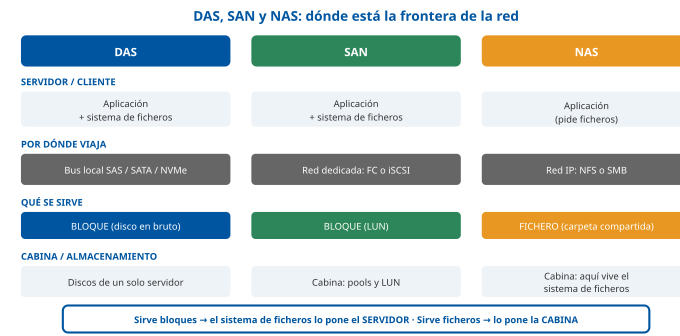

------------------------------------------------------------------------

### D2 · Bloque, fichero y objeto: los tres modos de acceso

**Sección**: §1.1.3 — Almacenamiento de objetos y almacenamiento unificado **Propósito**: Comparar los tres modos de acceso en sus rasgos decisivos y delimitar para qué sirve —y para qué no— el almacenamiento de objetos.

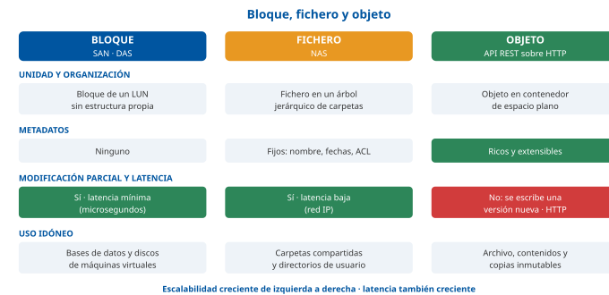

------------------------------------------------------------------------

### D3 · Protocolos de almacenamiento, transporte y puertos

**Sección**: §1.2.1 — Protocolos de acceso a bloque y archivo **Propósito**: Reunir en una sola imagen los protocolos, su tipo de acceso, su transporte y los identificadores y puertos clave.

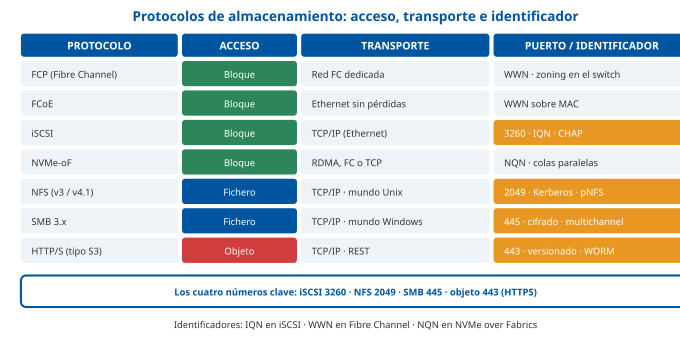

------------------------------------------------------------------------

### D4 · Niveles RAID: distribución, capacidad útil y tolerancia

**Sección**: §1.2.2 — Niveles RAID y técnicas de optimización **Propósito**: Visualizar cómo se reparten datos y paridad en cada nivel y fijar las dos cifras clave: capacidad útil y número de discos que se toleran.

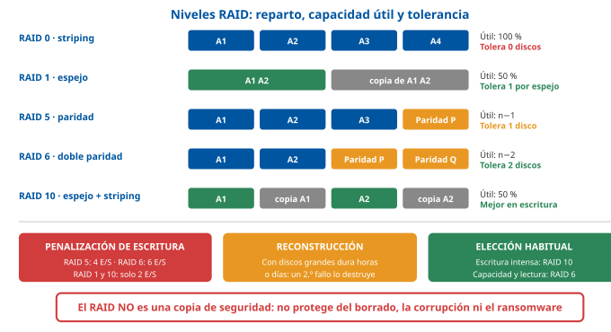

------------------------------------------------------------------------

### D5 · Thin provisioning y deduplicación sobre un pool

**Sección**: §1.2.2 — Técnicas de optimización **Propósito**: Mostrar cómo el aprovisionamiento fino y la deduplicación desacoplan lo que ve el servidor de lo que se consume físicamente, y cuál es el riesgo asociado.

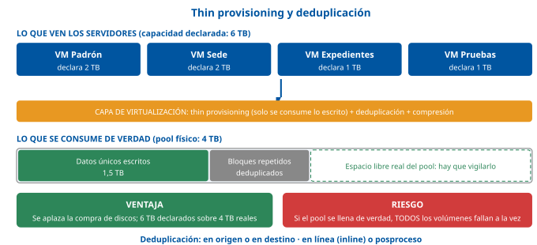

------------------------------------------------------------------------

### D6 · Los tres modelos de virtualización del almacenamiento

**Sección**: §2.1.1 — Virtualización basada en host, en red y en array **Propósito**: Situar visualmente dónde se ejecuta la capa de virtualización en cada modelo y qué ventaja e inconveniente característicos tiene.

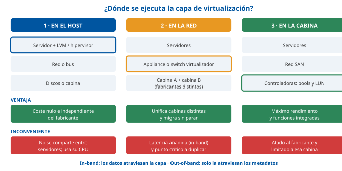

------------------------------------------------------------------------

### D7 · SDS: separación del plano de control y el plano de datos

**Sección**: §2.1.2 — Almacenamiento definido por software **Propósito**: Explicar el rasgo que define al SDS y en qué se diferencia de una cabina tradicional.

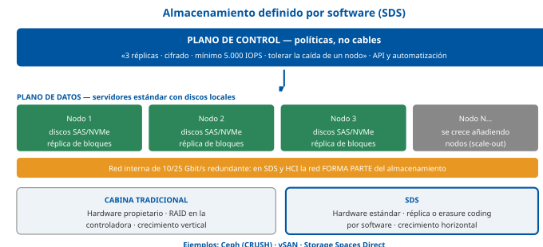

------------------------------------------------------------------------

### D8 · Tres capas frente a hiperconvergencia (HCI)

**Sección**: §2.2.1 — Infraestructuras hiperconvergentes y gestión de pools **Propósito**: Contraponer la arquitectura clásica de tres capas con la hiperconvergente y hacer visible que en HCI desaparece la cabina y se crece por nodos.

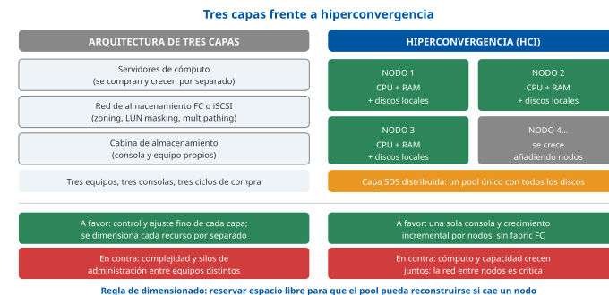

------------------------------------------------------------------------

### D9 · RTO y RPO en la línea de tiempo del incidente

**Sección**: §3.1.1 — Parámetros RTO y RPO **Propósito**: Fijar de una vez la diferencia entre los dos parámetros, situándolos a un lado y otro del incidente.

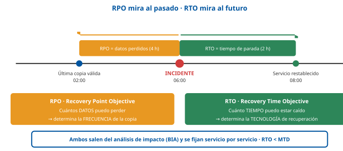

------------------------------------------------------------------------

### D10 · Regla 3-2-1-1-0 y retención GFS

**Sección**: §3.1.2 — Estrategias de retención, ventanas y regla 3-2-1 **Propósito**: Fijar la regla de oro del respaldo, su extensión frente al ransomware y el esquema de retención escalonada.

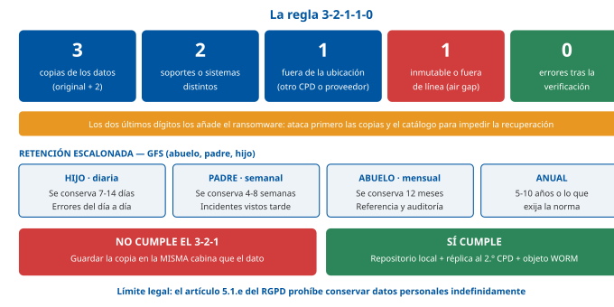

------------------------------------------------------------------------

### D11 · Completa, incremental, diferencial y sintética

**Sección**: §3.2.1 — Tipos de copia **Propósito**: Hacer visual la diferencia central: qué copia cada tipo y cuántas piezas hacen falta para restaurar.

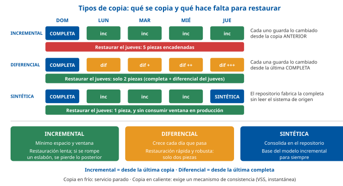

------------------------------------------------------------------------

### D12 · Arquitectura de una solución de copias de seguridad

**Sección**: §3.3.1 — Arquitecturas de software de backup **Propósito**: Presentar las cinco piezas funcionales comunes a casi cualquier producto y señalar cuál es la crítica.

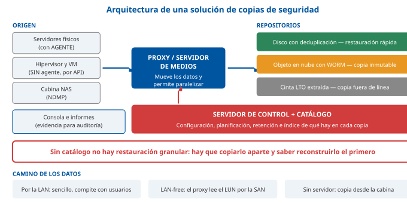

------------------------------------------------------------------------

### D13 · Copia con agente frente a copia sin agente con CBT

**Sección**: §4.2 — Backup en entornos virtuales **Propósito**: Contraponer las dos formas de copiar y mostrar el flujo completo de la copia sin agente, con el papel de la instantánea y del seguimiento de bloques modificados.

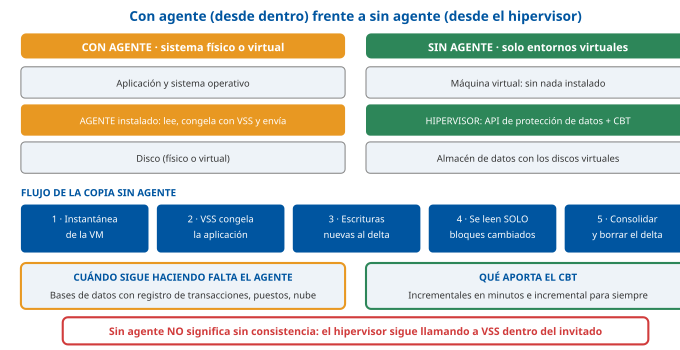

------------------------------------------------------------------------

### D14 · Escalera de recuperación y anclaje normativo

**Sección**: §4.2.3 y §5 — Replicación, recuperación granular y marco normativo **Propósito**: Ordenar los mecanismos de recuperación por RTO creciente y unir cada capa con la obligación jurídica que la respalda.

## Casos prácticos

Los tres casos recorren la plataforma de almacenamiento y respaldo del CPD municipal (ver la pestaña Contenido, «Convenciones»): el **Caso 1** trabaja el **diseño del almacenamiento y su virtualización**; el **Caso 2**, la **política de copias, el cálculo de RTO/RPO y la ventana de respaldo**; y el **Caso 3**, la **recuperación real ante un incidente de ransomware** y sus obligaciones normativas.

------------------------------------------------------------------------

### Caso 1 — Diseño del almacenamiento para el nuevo CPD municipal

#### Enunciado

El CPD municipal renueva su plataforma de almacenamiento. Debe dar servicio a cuatro cargas de trabajo:

1.  La **base de datos del Padrón municipal**, con escritura intensa y exigencia de latencia mínima.
2.  Los discos de **120 máquinas virtuales** (sede electrónica, gestor de expedientes y servicios internos), casi todas con la misma imagen base del sistema operativo.
3.  Las **carpetas departamentales** de 1.200 empleados, con documentos ofimáticos y permisos por unidad administrativa.
4.  El **archivo electrónico**: documentos de expedientes finalizados, que se escriben una vez, se consultan raramente y deben conservarse muchos años con sus metadatos.

Además, conviven en el CPD una cabina antigua todavía en garantía y la nueva, de fabricante distinto, y se pretende migrar los datos **sin ventana de parada**.

#### Cuestiones

**Cuestión 1 — Modo de acceso por carga (3 puntos).** Indique, para cada una de las cuatro cargas, si conviene acceso por **bloque**, por **fichero** o por **objeto**, y justifíquelo en una línea.

**Cuestión 2 — Protocolos y nivel RAID (3 puntos).** Concrete el protocolo de acceso adecuado para las cargas 1, 2 y 3, y proponga el nivel RAID (o esquema de protección) de las cargas 1 y 4, razonando la elección.

**Cuestión 3 — Migración sin parada (2 puntos).** Indique qué modelo de virtualización del almacenamiento permite migrar los datos de la cabina antigua a la nueva sin detener el servicio, y cuál es su inconveniente característico.

**Cuestión 4 — Optimización y su riesgo (2 puntos).** Señale las dos técnicas de optimización que más espacio ahorrarán en la carga 2 y el riesgo operativo que introducen.

#### Solución orientativa

- **C1**: (§1.1)

| Carga | Modo de acceso | Justificación |
|----|----|----|
| **Padrón (base de datos)** | **Bloque** | Necesita latencia mínima y modificación parcial de bloques; el motor pone su propio sistema de ficheros |
| **120 máquinas virtuales** | **Bloque** (LUN de almacén de datos; también es válido NFS) | El hipervisor exige acceso de bloque de baja latencia y que varios anfitriones vean el mismo volumen a la vez |
| **Carpetas departamentales** | **Fichero** | 1.200 usuarios concurrentes sobre las mismas carpetas, con permisos y bloqueo de ficheros gestionados por la cabina |
| **Archivo electrónico** | **Objeto** | Se escribe una vez y se lee raramente; necesita metadatos ricos (expediente, retención) y encaja con el versionado y la inmutabilidad |

- **C2**: (§1.2) Protocolos: Padrón y máquinas virtuales, **Fibre Channel** (o **iSCSI** sobre red segregada de 10/25 Gbit/s si el presupuesto lo aconseja; **NVMe-oF** si se busca la latencia mínima); carpetas departamentales, **SMB 3.x** por ser entorno Windows con autenticación de dominio (NFS si fuera Unix). Protección: para el **Padrón**, **RAID 10**, porque su penalización de escritura es de solo dos operaciones frente a las cuatro de RAID 5 y las seis de RAID 6, y la carga es de escritura intensa; para el **archivo electrónico**, **RAID 6** o **codificación de borrado**, porque la carga es de lectura, prima la capacidad y con discos de gran tamaño el riesgo durante la reconstrucción desaconseja RAID 5.

&nbsp;

- **C3**: (§2.1.1) Virtualización **basada en red** (appliance o conmutador virtualizador en el fabric) o **virtualización de cabina externa** desde la cabina nueva, que adopta los volúmenes de la antigua y migra los bloques en segundo plano. Inconveniente característico: al operar **en banda**, **añade latencia** y se convierte en un punto crítico que obliga a desplegarla en pareja; además introduce dependencia de ese elemento intermedio.

&nbsp;

- **C4**: (§1.2.2) **Deduplicación** (120 máquinas con la misma imagen base ofrecen ratios muy altos, del orden de 5:1 a 20:1) y **thin provisioning** (cada máquina declara mucho más espacio del que consume). Riesgo: el **sobreaprovisionamiento** hace que la suma de lo declarado supere lo físico, de modo que **si el pool se llena de verdad, todos los volúmenes fallan a la vez**; exige umbrales de alerta, vigilancia del llenado real y un procedimiento de ampliación. Sería válido añadir la compresión y el *tiering* automático.

#### Criterios de evaluación

| Criterio | Puntos |
|----|----|
| Las cuatro cargas asignadas al modo de acceso correcto, con justificación | 3 |
| Protocolos coherentes y niveles RAID correctamente razonados (RAID 10 por escritura, RAID 6 por capacidad y reconstrucción) | 3 |
| Modelo de virtualización adecuado para la migración sin parada, con su inconveniente | 2 |
| Deduplicación y aprovisionamiento fino, con el riesgo de llenado del pool | 2 |

------------------------------------------------------------------------

#### Preguntas tipo test sobre este caso

##### 1. Para la base de datos del Padrón, con escritura intensa y latencia mínima, ¿qué modo de acceso conviene?

- a) Por bloque: el motor pone su propio sistema de ficheros y modifica bloques parcialmente.
- b) Por fichero: la cabina NAS gestiona el sistema de ficheros y los bloqueos del motor.
- c) Por objeto: cada registro del Padrón se guarda como un objeto con metadatos ricos.

**Respuesta correcta:** a) · **Referencia:** Caso 1, cuestión 1 · §1.1.3

El acceso por bloque ofrece la latencia más baja y permite la modificación parcial; el objeto no la permite y su latencia es la de una petición HTTP.

##### 2. ¿Qué modo de acceso conviene a las carpetas departamentales de los 1.200 empleados?

- a) Por bloque, con un LUN por departamento que cada puesto formatea con su propio sistema de ficheros.
- b) Por fichero, porque los usuarios comparten carpetas con permisos y bloqueos gestionados por la cabina.
- c) Por objeto, porque el espacio de nombres plano facilita los permisos por unidad administrativa.

**Respuesta correcta:** b) · **Referencia:** Caso 1, cuestión 1 · §1.1.2

Lo que se comparte son ficheros entre muchos usuarios concurrentes; un LUN no se comparte entre cientos de puestos.

##### 3. Los documentos de expedientes finalizados se escriben una vez, se consultan poco y se conservan muchos años con sus metadatos. ¿Qué modo de acceso les conviene?

- a) Por bloque, porque su latencia mínima acelera las consultas ocasionales al archivo.
- b) Por fichero, porque solo un árbol de directorios conserva los metadatos del expediente.
- c) Por objeto, que admite metadatos ricos y encaja con el versionado y la inmutabilidad.

**Respuesta correcta:** c) · **Referencia:** Caso 1, cuestión 1 · §1.1.3

El terreno del almacenamiento de objetos es el dato que se escribe una vez y se lee poco, con metadatos definibles por el usuario y retención WORM.

##### 4. Las carpetas departamentales están en un entorno Windows con autenticación de dominio. ¿Qué protocolo procede?

- a) iSCSI, sobre el puerto 3260, con autenticación CHAP entre la cabina y los puestos.
- b) SMB 3.x, sobre el puerto 445, integrado con Kerberos y las ACL del dominio.
- c) NFS v3, sin estado, apoyado en mountd y lockd para gestionar los bloqueos.

**Respuesta correcta:** b) · **Referencia:** Caso 1, cuestión 2 · §1.2.1

SMB es el protocolo de fichero del mundo Windows; NFS se usaría en un entorno Unix e iSCSI es de bloque.

##### 5. ¿Qué protocolo de acceso es adecuado para el Padrón y para los discos de las máquinas virtuales?

- a) Fibre Channel, o iSCSI sobre una red segregada de 10/25 Gbit/s si el presupuesto lo aconseja.
- b) SMB 3.x con multichannel, porque reparte el tráfico de la base de datos entre varias tarjetas.
- c) HTTPS con la API de S3, porque el acceso REST reduce la latencia de las escrituras.

**Respuesta correcta:** a) · **Referencia:** Caso 1, cuestión 2 · §1.2.1

Las dos cargas necesitan acceso de bloque de baja latencia; NVMe-oF sería la opción si se busca la latencia mínima.

##### 6. ¿Qué nivel RAID conviene al Padrón, con escritura intensa?

- a) RAID 5, porque desperdicia menos disco y su paridad distribuida acelera las escrituras.
- b) RAID 6, porque la doble paridad reduce la penalización de escritura respecto a RAID 10.
- c) RAID 10, porque cada escritura cuesta dos operaciones físicas, frente a cuatro en RAID 5 y seis en RAID 6.

**Respuesta correcta:** c) · **Referencia:** Caso 1, cuestión 2 · §1.2.2

Con mucha escritura importa la penalización: RAID 10 la tiene mínima, aunque solo aproveche la mitad de la capacidad.

##### 7. ¿Qué esquema de protección conviene al archivo electrónico, de lectura dominante y discos de gran capacidad?

- a) RAID 0, porque los documentos se leen poco y basta con repartirlos en bandas entre todos los discos del grupo.
- b) RAID 10, porque su espejo es el único nivel que tolera el fallo simultáneo de dos discos cualesquiera.
- c) RAID 6 o codificación de borrado, porque prima la capacidad y RAID 5 es arriesgado al reconstruir discos grandes.

**Respuesta correcta:** c) · **Referencia:** Caso 1, cuestión 2 · §1.2.2

Con discos de decenas de terabytes la reconstrucción dura horas o días y un segundo fallo destruiría un RAID 5; RAID 6 tolera dos.

##### 8. ¿Qué modelo de virtualización permite migrar los datos de la cabina antigua a la nueva, de otro fabricante, sin detener el servicio?

- a) La virtualización basada en red (o la de cabina externa desde la nueva), que migra los bloques en segundo plano.
- b) La virtualización basada en host con LVM, que comparte un mismo pool entre todos los servidores.
- c) La virtualización basada en la cabina antigua, que exporta sus instantáneas a la nueva cabina.

**Respuesta correcta:** a) · **Referencia:** Caso 1, cuestión 3 · §2.1.1

El modelo de red unifica cabinas heterogéneas y permite la migración sin parada; la abstracción de host no se comparte entre servidores.

##### 9. ¿Cuál es el inconveniente característico de ese modelo de virtualización?

- a) Que exige instalar software específico en cada servidor para localizar sus bloques.
- b) Que, al operar en banda, añade latencia y es un punto crítico que hay que desplegar en pareja.
- c) Que consume CPU de cada servidor y multiplica los puntos de administración.

**Respuesta correcta:** b) · **Referencia:** Caso 1, cuestión 3 · §2.1.1

Todas las lecturas y escrituras pasan por el dispositivo intermedio: su caída dejaría sin datos a todos los servidores.

##### 10. ¿Qué dos técnicas ahorrarán más espacio en los discos de las 120 máquinas virtuales y qué riesgo operativo introducen?

- a) Deduplicación y thin provisioning; si el pool se llena de verdad, todos los volúmenes fallan a la vez.
- b) Instantáneas de cabina y cifrado en reposo; las instantáneas dependen del volumen original.
- c) RAID 5 y compresión; cada escritura exige cuatro operaciones físicas en la cabina.

**Respuesta correcta:** a) · **Referencia:** Caso 1, cuestión 4 · §1.2.2

La misma imagen base da ratios de deduplicación de 5:1 a 20:1, y el aprovisionamiento fino sobreaprovisiona: exige alertas y vigilancia del llenado real.

### Caso 2 — Política de copias, RTO/RPO y ventana de respaldo

#### Enunciado

La actual política de copias del CPD municipal es única para todos los servicios: **copia completa diaria a las 02:00** al repositorio de disco de la misma sala, con **retención de 14 días**. En la última revisión se detecta que:

1.  El responsable del **Padrón** exige un **RPO de 15 minutos** y un **RTO de 1 hora**; restaurar sus 2 TB tarda actualmente unas 3 horas.
2.  El volumen total copiado ha crecido hasta **20 TB** y la ventana nocturna disponible es de **8 horas**, con una red de 10 Gbit/s.
3.  No existe ninguna copia fuera del edificio y el repositorio está integrado en el dominio corporativo con las mismas credenciales de administración.
4.  Nunca se ha realizado una prueba de restauración documentada.

#### Cuestiones

**Cuestión 1 — Diagnóstico del Padrón (2 puntos).** Calcule el RPO y el RTO reales del Padrón con la política actual y proponga una corrección para cada uno, explicando por qué son problemas distintos.

**Cuestión 2 — Ventana de copia (3 puntos).** Determine si los 20 TB caben en la ventana de 8 horas y proponga tres medidas para resolver el problema de forma sostenible.

**Cuestión 3 — Regla 3-2-1 (3 puntos).** Enumere los incumplimientos de la regla 3-2-1-1-0 en la situación descrita y proponga el diseño de destinos que la satisfaga.

**Cuestión 4 — Verificación y retención (2 puntos).** Indique qué exige la normativa respecto de las pruebas de restauración y qué esquema de retención propondría, señalando su límite legal.

#### Solución orientativa

- **C1**: (§3.1.1) **RPO real: hasta 24 horas** —si el incidente ocurre a las 01:30, se pierden casi un día de altas, bajas y cambios de domicilio—, frente a los 15 minutos comprometidos. **RTO real: al menos 3 horas**, frente a 1 hora. Correcciones: para el **RPO**, añadir **copia del registro de transacciones cada 15 minutos**, que además habilita la recuperación a un instante concreto; para el **RTO**, disponer de una **réplica** de la base de datos en el segundo emplazamiento a la que conmutar, o de una **restauración instantánea** desde el repositorio. Son problemas distintos porque **el RPO se corrige copiando con más frecuencia y el RTO cambiando la tecnología de recuperación**: copiar más a menudo no acelera ni un minuto la restauración.

&nbsp;

- **C2**: (§3.1.2) Cálculo: 10 Gbit/s ≈ 1,25 GB/s teóricos; con una eficiencia realista del 60 %, unos **0,75 GB/s**, que en 28.800 segundos dan ≈ **21,6 TB**. Cabe **muy justo**, y solo si el origen y el destino sostienen ese caudal, cosa improbable con muchos ficheros pequeños; en la práctica, la limitación suele ser **la lectura del origen**, no la red. Tres medidas: (a) pasar a **copia completa semanal e incrementales diarios**, o directamente a **incremental para siempre con completas sintéticas**, moviendo solo el 2-5 % diario; (b) **deduplicar y comprimir en origen** y copiar desde **instantáneas** en lugar de desde el sistema vivo; (c) **paralelizar** con varios proxies o servidores de medios y escalonar los trabajos. En entornos virtuales, activar **CBT** para que los incrementales lean solo los bloques cambiados.

&nbsp;

- **C3**: (§3.1.2) Incumplimientos: solo hay **dos copias** (original y repositorio) en lugar de tres; **un solo tipo de destino** (disco) en lugar de dos; **ninguna copia fuera de la ubicación** —el repositorio está en la misma sala, expuesto al mismo incendio o inundación—; **ninguna copia inmutable o fuera de línea**, agravado porque el repositorio comparte credenciales del dominio, de modo que **un atacante que comprometa el directorio destruye también las copias**; y **cero verificación**. Diseño propuesto: (1) dato en producción; (2) repositorio de disco con deduplicación en la sala para restauración rápida; (3) **réplica del repositorio al segundo CPD**; (4) **copia inmutable** en objetos con bloqueo WORM y retención de 30 días, más **cinta LTO extraída** y custodiada para el archivo; (5) credenciales separadas y autenticación multifactor en la consola de copias.

&nbsp;

- **C4**: (§3.3.2 y §5) Normativa: el **ENS** exige verificar las copias y, en categoría **ALTA**, **probar periódicamente el plan de continuidad** (`[op.cont.3]`); el **RGPD**, en su **artículo 32.1.d**, exige un proceso de **verificación, evaluación y valoración regulares** de la eficacia de las medidas. Por tanto, procede establecer una **prueba de restauración documentada y cronometrada**, de periodicidad al menos trimestral para los servicios críticos, con acta y medición del RTO real. Retención: esquema **GFS** —diarias 14 días, semanales 8 semanas, mensuales 12 meses y anuales según la obligación aplicable—, con el límite del **artículo 5.1.e del RGPD**: la retención debe estar justificada y documentada, y su vencimiento ejecutarse con destrucción segura del soporte.

#### Criterios de evaluación

| Criterio | Puntos |
|----|----|
| RPO y RTO reales bien calculados, con corrección diferenciada de cada uno | 2 |
| Cálculo razonado de la ventana y tres medidas técnicamente correctas | 3 |
| Incumplimientos del 3-2-1-1-0 identificados y diseño de destinos que los resuelve | 3 |
| Obligación de prueba de restauración (ENS y RGPD) y esquema de retención con su límite legal | 2 |

------------------------------------------------------------------------

#### Preguntas tipo test sobre este caso

##### 1. Con la copia completa diaria a las 02:00 y una restauración que tarda unas 3 horas, ¿cuáles son el RPO y el RTO reales del Padrón?

- a) RPO de 3 horas y RTO de hasta 24 horas.
- b) RPO de hasta 24 horas y RTO de al menos 3 horas.
- c) RPO de 15 minutos y RTO de 1 hora, porque la copia es completa.

**Respuesta correcta:** b) · **Referencia:** Caso 2, cuestión 1 · §3.1.1

El RPO mide los datos perdidos desde la última copia (hasta un día) y el RTO el tiempo de vuelta al servicio (la restauración de 3 horas).

##### 2. ¿Qué corrección permite cumplir el RPO de 15 minutos del Padrón?

- a) Adelantar la copia completa diaria a las 00:00.
- b) Sustituir la copia completa diaria por una diferencial diaria.
- c) Añadir una copia del registro de transacciones cada 15 minutos.

**Respuesta correcta:** c) · **Referencia:** Caso 2, cuestión 1 · §3.1.1

El RPO fija la frecuencia: copiar el registro cada 15 minutos permite además recuperar la base de datos hasta un instante concreto.

##### 3. ¿Y qué corrección permite cumplir el RTO de 1 hora?

- a) Una réplica de la base de datos en el segundo emplazamiento, o una restauración instantánea.
- b) Copiar el registro de transacciones con más frecuencia, porque acelera la restauración.
- c) Ampliar la retención de las copias de 14 a 30 días en el mismo repositorio.

**Respuesta correcta:** a) · **Referencia:** Caso 2, cuestión 1 · §3.1.1

El RTO se corrige cambiando la tecnología de recuperación: copiar más a menudo no acelera ni un minuto la restauración.

##### 4. ¿Caben los 20 TB en la ventana de 8 horas con una red de 10 Gbit/s?

- a) No cabe: a 10 Gbit/s solo se transfieren unos 3,6 TB en 8 horas, aun con eficiencia plena.
- b) Cabe con holgura: 10 Gbit/s equivalen a 10 GB/s, unos 288 TB en la ventana nocturna.
- c) Cabe muy justo (≈ 21,6 TB con un 60 % de eficiencia) y solo si origen y destino sostienen ese caudal.

**Respuesta correcta:** c) · **Referencia:** Caso 2, cuestión 2 · §3.1.2

10 Gbit/s ≈ 1,25 GB/s; al 60 %, 0,75 GB/s × 28.800 s ≈ 21,6 TB. En la práctica la limitación suele ser la lectura del origen, no la red.

##### 5. ¿Qué medida resuelve el problema de la ventana de forma sostenible?

- a) Copiar desde el sistema en marcha en lugar de desde instantáneas, para no ocupar espacio en la cabina.
- b) Pasar a completa semanal e incrementales diarios, o a incremental para siempre con completas sintéticas.
- c) Duplicar la retención para no tener que repetir la copia completa cada noche.

**Respuesta correcta:** b) · **Referencia:** Caso 2, cuestión 2 · §3.1.2

Los incrementales mueven solo el 2-5 % diario; las completas sintéticas se fabrican en el repositorio sin leer de nuevo el origen.

##### 6. Respecto de la regla 3-2-1, ¿qué incumple la política actual de copias?

- a) Hay solo dos copias (original y repositorio) y ninguna está fuera de la ubicación.
- b) Solo la verificación, porque el original y el repositorio ya suman las tres copias exigidas.
- c) Nada, porque el repositorio de copias es un equipo distinto de la cabina de producción.

**Respuesta correcta:** a) · **Referencia:** Caso 2, cuestión 3 · §3.1.2

La regla exige tres copias (el original y dos más) y una fuera de la ubicación; un repositorio en la misma sala comparte el incendio o la inundación.

##### 7. El repositorio de copias está integrado en el dominio corporativo con las mismas credenciales de administración. ¿Por qué es grave?

- a) Porque impide cifrar las copias en tránsito entre el repositorio y la cabina.
- b) Porque un atacante que comprometa el directorio podría destruir también las copias.
- c) Porque obliga a restaurar con la cuenta del responsable del servicio afectado.

**Respuesta correcta:** b) · **Referencia:** Caso 2, cuestión 3 · §3.1.2

Una copia conectada con credenciales del mismo dominio no cumple la copia inmutable o desconectada; procede usar credenciales separadas y MFA en la consola.

##### 8. ¿Qué diseño de destinos satisface la regla 3-2-1-1-0 en el CPD municipal?

- a) Dos repositorios de disco en la misma sala, ambos con las credenciales del dominio corporativo.
- b) Instantáneas de la cabina como segunda copia y RAID 6 en la cabina como tercera copia.
- c) Repositorio local deduplicado, réplica al segundo CPD y copia inmutable WORM en objetos más cinta LTO extraída.

**Respuesta correcta:** c) · **Referencia:** Caso 2, cuestión 3 · §3.1.2

Da tres copias, dos soportes, una fuera, una inmutable o fuera de línea; las instantáneas y el RAID no son copias de seguridad.

##### 9. ¿Qué exige la normativa respecto de las pruebas de restauración?

- a) El ENS (verificar copias y, en categoría ALTA, probar el plan) y el RGPD (art. 32.1.d, verificación regular).
- b) Nada con carácter obligatorio: son una recomendación de las guías CCN-STIC sin rango normativo.
- c) Solo el RGPD, en su artículo 5.1.e, que obliga a restaurar cada copia antes de destruirla.

**Respuesta correcta:** a) · **Referencia:** Caso 2, cuestión 4 · §3.3.2 · art. 32.1.d RGPD

La prueba de restauración es una obligación jurídica, no una buena práctica opcional.

##### 10. ¿Qué límite legal tiene el esquema de retención escalonada (GFS) que se proponga?

- a) Ninguno: el artículo 17 de la Ley 39/2015 permite conservar las copias de seguridad de forma indefinida, sin plazo.
- b) El artículo 32.1.c del RGPD, que fija una retención máxima de 14 días para las copias diarias del repositorio.
- c) La limitación del plazo de conservación del artículo 5.1.e del RGPD: retención justificada y destrucción segura al vencer.

**Respuesta correcta:** c) · **Referencia:** Caso 2, cuestión 4 · §3.1.2 · art. 5.1.e RGPD

Las copias con datos personales no pueden guardarse «para siempre por si acaso»; el archivo electrónico de la Ley 39/2015 es otra función.

### Caso 3 — Recuperación ante un incidente de ransomware

#### Enunciado

Un sábado por la noche, un código dañino cifra el servidor de ficheros departamental, el gestor de expedientes y **el propio servidor de copias**, cuyo catálogo queda inutilizable. El lunes se comprueba que:

- La **réplica** de las máquinas virtuales al segundo CPD también está cifrada, porque replicó fielmente los bloques ya cifrados.
- La **copia inmutable** en objetos, con retención WORM de 30 días, está intacta.
- Los indicadores del análisis forense sitúan la **primera actividad anómala nueve días antes** del cifrado.
- Entre los datos afectados hay documentos con datos personales de ciudadanos.

#### Cuestiones

**Cuestión 1 — Por qué falló la réplica (2 puntos).** Explique por qué la réplica no sirvió y qué papel corresponde a cada mecanismo (réplica, instantánea y copia de seguridad) frente a este incidente.

**Cuestión 2 — Orden de recuperación (3 puntos).** Establezca el orden de las actuaciones de recuperación y justifique cuál debe ser la primera tarea técnica.

**Cuestión 3 — Punto de restauración (2 puntos).** Indique de qué fecha debe restaurarse y qué consecuencia tiene sobre la retención mínima que debe exigir la política.

**Cuestión 4 — Obligaciones normativas (3 puntos).** Enumere las obligaciones derivadas del ENS y del RGPD que activa este incidente, con sus plazos y referencias.

#### Solución orientativa

- **C1**: (§4.2.3 y §3.1) La réplica **no protege frente a la corrupción del contenido**: mantiene una copia fiel y actualizada de la máquina virtual, de modo que **replicó el cifrado casi al instante**. Su función es reducir el **RTO** ante el desastre del emplazamiento —se enciende y el servicio vuelve en minutos—, no conservar estados anteriores. La **instantánea** tampoco sirve si vive en el mismo almacén de datos comprometido, y en todo caso su horizonte es de horas. Solo la **copia de seguridad** conserva **profundidad histórica**, y solo la **copia inmutable o fuera de línea** resiste a un atacante con credenciales de administrador. Conclusión: réplica y copia son **complementarias**, y la arquitectura correcta tiene las dos.

&nbsp;

- **C2**: (§3.3.2) Orden: (1) **contener** el incidente —aislar la red, detener la propagación, preservar evidencias— y **declarar el desastre** conforme al DRP; (2) **verificar la integridad de la copia inmutable** y determinar el último punto limpio; (3) **reconstruir la infraestructura base**: directorio, DNS, red y, muy señaladamente, el **servidor de copia y su catálogo**, que es la primera tarea técnica ineludible, porque **sin catálogo no hay restauración granular** y no se puede recuperar nada más de forma ordenada; (4) restaurar los servicios **por orden de criticidad** conforme a sus RTO, sobre sistemas reconstruidos desde cero y parcheados, nunca sobre los comprometidos; (5) validar funcionalmente cada servicio antes de reabrirlo; (6) **notificar** y documentar; (7) revisar y actualizar el DRP con las lecciones aprendidas.

&nbsp;

- **C3**: (§3.1.2) Debe restaurarse de un punto **anterior a la primera actividad anómala**, es decir, de **más de nueve días atrás**, porque las copias posteriores pueden contener ya las herramientas del atacante o datos comprometidos. Consecuencia: una retención de pocos días **habría dejado a la organización sin ningún punto limpio**. Por tanto, la política debe garantizar una retención escalonada (GFS) que cubra **semanas y meses**, y la copia inmutable debe tener un periodo de retención superior al tiempo típico de permanencia no detectada del atacante. Es la justificación práctica de la retención larga.

&nbsp;

- **C4**: (§5) Obligaciones: **ENS** \[ENS\] — cumplimiento del **artículo 26** (continuidad de la actividad) y de la medida **`[mp.info.6]`**, incluida la exigencia de que las copias no puedan alterarse ni destruirse de forma no autorizada y de que se **autorice y registre** cada restauración; activación de las medidas del grupo **`[op.cont]`** (plan de continuidad, medios alternativos) y del **registro de la actividad** `[op.exp.8]`; notificación del incidente al **CCN-CERT** conforme a los procedimientos de notificación de incidentes del ENS. **RGPD** \[RGPD\] — la pérdida de **disponibilidad** de datos personales es una **violación de la seguridad**: procede **notificarla a la AEPD en el plazo de 72 horas** desde que se tuvo constancia (art. 33) y, si el riesgo para los derechos y libertades es alto, **comunicarla a los interesados** (art. 34); debe además documentarse el incidente en el registro interno de brechas y revisarse la eficacia de las medidas del **artículo 32**, que exige garantizar la disponibilidad y la resiliencia y **la capacidad de restaurar** el acceso a los datos con rapidez. Sería válido añadir la revisión del análisis de riesgos y la comunicación al delegado de protección de datos.

#### Criterios de evaluación

| Criterio | Puntos |
|----|----|
| Explicación correcta de por qué la réplica no protege frente al cifrado, y papel de cada mecanismo | 2 |
| Orden de recuperación coherente, con la reconstrucción del servidor de copia y su catálogo como primera tarea técnica | 3 |
| Punto de restauración anterior a la intrusión y su consecuencia sobre la retención | 2 |
| Obligaciones del ENS (art. 26, mp.info.6, op.cont, notificación) y del RGPD (arts. 32, 33 y 34, con el plazo de 72 horas) | 3 |

#### Preguntas tipo test sobre este caso

##### 1. ¿Por qué la réplica de las máquinas virtuales al segundo CPD no sirvió frente al ransomware?

- a) Porque solo copia la configuración de las máquinas virtuales y no sus discos.
- b) Porque el segundo CPD no tenía la categoría ALTA del Esquema Nacional de Seguridad.
- c) Porque mantiene una copia fiel y actualizada y replicó el cifrado casi al instante.

**Respuesta correcta:** c) · **Referencia:** Caso 3, cuestión 1 · §4.2.3

La réplica reduce el RTO ante el desastre del emplazamiento, pero no protege frente a la corrupción del contenido ni conserva estados anteriores.

##### 2. En este incidente, ¿qué mecanismo conserva estados anteriores y resiste a un atacante con credenciales de administrador?

- a) La copia de seguridad inmutable o fuera de línea.
- b) La instantánea de la máquina virtual en su almacén de datos.
- c) La réplica síncrona al segundo emplazamiento.

**Respuesta correcta:** a) · **Referencia:** Caso 3, cuestión 1 · §3.2.2

Solo la copia da profundidad histórica, y solo la inmutable o desconectada resiste a quien tiene credenciales de administrador.

##### 3. ¿Cuál debe ser la primera actuación de la recuperación?

- a) Restaurar el gestor de expedientes, por ser el servicio de mayor criticidad del CPD.
- b) Contener el incidente (aislar la red, detener la propagación, preservar evidencias) y declarar el desastre.
- c) Notificar a la AEPD antes de tocar ninguno de los sistemas afectados por el cifrado.

**Respuesta correcta:** b) · **Referencia:** Caso 3, cuestión 2 · §3.3.2

Antes de restaurar hay que detener la propagación y declarar el desastre conforme al DRP.

##### 4. ¿Cuál es la primera tarea técnica ineludible de la reconstrucción?

- a) Reconstruir el servidor de copia y su catálogo, sin el cual no hay restauración granular.
- b) Restaurar el servidor de ficheros departamental, por ser el más usado por los empleados.
- c) Encender la réplica del segundo CPD para recuperar el servicio en minutos.

**Respuesta correcta:** a) · **Referencia:** Caso 3, cuestión 2 · §3.3.1

El catálogo sabe qué hay en cada copia: todo DRP debe prever reconstruirlo antes de restaurar nada más.

##### 5. ¿Sobre qué sistemas deben restaurarse los servicios?

- a) Sobre los mismos servidores cifrados, una vez eliminados los ficheros cifrados.
- b) Sobre la réplica del segundo CPD, que ya tiene las máquinas virtuales configuradas.
- c) Sobre sistemas reconstruidos desde cero y parcheados, nunca sobre los comprometidos.

**Respuesta correcta:** c) · **Referencia:** Caso 3, cuestión 2 · §3.3.2

Los servicios se restauran por orden de criticidad conforme a sus RTO, y se validan antes de reabrirlos.

##### 6. El forense sitúa la primera actividad anómala nueve días antes del cifrado. ¿Desde qué punto debe restaurarse?

- a) Desde la copia más reciente de la copia inmutable, la del día anterior al cifrado.
- b) Desde un punto anterior a la primera actividad anómala, es decir, de más de nueve días atrás.
- c) Desde la réplica del segundo CPD, tras descifrar sus bloques con las claves de la copia.

**Respuesta correcta:** b) · **Referencia:** Caso 3, cuestión 3 · §3.1.2

Las copias posteriores a la intrusión pueden contener ya las herramientas del atacante o datos comprometidos.

##### 7. ¿Qué consecuencia tiene ese punto de restauración sobre la retención mínima de la política?

- a) Hay que reducir la retención a siete días, para que las copias no conserven el código del atacante.
- b) Retención escalonada de semanas y meses, y copia inmutable más larga que la permanencia oculta del atacante.
- c) Hay que conservar todas las copias de forma indefinida, sin plazo de destrucción.

**Respuesta correcta:** b) · **Referencia:** Caso 3, cuestión 3 · §3.1.2

Una retención de pocos días habría dejado a la organización sin ningún punto limpio; es la justificación práctica de la retención larga (GFS).

##### 8. Entre los datos cifrados hay datos personales de ciudadanos. ¿Qué obligación impone el RGPD?

- a) Notificar la violación de seguridad a la AEPD en 72 horas desde que se tuvo constancia (art. 33).
- b) Ninguna, porque una pérdida de disponibilidad sin divulgación no es una violación de seguridad.
- c) Notificarla a la AEPD en el plazo de un mes, una vez concluida la restauración (art. 32).

**Respuesta correcta:** a) · **Referencia:** Caso 3, cuestión 4 · §5.2.1 · art. 33 RGPD

La violación de seguridad abarca la destrucción, pérdida o alteración, no solo la divulgación; una pérdida de disponibilidad también es una brecha.

##### 9. ¿Cuándo hay que comunicar además el incidente a los ciudadanos afectados?

- a) Siempre, en las mismas 72 horas, con independencia del riesgo para sus derechos.
- b) Cuando el riesgo para sus derechos y libertades sea alto (art. 34 RGPD).
- c) Nunca, si existe una copia inmutable que permita recuperar los datos.

**Respuesta correcta:** b) · **Referencia:** Caso 3, cuestión 4 · §5.2.1 · art. 34 RGPD

La comunicación a los interesados depende de que el riesgo para sus derechos y libertades sea alto.

##### 10. ¿Qué medida del ENS exige que las copias no puedan alterarse ni destruirse de forma no autorizada y que se autorice y registre cada restauración?

- a) La medida [op.cont.1] Análisis de impacto.
- b) La medida [op.ext] de servicios prestados por terceros.
- c) La medida [mp.info.6] Copias de seguridad.

**Respuesta correcta:** c) · **Referencia:** Caso 3, cuestión 4 · §5.1.1

La medida [mp.info.6], que despliega el artículo 26 del RD 311/2022, incluye la protección de las copias y el registro de las restauraciones.

## Fuentes

### Tier 1 — Normas técnicas, especificaciones y documentación oficial de plataforma

| ID | Referencia |
|----|----|
| `[SNIA-DICT]` | Storage Networking Industry Association (SNIA). *SNIA Dictionary* — terminología canónica del almacenamiento (DAS, NAS, SAN, LUN, thin provisioning, deduplicación, snapshot). snia.org/education/dictionary. |
| `[SNIA-SSM]` | SNIA. *Shared Storage Model* — modelo de referencia por capas del almacenamiento compartido (dispositivo, agregación por bloque, sistema de ficheros, aplicación). Marco conceptual de §1 y §2. |
| `[SNIA-SDS]` | SNIA. *Software Defined Storage — White Paper* y *Swordfish/SMI-S*: separación del plano de control y el plano de datos, aprovisionamiento por políticas y gestión estandarizada de sistemas de almacenamiento. |
| `[PATTERSON88]` | Patterson, D. A.; Gibson, G.; Katz, R. H. *A Case for Redundant Arrays of Inexpensive Disks (RAID)*. ACM SIGMOD, 1988 (Universidad de California, Berkeley). Artículo fundacional que define y numera los niveles RAID. |
| `[SNIA-DDF]` | SNIA. *Common RAID Disk Data Format (DDF) Specification* — formato común de metadatos de un conjunto RAID, que permite que un grupo de discos sea reconocido por controladoras distintas. |
| `[T10-SCSI]` | INCITS T10. *SCSI Architecture Model (SAM)* y *SCSI Block Commands (SBC)* — modelo de comandos de bloque (LUN, `READ`/`WRITE`, `UNMAP`) sobre el que se construyen FC e iSCSI. |
| `[T11-FC]` | INCITS T11. *Fibre Channel* — *Framing and Signaling (FC-FS)*, *Fibre Channel Protocol for SCSI (FCP)* y *Fibre Channel over Ethernet (FCoE)*. Define WWN, capas FC-0 a FC-4, servicios de fabric y zoning. |
| `[RFC7143]` | IETF. *[RFC 7143](https://www.rfc-editor.org/rfc/rfc7143): Internet Small Computer System Interface (iSCSI) Protocol (Consolidated)* (2014), que actualiza y consolida el [RFC 3720](https://www.rfc-editor.org/rfc/rfc3720) (2004). Transporte de comandos SCSI sobre TCP/IP; puerto **3260**, nomenclatura **IQN**, autenticación CHAP. |
| `[NVME-OF]` | NVM Express, Inc. *NVM Express over Fabrics (NVMe-oF) Specification* — NVMe sobre RDMA, sobre Fibre Channel y sobre TCP. Modelo de colas paralelas frente al modelo SCSI. |
| `[RFC1813]` | IETF. *[RFC 1813](https://www.rfc-editor.org/rfc/rfc1813): NFS Version 3 Protocol Specification* (1995). |
| `[RFC8881]` | IETF. *[RFC 8881](https://www.rfc-editor.org/rfc/rfc8881): Network File System (NFS) Version 4 Minor Version 1 Protocol* (2020) — sesiones, delegaciones y pNFS. Obsoleta el [RFC 5661](https://www.rfc-editor.org/rfc/rfc5661). |
| `[MS-SMB2]` | Microsoft. *\[MS-SMB2\] Server Message Block (SMB) Protocol Versions 2 and 3* (especificación abierta) y documentación de SMB 3.x: cifrado en tránsito, *multichannel*, puerto **445**. |
| `[RFC9110]` | IETF HTTP Working Group. *[RFC 9110](https://www.rfc-editor.org/rfc/rfc9110): HTTP Semantics* (2022). Base del acceso REST al almacenamiento de objetos. |
| `[ISO27040]` | ISO/IEC 27040. *Information technology — Security techniques — Storage security*. Norma de referencia sobre seguridad del almacenamiento: cifrado en reposo, saneamiento de soportes, seguridad de SAN/NAS y de las copias de seguridad. |
| `[ISO27002]` | ISO/IEC 27002:2022. *Controles de seguridad de la información*. Control **8.13 «Copia de seguridad de la información»**: copias, pruebas de restauración y periodicidad acordes al negocio. |
| `[ISO22301]` | ISO 22301. *Sistemas de gestión de la continuidad del negocio*. Origen normativo del análisis de impacto en el negocio (BIA) y de los objetivos de recuperación. |
| `[ISO27031]` | ISO/IEC 27031. *Directrices para la preparación de las TIC para la continuidad del negocio*. Enlaza el plan de continuidad (BCP) con el plan de recuperación ante desastres (DRP). |
| `[NIST-SP800-34]` | NIST. *SP 800-34 Rev. 1: Contingency Planning Guide for Federal Information Systems*. Define el ciclo del plan de contingencia, los tipos de emplazamiento alternativo (*hot*, *warm*, *cold site*) y la estrategia de copias. |
| `[NIST-SP800-209]` | NIST. *SP 800-209: Security Guidelines for Storage Infrastructure* (2020). Recomendaciones de seguridad para SAN, NAS, almacenamiento de objetos, cifrado y copias de seguridad. |
| `[NIST-SP800-88]` | NIST. *SP 800-88 Rev. 1: Guidelines for Media Sanitization*. Borrado, purgado y destrucción de soportes: aplicable al fin de vida de discos y cintas de copia. |
| `[MS-VSS]` | Microsoft. *Volume Shadow Copy Service (VSS)* — arquitectura de solicitante, escritores y proveedores para obtener instantáneas **consistentes con la aplicación** en Windows. learn.microsoft.com. |
| `[LVM-LINUX]` | Proyecto LVM2 / *device-mapper* del núcleo Linux. *Logical Volume Manager* — grupos de volúmenes, volúmenes lógicos, instantáneas y aprovisionamiento fino (`lvmthin`). Ejemplo canónico de virtualización de almacenamiento **basada en host**. |
| `[SQLITE-WAL]` | Documentación de motores de base de datos sobre *write-ahead logging* y copia en caliente (`pg_basebackup`, *hot backup*, modo `ARCHIVELOG`). Fundamento de la consistencia de la copia de una base de datos en funcionamiento. |

### Tier 2 — Productos, servicios y tecnologías concretas

| ID | Referencia |
|----|----|
| `[VMW-VADP]` | VMware/Broadcom. *vSphere Storage APIs – Data Protection (VADP)* y *Changed Block Tracking (CBT)*. Modos de transporte SAN, HotAdd, NBD/NBDSSL y API de copia sin agente. |
| `[VMW-SNAP]` | VMware/Broadcom. *Understanding virtual machine snapshots* — ficheros delta, cadena de instantáneas y advertencia expresa de que **una instantánea no es una copia de seguridad**. |
| `[HYPERV-RCT]` | Microsoft. *Hyper-V — Resilient Change Tracking (RCT)*, *production checkpoints* e integración con VSS del invitado. learn.microsoft.com/windows-server/virtualization. |
| `[VSAN]` | VMware/Broadcom. *vSAN — Architecture and design*: almacenamiento distribuido por software sobre discos locales de los nodos del clúster. |
| `[S2D]` | Microsoft. *Storage Spaces Direct (S2D)* — almacenamiento definido por software sobre servidores estándar en Windows Server. |
| `[CEPH]` | Ceph Foundation. *Ceph Documentation* — RADOS, algoritmo CRUSH, réplica y **codificación de borrado** (*erasure coding*), pasarelas de bloque (RBD), de fichero (CephFS) y de objeto (RGW). |
| `[NUTANIX]` | Nutanix. *Nutanix Bible / Web-scale HCI architecture* — infraestructura hiperconvergente con capa de almacenamiento distribuida y localidad de datos. |
| `[S3-LOCK]` | Amazon Web Services. *Amazon S3 Object Lock* — inmutabilidad WORM en modos *governance* y *compliance*, y *legal hold*. Modelo de referencia de la copia inmutable en la nube. |
| `[S3-CLASSES]` | Amazon Web Services. *Amazon S3 storage classes* (Standard, Infrequent Access, Glacier) y equivalentes de otros proveedores. Niveles de coste y tiempo de recuperación del archivo en la nube. |
| `[NDMP]` | SNIA. *Network Data Management Protocol (NDMP)* — protocolo para copiar cabinas NAS sin pasar los datos por un servidor intermedio. |
| `[LTO]` | LTO Program (HPE, IBM, Quantum). *LTO Ultrium roadmap and specifications* — capacidades por generación, cartuchos WORM y compatibilidad hacia atrás. lto.org. |
| `[VEEAM-DOC]` | Veeam. *Backup & Replication User Guide* — verificación automatizada de la restauración en entorno aislado, *instant recovery*, cadenas incremental-para-siempre y repositorios inmutables. Citado como ejemplo de arquitectura de producto. |
| `[VTL]` | Documentación de bibliotecas virtuales de cintas (*Virtual Tape Library*) de fabricantes de sistemas de respaldo: emulación de biblioteca de cintas sobre disco con deduplicación. |

### Tier 3 — Marco normativo y del puesto (contexto, no contenido técnico)

| ID | Referencia |
|----|----|
| `[ENS]` | [Real Decreto 311/2022](https://www.boe.es/buscar/act.php?id=BOE-A-2022-7191), de 3 de mayo, por el que se regula el Esquema Nacional de Seguridad. **Artículo 26** (continuidad de la actividad) y **Anexo II**: medida **`[mp.info.6]` Copias de seguridad** y grupo **`[op.cont]`** (análisis de impacto, plan de continuidad, pruebas periódicas y medios alternativos). |
| `[CCN-STIC]` | Centro Criptológico Nacional. *Guías CCN-STIC serie 800* (desarrollo de las medidas del ENS; perfiles de cumplimiento y guías de configuración). ccn-cert.cni.es. |
| `[ENI]` | [Real Decreto 4/2010](https://www.boe.es/buscar/act.php?id=BOE-A-2010-1331), Esquema Nacional de Interoperabilidad, y sus **Normas Técnicas de Interoperabilidad** (política de gestión de documentos electrónicos, digitalización, catálogo de estándares). Marco de la conservación del documento electrónico. |
| `[LEY39-2015]` | [Ley 39/2015](https://www.boe.es/buscar/act.php?id=BOE-A-2015-10565), del Procedimiento Administrativo Común. **Artículo 17**: archivo electrónico único de los documentos que correspondan a procedimientos finalizados, con garantías de autenticidad, integridad y **conservación**. |
| `[RGPD]` | [Reglamento (UE) 2016/679](https://eur-lex.europa.eu/legal-content/ES/TXT/?uri=CELEX:32016R0679). **Artículo 32** (seguridad del tratamiento: confidencialidad, integridad, **disponibilidad y resiliencia**; capacidad de restaurar el acceso a los datos; verificación regular de la eficacia), **artículo 5.1.e** (limitación del plazo de conservación), **artículos 33-34** (notificación de brechas). |
| `[LOPDGDD]` | [Ley Orgánica 3/2018](https://www.boe.es/buscar/act.php?id=BOE-A-2018-16673), de Protección de Datos Personales y garantía de los derechos digitales. **Artículo 32**: bloqueo de los datos. |
| `[AEPD]` | Agencia Española de Protección de Datos. *Guía de medidas de seguridad*, *Guía para la gestión y notificación de brechas de seguridad* y criterios sobre el ejercicio del derecho de supresión frente a las copias de seguridad. aepd.es. |
| `[BOAM10032]` | BOAM 10.032 (23-dic-2025). Bases específicas TIC C1 Ayto. Madrid — temario oficial. |

------------------------------------------------------------------------

*Las referencias Tier 1 fijan el fundamento del tema: la terminología y los modelos de SNIA, el artículo fundacional del RAID, las especificaciones de los protocolos de acceso a bloque (T10/T11, iSCSI, NVMe-oF) y a fichero (NFS, SMB), las normas ISO/IEC de seguridad del almacenamiento y de copias, y las guías del NIST sobre contingencia e infraestructura de almacenamiento. Tier 2 documenta productos concretos citados como ejemplo (VADP/CBT, RCT, vSAN, S2D, Ceph, S3 Object Lock, LTO) sin que el tema dependa de ningún fabricante. Tier 3 enmarca la normativa —ENS, ENI, Ley 39/2015, RGPD y LOPDGDD— que convierte la copia de seguridad, en el Ayuntamiento de Madrid, en una obligación jurídica y no solo en una buena práctica técnica.*
