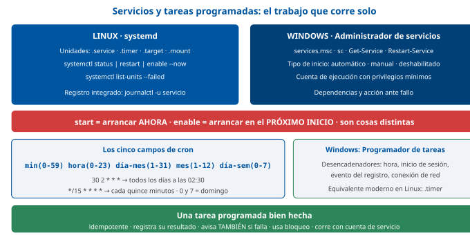
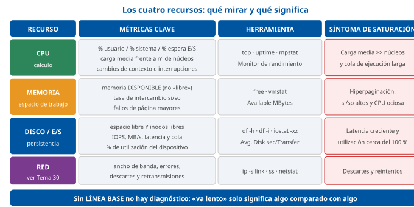

# Tema 27. Administración del sistema operativo y software de base

**Bloque:** técnico  
**Enunciado oficial** (BOAM n.º 10.032, de 23 de diciembre de 2025): Administración del Sistema operativo y software de base. Funciones y responsabilidades. Actualización, mantenimiento y reparación del sistema operativo.

Versión web: <https://ayuntamientomadrid.github.io/temario-tecnico-auxiliar/temas/tema-27.html> · PDF: [tema-27.pdf](tema-27.pdf) · Test: [../../../tests/tecnico/tema-27.md](../../../tests/tecnico/tema-27.md)

## Índice

- 1. Fundamentos y arquitectura del software de base
  - 1.1. Concepto, funciones y clasificación del software de base
  - 1.2. Componentes principales del software de base
- 2. Gestión y control de recursos del sistema operativo
  - 2.1. Gestión de procesos, hilos y memoria principal
  - 2.2. Subsistemas de almacenamiento, archivos y entrada/salida
- 3. Funciones operativas y administración técnica
  - 3.1. Administración de usuarios, grupos y directivas de seguridad
  - 3.2. Gestión de servicios, demonios y tareas programadas
- 4. Responsabilidades organizativas y marco normativo público
  - 4.1. Documentación técnica, inventario y procedimientos operativos
  - 4.2. Marco legal, gobernanza y seguridad en la Administración pública
- 5. Mantenimiento y optimización del sistema operativo
  - 5.1. Estrategias de mantenimiento preventivo, correctivo y evolutivo
  - 5.2. Monitorización del rendimiento y gestión de capacidad
- 6. Gestión de actualizaciones y parches de seguridad
  - 6.1. Ciclo de vida del software y gestión de versiones
  - 6.2. Procedimientos de despliegue de parches y actualizaciones
- 7. Diagnóstico de fallos y gestión de incidencias
  - 7.1. Análisis de registros (logs) y auditoría de eventos
  - 7.2. Identificación y aislamiento de anomalías del sistema
- 8. Reparación del sistema operativo y recuperación
  - 8.1. Técnicas de reparación y arranque de emergencia
  - 8.2. Copias de seguridad, restauración y continuidad operativa
- Síntesis final

### Conceptos clave para memorizar

| Concepto | Dato clave |
|----|----|
| Software de base | Capa de software que hace utilizable el hardware y sostiene a las aplicaciones: **firmware, sistema operativo, controladores, bibliotecas del sistema y utilidades**. No resuelve el problema del usuario final; habilita a quien lo resuelve |
| Núcleo (*kernel*) | Único componente que se ejecuta en **modo privilegiado** (anillo 0); las aplicaciones viven en **modo usuario** y solo entran al núcleo mediante **llamadas al sistema** |
| Monolítico / micronúcleo / híbrido | **Monolítico**: todos los servicios en el espacio del núcleo (rápido, menos robusto; Linux, con módulos cargables). **Micronúcleo**: núcleo mínimo y servicios en modo usuario (robusto, más cambios de contexto; MINIX, QNX). **Híbrido**: Windows NT y XNU (macOS) |
| UEFI y arranque seguro | El firmware **UEFI** sustituye a la BIOS heredada; usa tabla de particiones **GPT** y una partición **ESP** con formato FAT32. El **Arranque Seguro** (*Secure Boot*) verifica la firma digital de cada componente de la cadena de arranque |
| Gestor de arranque / cargador | **GRUB 2** (Linux) y el **Administrador de arranque de Windows** (`bootmgfw.efi` + BCD) eligen el sistema y **cargan el núcleo** en memoria; el **initramfs/initrd** aporta los controladores necesarios para montar la raíz |
| Proceso frente a hilo | El **proceso** posee el espacio de direcciones y los recursos; el **hilo** es la unidad de planificación y **comparte** ese espacio. Cambiar de hilo dentro de un proceso es más barato que cambiar de proceso |
| Memoria virtual | La **MMU** traduce direcciones virtuales a físicas por páginas; un **fallo de página** trae la página de disco. La **hiperpaginación** (*thrashing*) es el síntoma de exceso de intercambio: mucha E/S y CPU baja |
| Dispositivo de bloques | Abstracción del almacenamiento en bloques de tamaño fijo direccionables (`/dev/sda`, `\\.\PhysicalDrive0`); sobre él se construyen particiones, volúmenes lógicos y sistemas de archivos |
| LVM (PV / VG / LV) | **Volumen físico** → **grupo de volúmenes** → **volumen lógico**. Permite **redimensionar en caliente** y hacer **instantáneas**; el equivalente en Windows son los **discos dinámicos** y los **Espacios de almacenamiento** |
| Cuota de disco | Límite de espacio o de *inodos* por usuario o grupo, con **límite blando** (*soft*, avisa y da periodo de gracia) y **límite duro** (*hard*, impide escribir) |
| Usuarios y permisos | Linux: **UID/GID**, permisos `rwx` para propietario/grupo/otros, `sudo` y **PAM**. Windows: **SID**, **ACL** con ACE de permiso o denegación, grupos de **Active Directory** y **directivas de grupo (GPO)** |
| AAA | **Autenticación** (¿quién eres?) → **Autorización** (¿qué puedes hacer?) → **Auditoría/trazabilidad** (¿qué hiciste?). Son tres funciones distintas y las tres son exigibles en el ENS |
| Mínimo privilegio | Cada cuenta debe tener **solo** los permisos que necesita: cuentas nominales de administración separadas de la cuenta de uso diario, y **nunca** trabajo ordinario con `root` o `Administrador` |
| Servicio / demonio | Proceso de larga duración sin terminal asociada, arrancado por el sistema: **unidades de systemd** (`systemctl`) en Linux moderno; **servicios de Windows** (`services.msc`, `sc`) con su cuenta de ejecución |
| Tarea programada | Ejecución diferida y periódica: **cron** y **temporizadores de systemd** en Linux; **Programador de tareas** en Windows. La sintaxis de `cron` tiene **cinco campos**: minuto, hora, día del mes, mes y día de la semana |
| Tipos de mantenimiento (ISO/IEC 14764) | **Correctivo** (arregla defectos), **preventivo** (evita fallos latentes), **perfectivo** (mejora rendimiento o mantenibilidad) y **adaptativo** (acomoda cambios del entorno). El enunciado del tema los agrupa como preventivo, correctivo y **evolutivo** (= perfectivo + adaptativo) |
| Gestión de capacidad | Analizar la tendencia de uso de CPU, memoria, disco y red para **anticipar** el agotamiento del recurso: se dimensiona sobre el **percentil alto** de la carga, no sobre la media |
| Línea base (*baseline*) | Medición del comportamiento normal del sistema con la que se comparan las mediciones posteriores. Sin línea base no se puede afirmar que un sistema «va lento» |
| Ciclo de vida del soporte | Un sistema operativo tiene fases de **soporte general**, **soporte extendido** y **fin de vida (EOL)**. Un sistema fuera de soporte **no recibe parches de seguridad**: en el sector público, mantenerlo es un incumplimiento del ENS |
| Versionado semántico | `MAYOR.MENOR.PARCHE`: **mayor** rompe compatibilidad, **menor** añade funcionalidad compatible, **parche** corrige errores sin cambiar la interfaz |
| CVE y CVSS | **CVE** es el identificador único de una vulnerabilidad publicada; **CVSS** es la puntuación de gravedad de 0 a 10 (crítica 9,0-10,0) que ordena la prioridad de parcheo |
| Despliegue por anillos | Los parches se aplican en oleadas: **laboratorio → piloto → producción no crítica → producción crítica**, con verificación entre etapas y ventana de mantenimiento comunicada |
| Marcha atrás (*rollback*) | Todo cambio debe poder deshacerse: **instantánea** previa de la máquina virtual o del volumen, **punto de restauración**, desinstalación del parche o arranque desde la entrada anterior del gestor de arranque |
| Registro de eventos | Linux: **syslog** (RFC 5424) y **journald** (`journalctl`). Windows: **Visor de eventos** con los registros Sistema, Aplicación y **Seguridad**. Los registros deben **centralizarse** en un servidor distinto del auditado |
| Correlación y SIEM | Los registros solo son útiles si se **agregan, sincronizan en el tiempo (NTP) y correlacionan**; en el ENS la trazabilidad exige conservar y proteger los registros de actividad |
| Arranque de emergencia | Medios y modos de reparación: **modo seguro**, **Entorno de recuperación de Windows (WinRE)** con `bootrec`, `sfc` y `DISM`; en Linux, **modo de rescate** de systemd, `fsck` y `chroot` desde un medio vivo |
| RPO y RTO | **RPO**: cuántos datos se admite perder (edad de la última copia útil). **RTO**: cuánto tiempo se admite estar caído. Los dos los fija **el negocio**, no el técnico |
| Regla 3-2-1 | **3** copias de los datos, en **2** soportes distintos, con **1** de ellas fuera de las instalaciones (y, hoy, preferiblemente **inmutable** frente a *ransomware*) |
| Copia total, diferencial e incremental | **Total**: todo. **Diferencial**: lo cambiado desde la última **total** (restauración = total + última diferencial). **Incremental**: lo cambiado desde la **última copia de cualquier tipo** (restauración = total + toda la cadena) |
| Restauración probada | Una copia de seguridad **no verificada mediante una restauración de prueba** no es una copia de seguridad: es una suposición |

## Contenido

### Convenciones del documento

Este tema incluye cuatro tipos de **cajas callout** para facilitar el estudio:

> **Dato clave.** Información de alta densidad memorística.

> **Ejercicio resuelto.** Problema + solución paso a paso (diagnóstico de un síntoma, decisión de administración razonada).

> **Ejemplo de aplicación en el ayto.** Aplicación real de la teoría al entorno municipal (sede electrónica, Padrón, puestos de distrito).

> **Relación con otros temas.** Enlace conceptual a otros temas del temario oficial.

**Estructura**: la materia se agrupa en cuatro bloques. Cada bloque se desarrolla aquí en **dos secciones numeradas**, de modo que el contenido tiene **8 secciones y 31 epígrafes** sin añadir ni suprimir nada del enunciado oficial:

| Bloque | Secciones |
|----|----|
| I — Administración del sistema operativo y software de base | §1 Fundamentos y arquitectura · §2 Gestión y control de recursos |
| II — Funciones y responsabilidades de la administración de sistemas | §3 Funciones operativas · §4 Responsabilidades organizativas y marco normativo |
| III — Actualización y mantenimiento del sistema operativo | §5 Mantenimiento y optimización · §6 Actualizaciones y parches |
| IV — Diagnóstico, reparación y recuperación | §7 Diagnóstico de fallos · §8 Reparación y recuperación |

**Órdenes y ejemplos**: las órdenes se escriben en su forma real de **Linux (shell)** y de **Windows (PowerShell o símbolo del sistema)**, no en pseudocódigo, porque la administración de sistemas es una disciplina eminentemente práctica y el examen puede preguntar por una utilidad concreta. Los fragmentos son breves e ilustrativos. Las fuentes se citan con etiquetas breves tipo `[SILBERSCHATZ]` o `[ENS]`; el registro completo está en la pestaña Fuentes.

#### Mapa de equivalencias: administrar Windows y administrar Linux

Todo el tema se apoya en esta dualidad, presente en cualquier parque municipal. Conviene fijar el mapa de equivalencias antes de empezar, porque los conceptos son los mismos y lo que cambia es el nombre de la herramienta:

| Función | Linux | Windows |
|----|----|----|
| Gestor de arranque | GRUB 2 | Administrador de arranque de Windows + BCD |
| Proceso inicial | `systemd` (PID 1) | `wininit.exe` / Administrador de control de servicios |
| Servicios | Unidades `.service` (`systemctl`) | Servicios (`services.msc`, `sc`, `Get-Service`) |
| Tareas programadas | `cron`, temporizadores de systemd | Programador de tareas (`schtasks`) |
| Registro del sistema | `syslog` / `journald` (`journalctl`) | Visor de eventos (Sistema, Aplicación, Seguridad) |
| Identidad de usuario | UID/GID, `/etc/passwd`, `/etc/group` | SID, cuentas locales o de Active Directory |
| Elevación de privilegios | `sudo` | Control de cuentas de usuario (UAC), «Ejecutar como administrador» |
| Directivas centralizadas | Ficheros de configuración + herramienta de gestión de configuración | Directivas de grupo (GPO) |
| Instalación de software | Gestor de paquetes (`apt`, `dnf`, `zypper`) | MSI/MSIX, `winget`, distribución centralizada |
| Dónde vive la configuración | Ficheros de texto en `/etc` \[FHS\] | Registro de Windows (`HKEY_LOCAL_MACHINE`…) y ficheros |

> **Dato clave.** En Linux **la configuración es texto en `/etc`** y los registros están en `/var/log`, según el estándar de jerarquía de archivos FHS \[FHS\]; en Windows, buena parte de la configuración vive en el **Registro**. Esta diferencia explica por qué en Linux la administración se automatiza tan bien con guiones de texto y control de versiones.

**Caso de referencia usado en todo el tema** (contexto Ayuntamiento de Madrid, supuesto simplificado): el **Informática del Ayuntamiento de Madrid (IAM)** explota un conjunto de servidores —unos con Windows Server y otros con Linux— que sostienen la **Sede Electrónica**, el **Padrón municipal** y el gestor de expedientes, junto a varios miles de **puestos de usuario** repartidos por Áreas de Gobierno y Distritos. Sobre ese parque se ilustran todas las tareas del tema: cuentas y permisos, servicios, ventanas de mantenimiento, parcheo, registros, diagnóstico de una caída y restauración tras un desastre.

------------------------------------------------------------------------

### 1. Fundamentos y arquitectura del software de base

#### 1.1. Concepto, funciones y clasificación del software de base

Se llama **software de base** (o *software de sistema*) al conjunto de programas que hacen **utilizable el hardware** y proporcionan a las aplicaciones un entorno de ejecución homogéneo. No resuelve el problema del usuario final —eso lo hace el **software de aplicación**—, sino que habilita a quien lo resuelve: gestiona los recursos físicos, los reparte entre los programas, los protege unos de otros y ofrece una interfaz estable para usarlos \[SILBERSCHATZ\] \[STALLINGS\].

La frontera es funcional, no de fabricante: un gestor de bases de datos o un servidor de aplicaciones son software de base **para la aplicación municipal que se apoya en ellos**, aunque desde el punto de vista del sistema operativo sean simples procesos de usuario.

| Capa | Qué es | Ejemplos |
|----|----|----|
| **Firmware** | Software grabado en el propio equipo que inicializa el hardware y arranca lo demás | UEFI, BIOS heredada, microcódigo del procesador, firmware de un controlador RAID |
| **Núcleo del sistema operativo** | El componente privilegiado que gestiona procesos, memoria, archivos, dispositivos y seguridad | Linux, Windows NT, XNU (macOS), AIX |
| **Controladores de dispositivo** | Traducen las peticiones genéricas del núcleo al lenguaje de un hardware concreto | Controlador de red, de impresora, de almacenamiento |
| **Bibliotecas y entorno de ejecución del sistema** | Código común que las aplicaciones enlazan en lugar de reimplementarlo | `glibc`, DLL del sistema de Windows, .NET, JVM |
| **Utilidades y servicios del sistema** | Herramientas de administración, servicios de arranque, planificadores, gestores de paquetes | `systemd`, servicios de Windows, `apt`/`dnf`, copias de seguridad |
| **Middleware** | Software intermedio que sostiene aplicaciones distribuidas | Servidor web, servidor de aplicaciones, SGBD, colas de mensajes |

Las **funciones esenciales** del sistema operativo, núcleo del software de base, son cinco \[SILBERSCHATZ\] \[TANENBAUM\]:

1.  **Gestión de procesos**: crear, planificar, sincronizar y terminar los programas en ejecución.
2.  **Gestión de memoria**: asignar memoria a cada proceso, aislarlo de los demás y sostener la memoria virtual.
3.  **Gestión de archivos y almacenamiento**: organizar los datos en archivos y directorios sobre dispositivos físicos.
4.  **Gestión de entrada/salida**: abstraer los dispositivos tras una interfaz uniforme, con planificación y almacenamiento intermedio.
5.  **Protección y seguridad**: identificar a los usuarios, controlar el acceso a los recursos y registrar lo que ocurre.

A ellas se añade la **interfaz**: la interfaz de programación (**llamadas al sistema**) y la interfaz de usuario (intérprete de órdenes o entorno gráfico).

> **Dato clave.** El sistema operativo cumple simultáneamente dos papeles clásicos: **máquina extendida** (oculta la complejidad del hardware tras abstracciones cómodas: archivo, proceso, socket) y **gestor de recursos** (reparte CPU, memoria, disco y dispositivos entre programas que compiten). Tanenbaum los formula así de forma explícita \[TANENBAUM\].

La separación entre **modo núcleo** (privilegiado, anillo 0, acceso total al hardware) y **modo usuario** (restringido) es el mecanismo de hardware que hace posible la protección: una aplicación **no puede** tocar el hardware directamente, sino que debe pedirlo mediante una **llamada al sistema**, que provoca un cambio controlado a modo núcleo \[STALLINGS\] \[SILBERSCHATZ\].

> **Dato clave.** Una **llamada al sistema** (*system call*) es la única puerta legítima entre el modo usuario y el modo núcleo. Su coste no es cero: implica un cambio de modo, por lo que un programa que hace millones de llamadas pequeñas rinde peor que otro que agrupa el trabajo. `open`, `read`, `write`, `fork` y `exec` son llamadas POSIX típicas \[POSIX\].

Los sistemas operativos se clasifican, además, por criterios que conviene tener ordenados:

- **Por número de usuarios**: monousuario (Windows 11 en un puesto) o multiusuario (un servidor Linux con varias sesiones simultáneas).
- **Por número de tareas**: monotarea (histórico, MS-DOS) o multitarea, y dentro de esta **multitarea cooperativa** (el proceso cede voluntariamente la CPU) o **expropiativa** (*preemptive*: el planificador se la quita; es lo normal hoy).
- **Por finalidad**: propósito general, **de tiempo real** (garantiza plazos de respuesta: sistemas de control, señalización), embebido, distribuido o de red.
- **Por licencia**: privativo (Windows) o libre/código abierto (Linux, familia BSD).

> **Ejemplo de aplicación en el ayto.** En el parque del IAM conviven los tres perfiles: **servidores** multiusuario que sostienen la Sede Electrónica; **puestos de trabajo** de personal municipal; y sistemas **embebidos o de tiempo real** en la periferia (paneles informativos, control de accesos, semaforización). El software de base y las tareas de administración son conceptualmente los mismos, pero las ventanas de mantenimiento y la tolerancia a la caída son radicalmente distintas.

> **Relación con otros temas.** Los **sistemas operativos** en sí mismos —características, elementos constitutivos, Windows, Unix/Linux y sistemas móviles— son objeto del **Tema 14**. Este tema los aborda desde el punto de vista del **administrador**: qué hay que hacer con ellos una vez instalados. La **arquitectura del ordenador** sobre la que se apoyan es el **Tema 11**, y los **periféricos y elementos de almacenamiento**, el **Tema 12**.

##### 1.1.1. Modelos de arquitectura: monolítico, micronúcleo y modular

La cuestión arquitectónica central es **cuánto código se ejecuta en modo núcleo**. De ahí salen los tres modelos que pide el enunciado \[TANENBAUM\] \[SILBERSCHATZ\]:

**Núcleo monolítico.** Todos los servicios del sistema —planificador, gestión de memoria, sistemas de archivos, pila de red, controladores— se ejecutan **dentro** del espacio del núcleo, como un único programa privilegiado con un espacio de direcciones común.

- *Ventaja*: rendimiento. Las llamadas entre subsistemas son simples llamadas a función, sin cambios de contexto ni paso de mensajes.
- *Inconveniente*: robustez y mantenibilidad. Un fallo en un controlador puede tumbar todo el sistema, porque comparte espacio con el resto; y el código crece hasta hacerse difícil de auditar.
- *Ejemplos*: Linux, la familia BSD, Unix clásico.

**Micronúcleo (*microkernel*).** El núcleo se reduce al mínimo indispensable —planificación, gestión básica de memoria y **comunicación entre procesos (IPC)**— y todo lo demás (sistemas de archivos, controladores, pila de red) se ejecuta como **procesos servidores en modo usuario**, que se comunican por paso de mensajes.

- *Ventaja*: robustez, aislamiento y capacidad de reiniciar un componente caído sin reiniciar el sistema; base natural de los sistemas de alta fiabilidad.
- *Inconveniente*: sobrecarga por el paso de mensajes y los cambios de modo, y mayor complejidad de diseño.
- *Ejemplos*: MINIX 3, QNX (muy usado en sistemas de tiempo real), Mach, L4, GNU Hurd.

**Modular e híbrido.** Es la respuesta práctica al dilema. Un núcleo **modular** es monolítico en su ejecución, pero está dividido en **módulos cargables y descargables en caliente**, de modo que el sistema solo tiene en memoria lo que necesita y se puede añadir soporte de hardware sin recompilar. Un núcleo **híbrido** adopta la estructura conceptual del micronúcleo pero mantiene en modo núcleo, por rendimiento, subsistemas que un micronúcleo puro dejaría fuera.

- *Ejemplos*: **Linux** es monolítico **modular** (módulos `.ko`, gestionados con `lsmod`, `modprobe`, `rmmod`); **Windows NT** y **XNU** (macOS, con base Mach y BSD) se describen habitualmente como híbridos \[TANENBAUM\].

| Criterio | Monolítico | Micronúcleo | Modular / híbrido |
|----|----|----|----|
| Código en modo núcleo | Todo | Mínimo | Todo, pero segmentado en módulos |
| Rendimiento | Alto | Menor (IPC) | Alto |
| Aislamiento de fallos | Bajo | Alto | Bajo-medio |
| Extensibilidad en caliente | Limitada | Alta | Alta (carga de módulos) |
| Ejemplos | Unix, Linux, BSD | MINIX 3, QNX, L4 | Linux (módulos), Windows NT, XNU |

> **Dato clave.** Regla mnemotécnica: **monolítico = rápido pero frágil; micronúcleo = robusto pero con sobrecarga de mensajes; modular/híbrido = compromiso**. Y un matiz: **Linux es monolítico modular**, no un micronúcleo, por más que cargue y descargue módulos en caliente.

**Otras estructuras** que conviene reconocer: **por capas** (cada capa solo usa la inmediatamente inferior; claridad conceptual a costa de rendimiento), **máquina virtual** (un hipervisor ofrece varias copias del hardware, base de la virtualización) y **exonúcleo** (el núcleo solo reparte recursos y las bibliotecas de cada aplicación implementan las abstracciones) \[TANENBAUM\].

> **Relación con otros temas.** La estructura de **máquina virtual** y el papel del hipervisor se desarrollan en el **Tema 28** (virtualización de sistemas y de puestos de usuario). Aquí interesa solo como modelo arquitectónico y, más adelante (§6.2.1 y §8.1), como herramienta de marcha atrás mediante instantáneas.

#### 1.2. Componentes principales del software de base

Instalar un sistema operativo es, en realidad, dejar en el disco una **cadena de componentes encadenados** que deben ejecutarse en el orden correcto para que la máquina llegue a estar operativa. Conocer esa cadena es lo que permite, más tarde, **reparar** un sistema que no arranca (§8.1): cada paso que falla produce un síntoma distinto.

##### 1.2.1. Gestores de arranque, cargadores, controladores y bibliotecas del sistema

**1) Firmware y arranque.** Al encender, el procesador ejecuta el **firmware** de la placa. El firmware moderno es **UEFI**, sucesor de la BIOS heredada \[UEFI-SPEC\]:

| Aspecto | BIOS heredada | UEFI |
|----|----|----|
| Tabla de particiones | MBR (máximo 2 TiB, 4 particiones primarias) | **GPT** (hasta 128 particiones, sin el límite práctico de 2 TiB) |
| Dónde busca el arranque | Sector 0 del disco (MBR) | Partición **ESP** (*EFI System Partition*), en FAT32, con archivos `.efi` |
| Modo del procesador | 16 bits (modo real) | 32/64 bits |
| Verificación de firma | No | **Arranque Seguro** (*Secure Boot*): solo ejecuta binarios firmados por claves de confianza |
| Interfaz | Texto, teclado | Gráfica, ratón, red, extensible |

> **Dato clave.** **UEFI + GPT + ESP (FAT32) + Arranque Seguro** es el cuarteto clave. El **Arranque Seguro** verifica la **firma digital** de cada componente de la cadena de arranque para impedir que un *rootkit* se cargue antes que el sistema operativo; si se instala un núcleo o un controlador sin firmar, el equipo no arranca hasta que se firma o se desactiva la comprobación \[UEFI-SPEC\].

**2) Gestor de arranque (*boot manager*) y cargador (*boot loader*).** El gestor de arranque **presenta y elige** entre sistemas o versiones; el cargador **lee el núcleo del disco y lo pone en memoria**, le pasa parámetros y le cede el control. En la práctica ambos papeles suelen residir en el mismo producto:

- **GRUB 2** en Linux: configuración generada en `/boot/grub/grub.cfg`, entradas por versión de núcleo, opciones de arranque editables en caliente (útil para arrancar en modo de rescate) \[GRUB-DOC\].
- **Administrador de arranque de Windows** (`bootmgfw.efi` en la ESP) con su almacén de configuración **BCD**, reparable con `bootrec /rebuildbcd` \[MS-WINRE\].

**3) Núcleo e imagen inicial.** El cargador coloca en memoria el núcleo y, en Linux, un **initramfs**: un sistema de archivos mínimo en RAM que contiene **los controladores imprescindibles** para poder montar el sistema de archivos raíz real (por ejemplo, el controlador del RAID o del cifrado). Si el initramfs no incluye el controlador correcto, el sistema arranca y muere con un *kernel panic* por no encontrar la raíz: es una avería clásica tras actualizar un núcleo \[RH-DOC\].

**4) Proceso inicial y arranque de servicios.** Una vez vivo, el núcleo lanza el **primer proceso** (PID 1): `systemd` en Linux moderno, que alcanza un **objetivo** (`multi-user.target`, `graphical.target`) activando en paralelo las unidades necesarias \[SYSTEMD\]; en Windows, la secuencia `wininit.exe` → Administrador de control de servicios → servicios y sesión interactiva \[MS-WINSERVER\].

**5) Controladores de dispositivo.** Un **controlador** (*driver*) es el módulo que traduce las operaciones genéricas del núcleo («lee este bloque») a las órdenes concretas de un hardware. Se ejecutan normalmente **en modo núcleo**, y de ahí su criticidad: un controlador defectuoso es una de las causas más frecuentes de pantallazo azul en Windows o de *oops* en Linux. Por eso los sistemas modernos exigen **controladores firmados** y ofrecen mecanismos para **revertir** un controlador a su versión anterior.

**6) Bibliotecas del sistema.** Código común que las aplicaciones **enlazan** en vez de reimplementarlo: `glibc` en Linux, las DLL del sistema en Windows, y entornos de ejecución como .NET o la JVM.

- **Enlace estático**: la biblioteca se copia dentro del ejecutable. Ventaja: autonomía. Inconveniente: para corregir un fallo de la biblioteca hay que **recompilar y redistribuir** todos los programas que la incluyen.
- **Enlace dinámico**: la biblioteca se carga en memoria en tiempo de ejecución y **se comparte** entre procesos. Ventaja: se parchea una vez y todos los programas quedan corregidos; ahorro de memoria. Inconveniente: dependencia de versiones (el clásico «infierno de las DLL»).

> **Dato clave.** El **enlace dinámico es la razón por la que parchear el sistema operativo protege a todas las aplicaciones a la vez**: si una vulnerabilidad está en una biblioteca compartida (por ejemplo, una biblioteca criptográfica), basta actualizar la biblioteca y **reiniciar los servicios que la tenían cargada**. Ese matiz —reiniciar el servicio o el sistema— es lo que a menudo se olvida: el binario nuevo está en disco, pero el proceso en memoria sigue usando el viejo.

**7) Gestor de paquetes.** Es la pieza que convierte todo lo anterior en algo administrable: instala, actualiza, verifica firmas y resuelve dependencias del software de base (`apt`/`dpkg`, `dnf`/`rpm`, `winget`, MSI). Un parque sin gestión de paquetes centralizada es un parque que no se puede inventariar ni parchear con garantías (§4.1 y §6.2).

> **Ejemplo de aplicación en el ayto.** Cuando en un servidor de la Sede Electrónica se actualiza la biblioteca de TLS por una vulnerabilidad grave, no basta con que el gestor de paquetes deje el archivo nuevo en disco: hay que **reiniciar el servidor web y el servidor de aplicaciones** para que dejen de usar la copia vulnerable ya cargada en memoria. La comprobación se hace listando los procesos que mantienen abiertas bibliotecas eliminadas y se documenta en el parte de la ventana de mantenimiento (§6.2).

------------------------------------------------------------------------

### 2. Gestión y control de recursos del sistema operativo

Administrar un sistema es, en el fondo, **vigilar y arbitrar el reparto de cuatro recursos**: CPU, memoria, almacenamiento y entrada/salida (a los que se añade la red, objeto del Tema 30). Esta sección fija los conceptos que después se usarán para monitorizar (§5.2), diagnosticar (§7) y reparar (§8).

#### 2.1. Gestión de procesos, hilos y memoria principal

**Proceso.** Un **proceso** es un programa en ejecución: código, datos, pila, montículo, registros del procesador y una tabla de recursos abiertos (archivos, sockets). El sistema lo describe en un **bloque de control de proceso (PCB)** que contiene su identificador (**PID**), su estado, su prioridad, su contexto y su propietario \[SILBERSCHATZ\].

**Hilo.** Un **hilo** (*thread*) es la unidad de planificación dentro de un proceso. Todos los hilos de un proceso **comparten** el espacio de direcciones y los archivos abiertos, pero cada uno tiene su propia pila y sus propios registros.

> **Dato clave.** **El proceso posee los recursos; el hilo consume CPU.** De ahí que un cambio de contexto entre hilos del mismo proceso sea más barato que entre procesos (no hay que cambiar el espacio de direcciones ni vaciar las cachés de traducción), y de ahí también que un hilo que corrompe memoria pueda tumbar a todos sus hermanos, cosa que no ocurre entre procesos \[SILBERSCHATZ\] \[TANENBAUM\].

**Estados de un proceso.** El modelo clásico de cinco estados: **nuevo → preparado (*ready*) → en ejecución (*running*) → bloqueado/en espera (*waiting*) → terminado**. Un proceso pasa de *ejecución* a *preparado* cuando el planificador le expropia la CPU (fin de su porción de tiempo o *quantum*), y de *ejecución* a *bloqueado* cuando pide una operación de E/S y debe esperar.

Dos estados patológicos que el administrador debe reconocer:

- **Zombi** (Linux): el proceso ha terminado pero su padre no ha recogido su código de salida; ocupa una entrada en la tabla de procesos aunque no consuma CPU. Muchos zombis indican un programa padre mal escrito.
- **Huérfano**: su padre ha muerto antes que él; el proceso inicial (PID 1) lo adopta.
- **En espera ininterrumpible** (`D` en Linux): bloqueado en una E/S que no responde. Es el síntoma típico de un almacenamiento de red caído: la carga media sube muchísimo mientras la CPU está ociosa.

**Planificación.** El planificador decide a quién dar la CPU. Los algoritmos canónicos que hay que saber distinguir son \[SILBERSCHATZ\] \[STALLINGS\]:

| Algoritmo | Idea | Rasgo |
|----|----|----|
| **FCFS** (primero en llegar, primero en servirse) | Cola simple | No expropiativo; un proceso largo bloquea a los cortos (efecto convoy) |
| **SJF** (trabajo más corto primero) | Prioriza el de menor ráfaga | Óptimo en tiempo medio de espera, pero exige predecir la duración |
| **Por prioridades** | Cada proceso tiene prioridad | Riesgo de **inanición** de los de baja prioridad; se corrige con **envejecimiento** |
| **Round robin** (turno rotatorio) | Porción de tiempo fija y rotación | Expropiativo, equitativo; base de los sistemas interactivos |
| **Colas multinivel con realimentación** | Varias colas con prioridad y migración entre ellas | Aproxima SJF sin conocer la duración; es lo que usan los sistemas reales |

En la práctica, el administrador no cambia el algoritmo: ajusta la **prioridad** de un proceso concreto con `nice`/`renice` en Linux (valores de −20, máxima prioridad, a 19, mínima) o con la prioridad de proceso en Windows, y limita recursos con **cgroups** (Linux) o **objetos de trabajo** (Windows).

    ps -eo pid,ppid,stat,ni,pcpu,pmem,etime,cmd --sort=-pcpu | head -15   # procesos por consumo de CPU
    renice -n 10 -p 4821            # bajar la prioridad de un proceso que satura el servidor
    kill -TERM 4821                 # petición ordenada de terminación (SIGTERM)
    kill -KILL 4821                 # terminación forzosa, sin posibilidad de cerrar limpiamente (SIGKILL)

> **Dato clave.** `SIGTERM` (15) **pide** al proceso que termine y este puede cerrar archivos y guardar estado; `SIGKILL` (9) lo **mata** en el acto y el proceso no puede capturarlo ni ignorarlo. Ante un servicio colgado, la secuencia correcta es siempre **primero `SIGTERM`, y solo si no responde, `SIGKILL`** —matar a lo bruto un gestor de bases de datos puede dejar los datos en un estado que exija recuperación \[MAN-PAGES\].

**Memoria principal.** El sistema operativo asigna memoria a cada proceso y garantiza que **ninguno pueda leer ni escribir la de otro**. El mecanismo es la **memoria virtual**: cada proceso ve un espacio de direcciones propio y contiguo que la **MMU** traduce a marcos de memoria física mediante **tablas de páginas**, con ayuda de la caché de traducción (**TLB**) \[SILBERSCHATZ\] \[TANENBAUM\].

- Cuando un proceso accede a una página que no está en memoria física se produce un **fallo de página** (*page fault*): el núcleo la trae del disco (del archivo de intercambio o del propio ejecutable) y reanuda la instrucción.
- El área de disco usada para respaldar páginas se llama **espacio de intercambio** (*swap* en Linux; `pagefile.sys` en Windows).
- Los algoritmos de reemplazo (**LRU**, **FIFO**, **reloj**) deciden qué página se expulsa. La **anomalía de Belady** —que FIFO pueda empeorar al aumentar el número de marcos— es un resultado contraintuitivo.

> **Dato clave.** La **hiperpaginación** (*thrashing*) es el estado en el que el sistema dedica más tiempo a intercambiar páginas que a ejecutar trabajo útil. Su firma es inconfundible: **CPU de usuario baja, E/S de disco altísima, tiempo de espera de E/S alto y el sistema aparentemente parado**. La solución no es acelerar el disco, sino **reducir el grado de multiprogramación o añadir memoria** \[SILBERSCHATZ\].

- **Fragmentación interna**: espacio desperdiciado dentro de la unidad asignada (la última página de un proceso rara vez se llena del todo).
- **Fragmentación externa**: huecos libres demasiado pequeños y dispersos para ser útiles; es propia de la asignación contigua y la paginación la elimina.

En Linux, el **OOM killer** (asesino por falta de memoria) mata al proceso con mayor puntuación cuando la memoria se agota; en Windows, el sistema amplía el archivo de paginación y degrada el rendimiento. Ambos comportamientos aparecen en los registros y son una pista de diagnóstico de primer orden (§7.1).

    free -h                # memoria total, usada, disponible y de intercambio
    vmstat 1 5             # columnas si/so (intercambio entrada/salida): si son altas y constantes, hay hiperpaginación
    top                    # carga media, %wa (espera de E/S) y procesos por memoria residente

> **Ejercicio resuelto.** *Un servidor de la Sede Electrónica «va lentísimo». `top` muestra CPU al 12 %, `%wa` al 45 %, carga media 18 y `vmstat` da `si`/`so` sostenidos por encima de cero. ¿Qué ocurre y qué se hace?* **Solución**: no es un problema de CPU —está ociosa— sino de **memoria**: el sistema está hiperpaginando y los procesos se pasan la vida esperando E/S de intercambio. Actuación inmediata: identificar el proceso con mayor memoria residente y decidir si se reinicia el servicio (por ejemplo, una fuga de memoria en el servidor de aplicaciones); actuación de fondo: **ampliar la memoria o repartir la carga**, y abrir una revisión de capacidad (§5.2). Aumentar el tamaño del espacio de intercambio solo cambia el síntoma, no la causa.

#### 2.2. Subsistemas de almacenamiento, archivos y entrada/salida

**Sistema de archivos.** Es la estructura lógica que organiza los datos en **archivos y directorios** sobre un dispositivo de bloques, junto con los metadatos que los describen: nombre, tamaño, propietario, permisos, marcas de tiempo y punteros a los bloques de datos. En los sistemas tipo Unix esos metadatos viven en el **inodo**; el nombre del archivo es solo una entrada de directorio que apunta a un inodo, lo que explica los **enlaces duros** (varios nombres, un mismo inodo) frente a los **enlaces simbólicos** (un archivo que contiene una ruta) \[SILBERSCHATZ\] \[POSIX\].

| Sistema de archivos | Ámbito | Rasgos |
|----|----|----|
| **NTFS** | Windows | Registro por diario (*journaling*), ACL, cuotas, compresión y cifrado (EFS), instantáneas VSS |
| **ReFS** | Windows Server | Orientado a grandes volúmenes e integridad de datos con sumas de verificación |
| **FAT32 / exFAT** | Intercambio y ESP | Sin permisos ni diario; FAT32 no admite archivos mayores de 4 GiB |
| **ext4** | Linux | Diario, muy extendido, robusto y bien conocido |
| **XFS** | Linux (servidores) | Alto rendimiento con archivos grandes y paralelismo; predeterminado en varias distribuciones empresariales |
| **Btrfs / ZFS** | Linux / Unix | Sumas de verificación, instantáneas, subvolúmenes y agrupación de dispositivos integrada |

> **Dato clave.** El **diario** (*journaling*) es lo que permite que un sistema de archivos se recupere en segundos tras un corte de corriente: antes de modificar los metadatos, la operación se anota en un registro; al arrancar, el sistema **repite o descarta** las operaciones incompletas en lugar de recorrer todo el disco. Un sistema **sin diario** (FAT32) obliga a una comprobación completa y puede perder datos \[SILBERSCHATZ\].

**Montaje.** En Unix existe **un único árbol** que arranca en la raíz `/`, y cada dispositivo se **monta** en un directorio (`/mnt/datos`); la tabla de montajes persistente es `/etc/fstab`. En Windows, cada volumen recibe tradicionalmente una **letra de unidad** (`C:`), aunque también admite montaje en carpeta vacía. La ubicación normalizada de los directorios en Linux la fija el estándar **FHS**: `/etc` configuración, `/var/log` registros, `/home` usuarios, `/usr` programas, `/tmp` temporales \[FHS\].

**Entrada/salida.** El subsistema de E/S abstrae los dispositivos tras una interfaz uniforme y añade tres mecanismos que el administrador debe conocer porque explican comportamientos que parecen mágicos:

1.  **Almacenamiento intermedio (*buffering*) y caché**: el sistema retiene en memoria los datos leídos y **retrasa las escrituras** para agruparlas. Por eso una copia de archivos «termina» antes de estar realmente en el disco y por eso **extraer un dispositivo sin expulsarlo** puede corromper datos: hay que forzar el vaciado (`sync`).
2.  **Planificación de E/S**: el núcleo reordena las peticiones para reducir el movimiento del cabezal (irrelevante en SSD, donde se usan planificadores más simples).
3.  **DMA e interrupciones**: el dispositivo transfiere datos a memoria sin intervención de la CPU y avisa al terminar mediante una interrupción.

> **Relación con otros temas.** Los **dispositivos físicos** de almacenamiento y sus interfaces (SATA, SAS, NVMe, cabinas, cintas) son objeto del **Tema 12**; los **sistemas de almacenamiento en red y su virtualización** (SAN, NAS, RAID) y las políticas de copia de seguridad, del **Tema 26**; y las **organizaciones de ficheros** desde el punto de vista de las estructuras de datos, del **Tema 13**. Aquí se trata solo la parte que el sistema operativo administra.

##### 2.2.1. Volúmenes lógicos, cuotas de disco y dispositivos de bloques

**Dispositivo de bloques.** Es la abstracción con la que el sistema ve cualquier almacenamiento direccionable en bloques de tamaño fijo: `/dev/sda`, `/dev/nvme0n1` en Linux, `\\.\PhysicalDrive0` en Windows. Se opone al **dispositivo de caracteres** (flujo secuencial: terminal, puerto serie). Sobre un dispositivo de bloques se construye la pila completa: **partición → volumen lógico → sistema de archivos → punto de montaje**.

**Gestión de volúmenes lógicos (LVM).** Interponer un gestor de volúmenes entre las particiones y el sistema de archivos rompe la rigidez de las particiones clásicas \[LVM-DOC\]:

- **Volumen físico (PV)**: un disco o partición entregado al gestor.
- **Grupo de volúmenes (VG)**: la agrupación de varios PV en una única reserva de espacio.
- **Volumen lógico (LV)**: la porción del VG que se formatea y se monta, y que **puede crecer** tomando espacio libre del grupo, incluso **con el sistema en marcha**.

Ventajas para la administración: **redimensionado en caliente**, **instantáneas** (una copia congelada del volumen en un instante, utilísima para respaldar una base de datos coherente o para poder deshacer una actualización) y agregación de discos. El equivalente en Windows son los **discos dinámicos** y, en versiones modernas, los **Espacios de almacenamiento** (*Storage Spaces*).

    pvcreate /dev/sdb                       # 1) el disco pasa a ser volumen físico
    vgextend vg_datos /dev/sdb              # 2) se añade al grupo de volúmenes existente
    lvextend -L +50G /dev/vg_datos/lv_logs  # 3) se amplía el volumen lógico
    resize2fs /dev/vg_datos/lv_logs         # 4) se amplía el sistema de archivos (ext4) sin desmontar

> **Dato clave.** Ampliar espacio en LVM son **dos pasos**, no uno: primero se agranda el **volumen lógico** (`lvextend`) y después el **sistema de archivos** que vive dentro (`resize2fs` en ext4, `xfs_growfs` en XFS). Si solo se hace el primero, `df` sigue mostrando el tamaño antiguo y el administrador cree, erróneamente, que la ampliación no ha funcionado.

**Cuotas de disco.** Limitan el espacio (o el número de inodos) que un usuario o un grupo puede ocupar en un sistema de archivos. Distinguen dos umbrales \[MAN-PAGES\]:

- **Límite blando** (*soft*): puede superarse temporalmente durante un **periodo de gracia**, con avisos.
- **Límite duro** (*hard*): no puede superarse en ningún caso; la escritura falla.

Las cuotas cumplen una función que va más allá del ahorro de espacio: **evitan que un solo usuario o proceso agote un volumen compartido** y provoque una caída del servicio, que es una incidencia de **disponibilidad** y, por tanto, materia del ENS \[ENS\].

> **Ejemplo de aplicación en el ayto.** En un servidor de ficheros compartido por varias unidades de un Distrito se fija una cuota blanda de 20 GiB con siete días de gracia y una cuota dura de 25 GiB por usuario. Además, el volumen de registros del gestor de expedientes se aloja en un **volumen lógico independiente**: así, si un componente entra en un bucle y escribe registros sin control, llena su propio volumen y **no** el del sistema operativo ni el de la base de datos. Separar `/var/log` en su propio volumen es una de las decisiones de diseño que más caídas evita.

------------------------------------------------------------------------

### 3. Funciones operativas y administración técnica

El **administrador de sistemas** es el responsable de que la plataforma esté disponible, sea segura, rinda lo esperado y pueda recuperarse. Antes de entrar en el detalle, conviene fijar el catálogo completo de funciones, porque el enunciado del tema pregunta literalmente por «funciones y responsabilidades»:

| Función | Contenido |
|----|----|
| **Instalación y configuración** | Despliegue del sistema operativo y del software de base, parametrización, bastionado inicial |
| **Gestión de identidades y accesos** | Altas, bajas y modificaciones de cuentas; grupos; permisos; contraseñas y directivas |
| **Gestión de servicios** | Arranque, parada, dependencias, cuentas de ejecución, tareas programadas |
| **Gestión del almacenamiento** | Volúmenes, sistemas de archivos, cuotas, crecimiento |
| **Monitorización y capacidad** | Vigilancia de recursos, umbrales, alertas, tendencias y previsión |
| **Actualización y parcheo** | Mantenimiento del sistema al día y dentro de soporte |
| **Copias de seguridad y recuperación** | Diseño, ejecución, verificación y prueba de restauración |
| **Gestión de incidencias y problemas** | Diagnóstico, resolución, escalado y análisis de causa raíz |
| **Seguridad** | Bastionado, gestión de vulnerabilidades, registros y respuesta ante incidentes |
| **Documentación y control de cambios** | Inventario, procedimientos, registro de cambios y trazabilidad |
| **Cumplimiento normativo** | ENS, ENI, protección de datos, contratación y niveles de servicio |

> **Dato clave.** Las funciones se agrupan en tres planos que conviene no mezclar: **operativas** (lo que se hace a diario con el sistema), **tácticas** (capacidad, mantenimiento planificado, gestión de cambios) y **de gobernanza** (documentación, cumplimiento normativo, niveles de servicio). El error habitual en un supuesto práctico es resolver solo el plano operativo —«reinicio el servicio»— y olvidar el registro del cambio, la comunicación al usuario y la revisión de causa raíz.

#### 3.1. Administración de usuarios, grupos y directivas de seguridad

La identidad es la base de todo lo demás: sin una identidad fiable no hay control de acceso, ni trazabilidad, ni responsabilidad personal sobre lo que ocurre en el sistema.

**En sistemas tipo Unix/Linux** \[POSIX\] \[MAN-PAGES\]:

- Cada usuario tiene un **UID** y pertenece a un grupo principal (**GID**) y a grupos secundarios. Las cuentas se declaran en `/etc/passwd`, los grupos en `/etc/group` y las contraseñas **cifradas con sal** en `/etc/shadow`, legible solo por `root`.
- Los permisos clásicos son tres ternas `rwx` para **propietario, grupo y otros** (`chmod`, `chown`). Sobre un **directorio**, `x` significa poder atravesarlo y `r` poder listarlo.
- Permisos especiales: **SUID** (el programa se ejecuta con el propietario del archivo), **SGID** y **bit pegajoso** (*sticky*, en `/tmp`: cada cual solo puede borrar lo suyo).
- Cuando las tres ternas no bastan, se usan **ACL POSIX** (`setfacl`, `getfacl`).

&nbsp;

    useradd -m -s /bin/bash -G operadores jlopez     # alta con directorio propio y grupo secundario
    chage -M 60 -W 7 jlopez                          # caducidad de contraseña a 60 días con aviso a los 7
    usermod -L jlopez                                # bloqueo de la cuenta (baja: bloquear, no borrar)
    chmod 750 /srv/expedientes                       # rwx propietario, r-x grupo, nada para el resto

**En sistemas Windows** \[MS-AD\] \[MS-GPO\]:

- Cada principal de seguridad (usuario, grupo, equipo) se identifica con un **SID** único e irrepetible. **Renombrar** una cuenta conserva el SID y, con él, todos sus permisos; **borrarla y recrearla con el mismo nombre** genera un SID nuevo y **pierde** todos los permisos: es un error clásico.
- Los permisos se expresan en **ACL** compuestas de entradas (**ACE**) de permiso o de denegación. La **denegación explícita prevalece** sobre el permiso, y los permisos **se heredan** del contenedor padre salvo que se rompa la herencia.
- La gestión centralizada se hace con **Active Directory** (dominio, bosque, unidades organizativas) y **directivas de grupo (GPO)**: longitud e historial de contraseñas, bloqueo tras intentos fallidos, derechos de inicio de sesión, configuración de seguridad y despliegue de software.
- El orden de aplicación de las directivas es **LSDOU**: **L**ocal, **S**itio, **D**ominio y **U**nidad organizativa; **la última en aplicarse gana**, salvo bloqueos de herencia o directivas marcadas como obligatorias.

> **Dato clave.** Tres reglas clave: (1) el **SID** de Windows, no el nombre, es lo que llevan las ACL; (2) en una ACL, la **denegación explícita prevalece** sobre cualquier permiso concedido; (3) el orden de precedencia de las GPO es **LSDOU** y **prevalece la última aplicada** (la de la unidad organizativa más cercana al objeto) \[MS-GPO\].

**Principios de gestión de cuentas** comunes a ambos mundos y exigidos por el ENS \[ENS\] \[ISO27002\]:

1.  **Cuentas nominales**: cada persona, su cuenta. Las cuentas genéricas compartidas destruyen la trazabilidad y están proscritas salvo justificación documentada.
2.  **Mínimo privilegio**: solo los permisos imprescindibles, y por el tiempo imprescindible.
3.  **Separación de funciones**: quien administra no es quien audita; la cuenta de administración es **distinta** de la cuenta de uso diario (correo, navegación).
4.  **Ciclo de vida completo**: alta motivada, revisión periódica de permisos y **baja inmediata** al cesar la relación. Las cuentas de personal que ya no está son uno de los hallazgos más frecuentes en auditoría.
5.  **Gestión de credenciales**: longitud y complejidad, caducidad razonable, bloqueo tras intentos fallidos, prohibición de contraseñas por defecto y **segundo factor** para accesos privilegiados o remotos.

> **Ejemplo de aplicación en el ayto.** Un técnico del IAM tiene dos cuentas: `jlopez`, con la que lee el correo y accede a la intranet, y `adm-jlopez`, incorporada al grupo de administración de servidores y con segundo factor obligatorio, que **no** tiene buzón ni navegación. Si un correo fraudulento compromete la primera, el atacante no obtiene privilegios de administración sobre los servidores del Padrón. Es la aplicación directa del principio de mínimo privilegio y de la separación de funciones del ENS.

##### 3.1.1. Autenticación, autorización y control de acceso local

Tres funciones distintas y consecutivas que conviene no mezclar:

| Fase | Pregunta que responde | Mecanismos |
|----|----|----|
| **Autenticación** | ¿Quién eres? | Contraseña, certificado, tarjeta criptográfica, biometría, segundo factor |
| **Autorización** | ¿Qué puedes hacer? | Permisos, ACL, grupos, roles, `sudoers`, privilegios del sistema |
| **Auditoría / trazabilidad** | ¿Qué hiciste? | Registros de acceso y de acción, retención y protección de esos registros |

Los **factores de autenticación** se agrupan en tres categorías: **algo que sabes** (contraseña, PIN), **algo que tienes** (tarjeta, token, certificado en dispositivo) y **algo que eres** (biometría). La **autenticación multifactor** exige factores de **categorías distintas**: contraseña + código de una aplicación es multifactor; contraseña + pregunta de seguridad **no lo es**, porque ambos son «algo que sabes».

> **Dato clave.** Las contraseñas **no se almacenan**: se guarda un **resumen criptográfico (*hash*) con sal** obtenido mediante una función de derivación lenta. La **sal** es un valor aleatorio distinto para cada usuario que impide precalcular tablas de resúmenes y hace que dos usuarios con la misma contraseña tengan resúmenes distintos \[ISO27002\].

**Modelos de control de acceso** \[SILBERSCHATZ\]:

- **DAC** (discrecional): el **propietario** del recurso decide quién accede. Es el modelo de los permisos de Unix y de las ACL de Windows.
- **MAC** (obligatorio): la política la impone el sistema mediante etiquetas de seguridad, y el propietario **no** puede saltársela. SELinux y AppArmor lo aproximan en Linux; es el modelo natural de los entornos clasificados.
- **RBAC** (basado en roles): los permisos se asignan a **roles** y las personas se adscriben a roles. Es el modelo recomendado en organizaciones grandes porque el alta y la baja se reducen a añadir o quitar el rol.
- **ABAC** (basado en atributos): la decisión se calcula con atributos del sujeto, del recurso y del contexto (hora, ubicación, dispositivo).

**Elevación de privilegios.** Nadie debe trabajar habitualmente como `root` o `Administrador`. En Linux se usa `sudo`, que **registra cada orden ejecutada** y permite acotar exactamente qué puede hacer cada operador \[SUDO-DOC\]; en Windows, el **Control de cuentas de usuario (UAC)** y la ejecución explícita como administrador. La cadena de autenticación en Linux es modular: **PAM** encadena módulos de autenticación, cuenta, sesión y contraseña, lo que permite añadir un segundo factor o una política de complejidad sin tocar las aplicaciones \[PAM-DOC\].

    # /etc/sudoers.d/operadores  — mínimo privilegio bien entendido
    %operadores ALL=(root) /usr/bin/systemctl restart apache2, /usr/bin/journalctl

> **Relación con otros temas.** Las **técnicas criptográficas**, la firma digital y los certificados que sostienen la autenticación fuerte se desarrollan en el **Tema 32**; el **acceso remoto seguro** y la VPN, en el **Tema 36**; y la **gestión de usuarios a nivel de red**, en el **Tema 30**. Aquí se trata el control de acceso **local** al sistema administrado.

#### 3.2. Gestión de servicios, demonios y tareas programadas

Un **servicio** (Windows) o **demonio** (Unix) es un proceso de larga duración, sin terminal asociada, que arranca con el sistema y presta una función continuada: servidor web, base de datos, agente de copias, servidor de impresión.

**En Linux moderno**, el gestor es **systemd**, que trabaja con **unidades** declarativas \[SYSTEMD\]:

| Tipo de unidad | Para qué sirve |
|----|----|
| `.service` | Un servicio o demonio |
| `.timer` | Activación programada de otra unidad (alternativa moderna a `cron`) |
| `.target` | Agrupación de unidades que define un estado del sistema (`multi-user.target`) |
| `.mount` / `.automount` | Puntos de montaje |
| `.socket` | Activación por conexión entrante |

    systemctl status apache2            # estado, PID, memoria y últimas líneas de registro
    systemctl restart apache2           # reinicio del servicio
    systemctl enable --now apache2      # activar en el arranque y arrancar ahora
    systemctl list-units --failed       # todo lo que ha fallado: primera parada de cualquier diagnóstico
    journalctl -u apache2 -p err --since "today"

> **Dato clave.** `systemctl start` **arranca ahora**; `systemctl enable` **activa el arranque automático** en el próximo inicio. Son operaciones independientes: un servicio puede estar arrancado y no habilitado (desaparecerá tras reiniciar) o habilitado y parado. `enable --now` hace ambas cosas. El equivalente en Windows es el **tipo de inicio** (automático, automático con inicio retrasado, manual, deshabilitado) frente al **estado** (iniciado/detenido) \[SYSTEMD\] \[MS-WINSERVER\].

**En Windows**, el **Administrador de control de servicios** gestiona los servicios (`services.msc`, `sc`, `Get-Service`/`Restart-Service`). Dos decisiones de administración son especialmente sensibles:

- La **cuenta de ejecución**: un servicio no debe ejecutarse con una cuenta de administrador de dominio; se prefieren cuentas de servicio administradas o cuentas integradas con privilegios mínimos.
- Las **dependencias** y la **acción ante fallo** (reiniciar el servicio, ejecutar un programa) configuradas para que una caída puntual no exija intervención humana.

**Tareas programadas.** La ejecución diferida y periódica es el otro pilar de la operación: copias nocturnas, rotación de registros, limpieza de temporales, informes.

    # crontab: minuto  hora  día-del-mes  mes  día-de-la-semana  orden
    30 2 * * *      /opt/scripts/backup_padron.sh     # todos los días a las 02:30
    0 6 * * 1       /opt/scripts/informe_semanal.sh   # los lunes a las 06:00
    */15 * * * *    /opt/scripts/check_sede.sh        # cada 15 minutos

> **Dato clave.** La línea de `cron` tiene **cinco campos** en este orden: **minuto (0-59), hora (0-23), día del mes (1-31), mes (1-12) y día de la semana (0-7, con 0 y 7 = domingo)**. El asterisco significa «todos» y `*/n`, «cada n». Conviene memorizar el orden \[MAN-PAGES\].

En Windows, el **Programador de tareas** ofrece desencadenadores más ricos (al iniciar sesión, ante un evento concreto del registro de eventos, al conectarse a la red) y ejecuta con una cuenta configurable. Los **temporizadores de systemd** aportan en Linux ventajas equivalentes: dependencia de otras unidades, registro integrado en el diario, ejecución diferida si el equipo estaba apagado (`Persistent=true`) y márgenes de aleatoriedad para no lanzar mil tareas simultáneas.

**Buenas prácticas de tareas programadas**, como criterio profesional: que la tarea sea **idempotente** (dos ejecuciones seguidas no rompen nada), que **registre** su resultado, que **avise** si falla (y no solo si tiene éxito), que use un **bloqueo** para no solaparse consigo misma y que **no** se apoye en la cuenta personal de un técnico —cuando esa persona se va, la tarea deja de ejecutarse—.

> **Ejemplo de aplicación en el ayto.** La carga nocturna de variaciones del Padrón se planifica a las 02:30, fuera del horario de atención, con un bloqueo que impide que una carga anormalmente larga se solape con la del día siguiente, con envío de correo al buzón del equipo de explotación **tanto si acaba bien como si falla**, y con la salida volcada a un archivo de registro fechado que se conserva conforme a la política de retención. La tarea se ejecuta con una **cuenta de servicio**, nunca con la cuenta nominal del técnico que la creó.

------------------------------------------------------------------------

### 4. Responsabilidades organizativas y marco normativo público

Las funciones técnicas de §3 se ejercen dentro de una organización que responde jurídicamente de lo que hace. Esta sección cubre la otra mitad del enunciado: **de qué responde** un administrador de sistemas del sector público y con qué instrumentos lo demuestra.

#### 4.1. Documentación técnica, inventario y procedimientos operativos

La documentación no es burocracia añadida: es la condición para que el servicio **no dependa de una persona concreta** y para que cualquier actuación sea reproducible y auditable. Sin ella, la organización sufre lo que se conoce como «riesgo de autobús»: si el único técnico que sabe cómo se levanta un servicio no está disponible, el servicio no se levanta.

**Inventario de activos.** Es la pieza fundacional: no se puede proteger, parchear ni recuperar lo que no se sabe que existe. Un inventario útil registra, por cada elemento:

- Identificación (nombre, número de serie, dirección IP, ubicación física o lógica).
- **Versión** del sistema operativo y del software de base instalado.
- **Responsable funcional y técnico**, y servicio al que da soporte.
- **Criticidad** y categoría de seguridad del sistema al que pertenece.
- Fechas relevantes: instalación, garantía, **fin de soporte del fabricante**.

> **Dato clave.** El ENS convierte el inventario en una obligación: la medida **`op.exp.1` (Inventario de activos)** del anexo II del Real Decreto 311/2022 exige mantener «un inventario actualizado de todos los elementos del sistema» y **se aplica en las tres categorías** (BÁSICA, MEDIA y ALTA), sin excepción \[ENS\]. Es la medida de la que dependen todas las demás: el análisis de riesgos, la gestión de parches y la recuperación.

**Documentación de sistemas.** Debe ser suficiente para reconstruir el servicio desde cero:

| Documento | Contenido |
|----|----|
| **Arquitectura del sistema** | Esquema de componentes, dependencias, flujos y direccionamiento |
| **Configuración base** | Parámetros aplicados, bastionado, líneas base de seguridad |
| **Procedimientos operativos normalizados** | Arranque y parada ordenados, copia y restauración, alta de usuario, ventana de mantenimiento |
| **Diario de operación / bitácora** | Registro de intervenciones, con fecha, autor y resultado |
| **Registro de cambios** | Qué se cambió, cuándo, por qué, quién lo autorizó y cómo se deshace |
| **Plan de continuidad y recuperación** | RPO/RTO, secuencia de recuperación y contactos |
| **Acuerdo de nivel de servicio (ANS/SLA)** | Disponibilidad comprometida, horarios de servicio, tiempos de respuesta y resolución |

**Gestión de la configuración y del cambio.** Todo cambio en producción debe estar **autorizado, documentado, probado y ser reversible**. El ENS lo formaliza en la medida **`op.exp.5` (Gestión de cambios)**, que no se exige en categoría BÁSICA pero sí a partir de MEDIA \[ENS\]. La disciplina equivalente en la gestión del servicio (ITIL, ISO/IEC 20000) distingue \[ITIL\] \[ISO20000\]:

- **Cambio estándar**: preaprobado, de bajo riesgo y procedimiento conocido (crear un usuario).
- **Cambio normal**: evaluado y aprobado por el comité de cambios antes de ejecutarse.
- **Cambio de emergencia**: se ejecuta primero para resolver una caída y **se documenta y aprueba después**, sin excepción.

> **Dato clave.** No hay que confundir **incidencia**, **problema** y **cambio**: la **incidencia** es una interrupción o degradación del servicio y su objetivo es **restablecerlo cuanto antes** (aunque sea con una solución temporal); el **problema** es la **causa subyacente** de una o varias incidencias y su objetivo es eliminarla; el **cambio** es la modificación controlada que se introduce en el entorno. Reiniciar un servidor cerrado es gestión de **incidencias**; averiguar por qué se cuelga cada martes es gestión de **problemas** \[ITIL\] \[ISO20000\].

**Automatización y «infraestructura como código».** Cuando el parque crece, los procedimientos manuales dejan de ser fiables: se automatizan con guiones y herramientas de gestión de configuración, cuyo código se guarda en un **repositorio con control de versiones**. La ventaja para la administración pública es doble: el estado del sistema queda **documentado por construcción** y cualquier cambio queda **trazado** con autor y fecha.

> **Ejemplo de aplicación en el ayto.** Antes de una ventana de mantenimiento sobre los servidores del Padrón, el equipo del IAM publica un **plan de cambio** que incluye: alcance y máquinas afectadas, ventana horaria (fuera del horario de atención), procedimiento paso a paso, pruebas de verificación posteriores, **plan de marcha atrás** con instantáneas previas, responsable de la ejecución y aviso a las unidades usuarias. Terminada la intervención, el resultado se anota en la bitácora y se cierra el cambio. Si algo falla dos meses después, ese registro es lo que permite reconstruir qué se tocó.

#### 4.2. Marco legal, gobernanza y seguridad en la Administración pública

Administrar sistemas en el Ayuntamiento de Madrid no es lo mismo que administrarlos en una empresa privada: la disponibilidad de un servicio electrónico es un **derecho de la ciudadanía**, y el incumplimiento de las medidas de seguridad tiene consecuencias jurídicas.

| Norma | Qué impone al administrador de sistemas |
|----|----|
| **Ley 39/2015 (LPACAP)** | Derecho a relacionarse electrónicamente con la Administración: el registro y la sede electrónica deben estar **disponibles**, y sus caídas tienen efectos sobre plazos \[L3915\] |
| **Ley 40/2015 (LRJSP)** | Funcionamiento electrónico del sector público; remite al **ENS** y al **ENI**, y fomenta la reutilización de sistemas y aplicaciones \[L4015\] |
| **RD 311/2022 (ENS)** | Marco obligatorio de seguridad: principios, requisitos mínimos, categorización y medidas del anexo II \[ENS\] |
| **RD 4/2010 (ENI)** | Interoperabilidad: formatos, firma electrónica, documento y expediente electrónico, política de gestión documental \[ENI\] |
| **RGPD y LO 3/2018** | Confidencialidad, integridad y **disponibilidad** de los datos personales; capacidad de **restaurar** el acceso tras un incidente; notificación de brechas \[RGPD\] |
| **Normativa municipal** | Ordenanza de Atención a la Ciudadanía y Administración Electrónica y política de seguridad del Ayuntamiento \[ORD-ADMON-E\] |

> **Dato clave.** El **artículo 32 del RGPD** exige expresamente «la capacidad de **restaurar** la disponibilidad y el acceso a los datos personales de forma rápida en caso de incidente físico o técnico» y «un proceso de **verificación, evaluación y valoración regulares** de la eficacia de las medidas». Traducido a la práctica del administrador: **las copias de seguridad y las pruebas de restauración no son una buena práctica, son una obligación legal** \[RGPD\].

**Gobernanza.** El ENS obliga a **diferenciar cuatro responsabilidades** que no deben recaer en la misma persona (artículo 11 del RD 311/2022) \[ENS\]:

| Responsable | De qué responde |
|----|----|
| **Responsable de la información** | Determina los requisitos de seguridad de la información tratada |
| **Responsable del servicio** | Determina los requisitos de seguridad de los servicios prestados |
| **Responsable de la seguridad** | Determina las decisiones para satisfacer esos requisitos y supervisa su implantación |
| **Responsable del sistema** | Explota el sistema y aplica las medidas; es el papel más próximo al administrador |

> **Dato clave.** El mismo artículo 11 añade una regla clave: la responsabilidad **de la seguridad** debe estar **diferenciada** de la responsabilidad sobre la **explotación** del sistema. Es decir, quien administra los servidores **no** puede ser, a la vez, quien decide y supervisa si esa administración es segura \[ENS\].

**Deberes del empleado público que administra sistemas.** El acceso privilegiado conlleva obligaciones específicas: **confidencialidad** sobre la información a la que se accede por razón del puesto (deber que persiste tras el cese), acceso **solo por necesidad de servicio** —consultar los datos padronales de una persona por curiosidad es una infracción, aunque el sistema lo permita técnicamente—, uso de las herramientas corporativas conforme a la normativa interna, y comunicación inmediata de cualquier incidente de seguridad detectado.

> **Relación con otros temas.** Los **derechos y deberes del empleado público**, incluido el régimen disciplinario, son objeto del **Tema 5** (TREBEP); el **derecho de acceso a la información pública y la transparencia**, del **Tema 6**; y los **principios del ENS y del ENI** en su conjunto, del **Tema 39**. Aquí se desarrollan únicamente las medidas del ENS que afectan de forma directa a la administración, actualización y recuperación del sistema operativo.

##### 4.2.1. Aplicación del Esquema Nacional de Seguridad (ENS)

El **Real Decreto 311/2022, de 3 de mayo**, regula el Esquema Nacional de Seguridad y es de aplicación al conjunto del sector público, incluidas las entidades locales y sus organismos autónomos, de modo que **alcanza plenamente al Ayuntamiento de Madrid y al IAM** \[ENS\].

**Principios básicos** (artículo 5, desarrollados en los artículos 6 a 11) — son **siete**:

1.  **Seguridad como proceso integral** (personas, procesos y tecnología; no un producto que se compra).
2.  **Gestión de la seguridad basada en los riesgos**.
3.  **Prevención, detección, respuesta y conservación**.
4.  **Existencia de líneas de defensa** (defensa en profundidad: si una barrera cae, otra sigue).
5.  **Vigilancia continua**.
6.  **Reevaluación periódica**.
7.  **Diferenciación de responsabilidades**.

**Requisitos mínimos de seguridad** (artículo 12 y siguientes). La política de seguridad debe satisfacer, entre otros, los requisitos que desarrollan los artículos 13 a 27: organización e implantación del proceso de seguridad, análisis y gestión de los riesgos, gestión de personal, profesionalidad, autorización y control de los accesos, protección de las instalaciones, adquisición de productos y contratación de servicios de seguridad, **mínimo privilegio**, **integridad y actualización del sistema**, protección de la información almacenada y en tránsito, prevención ante otros sistemas interconectados, **registro de actividad y detección de código dañino**, incidentes de seguridad, **continuidad de la actividad** y mejora continua \[ENS\].

> **Dato clave.** El **artículo 21 (Integridad y actualización del sistema)** es el que ata este tema al ENS: exige **autorización formal previa** para incluir o modificar cualquier elemento físico o lógico del catálogo de activos, y una **evaluación y monitorización permanentes** que permitan adecuar el estado de seguridad atendiendo a deficiencias de configuración, vulnerabilidades identificadas y actualizaciones que afecten al sistema \[ENS\].

**Dimensiones y categorías.** El anexo I define **cinco dimensiones de seguridad**: **disponibilidad \[D\], integridad \[I\], confidencialidad \[C\], autenticidad \[A\] y trazabilidad \[T\]**. Cada información y cada servicio se valora en cada dimensión con un nivel **BAJO, MEDIO o ALTO**, y de ahí se deriva la **categoría del sistema**:

- **ALTA**, si alguna dimensión alcanza nivel ALTO.
- **MEDIA**, si alguna alcanza nivel MEDIO y ninguna supera ese nivel.
- **BÁSICA**, si alguna alcanza nivel BAJO y ninguna lo supera.

> **Dato clave.** Mnemotécnica de las cinco dimensiones: **D-I-C-A-T** (Disponibilidad, Integridad, Confidencialidad, Autenticidad y Trazabilidad). Y la regla de categorización: **manda la dimensión más alta**; basta con que una sola dimensión sea ALTA para que todo el sistema sea de categoría ALTA \[ENS\].

**Medidas del anexo II.** Se agrupan en tres bloques: **marco organizativo \[org\]**, **marco operacional \[op\]** y **medidas de protección \[mp\]**. Las que interesan directamente a este tema son:

| Medida | Rúbrica | Relación con el tema |
|----|----|----|
| `op.exp.1` | Inventario de activos | §4.1 — base de todo |
| `op.exp.2` | Configuración de seguridad | Bastionado: retirar cuentas y contraseñas estándar, **mínima funcionalidad** y **seguridad por defecto** |
| `op.exp.3` | Gestión de la configuración de seguridad | Mantener en el tiempo la funcionalidad mínima y el mínimo privilegio |
| `op.exp.4` | **Mantenimiento y actualizaciones de seguridad** | §5 y §6 — el corazón del enunciado del tema |
| `op.exp.5` | Gestión de cambios | §4.1 y §6.2 |
| `op.exp.7` | Gestión de incidentes | §7 |
| `op.exp.8` | Registro de la actividad | §7.1 — dimensión **trazabilidad** |
| `op.cont.1-4` | Análisis de impacto, plan de continuidad, pruebas periódicas y medios alternativos | §8.2 — dimensión **disponibilidad** |
| `mp.info.6` | Copias de seguridad | §8.2 — dimensión **disponibilidad** |

> **Dato clave.** La medida **`op.exp.4` (Mantenimiento y actualizaciones de seguridad)** exige: atender a las especificaciones del fabricante con **seguimiento continuo de los anuncios de defectos**, y disponer de **un procedimiento para analizar, priorizar y determinar cuándo aplicar** actualizaciones, parches, mejoras y nuevas versiones, priorizando según la variación del riesgo; el mantenimiento **solo lo realizará personal debidamente autorizado**. Sus refuerzos son igual de reveladores: **R1, pruebas en preproducción** (a partir de categoría MEDIA) y **R2, prevención de fallos**, que obliga a prever **un mecanismo para revertir** los parches «en caso de aparición de efectos adversos» (categoría ALTA) \[ENS\].

**Auditoría.** Los sistemas del ámbito del ENS se someten a **auditoría regular ordinaria al menos cada dos años**, y con carácter **extraordinario** siempre que se produzcan modificaciones sustanciales que puedan repercutir en las medidas de seguridad requeridas; los sistemas de **categoría BÁSICA** no necesitan auditoría, sino una **autoevaluación** para declarar su conformidad \[ENS\].

> **Ejemplo de aplicación en el ayto.** El sistema que soporta la Sede Electrónica se categoriza atendiendo a las cinco dimensiones: la **disponibilidad** es alta (una caída impide presentar escritos en plazo), la **trazabilidad** y la **autenticidad** son determinantes (hay que poder acreditar quién presentó qué y cuándo) y la **confidencialidad** afecta a datos personales. La categoría resultante arrastra la exigencia de las medidas reforzadas: pruebas en preproducción antes de parchear, mecanismo de marcha atrás, registro de actividad protegido y plan de continuidad probado periódicamente. Cada una de esas obligaciones se traduce en una tarea concreta de las secciones siguientes.

------------------------------------------------------------------------

### 5. Mantenimiento y optimización del sistema operativo

#### 5.1. Estrategias de mantenimiento preventivo, correctivo y evolutivo

La norma **ISO/IEC 14764** clasifica el mantenimiento del software en **cuatro tipos**, según el motivo que lo origina \[ISO14764\]:

| Tipo | Cuándo se hace | Ejemplo en administración de sistemas |
|----|----|----|
| **Correctivo** | **Después** de detectarse un fallo, para repararlo | Reinstalar un servicio corrupto, corregir una configuración errónea que provocó una caída |
| **Preventivo** | **Antes** de que el fallo se manifieste, sobre defectos latentes | Sustituir un disco con sectores reasignados en aumento, ampliar un volumen al 80 % de ocupación, rotar registros |
| **Perfectivo** | Para **mejorar** rendimiento o mantenibilidad sin corregir un fallo | Ajustar parámetros del núcleo, reorganizar volúmenes, automatizar una tarea manual |
| **Adaptativo** | Para **acomodar** cambios del entorno | Migrar a una versión soportada del sistema, adaptar el sistema a un nuevo hardware o a un cambio normativo |

> **Dato clave.** El enunciado del tema habla de mantenimiento **preventivo, correctivo y evolutivo**. La equivalencia con la norma es directa: **evolutivo = perfectivo + adaptativo**. Y el criterio que los separa es **el momento y la causa**: el correctivo es *reactivo* (ya ha fallado), el preventivo es *proactivo* (aún no ha fallado pero fallará) y el evolutivo *no responde a ningún fallo*, sino a una mejora o a un cambio del entorno \[ISO14764\].

Una cuarta categoría de uso frecuente en la práctica pública es el **mantenimiento predictivo**: usar datos de telemetría para estimar **cuándo** fallará un componente y actuar justo antes. Es la evolución natural del preventivo apoyada en la monitorización de §5.2 (por ejemplo, los atributos **S.M.A.R.T.** de un disco: sectores reasignados, sectores pendientes, horas de encendido, desgaste de la memoria NAND en una SSD) \[SMART-DOC\].

**Tareas típicas de mantenimiento preventivo** de un sistema operativo, que conviene tener listadas:

- **Rotación y purga de registros** (`logrotate` en Linux, tamaño máximo y sobrescritura en el Visor de eventos): impide que `/var/log` llene el disco.
- **Limpieza de temporales** y de versiones antiguas de paquetes y de núcleos (`/boot` lleno es una avería clásica que impide instalar el siguiente núcleo).
- **Vigilancia del espacio libre** con umbrales de aviso (80 %) y de alarma (90 %).
- **Comprobación de la salud del hardware**: discos (S.M.A.R.T.), memoria, temperaturas, fuentes redundantes, batería del controlador RAID.
- **Verificación de las copias de seguridad**: que se ejecutan, que terminan bien y que **se restauran** (§8.2).
- **Revisión de servicios y puertos innecesarios** (mínima funcionalidad, medida `op.exp.2` del ENS).
- **Comprobación de la sincronización horaria** (NTP): sin ella, los registros de varias máquinas no se pueden correlacionar \[RFC5905\].
- **Revisión de cuentas** activas, caducidades y permisos.
- **Desfragmentación** (solo en discos mecánicos con NTFS; **en SSD no se desfragmenta**, se ejecuta `TRIM`).

> **Dato clave.** Desfragmentar una **unidad de estado sólido** no aporta ninguna mejora y **consume ciclos de escritura**, acortando su vida. En SSD la operación correcta es **TRIM/optimización**, que informa al dispositivo de qué bloques ya no contienen datos válidos. Windows lo distingue automáticamente: al «optimizar» una SSD ejecuta TRIM, no desfragmentación.

**Ventanas de mantenimiento.** El mantenimiento planificado se ejecuta en una **ventana** acordada con los responsables funcionales: franja horaria de bajo impacto, comunicada con antelación, con criterios de aceptación y hora límite de decisión (el momento a partir del cual, si la intervención no ha terminado, se ejecuta la marcha atrás). Una **parada planificada y avisada** no cuenta como indisponibilidad a efectos del acuerdo de nivel de servicio; una parada **imprevista**, sí.

> **Ejemplo de aplicación en el ayto.** El mantenimiento de los servidores de la Sede Electrónica se planifica en fin de semana o de madrugada, nunca en las horas de mayor presentación de escritos ni en los días finales del plazo de una convocatoria masiva. La razón no es de comodidad: una caída del registro electrónico durante el último día de un plazo tiene consecuencias jurídicas sobre los interesados \[L3915\].

#### 5.2. Monitorización del rendimiento y gestión de capacidad

**Monitorizar** es observar de forma continua el estado del sistema para **detectar** desviaciones; **gestionar la capacidad** es usar esa observación para **anticipar** cuándo un recurso se agotará y actuar antes.

Los cuatro elementos de un sistema de monitorización son:

1.  **Recolección de métricas** (agente o consulta remota) y de **registros**.
2.  **Almacenamiento histórico**, que es lo que permite comparar con el pasado.
3.  **Umbrales y alertas**, con severidad y destinatario.
4.  **Visualización e informes** para el análisis y para el acuerdo de nivel de servicio.

> **Dato clave.** Una **línea base** (*baseline*) es la medición del comportamiento **normal** del sistema —por franja horaria y por día de la semana— con la que se comparan las mediciones posteriores. Sin línea base, la afirmación «el servidor va lento» no es verificable: no se sabe respecto de qué. Establecer la línea base tras cada cambio importante es parte del mantenimiento \[MS-PERF\].

**Disponibilidad y niveles de servicio.** La disponibilidad se expresa en porcentaje y se traduce en tiempo de caída admisible al año, cifra que conviene memorizar:

| Disponibilidad            | Caída máxima anual aproximada |
|---------------------------|-------------------------------|
| 99 % («dos nueves»)       | ≈ 3 días y 15 horas           |
| 99,9 % («tres nueves»)    | ≈ 8 horas y 46 minutos        |
| 99,95 %                   | ≈ 4 horas y 23 minutos        |
| 99,99 % («cuatro nueves») | ≈ 52 minutos                  |
| 99,999 % («cinco nueves») | ≈ 5 minutos                   |

Dos indicadores complementarios de fiabilidad: **MTBF** (tiempo medio entre fallos, mide la fiabilidad) y **MTTR** (tiempo medio de reparación, mide la capacidad de recuperación). La disponibilidad se puede expresar como MTBF ÷ (MTBF + MTTR): se mejora **espaciando los fallos** o **reparando más rápido**, y en la práctica lo segundo suele ser más barato que lo primero.

**Gestión de capacidad.** Consiste en responder a tres preguntas: ¿cuánto se está usando?, ¿cuánto se usará dentro de seis o doce meses?, ¿cuándo hay que comprar o ampliar? Reglas prácticas:

- Dimensionar sobre el **percentil alto** de la carga (percentil 95), no sobre la media: la media oculta los picos, y son los picos los que tiran el servicio.
- Considerar los **picos previsibles** del calendario administrativo: apertura de un plazo de matrícula, campaña de tributos, convocatoria de empleo público, incidencia meteorológica.
- Vigilar el **crecimiento del almacenamiento**, que es monótono y por tanto el más fácil de proyectar.
- Distinguir **escalado vertical** (más recursos en la misma máquina) de **escalado horizontal** (más máquinas repartiendo la carga).

> **Ejemplo de aplicación en el ayto.** El volumen de registros del gestor de expedientes crece unos 4 GiB al mes y quedan 30 GiB libres: la proyección lineal indica agotamiento en unos siete meses. La gestión de capacidad convierte ese dato en una tarea planificada —ampliar el volumen lógico o ajustar la retención— **antes** de que se convierta en una incidencia a las tres de la madrugada de un día de campaña de tributos.

##### 5.2.1. Análisis de métricas (CPU, memoria, E/S) y ajuste del sistema

Las métricas se leen **en conjunto**: ninguna, por sí sola, permite diagnosticar. El método más útil es el que examina, para cada recurso, su **utilización**, su **saturación** (cola de espera) y sus **errores**.

**CPU.**

- **Porcentaje de uso**, desglosado en **usuario** (trabajo de las aplicaciones), **sistema** (tiempo en el núcleo; si es alto, hay muchas llamadas al sistema o mucha E/S), **espera de E/S** (`%wa`: la CPU está ociosa esperando al disco) y **inactivo**.
- **Carga media** (Linux): número medio de procesos en ejecución o esperando. Se interpreta **frente al número de núcleos**: una carga de 4 en una máquina de 8 núcleos es holgada; en una de 2 núcleos, saturación.
- **Cambios de contexto** e **interrupciones** por segundo: valores desorbitados indican demasiada concurrencia o un dispositivo defectuoso.

**Memoria.**

- **Memoria disponible**, no «memoria libre»: los sistemas modernos usan la RAM sobrante como **caché de disco**, de modo que ver poca memoria «libre» es **normal y deseable**.
- **Uso e intensidad del intercambio**: lo relevante no es cuánto espacio de intercambio se ocupa, sino la **tasa de entrada/salida de páginas** (`si`/`so` en `vmstat`). Intercambio ocupado pero inactivo no es un problema; intercambio en movimiento constante, sí.
- **Fallos de página** mayores por segundo.

**Almacenamiento y E/S.**

- **Espacio libre** y **inodos libres**: un sistema de archivos puede tener espacio y aun así no poder crear archivos por agotamiento de inodos (millones de ficheros diminutos).
- **Operaciones por segundo (IOPS)**, **rendimiento** (MB/s), **latencia media de servicio** y **longitud de la cola**. La **latencia** es la métrica que mejor se correlaciona con la percepción del usuario.
- **Utilización del dispositivo**: cerca del 100 % de forma sostenida significa disco saturado.

**Red.** Ancho de banda usado, errores, descartes y retransmisiones (el detalle corresponde al Tema 30).

    uptime                      # carga media a 1, 5 y 15 minutos
    mpstat -P ALL 1             # uso por núcleo: distingue saturación global de un solo núcleo al 100 %
    iostat -xz 1                # por dispositivo: %util, await (latencia) y cola
    df -h && df -i              # espacio e inodos: hay que mirar los dos
    journalctl -p err -b        # errores desde el último arranque

En Windows, las herramientas equivalentes son el **Administrador de tareas** (visión rápida), el **Monitor de recursos** (detalle por proceso de CPU, memoria, disco y red) y el **Monitor de rendimiento** con sus **contadores** y **conjuntos de recopiladores de datos**, que permiten registrar una línea base durante días \[MS-PERF\]. Contadores clásicos: `% Processor Time`, `Available MBytes`, `Pages/sec`, `Avg. Disk sec/Transfer` y `Processor Queue Length`.

> **Ejercicio resuelto.** *Un servidor de aplicaciones responde con lentitud. Métricas: CPU de usuario 25 %, CPU de sistema 8 %, `%wa` 2 %, memoria disponible amplia, disco con latencia normal, pero la carga media es de 30 en una máquina de 4 núcleos. ¿Dónde está el problema?* **Solución**: no hay saturación de CPU, ni de memoria, ni de disco, luego los procesos **no están esperando recursos locales**. Una carga media alta con recursos locales ociosos apunta a procesos **bloqueados esperando algo externo**: una base de datos remota, un servicio web de terceros o un almacenamiento de red que no responde. La comprobación es directa: contar procesos en estado de espera ininterrumpible y medir el tiempo de respuesta del sistema del que dependen. La lección general es que **el cuello de botella suele estar donde no se está mirando**, y que hay que recorrer los cuatro recursos antes de concluir.

**Ajuste del sistema (*tuning*).** Es la fase final: modificar parámetros para adecuar el comportamiento del sistema a la carga real. Ejemplos habituales: **`swappiness`** en Linux (cuánta tendencia hay a intercambiar frente a descartar caché), límites de descriptores de archivo por proceso (`ulimit -n`, decisivo en servidores con muchas conexiones), parámetros de la pila de red, planificador de E/S adecuado al tipo de disco, tamaño de la memoria intermedia de la base de datos, o número de trabajadores del servidor web.

> **Dato clave.** Tres reglas del ajuste, como criterio profesional: (1) **medir antes y después** —sin línea base no hay mejora demostrable—; (2) **cambiar un parámetro cada vez**, o será imposible saber cuál produjo el efecto; (3) **documentar el cambio** y su justificación, porque el ajuste es un cambio en producción como cualquier otro y le aplica la gestión de cambios (`op.exp.5` del ENS) \[ENS\] \[ISO20000\].

------------------------------------------------------------------------

### 6. Gestión de actualizaciones y parches de seguridad

#### 6.1. Ciclo de vida del software y gestión de versiones

Todo sistema operativo tiene un **ciclo de vida** publicado por su fabricante o comunidad, y ese calendario condiciona la planificación del parque más que ninguna otra variable técnica:

| Fase | Qué significa |
|----|----|
| **Disponibilidad general** | Versión publicada y soportada para producción |
| **Soporte general (o completo)** | Recibe correcciones de errores, mejoras funcionales y parches de seguridad |
| **Soporte extendido** | Solo correcciones de seguridad (a veces de pago); no hay evolución funcional |
| **Fin de vida (EOL)** | **No** hay más actualizaciones, ni siquiera de seguridad |

> **Dato clave.** Un sistema **fuera de soporte** no es «un sistema viejo que funciona»: es un sistema en el que **cada nueva vulnerabilidad descubierta queda sin corregir para siempre**. Mantenerlo en producción en una Administración pública contradice el requisito de **integridad y actualización del sistema** (artículo 21 del ENS) y la medida `op.exp.4`, y por tanto es un incumplimiento normativo, no solo un riesgo técnico \[ENS\].

Cuando no queda más remedio que convivir temporalmente con un sistema fuera de soporte (porque una aplicación crítica no funciona en versiones nuevas), la respuesta profesional es documentar la **excepción** con su análisis de riesgo, su fecha límite y sus **medidas compensatorias**: aislamiento en un segmento de red propio, restricción de accesos, refuerzo de la monitorización y plan de migración con fecha.

**Tipos de versiones y de actualizaciones.** Conviene distinguirlas con precisión:

| Término | Qué es |
|----|----|
| **Parche** (*patch*, *hotfix*) | Corrección puntual de un defecto concreto, normalmente urgente y de alcance reducido |
| **Actualización acumulativa** (*rollup*) | Conjunto de parches agrupados en un único paquete, para simplificar el despliegue |
| **Paquete de servicio / actualización de mantenimiento** | Consolidación mayor de correcciones, a veces con cambios de configuración |
| **Actualización de funcionalidad** | Nueva versión con funcionalidad añadida: exige pruebas mucho más amplias |
| **Actualización in situ** (*in-place upgrade*) | Se actualiza el sistema conservando datos y configuración; más rápida, con más riesgo de arrastrar problemas |
| **Instalación limpia / migración** | Se instala de cero y se migran datos y configuración; más costosa y más predecible |

**Versionado semántico.** El convenio `MAYOR.MENOR.PARCHE` ordena la expectativa de compatibilidad \[SEMVER\]:

- **MAYOR**: cambios **incompatibles** con la versión anterior. Exige pruebas completas.
- **MENOR**: funcionalidad nueva **compatible** hacia atrás.
- **PARCHE**: corrección de errores sin cambios de interfaz.

> **Dato clave.** Ante `4.2.7 → 4.2.9` la expectativa razonable es un cambio de bajo riesgo (solo correcciones); ante `4.2.7 → 5.0.0`, un cambio **de alto riesgo** que puede romper la compatibilidad y que **nunca** debe aplicarse directamente en producción sin pasar por el entorno de pruebas \[SEMVER\].

**Distinción entre versión LTS y versión de ciclo corto.** Las versiones **de soporte a largo plazo** (LTS) reciben mantenimiento durante años y son las adecuadas para servidores de una Administración; las versiones de ciclo corto aportan novedades pero obligan a actualizar cada pocos meses. Elegir LTS es una decisión de **mantenibilidad**, no de conservadurismo.

**Vulnerabilidades: identificación y priorización.** Una vulnerabilidad pública se identifica con un código **CVE** (`CVE-2026-12345`) \[CVE\] y se puntúa con **CVSS** de 0,0 a 10,0 \[NIST-CVSS\]:

| Puntuación CVSS | Gravedad    |
|-----------------|-------------|
| 0,1 – 3,9       | Baja        |
| 4,0 – 6,9       | Media       |
| 7,0 – 8,9       | Alta        |
| 9,0 – 10,0      | **Crítica** |

> **Dato clave.** **CVE identifica; CVSS puntúa.** Y la puntuación CVSS **no** es, por sí sola, la prioridad de parcheo: hay que ponderarla con la **exposición real** del activo (¿está publicado en Internet?), su **criticidad** para el servicio y la **existencia de un exploit** en circulación. Una vulnerabilidad CVSS 9,8 en un servicio que está deshabilitado puede ser menos urgente que una CVSS 7,0 explotada activamente en un servidor publicado \[NIST80040\].

Un caso particular es el **día cero** (*zero-day*): vulnerabilidad conocida y explotada para la que **aún no existe parche**. La respuesta no es esperar: se aplican **mitigaciones temporales** (deshabilitar la función afectada, filtrar en el cortafuegos, restringir accesos, reforzar la vigilancia) hasta que el fabricante publique la corrección, y se documenta la actuación.

#### 6.2. Procedimientos de despliegue de parches y actualizaciones

El proceso de gestión de parches del NIST tiene seis pasos que se pueden recitar y aplicar tal cual en un caso práctico \[NIST80040\]:

1.  **Inventariar** los activos y su software (sin inventario no hay gestión de parches: `op.exp.1`).
2.  **Identificar** las actualizaciones disponibles y las vulnerabilidades que corrigen (boletines del fabricante, avisos del CCN-CERT, bases de datos de vulnerabilidades).
3.  **Priorizar** según riesgo: gravedad, exposición, criticidad del servicio, existencia de explotación activa.
4.  **Probar** en un entorno equivalente al de producción.
5.  **Desplegar** de forma controlada y por fases, dentro de la ventana de mantenimiento.
6.  **Verificar** que el parche se ha aplicado y que el servicio funciona; documentar y cerrar el cambio.

**Herramientas de despliegue centralizado.** Parchear máquina a máquina no es viable en un parque de miles de puestos. Se usan servidores de actualizaciones internos (**WSUS**, **Windows Update for Business** o una herramienta de gestión de configuración en el mundo Windows \[MS-WSUS\]; **réplicas locales de repositorios** de paquetes con `apt`/`dnf` y herramientas de gestión de configuración en Linux), que permiten **aprobar** qué actualizaciones se distribuyen, **a qué grupos** y **cuándo**, y **medir** el porcentaje de cumplimiento.

> **Dato clave.** La ventaja decisiva de un servidor interno de actualizaciones no es el ahorro de ancho de banda, sino el **control**: permite **aprobar selectivamente** los parches ya validados, desplegarlos **por anillos** y obtener un **informe de cumplimiento** que acredita ante una auditoría del ENS qué porcentaje del parque está al día \[MS-WSUS\] \[ENS\].

**Despliegue por anillos.** El parche recorre etapas con verificación entre ellas:

| Anillo | Contenido | Objetivo |
|----|----|----|
| **0 — Laboratorio** | Máquinas de prueba, clones de producción | Comprobar que instala y no rompe nada evidente |
| **1 — Piloto** | Un grupo reducido y representativo, incluido personal técnico | Detectar incompatibilidades con el software real de trabajo |
| **2 — Producción no crítica** | El grueso de los puestos de usuario | Despliegue masivo con vigilancia |
| **3 — Producción crítica** | Servidores de la sede, del Padrón, bases de datos | Último, en ventana de mantenimiento y con marcha atrás preparada |

**Comunicación y registro.** Toda actualización que implique reinicio o pérdida de servicio se **comunica con antelación** a las unidades afectadas y se registra como cambio (`op.exp.5`). Tras el despliegue se emite un **informe de cumplimiento**: equipos actualizados, equipos con error, equipos no localizados (que suelen ser el verdadero problema: portátiles apagados o fuera de la red durante semanas).

> **Ejemplo de aplicación en el ayto.** El segundo martes de cada mes se publican las actualizaciones acumulativas de Windows. El IAM las aprueba en el servidor interno el mismo día para el anillo de laboratorio, el jueves para el piloto (equipo de sistemas y una unidad voluntaria de un Distrito), la semana siguiente para los puestos de usuario y, por último, en la ventana del fin de semana, para los servidores de la Sede Electrónica, con instantánea previa de cada máquina virtual. Una actualización con calificación **crítica y explotación activa** rompe este calendario y se tramita como **cambio de emergencia**.

##### 6.2.1. Evaluaciones de impacto, entornos de prueba y mecanismos de marcha atrás

Este epígrafe es, en la práctica, la traducción operativa de los refuerzos **R1 (pruebas en preproducción)** y **R2 (prevención de fallos)** de la medida `op.exp.4` del ENS \[ENS\].

**Evaluación de impacto previa.** Antes de aplicar un cambio hay que responder por escrito a seis preguntas:

1.  **Qué** se va a cambiar exactamente (versión de origen y de destino, componentes afectados).
2.  **A quién** afecta: qué servicios, qué usuarios y en qué horario.
3.  **Qué puede romperse**: dependencias con aplicaciones, controladores, integraciones y certificados.
4.  **Cuánto dura** la intervención y cuánto la indisponibilidad, si la hay.
5.  **Cómo se verifica** que ha ido bien: pruebas funcionales concretas, no «parece que arranca».
6.  **Cómo se deshace** si sale mal, y **hasta qué hora** se puede decidir deshacerlo.

**Entornos.** La cadena habitual es **desarrollo → integración/pruebas → preproducción → producción**. Lo determinante es que la **preproducción sea equivalente a producción** en versión, configuración y, en lo posible, volumen de datos: probar en un entorno que no se parece al real produce una falsa sensación de seguridad. El ENS lo exige literalmente en el refuerzo R1 de `op.exp.4`: comprobar en «un entorno de prueba controlado y consistente en configuración al entorno de producción» que la nueva instalación funciona correctamente y **no disminuye la eficacia de las funciones necesarias para el trabajo diario** \[ENS\].

**Mecanismos de marcha atrás.** No es una sola técnica, sino un abanico que se elige según lo que se vaya a cambiar:

| Mecanismo | Cuándo aplica | Límite |
|----|----|----|
| **Instantánea de máquina virtual** | Actualización completa de un servidor virtualizado | No debe mantenerse mucho tiempo: degrada el rendimiento y consume espacio |
| **Instantánea de volumen (LVM, VSS)** | Cambios en un sistema de archivos o base de datos | Es un punto de retorno, **no** una copia de seguridad: vive en el mismo almacenamiento |
| **Punto de restauración del sistema** | Puestos Windows | Restaura configuración y controladores, no los datos del usuario |
| **Desinstalación del parche** | Actualizaciones de Windows y paquetes de Linux | Algunos parches no son desinstalables |
| **Arranque con la versión anterior del núcleo** | Actualización de núcleo en Linux | Requiere que la entrada anterior siga en el gestor de arranque |
| **Reversión del controlador** | Fallo tras actualizar un controlador | Sirve para un componente, no para el sistema |
| **Restauración desde copia de seguridad** | Último recurso | Es el más lento: implica asumir el RPO |

> **Dato clave.** Una **instantánea no es una copia de seguridad**. La instantánea depende del mismo almacenamiento y del mismo sistema: si se pierde la cabina o se cifra el volumen en un ataque de secuestro de datos, se pierden el original **y** la instantánea. Sirve para deshacer un cambio en minutos; no sustituye a la copia externa e independiente \[NIST80034\].

> **Dato clave.** Regla de oro del parcheo: **no se aplica un cambio en producción si no se sabe deshacerlo**. El ENS la convierte en obligación en el refuerzo R2 de `op.exp.4`: antes de aplicar configuraciones, parches y actualizaciones de seguridad se preverá «un mecanismo para revertirlos en caso de aparición de efectos adversos» \[ENS\].

> **Ejercicio resuelto.** *Tras el parcheo mensual, veinte puestos de un Distrito no arrancan: pantalla azul en el inicio. ¿Cómo se actúa?* **Solución, por orden**: (1) **Contener**: detener inmediatamente el despliegue del parche en el servidor interno de actualizaciones para que no alcance a más equipos —contener antes que diagnosticar—. (2) **Restablecer el servicio**: arrancar los equipos afectados en **modo seguro** o en el entorno de recuperación y **desinstalar la actualización** o revertir el controlador implicado; si no basta, restaurar el punto anterior. (3) **Diagnosticar**: comparar qué tienen en común esos veinte puestos y no el resto (mismo modelo, mismo controlador gráfico, mismo software de cifrado). (4) **Registrar** la incidencia y abrir un **problema** para la causa raíz, comunicando el hallazgo al fabricante. (5) **Reprogramar** el despliegue con el controlador actualizado y una prueba específica en un equipo de ese modelo en el anillo piloto. La lección: el fallo no fue el parche, fue que **el anillo piloto no incluía ese modelo de equipo**.

------------------------------------------------------------------------

### 7. Diagnóstico de fallos y gestión de incidencias

#### 7.1. Análisis de registros (logs) y auditoría de eventos

Un **registro** (*log*) es la anotación fechada de un suceso relevante del sistema. Es la única fuente que permite reconstruir **qué pasó** cuando ya ha pasado, y por eso el ENS lo trata como una medida de seguridad y no como una comodidad técnica: la dimensión **trazabilidad** depende íntegramente de él.

**En sistemas tipo Unix/Linux**, el modelo es **syslog**, normalizado en el RFC 5424 \[RFC5424\]. Cada mensaje lleva una **facilidad** (el subsistema que lo emite: `auth`, `cron`, `daemon`, `kern`, `mail`…) y una **severidad**:

| Nivel | Severidad | Significado                 |
|-------|-----------|-----------------------------|
| 0     | `emerg`   | El sistema es inutilizable  |
| 1     | `alert`   | Hay que actuar de inmediato |
| 2     | `crit`    | Condición crítica           |
| 3     | `err`     | Error                       |
| 4     | `warning` | Aviso                       |
| 5     | `notice`  | Normal pero significativo   |
| 6     | `info`    | Informativo                 |
| 7     | `debug`   | Depuración                  |

> **Dato clave.** En syslog, **cuanto menor es el número, más grave es el mensaje**: `0 = emerg` es lo más grave y `7 = debug` lo más trivial. Filtrar «por severidad 3 o inferior» significa quedarse con **errores y todo lo peor**. Es un contrasentido intuitivo \[RFC5424\].

Los archivos viven en `/var/log` conforme al estándar FHS \[FHS\]: `/var/log/syslog` o `/var/log/messages` (general), `/var/log/auth.log` o `/var/log/secure` (autenticación), `/var/log/kern.log` (núcleo). En sistemas con systemd, el **diario** (`journald`) los almacena en formato binario indexado y se consulta con `journalctl`:

    journalctl -u ssh -p err --since "2026-08-19 00:00" --until "2026-08-19 12:00"
    journalctl -b -1 -p crit        # errores críticos del arranque ANTERIOR: clave tras una caída
    dmesg -T | grep -i "error\|fail\|I/O"   # mensajes del núcleo: hardware y controladores
    last -20 && lastb -20           # últimos accesos correctos y últimos fallidos

**En Windows**, el **Visor de eventos** organiza los registros en canales —**Sistema**, **Aplicación**, **Seguridad**, **Instalación** y **Eventos reenviados**— con niveles **Crítico, Error, Advertencia, Información** y, en el canal de Seguridad, **auditoría correcta** y **auditoría errónea** \[MS-WINSERVER\]. Cada suceso tiene un **identificador de evento** que permite buscarlo con precisión (por ejemplo, los relativos a inicios de sesión fallidos, apagados inesperados o errores de disco).

    Get-WinEvent -FilterHashtable @{LogName='System'; Level=1,2; StartTime=(Get-Date).AddDays(-1)}
    Get-WinEvent -LogName Security -MaxEvents 50 | Where-Object {$_.Id -eq 4625}   # inicios de sesión fallidos

**Buenas prácticas de gestión de registros** \[NIST80092\] \[ENS\]:

1.  **Sincronizar el reloj** de todas las máquinas por NTP: sin tiempo común no hay correlación posible entre sistemas \[RFC5905\].
2.  **Centralizar** los registros en un servidor distinto del auditado. Es una medida de seguridad: quien compromete una máquina intenta borrar sus huellas, y no debe poder hacerlo en el repositorio central.
3.  **Proteger su integridad** y restringir su acceso: los registros contienen datos personales y su tratamiento está sujeto al RGPD.
4.  Definir **retención**: cuánto se conservan, con qué criterio y cómo se destruyen.
5.  **Rotar** y comprimir para que no agoten el disco.
6.  **Correlacionar y alertar**: un sistema de gestión de eventos de seguridad (**SIEM**) convierte millones de líneas en unas pocas alertas accionables.

> **Dato clave.** El ENS dedica a esto tres medidas encadenadas: **`op.exp.8` (Registro de la actividad)** —vinculada a la dimensión **trazabilidad**—, **`op.exp.9` (Registro de la gestión de incidentes)** y **`op.exp.10`**, sin olvidar la exigencia del artículo 24 de registrar la actividad de los usuarios «permitiendo identificar en cada momento a la persona que actúa», con pleno respeto a la normativa de protección de datos \[ENS\].

> **Ejemplo de aplicación en el ayto.** Un ciudadano afirma que presentó una solicitud el último día de plazo y que el sistema le dio error. La única forma de acreditar qué ocurrió —y de resolver correctamente la reclamación— es el **registro**: los eventos del servidor de la sede en esa franja horaria, el estado del servicio de registro electrónico y las anotaciones de la aplicación. Si esos registros no existen, no están sincronizados o se han sobrescrito, el Ayuntamiento se queda sin prueba. Ahí se ve por qué la trazabilidad es una dimensión de seguridad y no un lujo técnico.

#### 7.2. Identificación y aislamiento de anomalías del sistema

**Método de diagnóstico.** Frente a una incidencia, la improvisación cuesta tiempo y servicio. El método profesional recorre siempre los mismos pasos \[NIST80061\] \[ITIL\]:

1.  **Delimitar el síntoma** con precisión: qué falla, para quién, desde cuándo, con qué mensaje exacto. «Va lento» no es un síntoma; «la consulta del Padrón tarda más de 30 segundos para todos los usuarios del Distrito Centro desde las 9:15» sí lo es.
2.  **Determinar el alcance**: ¿un usuario, un equipo, una sede, todos? El alcance orienta la capa donde está el fallo.
3.  **Buscar el cambio reciente**: la inmensa mayoría de las incidencias siguen a un cambio (parche, actualización, modificación de configuración, cambio de red, certificado caducado). **La primera pregunta útil es «¿qué ha cambiado?»**.
4.  **Formular hipótesis y comprobarlas de una en una**, empezando por la más probable y barata de verificar.
5.  **Aislar y contener** para que el fallo no se propague ni se agrave.
6.  **Restablecer** el servicio, aunque sea con una solución temporal documentada.
7.  **Analizar la causa raíz** después, con el servicio ya en pie, y cerrar el ciclo con acciones que impidan la repetición.

> **Dato clave.** En gestión de incidencias, **restablecer el servicio y averiguar la causa son dos objetivos distintos y sucesivos**, no simultáneos. Primero se devuelve el servicio a la ciudadanía (aunque sea con una solución temporal); después se investiga el **problema** con calma. Confundirlos es el error típico del supuesto práctico: quedarse depurando la causa con el servicio caído \[ITIL\] \[ISO20000\].

**Aislamiento por capas.** Recorrer la pila de abajo arriba —o de arriba abajo, pero de forma sistemática— evita dar palos de ciego:

| Capa | Comprobación típica |
|----|----|
| **Hardware** | Registros del sistema, S.M.A.R.T. del disco, memoria, temperatura, fuentes y ventiladores |
| **Firmware / arranque** | ¿Llega a cargar el gestor de arranque? ¿Se ha cambiado el modo UEFI o el arranque seguro? |
| **Núcleo y controladores** | `dmesg`, pantallas azules, módulos recién cargados |
| **Sistema de archivos y almacenamiento** | Espacio libre, inodos, errores de E/S, montajes en solo lectura |
| **Servicios** | Estado, dependencias, puertos a la escucha, cuenta de ejecución |
| **Aplicación** | Registros propios, certificados caducados, conexiones a la base de datos |
| **Red** | Resolución de nombres, cortafuegos, latencia, rutas (Tema 30 y Tema 34) |
| **Usuario** | Permisos, perfil, credenciales bloqueadas |

**Anomalías características y su firma**, que conviene reconocer de memoria:

- **Disco lleno**: los servicios fallan de forma aparentemente aleatoria, no se puede iniciar sesión gráfica, la base de datos entra en solo lectura. Es la causa número uno de incidencias «misteriosas». `df -h` es la primera orden que hay que teclear.
- **Sistema de archivos remontado en solo lectura**: síntoma de errores de E/S; el núcleo protege los datos. Indica hardware o cabina en problemas.
- **Fuga de memoria**: la memoria residente de un proceso crece de forma monótona hasta que interviene el mecanismo de falta de memoria. Se identifica comparando la evolución en el histórico.
- **Bucle de reinicio de un servicio**: el gestor lo reinicia una y otra vez; el diario muestra el mismo error cíclicamente.
- **Certificado caducado**: fallo súbito, total y simultáneo de todos los clientes de un servicio. Al minuto exacto.
- **Cambio horario o reloj desincronizado**: fallos de autenticación (los protocolos con marca de tiempo rechazan diferencias) y registros inservibles.
- **Agotamiento de descriptores de archivo o de puertos efímeros**: errores de «demasiados archivos abiertos» bajo carga alta.
- **Código dañino / secuestro de datos**: uso anómalo de CPU y de disco, archivos renombrados masivamente, copias de seguridad atacadas. Exige **contención inmediata**: aislar de la red sin apagar precipitadamente, para no perder evidencias volátiles, y activar el procedimiento de gestión de incidentes.

> **Dato clave.** Ante la sospecha de un incidente de seguridad, la secuencia del ENS y del NIST es **preparación → detección y análisis → contención, erradicación y recuperación → lecciones aprendidas** \[NIST80061\]. Y hay una obligación específica del sector público: la **notificación** del incidente conforme al procedimiento establecido (CCN-CERT para el ENS) y, si hay datos personales comprometidos, la **notificación de la brecha** conforme al RGPD \[ENS\] \[RGPD\].

> **Relación con otros temas.** La **gestión de la resolución de incidencias** con el usuario final y el **control remoto del puesto** se desarrollan en el **Tema 29**; las **amenazas, vulnerabilidades y técnicas de seguridad** en su conjunto, en el **Tema 32**; y la **seguridad perimetral y del puesto**, en el **Tema 36**. Aquí se trata el diagnóstico técnico del sistema operativo.

------------------------------------------------------------------------

### 8. Reparación del sistema operativo y recuperación

#### 8.1. Técnicas de reparación y arranque de emergencia

Cuando el sistema **no arranca**, el diagnóstico se hace localizando **en qué eslabón de la cadena de arranque (§1.2.1) se detiene**, porque cada punto de fallo tiene su síntoma y su reparación:

| Punto de fallo | Síntoma | Reparación habitual |
|----|----|----|
| Firmware / hardware | Ni siquiera hay imagen, pitidos, no detecta el disco | Comprobación física, orden de arranque, modo UEFI/heredado, cambio de disco |
| Gestor de arranque | «No hay dispositivo de arranque», GRUB en modo de recuperación | `bootrec /fixboot`, `/rebuildbcd`; `grub-install` y regenerar la configuración desde un medio vivo |
| Núcleo / initramfs | *Kernel panic*, «no se encuentra el volumen raíz» | Arrancar la entrada del núcleo anterior; regenerar el initramfs; revisar `/etc/fstab` |
| Sistema de archivos | Comprobación al arrancar, montaje en solo lectura | `fsck` con el sistema **desmontado**; `chkdsk` en Windows |
| Servicios y sesión | Arranca pero se queda en pantalla negra o sin red | Arranque en modo seguro o `rescue.target` y desactivación del servicio culpable |
| Controlador o actualización reciente | Pantalla azul tras un cambio | Modo seguro, reversión del controlador, desinstalación de la actualización |

**Modos de arranque de emergencia.**

- **Windows**: **modo seguro** (carga un conjunto mínimo de controladores y servicios, con o sin red) y **Entorno de recuperación de Windows (WinRE)**, con reparación de inicio, símbolo del sistema, restauración del sistema, desinstalación de actualizaciones y restauración de imagen \[MS-WINRE\].
- **Linux**: **`rescue.target`** (sistema de archivos montado y sesión de administrador, sin servicios) y **`emergency.target`** (aún más mínimo: solo la raíz montada en solo lectura); edición temporal de la entrada de GRUB para añadir el objetivo o `init=/bin/bash`; y arranque desde un **medio vivo** con `chroot` sobre la instalación dañada cuando ni siquiera eso funciona \[SYSTEMD\] \[GRUB-DOC\].

&nbsp;

    # Reparación desde un medio vivo: se "entra" en el sistema instalado para repararlo
    mount /dev/vg_sys/lv_root /mnt && mount /dev/sda1 /mnt/boot
    for d in dev proc sys; do mount --bind /$d /mnt/$d; done
    chroot /mnt
    grub-install /dev/sda && update-grub        # reinstalar el gestor de arranque

    :: Windows, desde el símbolo del sistema del entorno de recuperación
    bootrec /scanos & bootrec /rebuildbcd       :: reconstruir el almacén de arranque
    sfc /scannow                                :: reparar archivos de sistema con la copia de respaldo
    DISM /Online /Cleanup-Image /RestoreHealth  :: reparar la imagen de componentes que usa sfc
    chkdsk C: /f /r                             :: comprobar y reparar el sistema de archivos

> **Dato clave.** El orden correcto en Windows es **`DISM` antes que `sfc`** cuando el almacén de componentes está dañado: `sfc` repara los archivos del sistema tomándolos de ese almacén, de modo que si el almacén está corrupto, `sfc` no puede reparar nada. `DISM /RestoreHealth` repara el almacén; después `sfc /scannow` repara el sistema \[MS-WINRE\].

> **Dato clave.** `fsck` **nunca** se ejecuta sobre un sistema de archivos montado en lectura y escritura: puede destruir datos. Se ejecuta desde un medio de rescate, en modo de emergencia o programándolo para el siguiente arranque. Es el error de manual del administrador con prisa \[MAN-PAGES\].

**Criterio de decisión: reparar o reinstalar.** Ante un sistema muy dañado, insistir en la reparación puede costar más que rehacerlo. Los criterios que inclinan la balanza hacia **reinstalar o restaurar la imagen** son: el sistema es un puesto de usuario estandarizado y existe una imagen corporativa; el tiempo de reparación supera al de despliegue; hay sospecha de **compromiso de seguridad** (un sistema comprometido **no se repara: se reinstala**, porque no se puede acreditar que no queden puertas traseras); o la causa raíz es desconocida y podría reproducirse.

> **Ejemplo de aplicación en el ayto.** Un puesto de un Distrito no arranca tras un corte de luz. Como existe una **imagen corporativa** y los datos del usuario están en el servidor de ficheros y no en el equipo, la decisión correcta no es dedicar tres horas a reparar el arranque, sino **redesplegar la imagen** en veinte minutos y devolver el puesto al servicio. Esa decisión solo es posible porque previamente se ha hecho el trabajo de fondo: imagen estandarizada, datos centralizados e inventario actualizado.

#### 8.2. Copias de seguridad, restauración y continuidad operativa

**Parámetros que gobiernan el diseño.** Los dos indicadores se derivan del **análisis de impacto en el negocio (BIA)** y los fija la organización, no el técnico \[ISO22301\] \[NIST80034\]:

- **RPO** (*Recovery Point Objective*): **cuántos datos** se puede permitir perder, expresado en tiempo. Determina la **frecuencia** de las copias: un RPO de 24 horas admite copia diaria; un RPO de 15 minutos exige replicación o copia de los registros de transacción.
- **RTO** (*Recovery Time Objective*): **cuánto tiempo** puede estar caído el servicio. Determina la **tecnología** de recuperación: cinta en armario, disco en línea, sistema en espera caliente o alta disponibilidad.

> **Dato clave.** **RPO mira hacia atrás** (hasta qué punto del pasado retrocedo: pérdida de datos) y **RTO mira hacia delante** (cuánto tardo en volver: pérdida de servicio). Bajar el RPO cuesta **almacenamiento y frecuencia**; bajar el RTO cuesta **infraestructura**. Ambos los decide el responsable del servicio, y el técnico diseña la solución que los cumple \[NIST80034\].

**Tipos de copia.**

| Tipo | Qué copia | Ventana de copia | Restauración |
|----|----|----|----|
| **Total** (*full*) | Todo | La más larga | La más simple: una sola copia |
| **Diferencial** | Lo cambiado desde la última **total** | Crece cada día | Total **+ última diferencial** |
| **Incremental** | Lo cambiado desde la **última copia de cualquier tipo** | La más corta | Total **+ todas** las incrementales de la cadena |
| **Sintética** | Consolida en el destino una total a partir de las incrementales | Corta | Simple, sin releer el origen |

> **Dato clave.** La diferencia se resume así: la **diferencial** ocupa más y tarda más en hacerse, pero **restaura en dos pasos**; la **incremental** ocupa menos y es más rápida de hacer, pero **restaura en tantos pasos como copias tenga la cadena**, y si se pierde o corrompe una sola de ellas, la cadena se rompe.

**Estrategias de rotación.** El esquema **abuelo-padre-hijo** (*GFS*) combina copias diarias (hijo), semanales (padre) y mensuales o anuales (abuelo), con retenciones distintas para cada nivel, y es el que permite conciliar espacio con obligaciones de conservación.

**La regla 3-2-1 y sus refuerzos modernos.**

- **3** copias de los datos (el original y dos copias).
- En **2** tipos de soporte distintos.
- Con **1** copia **fuera de las instalaciones**.

A lo que hoy se añade, por la amenaza del secuestro de datos: al menos una copia **inmutable** o **desconectada** (*air gap*), y **verificación** periódica. El ENS lo formula con el refuerzo **R2 de `mp.info.6`**: al menos una de las copias se almacenará **de forma separada, en lugar diferente**, de modo que un mismo incidente no pueda afectar a la vez al repositorio original y a la copia \[ENS\].

> **Dato clave.** El ENS exige, en la medida **`mp.info.6` (Copias de seguridad)** —dimensión **disponibilidad**—, que los procedimientos de respaldo indiquen **cuatro extremos**: **frecuencia** de las copias, requisitos de almacenamiento **en el propio lugar**, requisitos de almacenamiento **en otros lugares** y **controles de acceso autorizado** a las copias. Y su refuerzo **R1** obliga a **probar regularmente** los procedimientos de copia **y de restauración**, con una frecuencia que dependerá de la criticidad de los datos \[ENS\].

> **Dato clave.** **Una copia de seguridad que nunca se ha restaurado no es una copia de seguridad: es una suposición.** Los modos de fallo silencioso son numerosos —el trabajo termina «con avisos», se copia una carpeta vacía, la base de datos se copia en caliente sin coherencia, el soporte está ilegible, nadie recuerda la clave de cifrado de la copia—. La única prueba válida es una **restauración de prueba** documentada.

**Restauración: tipos y consideraciones.**

- **Restauración de archivos** (lo más frecuente: un usuario borró algo).
- **Restauración de sistema completo** o **recuperación desde cero** (*bare metal*): reinstalar el sistema operativo y volcar la imagen.
- **Restauración a un momento anterior** (*point-in-time*), típica de bases de datos con registro de transacciones.
- **Restauración en hardware distinto**, que exige que la imagen sea independiente del hardware o disponer de los controladores.

Consideraciones críticas: **verificar la integridad** de la copia antes de confiar en ella; conocer y custodiar las **claves de cifrado** (una copia cifrada cuya clave se perdió es un archivo inútil); **priorizar el orden** de recuperación de los servicios según su criticidad; y **medir** cuánto se ha tardado realmente, para contrastarlo con el RTO comprometido.

**Continuidad operativa.** La copia de seguridad es una pieza de un marco mayor \[ISO22301\] \[NIST80034\]:

| Instrumento | Contenido |
|----|----|
| **Análisis de impacto (BIA)** | Qué procesos son críticos, cuánto cuesta su interrupción, de qué dependen; de aquí salen RPO y RTO |
| **Plan de continuidad** | Cómo se sigue prestando el servicio (incluidos procedimientos alternativos, si hace falta manuales) |
| **Plan de recuperación ante desastres** | Cómo se recuperan los sistemas: secuencia, responsables, contactos y recursos |
| **Medios alternativos** | Centro de respaldo, equipos, comunicaciones y personal de reserva |
| **Pruebas periódicas** | Desde la revisión documental y el simulacro de mesa hasta la conmutación real |

Los centros alternativos se clasifican por su grado de preparación: **frío** (espacio y suministros, sin equipos configurados: recuperación en días), **templado** (equipos y comunicaciones preparados, datos por restaurar: horas) y **caliente** (réplica en funcionamiento, con datos sincronizados: minutos). Cuanto menor el RTO, mayor el coste.

> **Dato clave.** El ENS estructura la continuidad en cuatro medidas encadenadas de la familia **`op.cont`** —todas de la dimensión **disponibilidad**—: **`op.cont.1` Análisis de impacto**, **`op.cont.2` Plan de continuidad**, **`op.cont.3` Pruebas periódicas** y **`op.cont.4` Medios alternativos**. La primera se exige a partir de categoría MEDIA; las tres siguientes, en categoría **ALTA** \[ENS\].

> **Ejemplo de aplicación en el ayto.** Para el servicio de Padrón se fija un **RPO de una hora** (copia de los registros de transacción cada hora) y un **RTO de cuatro horas** en día hábil. La estrategia resultante: copia total semanal, incrementales diarias, copia de registros de transacción horaria, una copia inmutable fuera del centro principal y **una prueba de restauración completa al semestre**, cuyo resultado —incluido el tiempo real empleado— se documenta y se compara con el RTO comprometido. Si la prueba tarda seis horas, el compromiso no se cumple y hay que cambiar la tecnología, no el papel.

> **Relación con otros temas.** Los **sistemas de almacenamiento y su virtualización**, y las **políticas, sistemas y procedimientos de copia de seguridad** de sistemas físicos y virtuales en toda su extensión, son objeto del **Tema 26**; la **virtualización** que hace posibles las instantáneas y la recuperación rápida, del **Tema 28**; y los **servicios en la nube** como medio alternativo, del **Tema 31**. Este epígrafe cubre lo que corresponde al administrador del **sistema operativo**: qué se copia, con qué frecuencia, cómo se restaura y cómo se prueba.

------------------------------------------------------------------------

### Síntesis final

Los cuatro bloques del tema forman una **única cadena de responsabilidad profesional**:

1.  **Conocer** el software de base y cómo el sistema gestiona sus recursos (§1-§2), porque no se puede administrar lo que no se entiende.
2.  **Operar** con método —identidades, servicios, tareas— y **responder** de ello ante un marco normativo que, en el sector público, convierte las buenas prácticas en obligaciones (§3-§4).
3.  **Mantener** el sistema vivo, medido y al día, con parcheo controlado, probado y reversible (§5-§6).
4.  **Diagnosticar** con método y **recuperar** con garantías cuando, pese a todo, algo falla (§7-§8).

> **Dato clave.** Si hubiera que reducir el tema a cinco ideas para el examen: (1) el **inventario** es la base de todo (`op.exp.1`); (2) **nada se cambia en producción sin saber deshacerlo** (`op.exp.4` R2); (3) **la trazabilidad exige registros centralizados y con hora sincronizada**; (4) **RPO y RTO los fija el servicio, no el técnico**; y (5) **una copia sin prueba de restauración no existe** (`mp.info.6` R1).

## Diagramas

### Índice de diagramas

| ID | Título | Sección | Tipo |
|----|----|----|----|
| D1 | Las capas del software de base | §1.1 | Capas |
| D2 | Arquitecturas de núcleo: monolítico, micronúcleo e híbrido | §1.1.1 | Comparativa |
| D3 | La cadena de arranque y dónde falla | §1.2.1 | Flujo |
| D4 | Procesos, hilos y estados de ejecución | §2.1 | Flujo de estados |
| D5 | Memoria virtual, intercambio e hiperpaginación | §2.1 | Esquema anotado |
| D6 | La pila de almacenamiento: del disco al punto de montaje | §2.2.1 | Capas |
| D7 | Identidad y permisos: Linux frente a Windows | §3.1 | Comparativa |
| D8 | AAA y modelos de control de acceso | §3.1.1 | Flujo + tabla visual |
| D9 | Servicios, demonios y tareas programadas | §3.2 | Bloques |
| D10 | El ENS aplicado a la administración de sistemas | §4.2.1 | Esquema normativo |
| D11 | Los cuatro tipos de mantenimiento (ISO/IEC 14764) | §5.1 | Matriz |
| D12 | Diagnóstico por recurso: qué métrica mirar | §5.2.1 | Tabla visual |
| D13 | Ciclo de gestión de parches y anillos de despliegue | §6.2 | Flujo |
| D14 | Recuperación: RPO, RTO, tipos de copia y regla 3-2-1 | §8.2 | Línea temporal + esquema |

------------------------------------------------------------------------

### D1 · Las capas del software de base

**Sección**: §1.1 — Concepto, funciones y clasificación del software de base **Propósito**: Situar cada componente del software de base en su capa y fijar la frontera entre modo núcleo y modo usuario.

------------------------------------------------------------------------

### D2 · Arquitecturas de núcleo: monolítico, micronúcleo e híbrido

**Sección**: §1.1.1 — Modelos de arquitectura **Propósito**: Mostrar de un vistazo qué corre en modo núcleo en cada modelo, que es la única diferencia estructural entre ellos.

------------------------------------------------------------------------

### D3 · La cadena de arranque y dónde falla

**Sección**: §1.2.1 — Gestores de arranque, cargadores, controladores y bibliotecas **Propósito**: Encadenar los seis eslabones del arranque y asociar a cada uno su síntoma de fallo, que es la base del diagnóstico de §8.1.

------------------------------------------------------------------------

### D4 · Procesos, hilos y estados de ejecución

**Sección**: §2.1 — Gestión de procesos, hilos y memoria principal **Propósito**: Fijar el ciclo de estados de un proceso y la diferencia entre proceso e hilo, con los estados patológicos que el administrador debe reconocer.

------------------------------------------------------------------------

### D5 · Memoria virtual, intercambio e hiperpaginación

**Sección**: §2.1 — Gestión de procesos, hilos y memoria principal **Propósito**: Explicar la traducción de direcciones y el fallo de página, y fijar la firma diagnóstica de la hiperpaginación.

------------------------------------------------------------------------

### D6 · La pila de almacenamiento: del disco al punto de montaje

**Sección**: §2.2.1 — Volúmenes lógicos, cuotas de disco y dispositivos de bloques **Propósito**: Ordenar las capas que separan el disco físico del directorio en el que trabaja el usuario, y situar en ellas LVM y las cuotas.

------------------------------------------------------------------------

### D7 · Identidad y permisos: Linux frente a Windows

**Sección**: §3.1 — Administración de usuarios, grupos y directivas de seguridad **Propósito**: Poner en paralelo los dos modelos de identidad y permisos, con las reglas clave de cada uno.

------------------------------------------------------------------------

### D8 · AAA y modelos de control de acceso

**Sección**: §3.1.1 — Autenticación, autorización y control de acceso local **Propósito**: Separar las tres funciones que se confunden (autenticar, autorizar y auditar) y enumerar los cuatro modelos de control de acceso.

------------------------------------------------------------------------

### D9 · Servicios, demonios y tareas programadas

**Sección**: §3.2 — Gestión de servicios, demonios y tareas programadas **Propósito**: Equiparar los mecanismos de las dos familias de sistemas y fijar la sintaxis de `cron`.

------------------------------------------------------------------------

### D10 · El ENS aplicado a la administración de sistemas

**Sección**: §4.2.1 — Aplicación del Esquema Nacional de Seguridad **Propósito**: Traducir el Real Decreto 311/2022 a lo que significa para quien administra el sistema: dimensiones, categorías, responsables y medidas concretas.

------------------------------------------------------------------------

### D11 · Los cuatro tipos de mantenimiento (ISO/IEC 14764)

**Sección**: §5.1 — Estrategias de mantenimiento preventivo, correctivo y evolutivo **Propósito**: Ordenar los cuatro tipos por causa y momento, y mostrar su correspondencia con la terminología del enunciado oficial.

------------------------------------------------------------------------

### D12 · Diagnóstico por recurso: qué métrica mirar

**Sección**: §5.2.1 — Análisis de métricas y ajuste del sistema **Propósito**: Asociar cada recurso con sus métricas, su herramienta y el síntoma de saturación, para poder recorrer los cuatro recursos con método.

------------------------------------------------------------------------

### D13 · Ciclo de gestión de parches y anillos de despliegue

**Sección**: §6.2 — Procedimientos de despliegue de parches y actualizaciones **Propósito**: Encadenar los seis pasos del NIST con los cuatro anillos de despliegue y los mecanismos de marcha atrás.

------------------------------------------------------------------------

### D14 · Recuperación: RPO, RTO, tipos de copia y regla 3-2-1

**Sección**: §8.2 — Copias de seguridad, restauración y continuidad operativa **Propósito**: Fijar de un vistazo los dos parámetros que gobiernan el diseño, las tres formas de copiar y la regla de custodia.

## Casos prácticos

Los tres casos recorren el ciclo completo de vida de un sistema en el IAM: el **Caso 1** trabaja la **puesta en servicio y la administración ordinaria** (§1-§3); el **Caso 2**, el **mantenimiento, el parcheo y el marco del ENS** (§4-§6); y el **Caso 3**, el **diagnóstico de una caída y la recuperación** (§7-§8).

------------------------------------------------------------------------

### Caso 1 — Puesta en servicio de un servidor de la Sede Electrónica

#### Enunciado

El IAM va a poner en explotación un **servidor Linux** que alojará el componente de consulta de expedientes de la Sede Electrónica. El equipo dispone de dos discos: uno para el sistema y otro, nuevo, destinado a datos y registros. Del servidor se encargarán **tres técnicos** del equipo de explotación, y una **aplicación de terceros** debe ejecutarse como servicio permanente y lanzar, además, un proceso nocturno de consolidación de datos.

Durante las pruebas se detecta que, en un servidor gemelo ya en producción, un componente entró en bucle y llenó el disco del sistema escribiendo registros, dejando el servicio caído durante dos horas.

#### Cuestiones

**Cuestión 1 — Diseño del almacenamiento (3 puntos).** Proponga la organización del segundo disco de modo que el incidente del servidor gemelo no pueda repetirse, indicando las capas de la pila de almacenamiento que utilizaría y los pasos necesarios para poder ampliar el espacio más adelante sin parar el servicio.

**Cuestión 2 — Cuentas y permisos (3 puntos).** Defina el esquema de cuentas para los tres técnicos y para la aplicación, aplicando los principios exigidos por el ENS. Indique qué mecanismo usaría para que los técnicos puedan reiniciar el servicio sin ser administradores plenos.

**Cuestión 3 — Servicios y tareas programadas (2 puntos).** Explique cómo dejaría configurado el servicio de la aplicación para que sobreviva a un reinicio del servidor, y cómo planificaría el proceso nocturno indicando cuatro buenas prácticas exigibles a esa tarea.

**Cuestión 4 — Documentación (2 puntos).** Enumere la documentación mínima que debe existir antes de considerar el servidor «en servicio» y justifique por qué el inventario es la pieza fundacional.

#### Solución orientativa

- **C1**: (§2.2, §2.2.1) La pila correcta es **dispositivo de bloques → partición → LVM (PV → VG → LV) → sistema de archivos → punto de montaje**. Sobre el segundo disco se crea un **volumen físico**, se integra en un **grupo de volúmenes** y se crean **volúmenes lógicos separados**, al menos uno para los **datos** y otro para los **registros** (`/var/log` o la ruta de registro de la aplicación). Esa separación es la que impide que un componente en bucle llene el volumen del sistema: llenaría únicamente su propio volumen de registros. Se completa con **cuotas** cuando el volumen sea compartido, con **rotación de registros** y con **umbrales de aviso al 80 % y de alarma al 90 %**. Para ampliar más adelante sin parar el servicio: `lvextend` sobre el volumen lógico y, a continuación, `resize2fs` o `xfs_growfs` sobre el sistema de archivos —**los dos pasos**, no solo el primero—.

&nbsp;

- **C2**: (§3.1, §3.1.1) **Cuentas nominales** para cada uno de los tres técnicos, nunca una cuenta compartida, porque la cuenta compartida destruye la trazabilidad. Aplicando **mínimo privilegio** y **separación de funciones**, cada técnico dispone de su cuenta ordinaria y, si necesita administrar, de una **cuenta de administración diferenciada** con segundo factor. La aplicación se ejecuta con una **cuenta de servicio** propia, sin sesión interactiva y con los permisos estrictamente necesarios sobre sus directorios. Para reiniciar el servicio sin privilegios plenos se usa **`sudo` acotado**, que además **registra cada orden ejecutada**, autorizando únicamente las órdenes concretas necesarias (por ejemplo, reinicio de ese servicio y consulta del registro) al grupo de operadores. Se completa con política de contraseñas, bloqueo tras intentos fallidos y **revisión periódica y baja inmediata** de cuentas.

&nbsp;

- **C3**: (§3.2) El servicio se declara como **unidad de systemd** y se **habilita** (`systemctl enable --now`), teniendo presente que `start` solo lo arranca en ese momento y `enable` es lo que garantiza que vuelva tras un reinicio; se configuran sus **dependencias** y su política de reinicio automático ante fallo. El proceso nocturno se planifica con `cron` o con un **temporizador de systemd** en horario de bajo impacto. Cuatro buenas prácticas exigibles: (a) que sea **idempotente**, de modo que dos ejecuciones no rompan nada; (b) que use un **bloqueo** para no solaparse consigo misma si un día tarda de más; (c) que **registre** su resultado y **avise también cuando falle**, no solo cuando termine bien; y (d) que se ejecute con una **cuenta de servicio**, nunca con la cuenta nominal del técnico que la creó, porque desaparecería con él.

&nbsp;

- **C4**: (§4.1) Documentación mínima: **inventario del activo** (identificación, versión del sistema y del software de base, responsable funcional y técnico, criticidad y fecha de fin de soporte), **esquema de arquitectura y dependencias**, **configuración base y bastionado aplicado**, **procedimientos operativos normalizados** (arranque y parada ordenados, copia y restauración, alta de usuario), **registro de cambios**, **plan de continuidad con RPO y RTO** y **acuerdo de nivel de servicio**. El inventario es la pieza fundacional porque **no se puede proteger, parchear ni recuperar lo que no se sabe que existe**: de él dependen el análisis de riesgos, la gestión de parches y la recuperación. El ENS lo recoge en la medida **`op.exp.1`**, exigible en las tres categorías.

#### Criterios de evaluación

| Criterio | Puntos |
|----|----|
| Pila de almacenamiento correcta, con separación de volúmenes justificada y los dos pasos de ampliación en caliente | 3 |
| Esquema de cuentas con cuentas nominales, mínimo privilegio, cuenta de servicio y elevación acotada y auditada | 3 |
| Servicio habilitado (no solo arrancado) y tarea programada con cuatro buenas prácticas correctas | 2 |
| Documentación mínima enumerada y justificación del inventario como pieza fundacional | 2 |

------------------------------------------------------------------------

#### Preguntas tipo test sobre este caso

##### 1. ¿Cómo debe organizarse el segundo disco para que un componente en bucle no vuelva a llenar el volumen del sistema?

- a) Con LVM y volúmenes lógicos separados para los datos y para los registros.
- b) Con una única partición grande montada en / para dar más margen al sistema.
- c) Llevando los registros a /tmp, cuyo contenido el sistema vacía periódicamente.

**Respuesta correcta:** a) · **Referencia:** Caso 1, cuestión 1 · §2.2.1

Si el volumen de registros es independiente, un componente en bucle llena su propio volumen y no el del sistema ni el de los datos.

##### 2. ¿Cuál es el orden correcto de las capas de almacenamiento que se montan sobre el disco nuevo?

- a) Sistema de archivos → partición → LVM → dispositivo de bloques → punto de montaje.
- b) Dispositivo de bloques → partición → LVM (PV → VG → LV) → sistema de archivos → punto de montaje.
- c) Dispositivo de bloques → sistema de archivos → LVM (LV → VG → PV) → partición → punto de montaje.

**Respuesta correcta:** b) · **Referencia:** Caso 1, cuestión 1 · §2.2.1

Sobre el dispositivo de bloques se construye la pila: partición, volumen lógico (PV, VG y LV), sistema de archivos y punto de montaje.

##### 3. Más adelante hay que ampliar el volumen de datos sin parar el servicio. ¿Qué hay que hacer?

- a) Ejecutar solo lvextend: el sistema de archivos ocupa el nuevo espacio de forma automática.
- b) Desmontar el volumen, pasar fsck y ampliar después el grupo de volúmenes con vgextend.
- c) Ejecutar lvextend sobre el volumen lógico y, después, resize2fs o xfs_growfs sobre el sistema de archivos.

**Respuesta correcta:** c) · **Referencia:** Caso 1, cuestión 1 · §2.2.1

Son dos pasos: si solo se amplía el volumen lógico, df sigue mostrando el tamaño antiguo.

##### 4. ¿Qué esquema de cuentas procede para los tres técnicos de explotación?

- a) Una cuenta compartida «explotacion», con la contraseña custodiada en sobre cerrado por el jefe de equipo.
- b) Una cuenta nominal por técnico y, para administrar, una cuenta de administración diferenciada con segundo factor.
- c) La cuenta root para los tres, con contraseña larga y cambio obligatorio cada sesenta días.

**Respuesta correcta:** b) · **Referencia:** Caso 1, cuestión 2 · §3.1

Las cuentas compartidas destruyen la trazabilidad; mínimo privilegio y separación de funciones exigen separar la cuenta de uso diario de la de administración.

##### 5. ¿Con qué cuenta debe ejecutarse la aplicación de terceros?

- a) Con una cuenta de servicio propia, sin sesión interactiva y con permisos solo sobre sus directorios.
- b) Con la cuenta nominal del técnico que la instala, para que quede trazado quién la puso en marcha.
- c) Con la cuenta root, para evitar fallos de permisos al escribir sus registros y sus datos.

**Respuesta correcta:** a) · **Referencia:** Caso 1, cuestión 2 · §3.2

El servicio se ejecuta con privilegios mínimos y sin depender de la cuenta de una persona.

##### 6. ¿Qué mecanismo permite a los técnicos reiniciar el servicio sin ser administradores plenos?

- a) Darles la contraseña de root solo para las ventanas de mantenimiento.
- b) Activar el bit SUID en systemctl para que cualquier usuario lo ejecute como root.
- c) Sudo acotado a las órdenes concretas (reinicio y consulta del registro) para su grupo.

**Respuesta correcta:** c) · **Referencia:** Caso 1, cuestión 2 · §3.1.1

Sudo permite acotar exactamente qué puede hacer cada operador y registra cada orden ejecutada.

##### 7. ¿Qué garantiza que el servicio de la aplicación vuelva a arrancar tras un reinicio del servidor?

- a) Ejecutar systemctl start, que deja el servicio activo también en los arranques siguientes.
- b) Programar en cron un systemctl restart cada minuto para relanzarlo si se ha detenido.
- c) Habilitarlo con systemctl enable (o enable --now): start solo lo arranca en ese momento.

**Respuesta correcta:** c) · **Referencia:** Caso 1, cuestión 3 · §3.2

start y enable son operaciones independientes: un servicio arrancado pero no habilitado desaparece tras reiniciar.

##### 8. ¿Cuál de estas es una buena práctica exigible al proceso nocturno de consolidación?

- a) Que sea idempotente y use un bloqueo para no solaparse consigo mismo si un día tarda de más.
- b) Que se ejecute con la cuenta nominal del técnico que lo programó, para saber quién responde.
- c) Que solo envíe aviso cuando termine bien, para no saturar el buzón del equipo de explotación.

**Respuesta correcta:** a) · **Referencia:** Caso 1, cuestión 3 · §3.2

La tarea debe ser idempotente, usar un bloqueo, registrar su resultado, avisar también si falla y correr con una cuenta de servicio.

##### 9. ¿Qué documentación debe existir antes de considerar el servidor «en servicio»?

- a) Solo el manual de la aplicación de terceros, el contrato de soporte y la factura de compra del servidor.
- b) Inventario, arquitectura, configuración base, procedimientos operativos, registro de cambios, plan de continuidad y ANS.
- c) Las contraseñas de todas las cuentas, el código fuente de la aplicación y sus licencias de uso.

**Respuesta correcta:** b) · **Referencia:** Caso 1, cuestión 4 · §4.1

La documentación debe ser suficiente para reconstruir el servicio desde cero y no depender de una persona concreta.

##### 10. ¿Por qué el inventario es la pieza fundacional de esa documentación?

- a) Porque no se puede proteger, parchear ni recuperar lo que no se sabe que existe (op.exp.1 del ENS).
- b) Porque es la única medida del ENS que se exige solo a los sistemas de categoría ALTA.
- c) Porque sustituye al registro de cambios y al plan de continuidad del servidor.

**Respuesta correcta:** a) · **Referencia:** Caso 1, cuestión 4 · §4.1

De él dependen el análisis de riesgos, la gestión de parches y la recuperación; op.exp.1 se aplica en las tres categorías.

### Caso 2 — Ventana de mantenimiento y parche crítico

#### Enunciado

El **segundo martes de mes** el fabricante publica las actualizaciones acumulativas del sistema operativo del parque municipal. Entre ellas figura la corrección de una vulnerabilidad con identificador **CVE** y puntuación **CVSS 9,4**, que afecta a un componente **expuesto a Internet** en los servidores de la Sede Electrónica y que, según el aviso, **está siendo explotada activamente**.

El parque afectado son 4.200 puestos de usuario en Áreas y Distritos y 40 servidores, de los cuales 6 sostienen la Sede Electrónica. El sistema de la Sede está categorizado conforme al ENS con la dimensión de **disponibilidad en nivel ALTO**.

Un responsable propone «aplicarlo esta misma tarde en todo el parque, que es crítico y no hay tiempo que perder».

#### Cuestiones

**Cuestión 1 — Priorización (2 puntos).** Explique cómo se determina la prioridad real de aplicación de este parche y por qué la puntuación CVSS, por sí sola, no la determina.

**Cuestión 2 — Procedimiento de despliegue (3 puntos).** Describa el procedimiento que seguiría, valorando la propuesta de aplicar el parche esa misma tarde en todo el parque. Indique las etapas y qué se verifica en cada una.

**Cuestión 3 — Exigencias del ENS (3 puntos).** Identifique la medida del anexo II del ENS que regula esta actividad y sus dos refuerzos aplicables, y explique qué obliga a hacer cada uno en este supuesto concreto.

**Cuestión 4 — Marcha atrás y registro (2 puntos).** Enumere al menos cuatro mecanismos de marcha atrás disponibles, indicando cuál elegiría para los servidores de la Sede y por qué una instantánea no sustituye a una copia de seguridad.

#### Solución orientativa

- **C1**: (§6.1) La prioridad real combina **cuatro factores**: la **gravedad** (CVSS 9,4, banda crítica: 9,0-10,0), la **exposición** del activo (el componente está publicado en Internet, lo que eleva mucho el riesgo), la **criticidad del servicio** (la Sede Electrónica presta un servicio con efectos jurídicos sobre plazos) y la **existencia de explotación activa** (la hay, lo que convierte el riesgo en inminente). CVSS por sí sola no basta porque **puntúa la vulnerabilidad, no el riesgo del activo concreto**: una vulnerabilidad de 9,8 en un servicio deshabilitado o en una red aislada puede ser menos urgente que una de 7,0 explotada en un servidor publicado. En este supuesto, los cuatro factores apuntan en la misma dirección: **máxima prioridad**.

&nbsp;

- **C2**: (§6.2) La propuesta de aplicarlo esa tarde en todo el parque **debe rechazarse tal cual**: la urgencia justifica **comprimir** los plazos, no **suprimir** las etapas; un parche defectuoso aplicado simultáneamente a 4.200 puestos convierte un incidente de seguridad en una caída generalizada. Procedimiento correcto, con los seis pasos del NIST comprimidos: **inventariar** los sistemas afectados (ya disponible), **identificar** el parche y lo que corrige, **priorizar** (hecho en C1), **probar** en laboratorio y en un piloto representativo aunque sea en horas en lugar de días, **desplegar por anillos** —laboratorio, piloto, producción no crítica y, por último, los 6 servidores de la Sede en ventana de mantenimiento— y **verificar** el resultado con pruebas funcionales concretas, no con un simple «arranca». Entre etapas se verifica que el parche instala, que el software departamental real sigue funcionando y que el servicio responde. En paralelo, y por tratarse de explotación activa, se aplican **mitigaciones temporales** en el perímetro sobre el componente expuesto mientras avanza el despliegue, y se tramita como **cambio de emergencia**: se ejecuta primero y se documenta y aprueba formalmente después, nunca «en lugar de».

&nbsp;

- **C3**: (§4.2.1, §6.2.1) La medida es **`op.exp.4` — Mantenimiento y actualizaciones de seguridad**, del marco operacional del anexo II del ENS. Exige atender a las especificaciones del fabricante con **seguimiento continuo de los anuncios de defectos**, disponer de **un procedimiento para analizar, priorizar y determinar cuándo aplicar** las actualizaciones —priorizando según la variación del riesgo— y que el mantenimiento lo realice **solo personal debidamente autorizado**. Sus dos refuerzos: **R1, pruebas en preproducción**, que obliga a comprobar en un entorno **consistente en configuración con el de producción** que la nueva versión funciona y **no disminuye la eficacia de las funciones necesarias para el trabajo diario**; y **R2, prevención de fallos**, que obliga a **prever un mecanismo para revertir** los parches ante efectos adversos. Al estar el sistema de la Sede en categoría **ALTA** (basta con que una dimensión, aquí la disponibilidad, alcance el nivel ALTO), **le son exigibles ambos refuerzos**. Se añade la medida **`op.exp.5` (Gestión de cambios)**, también exigible.

&nbsp;

- **C4**: (§6.2.1) Mecanismos de marcha atrás: **instantánea de la máquina virtual** o del volumen, **punto de restauración del sistema**, **desinstalación del parche**, **arranque con la versión anterior del núcleo**, **reversión del controlador** y, como último recurso, **restauración desde copia de seguridad**. Para los 6 servidores de la Sede la elección natural es la **instantánea previa de cada máquina virtual**, por ser inmediata y completa, complementada con la posibilidad de desinstalar el parche; la instantánea se **elimina** en cuanto se consolida el cambio, porque mantenerla degrada el rendimiento y consume espacio. Una instantánea **no sustituye a una copia de seguridad** porque depende del **mismo almacenamiento y del mismo sistema**: si se pierde la cabina, o el volumen se cifra en un ataque de secuestro de datos, se pierden el original **y** la instantánea. Toda la intervención se registra: qué se cambió, cuándo, quién lo autorizó, resultado de la verificación y porcentaje de cumplimiento del parque.

#### Criterios de evaluación

| Criterio | Puntos |
|----|----|
| Priorización basada en gravedad, exposición, criticidad y explotación activa, con crítica correcta al uso aislado de CVSS | 2 |
| Rechazo razonado del despliegue simultáneo, etapas del proceso y anillos con verificación intermedia y mitigación temporal | 3 |
| Identificación de `op.exp.4` y de sus refuerzos R1 y R2, con su exigibilidad según la categoría del sistema | 3 |
| Cuatro o más mecanismos de marcha atrás, elección justificada y distinción entre instantánea y copia de seguridad | 2 |

------------------------------------------------------------------------

#### Preguntas tipo test sobre este caso

##### 1. ¿Cómo se determina la prioridad real de aplicación del parche de la vulnerabilidad con CVSS 9,4?

- a) Solo con la puntuación CVSS: al ser superior a 9,0, el parche tiene la máxima prioridad.
- b) Combinando gravedad, exposición del activo, criticidad del servicio y explotación activa.
- c) Con la fecha de publicación: los parches se aplican en el orden en que salen.

**Respuesta correcta:** b) · **Referencia:** Caso 2, cuestión 1 · §6.1

Aquí los cuatro factores apuntan en la misma dirección: banda crítica, componente publicado en Internet, servicio con efectos jurídicos y explotación activa.

##### 2. ¿Por qué la puntuación CVSS, por sí sola, no determina la prioridad?

- a) Porque CVSS solo puntúa de 0 a 5 y no distingue las vulnerabilidades críticas.
- b) Porque un 9,4 pertenece a la banda alta, no a la crítica, de la escala CVSS.
- c) Porque puntúa la vulnerabilidad, no el riesgo del activo concreto en que está.

**Respuesta correcta:** c) · **Referencia:** Caso 2, cuestión 1 · §6.1

Una vulnerabilidad de 9,8 en un servicio deshabilitado puede ser menos urgente que una de 7,0 explotada en un servidor publicado.

##### 3. Un responsable propone aplicarlo «esta misma tarde en todo el parque». ¿Cómo debe valorarse?

- a) Debe rechazarse: la urgencia comprime los plazos, pero no suprime las etapas de prueba y despliegue.
- b) Debe aceptarse: la explotación activa obliga a saltarse las pruebas y desplegar en todo el parque.
- c) Debe rechazarse y dejar el parche para el ciclo mensual ordinario, como cualquier otra actualización.

**Respuesta correcta:** a) · **Referencia:** Caso 2, cuestión 2 · §6.2

Un parche defectuoso aplicado a la vez a 4.200 puestos convertiría un incidente de seguridad en una caída generalizada.

##### 4. ¿En qué orden deben recorrerse los anillos de despliegue en este supuesto?

- a) Primero los 6 servidores de la Sede, por estar expuestos; después piloto, puestos y laboratorio.
- b) Los 4.200 puestos a la vez y, si no hay fallos, los servidores de la Sede al día siguiente.
- c) Laboratorio, piloto, producción no crítica y, por último, los servidores de la Sede en ventana.

**Respuesta correcta:** c) · **Referencia:** Caso 2, cuestión 2 · §6.2

La producción crítica va la última, en ventana de mantenimiento y con la marcha atrás preparada, tras verificar cada anillo.

##### 5. Mientras el parche recorre los anillos, ¿qué se hace con el componente expuesto de la Sede?

- a) Aplicar mitigaciones temporales en el perímetro sobre el componente expuesto.
- b) Desactivar el registro de actividad para aligerar la carga de los servidores.
- c) Nada: hasta que llegue su anillo, el componente se deja tal como está.

**Respuesta correcta:** a) · **Referencia:** Caso 2, cuestión 2 · §6.1

Con explotación activa no se espera sin más: se aplican mitigaciones temporales (filtrar, restringir accesos, reforzar la vigilancia) mientras llega la corrección.

##### 6. ¿Cómo se tramita este despliegue en la gestión de cambios?

- a) Como cambio estándar preaprobado, que no necesita documentarse.
- b) Como cambio de emergencia: se ejecuta primero y se documenta y aprueba formalmente después.
- c) Como cambio normal, que debe esperar a la reunión ordinaria del comité de cambios.

**Respuesta correcta:** b) · **Referencia:** Caso 2, cuestión 2 · §4.1

El cambio de emergencia se ejecuta para atajar el riesgo, pero se documenta y aprueba después, nunca «en lugar de».

##### 7. ¿Qué medida del anexo II del ENS regula esta actividad?

- a) op.exp.1 — Inventario de activos.
- b) op.exp.4 — Mantenimiento y actualizaciones de seguridad.
- c) mp.info.6 — Copias de seguridad.

**Respuesta correcta:** b) · **Referencia:** Caso 2, cuestión 3 · §4.2.1

op.exp.4 exige seguir los anuncios del fabricante y un procedimiento para analizar, priorizar y decidir cuándo aplicar las actualizaciones.

##### 8. ¿Qué obliga a hacer el refuerzo R1 de esa medida?

- a) Prever un mecanismo para revertir los parches si aparecen efectos adversos.
- b) Someter el sistema a una auditoría extraordinaria tras cada actualización.
- c) Probar en preproducción, en un entorno consistente con producción, antes de aplicar.

**Respuesta correcta:** c) · **Referencia:** Caso 2, cuestión 3 · §6.2.1

R1 son las pruebas en preproducción; la reversión es el refuerzo R2 (prevención de fallos).

##### 9. Solo la disponibilidad de la Sede está en nivel ALTO. ¿Qué refuerzos de op.exp.4 le son exigibles?

- a) Los dos, R1 y R2, porque el sistema es de categoría ALTA.
- b) Solo R1, porque con una única dimensión en ALTO el sistema es de categoría MEDIA.
- c) Ninguno, porque los refuerzos son recomendaciones y no medidas exigibles.

**Respuesta correcta:** a) · **Referencia:** Caso 2, cuestión 3 · §4.2.1

Manda la dimensión más alta: basta una dimensión en nivel ALTO para que todo el sistema sea de categoría ALTA, y R2 se exige en ALTA.

##### 10. ¿Qué mecanismo de marcha atrás procede para los 6 servidores de la Sede y qué límite tiene?

- a) La restauración desde copia de seguridad, porque es el mecanismo más rápido disponible.
- b) El punto de restauración del sistema, que además recupera los datos de los usuarios.
- c) La instantánea previa de cada máquina virtual, que no sustituye a la copia de seguridad.

**Respuesta correcta:** c) · **Referencia:** Caso 2, cuestión 4 · §6.2.1

La instantánea es inmediata y completa, pero depende del mismo almacenamiento: si se pierde la cabina o se cifra el volumen, se pierden ambas.

### Caso 3 — Caída de un servidor: diagnóstico, reparación y recuperación

#### Enunciado

Un **lunes a las 08:40**, el servicio de consulta del **Padrón municipal** deja de responder. El servidor que lo aloja no admite conexiones remotas y, tras solicitar su reinicio al centro de proceso de datos, el equipo **no arranca**: se detiene mostrando un mensaje de que no encuentra el volumen raíz. La noche del domingo se aplicó una actualización del núcleo del sistema operativo.

Del servicio se sabe que tiene un **RPO de una hora** y un **RTO de cuatro horas en día hábil**, y que la estrategia de copias es: **total semanal** los sábados, **incrementales diarias** y **copia de los registros de transacción cada hora**.

#### Cuestiones

**Cuestión 1 — Método de diagnóstico (3 puntos).** Describa el método que seguiría para diagnosticar la avería. Indique cuál es la primera hipótesis razonable a la vista del enunciado y por qué.

**Cuestión 2 — Reparación (3 puntos).** Explique cómo intentaría devolver el servidor al servicio, ordenando las técnicas de menor a mayor coste e indicando en qué eslabón de la cadena de arranque se ha detenido el sistema.

**Cuestión 3 — Registros (2 puntos).** Una vez restablecido el servicio, ¿qué evidencias buscaría y dónde, para acreditar qué ocurrió? Señale dos requisitos sin los cuales esas evidencias pierden valor.

**Cuestión 4 — Recuperación y cumplimiento (2 puntos).** Suponiendo que la reparación fracase y haya que restaurar, indique qué copias se necesitan, cuántos datos se perderían como máximo y si la estrategia descrita cumple el RPO y el RTO comprometidos.

#### Solución orientativa

- **C1**: (§7.2) Método: **delimitar el síntoma** con precisión (el sistema arranca el núcleo pero no encuentra la raíz; no es un fallo de aplicación ni de red), **determinar el alcance** (un solo servidor, no una caída general), **buscar el cambio reciente** —que es la primera pregunta útil en cualquier incidencia—, **formular hipótesis y comprobarlas de una en una**, **aislar y contener**, **restablecer** el servicio y **analizar la causa raíz después**. La primera hipótesis razonable es directa: **la actualización del núcleo aplicada la noche anterior**. La inmensa mayoría de las incidencias siguen a un cambio, y el síntoma —«no encuentra el volumen raíz»— es la firma clásica de un **`initramfs` regenerado sin el controlador necesario** para montar la raíz (RAID, cifrado o cabina), o de un cambio en el identificador del volumen en la configuración de montaje. Es importante también **contener**: detener el despliegue de esa misma actualización en el resto de servidores hasta aclarar lo ocurrido.

&nbsp;

- **C2**: (§8.1) El sistema se ha detenido en el **cuarto eslabón** de la cadena de arranque: firmware → gestor de arranque → cargador → **núcleo e `initramfs`** → proceso inicial → servicios. Técnicas ordenadas de menor a mayor coste: (1) **arrancar la entrada anterior del núcleo** desde el menú de GRUB, que en este supuesto es la actuación con mejor relación entre probabilidad de éxito y coste, y que devuelve el servicio en minutos; (2) desde ese sistema ya arrancado, **regenerar el `initramfs`** con los controladores correctos y revisar la configuración de montaje, o **desinstalar la actualización** del núcleo; (3) si no arranca ninguna entrada, arrancar desde un **medio vivo**, montar los volúmenes, hacer **`chroot`** sobre la instalación y reparar desde dentro (regenerar el `initramfs`, reinstalar el gestor de arranque); (4) comprobar el sistema de archivos con **`fsck`**, siempre **desmontado**, si hay indicios de daño; (5) como último recurso, **restaurar desde copia de seguridad**. En paralelo se comunica la indisponibilidad a las unidades usuarias y se registra la incidencia.

&nbsp;

- **C3**: (§7.1) Evidencias: los **registros del arranque anterior** (`journalctl -b -1`, mensajes del núcleo con `dmesg`), los registros del **gestor de paquetes** que acreditan qué se instaló y cuándo la noche del domingo, el registro de la **tarea o ventana de mantenimiento** que ejecutó la actualización, los **registros de autenticación** para descartar una intervención manual no prevista y los registros de la **aplicación de Padrón** para acotar el momento exacto en que dejó de responder. Dos requisitos sin los cuales pierden valor: (a) la **sincronización horaria por NTP** de todos los sistemas implicados, porque sin hora común los eventos de varias máquinas no se pueden correlacionar; y (b) la **centralización en un servidor distinto y la protección de su integridad y su acceso**, para que los registros existan aunque la máquina no arranque y para que nadie con acceso privilegiado pueda alterarlos. A ello se añade una **retención** definida y conforme a protección de datos.

&nbsp;

- **C4**: (§8.2) Con copia **total semanal** e **incrementales diarias**, la restauración exige la **última total (sábado)** y **todas las incrementales posteriores en orden** —si falta o se corrompe una, la cadena se rompe—, más la restauración de los **registros de transacción horarios** hasta el último punto disponible. Con copia horaria de registros de transacción, la pérdida máxima de datos es de **una hora**, de modo que **el RPO de una hora se cumple**. El **RTO de cuatro horas** no se cumple ni se incumple sobre el papel: **depende del tiempo real de restauración**, que solo se conoce si se ha hecho una **prueba de restauración** documentada. Ese es precisamente el refuerzo **R1 de `mp.info.6`** del ENS, que obliga a probar regularmente los procedimientos de copia **y de restauración**. Si la prueba arroja seis horas, no se cumple el compromiso y hay que **cambiar la tecnología de recuperación**, no el documento. Se completa con la regla **3-2-1** —tres copias, dos soportes, una fuera de las instalaciones, hoy además inmutable— y con la revisión posterior del cambio que originó la caída, incorporando al anillo piloto un servidor con la misma configuración de almacenamiento.

#### Criterios de evaluación

| Criterio | Puntos |
|----|----|
| Método de diagnóstico ordenado, con la actualización del núcleo como primera hipótesis y contención del despliegue | 3 |
| Eslabón de arranque correctamente identificado y técnicas de reparación ordenadas por coste, empezando por el núcleo anterior | 3 |
| Evidencias pertinentes y bien localizadas, con sincronización horaria y centralización protegida como requisitos | 2 |
| Cadena de restauración correcta, pérdida máxima de una hora, y RTO condicionado a la prueba de restauración | 2 |

#### Preguntas tipo test sobre este caso

##### 1. El servidor del Padrón no arranca y no encuentra el volumen raíz. ¿Cuál es la primera hipótesis razonable?

- a) Un fallo de la red del centro de proceso de datos, que impide las conexiones remotas.
- b) Un certificado caducado en el servidor de aplicaciones del Padrón.
- c) La actualización del núcleo aplicada la noche anterior.

**Respuesta correcta:** c) · **Referencia:** Caso 3, cuestión 1 · §7.2

La primera pregunta útil es qué ha cambiado: la inmensa mayoría de las incidencias siguen a un cambio.

##### 2. ¿De qué es firma clásica el mensaje «no encuentra el volumen raíz» tras actualizar el núcleo?

- a) De un initramfs regenerado sin el controlador necesario para montar la raíz.
- b) De una partición ESP dañada, que impide al firmware cargar el gestor de arranque.
- c) De un disco lleno en /var/log, que impide al sistema escribir sus registros.

**Respuesta correcta:** a) · **Referencia:** Caso 3, cuestión 1 · §1.2.1

Si el initramfs no incluye el controlador del RAID, del cifrado o de la cabina, el sistema arranca y muere por no encontrar la raíz.

##### 3. Además de diagnosticar el servidor caído, ¿qué medida de contención procede?

- a) Aplicar la misma actualización al resto de servidores para homogeneizar el parque.
- b) Detener el despliegue de esa actualización en el resto de servidores hasta aclarar lo ocurrido.
- c) Reinstalar desde cero todos los servidores que recibieron la actualización la misma noche.

**Respuesta correcta:** b) · **Referencia:** Caso 3, cuestión 1 · §7.2

Aislar y contener evita que el fallo se propague a otros servidores mientras se investiga.

##### 4. ¿En qué eslabón de la cadena de arranque se ha detenido el sistema?

- a) En el del núcleo y el initramfs, después del gestor de arranque y antes del proceso inicial.
- b) En el del firmware, antes de llegar a cargar el gestor de arranque desde el disco.
- c) En el del proceso inicial (systemd), al activar los servicios del objetivo multiusuario.

**Respuesta correcta:** a) · **Referencia:** Caso 3, cuestión 2 · §8.1

El síntoma «no se encuentra el volumen raíz» corresponde al punto de fallo núcleo/initramfs.

##### 5. ¿Cuál es la técnica de reparación de menor coste que debe intentarse primero?

- a) Restaurar el servidor desde la copia de seguridad del sábado.
- b) Arrancar desde un medio vivo y reinstalar el gestor de arranque con chroot.
- c) Arrancar la entrada anterior del núcleo desde el menú de GRUB.

**Respuesta correcta:** c) · **Referencia:** Caso 3, cuestión 2 · §6.2.1

Es la actuación con mejor relación entre probabilidad de éxito y coste, y devuelve el servicio en minutos.

##### 6. Si no arranca ninguna entrada del núcleo, ¿cuál es el siguiente paso razonable antes de restaurar?

- a) Ejecutar fsck sobre la raíz montada en lectura y escritura para reparar el volumen.
- b) Arrancar desde un medio vivo, montar los volúmenes, hacer chroot y regenerar el initramfs.
- c) Ejecutar bootrec /rebuildbcd desde el entorno de recuperación del sistema.

**Respuesta correcta:** b) · **Referencia:** Caso 3, cuestión 2 · §8.1

Con chroot se «entra» en la instalación dañada para repararla desde dentro; fsck nunca se ejecuta con el sistema montado en lectura y escritura.

##### 7. Restablecido el servicio, ¿dónde se acredita qué se instaló la noche del domingo y cuándo?

- a) En el registro de autenticación (auth.log o secure) del servidor afectado.
- b) En los registros del gestor de paquetes, junto a los del arranque anterior (journalctl -b -1).
- c) En los registros de la aplicación de Padrón, que anotan las versiones del núcleo.

**Respuesta correcta:** b) · **Referencia:** Caso 3, cuestión 3 · §7.1

El gestor de paquetes deja constancia de lo instalado; journalctl -b -1 muestra los errores del arranque anterior.

##### 8. ¿Qué dos requisitos deben cumplir esos registros para no perder su valor como evidencia?

- a) Sincronización horaria por NTP y centralización protegida en un servidor distinto.
- b) Rotación diaria y compresión, para que no agoten el disco del servidor auditado.
- c) Nivel de depuración (debug) activado y conservación en el disco local del servidor.

**Respuesta correcta:** a) · **Referencia:** Caso 3, cuestión 3 · §7.1

Sin hora común no se correlacionan eventos de varias máquinas, y sin centralización los registros desaparecen con la máquina o pueden alterarse.

##### 9. Si hubiera que restaurar el lunes, ¿qué copias se necesitarían?

- a) Solo la última incremental, la del domingo, que ya contiene todos los datos del servidor.
- b) La total del sábado, todas las incrementales posteriores en orden y los registros horarios.
- c) La total del sábado y la última diferencial, que acumula lo cambiado desde entonces.

**Respuesta correcta:** b) · **Referencia:** Caso 3, cuestión 4 · §8.2

La incremental restaura en tantos pasos como copias tenga la cadena; si falta una, la cadena se rompe.

##### 10. ¿Cumple la estrategia descrita el RPO de una hora y el RTO de cuatro horas?

- a) Cumple ambos, porque existe una copia horaria de los registros de transacción.
- b) Incumple el RPO, porque las copias incrementales solo se hacen una vez al día.
- c) Cumple el RPO; el RTO depende del tiempo real medido en una prueba de restauración.

**Respuesta correcta:** c) · **Referencia:** Caso 3, cuestión 4 · §8.2

La pérdida máxima es de una hora; el RTO solo se conoce restaurando de verdad, como exige el refuerzo R1 de mp.info.6 del ENS.

## Fuentes

### Tier 1 — Obras canónicas, estándares y normativa

| ID | Referencia |
|----|----|
| `[SILBERSCHATZ]` | Silberschatz, A.; Galvin, P. B.; Gagne, G. *Operating System Concepts*. Wiley (10.ª ed.). Obra canónica: procesos e hilos, planificación, memoria virtual, sistemas de archivos, E/S, protección y seguridad. |
| `[TANENBAUM]` | Tanenbaum, A. S.; Bos, H. *Modern Operating Systems*. Pearson (4.ª ed.). Arquitecturas de núcleo (monolítico, micronúcleo, capas, máquina virtual, exonúcleo) y el debate monolítico frente a micronúcleo. |
| `[STALLINGS]` | Stallings, W. *Operating Systems: Internals and Design Principles*. Pearson (9.ª ed.). Modo núcleo y modo usuario, llamadas al sistema, gestión de recursos y rendimiento. |
| `[POSIX]` | IEEE Std 1003.1 / The Open Group Base Specifications (POSIX). Interfaz normalizada de llamadas al sistema, permisos de archivos, señales, usuarios y grupos en sistemas tipo Unix. |
| `[FHS]` | Linux Foundation. *Filesystem Hierarchy Standard* (FHS 3.0). Ubicación normalizada de binarios, configuración (`/etc`), registros (`/var/log`) y datos variables en sistemas Linux. |
| `[UEFI-SPEC]` | UEFI Forum. *Unified Extensible Firmware Interface (UEFI) Specification*. Arranque UEFI, partición del sistema EFI (ESP), variables de arranque y **Arranque Seguro** (*Secure Boot*). uefi.org. |
| `[TPM-ISO]` | ISO/IEC 11889 / Trusted Computing Group. *Trusted Platform Module (TPM) Library Specification*. Almacenamiento de claves y medición de la integridad del arranque; base del cifrado de volumen ligado al equipo. |
| `[RFC5424]` | IETF. *[RFC 5424](https://www.rfc-editor.org/rfc/rfc5424): The Syslog Protocol* (2009). Formato normalizado de mensajes de registro, con sus **severidades** (0 *emerg* a 7 *debug*) y **facilidades**. Sustituye al histórico [RFC 3164](https://www.rfc-editor.org/rfc/rfc3164) (BSD syslog). |
| `[RFC5905]` | IETF. *[RFC 5905](https://www.rfc-editor.org/rfc/rfc5905): Network Time Protocol Version 4*. Sincronización horaria, requisito imprescindible para correlacionar registros de varios sistemas. |
| `[NIST80040]` | NIST. *SP 800-40 Rev. 4: Guide to Enterprise Patch Management Planning* (2022). Metodología de gestión de parches: inventario, priorización por riesgo, pruebas, despliegue por fases y excepciones documentadas. |
| `[NIST80092]` | NIST. *SP 800-92: Guide to Computer Security Log Management*. Generación, transmisión, almacenamiento, protección, análisis y retención de registros de seguridad. |
| `[NIST80034]` | NIST. *SP 800-34 Rev. 1: Contingency Planning Guide for Federal Information Systems*. Planes de contingencia, estrategias de copia de seguridad, sitios alternativos, RPO/RTO y pruebas del plan. |
| `[NIST80061]` | NIST. *SP 800-61 Rev. 2: Computer Security Incident Handling Guide*. Ciclo de gestión de incidentes: preparación, detección y análisis, contención/erradicación/recuperación, lecciones aprendidas. |
| `[NIST-CVSS]` | FIRST. *Common Vulnerability Scoring System (CVSS) Specification* y NIST *National Vulnerability Database (NVD)*. Puntuación de gravedad de vulnerabilidades (0,0-10,0) usada para priorizar el parcheo. |
| `[CVE]` | MITRE. *Common Vulnerabilities and Exposures (CVE) Program*. Identificador único y público de cada vulnerabilidad conocida (`CVE-AAAA-NNNNN`). cve.org. |
| `[ISO14764]` | ISO/IEC 14764 (IEEE 14764). *Software Engineering — Software Life Cycle Processes — Maintenance*. Tipología canónica del mantenimiento: **correctivo, preventivo, perfectivo y adaptativo**. |
| `[ISO12207]` | ISO/IEC/IEEE 12207. *Systems and software engineering — Software life cycle processes*. Procesos del ciclo de vida del software, incluidos operación y mantenimiento. |
| `[ISO20000]` | ISO/IEC 20000-1. *Gestión del servicio de TI*. Requisitos de gestión de incidencias, problemas, cambios, configuración, capacidad y continuidad del servicio. |
| `[ISO27002]` | ISO/IEC 27002. *Controles de seguridad de la información*. Controles de gestión de vulnerabilidades técnicas, control de acceso, registro y supervisión, copias de seguridad y gestión de cambios. |
| `[ISO22301]` | ISO/IEC 22301. *Sistemas de gestión de la continuidad del negocio*. Análisis de impacto en el negocio (BIA), del que se derivan **RPO** y **RTO**. |
| `[ISO25010]` | ISO/IEC 25010:2023 (SQuaRE). *Modelo de calidad del producto software*. Anula y sustituye a la edición de 2011: es la edición vigente. Fiabilidad, mantenibilidad, eficiencia de desempeño y seguridad: marco de los criterios de §5. |
| `[ISO25010-2011]` | ISO/IEC 25010:2011 (SQuaRE). *Modelo de calidad del producto software*. Edición histórica, **anulada y sustituida por la ISO/IEC 25010:2023**. Se conserva la referencia porque es la que recogen los temarios al uso. |
| `[ENS]` | [Real Decreto 311/2022](https://www.boe.es/buscar/act.php?id=BOE-A-2022-7191), de 3 de mayo, por el que se regula el **Esquema Nacional de Seguridad**. Principios básicos, requisitos mínimos, categorización de sistemas (BÁSICA/MEDIA/ALTA), dimensiones de seguridad y anexo II de medidas (marco organizativo, marco operacional y medidas de protección). |
| `[ENI]` | [Real Decreto 4/2010](https://www.boe.es/buscar/act.php?id=BOE-A-2010-1331), por el que se regula el **Esquema Nacional de Interoperabilidad**, y sus Normas Técnicas de Interoperabilidad. |
| `[L4015]` | [Ley 40/2015](https://www.boe.es/buscar/act.php?id=BOE-A-2015-10566), de 1 de octubre, de Régimen Jurídico del Sector Público. Arts. 156-157 (ENI, ENS y reutilización de sistemas y aplicaciones) y funcionamiento electrónico del sector público. |
| `[L3915]` | [Ley 39/2015](https://www.boe.es/buscar/act.php?id=BOE-A-2015-10565), de 1 de octubre, del Procedimiento Administrativo Común de las Administraciones Públicas. Obligación de disponibilidad de los servicios electrónicos y del registro electrónico. |
| `[RGPD]` | [Reglamento (UE) 2016/679](https://eur-lex.europa.eu/legal-content/ES/TXT/?uri=CELEX:32016R0679) (RGPD), arts. 5, 25 y 32, y [LO 3/2018](https://www.boe.es/buscar/act.php?id=BOE-A-2018-16673) (LOPDGDD). Integridad, confidencialidad y **disponibilidad** de los datos personales, y capacidad de **restaurar** el acceso a ellos tras un incidente. |

### Tier 2 — Documentación de producto y proyecto

| ID | Referencia |
|----|----|
| `[MS-WINSERVER]` | Microsoft Learn. *Windows Server documentation* — servicios, Administrador del servidor, roles y características, Registro de eventos. learn.microsoft.com/windows-server. |
| `[MS-AD]` | Microsoft Learn. *Active Directory Domain Services* — dominio, bosque, unidades organizativas, grupos de seguridad y SID. |
| `[MS-GPO]` | Microsoft Learn. *Group Policy* — directivas de grupo, GPO, precedencia LSDOU (local, sitio, dominio, unidad organizativa) y directivas de contraseña y bloqueo de cuenta. |
| `[MS-WSUS]` | Microsoft Learn. *Windows Server Update Services (WSUS)*, *Windows Update for Business* y *Microsoft Configuration Manager*. Distribución controlada de actualizaciones y anillos de despliegue. |
| `[MS-WINRE]` | Microsoft Learn. *Windows Recovery Environment (WinRE)*, `bootrec`, `sfc /scannow`, `DISM /RestoreHealth`, puntos de restauración y Restablecer este PC. |
| `[MS-PERF]` | Microsoft Learn. *Monitor de rendimiento, contadores, conjuntos de recopiladores de datos, Monitor de recursos y Administrador de tareas*. |
| `[MS-BITLOCKER]` | Microsoft Learn. *BitLocker* — cifrado de volumen completo apoyado en TPM. |
| `[SYSTEMD]` | freedesktop.org. *systemd — System and Service Manager*: unidades (`.service`, `.timer`, `.target`), `systemctl`, `journalctl`, objetivos de arranque y modo de rescate/emergencia. |
| `[MAN-PAGES]` | The Linux man-pages project y manuales de las utilidades GNU/Linux: `ps`, `top`, `vmstat`, `iostat`, `df`, `du`, `fsck`, `chroot`, `cron(5)`, `quota`, `dmesg`, `journalctl`, `useradd`, `chmod`. kernel.org/doc/man-pages. |
| `[RH-DOC]` | Red Hat. *Red Hat Enterprise Linux — System Administrator's Guide / Managing systems, storage devices and file systems*. access.redhat.com/documentation. |
| `[LVM-DOC]` | Red Hat / proyecto LVM2. *Logical Volume Manager Administration*: volumen físico (PV), grupo de volúmenes (VG), volumen lógico (LV), instantáneas y redimensionado en caliente. |
| `[GRUB-DOC]` | GNU. *GRUB 2 Manual* — configuración, entradas de arranque, modo de línea de órdenes y reinstalación del gestor. gnu.org/software/grub. |
| `[PAM-DOC]` | Linux-PAM. *Pluggable Authentication Modules* — pila de módulos de autenticación, cuenta, sesión y contraseña. |
| `[SUDO-DOC]` | Todd C. Miller. *sudo / sudoers* — elevación controlada y auditada de privilegios. sudo.ws. |
| `[SMART-DOC]` | smartmontools. *S.M.A.R.T. monitoring tools* — atributos de salud de discos (sectores reasignados, horas de encendido, desgaste de la NAND) para el mantenimiento preventivo. |
| `[ITIL]` | AXELOS. *ITIL 4* — prácticas de gestión de incidencias, problemas, cambios y niveles de servicio; vocabulario de referencia del servicio TIC (compatible con \[ISO20000\]). |
| `[SEMVER]` | Preston-Werner, T. *Semantic Versioning 2.0.0*. semver.org. Convenio `MAYOR.MENOR.PARCHE`. |
| `[CCN-STIC]` | Centro Criptológico Nacional. *Guías CCN-STIC*: serie 800 (ENS: categorización, política de seguridad, gestión de registros) y series 500/600 (guías de bastionado de Windows y Linux). ccn-cert.cni.es. |

### Tier 3 — Marco del puesto y contexto municipal (contexto, no contenido técnico)

| ID | Referencia |
|----|----|
| `[BOAM10032]` | BOAM 10.032 (23-dic-2025). Bases específicas TIC C1 Ayto. Madrid — temario oficial. Enunciado literal del Tema 27. |
| `[ORD-ADMON-E]` | [Ordenanza de Atención a la Ciudadanía y Administración Electrónica](https://www.bocm.es/boletin/CM_Orden_BOCM/2019/03/11/BOCM-20190311-21.PDF) del Ayuntamiento de Madrid. Marco de los servicios electrónicos municipales que sostienen los sistemas administrados. |
| `[IAM]` | Organismo Autónomo **Informática del Ayuntamiento de Madrid (IAM)**: entidad responsable de la explotación de los sistemas municipales, ámbito en el que se sitúan los ejemplos y casos prácticos del tema. |

------------------------------------------------------------------------

*Las referencias Tier 1 fijan el fundamento del tema: las tres obras canónicas de sistemas operativos (Silberschatz, Tanenbaum, Stallings) para la parte de arquitectura y gestión de recursos; los estándares abiertos que normalizan lo que el administrador manipula a diario (POSIX, FHS, UEFI, syslog, NTP); las guías metodológicas del NIST para parcheo, registros, incidentes y contingencia; las normas ISO/IEC para el ciclo de vida del mantenimiento, la gestión del servicio y la continuidad; y la normativa española —muy especialmente el **Esquema Nacional de Seguridad**— que convierte buena parte de estas buenas prácticas en obligación jurídica para el Ayuntamiento de Madrid. Tier 2 documenta productos concretos (Windows Server, systemd, LVM, GRUB, WSUS) citados como ejemplo de cómo cada familia de sistemas implementa esos conceptos, sin que el tema dependa de ningún fabricante. Tier 3 enmarca el puesto y el contexto municipal de los ejemplos y casos prácticos.*
