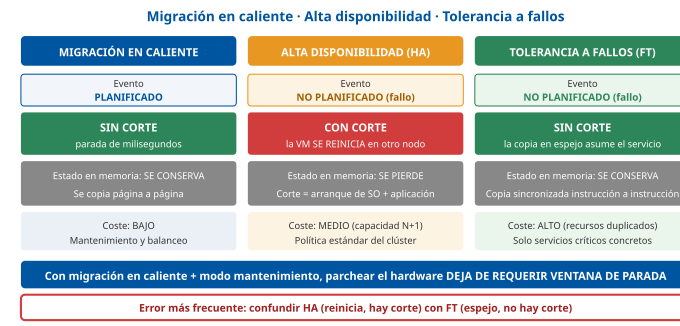

# Tema 28. Virtualización de sistemas y virtualización de puestos de usuario

**Bloque:** técnico  
**Enunciado oficial** (BOAM n.º 10.032, de 23 de diciembre de 2025): Virtualización de sistemas y virtualización de puestos de usuario.

Versión web: <https://ayuntamientomadrid.github.io/temario-tecnico-auxiliar/temas/tema-28.html> · PDF: [tema-28.pdf](tema-28.pdf) · Test: [../../../tests/tecnico/tema-28.md](../../../tests/tecnico/tema-28.md)

## Índice

- 1. Introducción y fundamentos de la virtualización de computadores
  - 1.1. Concepto, evolución y principios de la virtualización
  - 1.2. Arquitectura clásica de la virtualización y nivel de abstracción
  - 1.3. Hipervisores y su clasificación
- 2. Virtualización de sistemas y servidores
  - 2.1. Arquitectura y componentes de un entorno de virtualización de servidores
  - 2.2. Asignación y gestión de recursos del sistema
  - 2.3. Virtualización basada en contenedores y aislamiento de procesos
  - 2.4. Alta disponibilidad, balanceo y migración en caliente de sistemas
- 3. Virtualización de puestos de usuario y del entorno de trabajo
  - 3.1. Modelos de virtualización en el cliente
  - 3.2. Componentes de la arquitectura VDI
  - 3.3. Protocolos de representación y transporte para el puesto de trabajo
  - 3.4. Estrategias de persistencia: escritorios dedicados y no dedicados
- 4. Arquitectura de soporte: almacenamiento, redes y gestión
  - 4.1. Virtualización del almacenamiento e infraestructuras hiperconvergentes
  - 4.2. Virtualización de redes y redes definidas por software (SDN)
  - 4.3. Gestión centralizada, monitorización y orquestación de recursos
- 5. Marco normativo, seguridad y aplicación en la Administración Pública
  - 5.1. Cumplimiento del Esquema Nacional de Seguridad (ENS) en entornos virtualizados
  - 5.2. Protección de datos personales y garantías de privacidad (RGPD y LOPDGDD)
  - 5.3. Continuidad del negocio, copias de seguridad y recuperación ante desastres
  - 5.4. Eficiencia energética, consolidación de infraestructuras y sostenibilidad en el sector público
- Síntesis final del tema

### Conceptos clave para memorizar

| Concepto | Dato clave |
|----|----|
| Principios de Popek y Goldberg (1974) | Un monitor de máquina virtual debe cumplir tres propiedades: **equivalencia** (el programa se comporta igual que en la máquina real), **control de recursos** (el monitor controla todo el hardware) y **eficiencia** (la mayoría de instrucciones se ejecutan directamente en la CPU, sin intervención del monitor) |
| Teorema de virtualizabilidad | Una arquitectura es virtualizable de forma clásica si **toda instrucción sensible es también privilegiada**. El x86 original **no lo cumplía**: tenía **17 instrucciones sensibles no privilegiadas** |
| Virtualización total | El sistema huésped **no sabe** que está virtualizado; el monitor emula el hardware. Implementación clásica: **traducción binaria** del código privilegiado más ejecución directa del código de usuario |
| Paravirtualización | El sistema huésped **está modificado** y sabe que está virtualizado: sustituye las instrucciones problemáticas por llamadas explícitas al hipervisor (*hypercalls*). Mejor rendimiento, pero exige tocar el núcleo del huésped |
| Virtualización asistida por hardware | La CPU añade un **modo de ejecución nuevo** para el hipervisor (Intel **VT-x**: modo raíz/no raíz y estructura **VMCS**; AMD **SVM/AMD-V**: **VMCB**; Arm: **EL2**). El huésped se ejecuta sin modificar y sin traducción binaria |
| EPT / NPT | Tablas de páginas **anidadas** en hardware (*Extended Page Tables* en Intel, *Nested Page Tables* o RVI en AMD): resuelven en la MMU la doble traducción de memoria y eliminan las costosas *shadow page tables* por software |
| IOMMU (VT-d / AMD-Vi) | Unidad de gestión de memoria de **E/S**: traduce y aísla los accesos DMA de un dispositivo. **Requisito imprescindible** para asignar un dispositivo físico directamente a una máquina virtual (*passthrough*) |
| Hipervisor de Tipo 1 | Se ejecuta **directamente sobre el hardware**, sin sistema operativo anfitrión debajo (ESXi, Hyper-V, Xen, KVM sobre Linux). Es el modelo de **centro de datos**: mejor rendimiento, menor superficie de ataque |
| Hipervisor de Tipo 2 | Se ejecuta **como aplicación sobre un sistema operativo anfitrión** (VirtualBox, VMware Workstation/Fusion). Modelo de **escritorio, laboratorio y desarrollo** |
| virtio | Estándar **abierto** (OASIS) de dispositivos **paravirtualizados** de E/S: el huésped instala un controlador que habla directamente con el hipervisor por colas compartidas, en lugar de emular un dispositivo real. Es paravirtualización **de dispositivos**, no del núcleo entero |
| SR-IOV | Un dispositivo PCIe se presenta como una **función física (PF)** y varias **funciones virtuales (VF)** asignables directamente a máquinas virtuales: rendimiento casi nativo, a costa de perder la migración en caliente sencilla |
| Sobreasignación (*overcommit*) | Asignar a las máquinas virtuales **más recursos de los que existen físicamente**, apostando a que no los usan todos a la vez. Aceptable en CPU, **peligrosa en memoria** |
| Técnicas de recuperación de memoria | **Compartición de páginas idénticas**, **globo** (*ballooning*), **compresión** y, como último recurso y el peor de todos, **intercambio a disco** del hipervisor |
| Contenedor | Aísla **procesos** sobre un **núcleo compartido** usando *namespaces* y *cgroups*: arranca en milisegundos y ocupa MB, pero **no puede ejecutar otro sistema operativo** ni ofrece el aislamiento de una máquina virtual |
| VM frente a contenedor | La máquina virtual virtualiza **el hardware** (cada VM tiene su núcleo); el contenedor virtualiza **el sistema operativo** (todos comparten el núcleo del anfitrión). **No son alternativas excluyentes**: lo habitual es ejecutar contenedores dentro de máquinas virtuales |
| Migración en caliente | Mover una máquina virtual **en ejecución** entre anfitriones sin apagarla, copiando la memoria de forma iterativa (*precopia*) mientras sigue funcionando y conmutando en una parada final de milisegundos. Requiere **CPU compatible, red compartida y almacenamiento accesible** por ambos anfitriones |
| HA frente a FT | **Alta disponibilidad (HA)**: si cae un anfitrión, sus VM **se reinician** en otro → hay corte y se pierde el estado en memoria. **Tolerancia a fallos (FT)**: se mantiene una **copia en espejo sincronizada** → conmutación sin corte ni pérdida de estado, a un coste mucho mayor |
| VDI | *Virtual Desktop Infrastructure*: **una máquina virtual con sistema operativo de cliente por usuario**, ejecutada en el centro de datos y consumida en remoto |
| Escritorio por sesiones (RDSH) | **Un solo sistema operativo de servidor** compartido por muchas sesiones simultáneas: mucho más denso y barato que VDI, pero con menor aislamiento y sin personalización profunda del sistema |
| Virtualización de aplicaciones | Se virtualiza **solo la aplicación**, empaquetada en una burbuja aislada que se entrega bajo demanda al puesto (App-V, MSIX app attach, ThinApp), sin virtualizar el escritorio entero |
| Broker de conexiones | Pieza central de VDI: **autentica** al usuario, comprueba sus **autorizaciones**, **selecciona o enciende** el escritorio adecuado y **redirige** al cliente hacia él. Es punto único de fallo: se despliega siempre **redundado** |
| Imagen maestra (*golden image*) | Plantilla única de la que se derivan todos los escritorios: se parchea **una sola vez** y los escritorios no persistentes la heredan al siguiente reinicio |
| Escritorio no persistente | Se **descarta al cerrar sesión** y vuelve a la imagen maestra: barato de operar y muy seguro, pero **exige gestionar el perfil aparte** (contenedor de perfil, redirección de carpetas) |
| Protocolos de puesto remoto | **RDP** (Microsoft), **ICA/HDX** (Citrix), **PCoIP** (Teradici/HP), **Blast Extreme** (VMware/Omnissa), **SPICE** (Red Hat) y **RFB/VNC** (abierto, RFC 6143). Transmiten **imagen, audio y periféricos**, no la aplicación |
| Hiperconvergencia (HCI) | Cómputo, almacenamiento y red **en los mismos nodos** con software distribuido: desaparece la cabina externa, se crece **añadiendo nodos** (escalado horizontal) |
| VXLAN | Superposición de red que encapsula tramas de nivel 2 sobre UDP con un identificador **VNI de 24 bits** (~16 millones de segmentos frente a los 4.094 de VLAN) \[RFC 7348\] |
| SDN | Separación del **plano de control** (decide) y el **plano de datos** (reenvía), con un **controlador centralizado** programable y interfaces norte (aplicaciones) y sur (dispositivos) |
| Microsegmentación | Cortafuegos distribuido **por máquina virtual**, aplicado en el conmutador virtual: controla el tráfico **este-oeste** dentro del propio centro de datos, no solo el perimetral |
| ENS — categorías y dimensiones | RD 311/2022: categorías **básica, media y alta**, y cinco dimensiones de seguridad: **disponibilidad, integridad, confidencialidad, autenticidad y trazabilidad**. Auditoría ordinaria **cada dos años** en categorías media y alta |
| RTO y RPO | **RTO** = tiempo máximo tolerable hasta restablecer el servicio. **RPO** = cantidad máxima tolerable de datos perdidos, medida en tiempo hacia atrás. Los fija el **análisis de impacto en el negocio (BIA)**, no el técnico |
| Regla 3-2-1 | **3** copias de los datos, en **2** tipos de soporte distintos, con **1** de ellas fuera del emplazamiento. Ampliada hoy con **1 copia inmutable o aislada** frente al secuestro de datos |
| PUE | *Power Usage Effectiveness* \[ISO/IEC 30134-2\]: energía total del centro de datos dividida entre la energía consumida por el equipamiento TI. **El valor ideal es 1,0**; cuanto más bajo, mejor |

## Contenido

### Convenciones del documento

Este tema incluye cuatro tipos de **cajas callout** para facilitar el estudio:

> **Dato clave.** Información de alta densidad memorística.

> **Ejercicio resuelto.** Problema + solución paso a paso (identificación de una tecnología, dimensionamiento, elección arquitectónica razonada).

> **Ejemplo de aplicación en el ayto.** Aplicación de la teoría al entorno municipal (centro de proceso de datos, sede electrónica, puestos de las oficinas de atención a la ciudadanía).

> **Relación con otros temas.** Enlace conceptual a otros temas del temario oficial.

Los **nombres de producto** (ESXi, Hyper-V, KVM, Xen, Citrix, Horizon, Proxmox, Docker, Kubernetes) se usan siempre como **ilustración de un concepto general**, nunca como contenido en sí mismo: la parte estable y examinable del tema son los principios, las técnicas y las arquitecturas, no las marcas. Las fuentes se citan con etiquetas breves tipo `[POPEK74]` o `[ENS]`; el registro completo está en la pestaña Fuentes.

**Caso de referencia usado en todo el tema** (contexto Ayuntamiento de Madrid, supuesto simplificado): el Ayuntamiento mantiene un **centro de proceso de datos municipal** en el que conviven los servidores de la **sede electrónica**, del **padrón municipal de habitantes**, del **registro de entrada y salida** y del **gestor de expedientes**, además de un parque de **puestos de trabajo** repartidos entre las oficinas de atención a la ciudadanía, los servicios centrales y los distritos. Sobre ese supuesto se plantean las dos preguntas que estructuran el tema: **cómo se virtualizan los servidores** (secciones 1, 2 y 4) y **cómo se virtualiza el puesto de trabajo del empleado público** (sección 3), y qué obligaciones normativas impone hacerlo en una Administración Pública (sección 5).

------------------------------------------------------------------------

### 1. Introducción y fundamentos de la virtualización de computadores

#### 1.1. Concepto, evolución y principios de la virtualización

Se denomina **virtualización** a la técnica que permite crear una **representación lógica de un recurso informático**, desligada del recurso físico que la soporta, de modo que ese recurso lógico pueda ser utilizado como si fuera real. El elemento que hace posible esa ilusión es una **capa de indirección** —software, microprograma o circuitería— situada entre quien consume el recurso y el recurso mismo \[POPEK74\] \[NIST-SP800-125\].

El resultado más característico de aplicar esa técnica a un ordenador completo es la **máquina virtual**: un contenedor de software que se comporta como un ordenador físico independiente, con su propia CPU virtual, su memoria, su almacenamiento y sus interfaces de red, y sobre el que se instala un **sistema operativo huésped** sin modificar. El programa que crea y gobierna esas máquinas virtuales se llama **monitor de máquina virtual** (*Virtual Machine Monitor*, VMM) o, en la terminología actual, **hipervisor** \[GOLDBERG73\].

Conviene fijar desde el principio el vocabulario, porque se utiliza con precisión:

| Término | Significado |
|----|----|
| **Anfitrión** (*host*) | La máquina **física** que aporta los recursos reales y ejecuta el hipervisor. |
| **Huésped** (*guest*) | El sistema operativo **virtualizado** que se ejecuta dentro de una máquina virtual. |
| **Hipervisor** o **VMM** | La capa de software que crea las máquinas virtuales, les reparte los recursos del anfitrión y las aísla entre sí. |
| **Máquina virtual (VM)** | El conjunto formado por el hardware virtual definido y el sistema huésped instalado sobre él. En disco es un **conjunto de ficheros** (configuración + discos virtuales). |
| **Instantánea** (*snapshot*) | Estado congelado de una máquina virtual (disco y, opcionalmente, memoria) al que se puede volver. **No es una copia de seguridad**. |
| **Plantilla** (*template*) | Máquina virtual preparada y bloqueada que sirve de molde para desplegar máquinas nuevas idénticas. |

> **Dato clave.** Que una máquina virtual sea, en el sistema de ficheros del anfitrión, **un conjunto de ficheros** tiene tres consecuencias clave: se puede **copiar**, se puede **mover a otro anfitrión** y se puede **restaurar completa** con una sola operación. Esa es la razón última de que la virtualización simplifique tanto la continuidad del servicio y la recuperación ante desastres (§5.3).

**Evolución histórica.** La virtualización no es una tecnología reciente; es una idea de los años sesenta que el hardware de gran consumo tardó cuarenta años en poder ejecutar bien:

| Etapa | Periodo | Hitos |
|----|----|----|
| **Origen en los grandes sistemas** | 1964-1972 | IBM desarrolla CP-40 y **CP-67/CMS** y, después, **VM/370**: cada usuario de un mainframe recibe una máquina virtual completa. El objetivo era **compartir en tiempo compartido** un equipo carísimo \[HIST-IBM\]. |
| **Formalización teórica** | 1973-1974 | Goldberg clasifica los monitores en **Tipo 1 y Tipo 2** \[GOLDBERG73\]; Popek y Goldberg formulan las **tres propiedades** y el **teorema de virtualizabilidad** \[POPEK74\]. |
| **Travesía del desierto en x86** | 1980-1998 | La arquitectura x86 **no cumple** el teorema: 17 instrucciones sensibles no son privilegiadas \[ROBIN00\]. La virtualización queda confinada a los grandes sistemas. |
| **Virtualización por software del x86** | 1999-2005 | VMware resuelve el problema con **traducción binaria** (1999); Xen introduce la **paravirtualización** (2003) \[XEN-DOC\]. Comienza la consolidación de servidores. |
| **Asistencia por hardware** | 2005-2010 | Intel **VT-x** (2005) y AMD **AMD-V** (2006) añaden un modo de ejecución para el hipervisor \[INTEL-SDM\] \[AMD-APM\]; llegan después **EPT/NPT** para la memoria y **VT-d/AMD-Vi** para la E/S. La virtualización se vuelve la norma en el centro de datos. |
| **Virtualización de todo el centro de datos** | 2010-2015 | Se virtualizan también el **almacenamiento** y la **red** (SDN, NFV) y aparece el escritorio virtual (VDI) como producto maduro. |
| **Contenedores y nube** | 2013-actualidad | Docker (2013) populariza los **contenedores**; Kubernetes (2014) los orquesta. La virtualización deja de ser un fin y pasa a ser **el sustrato invisible de la nube** \[K8S-DOC\]. |

> **Dato clave.** Dos fechas y dos nombres clave: la virtualización **nace en los mainframes de IBM en los años sesenta** (CP-67, VM/370), no con VMware; y en x86 el problema no era de potencia sino **arquitectónico**, porque el juego de instrucciones no cumplía el teorema de Popek y Goldberg \[POPEK74\] \[ROBIN00\].

**Los tres principios de Popek y Goldberg.** Un monitor de máquina virtual solo merece ese nombre si cumple tres propiedades \[POPEK74\]:

1.  **Equivalencia o fidelidad.** Un programa ejecutado dentro de la máquina virtual debe comportarse **igual** que si se ejecutara directamente sobre el hardware, salvo por diferencias de temporización y por la disponibilidad de recursos.
2.  **Control de recursos o seguridad.** El monitor debe tener el **control completo** de los recursos físicos: ningún programa huésped puede acceder a recursos que el monitor no le haya asignado, ni afectar a otra máquina virtual.
3.  **Eficiencia o rendimiento.** Una **proporción estadísticamente dominante** de las instrucciones del huésped debe ejecutarse **directamente en la CPU real**, sin intervención del monitor. Es la propiedad que separa un hipervisor de un **emulador**.

> **Dato clave.** **Virtualizar no es emular.** Un **emulador** (por ejemplo, ejecutar software de arquitectura Arm sobre un x86) **traduce cada instrucción** y por tanto incumple la propiedad de eficiencia; puede, en cambio, ejecutar código de una arquitectura distinta. Un **hipervisor** ejecuta la mayoría de las instrucciones directamente en la CPU real, pero **exige que huésped y anfitrión compartan arquitectura** \[POPEK74\].

El **teorema de virtualizabilidad** que acompaña a los principios establece la condición formal: una arquitectura es virtualizable de forma clásica (por *trap-and-emulate*, es decir, «atrapar y emular») si **el conjunto de sus instrucciones sensibles está contenido en el de sus instrucciones privilegiadas**. Las **instrucciones sensibles** son las que consultan o modifican el estado de configuración de la máquina; las **privilegiadas**, las que provocan una excepción si se ejecutan fuera del modo supervisor. Si toda instrucción sensible es privilegiada, el monitor puede ejecutar el huésped en modo no privilegiado y limitarse a atrapar y emular las excepciones que se produzcan \[POPEK74\].

**Ventajas de la virtualización.** Son el motivo por el que hoy es la norma en cualquier centro de datos, también en el sector público:

- **Consolidación y aprovechamiento.** Un servidor físico dedicado a una sola aplicación suele operar muy por debajo de su capacidad; agrupando varias máquinas virtuales en un mismo anfitrión se eleva la utilización y se reduce drásticamente el número de equipos físicos (§5.4).
- **Aislamiento.** El fallo, el bloqueo o el compromiso de una máquina virtual **no arrastra** a las demás del mismo anfitrión.
- **Encapsulación y portabilidad.** La máquina virtual es un conjunto de ficheros: se copia, se mueve, se versiona y se restaura.
- **Independencia del hardware.** El huésped ve siempre el mismo hardware virtual aunque el anfitrión cambie; esto permite renovar servidores sin reinstalar sistemas ni aplicaciones.
- **Agilidad en el aprovisionamiento.** Desplegar un servidor nuevo desde plantilla pasa de semanas (compra, recepción, montaje, instalación) a minutos.
- **Continuidad del servicio.** Migración en caliente, reinicio automático en otro anfitrión y recuperación en un emplazamiento alternativo (§2.4 y §5.3).
- **Entornos de prueba realistas.** Se pueden reproducir entornos completos de preproducción con instantáneas y descartarlos después.

**Inconvenientes y riesgos**, que son la otra cara de las ventajas:

- **Sobrecarga** (*overhead*): siempre existe un coste de rendimiento, hoy muy reducido pero no nulo, y muy visible en cargas de E/S intensiva.
- **Concentración del riesgo**: si un anfitrión soporta veinte máquinas virtuales, su caída afecta a veinte servicios. Esto exige **agrupación en clúster** y reglas de antiafinidad (§2.4).
- **Nueva superficie de ataque**: el hipervisor es una capa crítica; un compromiso a ese nivel afecta a todo lo que aloja (§5.1).
- **Proliferación descontrolada** (*VM sprawl*): al ser tan fácil crear máquinas virtuales, se multiplican las que nadie da de baja, consumiendo licencias, almacenamiento, copias de seguridad y superficie de parcheo (§4.3).
- **Dependencia y licenciamiento**: los modelos de licencia de hipervisores y de sistemas huéspedes son complejos y han sufrido cambios abruptos; es un riesgo contractual real para una Administración.

> **Ejemplo de aplicación en el ayto.** Antes de virtualizar, cada aplicación municipal (padrón, registro, gestor de expedientes, portal interno) tenía su propio servidor físico, dimensionado para su pico anual y ocioso el resto del tiempo. Al consolidar esos servidores como máquinas virtuales sobre un grupo reducido de anfitriones, el Ayuntamiento reduce equipos, consumo eléctrico y espacio de sala, y gana la posibilidad de mover una aplicación de un anfitrión a otro sin interrumpir el servicio a la ciudadanía.

> **Relación con otros temas.** La **arquitectura de ordenadores** y sus componentes internos (CPU, memoria, buses) se estudian en el **Tema 11**; los **sistemas operativos** y sus mecanismos de gestión de procesos y memoria, en el **Tema 14**; la **administración del sistema operativo** en el **Tema 27**. Este tema da por conocidos esos conceptos y se centra en **qué cambia cuando se interpone un hipervisor**.

#### 1.2. Arquitectura clásica de la virtualización y nivel de abstracción

La virtualización puede introducirse en **distintos niveles de la pila** de un sistema informático, y cada nivel produce un tipo de virtualización distinto. Situar correctamente cada tecnología en esa pila es la mejor forma de no confundirlas:

| Nivel donde se inserta la capa | Qué se virtualiza | Ejemplos |
|----|----|----|
| **Juego de instrucciones** | La propia arquitectura de la CPU | Emuladores (QEMU en modo emulación completa) |
| **Hardware / plataforma** | El ordenador completo | **Hipervisores** (ESXi, Hyper-V, KVM, Xen) — objeto principal de este tema |
| **Sistema operativo** | El espacio de nombres y los recursos de un sistema en ejecución | **Contenedores** (Docker, LXC, Kubernetes) — §2.3 |
| **Biblioteca / entorno de ejecución** | La interfaz de programación | Máquina virtual de Java, entorno de ejecución de .NET |
| **Aplicación** | Una aplicación concreta, empaquetada aislada | App-V, MSIX app attach, ThinApp — §3.1.3 |
| **Escritorio** | El puesto de trabajo completo | VDI, escritorios por sesiones — §3 |
| **Almacenamiento** | Los volúmenes y sistemas de ficheros | SDS, hiperconvergencia — §4.1 |
| **Red** | Conmutadores, encaminadores, cortafuegos y segmentos | Conmutador virtual, VXLAN, SDN, NFV — §4.2 |

> **Dato clave.** No confundir el nivel: el **hipervisor** virtualiza el **hardware** y por eso cada máquina virtual lleva **su propio núcleo**; el **contenedor** virtualiza el **sistema operativo** y por eso todos comparten el **núcleo del anfitrión**; la **máquina virtual de Java** virtualiza el **entorno de ejecución** y no es en absoluto lo mismo que una máquina virtual de sistema, aunque compartan nombre.

La arquitectura clásica de la virtualización de plataforma se apoya en los **niveles de privilegio** de la CPU. En x86, la arquitectura define cuatro **anillos** (*rings*) numerados del 0 al 3: el sistema operativo se ejecuta en el **anillo 0** (modo supervisor, acceso pleno al hardware) y las aplicaciones en el **anillo 3** (modo usuario). El problema es evidente: si el hipervisor debe controlar el hardware, tiene que ocupar el anillo 0, y entonces **el sistema huésped no puede estar donde espera estar** \[INTEL-SDM\] \[ROBIN00\].

De cómo se resuelve ese conflicto nacen las **tres técnicas** que el enunciado del tema pide distinguir: virtualización total, paravirtualización y virtualización asistida por hardware.

##### 1.2.1. Virtualización total o completa

En la **virtualización total** o completa (*full virtualization*) el hipervisor presenta al huésped un **hardware virtual completo y verosímil**, y el sistema huésped **se instala sin ninguna modificación** y sin saber que está virtualizado. Es la técnica que mejor cumple la propiedad de **equivalencia** de Popek y Goldberg \[POPEK74\].

Su implementación clásica en x86, anterior a la asistencia por hardware, combina dos mecanismos \[ROBIN00\]:

- **Ejecución directa** del código de **aplicación** del huésped (anillo 3): se ejecuta tal cual en la CPU real, a plena velocidad. De aquí sale la eficiencia.
- **Traducción binaria dinámica** del código **privilegiado** del núcleo huésped: el hipervisor intercepta los bloques de código del sistema huésped antes de ejecutarlos, **reescribe sobre la marcha** las instrucciones sensibles no privilegiadas por secuencias seguras que devuelven el control al hipervisor, y guarda el resultado en una **caché de traducción** para no repetir el trabajo.

A esta combinación se le añade la **reubicación de anillos** (*ring deprivileging*): el hipervisor ocupa el anillo 0 y el núcleo huésped se desplaza a un anillo menos privilegiado (habitualmente el 1), de modo que sus intentos de acceder al hardware provoquen excepciones que el hipervisor pueda atrapar y emular.

Ventajas de la virtualización total:

- **No requiere modificar el sistema huésped**: admite sistemas operativos cerrados o antiguos, cuyo código fuente no está disponible.
- **Aislamiento y equivalencia máximos**: el huésped no puede distinguir, en condiciones normales, que está virtualizado.
- **Portabilidad**: la misma máquina virtual funciona sobre anfitriones distintos.

Inconvenientes:

- **Coste de la traducción binaria**: reescribir y cachear código tiene un precio en CPU y en memoria, sobre todo en cargas con muchas llamadas al sistema.
- **Emulación de dispositivos**: presentar un hardware verosímil obliga a emular controladores de red o de disco reales (tarjetas y adaptadores concretos), lo que es lento; de ahí que la virtualización total moderna se combine casi siempre con **controladores paravirtualizados** de E/S (§2.2.2).

> **Ejercicio resuelto.** *Un sistema operativo huésped muy antiguo, sin soporte del fabricante y sin posibilidad de instalar controladores nuevos, debe seguir funcionando para consultar un archivo histórico municipal. ¿Qué técnica de virtualización es la única viable?* **Solución**: la **virtualización total**. La paravirtualización queda descartada porque exige **modificar el núcleo** del huésped —imposible en un sistema cerrado y sin soporte— y los controladores paravirtualizados de E/S tampoco pueden instalarse. El huésped verá un hardware emulado clásico, con un rendimiento modesto pero suficiente para una carga de consulta.

##### 1.2.2. Paravirtualización

En la **paravirtualización** se renuncia a la equivalencia perfecta a cambio de rendimiento: el sistema huésped **se modifica** para que **sepa que está virtualizado** y coopere con el hipervisor. En lugar de ejecutar instrucciones sensibles que habría que atrapar y emular, el núcleo huésped invoca directamente al hipervisor mediante **llamadas al hipervisor** (*hypercalls*), que son a la relación huésped-hipervisor lo que las llamadas al sistema son a la relación aplicación-núcleo \[XEN-DOC\].

El exponente histórico de esta técnica es **Xen** (2003), cuya arquitectura introduce además una distinción que conviene conocer \[XEN-DOC\]:

- **`dom0`** (dominio 0): máquina virtual privilegiada, con controladores de dispositivo reales, que se arranca la primera y desde la que se administra el sistema y se da servicio de E/S a las demás.
- **`domU`**: los dominios no privilegiados, es decir, las máquinas virtuales de los usuarios.

Ventajas de la paravirtualización:

- **Rendimiento superior** al de la traducción binaria: se eliminan las capturas y emulaciones costosas.
- **E/S mucho más eficiente**, al sustituir la emulación de dispositivos por una interfaz explícita de colas compartidas.
- **Menor complejidad del hipervisor**, que no necesita reescribir código.

Inconvenientes:

- **Exige modificar el núcleo del huésped**: solo es viable con sistemas operativos de código abierto o cuyo fabricante haya publicado los componentes de integración. Un sistema cerrado y antiguo no puede paravirtualizarse.
- **Rompe la equivalencia**: el huésped ya no es idéntico al que correría sobre hardware físico, lo que complica el soporte del fabricante.

> **Dato clave.** La **paravirtualización pura del núcleo** ha quedado prácticamente desplazada por la virtualización asistida por hardware, que da rendimiento equivalente **sin tocar el huésped**. Lo que **sí sigue plenamente vigente** —y es un error frecuente creer lo contrario— es la **paravirtualización de dispositivos**: los controladores **virtio** \[VIRTIO\], los *Integration Services* de Hyper-V o VMware Tools son paravirtualización aplicada solo a la E/S, y se usan en la práctica totalidad de las máquinas virtuales actuales (§2.2.2).

##### 1.2.3. Virtualización asistida por hardware

La **virtualización asistida por hardware** resuelve el problema en el origen: en lugar de sortear las carencias del juego de instrucciones por software, los fabricantes **amplían la arquitectura de la CPU** con un modo de ejecución adicional pensado para el hipervisor. Es el modelo dominante desde finales de la década de 2000 \[INTEL-SDM\] \[AMD-APM\].

**En Intel (VT-x)**, la extensión **VMX** introduce \[INTEL-SDM\]:

- Dos modos de operación nuevos: **VMX raíz** (*root*), donde se ejecuta el hipervisor con control pleno, y **VMX no raíz** (*non-root*), donde se ejecuta el huésped. Cada modo conserva sus propios anillos 0-3, de modo que **el núcleo huésped vuelve a ejecutarse en su anillo 0** —el suyo, virtual— y deja de necesitar reubicación ni traducción binaria. Coloquialmente se dice que el hipervisor pasa a ocupar un **«anillo −1»**.
- La estructura de control **VMCS** (*Virtual Machine Control Structure*), una región de memoria por máquina virtual donde se guarda el estado del huésped y del anfitrión y se configura **qué eventos deben provocar la salida** hacia el hipervisor.
- Las transiciones **VM entry** (el hipervisor cede el control al huésped) y **VM exit** (el control vuelve al hipervisor porque se ha producido un evento configurado). Cada *VM exit* tiene un coste: **minimizar el número de salidas es el objetivo central de la optimización** de un hipervisor moderno.

**En AMD (AMD-V o SVM)** el planteamiento es equivalente, con la estructura **VMCB** (*Virtual Machine Control Block*) y las instrucciones `VMRUN`/`VMEXIT` \[AMD-APM\]. **En Arm**, la arquitectura define un nivel de excepción específico, **EL2**, para el hipervisor, por encima del núcleo huésped (EL1) y de las aplicaciones (EL0) \[ARM-ARM\].

La asistencia por hardware no se limitó a la CPU; se extendió a los otros dos cuellos de botella:

- **Memoria — EPT / NPT.** Sin ayuda del hardware, el hipervisor tenía que mantener por software **tablas de páginas sombra** (*shadow page tables*) que combinaran la traducción del huésped con la suya propia, un mecanismo correcto pero muy costoso. Las **tablas de páginas extendidas** (**EPT** en Intel) o **anidadas** (**NPT**, también llamada RVI, en AMD) añaden un **segundo nivel de traducción en la propia MMU**: el huésped traduce de dirección virtual a «física» del huésped, y el hardware traduce esa a dirección física real del anfitrión, sin intervención del hipervisor \[INTEL-SDM\] \[AMD-APM\]. En Arm, el mecanismo equivalente es la **traducción en dos etapas** (*Stage-1* y *Stage-2*) \[ARM-ARM\].
- **Entrada/salida — IOMMU.** La **unidad de gestión de memoria de E/S** (**VT-d** en Intel, **AMD-Vi** en AMD) traduce y controla los accesos **DMA** que los dispositivos hacen a la memoria. Sin ella, asignar un dispositivo físico directamente a una máquina virtual sería un agujero de seguridad, porque ese dispositivo podría leer y escribir toda la memoria del anfitrión. Con ella, el hipervisor confina cada dispositivo a las páginas de su máquina virtual \[INTEL-VTD\].

> **Dato clave.** Las tres asistencias por hardware y el problema que resuelve cada una: **VT-x / AMD-V / EL2** → el problema de las **instrucciones sensibles** y los anillos de privilegio; **EPT / NPT / Stage-2** → el problema de la **doble traducción de memoria** (sustituyen a las tablas sombra); **VT-d / AMD-Vi (IOMMU)** → el problema del **acceso directo a memoria por parte de los dispositivos**, y son el requisito para el *passthrough* y para SR-IOV \[INTEL-SDM\] \[AMD-APM\] \[INTEL-VTD\].

Comparativa final de las tres técnicas, que es la tabla que conviene llevar memorizada:

|  | **Virtualización total** | **Paravirtualización** | **Asistida por hardware** |
|----|----|----|----|
| ¿Se modifica el huésped? | **No** | **Sí** (núcleo modificado) | **No** |
| ¿El huésped sabe que está virtualizado? | No | **Sí** | No (salvo por los controladores de E/S) |
| Mecanismo principal | Traducción binaria + ejecución directa | Llamadas al hipervisor (*hypercalls*) | Modo de CPU adicional (VMX/SVM/EL2) |
| Requisito | Ninguno especial | Código fuente del huésped disponible | **CPU compatible y opción activada en la BIOS/UEFI** |
| Rendimiento | Medio | Alto | **Alto**, y sin tocar el huésped |
| Sistemas huéspedes admitidos | **Cualquiera** | Solo los adaptados | **Cualquiera** |
| Estado actual | Vigente como concepto; combinada con virtio | Desplazada en el núcleo, **vigente en E/S** | **Modelo dominante** |

> **Ejercicio resuelto.** *Se instala un hipervisor en un servidor y, al crear la primera máquina virtual de 64 bits, la consola informa de que «la virtualización por hardware no está disponible». El procesador es moderno. ¿Cuál es la causa más probable y cómo se corrige?* **Solución**: la extensión de virtualización de la CPU (**Intel VT-x** o **AMD-V**) está **desactivada en la BIOS/UEFI** del servidor, que es como suele venir de fábrica en algunos equipos. Se corrige activándola en la configuración del firmware y reiniciando. Es un fallo de configuración, no de hardware ni de licencia \[INTEL-SDM\].

#### 1.3. Hipervisores y su clasificación

La clasificación de los monitores de máquina virtual en dos tipos procede de Goldberg (1973) y es la taxonomía central del tema \[GOLDBERG73\]. El criterio de clasificación es **sobre qué se ejecuta el hipervisor**: directamente sobre el hardware, o sobre un sistema operativo anfitrión.

##### 1.3.1. Hipervisores de Tipo 1 o nativos (bare-metal)

Un **hipervisor de Tipo 1**, también llamado **nativo** o *bare-metal* («sobre metal desnudo»), se instala **directamente sobre el hardware del servidor**, sin ningún sistema operativo de propósito general debajo. El propio hipervisor es, en la práctica, un sistema operativo especializado y minimalista cuya única misión es planificar CPU, repartir memoria, gestionar E/S y aislar máquinas virtuales \[NIST-SP800-125\].

Características:

- **Acceso directo al hardware**: no hay una capa de sistema operativo intermedia que añada latencia.
- **Superficie de ataque reducida**: al no incluir un sistema operativo completo, hay muchísimo menos código expuesto y menos parches que aplicar. Es un argumento de seguridad de primer orden, recogido expresamente en las recomendaciones del NIST \[NIST-SP800-125\].
- **Gestión centralizada**: se administran en clúster desde una consola externa (§4.3), no desde el propio anfitrión.
- **Uso**: **centros de datos y producción**. Es el único modelo aceptable para servidores de un servicio público en explotación.

Ejemplos habituales: **VMware ESXi** \[VMWARE-DOC\], **Microsoft Hyper-V** en su rol de servidor \[HYPERV-DOC\], **Xen** \[XEN-DOC\], **KVM** sobre Linux \[KVM-DOC\], y distribuciones que los integran como **Proxmox VE** \[PROXMOX\] u **oVirt** \[OVIRT\].

> **Dato clave.** **KVM es un caso de clasificación discutido.** KVM es un **módulo del núcleo de Linux** que convierte al propio núcleo en hipervisor: puede parecer de Tipo 2 porque hay un Linux completo debajo, pero **se clasifica como Tipo 1**, porque el hipervisor **es** el núcleo y accede al hardware sin intermediarios \[KVM-DOC\]. Lo mismo ocurre con **Hyper-V**: aunque se activa como un «rol» de Windows Server, al habilitarlo el hipervisor se coloca **por debajo** del sistema, que pasa a ser una partición privilegiada — es de **Tipo 1** \[HYPERV-DOC\].

##### 1.3.2. Hipervisores de Tipo 2 o alojados (hosted)

Un **hipervisor de Tipo 2** o **alojado** (*hosted*) se instala **como una aplicación más sobre un sistema operativo anfitrión** ya existente (Windows, Linux o macOS). Todas las peticiones de la máquina virtual al hardware atraviesan, por tanto, **dos capas**: el hipervisor y el sistema operativo anfitrión.

Características:

- **Menor rendimiento** por la capa adicional, aunque hoy los hipervisores de Tipo 2 se apoyan también en VT-x/AMD-V y la diferencia es menor que antaño.
- **Mayor superficie de ataque**: hereda todas las vulnerabilidades del sistema operativo anfitrión, de sus servicios y de sus aplicaciones.
- **Dependencia del anfitrión**: si el sistema anfitrión se reinicia o se bloquea, se caen todas las máquinas virtuales.
- **Instalación y uso triviales**: no requiere dedicar un equipo completo ni conocimientos de administración de centro de datos.
- **Uso**: **puesto de trabajo, laboratorio, formación, desarrollo y pruebas**; también análisis de programas maliciosos en entorno aislado, y ejecución puntual de una aplicación heredada que solo funciona sobre un sistema antiguo.

Ejemplos habituales: **Oracle VirtualBox**, **VMware Workstation** (Windows/Linux) y **VMware Fusion** (macOS), **Parallels Desktop**, y **QEMU** en modo autónomo.

| Criterio | **Tipo 1 (nativo)** | **Tipo 2 (alojado)** |
|----|----|----|
| Se ejecuta sobre | **El hardware** | **Un sistema operativo anfitrión** |
| Capas hasta el hardware | 1 | 2 |
| Rendimiento | Alto | Menor |
| Superficie de ataque | Reducida | La del sistema anfitrión + la propia |
| Arranque del equipo | Arranca el hipervisor | Arranca el sistema operativo, luego se lanza el hipervisor |
| Ámbito natural | **Centro de datos / producción** | **Puesto de trabajo / laboratorio** |
| Ejemplos | ESXi, Hyper-V, Xen, KVM, Proxmox VE | VirtualBox, Workstation, Fusion, Parallels |

> **Ejemplo de aplicación en el ayto.** En el Ayuntamiento conviven los dos tipos y no compiten entre sí: los servidores del padrón, del registro y de la sede electrónica se ejecutan sobre **hipervisores de Tipo 1** en clúster dentro del centro de proceso de datos, mientras que un técnico de la unidad de desarrollo usa un **hipervisor de Tipo 2** en su propio portátil para levantar una máquina virtual de pruebas y verificar una migración antes de proponerla. Usar un hipervisor de Tipo 2 para un servicio en producción sería un error grave de arquitectura y de seguridad \[NIST-SP800-125\].

------------------------------------------------------------------------

### 2. Virtualización de sistemas y servidores

#### 2.1. Arquitectura y componentes de un entorno de virtualización de servidores

Un entorno profesional de virtualización de servidores **no es un hipervisor suelto**: es un conjunto de piezas que trabajan coordinadas. Distinguirlas es imprescindible para leer cualquier arquitectura real \[VMWARE-DOC\] \[HYPERV-DOC\] \[OPENSTACK\].

**1. Anfitriones o nodos.** Los servidores físicos que ejecutan el hipervisor. Aportan CPU, memoria, interfaces de red y, en algunos modelos, discos locales. Se agrupan en **clúster**.

**2. Clúster.** Agrupación lógica de anfitriones que **comparten recursos y políticas** y se tratan como una unidad. El clúster es la unidad sobre la que se definen la alta disponibilidad, el balanceo automático de carga y las reglas de colocación (§2.4). Un requisito práctico habitual es la **homogeneidad de las CPU** (o el uso de un modo de compatibilidad que enmascare las diferencias) para que las máquinas virtuales puedan migrar entre cualesquiera nodos.

**3. Almacenamiento compartido.** Un almacenamiento **accesible desde todos los anfitriones del clúster** —cabina SAN por Fibre Channel o iSCSI, cabina NAS por NFS o SMB, o almacenamiento distribuido hiperconvergente (§4.1)— sobre el que residen los ficheros de las máquinas virtuales. Es la pieza que hace posible que otro anfitrión pueda arrancar una máquina virtual que no es «suya».

**4. Red física y virtual.** Cada anfitrión ejecuta uno o varios **conmutadores virtuales** (*vSwitch*) que conectan las tarjetas de red virtuales de las máquinas con las tarjetas físicas del anfitrión, aplicando etiquetado VLAN, agregación de enlaces y políticas de seguridad (§4.2). Por buena práctica se **separan los flujos** en redes distintas: gestión, máquinas virtuales, almacenamiento y migración en caliente \[NIST-SP800-125\].

**5. Servidor de gestión.** La consola centralizada que inventaría los anfitriones, gestiona el ciclo de vida de las máquinas virtuales, aplica las políticas del clúster, guarda el catálogo de plantillas y concentra permisos y registros de actividad (vCenter, SCVMM, OpenStack, oVirt) (§4.3).

**6. Componentes internos de la máquina virtual.** Dentro del huésped se instalan los **controladores paravirtualizados y agentes de integración** (VMware Tools, *Integration Services*, `qemu-guest-agent`), que aportan controladores eficientes de red y disco, sincronización horaria, apagado ordenado desde el hipervisor y **congelación del sistema de ficheros** para copias consistentes (§5.3).

**7. Catálogo de plantillas e imágenes.** Repositorio de máquinas virtuales molde, ya actualizadas y bastionadas, desde las que se despliegan servidores nuevos de forma reproducible.

**Formatos de disco virtual.** El disco de una máquina virtual es un fichero (o un conjunto de ellos) en un formato concreto. Los más frecuentes:

| Formato | Origen | Nota |
|----|----|----|
| **VMDK** | VMware | Formato de la familia vSphere/Workstation. |
| **VHD / VHDX** | Microsoft | VHDX amplía el tamaño máximo y añade protección frente a corrupción por corte eléctrico. |
| **QCOW2** | QEMU/KVM | *QEMU Copy-On-Write v2*: admite aprovisionamiento fino, instantáneas internas y compresión. |
| **RAW** | Genérico | Volcado en bruto, sin metadatos: máximo rendimiento, mínima funcionalidad. |
| **OVF / OVA** | DMTF (estándar abierto) | **No es un formato de disco**, sino de **empaquetado e intercambio** de máquinas virtuales: descriptor XML + discos. OVA es el mismo contenido en un único fichero comprimido. |

> **Dato clave.** Distinguir **aprovisionamiento fino** (*thin provisioning*) de **grueso** (*thick*): en el fino el disco virtual **ocupa en la cabina solo lo realmente escrito** y crece bajo demanda —ahorra mucho espacio, pero **exige vigilar el sobreaprovisionamiento**, porque si la cabina se llena las máquinas virtuales se detienen—; en el grueso se **reserva todo el espacio desde el principio**, con rendimiento más predecible y sin riesgo de agotamiento sorpresivo \[VMWARE-DOC\].

> **Dato clave.** Una **instantánea no es una copia de seguridad**. La instantánea congela un punto en el tiempo y a partir de ahí los cambios se escriben en **ficheros delta** que crecen; si se acumulan o se olvidan, **degradan el rendimiento y pueden llenar el almacenamiento**. Además reside en el mismo sistema que la máquina virtual: si se pierde la cabina, se pierden las instantáneas. Sirven para revertir un cambio a corto plazo (una actualización, un despliegue), no para proteger datos (§5.3).

#### 2.2. Asignación y gestión de recursos del sistema

El hipervisor es, ante todo, un **repartidor de recursos escasos**. Su trabajo consiste en presentar a cada máquina virtual una vista coherente de CPU, memoria, disco y red mientras multiplexa unos recursos físicos que casi siempre están **sobreasignados**.

La **sobreasignación** (*overcommitment*) consiste en asignar al conjunto de máquinas virtuales más recursos de los que el anfitrión posee, apostando a que no todas los reclamarán simultáneamente. Es la técnica que hace rentable la consolidación, pero no todos los recursos la toleran igual:

| Recurso | ¿Se sobreasigna? | Comportamiento al agotarse |
|----|----|----|
| **CPU** | **Sí, con normalidad** | Las máquinas virtuales **esperan turno**: el servicio se degrada, pero nada falla. |
| **Memoria** | Sí, **con mucha cautela** | El hipervisor recurre a técnicas de recuperación cada vez más agresivas y, en el extremo, a **intercambio a disco**, que hunde el rendimiento. |
| **Disco (capacidad)** | Sí, vía aprovisionamiento fino | Si el almacén se llena, las máquinas virtuales se **detienen**: es el escenario más grave. |
| **Red** | Sí | Congestión, pérdida de paquetes y retransmisiones. |

Los hipervisores ofrecen además tres controles clásicos, presentes con distintos nombres en todos los productos, que conviene no confundir \[VMWARE-DOC\]:

- **Reserva** (*reservation*): mínimo **garantizado**. Si no puede concederse, la máquina virtual no arranca.
- **Límite** (*limit*): máximo que la máquina virtual podrá consumir **aunque haya recursos libres**.
- **Peso o participación** (*shares*): prioridad **relativa** para repartir el recurso **solo cuando hay contención**.

> **Ejercicio resuelto.** *Un anfitrión tiene 2 procesadores de 16 núcleos físicos cada uno (32 núcleos, 64 hilos con multihilo simultáneo). Se quieren alojar máquinas virtuales de 4 vCPU con una ratio de consolidación de 4 vCPU por núcleo físico. ¿Cuántas máquinas caben?* **Solución**: capacidad total = 32 núcleos × 4 = **128 vCPU asignables**; a 4 vCPU por máquina, **32 máquinas virtuales**. Advertencias: la ratio depende críticamente del **perfil de carga** (4:1 es razonable para servidores poco cargados y excesivo para bases de datos); el **multihilo simultáneo no duplica la capacidad real**, solo mejora el aprovechamiento; y debe reservarse margen para que el clúster siga funcionando **con un nodo caído** (regla N+1), lo que en la práctica reduce el número aceptable.

##### 2.2.1. Planificación de CPU y gestión de memoria virtualizada

**Planificación de CPU.** El hipervisor presenta a cada máquina virtual una o varias **CPU virtuales** (**vCPU**), que no son núcleos dedicados sino **entidades planificables** que compiten por tiempo de núcleo físico, exactamente igual que los procesos compiten por la CPU en un sistema operativo convencional \[KVM-DOC\] \[VMWARE-DOC\]. Conceptos clave:

- **Tiempo de espera** (*CPU ready* o `%RDY`): porcentaje de tiempo que una vCPU está **lista para ejecutarse pero esperando** un núcleo libre. Es **el indicador de contención de CPU por excelencia**: valores sostenidamente altos significan que el anfitrión está sobrecargado, aunque la utilización de CPU no parezca extrema.
- **Coplanificación** (*co-scheduling*): una máquina virtual con varias vCPU necesita que sus vCPU avancen **de forma razonablemente sincronizada**, porque el sistema huésped supone que sus procesadores progresan a la vez. Los hipervisores modernos aplican una **coplanificación relajada**, que no exige arrancarlas todas simultáneamente pero sí corregir las desviaciones (*skew*) entre ellas.
- **Consecuencia práctica y contraintuitiva**: **asignar más vCPU de las necesarias empeora el rendimiento**. Una máquina de 8 vCPU que solo usa 2 obliga al planificador a encontrar hueco para 8 entidades, aumentando su propio tiempo de espera y el de sus vecinas. La regla de oro es **empezar corto y crecer con datos de monitorización**.
- **NUMA** (*Non-Uniform Memory Access*): en servidores con varios procesadores, cada uno tiene memoria «cercana» (rápida) y memoria «lejana» (más lenta, atravesando la interconexión entre zócalos). Si una máquina virtual no cabe en un nodo NUMA, sus accesos se vuelven remotos y pierde rendimiento. Los hipervisores incorporan un **planificador consciente de NUMA** que intenta alojar cada máquina en un solo nodo y mover memoria y vCPU juntas.
- **Afinidad** (*CPU pinning*): fijar una vCPU a un núcleo físico concreto. Mejora la previsibilidad en cargas de latencia crítica, pero **impide al planificador equilibrar** y complica la migración; se reserva para casos justificados.

**Gestión de memoria.** La memoria es el recurso que **de verdad limita** la densidad de un anfitrión, y su gestión combina hardware y software:

- **Doble traducción.** El huésped mantiene sus tablas de páginas (dirección virtual → dirección física del huésped) y el hipervisor debe añadir la suya (física del huésped → física real). Por software se resolvía con **tablas de páginas sombra**; hoy lo resuelve la MMU con **EPT/NPT** (§1.2.3), a costa de recorridos de tabla más largos que se mitigan con cachés de traducción específicas \[INTEL-SDM\] \[AMD-APM\].
- **Técnicas de recuperación de memoria**, aplicadas de forma escalonada cuando el anfitrión empieza a quedarse sin memoria libre \[VMWARE-DOC\] \[KVM-DOC\]:

1.  **Compartición de páginas idénticas** (*transparent page sharing*, `KSM` en Linux): si varias máquinas virtuales tienen en memoria páginas de contenido idéntico —lo habitual cuando comparten sistema operativo—, se conserva **una sola copia física** marcada como copia en escritura. Muy eficaz en granjas homogéneas, como una granja VDI (§3).
2.  **Globo de memoria** (*ballooning*): un controlador instalado en el huésped **reclama memoria dentro del propio sistema operativo huésped**, obligándolo a liberar sus páginas menos usadas; esa memoria se devuelve al hipervisor. Es elegante porque **quien decide qué página sacrificar es el huésped**, que es quien mejor lo sabe.
3.  **Compresión**: se comprimen páginas poco usadas y se guardan en una caché en memoria, más lenta que la RAM pero mucho más rápida que el disco.
4.  **Intercambio del hipervisor a disco** (*swapping*): último recurso. El hipervisor escoge páginas **a ciegas**, sin saber cuáles importan al huésped, y el desplome de rendimiento es severo. **La aparición de intercambio del hipervisor es siempre señal de un problema de dimensionamiento.**

- **Página grande** (*large pages*, 2 MB frente a 4 KB): reduce el número de entradas de traducción y mejora el rendimiento, pero **inhibe la compartición de páginas idénticas**, porque es muy improbable que dos páginas de 2 MB sean idénticas.
- **Adición en caliente** (*hot-add*) de memoria y vCPU: algunos huéspedes admiten ampliar recursos sin apagar la máquina virtual, lo que reduce las ventanas de parada.

> **Dato clave.** El orden de las cuatro técnicas de recuperación de memoria, de menos a más dañina: **compartición de páginas → globo → compresión → intercambio a disco**. Y la asimetría fundamental del reparto de recursos: **sobreasignar CPU degrada; sobreasignar memoria rompe**.

> **Ejemplo de aplicación en el ayto.** En el clúster municipal, un servidor de consultas del padrón muestra un tiempo de espera de CPU del 18 % en horario de atención al público, con la utilización del anfitrión en torno al 55 %. El diagnóstico no es «falta CPU» sino **exceso de vCPU asignadas** en varias máquinas del mismo anfitrión: hay más entidades planificables que huecos, y todas esperan. La corrección es reducir las vCPU sobredimensionadas y redistribuir máquinas entre nodos, no comprar más servidores.

##### 2.2.2. Entradas y salidas y controladores paravirtualizados

La **E/S es el punto donde más se nota la virtualización**, porque cada acceso a disco o a red atraviesa la capa del hipervisor. Existen cuatro modelos, ordenados de menor a mayor rendimiento y de mayor a menor flexibilidad:

**1. Emulación completa de dispositivo.** El hipervisor presenta al huésped un dispositivo **real y conocido** (por ejemplo, una tarjeta de red clásica o un controlador IDE) y emula por software su comportamiento registro a registro. Ventaja: **funciona sin instalar nada** en el huésped, incluso durante la instalación del sistema operativo. Inconveniente: **es el modelo más lento**, porque cada operación provoca múltiples salidas al hipervisor.

**2. Dispositivo paravirtualizado.** El huésped instala un **controlador consciente de la virtualización** que no simula hardware alguno: se comunica con el hipervisor mediante **colas circulares en memoria compartida**, agrupando peticiones y notificando en bloque. El estándar abierto de referencia es **virtio** \[VIRTIO\], adoptado por KVM, QEMU y otros, con dispositivos como `virtio-net` (red), `virtio-blk` y `virtio-scsi` (bloque) y `virtio-fs` (ficheros). Los equivalentes propietarios son los controladores incluidos en **VMware Tools** (`vmxnet3`, `pvscsi`) y en los *Integration Services* de Hyper-V \[VMWARE-DOC\] \[HYPERV-DOC\]. Es el modelo **por defecto en producción**: rendimiento muy alto conservando la portabilidad y la migración en caliente.

**3. Asignación directa de dispositivo** (*passthrough* o DirectPath). El hipervisor **cede un dispositivo físico completo** a una única máquina virtual, que lo maneja con su controlador nativo. Rendimiento prácticamente nativo. Requiere **IOMMU** (VT-d / AMD-Vi) para aislar el DMA \[INTEL-VTD\] y tiene un coste alto de flexibilidad: el dispositivo queda **monopolizado** por esa máquina y, por regla general, **se pierde la migración en caliente**.

**4. SR-IOV.** Evolución del anterior que evita monopolizar el dispositivo: una tarjeta compatible se presenta como una **función física (PF)**, que administra el hipervisor, y un conjunto de **funciones virtuales (VF)**, cada una asignable directamente a una máquina virtual distinta \[PCI-SRIOV\]. Combina rendimiento casi nativo con reparto entre varias máquinas, manteniendo las mismas restricciones de movilidad y exigiendo soporte en tarjeta, placa y hipervisor.

| Modelo | Rendimiento | Requisitos | Migración en caliente | Uso típico |
|----|----|----|----|----|
| Emulación | Bajo | Ninguno | Sí | Instalación, huéspedes antiguos |
| **Paravirtualizado (virtio)** | **Alto** | Controlador en el huésped | **Sí** | **Producción, caso general** |
| *Passthrough* | Muy alto | **IOMMU** | Normalmente **no** | GPU, tarjetas especiales, criptografía |
| **SR-IOV** | Muy alto | IOMMU + tarjeta compatible | Normalmente **no** | Red de muy alto rendimiento, NFV |

> **Dato clave.** **virtio es paravirtualización**, aunque el huésped no esté paravirtualizado. Esta es la razón por la que la afirmación «la paravirtualización ya no se usa» es falsa: no se paravirtualiza el **núcleo**, pero sí los **dispositivos**, y eso está en casi todas las máquinas virtuales en producción \[VIRTIO\].

> **Relación con otros temas.** Los **periféricos, sus interfaces y los elementos de almacenamiento** en su dimensión física se estudian en el **Tema 12**; los **sistemas de almacenamiento y su virtualización**, junto con las políticas de copia de seguridad, corresponden al **Tema 26**. Aquí interesa exclusivamente **cómo el hipervisor entrega esos recursos a la máquina virtual**.

#### 2.3. Virtualización basada en contenedores y aislamiento de procesos

La **virtualización basada en contenedores**, también llamada **virtualización a nivel de sistema operativo**, aísla **conjuntos de procesos** dentro de un **único núcleo compartido**, en lugar de crear máquinas completas con núcleo propio. Cada contenedor recibe una vista privada del sistema —su propio árbol de procesos, su propia red, su propio sistema de ficheros— pero **todas las llamadas al sistema las atiende el mismo núcleo del anfitrión** \[OCI-SPEC\] \[NIST-SP800-190\].

En Linux, los contenedores no son una tecnología monolítica sino la **combinación de primitivas del núcleo** \[LINUX-NS\]:

- **Espacios de nombres** (*namespaces*): aíslan **qué ve** el proceso. Los principales son `pid` (árbol de procesos: el proceso principal del contenedor se ve a sí mismo como PID 1), `net` (interfaces, tablas de rutas y de filtrado propias), `mnt` (puntos de montaje), `uts` (nombre de máquina y dominio), `ipc` (comunicación entre procesos), `user` (correspondencia de identificadores de usuario y grupo, que permite ser `root` dentro sin serlo fuera) y `cgroup`.
- **Grupos de control** (*cgroups*): limitan y contabilizan **cuánto consume** el contenedor de CPU, memoria, E/S de bloque y número de procesos.
- **Restricción de privilegios**: **capacidades** (`capabilities`) para trocear los poderes de `root`, **`seccomp`** para restringir el conjunto de llamadas al sistema permitidas y **módulos de seguridad** como SELinux o AppArmor para el control de acceso obligatorio.
- **Sistemas de ficheros por capas** (`overlayfs`): la imagen se compone de **capas de solo lectura** apiladas más una **capa de escritura** propia del contenedor. Esto explica por qué las imágenes se comparten entre contenedores y por qué **un contenedor es efímero por diseño**: lo escrito en su capa superior desaparece al eliminarlo, salvo que se use un **volumen** persistente.

El ecosistema se ha estandarizado en torno a la **Open Container Initiative**, que define el formato de **imagen** y la especificación de **tiempo de ejecución** \[OCI-SPEC\]; sobre ella se apoyan `runc`, `containerd`, CRI-O, Docker \[DOCKER-DOC\] y los orquestadores. Cuando el número de contenedores crece, se necesita un **orquestador** que los planifique sobre un conjunto de nodos, los reinicie si fallan, los escale y los publique: **Kubernetes** es el estándar de facto, y su unidad mínima de despliegue no es el contenedor sino el **pod**, un grupo de contenedores que comparten red y almacenamiento \[K8S-DOC\].

**Riesgos propios de los contenedores** \[NIST-SP800-190\]:

- **Superficie compartida del núcleo**: una vulnerabilidad de escalada en el núcleo puede permitir **escapar** del contenedor y afectar al anfitrión y a sus vecinos. Es la diferencia de seguridad esencial frente a una máquina virtual.
- **Contenedores privilegiados**: ejecutar con `--privileged` o como `root` sin necesidad anula buena parte del aislamiento.
- **Cadena de suministro de las imágenes**: una imagen descargada de un registro público puede contener componentes vulnerables o maliciosos. Exige **registro propio, análisis de vulnerabilidades y firma de imágenes**.
- **Superficie del orquestador**: la interfaz de programación del plano de control es un objetivo de primer orden y debe autenticarse, autorizarse y auditarse.

Como respuesta a la primera de estas debilidades han aparecido los **contenedores aislados por hipervisor** (*sandboxed containers*, como Kata Containers o gVisor), que ejecutan cada contenedor dentro de una máquina virtual mínima: recuperan el aislamiento fuerte a cambio de algo de densidad y de latencia de arranque.

##### 2.3.1. Comparativa entre virtualización basada en hipervisor y contenedores

Es, junto con la clasificación de hipervisores, la comparación central del tema:

| Criterio | **Máquina virtual (hipervisor)** | **Contenedor** |
|----|----|----|
| Qué se virtualiza | **El hardware** | **El sistema operativo** |
| Núcleo | **Uno propio por máquina virtual** | **Compartido** con el anfitrión |
| Aislamiento | **Fuerte** (frontera de hardware, reforzada por la CPU) | Lógico (frontera de núcleo), más débil |
| Tamaño típico | GB (sistema operativo completo) | MB (solo la aplicación y sus dependencias) |
| Tiempo de arranque | Segundos a minutos | **Milisegundos a segundos** |
| Densidad por anfitrión | Decenas | **Cientos o miles** |
| Sistema operativo del huésped | **Cualquiera** compatible con la arquitectura | **Solo el del núcleo del anfitrión** (no se ejecuta Windows sobre un núcleo Linux) |
| Sobrecarga | Moderada | **Mínima** |
| Persistencia | Estado propio y persistente | **Efímero por diseño**; la persistencia va en volúmenes |
| Portabilidad | Alta (imagen pesada) | **Muy alta** (imagen ligera y estándar) |
| Caso de uso natural | Cargas heredadas, sistemas heterogéneos, servicios monolíticos, aislamiento exigente | Microservicios, despliegue continuo, escalado elástico |

> **Dato clave.** Dos afirmaciones clave: (1) **los contenedores no sustituyen a las máquinas virtuales, se apoyan en ellas**: en la práctica totalidad de las instalaciones reales, y en toda la nube pública, los nodos que ejecutan contenedores **son máquinas virtuales**; (2) **un contenedor no puede ejecutar un sistema operativo distinto del núcleo del anfitrión** — cuando se ven contenedores Linux en un equipo Windows, lo que hay por debajo es una **máquina virtual Linux ligera** que los aloja \[NIST-SP800-190\].

> **Ejemplo de aplicación en el ayto.** La sede electrónica municipal se moderniza dividiendo el portal en varios servicios pequeños empaquetados en contenedores, mientras que el gestor de expedientes heredado, con dependencias antiguas y certificado por su fabricante sobre un sistema operativo concreto, permanece como **máquina virtual**. Los nodos que ejecutan los contenedores son, a su vez, máquinas virtuales del mismo clúster: la Administración no elige entre las dos tecnologías, las **estratifica**.

#### 2.4. Alta disponibilidad, balanceo y migración en caliente de sistemas

La virtualización de servidores alcanza su máximo valor cuando el clúster deja de ser un conjunto de anfitriones y se comporta como **un único gran ordenador con políticas automáticas**.

**Migración en caliente** (*live migration*, comercialmente *vMotion* en VMware y *Live Migration* en Hyper-V). Consiste en **trasladar una máquina virtual en ejecución de un anfitrión a otro sin apagarla y sin interrumpir sus conexiones** \[VMWARE-DOC\] \[HYPERV-DOC\]. El mecanismo habitual es la **precopia iterativa**:

1.  **Preparación**: el destino reserva recursos y se establece el canal de transferencia por la red dedicada de migración.
2.  **Copia iterativa de memoria**: se copian todas las páginas de memoria mientras la máquina **sigue funcionando** en el origen. Como el huésped sigue escribiendo, algunas páginas se «ensucian» y hay que reenviarlas; se repite el ciclo copiando cada vez solo las páginas modificadas, hasta que el conjunto pendiente es pequeño.
3.  **Parada breve** (*stun*): se detiene la máquina unos **milisegundos**, se transfiere el último conjunto de páginas sucias y el estado de CPU y de dispositivos.
4.  **Conmutación**: la máquina se reanuda en el destino; se emite un aviso en la red (típicamente un *RARP* o un ARP gratuito) para que los conmutadores aprendan la nueva ubicación de su dirección MAC, y se libera el origen.

Existe también la variante de **poscopia**, que conmuta primero y trae las páginas bajo demanda: reduce la parada total pero deja la máquina expuesta a un fallo de red durante la transferencia. La precopia es la usada por defecto.

**Requisitos de la migración en caliente**:

- **Compatibilidad de CPU** entre origen y destino (mismo fabricante y conjunto de características, o uso de un modo de compatibilidad que enmascare las diferencias).
- **Red compartida** y una **red dedicada** de suficiente ancho de banda para la migración.
- **Acceso al mismo almacenamiento** desde ambos anfitriones (o, en la variante «sin nada compartido», migración simultánea de disco y memoria, más lenta).
- **Ausencia de dispositivos asignados directamente** (*passthrough*/SR-IOV) que aten la máquina al hardware del origen.

Además de la migración de cómputo, existe la **migración de almacenamiento** (*Storage vMotion*), que mueve los ficheros de la máquina virtual **entre almacenes de datos** sin apagarla, y que es la herramienta habitual para vaciar una cabina antes de retirarla.

**Alta disponibilidad (HA).** Si un anfitrión falla, el clúster detecta la pérdida (por latidos de red y de almacenamiento) y **reinicia en otro anfitrión** las máquinas virtuales que alojaba \[VMWARE-DOC\]. Puntos críticos:

- **Hay corte de servicio**: la máquina se reinicia, no continúa. Se pierde lo que hubiera en memoria y el tiempo de indisponibilidad es el de arranque del sistema y de la aplicación.
- Es necesario **reservar capacidad** para que los supervivientes puedan absorber la carga del caído: la política de **N+1** consiste en dimensionar el clúster de modo que pueda perder un nodo sin degradar el servicio.
- El **aislamiento de red** de un nodo (un nodo vivo pero incomunicado) debe distinguirse de su caída real para evitar el escenario de «cerebro dividido» (*split brain*), en el que dos anfitriones arrancarían la misma máquina virtual sobre el mismo disco. De ahí los latidos redundantes por red **y** por almacenamiento y los mecanismos de exclusión del nodo dudoso.

**Tolerancia a fallos (FT).** Un grado más: se mantiene una **copia secundaria de la máquina virtual en otro anfitrión, sincronizada instrucción a instrucción**, que asume el servicio de forma **instantánea y sin pérdida de estado** si el primario cae. Su coste es alto (duplica el consumo de recursos, exige red de muy baja latencia y suele estar limitada en número de vCPU), por lo que se reserva a servicios críticos concretos.

**Balanceo automático de carga (DRS).** El clúster **monitoriza el desequilibrio** entre anfitriones y **migra máquinas en caliente** para repartir la carga, ya sea de forma automática o mediante recomendaciones al administrador \[VMWARE-DOC\]. A ello se añaden:

- **Reglas de afinidad**: obligan a que dos máquinas se ejecuten en el mismo anfitrión (por ejemplo, por latencia entre ellas).
- **Reglas de antiafinidad**: obligan a que **nunca coincidan** en el mismo anfitrión. Es la regla imprescindible para los **pares redundantes**: los dos nodos de un balanceador o los dos servidores de una base de datos replicada no deben caer juntos porque el clúster los haya colocado, por casualidad, en el mismo hierro.
- **Gestión de energía** (*DPM*): en horas valle, el clúster concentra las máquinas en menos anfitriones y **apaga los sobrantes**, encendiéndolos de nuevo cuando la carga sube (§5.4).
- **Modo mantenimiento**: antes de parchear un anfitrión, se le marca en mantenimiento y el clúster **vacía automáticamente** todas sus máquinas virtuales hacia otros nodos, en caliente. Esta es la razón por la que en un entorno virtualizado bien diseñado **el mantenimiento del hardware deja de requerir ventanas de parada del servicio**.

> **Dato clave.** Diferenciar con precisión: **migración en caliente** = movimiento **planificado** sin corte; **HA** = respuesta **no planificada** a un fallo, **con reinicio y por tanto con corte**; **FT** = respuesta no planificada **sin corte**, mediante copia en espejo, a un coste muy superior. Confundir HA con FT es el error más frecuente en este bloque.

> **Ejemplo de aplicación en el ayto.** El clúster municipal aloja en pareja los servidores del registro de entrada. Una **regla de antiafinidad** garantiza que los dos nodos del par nunca se ejecuten en el mismo anfitrión; una política de **HA** los reinicia automáticamente si cae un servidor físico; y el **modo mantenimiento** permite parchear los anfitriones un martes por la mañana, sin ventana nocturna y sin que la ciudadanía perciba nada, porque las máquinas se han migrado en caliente antes de reiniciar el equipo.

------------------------------------------------------------------------

### 3. Virtualización de puestos de usuario y del entorno de trabajo

#### 3.1. Modelos de virtualización en el cliente

La segunda mitad del tema traslada la idea de la virtualización desde el servidor hasta el **puesto de trabajo del empleado**. El objetivo cambia: ya no se trata de consolidar servidores, sino de **desacoplar el entorno de trabajo del dispositivo físico** desde el que se accede, de modo que el escritorio, las aplicaciones y los datos residan y se ejecuten en el centro de datos y el terminal se limite a mostrar la imagen y a recoger las pulsaciones.

Las **motivaciones** de una organización pública para dar ese paso son concretas:

- **Seguridad y confidencialidad**: los datos **no salen del centro de datos**. El robo o la pérdida de un portátil deja de ser una brecha de datos personales, porque el terminal no almacena nada.
- **Gestión centralizada**: parchear, actualizar y desplegar aplicaciones se hace **una vez sobre la imagen maestra**, no equipo por equipo.
- **Movilidad y continuidad**: el mismo escritorio es accesible desde cualquier oficina, desde el domicilio en teletrabajo o desde un centro alternativo tras un incidente.
- **Prolongación de la vida del parque**: el terminal apenas hace trabajo, así que un equipo antiguo o un cliente ligero pueden servir muchos años más (§5.4).
- **Homogeneidad y cumplimiento**: la configuración de seguridad es idéntica y auditable en todos los puestos.

Y sus **contrapartidas**, que hay que saber enunciar igual de bien:

- **Dependencia absoluta de la red**: sin conectividad no hay puesto de trabajo. La red pasa a ser un servicio crítico.
- **Concentración del riesgo**: una caída de la plataforma VDI deja sin trabajar a **todos** los usuarios a la vez, no a uno.
- **Inversión inicial elevada** en servidores, almacenamiento de alto rendimiento y licencias, frente a un gasto distribuido en equipos.
- **Cargas mal adaptadas**: diseño gráfico, cartografía, edición de vídeo o aplicaciones que exigen periféricos especiales requieren GPU virtual y redirección de dispositivos, y no siempre compensan.
- **Complejidad operativa**: exige perfiles técnicos especializados y un dimensionamiento cuidadoso, sobre todo en E/S.

Los modelos disponibles son cuatro, y el enunciado del tema pide desarrollar los tres primeros:

| Modelo | Dónde se ejecuta | Qué se entrega | Aislamiento |
|----|----|----|----|
| **VDI** | Servidor, **una VM por usuario** | Escritorio completo con sistema operativo de **cliente** | **Alto** (VM independiente) |
| **Sesiones / RDSH** | Servidor, **un sistema compartido** | Escritorio o aplicación publicada | Medio (sesión dentro de un sistema compartido) |
| **Virtualización de aplicaciones** | Servidor **o** puesto local | **Solo la aplicación**, empaquetada aislada | Aplicación aislada del sistema |
| **Virtualización en el cliente** | **En el propio equipo del usuario** | Máquina virtual local (hipervisor de Tipo 1 o 2 en el puesto) | Alto, pero sin centralización |

> **Dato clave.** No confundir **cliente ligero** con **VDI**: el **cliente ligero** (*thin client*) es el **dispositivo terminal** —hardware reducido, sin disco relevante, con un sistema mínimo cuya única función es ejecutar el cliente de conexión—; **VDI** es la **arquitectura del lado del servidor**. Se puede hacer VDI con clientes ligeros, con PC completos reutilizados (*repurposed*), con clientes cero (*zero client*, con el protocolo implementado en circuitería) o con un navegador (*HTML5*).

##### 3.1.1. Infraestructura de escritorios virtuales en servidor (VDI)

**VDI** (*Virtual Desktop Infrastructure*) es el modelo en el que **cada usuario dispone de su propia máquina virtual con un sistema operativo de cliente**, ejecutada en el centro de datos sobre un clúster de virtualización, y a la que accede en remoto mediante un protocolo de representación (§3.3) \[HORIZON-DOC\] \[CITRIX-DOC\].

Rasgos definitorios:

- **Una máquina virtual por usuario**, con su núcleo, su memoria y su disco virtual: el aislamiento entre usuarios es el de dos máquinas distintas.
- **Sistema operativo de cliente** (de escritorio), no de servidor: la compatibilidad de aplicaciones es la del puesto habitual, sin las diferencias de comportamiento de un sistema de servidor.
- **Personalización profunda posible**: si el escritorio es persistente, el usuario puede instalar y configurar como en un equipo propio (§3.4).
- **Densidad menor y coste por usuario mayor** que en el modelo de sesiones, porque cada usuario paga el coste de un sistema operativo completo en memoria y en disco.

El **dimensionamiento** de una plataforma VDI se hace por **perfiles de usuario**, y el error clásico es dimensionar por CPU cuando el recurso que de verdad limita es **la memoria y, sobre todo, la E/S de almacenamiento**:

| Perfil | Carga típica | Recursos orientativos por escritorio |
|----|----|----|
| **Ligero** | Navegador, correo, ofimática básica, aplicación de gestión | 2 vCPU / 4 GB |
| **Medio** | Ofimática intensa, varias aplicaciones de gestión, muchas pestañas, vídeo ocasional | 2-4 vCPU / 8 GB |
| **Avanzado** | Cartografía, diseño, análisis de datos, vídeo | 4-8 vCPU / 16 GB **y GPU virtual** |

> **Dato clave.** El fenómeno que hunde una plataforma VDI mal dimensionada tiene nombre propio: la **tormenta de arranque** (*boot storm*), y su variante la **tormenta de inicio de sesión** (*login storm*). A las 8:00 todos los empleados encienden a la vez, y cientos de escritorios arrancan, cargan perfiles y actualizan el antivirus **simultáneamente**, provocando un pico de E/S de lectura y escritura que el almacenamiento debe absorber. Mitigaciones: **almacenamiento de estado sólido**, encendido escalonado y preencendido programado de escritorios, cachés de lectura de la imagen maestra, análisis antivirus desfasado en el tiempo y con exclusiones adecuadas, y clones instantáneos que comparten la memoria y el disco de una máquina plantilla ya arrancada.

##### 3.1.2. Escritorios basados en sesiones y terminal server

El modelo de **escritorios basados en sesiones**, históricamente conocido como **servicios de terminal** (*Terminal Services*, hoy **RDSH**, *Remote Desktop Session Host*), es **anterior a VDI** y sigue siendo el más eficiente en coste \[AVD-DOC\].

Su principio es distinto: **un único sistema operativo de servidor atiende simultáneamente a muchos usuarios**, cada uno en su **sesión**. Todos comparten el mismo núcleo, los mismos servicios y, en gran medida, las mismas instancias de bibliotecas en memoria; lo que cambia por usuario es su sesión, su perfil y sus procesos.

Se puede entregar de dos formas:

- **Escritorio publicado**: el usuario recibe un escritorio completo del servidor compartido.
- **Aplicación publicada** (*seamless* o **RemoteApp**): el usuario ve **solo la ventana de una aplicación** concreta, integrada visualmente en su escritorio local, aunque se ejecute en el servidor. Es una forma muy elegante de dar acceso a una aplicación de gestión concreta sin virtualizar el puesto entero.

| Criterio | **VDI** | **Sesiones (RDSH)** |
|----|----|----|
| Sistemas operativos en ejecución | **Uno por usuario** (cliente) | **Uno compartido** (servidor) |
| Densidad por servidor | Baja (decenas) | **Alta** (muchas más sesiones) |
| Coste por puesto | Mayor | **Menor** |
| Aislamiento entre usuarios | **Alto** | Medio: un proceso descontrolado o un cuelgue afecta **a todos** los de ese servidor |
| Personalización | **Alta** (si es persistente) | Limitada: no se instala software por usuario |
| Compatibilidad de aplicaciones | La del sistema de **cliente** | La del sistema de **servidor**: algunas aplicaciones no están certificadas |
| Caso de uso natural | Usuarios con necesidades específicas, cargas pesadas, perfiles con requisitos de aislamiento | **Colectivos numerosos y homogéneos** con un conjunto fijo de aplicaciones |

> **Ejemplo de aplicación en el ayto.** El colectivo de las oficinas de atención a la ciudadanía usa siempre las mismas cuatro aplicaciones (padrón, registro, gestor de expedientes y ofimática) y no instala software: es el caso de libro del modelo de **sesiones**, mucho más barato y denso. En cambio, la unidad de cartografía y planeamiento, que trabaja con sistemas de información geográfica y necesita aceleración gráfica y personalización, encaja en **VDI con GPU virtual** \[NVIDIA-VGPU\]. Una plataforma municipal realista **combina ambos modelos** y asigna cada colectivo al que le corresponde.

##### 3.1.3. Virtualización de aplicaciones

La **virtualización de aplicaciones** desacopla la aplicación del sistema operativo sobre el que se ejecuta: la aplicación se **empaqueta** con todo lo que necesita (ficheros, bibliotecas, claves de registro, configuración) en una **unidad aislada**, y en tiempo de ejecución un motor intercepta sus accesos al sistema de ficheros y a la configuración y los redirige hacia ese paquete, sin instalar nada de forma permanente en el sistema anfitrión \[APPV\].

Consecuencias prácticas:

- **Se elimina el conflicto entre aplicaciones**: dos versiones incompatibles de la misma aplicación —el caso típico de una aplicación de gestión heredada que exige una versión antigua de un componente— pueden convivir en el mismo puesto, cada una en su burbuja.
- **Despliegue y retirada limpios**: no hay instalación tradicional, así que no queda residuo al retirarla.
- **Entrega bajo demanda**: la aplicación puede transmitirse por la red al puesto cuando el usuario la invoca (*streaming*), en lugar de precargarla en todas las imágenes.
- **Actualización centralizada**: se actualiza el paquete y todos los usuarios reciben la nueva versión en su siguiente ejecución.

Tecnologías representativas: **Microsoft App-V** y su sucesor **MSIX app attach**, **VMware ThinApp**, y los sistemas de **capas de aplicación** (*app layering*) que montan discos virtuales con aplicaciones sobre un escritorio no persistente, como *App Volumes* \[APPV\] \[HORIZON-DOC\].

**Límites**: no toda aplicación es virtualizable —las que instalan controladores en modo núcleo, servicios de sistema profundos o componentes de bajo nivel suelen quedar fuera—, y el **empaquetado inicial tiene un coste** de trabajo técnico y de pruebas que hay que contabilizar.

> **Dato clave.** Ordenar los tres modelos por **lo que se virtualiza**: en **VDI** se virtualiza **la máquina** (una VM completa por usuario); en **sesiones** se virtualiza **el sistema operativo** (una sesión por usuario dentro de un sistema compartido); en **virtualización de aplicaciones** se virtualiza **la aplicación** (una burbuja aislada dentro del sistema del usuario). No son excluyentes: lo normal es usar virtualización de aplicaciones **dentro** de un escritorio VDI o de sesiones.

#### 3.2. Componentes de la arquitectura VDI

Una plataforma de escritorio virtual se compone de piezas con funciones muy delimitadas. Saber **qué hace cada una** es lo que permite resolver los casos prácticos de este bloque.

- **Cliente de acceso**: el software (o el circuito, en un cliente cero) que se ejecuta en el terminal del usuario. Puede ser una aplicación instalada o un cliente **HTML5** en el navegador, muy útil para acceso ocasional o desde equipos no gestionados.
- **Pasarela de acceso seguro** (*gateway*): publica el servicio hacia el exterior sin exponer los escritorios. Termina el cifrado, aplica autenticación multifactor y actúa como intermediario entre la red no confiable e interna. Es el componente que hace viable el **teletrabajo** sin abrir la red interna.
- **Portal o catálogo** (*StoreFront* o equivalente): presenta al usuario el conjunto de **escritorios y aplicaciones a los que tiene derecho**.
- **Agente de conexión o broker**: el cerebro de la plataforma (§3.2.1).
- **Directorio corporativo**: la fuente de identidad, autenticación y pertenencia a grupos sobre la que se calculan las autorizaciones.
- **Agente instalado en el escritorio**: componente dentro de cada máquina virtual que registra el escritorio en el broker, informa de su estado y **atiende el protocolo de representación**.
- **Gestor de imágenes y aprovisionamiento** (§3.2.2).
- **Gestor de perfiles de usuario**: separa la identidad y los datos del usuario del escritorio en el que trabaja (§3.4).
- **Infraestructura de virtualización subyacente**: el clúster de hipervisores, el almacenamiento y la red descritos en las secciones 2 y 4. **VDI no es una alternativa a la virtualización de servidores: se construye encima de ella.**
- **Servicios de licencia, monitorización y registro de actividad**.

##### 3.2.1. Agente de conexión o broker de accesos

El **broker de conexiones** (*connection broker*, *Delivery Controller* en Citrix, *Connection Server* en Horizon, servicio de agente de conexión a Escritorio remoto en Microsoft) es el componente central de VDI. Su cometido, en orden, es \[CITRIX-DOC\] \[HORIZON-DOC\] \[AVD-DOC\]:

1.  **Autenticar** al usuario contra el directorio corporativo (con segundo factor si procede).
2.  **Determinar sus autorizaciones**: qué escritorios y aplicaciones tiene asignados según su grupo o su puesto.
3.  **Seleccionar el recurso**: si el escritorio es **dedicado**, localizar el suyo; si es **no dedicado**, tomar uno libre del conjunto disponible.
4.  **Encender o preparar** el escritorio si estaba apagado, o clonarlo del catálogo si el conjunto necesita reponerse.
5.  **Redirigir al cliente** hacia el escritorio asignado, entregándole los datos de conexión para que el **protocolo de representación se establezca directamente** entre el cliente y el escritorio (§3.3).
6.  **Gestionar la reconexión**: si el usuario pierde la conexión o cambia de terminal, el broker debe devolverle **su sesión existente**, no una nueva. Esta capacidad, la **itinerancia de sesión** (*session roaming*), es la que permite a un empleado empezar en una oficina y continuar en otra sin perder lo que estaba haciendo.
7.  **Gestionar el ciclo de vida y el equilibrio de carga** del conjunto: mantener escritorios preencendidos para atender picos, apagar los sobrantes y aplicar tiempos de espera de desconexión y de cierre de sesión.

> **Dato clave.** Dos matices sobre el broker: (1) **el broker interviene en el establecimiento, no en el tráfico**: una vez asignado el escritorio, el flujo del protocolo va **directamente** entre el cliente y el escritorio (o a través de la pasarela), de modo que el broker no es un cuello de botella de ancho de banda; (2) **es un punto único de fallo**: si el broker no está disponible, **nadie puede iniciar sesiones nuevas** (aunque las existentes sigan vivas), por lo que se despliega siempre **redundado y balanceado**, con su base de datos en alta disponibilidad.

##### 3.2.2. Gestor de imágenes, plantillas y aprovisionamiento

La ventaja operativa decisiva de VDI —parchear una vez en lugar de mil— depende por completo de este componente. Su unidad de trabajo es la **imagen maestra** o *golden image*: una máquina virtual plantilla, actualizada, bastionada, con las aplicaciones comunes y **optimizada para VDI** (servicios innecesarios desactivados, tareas programadas de mantenimiento e indexación reducidas, hibernación y desfragmentación deshabilitadas, antivirus configurado con exclusiones).

A partir de ella se aprovisionan los escritorios con distintas técnicas \[HORIZON-DOC\] \[CITRIX-DOC\]:

| Técnica | Cómo funciona | Consumo de disco | Uso |
|----|----|----|----|
| **Clon completo** (*full clone*) | Copia independiente y completa de la plantilla | **Alto** (cada escritorio ocupa todo) | Escritorios dedicados persistentes |
| **Clon enlazado** (*linked clone*) | Comparte con la plantilla un disco base de solo lectura y escribe **solo las diferencias** en un disco delta | **Bajo** | Escritorios no persistentes |
| **Clon instantáneo** (*instant clone*) | Se deriva de una máquina plantilla **ya arrancada en memoria**: el escritorio nuevo está disponible en segundos y comparte también páginas de memoria | **Muy bajo** | Conjuntos no persistentes grandes, mitiga la tormenta de arranque |
| **Aprovisionamiento por arranque en red** (*streaming*) | El escritorio **no tiene disco propio**: arranca por red desde una imagen central compartida y usa un disco de escritura temporal | Muy bajo | Grandes conjuntos homogéneos |

El **ciclo de vida de la imagen** es el siguiente: se **clona** la imagen maestra a una copia de trabajo; se **aplican** parches, actualizaciones y cambios de aplicaciones; se **prueba** con un grupo piloto; se **sella** creando una nueva versión; se **publica** al conjunto de escritorios; y los escritorios no persistentes **adoptan la nueva versión en su siguiente reinicio**. Si la versión resulta defectuosa, se **revierte** a la versión anterior con la misma operación. Este mecanismo, y no otro, es el que convierte la gestión de mil puestos en la gestión de una imagen versionada.

> **Ejemplo de aplicación en el ayto.** Ante la publicación de una actualización de seguridad crítica del sistema operativo del puesto, el equipo de sistemas aplica el parche **una sola vez** sobre la imagen maestra, la valida con veinte usuarios piloto de un distrito durante una jornada y la publica esa noche. A la mañana siguiente, los escritorios no persistentes de todas las oficinas arrancan ya parcheados, sin desplazamientos, sin despliegue por equipos y sin puestos rezagados. La trazabilidad de la operación —quién publicó qué versión y cuándo— queda registrada, lo que da soporte directo a las medidas de gestión de cambios y de mantenimiento del **ENS** (§5.1).

#### 3.3. Protocolos de representación y transporte para el puesto de trabajo

El **protocolo de representación remota** (*remote display protocol*) es la pieza que determina la calidad percibida del puesto virtual. Su función es transportar en un sentido la **imagen de la pantalla, el audio y los eventos de periféricos redirigidos**, y en el otro las **pulsaciones de teclado, los movimientos de ratón y los datos de los dispositivos locales**. Lo esencial es entender que **no se transmite la aplicación ni los datos, sino su representación**: por eso la información permanece en el centro de datos \[MS-RDPBCGR\].

Principales protocolos:

| Protocolo | Origen | Notas |
|----|----|----|
| **RDP** | Microsoft | El más extendido; especificación abierta publicada \[MS-RDPBCGR\]. Puerto habitual **TCP 3389** (con transporte adicional por UDP para mejorar el vídeo). Múltiples **canales virtuales** para impresoras, portapapeles, unidades y dispositivos USB. |
| **ICA / HDX** | Citrix | Protocolo histórico de Citrix, muy optimizado para redes de alta latencia y bajo ancho de banda; HDX es el conjunto de tecnologías de experiencia de usuario construido sobre ICA \[CITRIX-DOC\]. |
| **PCoIP** | Teradici / HP | Diseñado sobre **UDP** con compresión progresiva de imagen: la pantalla se refina hasta la calidad plena, lo que lo hace resistente a la pérdida de paquetes \[PCOIP\]. |
| **Blast Extreme** | VMware / Omnissa | Usa códecs de vídeo (H.264/HEVC) con posible aceleración por GPU; funciona sobre TCP y UDP y atraviesa bien cortafuegos y redes públicas \[HORIZON-DOC\]. |
| **SPICE** | Red Hat (abierto) | Protocolo abierto del ecosistema KVM/oVirt, con buen soporte multimedia y de redirección USB \[SPICE\]. |
| **RFB / VNC** | Abierto \[RFC6143\] | Muy simple y universal, basado en actualizar rectángulos de la memoria de imagen. Poco eficiente para escritorios ricos; útil para consola y administración. |

**Técnicas comunes de optimización**, que son lo verdaderamente examinable porque son independientes del producto:

- **Compresión adaptativa** y **códecs de vídeo** para las regiones que cambian rápido, con codificación de texto sin pérdidas para mantener la nitidez de la letra.
- **Actualización solo de las regiones modificadas** de la pantalla, en lugar del fotograma completo.
- **Descarga al cliente** (*client-side rendering* o *redirection*): en lugar de codificar un vídeo en el servidor y enviarlo como imagen, se **envía el flujo original** para que lo decodifique el terminal; lo mismo se aplica a las llamadas de las herramientas de comunicación unificada, que se redirigen para que el flujo de audio y vídeo vaya **directo entre los interlocutores** y no dé un rodeo por el centro de datos.
- **Elección de transporte**: **UDP** tolera mejor la pérdida y la latencia para la imagen en movimiento; **TCP** garantiza la entrega y atraviesa mejor las redes restrictivas. Los protocolos modernos usan ambos y conmutan según las condiciones.
- **Redirección de periféricos** por canales virtuales: impresoras, unidades locales, lectores de tarjeta inteligente (imprescindibles para la **firma electrónica** con certificado en tarjeta), escáneres y dispositivos USB. Cada redirección habilitada es también **una vía potencial de fuga de información**, y por eso se controla por política (§5.2).
- **Adaptación a la latencia**: la calidad percibida depende más de la **latencia de ida y vuelta** y de la **estabilidad** (fluctuación o *jitter*) que del ancho de banda bruto. Un enlace de mucho caudal pero con latencia alta da una experiencia peor que uno modesto y estable.

> **Relación con otros temas.** No debe confundirse el **protocolo de representación de un puesto virtual**, que es lo que aquí se trata, con el **control remoto del puesto de usuario para dar soporte y resolver incidencias**, que es materia del **Tema 29**: aunque ambos transporten la imagen de una pantalla, el primero es el medio ordinario de trabajo del empleado y el segundo es una intervención excepcional de un técnico sobre la sesión de otra persona, con las garantías que ello exige (§5.2).

> **Dato clave.** El consumo de ancho de banda por sesión depende sobre todo del **contenido en movimiento**: una sesión de ofimática y aplicación de gestión consume poco y de forma discontinua; una sesión con vídeo a pantalla completa o cartografía consume un orden de magnitud más. Por eso el dimensionamiento de una plataforma VDI se hace **por perfil de usuario**, y por eso **el enlace de la oficina remota es tan crítico como el servidor**.

#### 3.4. Estrategias de persistencia: escritorios dedicados y no dedicados

La decisión de persistencia es **la más determinante del diseño de una plataforma VDI**, porque condiciona el almacenamiento, la gestión de imágenes, la política de perfiles y el coste operativo.

**Escritorio dedicado o persistente.** Se asigna **de forma permanente a un usuario concreto**, que lo encuentra igual cada mañana. Los cambios que hace —configuración, ficheros, incluso software instalado si se le permite— **sobreviven al reinicio**, exactamente como en un equipo físico.

- **Ventajas**: máxima personalización, compatibilidad con aplicaciones que exigen instalación local o licenciamiento por equipo, transición natural desde el PC físico y menor resistencia al cambio por parte del usuario.
- **Inconvenientes**: **cada escritorio hay que gestionarlo y parchearlo individualmente** (se pierde la gran ventaja de VDI), consume mucho más almacenamiento (clones completos) y **acumula desviación de configuración** y riesgo, porque cada puesto termina siendo distinto de los demás.

**Escritorio no dedicado, no persistente o flotante.** Se toma de un **conjunto compartido** al iniciar sesión y **se descarta y se recrea desde la imagen maestra al cerrarla**.

- **Ventajas**: **una sola imagen que gestionar y parchear**, ahorro de almacenamiento muy grande, **escritorio siempre limpio** —lo que aporta una resistencia notable frente al software malicioso, que no sobrevive al reinicio— y despliegue reproducible.
- **Inconvenientes**: **exige resolver la persistencia del usuario por otra vía**; algunas aplicaciones no toleran bien la recreación; y obliga a una disciplina estricta: **todo lo que no esté en la imagen o en el perfil, se pierde**.

**Gestión del perfil y de los datos del usuario**, que es la condición indispensable del modelo no persistente:

- **Redirección de carpetas**: las carpetas personales (documentos, escritorio, favoritos) apuntan a un recurso de red centralizado, no al disco del escritorio.
- **Contenedor de perfil** en disco virtual (**FSLogix** y equivalentes): el perfil completo del usuario, incluido el caché del cliente de correo y el estado de las aplicaciones, se guarda en un disco virtual que **se monta al iniciar sesión y se desmonta al cerrarla**. Es la técnica que hoy hace viable el escritorio no persistente sin degradar la experiencia \[FSLOGIX\].
- **Capas de aplicación** (*app layering*): las aplicaciones específicas de un usuario o de un colectivo se entregan como discos virtuales que se montan sobre la imagen común, evitando multiplicar imágenes maestras.
- **Directivas de grupo y de configuración**: la configuración del entorno se aplica **por política** en cada inicio de sesión, no se guarda en el escritorio.

| Criterio | **Dedicado / persistente** | **No dedicado / no persistente** |
|----|----|----|
| Asignación | Fija por usuario | Del conjunto, en cada inicio de sesión |
| Cambios del usuario | **Se conservan** | **Se descartan** |
| Gestión de parches | Escritorio a escritorio | **Una sola imagen maestra** |
| Almacenamiento | Alto (clones completos) | **Bajo** (clones enlazados o instantáneos) |
| Perfil de usuario | En el propio escritorio | **Externo obligatorio** (contenedor de perfil + redirección) |
| Seguridad | Acumula estado y riesgo | **Se limpia en cada cierre de sesión** |
| Coste operativo | Alto | **Bajo** |
| Encaje típico | Perfiles técnicos, usuarios con software propio | **Colectivos numerosos y homogéneos** |

> **Ejercicio resuelto.** *Una organización despliega 500 escritorios no persistentes. Los usuarios se quejan de que pierden las firmas del correo, los favoritos del navegador y los ficheros que dejan en el escritorio. ¿Dónde está el error de diseño y cómo se corrige?* **Solución**: el error **no está en la elección del modelo**, que es correcta para 500 puestos homogéneos, sino en haberlo desplegado **sin la gestión de perfil que el modelo exige**. Corrección: implantar un **contenedor de perfil de usuario** en disco virtual que se monte al iniciar sesión, **redirigir las carpetas personales** a un recurso de red centralizado y respaldado, y aplicar la configuración del entorno **por directiva** en cada inicio. Con esas tres piezas el escritorio sigue siendo desechable y el usuario conserva su entorno.

> **Ejemplo de aplicación en el ayto.** Para las oficinas de atención a la ciudadanía, el Ayuntamiento elige escritorios **no persistentes** con contenedor de perfil: el puesto se recrea limpio cada noche, se parchea desde una única imagen y ningún dato queda en el terminal, lo que refuerza la confidencialidad de los datos del padrón que se manejan en el mostrador. Para el personal técnico de sistemas y desarrollo, que necesita instalar herramientas propias, se reserva un conjunto reducido de escritorios **dedicados** con normas de uso específicas.

------------------------------------------------------------------------

### 4. Arquitectura de soporte: almacenamiento, redes y gestión

#### 4.1. Virtualización del almacenamiento e infraestructuras hiperconvergentes

La **virtualización del almacenamiento** consiste en interponer una capa lógica entre los servidores y los dispositivos físicos de almacenamiento, de modo que aquellos consuman **volúmenes lógicos** cuya composición, ubicación y tecnología subyacente desconocen \[SNIA-SSM\]. Igual que el hipervisor abstrae la CPU y la memoria, esta capa abstrae los discos: permite **agrupar** dispositivos heterogéneos en un mismo conjunto, **mover datos en caliente** entre ellos y aplicar servicios comunes con independencia del fabricante.

> **Relación con otros temas.** Los **sistemas de almacenamiento y su virtualización** son objeto propio del **Tema 26**, junto con las políticas y procedimientos de **copia de seguridad y recuperación**. Este epígrafe se limita a lo que la virtualización de sistemas y de puestos **necesita** del almacenamiento y a cómo lo consume; el detalle de tecnologías, cabinas y procedimientos de respaldo corresponde a aquel tema. Las **redes de área local** y los dispositivos de interconexión se estudian en los **Temas 30 y 37**.

**Modelos de acceso** que un entorno virtualizado utiliza:

| Modelo | Qué entrega | Protocolos habituales | Uso en virtualización |
|----|----|----|----|
| **Bloque** | Un volumen en bruto (LUN) que el anfitrión formatea | Fibre Channel, **iSCSI** \[RFC7143\], FCoE, **NVMe-oF** | Almacén de datos de máquinas virtuales de alto rendimiento |
| **Fichero** | Un recurso compartido ya formateado | **NFS**, **SMB** | Almacén de máquinas virtuales, perfiles de usuario, carpetas redirigidas |
| **Objeto** | Objetos con metadatos por interfaz web | S3 y compatibles | Repositorio de copias de seguridad, archivo, contenido estático |

**Servicios que aporta la capa de virtualización del almacenamiento** y que el entorno virtualizado explota de forma intensiva:

- **Aprovisionamiento fino**, ya descrito en §2.1.
- **Instantáneas y clones** a nivel de volumen, base del aprovisionamiento rápido de escritorios y servidores.
- **Deduplicación y compresión**: decisivas en VDI, donde cientos de escritorios derivan de la misma imagen y el contenido repetido es enorme.
- **Jerarquización automática** (*tiering*) y **caché**: los bloques calientes se sitúan en soporte rápido y los fríos migran a soporte lento y barato.
- **Replicación** síncrona o asíncrona hacia un segundo emplazamiento, base de la recuperación ante desastres (§5.3).
- **Calidad de servicio**: límites y garantías de operaciones de entrada/salida por segundo para que una máquina virtual ruidosa no ahogue a las demás.

**Almacenamiento definido por software (SDS) e hiperconvergencia.** El modelo tradicional separa los servidores de cómputo de una **cabina externa** especializada, unida por una red de almacenamiento. La **infraestructura hiperconvergente (HCI)** invierte ese planteamiento: los **discos van dentro de los mismos nodos que ejecutan el hipervisor**, y una capa de software distribuido los agrega y **replica los datos entre nodos** presentando un almacén único al clúster \[VMWARE-DOC\] \[HYPERV-DOC\].

| Criterio | **Convergente clásico (cabina + servidores)** | **Hiperconvergente (HCI)** |
|----|----|----|
| Dónde están los discos | En una **cabina externa** dedicada | **En los propios nodos de cómputo** |
| Red necesaria | Red de almacenamiento dedicada (FC o iSCSI) | Red Ethernet de alta velocidad entre nodos |
| Crecimiento | Se amplía cómputo y cabina **por separado** | **Añadiendo nodos** (cómputo y disco crecen juntos) |
| Protección del dato | RAID y funciones de la cabina | **Réplicas o codificación de borrado distribuidas** entre nodos |
| Gestión | Dos ámbitos y a menudo dos equipos | **Unificada** desde la consola de virtualización |
| Puntos fuertes | Rendimiento y funciones muy maduras; escalado independiente | **Simplicidad**, despliegue rápido, escalado horizontal predecible |
| Puntos débiles | Complejidad, coste de la red de almacenamiento, riesgo de concentración en la cabina | Cómputo y almacenamiento **acoplados**; dependencia fuerte de la red entre nodos |

> **Dato clave.** La **hiperconvergencia** es el modelo que mejor encaja con **VDI**, y la razón es esta: los escritorios virtuales generan un patrón de E/S muy exigente y muy repetitivo, y HCI lo atiende con **almacenamiento local rápido en el propio nodo** —evitando el rodeo por la red de almacenamiento— y con **deduplicación** de un contenido que es casi idéntico entre escritorios. Además, su crecimiento **por nodos** encaja con un despliegue VDI que se amplía por bloques de usuarios.

#### 4.2. Virtualización de redes y redes definidas por software (SDN)

Virtualizar servidores sin virtualizar la red deja el problema a medias: de nada sirve poder crear una máquina virtual en minutos si conectarla exige solicitar una VLAN y esperar a que alguien configure a mano un conmutador físico.

**Primer nivel: el conmutador virtual.** Cada anfitrión ejecuta un **conmutador virtual** (*vSwitch*) por software que conecta las tarjetas de red virtuales de sus máquinas entre sí y con las tarjetas físicas del anfitrión. Sus funciones son las de un conmutador de nivel 2: reenvío por dirección MAC, **etiquetado VLAN 802.1Q** mediante grupos de puertos, **agregación y balanceo de enlaces** (*NIC teaming*) para tolerancia a fallos, y políticas de seguridad del puerto (rechazo de modo promiscuo, de cambios de dirección MAC y de transmisiones falsificadas), que el NIST recomienda expresamente activar \[NIST-SP800-125\]. El **conmutador distribuido** eleva ese concepto al clúster: una única configuración lógica que abarca todos los anfitriones, de modo que una máquina migrada conserva su configuración de red y sus contadores.

**Segundo nivel: la superposición** (*overlay*). La VLAN clásica tiene dos límites serios en un centro de datos virtualizado: solo admite **4.094 identificadores** y obliga a **extender dominios de capa 2** por la red física para que las máquinas puedan migrar entre anfitriones distintos. La solución es **encapsular** el tráfico de nivel 2 dentro de paquetes de nivel 3, creando redes lógicas independientes de la topología física \[RFC7364\]:

- **VXLAN** \[RFC7348\]: encapsula la trama en **UDP** y añade un identificador **VNI de 24 bits**, lo que permite unos **16 millones** de segmentos frente a los 4.094 de VLAN. Los puntos de encapsulado y desencapsulado se denominan **VTEP** y residen habitualmente en el conmutador virtual del anfitrión.
- **Geneve** \[RFC8926\]: encapsulado más moderno y **extensible mediante opciones TLV**, pensado para transportar metadatos entre elementos de red virtualizados.
- **NVGRE**: alternativa basada en GRE, hoy menos extendida.

Consecuencia práctica: la red lógica **viaja con la máquina virtual**. Se puede migrar una máquina a otro anfitrión, a otra sala o a otro centro de proceso de datos conservando su dirección IP y su segmento, porque el segmento es lógico y la red física solo tiene que saber encaminar paquetes IP entre los anfitriones.

**Tercer nivel: SDN.** Las **redes definidas por software** separan el **plano de control** —la inteligencia que decide cómo se reenvía el tráfico— del **plano de datos** —los elementos que efectivamente lo reenvían—, y concentran el primero en un **controlador centralizado y programable** \[ONF-SDN\]. Su arquitectura tiene tres capas y dos interfaces:

- **Capa de aplicación**: las aplicaciones y las políticas de negocio o de seguridad.
- **Interfaz norte** (*northbound*): la interfaz de programación por la que las aplicaciones expresan **qué** quieren de la red.
- **Capa de control**: el **controlador**, que mantiene una **visión global** de la topología y traduce esas intenciones en reglas concretas.
- **Interfaz sur** (*southbound*): el protocolo con el que el controlador programa los dispositivos (**OpenFlow** es el histórico y el más citado).
- **Capa de infraestructura**: conmutadores físicos y virtuales que solo reenvían según las reglas recibidas.

Estrechamente emparentada está la **virtualización de funciones de red (NFV)**, que sustituye equipamiento dedicado —cortafuegos, balanceadores, encaminadores, optimizadores— por **funciones software ejecutadas en máquinas virtuales o contenedores** sobre hardware genérico, gestionadas por un marco de orquestación normalizado por ETSI (**NFV-MANO**) \[ETSI-NFV\]. Y de la combinación de superposición y control centralizado nace la capacidad que más ha cambiado la seguridad del centro de datos: la **microsegmentación**.

**Microsegmentación.** Consiste en aplicar un **cortafuegos distribuido en el propio conmutador virtual, con reglas por máquina virtual**, en lugar de confiar la seguridad únicamente a un cortafuegos perimetral. Su valor está en el tráfico **este-oeste** —el que circula entre servidores dentro del propio centro de datos, que nunca pasa por el perímetro y que es precisamente el que un atacante utiliza para **moverse lateralmente** tras comprometer un primer sistema—. Con microsegmentación, el servidor web puede hablar con el de aplicación **solo por el puerto necesario**, y no puede hablar con los demás servidores web ni con el sistema de nóminas, aunque estén en el mismo segmento \[NIST-SP800-125\].

> **Dato clave.** Tres números y una idea: **VLAN → 4.094** segmentos utilizables (12 bits de identificador); **VXLAN → ~16 millones** (24 bits de VNI) sobre UDP \[RFC7348\]; **SDN → separación de plano de control y plano de datos** con controlador centralizado e interfaces **norte** (hacia las aplicaciones) y **sur** (hacia los dispositivos) \[ONF-SDN\]. Y la idea: la microsegmentación protege el tráfico **este-oeste**, que es el que el cortafuegos perimetral **no ve**.

> **Relación con otros temas.** Los fundamentos de **comunicaciones y medios de transmisión** se estudian en el **Tema 33**; el modelo **TCP/IP y OSI** en el **Tema 34**; las **redes locales, su tipología y sus dispositivos de interconexión** en el **Tema 37**; la **administración de redes de área local** en el **Tema 30**; y la **seguridad y protección en redes, la seguridad perimetral y las VPN** en el **Tema 36**. Este epígrafe solo cubre la **capa de red virtualizada** que vive dentro del entorno de virtualización.

#### 4.3. Gestión centralizada, monitorización y orquestación de recursos

Un entorno virtualizado sin gestión centralizada es ingobernable: la facilidad de crear recursos se convierte, sin control, en su principal problema.

**Gestión centralizada.** La consola de gestión (vCenter, SCVMM, oVirt, OpenStack, Proxmox) concentra \[VMWARE-DOC\] \[OPENSTACK\] \[OVIRT\]:

- **Inventario** completo de anfitriones, máquinas virtuales, almacenes de datos y redes.
- **Ciclo de vida** de las máquinas: creación desde plantilla, modificación, clonación, migración, apagado y retirada.
- **Políticas de clúster**: alta disponibilidad, balanceo, reglas de afinidad y antiafinidad, gestión de energía.
- **Control de acceso basado en roles (RBAC)**, con permisos delegados por carpeta, por proyecto o por unidad organizativa. Es un requisito directo del ENS: el administrador de una aplicación municipal no debe poder apagar máquinas de otra (§5.1).
- **Registro de actividad** (*log*) de todas las operaciones administrativas, con marca de tiempo y usuario, exportado a un sistema centralizado de registros para garantizar la **trazabilidad**.
- **Catálogo de plantillas** y biblioteca de imágenes bastionadas.

**Monitorización.** No basta con vigilar el uso de CPU. Las métricas que de verdad diagnostican un entorno virtualizado son \[PROMETHEUS\] \[VMWARE-DOC\]:

| Ámbito | Métrica reveladora | Qué indica |
|----|----|----|
| CPU | **Tiempo de espera (`%RDY`)** | Contención: hay más vCPU listas que núcleos disponibles |
| Memoria | **Globo activo, compresión e intercambio del hipervisor** | Presión de memoria; el intercambio es señal de sobreasignación excesiva |
| Almacenamiento | **Latencia por operación (ms)**, más que las operaciones por segundo | Saturación de la cabina o de la ruta de acceso |
| Red | Descartes, retransmisiones, saturación de enlace | Cuello de botella de red o mala distribución de flujos |
| Escritorio virtual | **Tiempo de inicio de sesión** y latencia del protocolo | Experiencia real del usuario, que ninguna métrica de servidor refleja |
| Capacidad | Tendencia de consumo frente a capacidad | Cuándo habrá que ampliar: **planificación de capacidad**, no reacción |

**Orquestación y automatización.** El objetivo es que el aprovisionamiento sea **reproducible y auditable**, no artesanal: **plantillas** en lugar de instalaciones manuales, **infraestructura como código** \[TERRAFORM\] para describir en ficheros versionados qué máquinas, redes y políticas deben existir, **gestión de configuración** para garantizar que el estado real coincide con el declarado, y **portales de autoservicio** con flujos de aprobación para que las unidades usuarias soliciten recursos dentro de cuotas definidas.

**Gobierno del ciclo de vida.** El problema operativo más común y menos atendido de los entornos virtualizados es la **proliferación descontrolada** (*VM sprawl*): máquinas creadas para una prueba que nadie apaga, plantillas obsoletas, instantáneas de hace meses, escritorios de personal que ya causó baja. Cada una consume licencias, almacenamiento, ventana de copia de seguridad y, sobre todo, **superficie de ataque sin parchear**. Las contramedidas son de gestión, no técnicas: **etiquetado obligatorio** con responsable y finalidad, **fecha de caducidad** para los entornos temporales, **revisión periódica** de máquinas apagadas y de instantáneas antiguas, y un **procedimiento formal de baja**.

> **Relación con otros temas.** La virtualización es **el sustrato sobre el que se construye la nube**: los modelos de servicio (IaaS, PaaS, SaaS) y de despliegue (nube pública, privada e híbrida), junto con los paradigmas de computación distribuida, corresponden al **Tema 31**. Aquí interesa únicamente la **infraestructura propia** del organismo; cuando esa infraestructura se contrata a un tercero, se añaden las obligaciones de servicios externos y en la nube del ENS (§5.1).

> **Ejemplo de aplicación en el ayto.** Una revisión de inventario del clúster municipal detecta 40 máquinas virtuales apagadas desde hace más de un año, 12 instantáneas con más de seis meses de antigüedad ocupando varios terabytes y tres plantillas con un sistema operativo ya sin soporte. La corrección combina lo técnico y lo organizativo: consolidar y eliminar instantáneas, archivar y dar de baja las máquinas obsoletas previa comprobación con la unidad responsable, retirar las plantillas caducas y **establecer un etiquetado obligatorio** (unidad responsable, aplicación, entorno, fecha de revisión) como requisito para crear cualquier máquina nueva.

------------------------------------------------------------------------

### 5. Marco normativo, seguridad y aplicación en la Administración Pública

> **Material complementario.** El enunciado oficial de este tema no nombra este apartado. Se mantiene porque sitúa la materia en el Ayuntamiento y en la normativa que le aplica, pero lo exigible es lo que enumera el título del tema.

#### 5.1. Cumplimiento del Esquema Nacional de Seguridad (ENS) en entornos virtualizados

El **Esquema Nacional de Seguridad**, regulado por el **Real Decreto 311/2022, de 3 de mayo**, es de aplicación obligatoria a todo el sector público y a los sistemas de información que traten información o presten servicios administrativos electrónicos, incluidos los de los ayuntamientos, así como a los sistemas de los **proveedores** que les prestan servicios en esos ámbitos \[ENS\]. Un centro de proceso de datos virtualizado municipal está, por tanto, plenamente sujeto a él.

**Estructura del ENS que hay que conocer** \[ENS\]:

- **Principios básicos** (seguridad integral, gestión de la seguridad basada en los riesgos, prevención-detección-respuesta-conservación, existencia de líneas de defensa, vigilancia continua y reevaluación periódica, diferenciación de responsabilidades).
- **Requisitos mínimos** (organización e implantación del proceso de seguridad, análisis y gestión de riesgos, gestión de personal, profesionalidad, autorización y control de accesos, protección de las instalaciones, adquisición de productos de seguridad, seguridad por defecto, integridad y actualización del sistema, protección de la información almacenada y en tránsito, prevención frente a otros sistemas interconectados, registro de actividad, incidentes de seguridad, continuidad de la actividad y mejora continua).
- **Cinco dimensiones de seguridad**: **disponibilidad (D), integridad (I), confidencialidad (C), autenticidad (A) y trazabilidad (T)**. Cada servicio y cada información se valora en cada dimensión.
- **Tres categorías del sistema**: **BÁSICA, MEDIA y ALTA**, determinadas por la valoración más alta obtenida en cualquiera de las dimensiones.
- **Medidas de seguridad del Anexo II**, organizadas en **tres marcos**: **organizativo (`org`)**, **operacional (`op`)** y **medidas de protección (`mp`)**, con exigencia creciente según la categoría.
- **Auditoría y conformidad**: los sistemas de categoría **MEDIA y ALTA** se someten a una **auditoría ordinaria al menos cada dos años** y publican la correspondiente **certificación de conformidad**; los de categoría **BÁSICA** pueden acreditar su conformidad mediante **autoevaluación** y la correspondiente declaración.

> **Dato clave.** Las **cinco dimensiones** del ENS se recuerdan con las siglas **D-I-C-A-T** (disponibilidad, integridad, confidencialidad, autenticidad, trazabilidad); las **tres categorías**, básica, media y alta; y los **tres marcos** de medidas, `org`, `op` y `mp`. La **auditoría bienal** es obligatoria en categoría **media y alta**, no en básica \[ENS\].

**Cómo aterriza el ENS en un entorno virtualizado.** El ENS **no dedica un grupo de medidas exclusivo a la virtualización**: son las medidas generales de los tres marcos las que hay que aplicar a los elementos virtuales, entendiendo que el **hipervisor**, la **consola de gestión** y la **red virtual** son componentes del sistema tan reales como un servidor físico. Las implicaciones prácticas más relevantes:

| Ámbito de medida | Traducción concreta en el entorno virtualizado |
|----|----|
| **Control de acceso** | El acceso a la consola de gestión y al hipervisor es **acceso de administración privilegiada**: exige identificación nominal, **autenticación reforzada**, roles con **mínimo privilegio** y ninguna cuenta compartida. |
| **Segregación de redes** | Separar en redes distintas los flujos de **gestión**, de **máquinas virtuales**, de **almacenamiento** y de **migración**; la red de gestión del hipervisor **nunca** debe ser accesible desde la red de usuarios \[NIST-SP800-125\]. |
| **Configuración de seguridad y bastionado** | Desactivar servicios y consolas no necesarios en el anfitrión, aplicar las guías de configuración segura (serie **CCN-STIC**) y mantener plantillas ya bastionadas para todo despliegue nuevo \[CCN-STIC\]. |
| **Mantenimiento y actualizaciones** | El hipervisor es **software crítico**: sus parches de seguridad se aplican con la misma diligencia que los del sistema operativo, aprovechando el **modo mantenimiento** para hacerlo sin corte (§2.4). |
| **Gestión de cambios** | Los cambios en imágenes maestras, plantillas y políticas de clúster se documentan, se prueban y se aprueban; la **versión de la imagen** es un elemento de configuración. |
| **Registro de actividad y trazabilidad** | Todas las operaciones administrativas sobre el entorno (crear, migrar, clonar, exportar o eliminar una máquina virtual) se registran y se **envían a un repositorio centralizado** fuera del propio entorno, para que no puedan alterarse desde él. |
| **Protección de soportes y de la información** | Un disco virtual es un **soporte de información**: exportar una máquina virtual equivale a **llevarse una copia completa de sus datos**. Debe estar controlado, cifrado cuando proceda y trazado. |
| **Continuidad del servicio** | Análisis de impacto, plan de continuidad, **medios alternativos** y **pruebas periódicas** documentadas (§5.3). |
| **Servicios externos y en la nube** | Si parte de la infraestructura se contrata a un tercero, se exige acreditación de su conformidad con el ENS y se reparten responsabilidades por contrato \[ENS\] \[CCN-STIC\]. |

**Riesgos de seguridad específicos de la virtualización**, tal como los sistematiza el NIST \[NIST-SP800-125\] \[NIST-SP800-190\]:

- **Escape de máquina virtual** (*VM escape*): la amenaza más grave en concepto —código que rompe el aislamiento y alcanza el hipervisor o a otra máquina virtual—. Es infrecuente, pero su impacto es total; se mitiga parcheando el hipervisor con máxima prioridad y reduciendo su superficie.
- **Compromiso del plano de gestión**: quien controla la consola controla **todas** las máquinas virtuales sin necesidad de entrar en ninguna. Es, en la práctica, el vector más rentable para un atacante y el que más protección merece.
- **Convivencia de niveles de seguridad distintos** en un mismo anfitrión: alojar juntos un sistema de categoría alta y uno expuesto a Internet de categoría básica es una decisión de riesgo que debe evaluarse explícitamente.
- **Máquinas virtuales latentes o inactivas**: una máquina apagada durante meses **no recibe parches** y se convierte en un sistema vulnerable el día que alguien la enciende. Deben incluirse en los ciclos de actualización o darse de baja.
- **Fugas por copia**: la facilidad para clonar o exportar una máquina virtual completa es también una facilidad para **exfiltrar** todos sus datos en un solo fichero.
- **Canales laterales del hardware compartido**: vulnerabilidades de ejecución especulativa y similares que afectan a la CPU compartida entre máquinas virtuales; se mitigan con microcódigo, parches del hipervisor y, en casos críticos, aislamiento físico.

> **Relación con otros temas.** Los **principios básicos del ENS y del ENI** se desarrollan en el **Tema 39**; los **conceptos generales de seguridad de los sistemas, amenazas, criptografía y firma digital** en el **Tema 32**; la **seguridad perimetral, el acceso remoto seguro y las VPN** en el **Tema 36**; y la **confidencialidad y disponibilidad en el puesto de usuario final y la seguridad en el desarrollo** en el **Tema 25**. Aquí se tratan solo las implicaciones **propias de virtualizar**.

#### 5.2. Protección de datos personales y garantías de privacidad (RGPD y LOPDGDD)

Los sistemas municipales virtualizados tratan datos personales de forma masiva: el **padrón**, el registro, los expedientes, los tributos y la propia identidad de los empleados públicos. El **Reglamento (UE) 2016/679 (RGPD)** y la **Ley Orgánica 3/2018 (LOPDGDD)** imponen obligaciones que la arquitectura de virtualización debe soportar \[RGPD\] \[LOPDGDD\].

**Artículos del RGPD con impacto directo en el diseño de un entorno virtualizado**:

| Precepto | Exigencia | Traducción en el entorno virtualizado |
|----|----|----|
| **Art. 5.1.f** | Integridad y confidencialidad | Aislamiento efectivo entre máquinas virtuales, cifrado, control de acceso al plano de gestión. |
| **Art. 25** | Protección de datos **desde el diseño y por defecto** | Plantillas e imágenes maestras **ya bastionadas y con la configuración más restrictiva por defecto**; redirecciones de periféricos y portapapeles **deshabilitadas salvo necesidad**. |
| **Art. 28** | Encargado del tratamiento | Si el hipervisor, la plataforma VDI o el respaldo los opera un tercero, hace falta **contrato de encargo** con garantías, instrucciones documentadas y régimen de subencargados. |
| **Art. 32** | Seguridad del tratamiento | Cita expresamente **seudonimización y cifrado**, la **capacidad de restaurar la disponibilidad y el acceso** tras un incidente, y la **verificación periódica** de la eficacia de las medidas: es el fundamento jurídico directo de las copias, la replicación y **las pruebas de recuperación** (§5.3). |
| **Arts. 33-34** | Notificación de brechas | Notificación a la autoridad de control **sin dilación indebida y, de ser posible, en 72 horas**; el registro de actividad del entorno virtualizado es la fuente que permite reconstruir el alcance. |
| **Art. 35** | Evaluación de impacto (EIPD) | Necesaria cuando el tratamiento entrañe alto riesgo; un despliegue VDI que centralice el acceso a datos de toda la ciudadanía es candidato a valorarla. |
| **Arts. 44-49** | Transferencias internacionales | Determinante al elegir dónde se alojan las máquinas virtuales y las copias si se recurre a nube pública: **la ubicación de los datos es una decisión jurídica, no solo técnica**. |

La **LOPDGDD**, en su **disposición adicional primera**, remite en el sector público a las **medidas de seguridad del ENS**: para un ayuntamiento, cumplir el ENS y cumplir el artículo 32 del RGPD son **dos caras del mismo trabajo**, no dos proyectos distintos \[LOPDGDD\] \[ENS\].

**Cuestiones de privacidad propias de la virtualización del puesto de trabajo**, que son las más finas y las que mejor distinguen a quien domina el tema:

- **El escritorio virtual concentra datos personales** de muchos interesados en una infraestructura común: el impacto de un incidente es mayor, y por eso la microsegmentación y el control de acceso son también medidas de protección de datos.
- **Los canales de redirección son vías de salida de información**: portapapeles, unidades locales, impresión y almacenamiento USB. Deshabilitarlos por defecto y habilitarlos por excepción justificada es la aplicación literal del artículo 25 \[RGPD\].
- **La monitorización del puesto virtual tiene límites**: la plataforma permite ver sesiones, tiempos de uso e incluso interactuar con el escritorio del usuario para soporte. Sobre el empleado público rigen los **artículos 87 a 91 de la LOPDGDD** (derechos digitales en el ámbito laboral) y el deber de **información previa**; el acceso de un técnico a la sesión de un usuario debe estar **previsto, informado, consentido cuando proceda y trazado** \[LOPDGDD\].
- **Los datos residuales viven en más sitios de los que parece**: instantáneas, ficheros de intercambio del hipervisor, copias de seguridad y réplicas contienen datos personales. El **borrado seguro** y la política de retención deben alcanzarlos a todos; borrar la máquina virtual no borra sus copias.
- **Minimización aplicada a los entornos de prueba**: clonar una máquina virtual de producción para pruebas **duplica los datos personales reales**. Debe emplearse **seudonimización o datos de prueba**, y la comodidad de clonar no es justificación jurídica suficiente.

> **Ejemplo de aplicación en el ayto.** El equipo de desarrollo pide un clon de la máquina virtual del padrón para probar una migración. La respuesta correcta no es negarse ni acceder sin más: es aplicar el **principio de minimización** clonando el entorno con datos **seudonimizados o sintéticos**, dejar constancia de la autorización, aplicar al clon las mismas medidas de seguridad que al original mientras exista y **fijar su fecha de destrucción**. Un clon de producción olvidado en un entorno de pruebas menos protegido es uno de los orígenes más frecuentes de brecha de datos.

#### 5.3. Continuidad del negocio, copias de seguridad y recuperación ante desastres

> **Relación con otros temas.** Las **políticas, sistemas y procedimientos de copia de seguridad y recuperación**, incluido el respaldo de sistemas físicos y virtuales, constituyen materia propia del **Tema 26**. Este epígrafe cubre únicamente **lo que la virtualización cambia** en la continuidad y la recuperación, y el marco de obligación que impone el ENS.

**Conceptos que ordenan la materia** \[NIST-SP800-34\] \[ISO22301\]:

- **Análisis de impacto en el negocio (BIA)**: identifica los procesos críticos y **cuánto tiempo puede estar caído cada uno** y **cuántos datos puede permitirse perder**. De él salen los dos objetivos siguientes, que son decisiones **de la organización**, no del técnico.
- **RTO** (*Recovery Time Objective*): **tiempo máximo tolerable** desde la interrupción hasta el restablecimiento del servicio.
- **RPO** (*Recovery Point Objective*): **volumen máximo tolerable de datos perdidos**, expresado como el tiempo hacia atrás hasta el último punto recuperable. Un RPO de 24 horas se satisface con una copia diaria; un RPO cercano a cero exige **replicación síncrona**.
- **Plan de continuidad** y **plan de recuperación ante desastres**: el primero cubre la continuidad de la actividad en su conjunto; el segundo, el restablecimiento técnico de los sistemas.

> **Dato clave.** **RTO mira hacia delante** (cuánto tardo en volver) y **RPO mira hacia atrás** (cuánto pierdo). Los fija el **análisis de impacto**, y de ellos se derivan la tecnología y el coste, nunca al revés. Es una de las confusiones más frecuentes del bloque.

**Qué cambia con la virtualización**, que es lo específico de este tema:

- **La copia deja de ser por agente y pasa a ser de la máquina completa**: en lugar de instalar un agente en cada sistema, la herramienta de respaldo dialoga con el hipervisor, toma una **instantánea** de la máquina virtual y copia sus discos. El resultado es una **imagen completa y arrancable**, no un conjunto de ficheros.
- **Seguimiento de bloques modificados** (*changed block tracking*): el hipervisor sabe **qué bloques han cambiado** desde la copia anterior, así que las copias incrementales son rapidísimas y muy pequeñas. Es lo que hace viable respaldar cientos de máquinas en una ventana corta.
- **Consistencia de la aplicación**: una copia tomada «en frío» sobre una base de datos en marcha puede ser inconsistente. Por eso el agente de integración del huésped **congela momentáneamente el sistema de ficheros y avisa a las aplicaciones** (mediante los mecanismos de instantánea del sistema huésped) antes de tomar la instantánea.
- **Recuperación de grano fino**: desde una única copia de la máquina completa se puede restaurar **la máquina entera**, un **disco**, un **fichero suelto** o incluso un objeto de aplicación, montando la imagen sin restaurarla del todo.
- **Recuperación instantánea** (*instant recovery*): arrancar la máquina virtual **directamente desde el repositorio de copias** para restablecer el servicio en minutos, y migrarla en caliente al almacenamiento de producción después, con el servicio ya en marcha. Es la mayor mejora práctica de RTO que aporta la virtualización.
- **Replicación de máquinas virtuales** hacia un segundo emplazamiento, con orquestación de la conmutación: **planes de recuperación** que definen el orden de arranque, las dependencias y el cambio de direccionamiento, y que pueden **probarse en una red aislada sin afectar a producción**. Esta capacidad de **ensayar el plan sin riesgo** es, junto con la anterior, lo que más ha cambiado la recuperación ante desastres.

**Estrategias de emplazamiento alternativo** \[NIST-SP800-34\]:

| Estrategia | Descripción | RTO orientativo |
|----|----|----|
| **Frío** (*cold site*) | Espacio e infraestructura básica, sin equipamiento preparado | Días |
| **Templado** (*warm site*) | Equipamiento instalado y datos replicados periódicamente | Horas |
| **Caliente** (*hot site*) | Réplica operativa y sincronizada, lista para asumir el servicio | Minutos |
| **Activo-activo** | Ambos emplazamientos dan servicio simultáneamente | Prácticamente nulo |

**Buenas prácticas ineludibles**, todas ellas exigidas o implicadas por el ENS y por el artículo 32 del RGPD \[ENS\] \[RGPD\]:

- **Regla 3-2-1**: **3** copias de los datos, en **2** soportes distintos, con **1** fuera del emplazamiento. Frente al secuestro de datos (*ransomware*) se amplía con **1 copia inmutable o desconectada** (*air gap*), porque el atacante actual busca y cifra **también las copias de seguridad** antes de actuar.
- **Copias fuera del dominio de administración del entorno virtualizado**: si el repositorio de copias se administra con las mismas credenciales que el hipervisor, un compromiso del plano de gestión se lleva por delante los datos y su respaldo a la vez.
- **Pruebas de restauración periódicas y documentadas**. Una copia que nunca se ha restaurado **no es una copia**, es una suposición. El ENS exige pruebas periódicas de continuidad y el RGPD exige verificar la eficacia de las medidas \[ENS\] \[RGPD\].
- **Documentar RTO y RPO por servicio** y contrastarlos con lo que la solución realmente consigue, no con lo que se desearía.

> **Ejercicio resuelto.** *La sede electrónica municipal tiene un RPO de 15 minutos y un RTO de 1 hora. ¿Qué combinación técnica lo satisface y cuál no?* **Solución**: **no lo satisface** una copia de seguridad nocturna, que da un RPO de hasta 24 horas, ni una restauración completa desde cinta, cuyo RTO se mide en horas. **Sí lo satisface** una **replicación asíncrona a un segundo emplazamiento con intervalo igual o inferior a 15 minutos**, combinada con un **plan de recuperación orquestado** que arranque las máquinas replicadas en el orden correcto dentro de la hora, y **probado periódicamente en red aislada**. La copia de seguridad sigue siendo necesaria —la réplica no protege frente a un borrado lógico o un cifrado malicioso, que se replicarían—, pero cubre otro riesgo distinto.

#### 5.4. Eficiencia energética, consolidación de infraestructuras y sostenibilidad en el sector público

La virtualización es, además de una decisión técnica, **la palanca de eficiencia energética más eficaz** de un centro de proceso de datos, y en el sector público esa dimensión tiene respaldo normativo.

**Consolidación.** Un servidor físico dedicado a una sola aplicación consume una fracción muy elevada de su potencia máxima incluso cuando está prácticamente ocioso, porque el consumo de un servidor **no es proporcional a su carga**: existe un consumo de base considerable. Sustituir muchos servidores infrautilizados por unos pocos bien utilizados reduce el consumo total, y con él la potencia eléctrica contratada, la carga de refrigeración, el número de tomas y de puertos de red, el espacio de sala y los residuos electrónicos al final de la vida útil.

**Palancas de ahorro propias del entorno virtualizado**:

- **Elevar la utilización media** de los anfitriones mediante consolidación y balanceo automático.
- **Gestión dinámica de energía**: concentrar en horas valle las máquinas virtuales en menos anfitriones y **apagar los sobrantes**, encendiéndolos automáticamente al subir la carga \[VMWARE-DOC\].
- **Retirada de máquinas virtuales inactivas** (§4.3): cada máquina viva consume memoria, ciclos, copias de seguridad y almacenamiento.
- **Prolongación de la vida del parque de puestos**: con VDI o escritorios por sesiones, un equipo antiguo o un cliente ligero sirve durante años más. El **cliente ligero consume una fracción de lo que consume un PC** y su ciclo de vida es más largo, lo que reduce a la vez el gasto energético y la generación de residuos.
- **Optimización térmica de la sala**: menos equipos, mejor distribución y confinamiento de pasillos frío y caliente.
- **Traslado del pico a fuera de hora**: programar copias, análisis y actualizaciones en franjas de menor demanda.

**Indicadores.** El indicador normalizado del centro de datos es el **PUE** (*Power Usage Effectiveness*), definido en la norma **ISO/IEC 30134-2** como el cociente entre la **energía total consumida por el centro de datos** y la **energía consumida por el equipamiento de tecnologías de la información** \[ISO30134\]. Su valor **ideal es 1,0** (toda la energía iría al equipamiento TI y nada a refrigeración, pérdidas o iluminación) y en la práctica siempre es mayor. Junto a él se manejan la **ratio de consolidación** (máquinas virtuales por anfitrión) y la **utilización media** de los recursos.

> **Dato clave.** El **PUE** se calcula como energía **total** del centro de datos dividida entre energía del **equipamiento TI**; **cuanto más bajo, mejor**, y **1,0 es el óptimo teórico** \[ISO30134\]. Cuidado con la trampa habitual: **un PUE bajo no significa que el centro de datos sea eficiente en su conjunto** —mide la eficiencia de la instalación, no si los servidores están bien aprovechados—; un centro con PUE excelente lleno de servidores ociosos sigue derrochando energía. Por eso el PUE debe leerse junto con la **utilización real** del equipamiento.

**Marco normativo y de gestión aplicable al sector público**:

- **Directiva (UE) 2023/1791** de eficiencia energética: establece, en su artículo 12, obligaciones de **información sobre el rendimiento energético de los centros de datos** a partir de determinado umbral de potencia instalada, con el objetivo de dar transparencia y comparabilidad al sector \[EED2023\].
- **Ley 9/2017 de Contratos del Sector Público**: obliga a incorporar de manera transversal criterios **sociales y medioambientales** en la contratación pública, lo que permite valorar la eficiencia energética de los equipos y de las soluciones ofertadas en la adjudicación \[LCSP\].
- **ENS**: la **disponibilidad** es una de las cinco dimensiones y las medidas de protección de las instalaciones incluyen el suministro eléctrico y el acondicionamiento; eficiencia y disponibilidad son objetivos que deben equilibrarse, no oponerse \[ENS\].
- **Códigos de conducta y marcos de buenas prácticas** europeos para la eficiencia energética de centros de datos, empleados habitualmente como referencia técnica en los pliegos.

> **Ejemplo de aplicación en el ayto.** Un proyecto municipal de consolidación sustituye un parque de servidores físicos infrautilizados por un clúster reducido de anfitriones con gestión dinámica de energía, y despliega escritorios por sesiones y VDI reutilizando durante tres años más los equipos existentes como terminales. El resultado combina las tres dimensiones que la Administración debe justificar: **económica** (menos equipos, menos consumo, menos mantenimiento), **de servicio** (alta disponibilidad y mantenimiento sin ventanas de parada) y **ambiental** (menor consumo eléctrico y menos residuos de aparatos eléctricos y electrónicos), esta última acreditable mediante indicadores como el PUE y la ratio de consolidación.

------------------------------------------------------------------------

### Síntesis final del tema

Cinco ideas que ordenan todo lo anterior y que conviene poder reconstruir de memoria:

1.  **La virtualización es una capa de indirección**, y su legitimidad técnica se mide con los tres principios de Popek y Goldberg: **equivalencia, control de recursos y eficiencia**. Esa tercera propiedad es la que separa un hipervisor de un emulador \[POPEK74\].
2.  **Hay tres técnicas y dos tipos de hipervisor.** Técnicas: **total** (traducción binaria, huésped intacto), **paravirtualización** (huésped modificado, hoy vigente sobre todo en **dispositivos** vía virtio) y **asistida por hardware** (VT-x/AMD-V/EL2, más EPT/NPT y IOMMU), que es el modelo dominante. Tipos: **1 o nativo** (centro de datos) y **2 o alojado** (puesto de trabajo).
3.  **En el servidor, la virtualización compra elasticidad y continuidad**: sobreasignación controlada de recursos, controladores paravirtualizados de E/S, **migración en caliente** (planificada, sin corte), **HA** (no planificada, con reinicio) y **FT** (no planificada, sin corte). Los contenedores no la sustituyen: **se apoyan en ella**.
4.  **En el puesto, la virtualización compra control y seguridad**: **VDI** (una VM por usuario), **sesiones** (un sistema compartido, más denso y barato) y **virtualización de aplicaciones** (la burbuja aislada). El **broker** decide y conecta, la **imagen maestra** convierte mil puestos en uno, y la elección entre **persistente y no persistente** determina todo lo demás — incluida la obligación de gestionar el perfil aparte.
5.  **En la Administración Pública, virtualizar no exime de cumplir; obliga a cumplir mejor.** El **ENS** (RD 311/2022) impone control de accesos privilegiados, segregación de redes, bastionado, trazabilidad y continuidad probada; el **RGPD** y la **LOPDGDD** exigen protección desde el diseño, control de los canales de fuga y capacidad **verificada** de restaurar el servicio; y la consolidación aporta una eficiencia energética que la normativa europea y la contratación pública ya valoran expresamente.

## Diagramas

### Índice de diagramas

| ID | Título | Sección | Tipo |
|----|----|----|----|
| D1 | Niveles de abstracción: dónde se inserta cada virtualización | §1.2 | Capas |
| D2 | Las tres técnicas de virtualización y los anillos de privilegio | §1.2 | Comparativa |
| D3 | Hipervisor de Tipo 1 frente a hipervisor de Tipo 2 | §1.3 | Bloques comparados |
| D4 | Componentes de un entorno de virtualización de servidores | §2.1 | Arquitectura |
| D5 | Memoria virtualizada: doble traducción y recuperación de memoria | §2.2.1 | Flujo + escala |
| D6 | Los cuatro modelos de entrada/salida en virtualización | §2.2.2 | Comparativa |
| D7 | Máquinas virtuales frente a contenedores | §2.3.1 | Pilas comparadas |
| D8 | Migración en caliente: fases de la precopia iterativa | §2.4 | Flujo temporal |
| D9 | Migración, HA y FT: tres respuestas distintas | §2.4 | Comparativa |
| D10 | Los modelos de virtualización del puesto de usuario | §3.1 | Comparativa |
| D11 | Arquitectura VDI y flujo de conexión con el broker | §3.2 | Flujo numerado |
| D12 | Escritorio dedicado frente a no dedicado y gestión del perfil | §3.4 | Comparativa |
| D13 | Almacenamiento: cabina externa frente a hiperconvergencia | §4.1 | Bloques comparados |
| D14 | Red virtualizada: conmutador virtual, VXLAN y SDN | §4.2 | Capas + flujo |
| D15 | Continuidad: RTO, RPO y regla 3-2-1 | §5.3 | Línea temporal |

------------------------------------------------------------------------

### D1 · Niveles de abstracción: dónde se inserta cada virtualización

**Sección**: §1.2 — Arquitectura clásica de la virtualización y nivel de abstracción **Propósito**: Situar cada tecnología del tema en el nivel de la pila donde inserta su capa de indirección, para evitar la confusión más común (hipervisor, contenedor y máquina virtual de Java no virtualizan lo mismo).

------------------------------------------------------------------------

### D2 · Las tres técnicas de virtualización y los anillos de privilegio

**Sección**: §1.2 — Virtualización total, paravirtualización y asistida por hardware **Propósito**: Mostrar en paralelo cómo resuelve cada técnica el conflicto de privilegios del x86, que es el eje conceptual de la sección 1.

------------------------------------------------------------------------

### D3 · Hipervisor de Tipo 1 frente a hipervisor de Tipo 2

**Sección**: §1.3 — Hipervisores y su clasificación **Propósito**: Fijar visualmente el criterio de clasificación (sobre qué se ejecuta el hipervisor) y sus consecuencias de rendimiento, seguridad y ámbito de uso.

------------------------------------------------------------------------

### D4 · Componentes de un entorno de virtualización de servidores

**Sección**: §2.1 — Arquitectura y componentes **Propósito**: Mostrar las piezas de un clúster real y la separación de flujos de red, que es la base de las medidas de seguridad de §5.1.

------------------------------------------------------------------------

### D5 · Memoria virtualizada: doble traducción y recuperación de memoria

**Sección**: §2.2.1 — Planificación de CPU y gestión de memoria virtualizada **Propósito**: Explicar la doble traducción resuelta por EPT/NPT y ordenar las cuatro técnicas de recuperación de memoria de menos a más dañina.

------------------------------------------------------------------------

### D6 · Los cuatro modelos de entrada/salida en virtualización

**Sección**: §2.2.2 — Entradas y salidas y controladores paravirtualizados **Propósito**: Comparar emulación, paravirtualización de dispositivo, asignación directa y SR-IOV en rendimiento, requisitos y pérdida de movilidad.

------------------------------------------------------------------------

### D7 · Máquinas virtuales frente a contenedores

**Sección**: §2.3.1 — Comparativa entre hipervisor y contenedores **Propósito**: Contraponer las dos pilas y dejar claro que no son alternativas excluyentes, sino capas que se estratifican.

------------------------------------------------------------------------

### D8 · Migración en caliente: fases de la precopia iterativa

**Sección**: §2.4 — Alta disponibilidad, balanceo y migración en caliente **Propósito**: Detallar las cuatro fases de la migración y el momento exacto de la única parada, de milisegundos.

------------------------------------------------------------------------

### D9 · Migración, HA y FT: tres respuestas distintas

**Sección**: §2.4 — Alta disponibilidad y tolerancia a fallos **Propósito**: Separar de forma inequívoca los tres mecanismos que se suelen confundir, según sean planificados o no y según haya corte o no.

------------------------------------------------------------------------

### D10 · Los modelos de virtualización del puesto de usuario

**Sección**: §3.1 — Modelos de virtualización en el cliente **Propósito**: Separar VDI, escritorios por sesiones y virtualización de aplicaciones por lo que virtualiza cada uno y por su densidad, coste y aislamiento.

------------------------------------------------------------------------

### D11 · Arquitectura VDI y flujo de conexión con el broker

**Sección**: §3.2 — Componentes de la arquitectura VDI **Propósito**: Mostrar los siete pasos de una conexión VDI y, en particular, que el broker interviene en el establecimiento pero no en el tráfico del protocolo.

------------------------------------------------------------------------

### D12 · Escritorio dedicado frente a no dedicado y gestión del perfil

**Sección**: §3.4 — Estrategias de persistencia **Propósito**: Mostrar la decisión de persistencia y, sobre todo, la condición que el modelo no persistente impone: gestionar el perfil por fuera.

------------------------------------------------------------------------

### D13 · Almacenamiento: cabina externa frente a hiperconvergencia

**Sección**: §4.1 — Virtualización del almacenamiento e infraestructuras hiperconvergentes **Propósito**: Contrastar el modelo clásico de cabina y red de almacenamiento con el modelo hiperconvergente, y justificar por qué este último encaja tan bien con VDI.

------------------------------------------------------------------------

### D14 · Red virtualizada: conmutador virtual, VXLAN y SDN

**Sección**: §4.2 — Virtualización de redes y redes definidas por software **Propósito**: Encadenar los tres niveles de la red virtualizada (conmutador virtual, superposición y control centralizado) y situar la microsegmentación sobre el tráfico este-oeste.

------------------------------------------------------------------------

### D15 · Continuidad: RTO, RPO y regla 3-2-1

**Sección**: §5.3 — Continuidad del negocio, copias de seguridad y recuperación **Propósito**: Fijar visualmente la diferencia entre RPO (hacia atrás) y RTO (hacia delante) en una línea temporal, y recordar la regla 3-2-1 ampliada.

------------------------------------------------------------------------

## Casos prácticos

Los tres casos recorren el supuesto de referencia del tema (ver la pestaña Contenido, «Convenciones»): el **Caso 1** trabaja la **consolidación y el dimensionamiento del clúster de servidores**; el **Caso 2**, el **diseño de la plataforma de puesto de trabajo virtual**; y el **Caso 3**, la **seguridad, el cumplimiento normativo y la continuidad** del entorno virtualizado.

------------------------------------------------------------------------

### Caso 1 — Consolidación del centro de proceso de datos municipal

#### Enunciado

El Ayuntamiento mantiene **34 servidores físicos** dedicados cada uno a una aplicación (padrón, registro, gestor de expedientes, portal interno, servidores de impresión, entornos de preproducción…). La utilización media medida durante tres meses es del **11 % de CPU** y del **28 % de memoria**. Los equipos tienen entre cinco y nueve años, el mantenimiento de cinco de ellos ya no está cubierto por el fabricante y la sala está al límite de potencia eléctrica contratada.

Se plantea un proyecto de **consolidación** sobre un clúster de virtualización. Los servicios de padrón y registro se consideran **críticos** y deben poder mantenerse durante el mantenimiento del hardware. El proyecto debe justificarse también en términos de eficiencia energética.

Datos para el dimensionamiento: cada anfitrión candidato dispone de **2 procesadores de 16 núcleos** (32 núcleos físicos) y **512 GB de memoria**. La suma de vCPU necesarias por las 34 máquinas virtuales previstas es de **96 vCPU** y la suma de memoria asignada, de **680 GB**.

#### Cuestiones

**Cuestión 1 — Justificación de la consolidación (2 puntos).** Enumere **cuatro ventajas** de la virtualización aplicables a este supuesto concreto y **dos riesgos** que el proyecto introduce, indicando para cada riesgo su contramedida.

**Cuestión 2 — Dimensionamiento del clúster (3 puntos).** Calcule cuántos anfitriones son necesarios, tomando una ratio de consolidación de **4 vCPU por núcleo físico**, sin sobreasignar memoria y **cumpliendo la regla N+1**. Razone cuál de los dos recursos es el que realmente limita.

**Cuestión 3 — Continuidad durante el mantenimiento (3 puntos).** Explique qué mecanismos permiten parchear el hardware de un anfitrión **sin ventana de parada** de los servicios de padrón y registro, e indique los **requisitos técnicos** que deben cumplirse para que funcionen. Añada qué política protege al par redundante del registro frente a la caída de un único servidor físico.

**Cuestión 4 — Eficiencia energética (2 puntos).** Indique **tres palancas de ahorro energético** que aporta el proyecto y **el indicador normalizado** con el que se mide la eficiencia de la instalación, señalando su limitación.

#### Solución orientativa

- **C1**: (§1.1 y §5.4) Cuatro ventajas aplicables: (a) **consolidación y aprovechamiento** —una utilización del 11 % de CPU es el caso de libro—; (b) **independencia del hardware**, que permite retirar los cinco equipos sin soporte sin reinstalar sistemas ni aplicaciones; (c) **encapsulación**, que convierte cada servidor en un conjunto de ficheros copiable y restaurable; (d) **agilidad de aprovisionamiento** para preproducción, desde plantilla y en minutos. Dos riesgos con su contramedida: **concentración del riesgo** (la caída de un anfitrión afecta a muchos servicios) → **clúster con capacidad N+1, HA y reglas de antiafinidad**; y **nueva superficie de ataque en el hipervisor y en el plano de gestión** → **red de gestión separada, acceso privilegiado nominal con autenticación reforzada, bastionado y parcheo prioritario** (§5.1). También serían válidos la proliferación descontrolada (→ etiquetado y ciclo de vida, §4.3) y el riesgo de licenciamiento.

&nbsp;

- **C2**: (§2.2) Por **CPU**: 32 núcleos × 4 = **128 vCPU por anfitrión**; 96 vCPU necesarias → **1 anfitrión bastaría**. Por **memoria**, sin sobreasignar: 680 GB / 512 GB = **1,33 → 2 anfitriones**. El recurso limitante es, por tanto, **la memoria**, que es lo habitual en consolidación. Aplicando **N+1** sobre el resultado (2 + 1) → **3 anfitriones**. Con 3 anfitriones, la pérdida de uno deja 1.024 GB, suficientes para los 680 GB comprometidos, y 256 vCPU frente a las 96 necesarias. Se valorará que el opositor señale expresamente que **sobreasignar CPU es admisible y sobreasignar memoria es peligroso**, y que debe reservarse además memoria para el propio hipervisor.

&nbsp;

- **C3**: (§2.4) Mecanismos: **modo mantenimiento** del anfitrión, que **vacía automáticamente** sus máquinas virtuales hacia los demás nodos mediante **migración en caliente**, sin apagarlas; la migración usa **precopia iterativa** de memoria y solo detiene la máquina unos milisegundos en la conmutación final. Requisitos técnicos: **compatibilidad de CPU** entre anfitriones (o modo de compatibilidad), **red compartida y una red dedicada de migración**, **acceso de todos los anfitriones al mismo almacenamiento** y **ausencia de dispositivos asignados directamente** en passthrough o SR-IOV en las máquinas a migrar. Para el par redundante del registro: **regla de antiafinidad**, que impide que sus dos nodos se ejecuten en el mismo anfitrión; complementada con **HA** para el reinicio automático ante un fallo no planificado (recordando que HA **sí implica corte**, a diferencia de la migración).

&nbsp;

- **C4**: (§5.4) Tres palancas: (a) **elevar la utilización media** de los anfitriones, ya que el consumo de un servidor no es proporcional a su carga y hay un consumo de base considerable; (b) **gestión dinámica de energía**, concentrando máquinas en horas valle y **apagando anfitriones sobrantes**; (c) **retirada de máquinas virtuales inactivas y de instantáneas antiguas**, que consumen memoria, almacenamiento y ventana de copia. También son válidas la reducción de la carga de refrigeración y la menor generación de residuos electrónicos. Indicador: **PUE** (*Power Usage Effectiveness*, ISO/IEC 30134-2) = energía total del centro de datos / energía del equipamiento TI, **óptimo teórico 1,0**. Limitación: mide la eficiencia **de la instalación**, no si los servidores están bien aprovechados —un centro con PUE excelente lleno de servidores ociosos sigue derrochando—, por lo que debe leerse junto con la **utilización real** y la ratio de consolidación.

#### Criterios de evaluación

| Criterio | Puntos |
|----|----|
| Cuatro ventajas aplicadas al supuesto y dos riesgos con su contramedida correspondiente | 2 |
| Cálculo correcto por CPU y por memoria, identificación de la memoria como recurso limitante y aplicación de N+1 | 3 |
| Modo mantenimiento y migración en caliente correctamente explicados, con sus cuatro requisitos, más la regla de antiafinidad y la distinción respecto a HA | 3 |
| Tres palancas de ahorro, definición correcta del PUE y mención de su limitación | 2 |

------------------------------------------------------------------------

#### Preguntas tipo test sobre este caso

##### 1. La utilización media de los 34 servidores es del 11 % de CPU. ¿Qué ventaja de la virtualización explota directamente ese dato?

- a) La consolidación: agrupar máquinas virtuales en pocos anfitriones eleva la utilización.
- b) La emulación: ejecutar en x86 aplicaciones escritas para otra arquitectura de procesador.
- c) La tolerancia a fallos: duplicar cada servidor en otro anfitrión sincronizado.

**Respuesta correcta:** a) · **Referencia:** Caso 1, cuestión 1 · §1.1

Un servidor dedicado a una sola aplicación opera muy por debajo de su capacidad; agrupar varias máquinas virtuales reduce drásticamente el número de equipos.

##### 2. La consolidación concentra el riesgo: la caída de un anfitrión afecta a muchos servicios. ¿Cuál es su contramedida?

- a) Asignar más vCPU de las necesarias a cada máquina, para que absorba los picos.
- b) Un clúster con capacidad N+1, alta disponibilidad (HA) y reglas de antiafinidad.
- c) Desactivar la HA, para que un fallo no arrastre las máquinas a otro anfitrión.

**Respuesta correcta:** b) · **Referencia:** Caso 1, cuestión 1 · §1.1

Si un anfitrión soporta muchas máquinas virtuales, su caída afecta a todos sus servicios; el clúster debe poder perder un nodo.

##### 3. Cada anfitrión tiene 32 núcleos físicos y se toma una ratio de 4 vCPU por núcleo. ¿Qué resulta para las 96 vCPU necesarias?

- a) 32 vCPU asignables por anfitrión: por CPU harían falta tres.
- b) 256 vCPU por anfitrión, porque el multihilo duplica los núcleos útiles.
- c) 128 vCPU asignables por anfitrión: por CPU bastaría con uno solo.

**Respuesta correcta:** c) · **Referencia:** Caso 1, cuestión 2 · §2.2

32 núcleos × 4 = 128 vCPU por anfitrión; el multihilo simultáneo no duplica la capacidad real.

##### 4. Sin sobreasignar memoria, ¿cuántos anfitriones hacen falta para los 680 GB y qué recurso limita el dimensionamiento?

- a) Dos anfitriones: el recurso limitante es la CPU, por las 96 vCPU.
- b) Dos anfitriones (680 / 512 = 1,33): el recurso limitante es la memoria.
- c) Uno: sobreasignando la memoria no hay ningún recurso limitante.

**Respuesta correcta:** b) · **Referencia:** Caso 1, cuestión 2 · §2.2.1

La memoria es el recurso que de verdad limita la densidad de un anfitrión; por CPU bastaba uno.

##### 5. Aplicando la regla N+1, ¿cuántos anfitriones debe tener el clúster?

- a) Tres: los dos que exige la memoria más uno de reserva.
- b) Dos: la regla N+1 ya está incluida en el redondeo de 1,33 a 2.
- c) Cuatro: uno por cada procesador de los dos anfitriones necesarios.

**Respuesta correcta:** a) · **Referencia:** Caso 1, cuestión 2 · §2.4

N+1 dimensiona el clúster para perder un nodo: con tres, la caída de uno deja 1.024 GB para los 680 GB comprometidos.

##### 6. ¿Qué mecanismo permite parchear el hardware de un anfitrión sin parar el padrón ni el registro?

- a) Apagar las máquinas, moverlas en frío a otro anfitrión y arrancarlas allí de madrugada.
- b) La alta disponibilidad (HA), que reinicia las máquinas en otro anfitrión sin ningún corte.
- c) El modo mantenimiento, que vacía el anfitrión migrando sus máquinas en caliente.

**Respuesta correcta:** c) · **Referencia:** Caso 1, cuestión 3 · §2.4

La migración en caliente usa precopia iterativa de memoria y solo detiene la máquina unos milisegundos; la HA, en cambio, reinicia y sí implica corte.

##### 7. ¿Qué circunstancia impide migrar en caliente una máquina virtual al vaciar el anfitrión?

- a) Usar controladores paravirtualizados virtio para la red y el disco.
- b) Tener más vCPU asignadas que núcleos físicos tiene el anfitrión de destino.
- c) Tener un dispositivo asignado directamente (passthrough o SR-IOV).

**Respuesta correcta:** c) · **Referencia:** Caso 1, cuestión 3 · §2.4

Los requisitos son CPU compatible, red compartida y de migración, almacenamiento común y ausencia de dispositivos en passthrough o SR-IOV.

##### 8. ¿Qué protege al par redundante del registro frente a la caída de un único servidor físico?

- a) Una regla de antiafinidad, que impide que los dos nodos se ejecuten en el mismo anfitrión.
- b) Una regla de afinidad, que los mantiene en el mismo anfitrión para reducir su latencia.
- c) La migración en caliente, que los traslada antes de que el anfitrión llegue a fallar.

**Respuesta correcta:** a) · **Referencia:** Caso 1, cuestión 3 · §2.4

La antiafinidad es imprescindible para los pares redundantes; la HA reinicia después las máquinas ante un fallo no planificado, con corte.

##### 9. ¿Qué mide el PUE y cuál es su limitación?

- a) Energía del equipamiento TI entre energía total; cuanto más alto, más eficiente es el centro de datos.
- b) Energía total del centro entre energía del equipamiento TI; no dice si los servidores están bien aprovechados.
- c) La ratio de máquinas virtuales por anfitrión; no tiene en cuenta el consumo de la refrigeración.

**Respuesta correcta:** b) · **Referencia:** Caso 1, cuestión 4 · §5.4

El óptimo teórico es 1,0; un centro con PUE excelente lleno de servidores ociosos sigue derrochando, por eso se lee junto con la utilización real.

##### 10. ¿Por qué elevar la utilización media de los anfitriones es una palanca de ahorro energético?

- a) Porque el consumo de un servidor no es proporcional a su carga: tiene un consumo de base considerable.
- b) Porque un servidor al 11 % de carga consume el 11 % de su potencia máxima, y al subirla se ahorra.
- c) Porque los anfitriones muy cargados desactivan solos la refrigeración de la sala.

**Respuesta correcta:** a) · **Referencia:** Caso 1, cuestión 4 · §5.4

Un servidor casi ocioso consume una fracción muy elevada de su potencia máxima; pocos servidores bien utilizados consumen menos que muchos infrautilizados.

### Caso 2 — Diseño del puesto de trabajo virtual para las oficinas de atención a la ciudadanía

#### Enunciado

El Ayuntamiento quiere renovar el puesto de trabajo de **900 empleados** repartidos en oficinas de atención a la ciudadanía y servicios de distrito. El análisis del parque arroja tres colectivos:

- **700 usuarios de mostrador**: utilizan siempre las mismas cuatro aplicaciones (padrón, registro, gestor de expedientes y ofimática), no instalan software y firman documentos con **certificado en tarjeta criptográfica**.
- **150 usuarios técnicos y de gestión**: ofimática intensa, varias aplicaciones de gestión y necesidad ocasional de instalar herramientas propias.
- **50 usuarios de cartografía y planeamiento**: sistemas de información geográfica con carga gráfica elevada.

Los equipos actuales tienen entre seis y ocho años. Se detecta que **el 100 % de los usuarios inicia sesión entre las 8:00 y las 8:20**. Dos distritos tienen enlaces de datos con **latencia elevada y variable**.

#### Cuestiones

**Cuestión 1 — Asignación de modelo por colectivo (3 puntos).** Asigne a cada uno de los tres colectivos el modelo de virtualización del puesto más adecuado y justifique cada elección con **dos criterios**.

**Cuestión 2 — Persistencia y perfil (3 puntos).** Para el colectivo de mostrador, decida la estrategia de persistencia y enumere las **piezas indispensables** que el modelo elegido exige para que el usuario no pierda su entorno. Explique además cómo se gestiona a partir de entonces la aplicación de un parche crítico del sistema operativo del puesto.

**Cuestión 3 — Tormenta de arranque (2 puntos).** Identifique el fenómeno que provocará el patrón de inicio de sesión descrito, explique **por qué** ocurre y proponga **tres mitigaciones**.

**Cuestión 4 — Enlaces con latencia y periféricos (2 puntos).** Indique qué factor de red determina la calidad percibida en los dos distritos problemáticos y proponga **dos medidas** de optimización del protocolo. Señale además qué mecanismo permite firmar con la tarjeta criptográfica desde un escritorio virtual y qué riesgo introduce esa familia de mecanismos.

#### Solución orientativa

- **C1**: (§3.1)
  - **700 usuarios de mostrador → escritorios basados en sesiones (RDSH)**. Criterios: (a) es un **colectivo numeroso y homogéneo** con un conjunto fijo de aplicaciones y sin instalación de software, que es el caso natural del modelo; (b) su **densidad y su coste por puesto** son claramente mejores que los de VDI, al compartir un único sistema operativo de servidor.
  - **150 usuarios técnicos y de gestión → VDI**. Criterios: (a) necesitan **personalización e instalación de herramientas propias**, imposible en un sistema compartido; (b) el **aislamiento** entre usuarios es mayor y la compatibilidad es la de un sistema operativo de cliente.
  - **50 usuarios de cartografía → VDI con GPU virtual**. Criterios: (a) la **carga gráfica** exige aceleración, que se resuelve repartiendo la GPU entre máquinas virtuales; (b) el **perfil de recursos** (4-8 vCPU y 16 GB) es incompatible con la densidad de un servidor de sesiones y degradaría a los demás usuarios.
  - Se valorará que se señale que **los tres modelos conviven** en una misma plataforma y que la **virtualización de aplicaciones** puede usarse dentro de cualquiera de ellos para resolver conflictos entre versiones.

&nbsp;

- **C2**: (§3.1.2, §3.4 y §3.2.2) Estrategia: **no dedicada o no persistente**, por tratarse de 700 puestos homogéneos. Es coherente con el modelo de sesiones elegido en C1: el usuario de mostrador no tiene una máquina propia, sino una sesión en cualquiera de los **servidores de sesión** del conjunto, todos idénticos y creados desde la misma imagen maestra, y lo que haga en ellos no se conserva. Se aplica así el criterio de §3.4 para el modelo no persistente: una sola imagen que parchear, ahorro grande de almacenamiento y entorno limpio en cada inicio de sesión, lo que además refuerza la confidencialidad de los datos del padrón que se manejan en el mostrador. (Si se optara por VDI, como en el ejemplo de §3.4, la elección sería igualmente un conjunto de escritorios no persistentes, con las mismas piezas.) Piezas indispensables: (a) **contenedor de perfil de usuario** en disco virtual, que se monta al iniciar sesión y se desmonta al cerrarla; (b) **redirección de carpetas** personales a un recurso de red centralizado y respaldado; (c) **capas de aplicación** para las aplicaciones específicas de un colectivo, evitando multiplicar imágenes maestras; (d) **directivas de configuración** aplicadas en cada inicio, en lugar de guardadas en el escritorio. Parche crítico: se aplica **una sola vez sobre la imagen maestra** —se clona a una copia de trabajo, se parchea, se valida con un grupo piloto, se sella como nueva versión y se publica—, y los servidores de sesión (o, en su caso, los escritorios no persistentes) **la adoptan en su siguiente reinicio**; si resulta defectuosa, se **revierte a la versión anterior** con la misma operación.

&nbsp;

- **C3**: (§3.1.1) Fenómeno: **tormenta de arranque** (*boot storm*) y su variante la **tormenta de inicio de sesión** (*login storm*). Ocurre porque cientos de escritorios **arrancan, cargan perfiles y actualizan el antivirus simultáneamente**, generando un pico de entrada/salida de lectura y escritura que el almacenamiento no absorbe si se ha dimensionado por consumo medio. Tres mitigaciones válidas entre: **almacenamiento de estado sólido** o hiperconvergente con caché de lectura de la imagen maestra; **preencendido programado y escalonado** de escritorios antes de las 8:00; **clones instantáneos**, que se derivan de una plantilla ya arrancada en memoria; **análisis antivirus desfasado en el tiempo y con exclusiones adecuadas**; y **deduplicación**, que reduce el volumen real leído al ser los escritorios casi idénticos.

&nbsp;

- **C4**: (§3.3) Factor determinante: la **latencia de ida y vuelta y su estabilidad** (fluctuación), **más que el ancho de banda bruto**; un enlace de gran caudal pero inestable ofrece peor experiencia que uno modesto y estable. Dos medidas: (a) usar **transporte UDP** en el protocolo de representación, que tolera mejor la pérdida y la latencia para la imagen en movimiento, con compresión adaptativa y actualización solo de las regiones modificadas de la pantalla; (b) **descargar en el cliente** la reproducción de contenido multimedia y redirigir los flujos de las herramientas de comunicación para que vayan directos entre interlocutores en lugar de dar un rodeo por el centro de datos. Firma con tarjeta: se resuelve con la **redirección de lectores de tarjeta inteligente por canal virtual** del protocolo. Riesgo: **cada canal de redirección habilitado —portapapeles, unidades locales, impresión, USB— es una vía potencial de fuga de información**, por lo que deben estar **deshabilitados por defecto y habilitados por excepción justificada**, en aplicación del principio de protección de datos desde el diseño y por defecto (art. 25 del RGPD).

#### Criterios de evaluación

| Criterio | Puntos |
|----|----|
| Asignación correcta de los tres modelos con dos criterios justificados en cada caso | 3 |
| Elección razonada de la estrategia no persistente, coherente con el modelo de C1, y enumeración de las piezas de gestión del perfil, más el ciclo de vida de la imagen maestra ante un parche | 3 |
| Identificación y explicación de la tormenta de arranque con tres mitigaciones válidas | 2 |
| Latencia como factor determinante, dos medidas de optimización, redirección de la tarjeta y riesgo de los canales de redirección | 2 |

------------------------------------------------------------------------

#### Preguntas tipo test sobre este caso

##### 1. ¿Qué modelo conviene a los 700 usuarios de mostrador, con cuatro aplicaciones fijas y sin instalar software?

- a) VDI con escritorios dedicados persistentes, uno por usuario y con clon completo.
- b) Escritorios basados en sesiones (RDSH), por su densidad y menor coste por puesto.
- c) Virtualización en el cliente, con un hipervisor de Tipo 2 en cada puesto de mostrador.

**Respuesta correcta:** b) · **Referencia:** Caso 2, cuestión 1 · §3.1.2

Es el colectivo numeroso y homogéneo con un conjunto fijo de aplicaciones, caso natural del modelo de sesiones, que comparte un único sistema de servidor.

##### 2. ¿Y a los 150 técnicos que necesitan instalar de vez en cuando herramientas propias?

- a) Escritorios por sesiones, porque cada usuario puede instalar software en su sesión.
- b) Solo virtualización de aplicaciones, sin escritorio virtual de ningún tipo.
- c) VDI, por la personalización y el aislamiento de una máquina virtual por usuario.

**Respuesta correcta:** c) · **Referencia:** Caso 2, cuestión 1 · §3.1.1

En un sistema compartido no se instala software por usuario; VDI ofrece aislamiento alto y la compatibilidad de un sistema de cliente.

##### 3. ¿Qué modelo procede para los 50 usuarios de cartografía con carga gráfica elevada?

- a) VDI con GPU virtual, porque su perfil de recursos no cabe en un servidor de sesiones.
- b) Escritorios por sesiones, aumentando el número de usuarios por servidor.
- c) Clientes ligeros conectados a un escritorio por sesiones sin aceleración gráfica.

**Respuesta correcta:** a) · **Referencia:** Caso 2, cuestión 1 · §3.1.1

El perfil avanzado (4-8 vCPU, 16 GB y GPU virtual) degradaría a los demás usuarios de un servidor de sesiones.

##### 4. ¿Qué estrategia de persistencia conviene a los 700 puestos homogéneos de mostrador?

- a) Persistente con clones completos, para que cada usuario conserve los cambios que haga.
- b) Dedicada, porque solo los escritorios dedicados se parchean desde una imagen maestra.
- c) No persistente: una sola imagen que parchear, gran ahorro de almacenamiento y escritorio limpio cada vez.

**Respuesta correcta:** c) · **Referencia:** Caso 2, cuestión 2 · §3.4

Con el modelo de sesiones elegido, el usuario no tiene máquina propia: entra en cualquiera de los servidores de sesión, idénticos y creados desde una imagen maestra, y su entorno va aparte. El entorno limpio en cada inicio refuerza además la confidencialidad de los datos del padrón del mostrador.

##### 5. ¿Qué piezas impiden que el usuario de un escritorio no persistente pierda su entorno?

- a) Guardar el perfil en el disco del propio escritorio para que se recupere al reiniciar.
- b) Contenedor de perfil en disco virtual, redirección de carpetas a la red y directivas en cada inicio.
- c) Convertir los escritorios en persistentes cuando un usuario se queje de perder datos.

**Respuesta correcta:** b) · **Referencia:** Caso 2, cuestión 2 · §3.4

El modelo no persistente exige resolver la persistencia del usuario fuera del escritorio; las capas de aplicación completan el esquema.

##### 6. ¿Cómo se aplica un parche crítico del sistema operativo a esos escritorios?

- a) Una vez sobre la imagen maestra: copia de trabajo, parche, piloto, nueva versión sellada y publicación.
- b) Escritorio por escritorio, con la herramienta de despliegue de software corporativa.
- c) Directamente sobre todos los escritorios, sin piloto, porque se recrean cada noche.

**Respuesta correcta:** a) · **Referencia:** Caso 2, cuestión 2 · §3.2.2

Los escritorios no persistentes adoptan la nueva versión en su siguiente reinicio, y si es defectuosa se revierte a la anterior con la misma operación.

##### 7. Todos los usuarios inician sesión entre las 8:00 y las 8:20. ¿Qué fenómeno provocará?

- a) Un «cerebro dividido» (split brain), porque dos anfitriones arrancan el mismo escritorio.
- b) Una tormenta de arranque y de inicio de sesión: un pico de E/S que el almacenamiento no absorbe.
- c) Una hiperpaginación de los anfitriones por falta de núcleos físicos de CPU.

**Respuesta correcta:** b) · **Referencia:** Caso 2, cuestión 3 · §3.1.1

Cientos de escritorios arrancan, cargan perfiles y actualizan el antivirus a la vez; si el almacenamiento se dimensionó por consumo medio, no lo absorbe.

##### 8. ¿Cuál de estas medidas mitiga ese fenómeno?

- a) Lanzar el análisis antivirus completo de cada escritorio al iniciar sesión.
- b) Dimensionar el almacenamiento por el consumo medio de la jornada laboral.
- c) Preencender los escritorios de forma programada y escalonada antes de las 8:00.

**Respuesta correcta:** c) · **Referencia:** Caso 2, cuestión 3 · §3.1.1

También valen el almacenamiento de estado sólido con caché de lectura, los clones instantáneos, el antivirus desfasado y la deduplicación.

##### 9. En los dos distritos con enlaces problemáticos, ¿qué factor de red determina la calidad percibida del escritorio virtual?

- a) La latencia de ida y vuelta y su estabilidad (fluctuación), más que el ancho de banda bruto.
- b) El ancho de banda bruto del enlace, con independencia de su latencia y su estabilidad.
- c) El número de saltos de encaminamiento entre la oficina y el centro de datos.

**Respuesta correcta:** a) · **Referencia:** Caso 2, cuestión 4 · §3.3

Un enlace de mucho caudal pero inestable da peor experiencia que uno modesto y estable.

##### 10. ¿Cómo se firma con la tarjeta criptográfica desde el escritorio virtual y qué riesgo introduce ese mecanismo?

- a) Copiando el certificado en la imagen maestra; el riesgo es que la imagen ocupe más espacio.
- b) Instalando el lector en el anfitrión del centro de datos; el riesgo es la latencia del enlace.
- c) Con la redirección del lector de tarjeta por un canal virtual; los canales de redirección son vías de fuga.

**Respuesta correcta:** c) · **Referencia:** Caso 2, cuestión 4 · §3.3

Portapapeles, unidades locales, impresión y USB deben estar deshabilitados por defecto y habilitarse por excepción justificada (art. 25 RGPD).

### Caso 3 — Seguridad, cumplimiento y continuidad del entorno virtualizado

#### Enunciado

Una revisión del entorno virtualizado municipal, previa a la auditoría del ENS, detecta la siguiente situación:

1.  La **consola de gestión** del clúster es accesible desde la red de usuarios y **tres administradores comparten** una misma cuenta con contraseña conocida por el equipo.
2.  Existen **doce instantáneas** con más de seis meses de antigüedad y **cuarenta máquinas virtuales apagadas** desde hace más de un año, ninguna de ellas parcheada.
3.  Las **copias de seguridad** se almacenan en un repositorio del propio clúster, administrado con las mismas credenciales que el hipervisor, y **nunca se ha realizado una prueba de restauración**.
4.  La sede electrónica tiene fijados un **RPO de 15 minutos** y un **RTO de 1 hora**; la protección actual consiste en una **copia completa nocturna** en disco.
5.  Un equipo de desarrollo trabaja con un **clon de la máquina virtual del padrón** con datos reales, creado hace ocho meses en un entorno de pruebas sin las medidas de producción.

El sistema está categorizado como de **categoría MEDIA** conforme al Anexo I del ENS.

#### Cuestiones

**Cuestión 1 — Hallazgos de seguridad del plano de gestión (3 puntos).** Analice los puntos 1 y 2 del enunciado: explique **por qué** son graves y proponga la corrección de cada uno, relacionándola con el tipo de medida del ENS que la exige.

**Cuestión 2 — Copias de seguridad (2 puntos).** Analice el punto 3: enuncie la regla que se está incumpliendo, explique el riesgo concreto de que el repositorio comparta dominio de administración con el hipervisor y justifique jurídicamente la obligación de realizar pruebas de restauración.

**Cuestión 3 — Diseño de la continuidad (3 puntos).** Analice el punto 4: indique si la protección actual satisface los objetivos declarados, razone por qué y proponga la combinación técnica que sí los satisface. Precise quién debe fijar el RTO y el RPO y por qué la copia de seguridad sigue siendo necesaria aunque exista replicación.

**Cuestión 4 — Protección de datos personales (2 puntos).** Analice el punto 5 e indique la actuación correcta, citando los principios y preceptos aplicables y las cuatro condiciones que debería cumplir el entorno de pruebas.

#### Solución orientativa

- **C1**: (§5.1 y §4.3)
  - **Consola accesible desde la red de usuarios**: es el activo más crítico del entorno, porque **quien controla la consola controla todas las máquinas virtuales sin necesidad de entrar en ninguna**. Corrección: **segregar la red de gestión** en un segmento propio, no accesible desde la red de usuarios, y publicarla —si es imprescindible el acceso remoto— solo a través de un mecanismo de acceso remoto seguro con doble factor. Se corresponde con las medidas de **separación de flujos en la red** (marco de medidas de protección) y de **control de acceso** (marco operacional) del Anexo II del ENS.
  - **Cuenta compartida entre tres administradores**: destruye la **trazabilidad**, que es una de las cinco dimensiones de seguridad del ENS: ante cualquier operación no es posible determinar quién la ejecutó. Corrección: **cuentas nominales individuales** con **autenticación reforzada**, **roles con mínimo privilegio** (control de acceso basado en roles delegado por unidad o aplicación) y **registro de actividad exportado a un repositorio centralizado externo** al propio entorno, para que no pueda alterarse desde él.
  - **Instantáneas antiguas y máquinas apagadas sin parchear**: es **proliferación descontrolada** (*VM sprawl*). Las instantáneas antiguas **degradan el rendimiento y pueden llenar el almacén de datos**, deteniendo máquinas virtuales; las máquinas apagadas **no reciben parches** y se convierten en sistemas vulnerables el día que alguien las encienda. Corrección: consolidar y eliminar las instantáneas, incluir las máquinas latentes en los ciclos de actualización o **darlas de baja formalmente** previa comprobación con la unidad responsable, e implantar **etiquetado obligatorio** (responsable, aplicación, entorno, fecha de revisión) y **fecha de caducidad** para los entornos temporales. Enlaza con las medidas de **mantenimiento y actualizaciones de seguridad** y de **gestión de la configuración y de cambios**.

&nbsp;

- **C2**: (§5.3) Se incumple la **regla 3-2-1**: **3** copias de los datos, en **2** tipos de soporte distintos, con **1** de ellas **fuera del emplazamiento**; en su versión actual debe ampliarse con **1 copia inmutable o desconectada** (*air gap*) frente al secuestro de datos. Riesgo concreto de compartir dominio de administración: un **compromiso del plano de gestión se lleva por delante, con las mismas credenciales, los datos y su respaldo a la vez**, que es exactamente lo que busca un ataque de *ransomware* moderno, el cual localiza y cifra las copias antes de actuar. Justificación jurídica de las pruebas: el **artículo 32 del RGPD** exige la **capacidad de restaurar la disponibilidad y el acceso** a los datos tras un incidente y la **verificación periódica de la eficacia de las medidas**; el **ENS** exige pruebas periódicas de continuidad. Formulación esperada: **una copia que nunca se ha restaurado no es una copia, es una suposición**.

&nbsp;

- **C3**: (§5.3) La protección actual **no satisface** los objetivos: una copia completa **nocturna** implica un **RPO de hasta 24 horas**, muy por encima de los 15 minutos declarados, y la **restauración completa** de la máquina desde el repositorio consume, en general, más de una hora, incumpliendo también el RTO. Combinación que sí los satisface: **replicación asíncrona de las máquinas virtuales a un segundo emplazamiento con intervalo igual o inferior a 15 minutos** (o replicación de almacenamiento equivalente), más un **plan de recuperación orquestado** que defina el **orden de arranque, las dependencias y el cambio de direccionamiento**, capaz de completarse dentro de la hora, y **probado periódicamente en una red aislada** sin afectar a producción. Es admisible añadir la **recuperación instantánea** —arrancar la máquina virtual directamente desde el repositorio de copias y migrarla en caliente después— como mecanismo complementario de mejora del RTO. Quién los fija: el **análisis de impacto en el negocio (BIA)**, es decir, la organización responsable del servicio, **no el técnico**; de ellos se derivan la tecnología y el coste, nunca al revés. Por qué sigue haciendo falta la copia: **la réplica no protege frente a un borrado lógico, una corrupción o un cifrado malicioso**, porque esos cambios **se replicarían** al segundo emplazamiento; réplica y copia cubren riesgos distintos y son complementarias.

&nbsp;

- **C4**: (§5.2) Actuación correcta: **no mantener el clon con datos reales**. Debe aplicarse el **principio de minimización de datos** (art. 5.1.c del RGPD) y la **protección de datos desde el diseño y por defecto** (art. 25), sustituyendo el clon por un entorno con **datos seudonimizados o sintéticos**; el artículo 32 exige además medidas de seguridad adecuadas al riesgo, y en el sector público la **disposición adicional primera de la LOPDGDD** remite a las medidas del **ENS**. Un clon de producción olvidado en un entorno menos protegido es uno de los orígenes más frecuentes de brecha de datos, con la obligación de notificación de los **artículos 33 y 34 del RGPD** (a la autoridad de control sin dilación indebida y, de ser posible, en **72 horas**). Cuatro condiciones exigibles al entorno de pruebas: (a) **datos seudonimizados o sintéticos**, no reales; (b) **autorización documentada y registrada** de la unidad responsable del tratamiento; (c) **mismas medidas de seguridad** que el entorno de origen mientras el clon exista; (d) **fecha de destrucción fijada** y borrado seguro que alcance también a instantáneas, réplicas y copias de seguridad del clon.

#### Criterios de evaluación

| Criterio | Puntos |
|----|----|
| Análisis correcto de los tres hallazgos del plano de gestión, con corrección y vinculación a las medidas del ENS | 3 |
| Regla 3-2-1 enunciada, riesgo del dominio de administración compartido y fundamento jurídico de las pruebas de restauración | 2 |
| Diagnóstico correcto del incumplimiento de RPO y RTO, propuesta técnica válida, atribución del BIA y complementariedad de réplica y copia | 3 |
| Actuación correcta sobre el clon con datos reales, preceptos citados y cuatro condiciones del entorno de pruebas | 2 |

#### Preguntas tipo test sobre este caso

##### 1. La consola de gestión del clúster es accesible desde la red de usuarios. ¿Por qué es grave y cómo se corrige?

- a) Consume caudal de la red de usuarios: basta con limitar su ancho de banda.
- b) No es grave si la contraseña de la consola es larga y compleja.
- c) Quien controla la consola controla todas las máquinas: hay que segregar la red de gestión.

**Respuesta correcta:** c) · **Referencia:** Caso 3, cuestión 1 · §5.1

Es el activo más crítico del entorno; si hace falta acceso remoto, solo a través de un mecanismo seguro con doble factor.

##### 2. Tres administradores comparten una cuenta. ¿Qué dimensión del ENS se destruye y cuál es la corrección?

- a) La trazabilidad; cuentas nominales, roles con mínimo privilegio y registro exportado fuera del entorno.
- b) La disponibilidad; basta con cambiar la contraseña compartida una vez al mes y comunicarla a los tres.
- c) Ninguna, si la contraseña de la cuenta se custodia en un sobre cerrado y bajo llave.

**Respuesta correcta:** a) · **Referencia:** Caso 3, cuestión 1 · §4.3

Con una cuenta compartida no se puede saber quién ejecutó cada operación; el registro se exporta fuera para que no pueda alterarse desde el propio entorno.

##### 3. ¿Qué riesgo tienen las doce instantáneas de más de seis meses?

- a) Son copias de seguridad válidas que conviene conservar como histórico del entorno.
- b) Degradan el rendimiento y pueden llenar el almacén de datos, deteniendo máquinas virtuales.
- c) Ninguno, porque una instantánea no ocupa espacio en el almacén de datos.

**Respuesta correcta:** b) · **Referencia:** Caso 3, cuestión 1 · §4.3

Una instantánea no es una copia de seguridad; las antiguas se consolidan y eliminan.

##### 4. ¿Qué hacer con las cuarenta máquinas virtuales apagadas desde hace más de un año y sin parchear?

- a) Incluirlas en los ciclos de actualización o darlas de baja tras consultar a la unidad responsable.
- b) Dejarlas como están, porque una máquina virtual apagada no puede ser vulnerable a ningún ataque.
- c) Eliminarlas de inmediato sin consultar a nadie, porque ninguna unidad las ha usado en un año.

**Respuesta correcta:** a) · **Referencia:** Caso 3, cuestión 1 · §5.1

Es proliferación descontrolada: una máquina latente no recibe parches y es un sistema vulnerable el día que alguien la enciende.

##### 5. Las copias están en un repositorio del propio clúster, con las mismas credenciales que el hipervisor. ¿Qué riesgo concreto supone?

- a) Que las copias consumen ciclos de CPU de las máquinas virtuales en producción.
- b) Que la restauración es más lenta por estar el repositorio en el mismo clúster.
- c) Un compromiso del plano de gestión destruiría a la vez los datos y sus copias.

**Respuesta correcta:** c) · **Referencia:** Caso 3, cuestión 2 · §5.3

Es exactamente lo que busca el ransomware moderno, que localiza y cifra las copias antes de actuar; además se incumple la regla 3-2-1.

##### 6. ¿En qué se funda jurídicamente la obligación de hacer pruebas de restauración?

- a) En el artículo 5.1.c del RGPD, que impone la minimización de los datos personales.
- b) En el artículo 32 del RGPD (capacidad de restaurar y verificación de la eficacia) y en el ENS.
- c) En el artículo 28 del RGPD, que regula los contratos con el encargado del tratamiento.

**Respuesta correcta:** b) · **Referencia:** Caso 3, cuestión 2 · §5.2 · art. 32 RGPD

El artículo 32 exige la capacidad de restaurar la disponibilidad tras un incidente y verificar periódicamente las medidas; el ENS, pruebas periódicas de continuidad.

##### 7. La sede tiene un RPO de 15 minutos y un RTO de 1 hora, y se protege con una copia completa nocturna. ¿Los cumple?

- a) Sí: la copia completa nocturna garantiza un RPO de 15 minutos y un RTO de 1 hora.
- b) No: el RPO real es de hasta 24 horas y la restauración completa suele superar la hora.
- c) Solo incumple el RTO, porque el RPO de una copia diaria se mide en minutos.

**Respuesta correcta:** b) · **Referencia:** Caso 3, cuestión 3 · §5.3

Una copia nocturna da un RPO de hasta 24 horas, y restaurar la máquina completa desde el repositorio consume en general más de una hora.

##### 8. ¿Qué combinación técnica sí satisface esos objetivos?

- a) Replicación asíncrona cada 15 minutos o menos a un segundo emplazamiento y recuperación orquestada probada.
- b) Copia incremental horaria en el mismo clúster y restauración manual de las máquinas afectadas.
- c) Copia completa nocturna en cinta y restauración completa desde la cinta en el segundo emplazamiento.

**Respuesta correcta:** a) · **Referencia:** Caso 3, cuestión 3 · §5.3

El plan orquestado fija el orden de arranque, las dependencias y el direccionamiento, y se prueba en una red aislada sin afectar a producción.

##### 9. ¿Quién debe fijar el RTO y el RPO de la sede electrónica?

- a) El técnico de sistemas, según la tecnología de copia y réplica que tenga disponible.
- b) La organización responsable del servicio, mediante el análisis de impacto (BIA).
- c) El fabricante del hipervisor, según las capacidades de su producto de réplica.

**Respuesta correcta:** b) · **Referencia:** Caso 3, cuestión 3 · §5.3

Son decisiones de la organización, no del técnico: de ellos se derivan la tecnología y el coste, nunca al revés.

##### 10. Desarrollo trabaja con un clon del padrón con datos reales en un entorno sin las medidas de producción. ¿Qué procede?

- a) Mantenerlo, siempre que se cifre el disco virtual del clon de pruebas.
- b) Mantenerlo, porque el artículo 32 del RGPD permite clonar datos para pruebas.
- c) Sustituirlo por datos seudonimizados o sintéticos (minimización y protección desde el diseño).

**Respuesta correcta:** c) · **Referencia:** Caso 3, cuestión 4 · §5.2 · arts. 5.1.c y 25 RGPD

Un clon de producción olvidado en un entorno menos protegido es uno de los orígenes más frecuentes de brecha; además debe autorizarse, protegerse como el original y tener fecha de destrucción.

## Fuentes

### Tier 1 — Literatura fundacional, especificaciones y normativa

| ID | Referencia |
|----|----|
| `[POPEK74]` | Popek, G. J. y Goldberg, R. P. *Formal Requirements for Virtualizable Third Generation Architectures*. Communications of the ACM, vol. 17, n.º 7 (julio de 1974). Define las tres propiedades exigibles a un monitor de máquina virtual (equivalencia, control de recursos y eficiencia) y el teorema de virtualizabilidad. Referencia canónica del concepto. |
| `[GOLDBERG73]` | Goldberg, R. P. *Architectural Principles for Virtual Computer Systems*. Harvard University / ESD-TR-73-105 (1973). Origen de la clasificación de los monitores en **Tipo 1** y **Tipo 2**. |
| `[ROBIN00]` | Robin, J. S. y Irvine, C. E. *Analysis of the Intel Pentium's Ability to Support a Secure Virtual Machine Monitor*. 9th USENIX Security Symposium (2000). Identifica las **17 instrucciones sensibles no privilegiadas** que impedían virtualizar x86 de forma clásica. |
| `[INTEL-SDM]` | Intel Corporation. *Intel 64 and IA-32 Architectures Software Developer's Manual, Volume 3C: System Programming Guide* — extensiones **VMX** (Intel VT-x): modos VMX raíz y no raíz, estructura **VMCS**, transiciones *VM entry* / *VM exit*, tablas de páginas extendidas (**EPT**). |
| `[INTEL-VTD]` | Intel Corporation. *Intel Virtualization Technology for Directed I/O (VT-d) Architecture Specification*. Unidad de gestión de memoria de E/S (**IOMMU**): reasignación de DMA y de interrupciones, requisito de la asignación directa de dispositivos. |
| `[AMD-APM]` | Advanced Micro Devices. *AMD64 Architecture Programmer's Manual, Volume 2: System Programming* — extensión **SVM** (AMD-V), estructura **VMCB**, paginación anidada (**NPT/RVI**) y AMD-Vi (IOMMU). |
| `[ARM-ARM]` | Arm Limited. *Arm Architecture Reference Manual for A-profile architecture* — nivel de excepción **EL2** para el hipervisor y traducción en **dos etapas** (*Stage-1* / *Stage-2*). |
| `[PCI-SRIOV]` | PCI-SIG. *Single Root I/O Virtualization and Sharing Specification (SR-IOV)*. Reparto de un dispositivo PCI Express en una **función física (PF)** y varias **funciones virtuales (VF)** asignables a máquinas virtuales. |
| `[VIRTIO]` | OASIS. *Virtual I/O Device (VIRTIO) Specification, Version 1.2*. Estándar abierto de dispositivos **paravirtualizados** (virtio-net, virtio-blk, virtio-scsi, virtio-fs) y de sus colas virtuales. |
| `[OCI-SPEC]` | Open Container Initiative. *Runtime Specification* e *Image Format Specification*. Estandarización del formato de imagen y del ciclo de vida de un contenedor. |
| `[RFC7348]` | IETF. *[RFC 7348](https://www.rfc-editor.org/rfc/rfc7348): Virtual eXtensible Local Area Network (VXLAN)* (2014). Superposición de red de capa 2 sobre capa 3 con identificador **VNI de 24 bits** encapsulado en UDP. |
| `[RFC8926]` | IETF. *[RFC 8926](https://www.rfc-editor.org/rfc/rfc8926): Geneve — Generic Network Virtualization Encapsulation* (2020). Encapsulado de superposición extensible mediante opciones TLV. |
| `[RFC7364]` | IETF. *[RFC 7364](https://www.rfc-editor.org/rfc/rfc7364): Problem Statement — Overlays for Network Virtualization*. Justificación de las redes de superposición en centros de datos multiinquilino. |
| `[RFC7143]` | IETF. *[RFC 7143](https://www.rfc-editor.org/rfc/rfc7143): Internet Small Computer System Interface (iSCSI) Protocol*. Transporte de SCSI sobre TCP/IP, base del almacenamiento en bloque compartido de bajo coste. |
| `[RFC6143]` | IETF. *[RFC 6143](https://www.rfc-editor.org/rfc/rfc6143): The Remote Framebuffer Protocol (RFB)*. Protocolo abierto en el que se basa VNC. |
| `[ONF-SDN]` | Open Networking Foundation. *SDN Architecture (TR-521)* y *OpenFlow Switch Specification*. Separación de plano de control y plano de datos, controlador centralizado e interfaces norte/sur. |
| `[ETSI-NFV]` | ETSI. *GS NFV 002 — Network Functions Virtualisation (NFV): Architectural Framework* y serie **NFV-MANO**. Virtualización de funciones de red y su orquestación. |
| `[SNIA-SSM]` | SNIA. *Shared Storage Model* y *Storage Virtualization Tutorial*. Modelo de referencia de la virtualización del almacenamiento en bloque, fichero y objeto. |
| `[NIST-SP800-125]` | NIST. *SP 800-125: Guide to Security for Full Virtualization Technologies*; *SP 800-125A Rev. 1: Security Recommendations for Server-based Hypervisor Platforms*; *SP 800-125B: Secure Virtual Network Configuration for Virtual Machine (VM) Protection*. Referencia de seguridad del hipervisor y de la red virtual. |
| `[NIST-SP800-190]` | NIST. *SP 800-190: Application Container Security Guide*. Riesgos y contramedidas propios de los contenedores (imágenes, registros, orquestador, tiempo de ejecución). |
| `[NIST-SP800-34]` | NIST. *SP 800-34 Rev. 1: Contingency Planning Guide for Federal Information Systems*. Origen de los objetivos **RTO** y **RPO** y de la clasificación de emplazamientos alternativos. |
| `[ISO27001]` | ISO/IEC 27001:2022 e ISO/IEC 27002:2022. Sistema de gestión de seguridad de la información y catálogo de controles. |
| `[ISO22301]` | ISO 22301:2019. *Security and resilience — Business continuity management systems — Requirements*. Marco del plan de continuidad de negocio. |
| `[ISO30134]` | ISO/IEC 30134-2. *Information technology — Data centres — Key performance indicators — Part 2: Power usage effectiveness (PUE)*. Definición normalizada del indicador PUE. |
| `[ENS]` | **[Real Decreto 311/2022](https://www.boe.es/buscar/act.php?id=BOE-A-2022-7191), de 3 de mayo**, por el que se regula el Esquema Nacional de Seguridad (BOE de 4 de mayo de 2022). Categorías, dimensiones de seguridad, marcos de medidas del Anexo II, auditoría y conformidad. |
| `[ENI]` | **[Real Decreto 4/2010](https://www.boe.es/buscar/act.php?id=BOE-A-2010-1331), de 8 de enero**, por el que se regula el Esquema Nacional de Interoperabilidad. |
| `[LEY40-2015]` | **[Ley 40/2015](https://www.boe.es/buscar/act.php?id=BOE-A-2015-10566), de 1 de octubre**, de Régimen Jurídico del Sector Público. Título preliminar, capítulo V (funcionamiento electrónico del sector público) y arts. 156-158 (reutilización y transferencia de tecnología, medios de la Administración electrónica). |
| `[LEY39-2015]` | **[Ley 39/2015](https://www.boe.es/buscar/act.php?id=BOE-A-2015-10565), de 1 de octubre**, del Procedimiento Administrativo Común de las Administraciones Públicas. |
| `[RGPD]` | **[Reglamento (UE) 2016/679](https://eur-lex.europa.eu/legal-content/ES/TXT/?uri=CELEX:32016R0679)** General de Protección de Datos. Arts. 5, 24, 25, 28, 32, 33-34, 35 y 44-49. |
| `[LOPDGDD]` | **[Ley Orgánica 3/2018](https://www.boe.es/buscar/act.php?id=BOE-A-2018-16673), de 5 de diciembre**, de Protección de Datos Personales y garantía de los derechos digitales. Disposición adicional primera (medidas de seguridad en el sector público, por remisión al ENS). |
| `[LCSP]` | **[Ley 9/2017](https://www.boe.es/buscar/act.php?id=BOE-A-2017-12902), de 8 de noviembre**, de Contratos del Sector Público. Art. 1.3 (incorporación de criterios sociales y medioambientales) y art. 145 (criterios de adjudicación). |
| `[EED2023]` | **[Directiva (UE) 2023/1791](https://eur-lex.europa.eu/legal-content/ES/TXT/?uri=CELEX:32023L1791)** relativa a la eficiencia energética (refundición). Artículo 12: obligación de información sobre el rendimiento energético de los centros de datos a partir de un determinado umbral de potencia instalada. |
| `[CCN-STIC]` | Centro Criptológico Nacional. Serie de guías **CCN-STIC** de configuración segura y de cumplimiento del ENS (entre ellas la CCN-STIC-823 sobre utilización de servicios en la nube y los perfiles de cumplimiento específicos). Referencia de bastionado en el sector público español. |

### Tier 2 — Productos, proyectos y documentación de fabricante

| ID | Referencia |
|----|----|
| `[VMWARE-DOC]` | VMware / Broadcom. *vSphere Documentation* — ESXi, vCenter Server, vMotion y Storage vMotion, HA, DRS, DPM, Fault Tolerance, VMFS, conmutador distribuido y vSAN. |
| `[HYPERV-DOC]` | Microsoft. *Hyper-V documentation*, *Failover Clustering*, *Live Migration*, *Storage Spaces Direct*, *Cluster Shared Volumes*. learn.microsoft.com. |
| `[KVM-DOC]` | Proyecto KVM/QEMU y *libvirt*. Hipervisor integrado en el núcleo Linux (módulo `kvm`), emulación de dispositivos con QEMU y gestión con libvirt. |
| `[XEN-DOC]` | Xen Project. *Xen Hypervisor Documentation* — arquitectura `dom0`/`domU`, paravirtualización (PV), HVM y modo PVH, *hypercalls*. |
| `[OPENSTACK]` | OpenStack Foundation. *OpenStack Documentation* — Nova (cómputo), Neutron (red), Cinder (bloque), Glance (imágenes), Keystone (identidad). |
| `[OVIRT]` | Proyecto oVirt / Red Hat Virtualization. Gestión centralizada de clústeres KVM. |
| `[PROXMOX]` | Proxmox Server Solutions. *Proxmox VE Administration Guide* — KVM y contenedores LXC en una misma plataforma de gestión de código abierto. |
| `[DOCKER-DOC]` | Docker Inc. *Docker Documentation* — imágenes por capas, `Dockerfile`, redes y volúmenes, `containerd`. |
| `[K8S-DOC]` | The Kubernetes Authors. *Kubernetes Documentation* — pod, nodo, `kubelet`, plano de control, controladores y planificador. |
| `[LINUX-NS]` | Documentación del núcleo Linux: `namespaces(7)`, `cgroups(7)`, `capabilities(7)`, `seccomp(2)`, `overlayfs`. Primitivas de aislamiento sobre las que se construyen los contenedores. |
| `[MS-RDPBCGR]` | Microsoft. *\[MS-RDPBCGR\]: Remote Desktop Protocol — Basic Connectivity and Graphics Remoting*, especificación abierta. Protocolo RDP y su canal de transporte. |
| `[CITRIX-DOC]` | Citrix. *Citrix Virtual Apps and Desktops Documentation* — protocolo **ICA/HDX**, *Delivery Controller*, *StoreFront*, *Machine Creation Services* y *Provisioning Services*. |
| `[HORIZON-DOC]` | VMware / Omnissa. *Horizon Documentation* — *Connection Server*, protocolo **Blast Extreme**, clones instantáneos (*instant clones*), *App Volumes*. |
| `[AVD-DOC]` | Microsoft. *Azure Virtual Desktop* y *Remote Desktop Services (RDS)* — escritorios y aplicaciones publicadas, sesiones múltiples, *host pool*. |
| `[FSLOGIX]` | Microsoft. *FSLogix profile containers* — contenedor de perfil de usuario en disco virtual para escritorios no persistentes. |
| `[APPV]` | Microsoft *App-V*, *MSIX app attach*; VMware *ThinApp*. Virtualización de aplicaciones mediante empaquetado aislado. |
| `[SPICE]` | Proyecto SPICE (Red Hat). *Simple Protocol for Independent Computing Environments*. |
| `[PCOIP]` | Teradici / HP Anyware. *PCoIP Technology* — protocolo de representación remota sobre UDP con compresión progresiva de imagen. |
| `[NVIDIA-VGPU]` | NVIDIA. *Virtual GPU Software Documentation* — reparto de GPU entre máquinas virtuales para puestos con carga gráfica. |
| `[TERRAFORM]` | HashiCorp *Terraform* y Red Hat *Ansible*. Infraestructura como código y automatización de la configuración. |
| `[PROMETHEUS]` | Cloud Native Computing Foundation. *Prometheus* y *Grafana*. Recolección de métricas y cuadros de mando de la infraestructura virtualizada. |

### Tier 3 — Contexto no citado como contenido técnico

| ID | Referencia |
|----|----|
| `[HIST-IBM]` | Documentación histórica de IBM sobre CP-40, CP-67/CMS y VM/370 (1967-1972), primeros sistemas de máquinas virtuales completas en tiempo compartido. Citado solo como antecedente histórico. |
| `[MERCADO]` | Informes de analistas de mercado sobre cuotas de hipervisores y plataformas VDI. **No citados** como fuente de contenido: los datos de cuota de mercado son volátiles y no forman parte del temario. |
| `[FABRICANTES-COMERCIAL]` | Material comercial de fabricantes (fichas de producto, notas de prensa). **No citado**: las cifras de rendimiento y de ahorro de origen comercial no se consideran fuente técnica. |

------------------------------------------------------------------------

### Nota sobre la volatilidad del tema

Los **conceptos** de este tema (los principios de Popek y Goldberg, las tres técnicas de virtualización, la clasificación de hipervisores, el modelo VDI, la separación de planos de SDN, los objetivos RTO/RPO) son **estables**. Los **productos** que los implementan cambian de nombre, de propietario y de licencia con frecuencia. Por eso el contenido apoya cada afirmación técnica en fuente Tier 1 y usa los productos de Tier 2 únicamente como ilustración, indicando siempre a qué concepto general corresponden.
