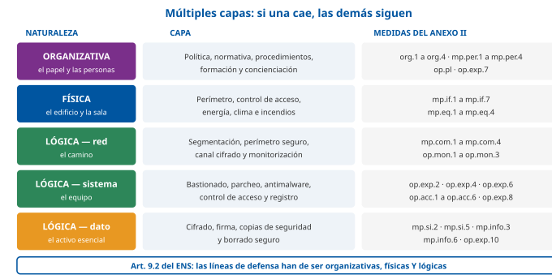
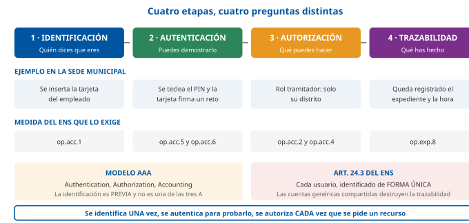

# Tema 32. Conceptos de seguridad de los sistemas de información

**Bloque:** técnico  
**Enunciado oficial** (BOAM n.º 10.032, de 23 de diciembre de 2025): Conceptos de seguridad de los sistemas de información. Seguridad física. Seguridad lógica. Amenazas y vulnerabilidades. Técnicas criptográficas y protocolos seguros. Mecanismos de firma digital.

Versión web: <https://ayuntamientomadrid.github.io/temario-tecnico-auxiliar/temas/tema-32.html> · PDF: [tema-32.pdf](tema-32.pdf) · Test: [../../../tests/tecnico/tema-32.md](../../../tests/tecnico/tema-32.md)

## Índice

- 1. Conceptos de seguridad de los sistemas de información
  - 1.1. Principios generales y dimensiones de la seguridad
  - 1.2. Marco legal y normativo en el ámbito público
- 2. Seguridad física
  - 2.1. Protección perimetral y control de acceso físico
  - 2.2. Protección ambiental y del equipamiento
- 3. Seguridad lógica
  - 3.1. Identificación, autenticación y autorización
  - 3.2. Gestión de usuarios y accesos
- 4. Amenazas y vulnerabilidades
  - 4.1. Análisis e identificación de amenazas
  - 4.2. Tratamiento de vulnerabilidades
- 5. Técnicas criptográficas y protocolos seguros
  - 5.1. Fundamentos criptográficos
  - 5.2. Protocolos de comunicación segura
- 6. Mecanismos de firma digital
  - 6.1. Infraestructura de clave pública y certificados digitales
  - 6.2. Firma electrónica y servicios de confianza
- Cierre: los siete datos que no se pueden fallar

### Conceptos clave para memorizar

| Concepto | Dato clave |
|----|----|
| Dimensiones de la seguridad (ENS) | **Cinco**: **C**onfidencialidad, **I**ntegridad, **T**razabilidad, **A**utenticidad y **D**isponibilidad. Anexo I, apartado 2 del RD 311/2022. El «no repudio» **no** es una dimensión del ENS: es un efecto jurídico que se apoya en autenticidad + integridad + trazabilidad |
| Niveles y categorías (ENS) | **Niveles** por dimensión: BAJO, MEDIO, ALTO. **Categorías** del sistema: BÁSICA, MEDIA, ALTA. Manda **la dimensión más alta**; si una dimensión no se ve afectada, no se le asigna nivel |
| Riesgo | Función del **impacto** de un incidente y de la **probabilidad** de que ocurra. La **amenaza** es externa al activo; la **vulnerabilidad**, propia del activo. Sin vulnerabilidad que explotar, la amenaza no se materializa |
| Tratamiento del riesgo | Cuatro opciones: **evitar / eliminar**, **mitigar / reducir**, **transferir / compartir** (seguro, contrato) y **aceptar / asumir**. El riesgo que queda tras las salvaguardas es el **riesgo residual**, y debe ser **aceptado formalmente** |
| Salvaguardas por función | **Preventivas** (evitan), **disuasorias** (desaniman), **detectivas** (descubren), **correctivas** (reparan) y **recuperativas** (restauran). El ENS las ordena en **prevención, detección, respuesta y conservación** (art. 8) |
| Seguridad física en el ENS | Familia **mp.if** (protección de las instalaciones e infraestructuras): **mp.if.1** áreas separadas · **mp.if.2** identificación de las personas · **mp.if.3** acondicionamiento de los locales · **mp.if.4** energía eléctrica · **mp.if.5** incendios · **mp.if.6** inundaciones · **mp.if.7** registro de entrada y salida de equipamiento |
| Factores de autenticación | **Tres**: algo que **se sabe** (contraseña, PIN), algo que **se tiene** (tarjeta, token, OTP) y algo que **se es** (biometría). Multifactor = **dos o más de categorías distintas**. Contraseña + PIN **no** es multifactor |
| Modelos de control de acceso | **DAC** (el propietario decide) · **MAC** (lo decide una política obligatoria por etiquetas, Bell-LaPadula) · **RBAC** (por rol) · **ABAC** (por atributos y contexto). El ENS impone **mínimo privilegio** (art. 20) y **segregación de funciones** (op.acc.3) |
| Bell-LaPadula vs Biba | **Bell-LaPadula** protege la **confidencialidad**: *no leer arriba, no escribir abajo*. **Biba** protege la **integridad**: *no leer abajo, no escribir arriba*. Son duales |
| Malware: virus, gusano, troyano | **Virus**: necesita un **anfitrión** y una acción del usuario. **Gusano**: se propaga **solo** por la red, sin anfitrión. **Troyano**: se **disfraza** de programa legítimo y no se replica |
| Vulnerabilidad de día cero | Vulnerabilidad **sin parche disponible** en el momento en que se explota. La **ventana de exposición** va del descubrimiento a la aplicación efectiva del parche, no a su publicación |
| CVE y CVSS | **CVE** = identificador único de la vulnerabilidad (`CVE-AAAA-NNNN`). **CVSS** = puntuación de gravedad de 0,0 a 10,0. Umbrales v3.1: **0,1-3,9 baja · 4,0-6,9 media · 7,0-8,9 alta · 9,0-10,0 crítica** |
| Simétrica vs asimétrica | **Simétrica**: una sola clave, rápida, problema de **distribución de claves**; *n* usuarios → **n(n−1)/2** claves. **Asimétrica**: par pública/privada, lenta, resuelve la distribución; *n* usuarios → **2n** claves |
| Qué garantiza cada operación | **Cifrar con la clave pública del destinatario** → confidencialidad. **Cifrar (firmar) con la clave privada del emisor** → autenticidad, integridad y no repudio. Nunca al revés |
| Función hash | **Unidireccional**, salida de **longitud fija**, **efecto avalancha**, resistente a colisiones. **No** cifra y **no** tiene clave: no es reversible. **SHA-1 y MD5 están proscritos**; se usan **SHA-256/SHA-384/SHA-512** o SHA-3 |
| Cifrado híbrido | Los protocolos reales **combinan** ambos: la criptografía **asimétrica** negocia una **clave de sesión**, y con ella la **simétrica** cifra los datos. Es el «sobre digital» de TLS, S/MIME e IPsec |
| IPsec | Nivel de **red** (capa 3). **AH** (protocolo 51): integridad y autenticidad, **no** confidencialidad. **ESP** (protocolo 50): además **cifra**. **Modo transporte** (extremo a extremo, conserva la cabecera IP original) vs **modo túnel** (encapsula el paquete entero: VPN sitio a sitio). Negociación con **IKEv2, UDP/500** |
| TLS | Nivel de **transporte**. **SSL está muerto** (2.0 y 3.0 prohibidos, RFC 7568); TLS 1.0/1.1 **obsoletos** (RFC 8996). Vigentes **TLS 1.2** y **TLS 1.3** (RFC 9846, que sustituye en 2026 al RFC 8446): 1.3 elimina RSA como intercambio de claves, exige **confidencialidad directa** (*forward secrecy*) y hace el saludo en **1-RTT** |
| HTTPS y HSTS | HTTPS = HTTP sobre TLS, puerto **443**. **HSTS** (RFC 6797, cabecera `Strict-Transport-Security`) obliga al navegador a usar siempre HTTPS y evita el ataque de degradación |
| SSH | Puerto **22**. Sustituye a Telnet, rlogin y FTP. Autenticación por contraseña o por **par de claves**; permite túneles y transferencia (SFTP, SCP) |
| PKI: componentes | **AC** (autoridad de certificación, emite y revoca) · **AR** (autoridad de registro, identifica al solicitante) · **AV** (autoridad de validación, responde sobre el estado) · **repositorio** · **DPC** (declaración de prácticas de certificación) |
| Certificado X.509 | Vincula una **identidad** con una **clave pública**, y lo **firma la AC**. Estándar **X.509 v3** (RFC 5280): número de serie, emisor, sujeto, periodo de validez, clave pública, extensiones y firma de la AC |
| Revocación | **CRL**: lista firmada y publicada periódicamente → puede estar **desactualizada**. **OCSP** (RFC 6960): consulta **en línea** del estado de **un** certificado → información fresca, pero exige disponibilidad del respondedor. **OCSP stapling**: lo aporta el propio servidor |
| Firma electrónica (eIDAS) | Tres modalidades: **simple**, **avanzada** (vinculada al firmante, detecta cambios, control exclusivo) y **cualificada** (avanzada + **DCCFE/QSCD** + **certificado cualificado**). Solo la **cualificada** tiene efecto jurídico **equivalente a la manuscrita** en toda la UE (art. 25.2 del Reglamento 910/2014) |
| Formatos de firma | **CAdES** (binario, cualquier fichero) · **XAdES** (XML) · **PAdES** (PDF) · **ASiC** (contenedor). Niveles de longevidad **-B, -T, -LT, -LTA**: la **T** añade sello de tiempo y la **LTA** permite el archivo a largo plazo |
| Firma en el ENS | **mp.info.3**, dimensiones **I** y **A**: nivel BAJO = cualquier firma admitida en derecho (incluido el **CSV**); MEDIO = **+R1 certificados cualificados +R2 algoritmos autorizados por el CCN +R3 verificación y validación duraderas**; ALTO = **+R4 segundo factor** |
| Sellado de tiempo | **mp.info.4**, dimensión **T**, exigible solo en nivel **ALTO**. Aporta prueba de la **existencia de un dato en un instante**. Protocolo **TSP (RFC 3161)**; en la UE, **sello cualificado de tiempo electrónico** |

## Contenido

### Convenciones del documento

Este tema incluye cuatro tipos de **cajas callout** para facilitar el estudio:

> **Dato clave.** Información de alta densidad memorística: cifras, siglas, puertos, artículos y códigos de medida del ENS.

> **Ejercicio resuelto.** Problema + solución paso a paso: categorizar un sistema, calcular claves de una red, decidir un mecanismo de firma, interpretar una puntuación CVSS.

> **Ejemplo de aplicación en el ayto.** Aplicación real de la teoría al entorno municipal (Padrón, sede electrónica, expedientes, CPD del IAM, tarjetas criptográficas del personal).

> **Relación con otros temas.** Enlace conceptual a otros temas del temario oficial.

**Este tema es el más transversal del bloque técnico**, y conviene saberlo antes de empezar. Su enunciado recorre seis materias que en otros temarios son temas independientes: los conceptos y el marco normativo, la seguridad física, la seguridad lógica, las amenazas, la criptografía y la firma electrónica. Eso obliga a una decisión de profundidad en cada una: aquí se desarrolla **el mecanismo y el dato memorizable**, y se deja el desarrollo extenso de lo que otros temas ya cubren. En concreto, **la seguridad perimetral de red, los cortafuegos, los IDS/IPS y las VPN de acceso remoto son el objeto del Tema 36**, y **los principios del ENS y del ENI, el del Tema 39**; aquí aparecen solo en la medida en que el enunciado del Tema 32 los reclama —los protocolos seguros y el marco normativo de la firma—. Es un solapamiento deliberado del temario oficial, no una omisión.

La segunda advertencia es de método. La seguridad **no es una lista de productos**: es un proceso que empieza en un análisis de riesgos y termina en una revisión. Un opositor que memorice herramientas sin entender el ciclo activo → amenaza → vulnerabilidad → impacto → riesgo → salvaguarda no entenderá la materia. Y al revés: quien domine el ciclo pero no sepa que **AH es el protocolo IP 51 y ESP el 50**, o que la firma cualificada exige **certificado cualificado más dispositivo cualificado de creación**, se quedará sin los datos precisos. Hay que llevar las dos cosas.

Las fuentes se citan con etiquetas breves tipo `[ENS]`, `[RFC9846]` o `[EIDAS]`; el registro completo está en la pestaña Fuentes. Todo el articulado del ENS citado en este tema se ha verificado **contra el PDF oficial del BOE**, no de memoria.

**Caso de referencia usado en todo el tema** (contexto Ayuntamiento de Madrid, supuesto simplificado): el **sistema de tramitación de expedientes de la sede electrónica municipal**. Trata datos personales de la ciudadanía, produce resoluciones administrativas firmadas electrónicamente, se apoya en el Padrón, se ejecuta en el centro de proceso de datos del IAM y es accesible desde internet. Ese único sistema concentra todas las materias del tema: hay que **categorizarlo** (§1), proteger la sala donde vive (§2), decidir quién entra y con qué (§3), defenderlo de quien lo ataca (§4), cifrar lo que sale de él (§5) y firmar lo que produce (§6).

------------------------------------------------------------------------

### 1. Conceptos de seguridad de los sistemas de información

#### 1.1. Principios generales y dimensiones de la seguridad

##### 1.1.1. Concepto de seguridad de la información

La **seguridad de la información** es el conjunto de medidas —organizativas, físicas, lógicas y jurídicas— destinadas a **preservar determinadas propiedades de la información y de los servicios** frente a incidentes, sean accidentales o deliberados. La definición importa por lo que excluye: no es un producto, no es un departamento y no es un estado que se alcance de una vez.

El ENS lo formula con una precisión que conviene retener casi literalmente: *«el objeto último de la seguridad de la información es garantizar que una organización podrá cumplir sus objetivos, desarrollar sus funciones y ejercer sus competencias utilizando sistemas de información»* \[ENS, art. 5\]. Es decir, **la seguridad es instrumental**: no se protege por proteger, se protege para que el servicio público siga prestándose. De ahí se deriva todo lo demás, incluida la proporcionalidad de las medidas.

Conviene distinguir tres términos que el lenguaje corriente confunde:

- **Seguridad de la información**: protege la información en **cualquier soporte**, también el papel, la conversación o el archivo físico. Es el concepto más amplio.
- **Seguridad informática** o de los sistemas de información: se ciñe a la información tratada por **medios informáticos** y a los sistemas que la tratan.
- **Ciberseguridad**: el ENS la define como *«la capacidad de las redes y sistemas de información de resistir, con un nivel determinado de fiabilidad, toda acción que comprometa la disponibilidad, autenticidad, integridad o confidencialidad de los datos almacenados, transmitidos o tratados»* \[ENS, anexo IV\]. Su acento está en el **ciberespacio** y en la resistencia frente a acciones hostiles.

> **Dato clave.** El ENS obliga a proteger **con el mismo grado de seguridad** la información en soporte **no electrónico** que sea «causa o consecuencia directa» de la información electrónica protegida \[ENS, art. 22.3\]. Un expediente impreso que salga de un sistema de categoría MEDIA no puede quedarse en una bandeja de la mesa: es la razón de ser de la medida `mp.eq.1`, **puesto de trabajo despejado**.

**La seguridad como proceso integral.** El primero de los siete principios básicos del ENS establece que la seguridad *«es un proceso integral constituido por todos los elementos humanos, materiales, técnicos, jurídicos y organizativos»*, y que su aplicación *«excluye cualquier actuación puntual o tratamiento coyuntural»* \[ENS, art. 6.1\]. La consecuencia práctica es doble: (a) comprar un cortafuegos no es «hacer seguridad», y (b) el eslabón humano es parte del sistema, por lo que el propio artículo exige prestar **máxima atención a la concienciación** de las personas y de los responsables jerárquicos, «para evitar que la ignorancia, la falta de organización y de coordinación o de instrucciones adecuadas constituyan fuentes de riesgo» \[ENS, art. 6.2\].

De ese carácter integral se derivan dos ideas clásicas que aparecen en todos los manuales y en el propio ENS:

**1. Defensa en profundidad.** El sistema debe disponer de *«una estrategia de protección constituida por múltiples capas de seguridad»*, de modo que si una capa se ve comprometida, se pueda reaccionar y **minimizar el impacto final** \[ENS, art. 9.1\]. El ENS añade un matiz: esas líneas de defensa han de ser de naturaleza **organizativa, física y lógica** \[ENS, art. 9.2\] —las tres, no solo la última—. Ver **diagrama D4**.

**2. El eslabón más débil.** La resistencia del conjunto es la del punto más frágil. Da igual un cifrado impecable si la contraseña está en un pósit bajo el teclado, o si cualquiera puede entrar en la sala de servidores.

A ellas se suman otros principios de diseño de aceptación universal, que conviene poder enunciar:

| Principio | Enunciado | Reflejo normativo |
|----|----|----|
| **Mínimo privilegio** | Cada sujeto recibe **solo** los permisos imprescindibles para su función, y solo durante el tiempo necesario | Art. 20 del ENS; `op.acc.4` |
| **Separación o segregación de funciones** | Ninguna persona debe controlar por sí sola un proceso crítico de principio a fin (quien autoriza no ejecuta; quien opera no audita) | `op.acc.3`; art. 11 y 13.3 del ENS para la seguridad frente a la explotación |
| **Denegación por defecto** | Lo que no está expresamente permitido, está prohibido; la configuración de partida es la más restrictiva | `op.exp.2`, guías de bastionado |
| **Seguridad por diseño y por defecto** | La protección se incorpora desde la concepción del sistema, no se añade al final | Art. 36 del ENS (ciclo de vida); art. 25 del RGPD |
| **Principio de Kerckhoffs** | La seguridad debe residir **solo en la clave**, nunca en el secreto del algoritmo. Rechazo de la «seguridad por oscuridad» | `[KERCKHOFFS]`; algoritmos públicos y auditables |
| **Simplicidad / economía del mecanismo** | Cuanto más simple es un mecanismo, menos superficie de error tiene. El uso ordinario ha de ser «sencillo y seguro», de forma que **usarlo mal exija un acto consciente** | Art. 20.c del ENS, casi literal |

> **Ejemplo de aplicación en el ayto.** El principio de simplicidad explica una decisión de diseño de la sede electrónica: si firmar correctamente exige tres clics y firmar de manera insegura exige uno, la gente firmará mal. Por eso el flujo por defecto de la tramitación municipal fuerza el uso del certificado en tarjeta y no ofrece atajos; la excepción requiere una autorización expresa que deja rastro.

**Prevención, detección, respuesta y conservación.** El tercer principio básico del ENS ordena las medidas por su momento respecto al incidente \[ENS, art. 8\]: las de **prevención** eliminan o reducen la posibilidad de que la amenaza se materialice y pueden incorporar componentes de **disuasión** o de reducción de la superficie de exposición; las de **detección** descubren la presencia de un incidente; las de **respuesta**, gestionadas «en tiempo oportuno», restauran la información y los servicios afectados; y la **conservación** garantiza que los datos en soporte electrónico perduren y que los servicios sigan disponibles durante todo el ciclo vital de la información digital.

En la literatura clásica y en MAGERIT esa misma idea se expresa clasificando las **salvaguardas por su función** \[MAGERIT\]:

| Tipo de salvaguarda | Qué hace | Ejemplo |
|----|----|----|
| **Preventiva** | Impide que el incidente ocurra | Cortafuegos, cifrado, control de acceso |
| **Disuasoria** | Desanima al atacante sin impedirle nada físicamente | Cartel de zona videovigilada, aviso legal de registro de actividad |
| **Detectiva** | Descubre que el incidente está ocurriendo o ha ocurrido | IDS, antivirus, revisión de registros, alarma de intrusión |
| **Correctiva** | Corrige el fallo y limita el daño una vez detectado | Aplicación del parche, aislamiento del equipo, bloqueo de la cuenta |
| **Recuperativa** | Restaura la situación previa | Restauración de copia de seguridad, medios alternativos |

> **Dato clave.** Una **cámara de videovigilancia** es simultáneamente **disuasoria** (se ve) y **detectiva** (graba); **no es preventiva**, porque no impide físicamente el acceso. Una **cerradura** sí es preventiva.

**Vigilancia continua y reevaluación periódica.** Los principios quinto y sexto exigen detectar comportamientos anómalos y responder, medir permanentemente el estado de seguridad de los activos para descubrir vulnerabilidades y deficiencias de configuración, y **reevaluar y actualizar las medidas periódicamente**, «pudiendo llegar a un replanteamiento de la seguridad si fuese necesario» \[ENS, art. 10\]. La seguridad, por tanto, caduca: una configuración correcta en 2022 puede ser insuficiente en 2026 porque cambió la amenaza, no el sistema.

**Diferenciación de responsabilidades.** El séptimo principio impone distinguir cuatro figuras en todo sistema —responsable de la **información**, del **servicio**, de la **seguridad** y del **sistema**— y añade una regla clave: *«la responsabilidad de la seguridad de los sistemas de información estará diferenciada de la responsabilidad sobre la explotación»* \[ENS, art. 11.2\]. El art. 13.3 lo remata: el **responsable de la seguridad será distinto del responsable del sistema**, y **no debe existir dependencia jerárquica entre ambos**; solo excepcionalmente, por ausencia justificada de recursos, pueden coincidir, y entonces han de aplicarse **medidas compensatorias**.

> **Dato clave.** Reparto de funciones del art. 13.2 del ENS: el **responsable de la información** determina los requisitos de la información tratada; el **responsable del servicio**, los de los servicios prestados; el **responsable de la seguridad** decide cómo satisfacer esos requisitos, supervisa la implantación y reporta; y el **responsable del sistema** desarrolla la forma concreta de implementar la seguridad y supervisa la operación diaria, pudiendo delegar en administradores u operadores. En servicios externalizados debe designarse además un **POC** (punto o persona de contacto) de seguridad \[ENS, art. 13.5\].

##### 1.1.2. Confidencialidad, integridad, disponibilidad, autenticidad y no repudio

La forma canónica de concretar «qué hay que proteger» es enunciar las **propiedades o dimensiones de la seguridad**. La tríada clásica es **CIA** en inglés (*Confidentiality, Integrity, Availability*), que en español se abrevia **CID**. El ENS amplía la tríada a **cinco dimensiones**. Ver **diagrama D1**.

> **Dato clave.** Las **cinco dimensiones de la seguridad** del ENS \[anexo I, apartado 2\], con sus iniciales en mayúscula: **Confidencialidad \[C\]**, **Integridad \[I\]**, **Trazabilidad \[T\]**, **Autenticidad \[A\]** y **Disponibilidad \[D\]**. Regla mnemotécnica habitual: **C-I-T-A-D**. Cuidado: el orden en que las enumera el anexo es exactamente ese, y la **trazabilidad** aparece en tercer lugar, antes que autenticidad y disponibilidad.

**Confidencialidad.** Propiedad por la que la información **no se pone a disposición ni se revela** a individuos, entidades o procesos no autorizados. Se pierde cuando alguien que no debía ver un dato lo ve, aunque no lo modifique y aunque no lo copie. Mecanismos típicos: control de acceso, cifrado, clasificación y marcado de la información, borrado seguro de soportes, limpieza de metadatos de los documentos (`mp.info.5`).

**Integridad.** Propiedad por la que la información **no ha sido alterada ni destruida** de forma no autorizada. Ojo a la doble cara: se rompe tanto por una modificación maliciosa como por una corrupción accidental de un disco. Mecanismos típicos: funciones **hash** y sumas de verificación, códigos de autenticación de mensaje (**HMAC**), firma electrónica, control de versiones y control de cambios, sistemas de ficheros con verificación de sumas.

**Disponibilidad.** Propiedad por la que la información y los servicios son **accesibles y utilizables** por quien está autorizado **cuando los necesita**. Es la dimensión que se degrada sin que nadie robe ni altere nada: una denegación de servicio, un corte eléctrico o un disco lleno la destruyen. Mecanismos típicos: redundancia (N+1, 2N), agrupaciones de alta disponibilidad, copias de seguridad, planes de continuidad, sistemas de alimentación ininterrumpida, protección frente a denegación de servicio.

**Autenticidad.** El ENS la define como *«propiedad o característica consistente en que una entidad es quien dice ser o bien que garantiza la fuente de la que proceden los datos»* \[ENS, anexo IV\]. Tiene, por tanto, dos caras: autenticidad **de entidad** (esta persona es quien afirma ser) y autenticidad **de origen de los datos** (este documento procede realmente de quien dice). Mecanismos: autenticación multifactor, certificados, firma electrónica, `mp.com.3` para el canal.

**Trazabilidad.** *«Propiedad o característica consistente en que las actuaciones de una entidad (persona o proceso) pueden ser trazadas de forma indiscutible hasta dicha entidad»* \[ENS, anexo IV\]. Es la dimensión que permite reconstruir **quién hizo qué y cuándo**. Mecanismos: registro de actividad (`op.exp.8`), registro de accesos con éxito y fallidos (`op.acc.6.r5`), sincronización horaria, sellado de tiempo (`mp.info.4`), protección de los propios registros frente a manipulación.

> **Dato clave.** Requisito imprescindible de la trazabilidad: el art. 24.3 del ENS exige que **cada usuario que acceda al sistema esté identificado de forma única**, «de modo que se sepa, en todo momento, quién recibe derechos de acceso, de qué tipo son y quién ha realizado una determinada actividad». Por eso **las cuentas genéricas compartidas destruyen la trazabilidad** y son incompatibles con el ENS: si cinco personas usan `mostrador01`, no hay actuación imputable a nadie.

**El no repudio.** Es la propiedad por la que **el autor de una acción no puede negar válidamente haberla realizado**. Se distinguen el no repudio **de origen** (el emisor no puede negar haber enviado) y el no repudio **de destino** (el receptor no puede negar haber recibido). Aquí hay que ser muy preciso, porque es una trampa frecuente:

> **Dato clave.** **El no repudio NO es una de las cinco dimensiones del ENS.** El anexo I enumera confidencialidad, integridad, trazabilidad, autenticidad y disponibilidad; el no repudio no está. Es un **efecto jurídico** que se construye combinando **autenticidad + integridad + trazabilidad**, y cuyo instrumento técnico por excelencia es la **firma electrónica con clave privada bajo control exclusivo del firmante** (§6). Si una pregunta ofrece «no repudio» entre las dimensiones del ENS, es distractor; si pregunta qué garantiza la firma electrónica, entonces sí.

La razón técnica de fondo: el no repudio exige que **solo una persona** haya podido generar la evidencia. Un HMAC garantiza integridad y autenticidad, pero **no da no repudio**, porque la clave secreta la conocen los dos extremos y cualquiera de ellos pudo generarlo. Solo la criptografía **asimétrica**, en la que la clave privada es de una sola persona, produce no repudio.

Se citan además otras propiedades derivadas: la **autenticación** (el proceso de verificar la autenticidad), la **imputabilidad** o rendición de cuentas (*accountability*), la **fiabilidad** y la **resiliencia** —esta última incorporada por el art. 32.1.b del RGPD, que exige «garantizar la confidencialidad, integridad, disponibilidad y **resiliencia** permanentes de los sistemas y servicios de tratamiento»—.

> **Ejercicio resuelto.** **Clasificar incidentes por dimensión afectada.** Indique qué dimensión se ve comprometida principalmente en cada caso del sistema de expedientes municipal: 1. Un empleado consulta el expediente de un vecino conocido sin motivo laboral. → **Confidencialidad** (y, si el sistema no lo registra, además falla la trazabilidad). 2. Un fallo de disco corrompe 40 documentos del expediente. → **Integridad**. 3. Un ataque de denegación de servicio tumba la sede durante seis horas del plazo de una convocatoria. → **Disponibilidad**. 4. Alguien presenta una solicitud haciéndose pasar por otra persona. → **Autenticidad**. 5. Se detecta una modificación indebida en una resolución, pero los registros no permiten saber quién la hizo. → **Trazabilidad**. 6. El firmante de una resolución niega haberla firmado y no hay forma de demostrar lo contrario. → **No repudio** (efecto jurídico, no dimensión del ENS).

##### 1.1.3. Análisis y gestión de riesgos

El **análisis y la gestión de riesgos** es el mecanismo que convierte la seguridad de una intuición en una decisión justificable. El ENS lo eleva a principio básico —*«el análisis y la gestión de los riesgos es parte esencial del proceso de seguridad, debiendo constituir una actividad continua y permanentemente actualizada»* \[ENS, art. 7.1\]— y a requisito mínimo, obligando a cada organización a realizar su propia gestión de riesgos **empleando una metodología reconocida internacionalmente** \[ENS, art. 14.2\]. En el sector público español, la metodología de referencia es **MAGERIT v3**, con su herramienta **PILAR**; en el ámbito internacional, ISO/IEC 27005 y NIST SP 800-30.

**El vocabulario, con precisión.** Es la parte del tema donde más se penaliza la imprecisión. Ver **diagrama D2**.

| Término | Definición | Clave para no confundirlo |
|----|----|----|
| **Activo** | Cualquier componente del sistema que tiene **valor** para la organización: información, servicios, datos, aplicaciones, equipos, redes, soportes, instalaciones, **personas** | El activo esencial es la **información y el servicio**; el resto son activos de soporte |
| **Amenaza** | Evento que **puede** causar un incidente y producir daños. Es **externa al activo** y no depende de él | Existe aunque el sistema sea perfecto. Un incendio es una amenaza aunque la sala esté bien protegida |
| **Vulnerabilidad** | **Debilidad propia del activo** que una amenaza puede aprovechar | Es interna, y es lo único sobre lo que se puede actuar directamente |
| **Impacto** | **Consecuencia** de la materialización de la amenaza sobre el activo, medida en la degradación de sus dimensiones | Se mide en daño, no en probabilidad |
| **Probabilidad** o frecuencia | Verosimilitud de que la amenaza se materialice en un periodo dado | — |
| **Riesgo** | Estimación que combina **impacto** y **probabilidad**. El ENS define el análisis de riesgos como el estudio de las consecuencias previsibles de un incidente «y la probabilidad de que ocurra» \[anexo IV\] | Riesgo ≈ impacto × probabilidad. Sin vulnerabilidad explotable, el riesgo tiende a cero |
| **Salvaguarda** o medida | Procedimiento o mecanismo que **reduce** el riesgo, actuando sobre el impacto o sobre la probabilidad | Ver la clasificación funcional de §1.1.1 |
| **Riesgo residual** | El que **permanece** tras aplicar las salvaguardas | Nunca es cero; debe ser **aceptado formalmente** por la dirección |

> **Dato clave.** La distinción **amenaza / vulnerabilidad** es la clave del bloque conceptual. La amenaza es **el qué puede pasar** y no se puede eliminar (nadie elimina los incendios, los terremotos ni la existencia de atacantes); la vulnerabilidad es **la debilidad que lo permite** y sí se puede corregir (parchear, cifrar, formar al personal). Las salvaguardas actúan sobre la vulnerabilidad y sobre el impacto, no sobre la amenaza.

**Las fases del proceso.** MAGERIT ordena el análisis en cuatro pasos y añade después el tratamiento:

1.  **Identificación y valoración de activos.** Inventario (que el ENS exige de forma autónoma en `op.exp.1`) y valoración de cada activo **en cada dimensión**, con las dependencias entre ellos: un servicio depende de una aplicación, que depende de un servidor, que depende de la sala y del suministro eléctrico. El valor «sube» por esas dependencias.
2.  **Identificación de amenazas** aplicables a cada activo, a partir del catálogo del Libro II de MAGERIT: desastres naturales, de origen industrial, errores y fallos no intencionados, y **ataques intencionados**.
3.  **Determinación del impacto**: degradación que produciría cada amenaza en cada dimensión del activo.
4.  **Estimación del riesgo**: combinación del impacto con la probabilidad, normalmente en una **matriz** cualitativa de niveles.

Después viene la **gestión** propiamente dicha, es decir, el **tratamiento del riesgo**, con cuatro opciones que hay que saber enunciar y distinguir:

| Opción | En qué consiste | Ejemplo municipal |
|----|----|----|
| **Evitar / eliminar** | Suprimir la actividad o el activo que genera el riesgo | Dejar de almacenar en local una copia de datos que no se necesita |
| **Mitigar / reducir** | Aplicar salvaguardas que bajen el impacto o la probabilidad | Cifrar los portátiles, duplicar el suministro eléctrico |
| **Transferir / compartir** | Trasladar la consecuencia económica o la operación a un tercero | Póliza de seguro, contrato con proveedor con SLA y penalizaciones |
| **Aceptar / asumir** | Convivir con el riesgo porque el coste de tratarlo supera al daño esperado | Asumir una indisponibilidad de 15 minutos al mes en un servicio interno |

> **Dato clave.** «Transferir el riesgo» **no transfiere la responsabilidad**. Contratar a un tercero traslada el coste o la operación, pero la responsabilidad última sigue siendo de la entidad del sector público: el ENS lo dice expresamente para los servicios externalizados —*«sin perjuicio de que la responsabilidad última resida en la entidad del sector público destinataria»* \[art. 13.5\]— y el RGPD lo dice del responsable del tratamiento frente al encargado \[RGPD, art. 28\].

El art. 14.3 del ENS cierra el círculo exigiendo **proporcionalidad**: las medidas adoptadas para mitigar o suprimir los riesgos deben estar **justificadas** y guardar proporción con ellos. Y el art. 7.2 lo formula como objetivo: mantener un entorno controlado *«minimizando los riesgos a niveles aceptables»* mediante una aplicación de medidas «equilibrada y proporcionada a la naturaleza de la información tratada, de los servicios a prestar y de los riesgos». Traducido: **no se protege todo igual**, y sobreproteger un sistema irrelevante es tan defectuoso como infraproteger uno crítico.

> **Relación con otros temas.** El **análisis de impacto en el negocio (BIA)** y los objetivos **RTO** (tiempo máximo de recuperación) y **RPO** (pérdida máxima de datos admisible) pertenecen a la **continuidad**, que el ENS regula en `op.cont.1` a `op.cont.4` y cuyo desarrollo técnico —copias de seguridad, réplicas, restauración— corresponde al **Tema 26**. Aquí basta con saber que la continuidad es el tratamiento del riesgo de indisponibilidad.

#### 1.2. Marco legal y normativo en el ámbito público

##### 1.2.1. El Esquema Nacional de Seguridad

El **Esquema Nacional de Seguridad (ENS)**, aprobado por el **Real Decreto 311/2022, de 3 de mayo** \[ENS\], es la norma que determina la política de seguridad en la utilización de medios electrónicos por las entidades del sector público. Es de **obligado cumplimiento** —no es una recomendación ni una certificación voluntaria— y su ámbito incluye a todo el sector público y, por extensión, a los **operadores del sector privado que prestan servicios o proveen soluciones** a esas entidades.

> **Relación con otros temas.** El **Tema 39** está dedicado íntegramente a los **principios básicos del ENS y del ENI**, y allí corresponde el desarrollo completo del esquema: gobernanza, conformidad, distintivos, informe del estado de la seguridad y relación con la interoperabilidad. En este tema se toma el ENS por lo que aporta al enunciado del Tema 32: **la definición de las dimensiones, la categorización, y el catálogo de medidas de seguridad física, lógica, criptográfica y de firma** que estructuran las secciones 2 a 6.

**Estructura de la norma.** Cuatro anexos que conviene tener localizados:

| Anexo | Contenido |
|----|----|
| **Anexo I** | Categorías de seguridad de los sistemas: **dimensiones**, **niveles** (BAJO/MEDIO/ALTO) y **categorías** (BÁSICA/MEDIA/ALTA) |
| **Anexo II** | **Medidas de seguridad**: marco organizativo `org`, marco operacional `op` y medidas de protección `mp`, con sus **refuerzos** (R1, R2…) |
| **Anexo III** | **Auditoría** de la seguridad |
| **Anexo IV** | **Glosario** de términos |

**Niveles y categorías: el mecanismo exacto.** La precisión terminológica es decisiva. Ver **diagrama D1**.

- Se valora **cada dimensión** de cada información y de cada servicio, asignándole un **NIVEL**: **BAJO**, **MEDIO** o **ALTO**. Si una dimensión **no se ve afectada, no se le adscribe ningún nivel** \[ENS, anexo I.3\].
- Los tres niveles se definen por la gravedad del perjuicio: **BAJO** = perjuicio **limitado**; **MEDIO** = perjuicio **grave**; **ALTO** = perjuicio **muy grave**, sobre las funciones de la organización, sobre sus activos o sobre los individuos afectados.
- Cuando un sistema trata varias informaciones y presta varios servicios, el nivel del sistema en cada dimensión es **el mayor** de los establecidos para cada información y cada servicio.
- La **CATEGORÍA** del sistema se deduce después: **ALTA** si **alguna** dimensión alcanza nivel ALTO; **MEDIA** si alguna alcanza MEDIO y ninguna supera ese nivel; **BÁSICA** si alguna alcanza BAJO y ninguna supera ese nivel \[ENS, anexo I.4\].

> **Dato clave.** **Niveles** (BAJO, MEDIO, ALTO) se predican de **dimensiones**; **categorías** (BÁSICA, MEDIA, ALTA) se predican del **sistema**. Nunca «sistema de nivel alto» ni «dimensión de categoría media». Y la regla de agregación es **el máximo manda**: basta **una** dimensión en ALTO para que todo el sistema sea de categoría ALTA. Además, determinar la categoría **no altera** el nivel de las dimensiones que no influyeron en ella \[anexo I.4.2\]: un sistema de categoría ALTA por disponibilidad sigue teniendo confidencialidad BAJA, y se le aplican las medidas de cada dimensión en su nivel.

Un matiz temporal: la categoría debe **reevaluarse anualmente**, o siempre que se produzcan modificaciones significativas en los criterios de determinación \[ENS, anexo I.1\].

> **Ejercicio resuelto.** **Categorizar el sistema de expedientes de la sede.** El responsable de la información y el del servicio valoran así las cinco dimensiones: - **Confidencialidad**: trata datos personales identificativos y de contacto de la ciudadanía, sin categorías especiales → perjuicio **grave** para los individuos si se revelan → **MEDIO**. - **Integridad**: una resolución alterada produce efectos jurídicos indebidos → **ALTO**. - **Trazabilidad**: hay que poder imputar cada actuación a un empleado concreto → **MEDIO**. - **Autenticidad**: la identidad del solicitante y del firmante condiciona la validez del acto → **ALTO**. - **Disponibilidad**: una caída de un día es reparable ampliando plazos → **MEDIO**. **Solución.** Hay dimensiones en nivel ALTO (integridad y autenticidad) → la **categoría del sistema es ALTA**. Consecuencias inmediatas: se aplican las medidas del anexo II en su columna ALTA, lo que arrastra, entre otras, `mp.info.3 + R1 + R2 + R3 + R4` para la firma electrónica (certificados cualificados, algoritmos autorizados por el CCN, validación duradera y segundo factor), `mp.si.2 + R1 + R2` para la criptografía de soportes y `op.acc.6 + [R1 o R2 o R3 o R4] + R5 + R6 + R7 + R8 + R9` para la autenticación del personal. Y, por el art. 31, **auditoría al menos cada dos años** —frente a la simple **autoevaluación** que basta en categoría BÁSICA—.

**Las medidas del anexo II.** Se agrupan en tres bloques, y saber a cuál pertenece cada familia vale tanto como conocer la medida:

| Marco | Familias | Objeto |
|----|----|----|
| **Marco organizativo** `org` | `org.1` política de seguridad · `org.2` normativa · `org.3` procedimientos · `org.4` proceso de autorización | El papel: quién decide y con qué reglas |
| **Marco operacional** `op` | `op.pl` planificación · `op.acc` control de acceso · `op.exp` explotación · `op.ext` recursos externos · `op.nub` servicios en la nube · `op.cont` continuidad · `op.mon` monitorización | Lo que se hace a diario con el sistema |
| **Medidas de protección** `mp` | `mp.if` instalaciones e infraestructuras · `mp.per` personal · `mp.eq` equipos · `mp.com` comunicaciones · `mp.si` soportes de información · `mp.sw` aplicaciones · `mp.info` información · `mp.s` servicios | Lo que se protege, por tipo de activo |

Cada medida se aplica **por categoría** del sistema o **por nivel** de una dimensión concreta, y puede llevar **refuerzos** (R1, R2…) que se activan al subir de nivel. Esa doble lógica explica anotaciones como «`mp.if.4` dimensión **D**: BAJO aplica, MEDIO y ALTO **+ R1**» —la energía eléctrica se exige en función de la disponibilidad, no de la categoría global—.

> **Dato clave.** Familias que este tema usa una y otra vez, con su marco: **`mp.if`** = seguridad **física** (§2) · **`op.acc`** = control de **acceso** lógico (§3) · **`op.exp.6`** código dañino y **`op.exp.4`** actualizaciones de seguridad (§4) · **`mp.com.2/3`** y **`mp.si.2`** = **cifrado** de comunicaciones y soportes (§5) · **`mp.info.3`** firma electrónica y **`mp.info.4`** sellos de tiempo (§6) · **`op.exp.10`** protección de claves criptográficas.

**Otras piezas del ENS con reflejo en este tema.** El art. 21 exige **autorización formal previa** para incluir o modificar cualquier elemento del catálogo de activos, y evaluación y monitorización permanentes para atender deficiencias de configuración y vulnerabilidades. El art. 23 obliga a **proteger el perímetro**, especialmente frente a redes públicas. El art. 25 exige procedimientos de **gestión de incidentes** y remite a la instrucción técnica correspondiente y al RD 43/2021 para operadores de servicios esenciales. El art. 26 impone **copias de seguridad** y mecanismos de continuidad. Y el art. 19 obliga a que los productos y servicios de seguridad adquiridos tengan **certificada su funcionalidad de seguridad**, correspondiendo al **Organismo de Certificación del CCN** determinar los requisitos.

##### 1.2.2. Protección de datos personales y garantía de derechos digitales

Sobre la capa del ENS se superpone, en toda Administración, la de **protección de datos personales**: el **Reglamento (UE) 2016/679 (RGPD)** \[RGPD\] y la **Ley Orgánica 3/2018 (LOPDGDD)** \[LOPDGDD\]. Son marcos distintos con objetivos distintos que a menudo se confunden.

> **Dato clave.** Diferencia de finalidad: el **ENS** protege **la información y los servicios de la organización** para que la Administración pueda cumplir sus fines; el **RGPD** protege **los derechos y libertades de las personas físicas** cuyos datos se tratan. Coinciden en muchas medidas, pero un sistema puede ser conforme al ENS y estar infringiendo el RGPD (por ejemplo, si conserva datos más tiempo del necesario), y a la inversa. El propio ENS lo articula en su **art. 3**: cuando un sistema trate datos personales, le será de aplicación **lo dispuesto en el RGPD y la LOPDGDD**, sin perjuicio del ENS; y el anexo II incorpora la medida `mp.info.1` **Datos personales**.

**La seguridad en el RGPD: el artículo 32.** Es el precepto que hay que saber. Obliga al responsable y al encargado a aplicar **medidas técnicas y organizativas apropiadas** para garantizar un nivel de seguridad **adecuado al riesgo**, teniendo en cuenta el estado de la técnica, los costes de aplicación y la naturaleza, alcance, contexto y fines del tratamiento. Y menciona expresamente, «entre otras y según proceda»:

- la **seudonimización** y el **cifrado** de datos personales;
- la capacidad de garantizar la **confidencialidad, integridad, disponibilidad y resiliencia** permanentes de los sistemas y servicios;
- la capacidad de **restaurar** la disponibilidad y el acceso a los datos de forma rápida en caso de incidente físico o técnico;
- un proceso de **verificación, evaluación y valoración regulares** de la eficacia de las medidas.

> **Dato clave.** **Seudonimización ≠ anonimización.** La **seudonimización** sustituye los identificadores por un seudónimo, pero con información adicional (guardada aparte) es **reversible**: los datos **siguen siendo personales** y el RGPD sigue aplicándose. La **anonimización** es **irreversible**, y los datos anonimizados **quedan fuera del RGPD**. Confundirlas es un error frecuente.

**Violaciones de seguridad de los datos personales.** Los arts. 33 y 34 del RGPD regulan lo que coloquialmente se llama «brecha»: toda violación de la seguridad que ocasione la **destrucción, pérdida o alteración accidental o ilícita** de datos personales, o la **comunicación o acceso no autorizados** a ellos.

| Obligación | Plazo y condición | Destinatario |
|----|----|----|
| **Notificar la violación** \[art. 33\] | **Sin dilación indebida y, de ser posible, en 72 horas** desde que se tuvo constancia; si se supera, hay que **justificar la demora**. No procede si es **improbable** que suponga un riesgo para los derechos y libertades | **Autoridad de control** (AEPD) |
| **Comunicar al interesado** \[art. 34\] | Sin dilación indebida, cuando sea probable que entrañe un **alto riesgo** para sus derechos y libertades. Hay excepciones (datos **cifrados** o ininteligibles, medidas posteriores que eliminen el alto riesgo, o esfuerzo desproporcionado → comunicación pública) | **Personas afectadas** |
| **Documentar** \[art. 33.5\] | **Siempre**, con independencia de si se notifica o no | Registro interno del responsable |

> **Dato clave.** Las **72 horas** son para notificar a la **autoridad de control**, y el cómputo arranca **desde que se tiene constancia** de la violación, no desde que ocurrió. La comunicación **a los afectados** no tiene plazo tasado en horas: procede «sin dilación indebida» **solo si hay alto riesgo**. Y el **cifrado** de los datos afectados es la causa de exención más citada del art. 34.3.a: si el atacante se llevó datos cifrados con algoritmos robustos, no son inteligibles para él.

**Derechos digitales (Título X de la LOPDGDD).** La ley española añadió un catálogo de derechos que afecta directamente a cómo se implantan las medidas de seguridad en el puesto de trabajo público:

- **Art. 87 — Intimidad y uso de dispositivos digitales.** El empleador puede acceder a los contenidos derivados del uso de medios digitales facilitados a la persona trabajadora **solo** para controlar el cumplimiento de sus obligaciones laborales y garantizar la integridad de esos dispositivos, y debe **establecer criterios de utilización** con participación de la representación de las personas trabajadoras.
- **Art. 88 — Desconexión digital** en el ámbito laboral.
- **Art. 89 — Videovigilancia y grabación de sonidos.** Admite el tratamiento de imágenes para el control laboral, con **deber de información previa y expresa** y con la exigencia de un **dispositivo informativo** visible; la instalación en lugares destinados al descanso o esparcimiento (vestuarios, aseos, comedores) está **prohibida**.
- **Art. 90 — Geolocalización** en el ámbito laboral, también sujeta a información previa.
- **Art. 22 — Videovigilancia general.** Regula la captación de imágenes en lugares públicos y fija el plazo de **supresión de las imágenes en un máximo de un mes** desde su captación, salvo que deban conservarse para acreditar la comisión de actos que atenten contra la integridad de personas, bienes o instalaciones.

> **Dato clave.** Ese plazo de **un mes** para la supresión de las grabaciones de videovigilancia \[LOPDGDD, art. 22.3\] es el dato clave del cruce entre seguridad física y protección de datos, y se aplica también a las cámaras que protegen el acceso a un centro de proceso de datos. La **existencia** de la cámara es una medida de seguridad física; su **régimen de conservación** lo fija la normativa de protección de datos.

**Otras normas del entorno.** El **RD 43/2021** (desarrollo del RDL 12/2018, transposición de la Directiva NIS) impone obligaciones de notificación de incidentes a operadores de servicios esenciales y proveedores de servicios digitales, y designa los **CSIRT de referencia** —para el sector público, el **CCN-CERT**—. La **Directiva NIS2** (UE 2022/2555) amplía sectores y endurece plazos, con una **alerta temprana en 24 horas**, e implica a los órganos de dirección. Y el **RD 704/2011** de infraestructuras críticas, citado expresamente por el art. 18 del ENS, se superpone cuando la instalación protegida tiene esa consideración. Ver **diagrama D3**.

> **Ejemplo de aplicación en el ayto.** Un mismo incidente puede activar **tres relojes distintos** en el IAM: el del ENS y su instrucción técnica de gestión de ciberincidentes (notificación al **CCN-CERT** según la taxonomía y peligrosidad de la guía **CCN-STIC 817**), el del RGPD (**72 horas** a la AEPD si hay datos personales afectados) y, si el servicio estuviera calificado como esencial, el del RD 43/2021 o NIS2. Los plazos corren **en paralelo**, no de forma sucesiva, y el registro de la gestión del incidente que exige `op.exp.9` es lo que permite acreditar después que se cumplieron.

------------------------------------------------------------------------

### 2. Seguridad física

La **seguridad física** es el conjunto de medidas destinadas a proteger los sistemas de información y su infraestructura frente a **amenazas materiales**: acceso no autorizado de personas, robo, sabotaje, vandalismo, incendio, inundación, fallo de suministro eléctrico, temperatura inadecuada, interferencias electromagnéticas y desastres naturales.

Se estudia la primera de las tres naturalezas de las líneas de defensa del art. 9.2 del ENS por una razón sencilla: **es la más fácil de olvidar y la que anula a todas las demás**. Quien tiene acceso físico a un equipo tiene, tarde o temprano, acceso lógico a él: puede arrancarlo desde un medio externo, extraer el disco, conectar un dispositivo al bus, reiniciar el firmware o, simplemente, llevárselo. Es un axioma clásico de la disciplina: *si el atacante tiene acceso físico al equipo, ya no es tu equipo*.

> **Dato clave.** El ENS dedica a esta materia el art. 18 (**Protección de las instalaciones**: los sistemas y su infraestructura de comunicaciones «deberán permanecer en **áreas controladas** y disponer de mecanismos de acceso adecuados y proporcionales en función del análisis de riesgos») y la familia **`mp.if`** del anexo II, con **siete medidas**: `mp.if.1` a `mp.if.7`. El propio art. 18 se remite además a la **Ley 8/2011** y al **RD 704/2011** de protección de infraestructuras críticas.

#### 2.1. Protección perimetral y control de acceso físico

##### 2.1.1. Medidas de seguridad en entradas, edificios y áreas restringidas

El modelo de referencia es el de **anillos concéntricos** o **defensa en profundidad física**: se establecen zonas sucesivas, cada una con un control de acceso más exigente, de modo que llegar al activo crítico obliga a atravesar todas ellas. Ver **diagrama D5**.

| Anillo | Alcance | Controles típicos |
|----|----|----|
| **1. Perímetro exterior** | Parcela, vallado, accesos rodados | Vallado, iluminación, videovigilancia perimetral, control de vehículos, bolardos |
| **2. Edificio** | Puertas de acceso, recepción | Recepción atendida, identificación y registro de visitantes, tarjeta de acceso, torniquetes |
| **3. Zonas de trabajo** | Plantas y despachos | Tarjeta de proximidad por zona, segmentación de plantas, política de acompañamiento de visitas |
| **4. Áreas restringidas** | Sala técnica, sala de comunicaciones, archivo | Doble factor (tarjeta + PIN o biometría), registro de entradas y salidas, cámaras |
| **5. Activo** | Bastidor (*rack*), armario, caja fuerte | Bastidores con cerradura, precintos, cerraduras de armario de cableado |

**El concepto de «área controlada».** El ENS lo define de forma que conviene retener, porque reaparece en la seguridad lógica: es aquella zona *que no es de acceso público, en la que el usuario, antes de tener acceso al equipo, se ha autenticado previamente de alguna forma —el control de acceso a las instalaciones—, de manera distinta al mecanismo de autenticación lógica frente al sistema* \[ENS, `op.acc.6.r8`\]. Y añade el ejemplo canónico de lo contrario: **una zona no controlada es internet**.

> **Dato clave.** Esa definición es la bisagra entre la §2 y la §3 de este tema: el ENS exige **doble factor de autenticación para el acceso desde o a través de zonas no controladas** \[`op.acc.6.r8.1`\], en **todos los niveles**. Es decir, la calidad de la seguridad **física** de la ubicación determina la exigencia de la seguridad **lógica**: se puede entrar con contraseña sola (refuerzo R1) **solo** si el acceso se realiza desde zonas controladas y sin atravesar zonas no controladas.

**Las medidas `mp.if` del ENS, literalmente.** Es el bloque de datos memorizables de esta sección:

| Medida | Nombre | Dimensiones / aplicación | Contenido esencial |
|----|----|----|----|
| **`mp.if.1`** | Áreas separadas y con control de acceso | Todas · aplica en BÁSICA, MEDIA y ALTA | El equipamiento del **CPD** se instalará, en la medida de lo posible, en **áreas separadas y específicas** para su función, y se controlarán los accesos de forma que **solo se pueda acceder por las entradas previstas** |
| **`mp.if.2`** | Identificación de las personas | Todas · aplica en las tres categorías | El procedimiento de control de acceso **identificará a las personas** que accedan a los locales con equipamiento esencial, **registrando entradas y salidas** |
| **`mp.if.3`** | Acondicionamiento de los locales | Todas · aplica en las tres categorías | Elementos que aseguren **temperatura y humedad**, **protección frente a las amenazas identificadas en el análisis de riesgos** y **protección del cableado** frente a incidentes fortuitos o deliberados |
| **`mp.if.4`** | Energía eléctrica | Dimensión **D** · BAJO aplica · MEDIO y ALTO **+R1** | Tomas de energía que garanticen el suministro y el funcionamiento de las **luces de emergencia**. **R1 (suministro de emergencia)**: ante fallo del suministro principal, abastecimiento garantizado **durante el tiempo suficiente para una terminación ordenada de los procesos y la salvaguarda de la información** |
| **`mp.if.5`** | Protección frente a incendios | Dimensión **D** · aplica en los tres niveles | Protección atendiendo, **al menos, a la normativa industrial de aplicación** |
| **`mp.if.6`** | Protección frente a inundaciones | Dimensión **D** · **n. a. en BAJO** · aplica en MEDIO y ALTO | Protección frente a incidentes **causados por el agua** |
| **`mp.if.7`** | Registro de entrada y salida de equipamiento | Todas · aplica en las tres categorías | Registro **pormenorizado** de toda entrada y salida de equipamiento esencial, **incluyendo la identificación de quien autoriza** el movimiento |

> **Dato clave.** Dos detalles finos: (1) **`mp.if.6` (inundaciones) NO aplica en nivel BAJO** de disponibilidad; es la única de la familia con una casilla «n. a.». (2) El **refuerzo R1 de `mp.if.4`** no exige autonomía indefinida: exige el tiempo suficiente para **terminar ordenadamente los procesos y salvaguardar la información**. Un SAI que aguante lo justo para apagar limpiamente cumple; el grupo electrógeno para seguir dando servicio pertenece ya a la continuidad (`op.cont.4`, medios alternativos).

**Mecanismos de control de acceso físico.** Se clasifican por el mismo criterio que los de autenticación lógica —algo que se tiene, algo que se sabe, algo que se es— y se combinan entre sí:

- **Algo que se tiene**: tarjeta de proximidad (RFID/NFC), llave física, llave electrónica, token.
- **Algo que se sabe**: código PIN de teclado, combinación.
- **Algo que se es**: **biometría** (huella dactilar, geometría de la mano, iris, reconocimiento facial, patrón venoso).

En la biometría hay dos parámetros que hay que distinguir con cuidado:

> **Dato clave.** **FAR** (*False Acceptance Rate*, tasa de falsa aceptación): proporción de **impostores admitidos**; es el error **grave para la seguridad**. **FRR** (*False Rejection Rate*, tasa de falso rechazo): proporción de **legítimos rechazados**; es el error **molesto para el usuario**. Ambas son inversamente proporcionales: endurecer el umbral baja la FAR y sube la FRR. El punto en que se igualan es la **EER** (*Equal Error Rate*), y cuanto **menor** es la EER, **mejor** es el sistema biométrico.

Un apunte jurídico que se cruza con §1.2.2: los datos biométricos, cuando se usan para **identificar de manera unívoca** a una persona física, son **categoría especial de datos** \[RGPD, art. 9\]. Su uso para fichar o para controlar accesos en el ámbito laboral está sometido a un análisis de necesidad y proporcionalidad especialmente exigente, y la AEPD lo ha restringido considerablemente. La medida técnica es válida; su implantación requiere base jurídica y, normalmente, **evaluación de impacto** (EIPD).

Otros elementos habituales del control físico:

- **Esclusa o vestíbulo de doble puerta** (*mantrap*): dos puertas enclavadas que no pueden abrirse simultáneamente; una persona por ciclo. Es la contramedida específica del **acceso «a rebufo»** (*tailgating* o *piggybacking*), en el que un intruso entra pegado a alguien autorizado.
- **Torniquetes** y **puertas antipánico** con alarma de apertura.
- **Videovigilancia (CCTV)**: disuasoria y detectiva, sujeta a `mp.if` en cuanto medida y a los arts. 22 y 89 de la LOPDGDD en cuanto tratamiento.
- **Vigilancia humana** y rondas.
- **Registro de visitas** con identificación, motivo, persona anfitriona, hora de entrada y de salida —que es exactamente lo que exige `mp.if.2`—.
- **Precintos y etiquetado** de equipos, y **cables de seguridad** (tipo Kensington) en puestos de acceso público.

> **Ejemplo de aplicación en el ayto.** En una Oficina de Atención a la Ciudadanía, la seguridad física no es la del CPD, pero existe: el puesto de la persona tramitadora está en un mostrador con público al otro lado. De ahí se derivan medidas concretas del ENS: **`mp.eq.1` puesto de trabajo despejado** (no dejar a la vista documentos ni soportes), **`mp.eq.2` bloqueo de puesto de trabajo** (dimensión **A**, obligatorio desde nivel MEDIO), filtros de privacidad en la pantalla, y **retirada de la tarjeta criptográfica del lector** al levantarse —porque la tarjeta olvidada en el lector convierte «algo que se tiene» en «algo que está ahí para cualquiera»—.

**Amenazas físicas menos evidentes.** Conviene conocerlas porque aparecen como distractores:

- **TEMPEST**: el ENS lo define en su glosario como el estudio de las **emanaciones comprometedoras** —emisiones electromagnéticas no intencionadas de equipos eléctricos y electrónicos que, detectadas y analizadas, pueden llevar a obtener información— y las medidas para protegerse de ellas (apantallamiento, jaulas de Faraday, separación de cableados, equipos certificados).
- **Interferencias y calidad eléctrica**: microcortes, sobretensiones, armónicos, descargas atmosféricas. Se combaten con SAI, protectores de sobretensión y puesta a tierra adecuada.
- **Acceso al cableado**: una toma de red accesible en una sala de espera es un punto de entrada. De ahí `mp.if.3.3` (protección del cableado) y, en el lado lógico, el control de puertos y el 802.1X.
- **Robo de soportes y de equipos portátiles**: mitigado con `mp.eq.3` (protección de dispositivos portátiles) y **cifrado de disco completo**, que convierte el robo en una pérdida de disponibilidad y no de confidencialidad.

#### 2.2. Protección ambiental y del equipamiento

##### 2.2.1. Suministro eléctrico, climatización y prevención de incendios

Las tres amenazas ambientales clásicas —**falta de corriente, exceso de calor y fuego**— comparten una característica: no las provoca un atacante y, sin embargo, destruyen la disponibilidad con más frecuencia que cualquier ataque. Ver **diagrama D6**.

**Suministro eléctrico.** La cadena de protección tiene tres escalones, y hay que saber qué cubre cada uno:

| Elemento | Función | Autonomía típica | Qué cubre |
|----|----|----|----|
| **Acometidas redundantes** | Dos alimentaciones independientes desde la red, idealmente de subestaciones distintas | — | Fallo de una línea |
| **SAI / UPS** (sistema de alimentación ininterrumpida) | Suministro **inmediato y sin corte** por baterías; además **filtra** la calidad de la señal (microcortes, sobretensiones, armónicos) | Minutos (típicamente 10-30) | El **hueco** entre el fallo de red y el arranque del generador; y el apagado ordenado si no hay generador |
| **Grupo electrógeno** | Generación autónoma con combustible | Horas o días, según depósito y reposición | La indisponibilidad **prolongada** de la red |

> **Dato clave.** El **SAI no sustituye al grupo electrógeno ni al revés**: el SAI cubre el **arranque** (un generador tarda decenas de segundos en tomar carga), y el generador cubre la **duración**. Un SAI **en línea** (*online*, doble conversión) regenera la onda continuamente y no tiene tiempo de transferencia; uno **interactivo** (*line-interactive*) o **fuera de línea** (*offline/standby*) conmuta a batería al detectar el fallo y sí tiene un tiempo de conmutación. Para un CPD, la topología de referencia es **en línea de doble conversión**.

Sobre estos elementos se construye la **redundancia**, que se expresa con una notación propia:

- **N**: la capacidad justa para atender la carga. Sin margen.
- **N+1**: un componente de reserva por encima de lo necesario (si hacen falta tres climatizadores, se instalan cuatro). Tolera **un** fallo.
- **2N**: duplicación completa e independiente de todo el sistema, incluidas las rutas de distribución.
- **2(N+1)**: dos sistemas completos, cada uno con su reserva. Es el grado máximo habitual.

Esa redundancia es la base de la clasificación por **niveles** (*Tier*) del Uptime Institute y del estándar **ANSI/TIA-942** \[TIA942\]:

| Nivel | Rasgo distintivo | Disponibilidad anual orientativa |
|----|----|----|
| **Tier I** | Capacidad básica, **sin redundancia**; cualquier mantenimiento obliga a parar | ≈ 99,671 % |
| **Tier II** | Componentes redundantes (**N+1**), pero **una sola ruta** de distribución | ≈ 99,741 % |
| **Tier III** | **Mantenible concurrentemente**: rutas múltiples, una activa; se puede mantener cualquier elemento **sin parar** el servicio | ≈ 99,982 % |
| **Tier IV** | **Tolerante a fallos**: rutas múltiples activas simultáneamente, **2(N+1)**, compartimentación | ≈ 99,995 % |

> **Dato clave.** La diferencia entre **Tier III y Tier IV** es conceptual, no numérica: **Tier III = mantenible concurrentemente** (puedo hacer mantenimiento sin parar, pero un fallo imprevisto puede afectarme); **Tier IV = tolerante a fallos** (un fallo imprevisto de cualquier componente **no** interrumpe el servicio). La disponibilidad es una consecuencia, no la definición.

**Climatización.** El equipamiento electrónico convierte casi toda la energía que consume en **calor**, y el calor reduce la vida útil y provoca paradas por protección térmica. Los criterios de referencia son los de **ASHRAE TC 9.9** \[ASHRAE\], que define un rango recomendado —en la clase A1, del orden de **18 a 27 °C** de temperatura de entrada al equipo— y una franja de humedad relativa que evita los dos extremos peligrosos: humedad **baja** → **electricidad estática**; humedad **alta** → **condensación y corrosión**.

La disciplina de diseño estándar es la de **pasillo frío / pasillo caliente**: los bastidores se enfrentan por sus caras frontales creando un pasillo por el que entra aire frío, y por sus caras traseras creando un pasillo por el que sale el aire caliente hacia el retorno, con **confinamiento** de uno de los dos pasillos para que las masas de aire no se mezclen. A ello se suman falso suelo o falso techo técnico, unidades de tratamiento de aire redundantes (**N+1**) y **sensores de temperatura y humedad** con alarma, más detección de fugas de agua bajo el falso suelo.

**Prevención y extinción de incendios.** El ENS exige protección «atendiendo, al menos, a la normativa industrial de aplicación» \[`mp.if.5.1`\], lo que en España remite al **RD 2267/2004** (establecimientos industriales) y al **CTE DB-SI**, y en la práctica internacional a **NFPA 75** \[NFPA75\]. Los elementos:

1.  **Sectorización**: la sala técnica debe constituir un **sector de incendio independiente**, con elementos constructivos resistentes al fuego (EI) y puertas cortafuegos.
2.  **Detección temprana**: detectores **ópticos de humo**, y en salas críticas sistemas de **aspiración** (tipo VESDA), que detectan partículas de combustión mucho antes de que haya llama visible.
3.  **Extinción**: **nunca agua** sobre equipos electrónicos energizados. Se emplean **agentes limpios** gaseosos que no dejan residuo ni conducen la electricidad: **gases inertes** (nitrógeno, argón y sus mezclas, tipo IG-541/IG-55), que extinguen por **reducción del oxígeno**, y **agentes químicos halocarbonados** (FK-5-1-12, HFC-227ea), que extinguen por **absorción de calor**. Los antiguos **halones están prohibidos** por su efecto sobre la capa de ozono.
4.  **Corte automático** de la climatización y de la alimentación al disparar la extinción, y compuertas cortafuego.
5.  **Extintores portátiles** de CO₂ en el exterior de la sala y formación del personal.

> **Dato clave.** Tres datos de esta lista: (1) los **halones están prohibidos**; (2) los **gases inertes** actúan **desplazando el oxígeno** hasta un nivel en el que no hay combustión pero sí es respirable brevemente, mientras que los **halocarbonados** actúan **absorbiendo calor**; (3) la **descarga de gas produce una sobrepresión** que exige **compuertas de alivio** en la sala, y el ruido de la descarga puede dañar discos mecánicos —un efecto documentado—.

##### 2.2.2. Ubicación y acondicionamiento del centro de proceso de datos

La elección del emplazamiento de un **centro de proceso de datos (CPD)** es una decisión de seguridad, y las reglas son bastante estables:

**Qué evitar.**

- **Plantas bajas y sótanos**: riesgo de **inundación** (recordar `mp.if.6`) y de acceso desde el exterior. Un sótano es la peor opción por agua, aunque sea buena por temperatura.
- **Últimas plantas y cubiertas**: riesgo por filtraciones, viento y temperatura.
- **Proximidad a instalaciones peligrosas**: depósitos de combustible, industrias químicas, ejes de transporte de mercancías peligrosas, aeropuertos.
- **Bajo o junto a conducciones de agua**: bajantes, aseos, canalizaciones de climatización en plantas superiores.
- **Zonas inundables**, con historial sísmico relevante o cercanas a cauces.
- **Rótulos y señalización externa** que identifiquen la sala como centro de datos: la **discreción** es una medida de seguridad («seguridad por ocultación» de la ubicación, que aquí sí es legítima porque **complementa**, no sustituye, a las demás).

**Qué buscar.** Planta intermedia de un edificio, con suelo capaz de soportar la **carga** de bastidores llenos (que puede superar los 1.000 kg/m² en zonas de alta densidad), sin ventanas o con ventanas cegadas, con **dos accesos** independientes (uno de servicio para la entrada y salida de equipos), acometidas eléctricas y de comunicaciones **redundantes y por rutas físicamente distintas**, y espacio para crecer.

**Elementos de acondicionamiento interno.**

| Elemento | Función de seguridad |
|----|----|
| **Falso suelo técnico** | Distribución de aire frío, paso de cableado eléctrico y de datos separados, drenaje |
| **Bastidores (*racks*) 19"** | Organización, guiado térmico, cerradura por armario; los de comunicaciones separados de los de servidores |
| **Cableado estructurado** | Separación física entre cableado eléctrico y de datos (para evitar interferencias), etiquetado, canalizaciones cerradas |
| **Puesta a tierra y equipotencialidad** | Protección frente a descargas y derivaciones |
| **Sistema de detección de fugas de agua** | Bajo falso suelo y junto a unidades de climatización |
| **Control de acceso a la sala** | Doble factor, esclusa si procede, registro de entradas y salidas (`mp.if.2`) y de equipamiento (`mp.if.7`) |
| **Monitorización ambiental (DCIM)** | Temperatura, humedad, consumo, alarmas de puerta, integradas en el sistema de vigilancia |

**El centro de respaldo.** La protección física de un único CPD nunca cubre el riesgo de destrucción total del emplazamiento. La respuesta es un **centro alternativo**, que el ENS reclama a través de `op.cont.4` (**medios alternativos**, exigible en nivel ALTO de disponibilidad). Se distinguen tres grados clásicos por su tiempo de entrada en servicio:

- **Sala fría** (*cold site*): local acondicionado con suministro y comunicaciones, **sin equipamiento** instalado. Barata; recuperación en días.
- **Sala templada** (*warm site*): equipamiento instalado y datos **replicados con periodicidad**; recuperación en horas.
- **Sala caliente** (*hot site*): réplica en funcionamiento con datos sincronizados; recuperación en **minutos o inmediata**.

> **Dato clave.** Regla de emplazamiento del centro de respaldo: debe estar **suficientemente lejos** para no compartir el mismo riesgo geográfico (misma inundación, mismo incendio, misma subestación eléctrica) y **suficientemente cerca** para que la latencia permita la réplica síncrona si se necesita **RPO = 0**. Es un compromiso, no un valor fijo. La distancia también condiciona el tipo de réplica: **síncrona** (confirma tras escribir en ambos, RPO cero, penaliza el rendimiento con la distancia) frente a **asíncrona** (confirma en el principal, RPO \> 0, tolera cualquier distancia).

> **Relación con otros temas.** Los **sistemas de almacenamiento, las políticas de copia de seguridad y la restauración** —incluidos RTO/RPO, la regla 3-2-1 y el respaldo de sistemas físicos y virtuales— son objeto del **Tema 26**. La **virtualización de servidores y puestos**, que permite recuperar un servicio en otro emplazamiento sin hardware idéntico, corresponde al **Tema 28**, y los **servicios en la nube** como emplazamiento alternativo, al **Tema 31**.

> **Ejemplo de aplicación en el ayto.** El sistema de expedientes del caso de referencia se ejecuta en el CPD del IAM. La categorización de §1.2.1 lo dejó en **disponibilidad MEDIA**, lo que activa `mp.if.4 + R1` (suministro de emergencia) y `mp.if.6` (inundaciones), pero **no** `op.cont.2` a `op.cont.4` (plan de continuidad, pruebas y medios alternativos), que el anexo II reserva al nivel **ALTO** de disponibilidad. Si mañana el Padrón —cuya indisponibilidad paraliza la emisión de volantes en todos los distritos— se valorase en disponibilidad **ALTA**, la consecuencia normativa inmediata sería la exigencia de **plan de continuidad, pruebas periódicas y medios alternativos**. Categorizar bien no es un trámite: **determina cuánto hay que gastar**.

------------------------------------------------------------------------

### 3. Seguridad lógica

La **seguridad lógica** es el conjunto de medidas implementadas por **software y configuración** que controlan quién accede a qué recurso, con qué permisos y dejando qué rastro. Su núcleo es el **control de acceso**, y su objetivo, hacer efectivas las dimensiones de confidencialidad, integridad y trazabilidad sobre los activos lógicos.

El ENS la aborda desde dos artículos y una familia de medidas: el art. 17 (**autorización y control de los accesos**: el acceso debe estar limitado a usuarios, procesos, dispositivos u otros sistemas **debidamente autorizados** y **exclusivamente a las funciones permitidas**), el art. 20 (**mínimo privilegio**) y la familia **`op.acc`** del marco operacional, con seis medidas: `op.acc.1` identificación, `op.acc.2` requisitos de acceso, `op.acc.3` segregación de funciones y tareas, `op.acc.4` proceso de gestión de derechos de acceso, `op.acc.5` mecanismo de autenticación de **usuarios externos** y `op.acc.6` mecanismo de autenticación de **usuarios de la organización**.

#### 3.1. Identificación, autenticación y autorización

Tres conceptos que el lenguaje corriente mezcla y que conviene separar. Ver **diagrama D7**.

| Concepto | Pregunta que responde | Momento | Ejemplo |
|----|----|----|----|
| **Identificación** | ¿Quién dices que eres? | Primero | Introducir el nombre de usuario `jgarcia` |
| **Autenticación** | ¿Puedes demostrarlo? | Segundo | Introducir la contraseña, el PIN de la tarjeta o la huella |
| **Autorización** | ¿Qué puedes hacer una vez dentro? | Tercero | El sistema comprueba que `jgarcia` tiene el rol «tramitador» y le deja leer expedientes de su distrito |
| **Trazabilidad** o contabilidad | ¿Qué has hecho? | Durante y después | El registro anota que `jgarcia` consultó el expediente 2026/0451 a las 10:14 |

> **Dato clave.** El modelo clásico se abrevia **AAA**: *Authentication, Authorization, Accounting* —autenticación, autorización y **contabilidad/registro**—, implementado en protocolos como **RADIUS** (RFC 2865/2866) o **TACACS+** \[RFC2865\]. La **identificación** es previa y no forma parte de las tres «A»: se identifica **una vez**, se autentica **para probarlo** y se autoriza **cada vez** que se pide un recurso. El ENS separa esas piezas en `op.acc.1` (identificación) y `op.acc.5/6` (mecanismos de autenticación).

**La identificación en el ENS** \[`op.acc.1`, dimensión T y A\]: cada entidad que accede debe tener un **identificador singular**, de modo que se sepa siempre quién recibe derechos y quién ha realizado una actividad. Reglas asociadas de esa medida y del art. 24.3:

- Las cuentas **se pueden inhabilitar** cuando el usuario deja la organización, cambia de función o se detecta un uso indebido, y deben conservarse el tiempo necesario para atender la trazabilidad de los registros de actividad.
- Un identificador **no se reutiliza** para otra persona mientras existan registros que lo mencionen: si `jgarcia` causa baja y años después entra otra persona con las mismas iniciales, asignarle el mismo identificador contamina el histórico.
- Los identificadores de **procesos y servicios** también deben ser únicos y estar controlados: las cuentas de servicio son un vector clásico de ataque precisamente por quedar fuera del gobierno de identidades.

##### 3.1.1. Mecanismos y factores de autenticación

La autenticación se apoya en **factores**, y su clasificación es uno de los datos centrales del tema. Ver **diagrama D8**.

> **Dato clave.** Los **tres factores de autenticación**: **algo que se SABE** (contraseña, PIN, pregunta de seguridad, patrón), **algo que se TIENE** (tarjeta criptográfica, token OTP, teléfono móvil, llave FIDO2, certificado en dispositivo) y **algo que se ES** (biometría: huella, iris, rostro, voz, patrón venoso). La **autenticación multifactor (MFA)** exige **dos o más factores de categorías distintas**; el ENS la define en su glosario como *«exigencia de dos o más factores de autenticación para ratificar una autenticación como válida»*. **Contraseña + PIN NO es multifactor**: son dos elementos del mismo factor «algo que se sabe». Se citan también, como factores derivados y no canónicos, «algo que se hace» (patrón de comportamiento, dinámica de tecleo) y «dónde se está» (geolocalización o dirección de red), que se usan como señales de riesgo más que como factores plenos.

**Contraseñas.** Siguen siendo el mecanismo más extendido y el más débil. La doctrina moderna —recogida en las *Digital Identity Guidelines* del NIST \[SP800-63\]— ha invertido varias recomendaciones tradicionales, y conviene conocer el cambio:

| Criterio | Doctrina tradicional | Doctrina actual \[SP800-63\] |
|----|----|----|
| Longitud | 8 caracteres | **Longitud alta** (mínimo 8, recomendable 12-15+); la longitud pesa más que la complejidad |
| Composición | Obligar a mayúsculas, dígitos y símbolos | **No imponer** reglas de composición arbitrarias: producen patrones previsibles (`Madrid2026!`) |
| Caducidad | Cambio forzoso cada 30-90 días | **No forzar** el cambio periódico **sin motivo**; cambiar **solo** ante indicio de compromiso |
| Comprobación | — | Contrastar contra **listas de contraseñas comprometidas** y bloquear las que aparezcan |
| Almacenamiento | Hash simple | **Hash con sal** y función de derivación lenta (bcrypt, scrypt, **Argon2**, PBKDF2) |

Aquí hay una tensión que conviene tener localizada: el ENS **sí exige** que las credenciales «se cambien con una periodicidad marcada por la política de seguridad de la organización» \[`op.acc.5.4` y `op.acc.6.4`\]. Es decir, la norma española remite a la política del organismo, y la política puede recoger la doctrina moderna; lo que no cabe es no tener criterio.

Los requisitos comunes que el ENS impone a los mecanismos de autenticación —tanto para usuarios externos (`op.acc.5`) como de la organización (`op.acc.6`)— son un bloque memorizable de nueve puntos casi idénticos:

1.  **Registro previo fidedigno** de la identidad antes de entregar credenciales (para usuarios externos, ante el sistema, ante un **prestador cualificado de servicios de confianza** o ante un proveedor de identidad reconocido, conforme a la Ley 39/2015); para usuarios de la organización, conocimiento y aceptación previa de la **política de seguridad**.
2.  **Acuse de recibo** de las credenciales y aceptación de las obligaciones que implica su tenencia: **custodia diligente**, protección de la confidencialidad y **notificación inmediata en caso de pérdida**.
3.  Credenciales bajo **control exclusivo** del usuario, activadas cuando estén bajo su control efectivo.
4.  **Cambio periódico** según la política de seguridad.
5.  **Inhabilitación** ante constancia o sospecha de pérdida, compromiso o revelación.
6.  **Inhabilitación** al terminar la relación con el sistema.
7.  **Mínima información** en la pantalla de autenticación: nada que revele datos del sistema o de la cuenta, y si se rechaza el acceso, **no informar del motivo**.
8.  **Número limitado de intentos**, con bloqueo y necesidad de intervención específica documentada para reactivar.
9.  **Información al usuario** de sus derechos y obligaciones inmediatamente después de obtener el acceso.

> **Dato clave.** El punto 7 explica por qué un formulario de acceso bien diseñado responde *«usuario o contraseña incorrectos»* y nunca *«esa contraseña no es válida para ese usuario»*: la segunda respuesta confirma al atacante que el **usuario existe**, lo que convierte un ataque de fuerza bruta ciego en un ataque dirigido. Es enumeración de usuarios, y el ENS la prohíbe expresamente.

**Los refuerzos de `op.acc.6`** son el mapa de mecanismos que el ENS considera aceptables, y su lectura ordenada resume toda la materia:

| Refuerzo | Mecanismo |
|----|----|
| **R1** | **Contraseña**, admisible **solo** cuando el acceso se realiza desde zonas controladas y **sin atravesar zonas no controladas**, con normas de complejidad mínima y robustez frente a adivinación |
| **R2** | **Contraseña + otro factor**: «algo que se tiene» (dispositivo, **OTP**) o «algo que se es» |
| **R3** | **Certificados cualificados**, con el uso del certificado protegido por un **segundo factor** de tipo PIN o biométrico |
| **R4** | **Certificados cualificados en soporte físico** (tarjeta o similar), con algoritmos, parámetros y dispositivos **autorizados por el CCN**, y segundo factor PIN o biométrico |
| **R5** | **Registro** de los accesos con éxito **y de los fallidos**, e información al usuario del **último acceso** efectuado con su identidad |
| **R6** | **Limitación de la ventana de acceso**: puntos en los que el sistema exige **reautenticación**, no bastando la sesión establecida |
| **R7** | **Suspensión por no utilización** tras un periodo definido |
| **R8** | **Doble factor** para el acceso **desde o a través de zonas no controladas** (R2, R3 o R4) |
| **R9** | **Acceso remoto**: autorizado por la autoridad correspondiente, **tráfico cifrado**, **deshabilitado** cuando no se use de forma constante y con **registros de auditoría** de las conexiones |

> **Dato clave.** Aplicación por niveles de `op.acc.6` (dimensiones C, I, T y A): **BAJO** = `op.acc.6` + \[R1 o R2 o R3 o R4\] + **R8 + R9**; **MEDIO** = lo anterior **+ R5**; **ALTO** = **+ R5 + R6 + R7**. Es decir, **R8 (doble factor desde zonas no controladas) y R9 (acceso remoto) se exigen ya en el nivel BAJO**, en todos los niveles. El registro de accesos (R5) entra en MEDIO. La reautenticación (R6) y la suspensión por desuso (R7), solo en ALTO.

**Tecnologías de autenticación reforzada.**

- **OTP** (*One-Time Password*): contraseña de un solo uso, generada por **contador** (**HOTP**, RFC 4226) o por **tiempo** (**TOTP**, RFC 6238, con ventanas típicas de 30 segundos). Vulnerable a suplantación de sitio en tiempo real si el usuario teclea el código en una página falsa.
- **FIDO2 / WebAuthn** \[FIDO2\]: autenticación por **par de claves** en la que la clave privada nunca sale del autenticador (llave física o dispositivo con TPM) y la firma está **vinculada al dominio** que la solicita. Eso la hace **resistente al *phishing***, a diferencia del OTP. Es la base de las *passkeys*.
- **Certificados en tarjeta criptográfica**: la clave privada se genera y permanece dentro del chip, que es un **dispositivo cualificado de creación de firma** (§6); el PIN aporta el segundo factor. Es el modelo `op.acc.6.r4`.
- **Inicio de sesión único (SSO)** y federación: **SAML 2.0**, **OAuth 2.0** (autorización) y **OpenID Connect** (autenticación sobre OAuth). Simplifican al usuario y centralizan el control, pero concentran el riesgo: comprometer el proveedor de identidad compromete todo.
- **Kerberos** \[RFC2865\]: autenticación por **tiques** (TGT y tiques de servicio) en dominios corporativos, sin transmitir la contraseña por la red.

> **Ejemplo de aplicación en el ayto.** El personal municipal se autentica con **certificado en tarjeta criptográfica + PIN** (`op.acc.6.r4`) para la tramitación y la firma. La ciudadanía, como **usuario externo** (`op.acc.5`), accede a la sede con **certificado cualificado**, **DNI electrónico** o **Cl@ve**, sistemas admitidos por el art. 9 de la Ley 39/2015. Nótese la simetría con el ENS: el registro previo fidedigno del que habla `op.acc.5.1` es exactamente lo que hace la oficina de registro de la FNMT o el registro de Cl@ve antes de entregar la credencial.

##### 3.1.2. Modelos de control de acceso lógico

Autorizado el acceso, hay que decidir **quién puede hacer qué**. Los modelos formales que responden a esa pregunta son cuatro. Ver **diagrama D9**.

**1. DAC — Control de acceso discrecional** (*Discretionary Access Control*). El **propietario del recurso** decide quién accede y con qué permisos, y puede **delegar** esa facultad. Es el modelo de los sistemas de ficheros de propósito general: los permisos `rwx` de usuario/grupo/otros en Unix y las **ACL** de Windows son DAC.

- *Ventaja*: flexible, natural para el usuario.
- *Inconveniente*: la política global es la **suma de decisiones individuales**, imposible de auditar en conjunto; y es vulnerable a la **propagación** de permisos (quien recibe acceso puede copiar el fichero a un sitio sin protección) y a los **troyanos**, que actúan con los permisos del usuario que los ejecuta.

**2. MAC — Control de acceso obligatorio** (*Mandatory Access Control*). La política la fija una **autoridad central** mediante **etiquetas de seguridad** asignadas a sujetos (**habilitación**, *clearance*) y objetos (**clasificación**). Ni siquiera el propietario puede saltársela. Es el modelo de los entornos clasificados —y, en el mundo Linux, de **SELinux** y **AppArmor**—.

Sobre MAC se apoyan los dos modelos formales clásicos, que hay que saber distinguir:

> **Dato clave.** **Bell-LaPadula** protege la **CONFIDENCIALIDAD**: regla de **no leer arriba** (*no read up*, propiedad de seguridad simple) y **no escribir abajo** (*no write down*, la llamada propiedad estrella). Un usuario con habilitación «confidencial» no puede leer un documento «secreto» ni escribir en uno «público». **Biba** protege la **INTEGRIDAD** y es su **dual**: **no leer abajo** (*no read down*) y **no escribir arriba** (*no write up*), para que la información de baja calidad no contamine la de alta. Regla mnemotécnica: **BLP = confidencialidad, «no leer arriba»; Biba = integridad, «no escribir arriba»**. Un tercer modelo, **Clark-Wilson**, también de integridad, se orienta al mundo comercial mediante **transacciones bien formadas** y **separación de funciones**.

**3. RBAC — Control de acceso basado en roles** (*Role-Based Access Control*, INCITS 359) \[SP800-162\]. Los permisos **no se asignan a personas**, sino a **roles**, y a las personas se les asignan roles. Es el modelo dominante en aplicaciones corporativas y de administración electrónica.

- Componentes: usuarios, **roles**, permisos (operación sobre objeto) y **sesiones**; con jerarquía de roles y **restricciones** (entre ellas, la **separación de funciones**, que puede ser **estática** —un usuario no puede tener nunca dos roles incompatibles— o **dinámica** —no puede activarlos en la misma sesión—).
- *Ventaja*: escalable y auditable. El alta y la baja de una persona se resuelven asignando o retirando roles; la revisión de permisos se hace sobre decenas de roles, no sobre miles de usuarios.
- *Inconveniente*: rigidez y **explosión de roles** cuando se intenta modelar cada matiz creando un rol nuevo.

**4. ABAC — Control de acceso basado en atributos** (*Attribute-Based Access Control*, NIST SP 800-162). La decisión se toma evaluando **reglas sobre atributos** del sujeto (departamento, categoría, distrito), del objeto (tipo de expediente, clasificación), de la **acción** y del **entorno** (hora, ubicación, dispositivo, nivel de riesgo de la sesión).

- *Ventaja*: máxima granularidad y sensibilidad al **contexto**; permite políticas como «un tramitador puede modificar expedientes **de su propio distrito**, **en horario laboral**, **desde un equipo corporativo**».
- *Inconveniente*: complejidad de definición y de depuración; es difícil responder a «¿quién puede acceder a esto?» sin evaluar todas las reglas.

| Modelo | Quién decide | Base de la decisión | Uso típico |
|----|----|----|----|
| **DAC** | El **propietario** del recurso | Identidad del sujeto y ACL | Sistemas de ficheros, ofimática compartida |
| **MAC** | La **política** central | **Etiquetas** de clasificación y habilitación | Entornos clasificados, SELinux |
| **RBAC** | La organización, por **función** | **Rol** asignado al usuario | Aplicaciones corporativas y de gestión |
| **ABAC** | La organización, por **reglas** | **Atributos** de sujeto, objeto, acción y entorno | Escenarios dinámicos, federación, nube |

> **Dato clave.** La **matriz de control de acceso** (Lampson) es la representación teórica: filas = sujetos, columnas = objetos, celdas = permisos. Se implementa de dos formas duales: por **columnas**, dando lugar a las **listas de control de acceso (ACL)** —«quién puede acceder a este objeto»—, o por **filas**, dando lugar a las **listas de capacidades** (*capability lists*) —«a qué objetos puede acceder este sujeto»—.

Dos enfoques modernos completan el cuadro:

- **Confianza cero** (*Zero Trust*): se abandona la idea de una red interna «de confianza». **Nunca confiar, siempre verificar**: cada petición se autentica y autoriza en función de la identidad, el estado del dispositivo y el contexto, con independencia de dónde se origine. Es la respuesta al hecho de que el perímetro se ha disuelto (teletrabajo, nube, móviles).
- **Gestión de accesos privilegiados (PAM)**: los administradores no usan sus credenciales privilegiadas de forma continua, sino que las solicitan **justo a tiempo** (*just-in-time*), con la contraseña custodiada en una **bóveda**, sesión grabada y caducidad automática. Es la implementación práctica del mínimo privilegio en las cuentas más peligrosas.

#### 3.2. Gestión de usuarios y accesos

##### 3.2.1. Mínimo privilegio, separación de funciones y registro de actividad

**Mínimo privilegio.** El art. 20 del ENS lo desarrolla en cuatro exigencias que conviene leer con detalle porque van más allá de «dar pocos permisos»:

a\) El sistema proporcionará **la funcionalidad imprescindible** para alcanzar los objetivos de la organización. b) Las funciones de **operación, administración y registro** serán las mínimas necesarias, desarrolladas solo por personas autorizadas, **desde emplazamientos o equipos asimismo autorizados**, pudiendo exigirse **restricciones de horario y puntos de acceso**. c) Se **eliminarán o desactivarán** las funciones innecesarias o inadecuadas mediante control de la configuración, de forma que **el uso ordinario sea sencillo y seguro** y una utilización insegura **requiera un acto consciente** del usuario. d) Se aplicarán **guías de configuración de seguridad** (bastionado) por tecnología, adaptadas a la categorización del sistema.

> **Dato clave.** El apartado d del art. 20 es la base normativa del **bastionado** (*hardening*), que el anexo II concreta en **`op.exp.2` Configuración de seguridad** y que en la práctica se realiza con las **guías CCN-STIC de las series 500 y 600** por tecnología. Bastionar es: retirar el software y los servicios innecesarios, cerrar puertos, cambiar credenciales por defecto, desactivar cuentas genéricas, aplicar plantillas de seguridad y documentar la línea base. La **reducción de la superficie de exposición** que menciona el art. 8.2 es su objetivo.

El ciclo de vida de los derechos de acceso lo regula **`op.acc.4`**, y es el proceso que en la práctica más falla:

1.  **Alta**: solicitud, **autorización por quien tiene la potestad** sobre el recurso, asignación de los permisos mínimos.
2.  **Modificación**: cambio de puesto o de funciones. Aquí ocurre el error más común, la **acumulación de privilegios** (*privilege creep*): la persona cambia de unidad, gana los permisos nuevos y **conserva los antiguos**.
3.  **Revisión periódica**: recertificación de accesos por los responsables funcionales.
4.  **Baja**: retirada inmediata al terminar la relación (`op.acc.6.6`), incluyendo cuentas de servicios externos y accesos de terceros.

> **Dato clave.** `op.acc.4` establece que los derechos de acceso los concede **quien tiene la potestad sobre el recurso**, y solo dentro de lo que permita la política; no los concede quien administra técnicamente el sistema. La separación entre **quien autoriza** (responsable funcional) y **quien ejecuta** (administrador) es una aplicación directa de `op.acc.3`, segregación de funciones y tareas.

**Segregación de funciones y tareas** (`op.acc.3`, dimensiones C, I, T y A; **no aplica en categoría BÁSICA**, aplica en MEDIA y **+R1** en ALTA). Consiste en repartir entre personas distintas las tareas cuya acumulación permitiría a una sola cometer y ocultar un fraude o un error grave. Los pares clásicos que deben separarse:

- **Desarrollo** / **explotación** (quien programa no despliega en producción).
- **Configuración/operación** / **auditoría** (quien administra no revisa sus propios registros).
- **Solicitud/autorización** / **ejecución** de un alta de permisos.
- **Seguridad** / **explotación**, exigido de forma autónoma por el art. 11.2 del ENS.

**Registro de actividad** (`op.exp.8`, dimensión **T**). Es la medida que materializa la trazabilidad. Debe registrarse **quién** realiza la actividad, **cuándo** y **sobre qué**, incluyendo los accesos con éxito y fallidos, y las actividades de los administradores. Requisitos asociados:

- **Sincronización horaria** de todos los sistemas: sin una hora común y fiable, los registros no se pueden correlacionar ni sirven como evidencia. En la práctica, NTP con fuentes fiables.
- **Protección de los propios registros** frente a modificación y borrado, y control de acceso a ellos: quien puede alterar el registro puede borrar la prueba de lo que hizo. De ahí el envío a un **repositorio centralizado** (SIEM) en el que el administrador del sistema origen no tiene permisos de escritura.
- **Revisión** de los registros —un registro que nadie mira no detecta nada—, que en el ENS se refuerza con `op.mon.1` (detección de intrusión) y `op.mon.3` (vigilancia).
- **Conservación** por el periodo que determine la política, compatible con el RGPD.

> **Dato clave.** El art. 24 del ENS legitima el registro de la actividad de los usuarios, pero lo somete a tres límites expresos: se hará **«con plenas garantías del derecho al honor, a la intimidad personal y familiar y a la propia imagen»**, de acuerdo con la normativa de protección de datos y de función pública, **reteniendo la información estrictamente necesaria**, y respetando los principios de **limitación de la finalidad, minimización de los datos y limitación del plazo de conservación**. El análisis de las comunicaciones entrantes y salientes solo cabe **«en la medida estrictamente necesaria y proporcionada»** y **únicamente para fines de seguridad de la información**. Es el punto donde el ENS y el RGPD se tocan de forma más directa, junto con el art. 87 de la LOPDGDD.

Cierran la sección tres medidas de protección de los equipos que pertenecen de lleno a la seguridad lógica del puesto:

- **`mp.eq.1` Puesto de trabajo despejado**: exigir que el puesto esté libre de material que permita revelar información (papeles, soportes) cuando se abandona.
- **`mp.eq.2` Bloqueo de puesto de trabajo** (dimensión **A**, **n. a. en BAJO**, aplica en MEDIO, **+R1** en ALTO): bloqueo tras un tiempo prudencial de inactividad, exigiendo nueva autenticación; el refuerzo añade el **cierre de sesión** pasado un tiempo mayor.
- **`mp.eq.3` Protección de dispositivos portátiles**: inventario, identificación de responsable, protección de la información —en la práctica, **cifrado de disco completo**—, y procedimiento de comunicación y actuación ante pérdida o robo, con capacidad de **borrado remoto**.

> **Relación con otros temas.** La **confidencialidad y disponibilidad en el puesto de usuario final** y los **conceptos de seguridad en el desarrollo** son objeto del **Tema 25**; la **administración de usuarios y dispositivos en la red local**, del **Tema 30**; la **seguridad perimetral, el acceso remoto seguro y las VPN**, del **Tema 36**; y el **control remoto del puesto y la gestión de incidencias**, del **Tema 29**. Este tema aporta el **marco conceptual del control de acceso** que todos ellos aplican.

------------------------------------------------------------------------

### 4. Amenazas y vulnerabilidades

#### 4.1. Análisis e identificación de amenazas

Recuperando el vocabulario de §1.1.3: la **amenaza** es el evento que puede causar daño y es **externa al activo**; la **vulnerabilidad** es la debilidad **del propio activo** que permite que ese evento produzca efecto. Esta sección cataloga primero las amenazas y después el tratamiento de las vulnerabilidades.

**Clasificación de las amenazas.** MAGERIT ordena su catálogo (Libro II) en **cuatro grandes grupos**, y esa clasificación es la de referencia en el sector público español:

| Grupo | Contenido | Ejemplos |
|----|----|----|
| **\[N\] Desastres naturales** | Sucesos que ocurren **sin intervención humana** | Fuego, daños por agua, terremoto, tormenta eléctrica |
| **\[I\] De origen industrial** | Sucesos derivados de la actividad humana **de tipo industrial**, que pueden darse de forma accidental | Corte de suministro eléctrico, avería de origen físico o lógico, condiciones inadecuadas de temperatura o humedad, fallo de comunicaciones, contaminación electromagnética |
| **\[E\] Errores y fallos no intencionados** | Fallos **de personas** con consecuencias no deliberadas | Errores de usuario, de administrador, de configuración, de mantenimiento, difusión de software dañino por descuido, escapes de información, indisponibilidad del personal |
| **\[A\] Ataques intencionados** | Acciones **deliberadas** de personas | Suplantación de identidad, abuso de privilegios, acceso no autorizado, interceptación, modificación deliberada, denegación de servicio, robo, extorsión, ingeniería social |

> **Dato clave.** Dos ideas contraintuitivas: (1) **la mayor parte de los incidentes reales no son ataques**, sino **errores y fallos no intencionados** del grupo \[E\]; (2) el **factor humano** aparece en tres de los cuatro grupos y es, tanto por error como por acción deliberada, el principal origen de incidentes. Por eso el ENS dedica una familia entera al personal (**`mp.per`**: caracterización del puesto, deberes y obligaciones, **concienciación** y **formación**) y eleva la concienciación a contenido del principio de seguridad integral \[art. 6.2\].

Otra clasificación útil atiende al **origen respecto de la organización**:

- **Amenazas internas**: proceden de personas con acceso legítimo (empleados, personal contratado, proveedores con acceso). Son las más peligrosas porque **ya han superado el perímetro** y conocen el sistema. Se subdividen en **malintencionadas** (el «infiltrado» o *insider*) y **negligentes**.
- **Amenazas externas**: proceden de fuera. Se clasifican, por capacidad y motivación, en **oportunistas** (automatizadas, buscan cualquier víctima vulnerable), **hacktivismo**, **ciberdelincuencia organizada** (motivación económica; es el origen del **secuestro de datos**) y **amenazas persistentes avanzadas (APT)**, generalmente vinculadas a Estados, caracterizadas por su **sigilo**, su **persistencia** en el tiempo y su objetivo dirigido.

Y una tercera, por el **tipo de acción sobre la información**, que se usa para razonar qué dimensión se ve afectada:

| Tipo de ataque | Acción | Dimensión afectada |
|----|----|----|
| **Interceptación** | Acceso a la información **sin modificarla** (ataque **pasivo**) | Confidencialidad |
| **Modificación** | Alteración de la información en tránsito o almacenada | Integridad |
| **Fabricación** | Inserción de información o mensajes falsos | Autenticidad e integridad |
| **Interrupción** | Destrucción o inutilización del recurso | Disponibilidad |

> **Dato clave.** **Ataque pasivo vs. activo**: el **pasivo** solo observa (escucha del tráfico, análisis de tráfico); **no altera nada**, es **muy difícil de detectar** y se combate **previniéndolo** —con cifrado—. El **activo** altera el flujo o crea flujos falsos (suplantación, repetición, modificación, denegación de servicio); es **difícil de prevenir** por completo y se combate **detectándolo y respondiendo**. El ENS recoge esta lógica en `mp.com.3.2`, que enumera como ataques activos la **alteración de la información en tránsito**, la **inyección de información espuria** y el **secuestro de la sesión** por una tercera parte.

Para el **modelado de amenazas** de un sistema concreto, la taxonomía más usada es **STRIDE** \[STRIDE\], que además tiene la virtud de asociarse una a una con las propiedades de seguridad:

| STRIDE | Amenaza | Propiedad que vulnera |
|----|----|----|
| **S** — *Spoofing* | Suplantación de identidad | Autenticidad |
| **T** — *Tampering* | Manipulación de datos | Integridad |
| **R** — *Repudiation* | Repudio de una acción | No repudio / trazabilidad |
| **I** — *Information disclosure* | Revelación de información | Confidencialidad |
| **D** — *Denial of service* | Denegación de servicio | Disponibilidad |
| **E** — *Elevation of privilege* | Elevación de privilegios | Autorización |

##### 4.1.1. Código malicioso y vectores de infección

**Código malicioso** o **software dañino** (*malware*) es todo programa diseñado para introducirse en un sistema y realizar acciones no autorizadas. El ENS lo llama **código dañino** y le dedica `op.exp.6`. La taxonomía se organiza por **cómo se propaga** y por **qué hace**, y confundir las dos dimensiones es el error más frecuente. Ver **diagrama D10**.

**Por su forma de propagación:**

| Tipo | Definición precisa | Rasgo diferencial |
|----|----|----|
| **Virus** | Código que se **inserta dentro de otro programa o fichero anfitrión** y se replica al ejecutarse este | **Necesita anfitrión** y, normalmente, **una acción del usuario** |
| **Gusano** (*worm*) | Programa **autónomo** que se replica y se propaga **por sí mismo** a través de la red, explotando vulnerabilidades | **No necesita anfitrión ni usuario**. Su efecto colateral típico es la **saturación de la red** |
| **Troyano** | Programa que se presenta como **legítimo o útil** y oculta funcionalidad dañina | **No se replica**. Depende del **engaño** |
| **Bomba lógica** | Código latente que se activa al cumplirse una **condición** (fecha, borrado de un empleado de la nómina) | Latencia y disparo condicional |

> **Dato clave.** La tríada **virus / gusano / troyano** es esencial: **virus = necesita anfitrión**; **gusano = se propaga solo por la red**; **troyano = se disfraza y no se replica**. Si el enunciado dice «se propagó por la red sin intervención de los usuarios», es un **gusano**, aunque el texto lo llame «virus».

**Por su función o carga útil:**

- **Secuestro de datos** (*ransomware*): **cifra** la información y exige un rescate. La variante actual añade **doble extorsión**: además de cifrar, **exfiltra** los datos y amenaza con publicarlos —lo que convierte el incidente, en una Administración, en una **violación de datos personales** notificable a la AEPD—. La contramedida decisiva **no es el antivirus**, sino **copias de seguridad aisladas** (fuera de línea o inmutables) y probadas.
- **Programa espía** (*spyware*) y **registrador de teclas** (*keylogger*): capturan actividad y credenciales.
- **Puerta trasera** (*backdoor*): acceso alternativo que evita los controles de autenticación.
- **Encubridor** (*rootkit*): se instala en capas profundas (núcleo, controladores, firmware) para **ocultar** su presencia y la de otros componentes; es el más difícil de detectar y, a menudo, obliga a reinstalar.
- **Red de equipos zombi** (*botnet*): conjunto de equipos comprometidos controlados desde un servidor de **mando y control (C2)**; se usan para denegación de servicio distribuida, envío masivo de correo o minado de criptomonedas.
- **Publicidad no deseada** (*adware*), **secuestrador de navegador**, **minero** de criptomonedas (*cryptojacking*), **descargador** (*dropper/downloader*), **software espía comercial**.
- **Malware sin fichero** (*fileless*): reside solo en memoria y abusa de herramientas legítimas del sistema (PowerShell, WMI) — técnica conocida como *vivir de la tierra*—. Escapa a la detección basada en firmas de fichero.

**Vectores de infección** (por dónde entra):

1.  **Correo electrónico**: adjunto malicioso o enlace. Sigue siendo el vector número uno. Contramedida del ENS: `mp.s.1` protección del correo electrónico.
2.  **Navegación web**: descargas, sitios comprometidos, publicidad maliciosa, descarga «al paso» que explota el navegador. Contramedida: `mp.s.3` protección de la navegación.
3.  **Soportes extraíbles**: memorias USB. El ENS obliga a analizar **todo fichero procedente de fuentes externas** antes de trabajar con él \[`op.exp.6.3`\] y, en el refuerzo R5, a revisar el sistema **cada vez que se conecte un dispositivo extraíble**.
4.  **Explotación remota de servicios** expuestos y sin parchear: es la vía del gusano.
5.  **Cadena de suministro**: comprometer al proveedor de software o una biblioteca de terceros para llegar a todos sus clientes. Es la amenaza que ha ascendido con más fuerza y que el OWASP Top 10:2025 ha elevado a categoría propia (**A03 Software Supply Chain Failures**) \[OWASP2025\]; el ENS la cubre con `op.ext.3`.
6.  **Movimiento lateral** desde otro equipo ya comprometido de la red interna.

**Defensas frente al código dañino: lo que exige `op.exp.6`.** Es materia memorizable:

> **Dato clave.** **`op.exp.6` Protección frente a código dañino** (todas las dimensiones; BÁSICA aplica, MEDIA **+R1+R2**, ALTA **+R1+R2+R3+R4**). Requisitos base: mecanismos de **prevención y reacción**; software de protección **en todos los equipos** —puestos, **servidores y elementos perimetrales**—; **análisis de todo fichero de fuente externa**; bases de datos de detección **permanentemente actualizadas**; y protección **en tiempo real** en los puestos. Refuerzos: **R1** escaneo periódico de todo el sistema · **R2** revisión de funciones críticas **al arrancar** · **R3 lista blanca**: solo se ejecutan aplicaciones previamente autorizadas · **R4 EDR** (*Endpoint Detection and Response*) para detectar, investigar y resolver actividad sospechosa.

Los mecanismos técnicos de detección, por generaciones:

- **Basada en firmas**: compara con patrones conocidos. Muy fiable para lo conocido, **ciega ante lo nuevo**; exige actualización permanente.
- **Heurística**: busca características sospechosas del código sin conocerlo. Genera **falsos positivos**.
- **Basada en comportamiento**: observa lo que el programa **hace** (cifrar masivamente ficheros, inyectarse en otro proceso). Es la única eficaz frente a **día cero** y a *fileless*.
- **Aislamiento** (*sandboxing*): ejecuta el fichero sospechoso en un entorno controlado para observarlo.
- **Lista blanca de aplicaciones** (`op.exp.6.r3`): invierte el modelo — en lugar de prohibir lo malo conocido, **solo permite lo bueno autorizado**—. Es la defensa más eficaz y la más costosa de mantener.

##### 4.1.2. Ataques a redes, aplicaciones e ingeniería social

Antes de recorrer los ataques concretos conviene tener presente que **no son sucesos instantáneos**: un ataque dirigido se desarrolla por **fases**, y cada fase ofrece una oportunidad distinta de detección y de corte. El modelo más citado es la **cadena de ataque** (*cyber kill chain*) de Lockheed Martin, con siete fases —reconocimiento, preparación del arma, entrega, explotación, instalación, **mando y control (C2)** y acciones sobre el objetivo— \[KILLCHAIN\], complementado hoy por la matriz **MITRE ATT&CK**, que cataloga **tácticas** (el objetivo del adversario en cada momento) y **técnicas** (cómo lo consigue) observadas en incidentes reales \[ATTACK\]. La consecuencia defensiva es directa: **cuanto antes se corta la cadena, menor es el daño**, y la defensa en profundidad de §1.1.1 consiste precisamente en tener un control en cada eslabón. Ver **diagrama D11**.

**Ataques a redes y comunicaciones.** Se resumen aquí en cuanto amenazas; su contramedida perimetral corresponde al Tema 36.

- **Escucha o rastreo** (*sniffing*): captura pasiva del tráfico. Contramedida: **cifrado del canal** (§5).
- **Análisis de tráfico**: aunque el contenido esté cifrado, los **metadatos** (quién habla con quién, cuánto y cuándo) revelan información.
- **Suplantación** (*spoofing*): de dirección IP, de MAC, de ARP, de DNS. El **envenenamiento ARP** permite situarse en medio de una comunicación en la red local.
- **Interceptación activa** (*man in the middle*, atacante interpuesto): el atacante se coloca entre los dos extremos, lee y puede alterar. Contramedida: **autenticación mutua del canal** y validación de certificados —exactamente lo que exige `mp.com.3.1`, asegurar la autenticidad del otro extremo **antes** de intercambiar información—.
- **Secuestro de sesión** (*session hijacking*): robo del identificador de sesión para continuar una sesión ya autenticada.
- **Ataque de repetición** (*replay*): reenvío de un mensaje legítimo capturado. Contramedida: **números de secuencia**, marcas de tiempo y **nonces**, que es justamente lo que incorporan IPsec y TLS.
- **Denegación de servicio (DoS)** y **distribuida (DDoS)**: agotamiento de recursos (ancho de banda, conexiones, CPU) desde uno o muchos orígenes. Variantes clásicas: inundación **SYN**, **amplificación** mediante servicios UDP mal configurados (DNS, NTP). Contramedida del ENS: `mp.s.4` protección frente a denegación de servicio (dimensión **D**, desde nivel MEDIO).
- **Ataques a redes inalámbricas**: puntos de acceso no autorizados (*rogue AP*), «gemelo malvado» (*evil twin*), ataques al cifrado obsoleto (WEP, WPA/TKIP).

**Ataques a aplicaciones web.** El catálogo de referencia es el **OWASP Top 10**, cuya edición vigente es la de **2025** \[OWASP2025\], aunque la de 2021 \[OWASP2021\] sigue siendo la citada en numerosos pliegos y temarios; conviene reconocer ambas.

| OWASP Top 10:2025 | Riesgo |
|----|----|
| **A01** | *Broken Access Control* — pérdida de control de acceso |
| **A02** | *Security Misconfiguration* — configuración de seguridad incorrecta |
| **A03** | *Software Supply Chain Failures* — fallos de la cadena de suministro de software |
| **A04** | *Cryptographic Failures* — fallos criptográficos |
| **A05** | *Injection* — inyección |
| **A06** | *Insecure Design* — diseño inseguro |
| **A07** | *Authentication Failures* — fallos de autenticación |
| **A08** | *Software or Data Integrity Failures* — fallos de integridad del software o de los datos |
| **A09** | *Security Logging and Alerting Failures* — fallos de registro y alerta de seguridad |
| **A10** | *Mishandling of Exceptional Conditions* — gestión inadecuada de condiciones excepcionales |

> **Dato clave.** Tres datos sobre el cambio de edición: (1) **A01 sigue siendo la pérdida de control de acceso**, que encabeza la lista también en 2021; (2) la **cadena de suministro de software** pasa a ser categoría propia y sube al **tercer puesto**, absorbiendo lo que en 2021 era «componentes vulnerables y desactualizados»; (3) el **SSRF**, que en 2021 era la categoría A10 independiente, **desaparece como tal y se integra en A01**. Si una pregunta antigua sitúa la inyección en primer lugar, se refiere al Top 10 de **2013 o 2017**: desde **2021 la inyección es la tercera** y en 2025 es la quinta.

Los ataques concretos que hay que saber describir:

- **Inyección SQL**: inserción de fragmentos de consulta en la entrada de usuario para alterar la consulta ejecutada. Contramedida: **consultas parametrizadas** (sentencias preparadas), nunca concatenar cadenas; validación de entrada; mínimo privilegio de la cuenta de base de datos.
- **Ejecución de guiones en sitios cruzados (XSS)**: inyección de código de guion que se ejecuta en el navegador de otra víctima. Variantes **almacenado**, **reflejado** y **basado en DOM**. Contramedida: **codificación de salida** según el contexto, política de seguridad de contenidos (CSP), *cookies* con atributo `HttpOnly`.
- **Falsificación de petición en sitios cruzados (CSRF)**: forzar al navegador de una víctima autenticada a ejecutar una acción no deseada. Contramedida: **token anti-CSRF** por sesión y atributo `SameSite` en las *cookies*.
- **Falsificación de petición del lado del servidor (SSRF)**: se engaña al servidor para que realice peticiones a destinos internos.
- **Recorrido de directorios** y **carga de ficheros** sin validar.
- **Referencia directa insegura a objetos**: cambiar un identificador en la URL para acceder al recurso de otro usuario. Es el caso más común de A01.
- **Desbordamiento de búfer**: escritura fuera de los límites de una región de memoria, que puede permitir ejecutar código. Es la debilidad **CWE-787**, históricamente la primera del CWE Top 25. Contramedidas del sistema operativo: **ASLR** (aleatorización del espacio de direcciones), **DEP/NX** (páginas no ejecutables) y canarios de pila.

> **Relación con otros temas.** El desarrollo de **aplicaciones web** —arquitectura, lenguajes, navegadores— y el detalle de estos ataques desde la perspectiva del desarrollo corresponden al **Tema 23**; los **conceptos de seguridad en el desarrollo** (ciclo de vida seguro, validación, pruebas), al **Tema 25**; y las **bases de datos** y el lenguaje SQL sobre el que opera la inyección, a los **Temas 15, 17 y 19**. El ENS obliga a tratarlos en `mp.sw.1` (desarrollo de aplicaciones) y `mp.s.2` (protección de servicios y aplicaciones web).

**Ingeniería social.** Es la manipulación de personas para que revelen información o realicen acciones que comprometen la seguridad. **No ataca al sistema: rodea al sistema**, y por eso ninguna medida técnica la neutraliza por completo.

| Técnica | Descripción |
|----|----|
| **Suplantación de identidad por correo** (*phishing*) | Mensaje masivo que imita a una entidad de confianza para robar credenciales o inducir a abrir un adjunto |
| **Suplantación dirigida** (*spear phishing*) | Igual, pero **personalizada** con datos reales de la víctima; mucho más eficaz |
| **Fraude al directivo** (*whaling*, *BEC*) | Dirigida a altos cargos o suplantándolos para ordenar transferencias o cambios de cuenta bancaria |
| **Por voz** (*vishing*) y **por SMS** (*smishing*) | Los mismos esquemas por teléfono o mensajería |
| **Cebo** (*baiting*) | Dejar un soporte USB «perdido» en un lugar de paso para que alguien lo conecte |
| **Pretexto** (*pretexting*) | Construir una historia creíble (técnico de mantenimiento, inspección) para obtener acceso o datos |
| **Acceso a rebufo** (*tailgating*) | Entrar físicamente pegado a una persona autorizada. Enlaza con §2.1.1 |
| **Espionaje visual** (*shoulder surfing*) y **búsqueda en la basura** (*dumpster diving*) | Observar la pantalla o el teclado; recuperar información de documentos desechados |

> **Dato clave.** Las contramedidas frente a la ingeniería social son **organizativas y humanas**, no técnicas: **concienciación y formación** (`mp.per.3` y `mp.per.4`, exigidas en las tres categorías), **procedimientos de verificación por canal alternativo** ante peticiones inusuales, política de **no revelar información por teléfono**, ejercicios de simulación de *phishing*, y una cultura en la que **notificar una sospecha no tenga coste** para quien la notifica. Técnicamente se mitiga con **MFA resistente a la suplantación de sitio** (FIDO2), filtrado de correo, SPF/DKIM/DMARC y `mp.s.1`.

> **Ejemplo de aplicación en el ayto.** Un correo dirigido al personal de un distrito anuncia que «su certificado caduca hoy» y enlaza a una página idéntica a la sede municipal que pide el PIN de la tarjeta. Aquí se ve por qué el modelo de `op.acc.6.r4` es robusto: aunque la persona teclee el PIN, **la clave privada no sale de la tarjeta** y el atacante no puede firmar sin tenerla físicamente. Si el segundo factor hubiera sido un **código OTP**, el atacante sí podría haberlo retransmitido en tiempo real. Ese es exactamente el motivo por el que se prefieren los mecanismos **vinculados al dominio** (FIDO2, certificados) frente a los códigos tecleables.

#### 4.2. Tratamiento de vulnerabilidades

##### 4.2.1. Detección, evaluación y gestión de parches

Una **vulnerabilidad** es una debilidad de un activo —de diseño, de implementación, de configuración o de procedimiento— que puede ser aprovechada por una amenaza. El **exploit** es el código o la técnica que la aprovecha. Ver **diagrama D12**.

**Tipos de vulnerabilidad por origen:**

- **De diseño**: el fallo está en la concepción (protocolo sin autenticación, arquitectura sin segmentación). Es la más cara de corregir; el OWASP la recoge como *Insecure Design*.
- **De implementación**: error de programación (desbordamiento, condición de carrera, validación ausente). Se corrige con **parche**.
- **De configuración**: el producto es correcto, pero está mal configurado (credenciales por defecto, servicio innecesario abierto, permisos excesivos, mensajes de error verbosos). Es la categoría **A02** del OWASP Top 10:2025 y la que corrige el **bastionado** (`op.exp.2`).
- **De procedimiento o humana**: ausencia de proceso, falta de formación, controles no aplicados.

> **Dato clave.** **Vulnerabilidad de día cero** (*zero-day*): aquella para la que **no existe parche disponible** en el momento en que se conoce o se explota. El término no significa «recién descubierta», sino «**sin corrección disponible**». La **ventana de exposición** es el intervalo durante el cual el sistema es vulnerable, y va del descubrimiento (o de la publicación de la vulnerabilidad) hasta la **aplicación efectiva** del parche en el sistema — **no** hasta su publicación por el fabricante—. Un parche publicado y no instalado no reduce la ventana en absoluto.

**Identificación y medición: CVE, CVSS y CWE.** Los tres se confunden constantemente y son cosas distintas:

| Sistema | Qué es | Formato / valor |
|----|----|----|
| **CVE** | **Identificador único** de una vulnerabilidad **concreta** en un producto concreto | `CVE-2026-12345` |
| **CVSS** | **Puntuación de gravedad** de esa vulnerabilidad | **0,0 a 10,0** |
| **CWE** | **Tipo de debilidad** al que pertenece (la categoría, no la instancia) | `CWE-89` (inyección SQL), `CWE-79` (XSS), `CWE-787` (escritura fuera de límites) |

> **Dato clave.** Umbrales cualitativos del **CVSS v3.1**: **0,0 ninguna · 0,1-3,9 BAJA · 4,0-6,9 MEDIA · 7,0-8,9 ALTA · 9,0-10,0 CRÍTICA**. El CVSS se compone de tres grupos de métricas: **base** (características intrínsecas e invariables: vector de ataque, complejidad, privilegios requeridos, interacción del usuario, alcance e impacto en C-I-D), **temporales o de amenaza** (madurez del código de explotación, disponibilidad de solución) y **ambientales** (ajuste al entorno concreto de la organización). La versión **v4.0**, de 2023, reordena las métricas y añade las de amenaza y las suplementarias, pero mantiene el rango 0-10.

Un matiz: **la puntuación CVSS base no es el riesgo**. El riesgo depende además de si el activo está expuesto, de si existe explotación activa y del valor del activo. Una vulnerabilidad de CVSS 9,8 en un servicio que no está instalado no genera riesgo alguno; una de 6,5 en el servidor de la sede accesible desde internet y con explotación pública puede ser prioritaria. Por eso las políticas modernas priorizan combinando CVSS con **explotación conocida** (listas de vulnerabilidades explotadas activamente) y con la **criticidad del activo**.

**El ciclo de gestión de vulnerabilidades.** Cinco fases, cíclicas:

1.  **Descubrimiento e inventario.** No se puede proteger lo que no se sabe que existe: el punto de partida es el inventario de activos (`op.exp.1`). Se completa con el seguimiento continuo de los **anuncios de defectos** de los fabricantes, que `op.exp.4.1` exige expresamente, y con los avisos del **CCN-CERT** y del **INCIBE-CERT**.
2.  **Detección**: análisis de vulnerabilidades con herramientas automatizadas (escáneres autenticados y no autenticados), análisis de configuración contra la línea base, análisis de composición de software (**SCA**) para las dependencias de terceros, y análisis estático y dinámico del código propio (SAST/DAST) — que `mp.sw.1` exige para el desarrollo—.
3.  **Evaluación y priorización**: valorar cada hallazgo por gravedad (CVSS), exposición, criticidad del activo y existencia de explotación. `op.exp.4.2` obliga a disponer de un procedimiento para **analizar, priorizar y determinar cuándo aplicar** actualizaciones, y precisa que la priorización tendrá en cuenta **la variación del riesgo en función de que la actualización se implante o no**.
4.  **Corrección**: aplicar el parche, o —si no es posible— aplicar una **mitigación compensatoria** (deshabilitar la función vulnerable, segmentar, filtrar en el perímetro, aplicar reglas virtuales). El **mantenimiento solo puede realizarlo personal debidamente autorizado** \[`op.exp.4.3`\].
5.  **Verificación y cierre**: comprobar que el parche está efectivamente aplicado y que la vulnerabilidad ha desaparecido. Documentar. Volver a empezar.

> **Dato clave.** **`op.exp.4` Mantenimiento y actualizaciones de seguridad** (todas las dimensiones; BÁSICA aplica, MEDIA **+R1**, ALTA **+R1+R2**). Base: atender a las especificaciones del fabricante con **seguimiento continuo de los anuncios de defectos**; disponer de **procedimiento de análisis, priorización y decisión** sobre cuándo aplicar; y mantenimiento **solo por personal autorizado**. **R1 — Pruebas en preproducción**: antes de producción, comprobar en un **entorno de prueba consistente en configuración con producción** que la instalación funciona y **no disminuye la eficacia** de las funciones necesarias. **R2 — Prevención de fallos**: prever un mecanismo para **revertir** los cambios ante efectos adversos. **R3** comprobación periódica de la **integridad del firmware**; **R4** estrategia de **monitorización continua** de amenazas y vulnerabilidades.

**Ventanas de mantenimiento y gestión del cambio.** Parchear introduce riesgo de indisponibilidad, por lo que el proceso se articula con **`op.exp.5` Gestión de cambios** (que no aplica en categoría BÁSICA): planificación, evaluación del impacto, autorización, plan de vuelta atrás y comunicación a los usuarios. La tensión entre **parchear rápido** (reduce la ventana de exposición) y **parchear con garantías** (evita romper el servicio) se resuelve **segmentando por criticidad**: parche de emergencia fuera de ciclo para lo crítico y explotado, ciclo ordinario para el resto.

> **Relación con otros temas.** La **administración del sistema operativo y del software de base** —incluidos el detalle de la actualización, el mantenimiento y la reparación del SO, y la explotación de `op.exp.4` desde la perspectiva del administrador— es el objeto del **Tema 27**. La **gestión de incidencias** y su ciclo de vida, del **Tema 29**. Aquí interesa el tratamiento de la vulnerabilidad como **componente del riesgo**.

**Pruebas de seguridad ofensivas.** Sirven para descubrir vulnerabilidades antes que el atacante:

- **Análisis de vulnerabilidades** (*vulnerability assessment*): automatizado, amplio, no explota; produce un inventario de hallazgos con muchos falsos positivos que hay que verificar.
- **Prueba de penetración** (*pentest*): manual y dirigida; **sí explota** para demostrar el impacto real y el encadenamiento de fallos. Modalidades por conocimiento previo: **caja negra** (sin información), **caja gris** (información parcial, con credenciales de usuario estándar) y **caja blanca** (acceso a código y arquitectura).
- **Ejercicios de equipo rojo** (*red team*): simulación de un adversario real, con sigilo y sin previo aviso al equipo defensor (*blue team*), para medir la **capacidad de detección y respuesta**, no solo la existencia de agujeros.
- **Auditoría del ENS**: distinta de todo lo anterior; es una verificación **de conformidad** con las medidas del anexo II, regulada por el art. 31 y el anexo III.

> **Dato clave.** Régimen de auditoría del ENS \[art. 31\]: los sistemas de categoría **MEDIA y ALTA** son objeto de **auditoría** ordinaria **al menos cada dos años**, y con carácter extraordinario cuando se produzcan modificaciones sustanciales. Los sistemas de categoría **BÁSICA** solo requieren una **autoevaluación**, documentada de forma equivalente. Y toda prueba ofensiva exige **autorización previa por escrito** con alcance y reglas de enfrentamiento definidas: sin ella no es una auditoría, es un ataque.

> **Ejercicio resuelto.** **Priorizar tres vulnerabilidades.** El escáner semanal devuelve tres hallazgos sobre sistemas del IAM. ¿En qué orden se tratan? - **(a)** `CVSS 9,8` en una biblioteca de un servidor de aplicaciones **apagado**, pendiente de retirada, sin acceso desde la red. - **(b)** `CVSS 7,5` en el servidor web de la **sede electrónica**, accesible desde internet, **con explotación pública disponible**. - **(c)** `CVSS 6,1` de XSS reflejado en una **intranet** accesible solo desde zona controlada. **Solución.** Orden: **(b) → (c) → (a)**. La puntuación CVSS **no** decide por sí sola. **(b)** combina gravedad alta, **exposición máxima** (internet), activo crítico (sede) y **explotación activa**: es riesgo real e inmediato, y merece parche de emergencia fuera de la ventana ordinaria. **(c)** tiene gravedad media pero afecta a un sistema en uso; entra en el ciclo ordinario de parcheo. **(a)**, pese a ser la puntuación más alta, tiene **probabilidad de explotación prácticamente nula** porque el activo no está operativo ni accesible: se trata dando de baja el activo en el inventario, que además es la salvaguarda más barata. Lección: **riesgo = gravedad × exposición × criticidad del activo**, no gravedad a secas.

------------------------------------------------------------------------

### 5. Técnicas criptográficas y protocolos seguros

#### 5.1. Fundamentos criptográficos

La **criptografía** es la disciplina que estudia los métodos para transformar la información de modo que solo quien posea el secreto adecuado pueda recuperarla o verificarla. Junto con el **criptoanálisis** —el estudio de cómo romper esos métodos— constituye la **criptología**.

**Vocabulario mínimo, con precisión:**

| Término | Significado |
|----|----|
| **Texto en claro** | Información original legible |
| **Criptograma** o texto cifrado | Resultado de aplicar el cifrado |
| **Cifrar / descifrar** | Transformar en criptograma / recuperar el original **con la clave** |
| **Descifrar vs. «desencriptar»** | En español, el término correcto es **descifrar**; **criptoanalizar** o *romper* es recuperar el original **sin la clave** |
| **Algoritmo** (o cifrador) | La función matemática. Es **público** |
| **Clave** | El parámetro secreto. Es **lo único que debe permanecer oculto** |

> **Dato clave.** **Principio de Kerckhoffs** (1883): un sistema criptográfico debe ser seguro **aunque todo lo relativo al sistema, salvo la clave, sea de dominio público** \[KERCKHOFFS\]. De él deriva el rechazo a la **seguridad por oscuridad**: un algoritmo secreto no es más seguro, es solo menos analizado. Por eso los estándares (AES, SHA, RSA) son públicos y han sido sometidos a escrutinio internacional durante años, y por eso el ENS exige emplear **algoritmos autorizados por el CCN** \[CCN-STIC-807\] en vez de soluciones propietarias.

Se distinguen también dos grandes familias por la unidad de proceso:

- **Cifrado en bloque**: procesa bloques de tamaño fijo (AES: 128 bits). Necesita un **modo de operación** que indique cómo encadenar los bloques.
- **Cifrado en flujo**: procesa bit a bit o byte a byte combinando el texto con un flujo pseudoaleatorio (ChaCha20). Rápido y adecuado para comunicaciones continuas.

Sobre los modos de operación conviene retener una idea: el modo **ECB** (libro de códigos electrónico) cifra cada bloque **independientemente**, por lo que **bloques iguales producen criptogramas iguales** y se filtra la estructura del texto —el ejemplo clásico es una imagen cifrada en ECB en la que se sigue reconociendo el dibujo—. **No debe usarse nunca.** Los modos correctos encadenan (**CBC**, con vector de inicialización) o convierten el cifrador de bloque en uno de flujo (**CTR**), y los modernos añaden **autenticación**: **GCM** y **CCM** son modos **AEAD** (cifrado autenticado con datos asociados) que proporcionan **confidencialidad e integridad a la vez**. TLS 1.3 **solo** admite AEAD \[RFC9846\].

##### 5.1.1. Criptografía simétrica, asimétrica y funciones hash

Los tres pilares. Ver **diagrama D13**.

**A) Criptografía simétrica** o **de clave secreta**. Emisor y receptor comparten **la misma clave**, que sirve para cifrar y para descifrar.

- **Algoritmos**: **AES** \[FIPS197\] es el estándar actual, con bloque de **128 bits** y claves de **128, 192 o 256 bits** (10, 12 o 14 rondas respectivamente). Sustituyó a **DES** —clave efectiva de **56 bits**, hoy trivialmente rompible por fuerza bruta— y a **3DES** (triple aplicación de DES, ya en retirada). Otros: **ChaCha20** (flujo), Blowfish/Twofish, IDEA, RC4 (**proscrito**).
- **Ventajas**: **muy rápida** —órdenes de magnitud más que la asimétrica—, apta para grandes volúmenes de datos, con implementaciones aceleradas por hardware (instrucciones AES-NI).
- **Inconvenientes**: el **problema de la distribución de claves** (¿cómo se hace llegar la clave al otro extremo de forma segura?), la **escalabilidad** y la **ausencia de no repudio**, porque ambos extremos conocen el secreto.

> **Dato clave.** **Número de claves.** En un sistema simétrico donde *n* participantes deben poder comunicarse entre sí por parejas hacen falta **n(n−1)/2** claves distintas. En un sistema asimétrico bastan **2n** claves (un par por participante). Para *n* = 100: **4.950** claves simétricas frente a **200** asimétricas. Es el cálculo más pedido del bloque.

**B) Criptografía asimétrica** o **de clave pública**. Cada participante tiene un **par de claves** matemáticamente relacionadas: una **pública**, que se difunde libremente, y una **privada**, que se mantiene en secreto absoluto. Lo cifrado con una **solo** se descifra con la otra. Nació con el trabajo de Diffie y Hellman (1976) \[DH\].

- **Algoritmos**: **RSA** \[RFC8017\], basado en la dificultad de **factorizar** el producto de dos primos grandes; **Diffie-Hellman (DH)** y su variante de curva elíptica **ECDH**, para **intercambio de claves**; **DSA** y **ECDSA** \[FIPS186\], para **firma**; **EdDSA** (Ed25519). La **criptografía de curva elíptica (ECC)** ofrece **seguridad equivalente con claves mucho más cortas**: una clave ECC de **256 bits** equivale aproximadamente a una RSA de **3.072 bits**, lo que la hace idónea para dispositivos con recursos limitados y para tarjetas criptográficas.
- **Ventajas**: resuelve la **distribución de claves**, escala bien y es **el único mecanismo que proporciona no repudio**.
- **Inconvenientes**: **lenta** (por eso no se usa para cifrar volúmenes de datos), claves largas, y **depende críticamente de la autenticidad de la clave pública** — lo que obliga a una infraestructura de certificados (§6)—.

> **Dato clave.** **Qué clave se usa en cada caso.** Para **confidencialidad**, el emisor cifra con **la clave PÚBLICA del receptor** (solo el receptor, con su privada, puede abrirlo). Para **autenticidad, integridad y no repudio** (firma), el emisor cifra el resumen con **su propia clave PRIVADA** (cualquiera puede verificarlo con su pública). Si una pregunta dice «se cifra con la clave privada del destinatario» o «se firma con la clave pública del emisor», es **falsa**: son las dos formulaciones erróneas más frecuentes.

**C) Funciones hash** o **resumen**. Transforman un mensaje de longitud arbitraria en una **huella digital de longitud fija**. Propiedades exigibles:

1.  **Longitud fija** de salida, sea cual sea la entrada (SHA-256 → siempre 256 bits).
2.  **Unidireccionalidad** (resistencia a preimagen): del resumen no se puede obtener el mensaje.
3.  **Resistencia a segunda preimagen**: dado un mensaje, es inviable encontrar otro con el mismo resumen.
4.  **Resistencia a colisiones**: es inviable encontrar **dos mensajes cualesquiera** con el mismo resumen.
5.  **Efecto avalancha**: un cambio de **un solo bit** en la entrada altera aproximadamente **la mitad** de los bits de salida.
6.  **Eficiencia** de cálculo.

- **Algoritmos**: familia **SHA-2** (SHA-224, SHA-256, SHA-384, SHA-512) \[FIPS180\] y **SHA-3** (Keccak). **MD5** (128 bits) y **SHA-1** (160 bits) están **rotos** y proscritos para firma: existen colisiones prácticas demostradas.

> **Dato clave.** Una función hash **NO cifra**: **no tiene clave y no es reversible**, ni siquiera para quien la calculó. Garantiza **integridad**, no confidencialidad. Para garantizar además autenticidad se usa un **HMAC** \[RFC2104\], que es un hash **con clave secreta compartida** — y que, precisamente por ser compartida, **no da no repudio**—. Y para almacenar contraseñas no se usa un hash simple sino un hash **con sal** y función de derivación **lenta** (bcrypt, scrypt, Argon2, PBKDF2), donde la **sal** es un valor aleatorio distinto por usuario que impide el uso de tablas precalculadas (**tablas arcoíris**).

**D) Criptografía híbrida: cómo se combinan en la práctica.** Ningún protocolo real usa solo una familia. El esquema del **sobre digital** resuelve simultáneamente los inconvenientes de ambas. Ver **diagrama D14**.

1.  El emisor genera una **clave de sesión** simétrica **aleatoria y de un solo uso**.
2.  **Cifra los datos** con esa clave simétrica (rápido, cualquier volumen).
3.  **Cifra la clave de sesión** con la **clave pública del receptor** (lento, pero son solo unos pocos bytes).
4.  Envía ambas cosas: el criptograma y la clave de sesión cifrada («el sobre»).
5.  El receptor abre el sobre con su **clave privada**, recupera la clave de sesión y descifra los datos.

Ese es el mecanismo de **TLS**, de **S/MIME**, de **PGP** y de **IPsec**. Y explica una expresión que aparece en los enunciados: *«la criptografía asimétrica se usa para negociar la clave; la simétrica, para cifrar el tráfico»*.

**Confidencialidad directa** (*forward secrecy* o **PFS**). Si la clave de sesión se derivase directamente de la clave privada del servidor, quien capturase el tráfico hoy y obtuviera esa clave privada mañana podría **descifrar retroactivamente** todas las sesiones grabadas. Para evitarlo, los protocolos modernos negocian la clave de sesión mediante **Diffie-Hellman efímero** (**DHE** o **ECDHE**), con parámetros nuevos y desechables en cada sesión: comprometer la clave privada del servidor **no** permite descifrar el tráfico pasado. **TLS 1.3 lo hace obligatorio** \[RFC9846\].

**Gestión del ciclo de vida de las claves.** Es donde fallan la mayoría de las implantaciones, y el ENS lo regula en `op.exp.10`:

> **Dato clave.** **`op.exp.10` Protección de claves criptográficas** (todas las dimensiones; BÁSICA aplica, MEDIA y ALTA **+R1**). Exige proteger las claves **durante todo su ciclo de vida**, que la medida enumera en **cinco fases**: **(1) generación, (2) transporte al punto de explotación, (3) custodia durante la explotación, (4) archivo posterior a su retirada de explotación activa y (5) destrucción final**. Además: los **medios de generación estarán aislados de los medios de explotación**, y las claves retiradas que deban archivarse se archivarán **en medios aislados de los de explotación**. El refuerzo **R1** obliga a emplear **algoritmos y parámetros autorizados por el CCN**.

En la práctica esto se materializa con **módulos criptográficos hardware (HSM)** y tarjetas criptográficas \[HSM\], en los que la clave privada **se genera dentro del dispositivo y nunca sale de él**: las operaciones de firma o descifrado se realizan **en el propio módulo**. Es la única forma de sostener con seriedad el **control exclusivo** que exige la firma cualificada (§6). En el puesto, la pieza equivalente es el **TPM** \[TPM20\].

**Criptografía post-cuántica.** Un computador cuántico suficientemente grande rompería, mediante el algoritmo de **Shor**, los fundamentos matemáticos de **RSA, DH y ECC** —factorización y logaritmo discreto—. La criptografía **simétrica** y las **funciones hash** resisten mucho mejor: el algoritmo de **Grover** reduce a la mitad la seguridad efectiva, lo que se compensa **duplicando la longitud de clave** (de AES-128 a AES-256). En **agosto de 2024** el NIST publicó los tres primeros estándares post-cuánticos: **FIPS 203 (ML-KEM**, encapsulado de claves, basado en CRYSTALS-Kyber), **FIPS 204 (ML-DSA**, firma, basado en CRYSTALS-Dilithium) y **FIPS 205 (SLH-DSA**, firma basada en funciones hash) \[FIPS203\]. La estrategia de transición dominante es **híbrida**: combinar un algoritmo clásico con uno post-cuántico para no perder seguridad si uno de los dos falla.

> **Dato clave.** El riesgo que justifica migrar ya, aunque no exista todavía el computador cuántico, se llama **«cosechar ahora, descifrar después»**: un adversario captura y almacena hoy tráfico cifrado que solo podrá descifrar dentro de años. Afecta sobre todo a la información con **larga vida útil** —expedientes, historiales, documentos con valor probatorio a décadas—, que es justamente la que maneja una Administración.

#### 5.2. Protocolos de comunicación segura

Un **protocolo seguro** aplica las primitivas anteriores a una comunicación concreta. Lo relevante es **en qué capa actúa cada uno**, porque de ahí se deduce qué protege y qué no.

| Protocolo | Capa (modelo TCP/IP) | Protege |
|----|----|----|
| **IPsec** | **Red** (Internet) | **Todo** el tráfico IP entre los extremos, de forma transparente a las aplicaciones |
| **TLS** | **Transporte** (sobre TCP) | El tráfico de las **aplicaciones que lo invocan** (HTTPS, SMTPS, LDAPS, FTPS…) |
| **SSH** | **Aplicación** | La sesión y los canales que multiplexa (terminal, SFTP, túneles) |
| **S/MIME, PGP** | **Aplicación** | El **mensaje** de extremo a extremo, con independencia del canal |

> **Relación con otros temas.** El **modelo TCP/IP y el modelo de referencia OSI**, con las capas sobre las que se sitúan estos protocolos, son el objeto del **Tema 34**; **Internet y sus servicios, incluidos HTTP, HTTPS y SSL/TLS** desde la perspectiva de la arquitectura de red, del **Tema 35**; y la **seguridad perimetral, el acceso remoto seguro y las VPN** como despliegue, del **Tema 36**. Aquí se estudia el **mecanismo criptográfico** de cada protocolo.

##### 5.2.1. Protocolos de red y transporte: IPsec, TLS y SSL

**IPsec.** Conjunto de protocolos definido por el IETF para dar seguridad **a nivel de red** \[RFC4301\]. Su gran virtud es que es **transparente a las aplicaciones**: cifra y autentica el tráfico IP sin que los programas tengan que saber nada. Es la base de las **VPN de sitio a sitio**. Ver **diagrama D15**.

Componentes:

| Elemento | Función | Dato |
|----|----|----|
| **AH** — *Authentication Header* | **Integridad y autenticación** del origen, incluidas partes invariables de la cabecera IP, y protección **anti-repetición** | **Protocolo IP número 51**. **NO cifra**: no aporta confidencialidad \[RFC4302\] |
| **ESP** — *Encapsulating Security Payload* | **Confidencialidad** (cifrado) más integridad y autenticación de la carga útil | **Protocolo IP número 50** \[RFC4303\] |
| **IKEv2** — *Internet Key Exchange* | Negocia las **asociaciones de seguridad (SA)** y las claves, con autenticación mutua | **UDP puerto 500**; **UDP 4500** con travesía de NAT \[RFC7296\] |
| **SA / SPD / SAD** | Asociación de seguridad (unidireccional, identificada por **SPI**), base de datos de políticas y base de datos de asociaciones | Una comunicación bidireccional necesita **dos SA** |

Y los dos **modos** de funcionamiento, que es la distinción clave:

> **Dato clave.** **Modo TRANSPORTE**: protege **solo la carga útil** del paquete y **conserva la cabecera IP original**. Se usa **extremo a extremo** entre dos equipos. **Modo TÚNEL**: **encapsula el paquete IP completo** (cabecera incluida) dentro de un nuevo paquete con **nueva cabecera IP**. Se usa entre **pasarelas** (VPN sitio a sitio) y oculta el direccionamiento interno. Combinación habitual en una VPN: **ESP en modo túnel**. Y un matiz: **AH es incompatible con NAT** en su forma pura, porque autentica campos de la cabecera IP que el NAT modifica; ESP con encapsulado UDP sí atraviesa NAT.

**SSL y TLS.** **SSL** (*Secure Sockets Layer*) fue el protocolo original de Netscape; **TLS** (*Transport Layer Security*) es su sucesor normalizado por el IETF. En el lenguaje corriente se sigue diciendo «SSL», pero técnicamente:

> **Dato clave.** **Estado de las versiones**: **SSL 2.0 y SSL 3.0 están PROHIBIDOS** (RFC 6176 y **RFC 7568**) \[RFC7568\]. **TLS 1.0 y TLS 1.1 están declarados OBSOLETOS** por el **RFC 8996** (2021) \[RFC8996\]. **Vigentes: TLS 1.2** (RFC 5246) y **TLS 1.3** (RFC 9846, que sustituye en 2026 al RFC 8446). Decir «certificado SSL» es un uso comercial heredado; lo que se despliega es **TLS**.

Arquitectura de **TLS 1.2**: se apoya en un protocolo de **registro** (*Record*) que fragmenta, comprime —opción hoy desaconsejada—, aplica MAC y cifra; y sobre él, cuatro subprotocolos: **Handshake** (negociación y autenticación), **Change Cipher Spec**, **Alert** y **Application Data**.

Qué ocurre en el **saludo (handshake)**, en su versión conceptual:

1.  El cliente propone versiones y **suites de cifrado** (`ClientHello`, con un valor aleatorio).
2.  El servidor elige (`ServerHello`) y envía su **certificado X.509**.
3.  El cliente **valida el certificado**: firma de la AC, cadena de confianza hasta una raíz reconocida, **vigencia**, **estado de revocación** y **coincidencia del nombre** con el dominio solicitado.
4.  Se **negocia la clave de sesión** —con **ECDHE** para tener confidencialidad directa—.
5.  Ambos derivan las claves simétricas y conmutan al cifrado; opcionalmente, el servidor solicita el certificado del cliente (**autenticación mutua**), que es lo habitual en la administración electrónica.

**TLS 1.3** \[RFC9846\] simplifica y endurece: elimina el **intercambio de claves RSA** (por no ofrecer confidencialidad directa), elimina la renegociación y la compresión, **solo admite cifrado autenticado AEAD**, reduce la lista de suites a cinco, y completa el saludo en **1-RTT** —una sola ida y vuelta— con reanudación en **0-RTT** (que tiene un matiz de seguridad conocido: los datos de 0-RTT **no** están protegidos frente a repetición).

> **Dato clave.** **Qué valida realmente un cliente TLS.** Cuatro comprobaciones, y fallar una sola debe abortar la conexión: (1) **cadena de confianza** hasta una AC raíz en el almacén de confianza; (2) **periodo de validez** vigente; (3) **estado de revocación** (CRL u OCSP); (4) **correspondencia del nombre** del certificado (`subjectAltName`) con el nombre solicitado. Aceptar «excepciones de seguridad» de forma rutinaria anula el modelo completo, y es lo que la cabecera **HSTS** \[RFC6797\] impide.

##### 5.2.2. Protocolos de aplicación seguros: SSH y HTTPS

**SSH** (*Secure Shell*) \[RFC4251\]. Protocolo de nivel de aplicación que proporciona un canal seguro sobre una red insegura. **Puerto TCP 22**. Sustituyó a Telnet, rlogin, rsh y FTP, que transmitían **credenciales en claro**.

Arquitectura en **tres capas**:

1.  **Capa de transporte** (RFC 4253): establece el canal cifrado, **autentica al servidor** mediante su clave de host, negocia algoritmos e integra el intercambio de claves y la comprobación de integridad.
2.  **Capa de autenticación de usuario** (RFC 4252): métodos de autenticación —**contraseña**, **clave pública** (el cliente demuestra poseer la privada correspondiente a una pública instalada en `authorized_keys`), basada en el equipo, teclado interactivo—.
3.  **Capa de conexión** (RFC 4254): multiplexa **canales** sobre la sesión: terminal interactivo, ejecución de órdenes, **SFTP**, y **reenvío de puertos** (túneles local, remoto y dinámico SOCKS) y de X11.

> **Dato clave.** Al conectarse por primera vez, SSH muestra la **huella digital** de la clave del servidor y pide confirmación, guardándola después en `known_hosts`. Ese modelo se llama **«confianza en el primer uso»** (*trust on first use*, TOFU) y es su diferencia esencial con TLS: **SSH no usa una PKI con autoridades de certificación**, sino confianza directa en la clave del extremo. Si la huella cambia después, SSH avisa de posible interceptación y bloquea la conexión.

Buenas prácticas de bastionado de SSH: deshabilitar el acceso directo del usuario **root**, deshabilitar la autenticación por **contraseña** en favor de **claves**, usar claves protegidas por frase de paso, limitar los usuarios autorizados, restringir por dirección de origen, cambiar o filtrar el puerto (medida menor, solo reduce ruido), y registrar los accesos. Todo ello es aplicación directa de `op.exp.2` (configuración de seguridad) y de `op.acc.6.r9` (acceso remoto: autorizado, cifrado, deshabilitado cuando no se use y con registros de auditoría).

**HTTPS.** Es **HTTP transportado sobre TLS**; no es un protocolo distinto de HTTP. **Puerto TCP 443**, esquema de URI `https` \[RFC9110\].

Qué protege y qué no:

- **Protege**: la **confidencialidad** del contenido de las peticiones y respuestas (incluidas URL completa, cabeceras, *cookies* y cuerpo), su **integridad** y la **autenticidad del servidor** —y, con certificado de cliente, también la del usuario—.
- **No protege**: el **nombre del servidor** al que se conecta (visible en el DNS y, salvo con extensiones modernas, en el campo SNI del saludo), ni la dirección IP de destino, ni el **volumen** y patrón temporal del tráfico. Tampoco protege del contenido malicioso servido por un sitio legítimo: **HTTPS no significa «sitio seguro», significa «canal cifrado con un extremo identificado»**. Es una confusión muy explotada por el *phishing*, que hoy usa masivamente certificados válidos.

Complementos habituales:

- **HSTS** \[RFC6797\]: cabecera `Strict-Transport-Security` que ordena al navegador usar **siempre** HTTPS con ese dominio durante un plazo, impidiendo la degradación a HTTP y la aceptación de excepciones de certificado. Con `includeSubDomains` y `preload`.
- **Certificados**: de validación de dominio (DV), de organización (OV) o de **validación extendida** (EV). En el sector público español, los **certificados de sede electrónica** y de **sello** los emiten prestadores cualificados como la FNMT \[FNMT\].
- **Cookies seguras**: atributos `Secure` (solo por HTTPS), `HttpOnly` (inaccesible desde JavaScript, mitiga XSS) y `SameSite` (mitiga CSRF).
- **Redirección permanente** de HTTP a HTTPS y **política de seguridad de contenidos (CSP)**.

**Otros protocolos seguros que conviene ubicar:**

| Servicio | Versión insegura | Versión segura | Puerto |
|----|----|----|----|
| Web | HTTP (80) | **HTTPS** (HTTP sobre TLS) | **443** |
| Terminal remoto | Telnet (23) | **SSH** | **22** |
| Transferencia de ficheros | FTP (21) | **SFTP** (sobre SSH) / **FTPS** (sobre TLS) | 22 / 990 |
| Correo (envío) | SMTP (25) | **SMTP con STARTTLS** / SMTPS | 587 / 465 |
| Correo (buzón) | POP3 (110), IMAP (143) | **POP3S**, **IMAPS** | 995, 993 |
| Directorio | LDAP (389) | **LDAPS** o LDAP con STARTTLS | **636** |
| Resolución de nombres | DNS (53) | **DNSSEC** (autenticidad), **DoT** (853), **DoH** (443) | 53 / 853 / 443 |
| Gestión de red | SNMPv1/v2c (161) | **SNMPv3** (autenticación y cifrado) | 161 / 162 |
| Correo (mensaje) | — | **S/MIME**, **PGP** (extremo a extremo) | — |

> **Dato clave.** Distinción entre **cifrado del canal** y **cifrado del mensaje**: TLS protege el **trayecto**, pero el mensaje queda **en claro en cada servidor intermedio** —un correo cifrado con TLS es legible en el servidor de correo—. **S/MIME o PGP** cifran el **mensaje** de extremo a extremo, de modo que ningún intermediario lo lee. Para información sensible por correo, TLS **no basta**. Y una precisión sobre **DNSSEC**: proporciona **autenticidad e integridad** de las respuestas DNS, **no confidencialidad**; para eso están DoT y DoH.

**Lo que exige el ENS sobre comunicaciones.** Cierra la sección el bloque `mp.com`:

> **Dato clave.** **`mp.com.2` Protección de la confidencialidad** (dimensión **C**): BAJO aplica, MEDIO **+R1**, ALTO **+R1+R2+R3**. Requisito base literal: *«se emplearán **redes privadas virtuales cifradas** cuando la comunicación discurra por redes fuera del propio dominio de seguridad»*; R1 obliga a **algoritmos y parámetros autorizados por el CCN**, R2 a **dispositivos hardware** y R3 a **productos certificados**. **`mp.com.3` Protección de la integridad y de la autenticidad** (dimensiones **I** y **A**): BAJO aplica, MEDIO **+R1+R2**, ALTO **+R1+R2+R3+R4**. Exige **asegurar la autenticidad del otro extremo antes de intercambiar información** y prevenir los **ataques activos** (alteración en tránsito, inyección de información espuria y secuestro de sesión). Se completan con **`mp.com.1` perímetro seguro**, **`mp.com.4` separación de flujos** y, para los soportes, **`mp.si.2` Criptografía** (dimensiones **C** e **I**; **n. a. en BAJO**, MEDIO aplica, ALTO **+R1+R2**), que se aplica **en particular a todos los dispositivos removibles cuando salen de un área controlada** —CD, DVD, discos extraíbles, memorias USB— y cuyo refuerzo R2 obliga a **cifrar las copias de seguridad**.

> **Ejemplo de aplicación en el ayto.** Traducción del párrafo anterior al caso de referencia: el tráfico entre el navegador del ciudadano y la sede va por **HTTPS con TLS 1.2/1.3** y certificado de sede emitido por un prestador cualificado; la conexión de una oficina de distrito con el CPD del IAM, si discurre por una red que no es del propio dominio de seguridad, exige **VPN cifrada** (`mp.com.2`); el técnico que administra el servidor entra por **SSH** con clave y desde origen autorizado, con la sesión registrada (`op.acc.6.r9`); y la copia de seguridad que se lleva a la sala de respaldo va **cifrada** (`mp.si.2.r2`). Cuatro tecnologías distintas para cuatro trayectos distintos, cada una obligada por una medida distinta.

------------------------------------------------------------------------

### 6. Mecanismos de firma digital

#### 6.1. Infraestructura de clave pública y certificados digitales

La criptografía asimétrica de §5 resuelve la distribución de claves, pero deja abierto un problema decisivo: **¿cómo sé que esta clave pública es realmente de quien dice ser?** Sin respuesta a esa pregunta, un atacante puede publicar su propia clave pública diciendo que es la del Ayuntamiento y suplantarlo por completo. La solución es un **tercero de confianza** que certifique el vínculo entre una identidad y una clave pública: eso es una **infraestructura de clave pública (PKI)**.

##### 6.1.1. Componentes de la PKI, certificados y listas de revocación

**Componentes de una PKI.** Ver **diagrama D16**.

| Componente | Siglas | Función |
|----|----|----|
| **Autoridad de certificación** | **AC** (CA) | **Emite, renueva y revoca** los certificados, y los **firma con su propia clave privada**. Es la raíz de la confianza |
| **Autoridad de registro** | **AR** (RA) | **Identifica y verifica** al solicitante antes de la emisión. No emite: **comprueba la identidad**. Son las oficinas de registro |
| **Autoridad de validación** | **AV** (VA) | Informa del **estado** de un certificado (vigente, revocado, suspendido) mediante CRL u OCSP. En España, la plataforma **@firma** cumple esa función para el sector público |
| **Repositorio** | — | Publica certificados y listas de revocación, accesible normalmente por LDAP o HTTP |
| **Autoridad de sellado de tiempo** | **TSA** | Emite **sellos de tiempo** que acreditan la existencia de un dato en un instante (§6.2.1) |
| **Declaración de prácticas de certificación** | **DPC** (CPS) | Documento público que describe **cómo opera** la AC: procedimientos, garantías, responsabilidades y límites de uso |
| **Política de certificación** | **PC** | Conjunto de reglas que define la **aplicabilidad** de un certificado a una comunidad o a una clase de aplicaciones |

> **Dato clave.** La confusión más frecuente es **AC vs. AR**. La **autoridad de registro identifica** a la persona (comprueba el DNI, presencialmente o por medios equivalentes); la **autoridad de certificación emite y firma** el certificado. Una AC puede tener muchas AR delegadas —en el sector público español, las oficinas de registro de la FNMT en ayuntamientos, seguridad social y agencia tributaria son AR—. Y la **autoridad de validación** es una tercera figura: **no emite ni identifica**, solo **responde sobre el estado** del certificado.

**Jerarquía de confianza.** Las AC se organizan en **cadena**: una **AC raíz** (*root*), cuyo certificado es **autofirmado** y está preinstalado en los almacenes de confianza de sistemas operativos y navegadores; **AC subordinadas** o intermedias, firmadas por la raíz; y los **certificados finales**, firmados por las subordinadas. Verificar un certificado consiste en recorrer esa **ruta de certificación** hasta llegar a una raíz en la que ya se confía \[RFC5280\].

La razón de las intermedias es de seguridad práctica: la clave privada de la **raíz** se mantiene **fuera de línea**, en un HSM custodiado con ceremonias de clave, y solo se usa para firmar subordinadas. Si se compromete una subordinada, se revoca esa rama; si se comprometiera la raíz, habría que sustituir el almacén de confianza de todo el mundo.

**El certificado X.509 v3.** Es la estructura estándar \[RFC5280\]. Campos que hay que saber enumerar:

| Campo | Contenido |
|----|----|
| **Versión** | v3 |
| **Número de serie** | Único dentro de la AC emisora. Es el identificador que aparece en las listas de revocación |
| **Algoritmo de firma** | El usado por la AC para firmar el certificado |
| **Emisor** (*issuer*) | Nombre distinguido de la AC |
| **Periodo de validez** | Fechas *no antes de* y *no después de* |
| **Sujeto** (*subject*) | Nombre distinguido del titular |
| **Clave pública del sujeto** | Y el algoritmo asociado |
| **Extensiones** | `keyUsage` (para qué se puede usar la clave: firma, no repudio, cifrado de clave), `extendedKeyUsage`, `basicConstraints` (si es o no una AC), `subjectAltName` (nombres de dominio o correo), `cRLDistributionPoints`, dirección del respondedor **OCSP**, políticas de certificación |
| **Firma de la AC** | Firma que liga todo lo anterior y lo hace inalterable |

> **Dato clave.** El certificado **contiene la clave pública, nunca la privada**. La clave privada se genera y permanece en el dispositivo del titular —idealmente **dentro** de una tarjeta criptográfica o un HSM, sin salir jamás—. Un certificado es, por definición, **información pública**: se puede publicar sin riesgo. Y su extensión `keyUsage` es la que distingue un certificado de **firma** de uno de **autenticación** o de **cifrado**: usar un certificado fuera de su uso declarado es un incumplimiento de la política de certificación.

**Ciclo de vida del certificado:** solicitud (con generación del par de claves por el titular y envío de una petición de firma, **CSR**) → **identificación por la AR** → emisión y publicación por la AC → uso → **renovación** antes de la caducidad → **expiración** o **revocación** → archivo.

**Revocación.** Un certificado deja de ser válido antes de su caducidad cuando se compromete la clave privada, cambian los datos del titular, cesa la relación que lo justificaba o se detecta un error en la emisión. Los dos mecanismos para comprobarlo son el núcleo de esta sección:

| Mecanismo | Funcionamiento | Ventajas | Inconvenientes |
|----|----|----|----|
| **CRL** — Lista de certificados revocados | La AC publica **periódicamente** una lista **firmada** con los **números de serie** revocados, su fecha y el motivo | Funciona **sin conexión** una vez descargada; carga el servidor solo al publicar | **Latencia**: entre publicaciones la información está desactualizada. **Tamaño** creciente. Se mitiga con **CRL delta** (solo los cambios desde la última completa) |
| **OCSP** — Protocolo de estado en línea \[RFC6960\] | El verificador **consulta en línea** por **un** certificado concreto; la respuesta, **firmada**, es `good`, `revoked` o `unknown` | Información **fresca**, respuesta ligera | Exige **disponibilidad** del respondedor (punto único de fallo), añade latencia y **revela** al respondedor qué sitios visita el usuario |

> **Dato clave.** **OCSP stapling** (grapado): el **propio servidor TLS** obtiene periódicamente su respuesta OCSP firmada y la **adjunta** al saludo. Resuelve los tres inconvenientes de OCSP a la vez —quita carga y dependencia del respondedor, elimina la latencia para el cliente y **protege la privacidad** del usuario, que ya no consulta a un tercero—. Y un detalle: la respuesta OCSP `unknown` **no equivale a válido**; una política estricta debe rechazar la conexión.

Además de la revocación, algunos prestadores admiten la **suspensión** (revocación temporal y reversible, con el estado `certificateHold`), útil ante la sospecha no confirmada de pérdida de una tarjeta.

> **Ejemplo de aplicación en el ayto.** Cuando una persona empleada municipal cesa, no basta con dar de baja su cuenta en el directorio (`op.acc.6.6`): hay que **revocar su certificado** de empleado público y retirar la tarjeta criptográfica. Si no se revoca, el certificado sigue siendo criptográficamente válido hasta su caducidad y una firma realizada con él seguiría verificándose como correcta. La revocación es a la PKI lo que la baja de la cuenta es al control de acceso, y ambas pertenecen al mismo procedimiento de baja.

#### 6.2. Firma electrónica y servicios de confianza

##### 6.2.1. Modalidades de firma electrónica, sellado de tiempo y marco regulatorio

**Firma digital y firma electrónica: no son sinónimos.**

> **Dato clave.** La **firma digital** es el **mecanismo criptográfico** (resumen del documento cifrado con la clave privada del firmante). La **firma electrónica** es un **concepto jurídico** definido por eIDAS como *«los datos en formato electrónico anejos a otros datos electrónicos o asociados de manera lógica con ellos, que utiliza el firmante para firmar»* \[EIDAS, art. 3.10\]. Toda firma digital puede ser una firma electrónica, pero **hay firmas electrónicas que no son firmas digitales** —una imagen escaneada de una rúbrica, un «acepto» en un formulario o un PIN pueden ser firma electrónica **simple**—. La pregunta «¿qué es más amplio?» tiene respuesta: **firma electrónica**.

**Cómo funciona técnicamente la firma digital.** Dos procesos simétricos. Ver **diagrama D17**.

**Generación (firmante):**

1.  Se calcula el **resumen hash** del documento (p. ej. SHA-256).
2.  Ese resumen se **cifra con la clave privada** del firmante. El resultado es la **firma**.
3.  Se adjuntan la firma y, normalmente, el **certificado** del firmante.

**Verificación (destinatario):**

1.  Se **descifra la firma con la clave pública** del firmante (obtenida de su certificado) → se recupera el resumen original.
2.  Se **calcula de nuevo el resumen** del documento recibido.
3.  Se **comparan**. Si coinciden: el documento **no ha sido alterado** (integridad) y **solo pudo firmarlo el poseedor de la clave privada** (autenticidad y no repudio).
4.  Se **valida el certificado**: cadena de confianza, vigencia **en el momento de la firma** y **estado de revocación**.

> **Dato clave.** **Por qué se firma el resumen y no el documento.** Por **eficiencia** (la criptografía asimétrica es lenta y el resumen tiene tamaño fijo y pequeño, sea el documento de 2 KB o de 2 GB) y porque el resumen, gracias al efecto avalancha, **detecta cualquier cambio**. Consecuencia importantísima: **firmar NO cifra el documento**. Un documento firmado sigue siendo legible por cualquiera; la firma garantiza **integridad, autenticidad y no repudio**, **no confidencialidad**. Si además se quiere confidencialidad, hay que **cifrar** aparte —normalmente firmando primero y cifrando después—.

**Las tres modalidades de eIDAS.** Es el esquema jurídico central del tema. Ver **diagrama D18**.

| Modalidad | Definición \[EIDAS\] | Requisitos | Efecto jurídico |
|----|----|----|----|
| **Firma electrónica** (simple) | Datos en formato electrónico anejos o asociados lógicamente a otros datos, que el firmante utiliza para firmar \[art. 3.10\] | Ninguno adicional | **No se le pueden denegar efectos jurídicos ni admisibilidad como prueba** por el solo hecho de ser electrónica o de no ser cualificada \[art. 25.1\] |
| **Firma electrónica avanzada** | La que cumple los **cuatro requisitos del art. 26** | \(a\) Está **vinculada al firmante de manera única**; (b) permite la **identificación del firmante**; (c) se crea con datos que el firmante puede utilizar, con un **alto nivel de confianza, bajo su control exclusivo**; (d) está **vinculada a los datos firmados de modo que cualquier modificación ulterior sea detectable** | Mayor valor probatorio; base de la firma cualificada |
| **Firma electrónica cualificada** | Firma **avanzada** creada mediante un **dispositivo cualificado de creación de firma electrónica (DCCFE / QSCD)** y basada en un **certificado cualificado** de firma electrónica \[art. 3.12\] | Los cuatro de la avanzada **+ QSCD + certificado cualificado** | **Efecto jurídico equivalente al de una firma manuscrita** \[art. 25.2\] y **reconocimiento obligatorio en todos los Estados miembros** \[art. 25.3\] |

> **Dato clave.** Los **cuatro requisitos del art. 26** de eIDAS para la firma **avanzada** son: **vinculación única al firmante · identificación del firmante · control exclusivo de los datos de creación · detección de cualquier modificación posterior**. Y la fórmula de la **cualificada**: **avanzada + dispositivo cualificado (QSCD) + certificado cualificado**. Solo esta última equivale a la manuscrita. Un certificado cualificado **sin** dispositivo cualificado produce firma **avanzada**, no cualificada: es el error más repetido.

**Figuras paralelas.** eIDAS regula, con la misma estructura de tres niveles, otros servicios de confianza que conviene no confundir con la firma:

- **Sello electrónico**: es el equivalente para **personas jurídicas** (arts. 35-40). Garantiza el **origen y la integridad** de un documento emitido por una entidad; **no** hay «firmante» persona física. La Administración lo usa para la **actuación administrativa automatizada** \[L40-2015, art. 42\].
- **Sello de tiempo electrónico** (arts. 41-42): vincula unos datos con un **instante**.
- **Servicio de entrega electrónica certificada** (arts. 43-44): acredita el envío y la recepción.
- **Certificado de autenticación de sitio web** (art. 45): el certificado de **sede electrónica**.
- eIDAS 2 \[EIDAS2\] añade la **cartera europea de identidad digital** y nuevos servicios cualificados: **archivo electrónico**, **libros registro electrónicos** y **certificación de atributos electrónicos**.

> **Dato clave.** **Firma ≠ sello.** La **firma** electrónica la realiza una **persona física** y expresa voluntad. El **sello** electrónico corresponde a una **persona jurídica** (un órgano administrativo) y acredita **origen e integridad**, no voluntad. Por eso el art. 25.2 —equivalencia con la manuscrita— se predica solo de la **firma cualificada**; para el sello cualificado, el art. 35.2 establece una presunción distinta: la de **integridad de los datos y corrección del origen**.

**El marco español.** Sobre eIDAS —que es reglamento y por tanto directamente aplicable— se superponen:

- **Ley 6/2020** \[L6-2020\], reguladora de determinados aspectos de los servicios electrónicos de confianza: valor probatorio de los documentos electrónicos, régimen y supervisión de los prestadores, y obligación de conservar la información de los prestadores cualificados durante **quince años**.
- **Ley 39/2015** \[L39-2015\], que fija qué admite la Administración. Su **art. 9.2** enumera los sistemas de **identificación**: (a) sistemas basados en **certificados electrónicos cualificados de firma electrónica**; (b) sistemas basados en **certificados electrónicos cualificados de sello electrónico**; y (c) **cualquier otro sistema que las Administraciones consideren válido**, previa comunicación. Y su **art. 10.2** enumera los sistemas de **firma**: (a) firma electrónica **cualificada y avanzada basada en certificados cualificados de firma**; (b) **sello** electrónico cualificado y avanzado basado en certificados cualificados; (c) **cualquier otro sistema** que las Administraciones consideren válido.
- **Ley 40/2015** \[L40-2015\], con las figuras propias del sector público: **sello de órgano**, **actuación administrativa automatizada**, firma del personal al servicio de las Administraciones y **código seguro de verificación (CSV)**.
- **RD 203/2021** \[RD203-2021\] y las **NTI** del ENI \[ENI\], en especial la de **política de firma electrónica y de certificados**.

> **Dato clave.** El **código seguro de verificación (CSV)** es un sistema de firma **admitido** por la Administración: un identificador único impreso en el documento que permite **contrastar su autenticidad** accediendo a la sede electrónica del organismo. Es el mecanismo que hace que una copia en papel de un documento electrónico siga siendo verificable. El ENS lo reconoce expresamente en `mp.info.3.1`, que admite *«cualquier tipo de firma electrónica de los previstos en el vigente ordenamiento jurídico, entre ellos, los sistemas de código seguro de verificación»*. Es decir: **el CSV es válido, pero es el escalón más bajo**; en cuanto la dimensión de integridad o autenticidad sube a MEDIO, entran los refuerzos con certificados cualificados.

**La firma en el ENS.** Traducción de todo lo anterior a obligaciones exigibles:

> **Dato clave.** **`mp.info.3` Firma electrónica**, dimensiones **I** y **A**. Aplicación: **BAJO** = `mp.info.3` (cualquier firma admitida en derecho, **incluido el CSV**); **MEDIO** = **+R1+R2+R3**; **ALTO** = **+R1+R2+R3+R4**. Los refuerzos: **R1** cuando se empleen firmas avanzadas basadas en certificados, estos serán **cualificados**; **R2** algoritmos y parámetros **autorizados por el CCN** (guía **CCN-STIC 807**); **R3** garantizar la **verificación y validación de la firma durante el tiempo requerido** por la actividad administrativa, adjuntando o referenciando toda la información pertinente (certificados y datos de validación); **R4** firma avanzada con certificado cualificado **complementada por un segundo factor** del tipo «algo que se sabe» o «algo que se es». La norma define además un **R5** (firma electrónica **cualificada** con productos certificados), que **no se exige por categoría** en la tabla de aplicación y queda para perfiles de cumplimiento específicos o decisión de la organización.

**Sellado de tiempo.** Un sello de tiempo es una **firma de una TSA** sobre el conjunto formado por el **resumen del documento** y una **marca temporal** procedente de una fuente fiable \[RFC3161\]. Prueba que **ese dato existía en ese instante**. Es imprescindible para la **longevidad** de la firma: sin él, cuando el certificado del firmante caduca o se revoca, ya no se puede demostrar que la firma se realizó cuando el certificado estaba vigente.

> **Dato clave.** **`mp.info.4` Sellos de tiempo**, dimensión **T**: **n. a. en BAJO y en MEDIO**, **aplica solo en nivel ALTO**. Exige aplicarlos a la información **susceptible de ser utilizada como evidencia electrónica en el futuro**, tratar los datos de verificación con la misma seguridad que la información fechada, **renovar regularmente** los sellos mientras la información siga siendo necesaria, y emplear **sellos cualificados de tiempo electrónicos**. Lo del **renovar** tiene explicación técnica: los algoritmos envejecen, y volver a sellar antes de que el algoritmo anterior quede obsoleto es lo que mantiene la cadena de prueba viva a lo largo de décadas.

**Formatos de firma.** El formato determina **cómo** se empaquetan documento, firma y datos de validación. Los tres estándares europeos \[ETSI319\]:

| Formato | Sobre qué opera | Uso típico |
|----|----|----|
| **CAdES** (*CMS Advanced Electronic Signatures*, EN 319 122) | Cualquier fichero **binario**, sobre la sintaxis **CMS** \[RFC5652\] | Firma de ficheros de cualquier tipo, correo S/MIME |
| **XAdES** (*XML Advanced…*, EN 319 132) | Documentos **XML** | Facturación electrónica (**Facturae**), interoperabilidad administrativa, expediente electrónico |
| **PAdES** (*PDF Advanced…*, EN 319 142) | Documentos **PDF**, incrustada en el propio fichero | Documentos administrativos legibles con firma visible y verificable en el visor |
| **ASiC** (*Associated Signature Containers*, EN 319 162) | **Contenedor** que agrupa datos y firmas | Empaquetado de conjuntos de documentos firmados |

Y las tres formas de asociar firma y documento: **adjunta o envolvente** (*enveloping*: la firma contiene el documento), **envuelta** (*enveloped*: el documento contiene la firma, como en PAdES) y **separada** (*detached*: dos ficheros distintos).

Los **niveles de longevidad**, comunes a los tres formatos, son un dato memorizable:

| Nivel | Qué añade | Para qué sirve |
|----|----|----|
| **-B** (*Basic*) | Firma con los atributos básicos | Firma válida mientras el certificado esté vigente y verificable |
| **-T** (*Timestamp*) | Añade un **sello de tiempo** sobre la firma | Prueba **cuándo** se firmó; sobrevive a la caducidad del certificado |
| **-LT** (*Long Term*) | Incorpora **todos los datos de validación** (cadena de certificados, CRL/OCSP del momento de la firma) | Permite validar **sin depender** de que los servicios de la AC sigan existiendo |
| **-LTA** (*Long Term with Archive timestamps*) | Añade **sellos de tiempo de archivo** renovables | **Conservación a muy largo plazo**, resistiendo la obsolescencia de los algoritmos |

> **Dato clave.** La correspondencia entre el nivel de formato y el ENS: el refuerzo **`mp.info.3.r3`** —«garantizar la verificación y validación de la firma **durante el tiempo requerido** por la actividad administrativa, adjuntando o referenciando toda la información pertinente para su verificación y validación, incluyendo certificados o datos de verificación»— es, en términos técnicos, **exactamente la exigencia de un nivel -LT o -LTA**. Es el punto que enlaza la norma con el formato.

**Validación de una firma: qué hay que comprobar.** Cinco pasos, y fallar uno invalida el conjunto:

1.  **Integridad**: el resumen recalculado coincide con el descifrado de la firma.
2.  **Cadena de confianza**: el certificado del firmante encadena hasta una **AC raíz de confianza**, y esa AC está en la **lista de confianza** (TSL) correspondiente si se exige carácter cualificado \[ETSI-TL\].
3.  **Vigencia en el momento de la firma**: el certificado estaba dentro de su periodo de validez **cuando se firmó** —lo que exige un **sello de tiempo** fiable, no la hora del equipo—.
4.  **Estado de revocación en ese instante**: no revocado en el momento de firmar (CRL u OCSP históricos, que es lo que conserva el nivel -LT).
5.  **Adecuación a la política**: uso de clave (`keyUsage`) coherente, política de firma aplicable, y —cuando proceda— comprobación de que el certificado es **cualificado** y de que se usó un **dispositivo cualificado**.

> **Dato clave.** El punto 3 encierra la razón de ser del sellado de tiempo y un error frecuente: una firma realizada **antes** de la revocación sigue siendo **válida**; una realizada **después** no lo es. Como los certificados caducan a los pocos años y los expedientes se conservan durante décadas, sin sello de tiempo y sin datos de validación embebidos **una firma perfectamente legítima deja de poder demostrarse**. La validación no es «hoy funciona»: es «se puede demostrar dentro de treinta años».

**Prestadores cualificados y listas de confianza.** Un **prestador cualificado de servicios de confianza** es aquel al que el organismo supervisor —en España, el ministerio competente, conforme a la Ley 6/2020— ha concedido la cualificación tras una **evaluación de conformidad**. Cada Estado miembro publica una **lista de confianza (TSL)** firmada con sus prestadores y los servicios cualificados que presta cada uno, y la Comisión Europea agrega esas listas en la **lista de listas (LOTL)** \[ETSI-TL\]. Verificar que una firma es **cualificada** implica, en última instancia, comprobar que su AC figura en esa lista con ese servicio cualificado en la fecha de la firma. En España, prestadores de referencia para el sector público son la **FNMT-RCM** (certificados de persona física, de representante, de empleado público, de sede y de sello) y la **Dirección General de la Policía** (DNI electrónico) \[FNMT\].

> **Ejemplo de aplicación en el ayto.** Recorrido completo de una resolución del caso de referencia. (1) El ciudadano se **identifica** en la sede con certificado, DNIe o Cl@ve \[L39-2015, art. 9\] y presenta la solicitud, que recibe un **sello de tiempo** de entrada en el registro. (2) La persona tramitadora accede con su **certificado de empleado público en tarjeta y PIN** (`op.acc.6.r4`) y trabaja el expediente, quedando cada actuación registrada (`op.exp.8`). (3) El órgano competente **firma** la resolución con firma avanzada basada en **certificado cualificado**, en formato **PAdES-LTA** para que sea verificable durante toda la vida del expediente (`mp.info.3.r1`, `r2` y `r3`). (4) El documento incorpora un **CSV** que permite verificar en la sede una copia en papel \[L40-2015\]. (5) Si el acto lo dictara un sistema automatizado sin intervención humana, no llevaría firma de persona sino **sello electrónico de órgano** \[L40-2015, art. 42\]. (6) Todo ello se archiva en el **archivo electrónico único**, donde los sellos de archivo se renovarán para que la firma siga siendo verificable dentro de décadas \[RD203-2021\].

> **Ejercicio resuelto.** **Decidir el mecanismo de firma.** El IAM debe elegir mecanismo para tres supuestos. Justifique en cada caso. **(a)** Un certificado de empadronamiento generado **automáticamente** por la sede, sin intervención de persona alguna. **(b)** Una resolución sancionadora firmada por la jefatura de servicio, que puede recurrirse durante años. **(c)** Un informe interno que circula entre dos unidades y no produce efectos frente a terceros. **Solución.** **(a)** No hay voluntad de persona física: corresponde un **sello electrónico de órgano** con certificado cualificado de sello, propio de la **actuación administrativa automatizada** \[L40-2015, art. 42\], complementado con **CSV** para permitir la verificación de las copias en papel. **(b)** Firma **avanzada basada en certificado cualificado** del titular del órgano, en tarjeta criptográfica (control exclusivo, art. 26.c de eIDAS), formato **PAdES-LTA** con **sello de tiempo cualificado** y datos de validación embebidos: el expediente debe poder acreditarse mucho después de que el certificado del firmante haya caducado. Si el sistema estuviera valorado en integridad o autenticidad **ALTO**, se activa además `mp.info.3.r4`, **segundo factor**, que el PIN de la tarjeta ya satisface. **(c)** Bastaría el escalón básico: firma admitida en derecho, incluido un **CSV** o la firma con certificado de empleado público en formato **-B**. Sobredimensionar aquí tiene un coste real (tiempo, soporte, incidencias) sin ganancia jurídica: el ENS pide **proporcionalidad**, no el máximo en todo.

> **Relación con otros temas.** Los **principios del ENS y del ENI** en su conjunto —incluida la **Norma Técnica de Interoperabilidad de política de firma electrónica y de certificados**— corresponden al **Tema 39**. Los **derechos de la ciudadanía y los registros** de la Ley 39/2015, al **Tema 6**. El **procedimiento administrativo y los recursos**, al **Tema 7**. Este tema aporta el **mecanismo criptográfico** que hace posible que todo aquello sea jurídicamente sostenible.

------------------------------------------------------------------------

### Cierre: los siete datos que no se pueden fallar

1.  **Cinco dimensiones del ENS**: **C**onfidencialidad, **I**ntegridad, **T**razabilidad, **A**utenticidad, **D**isponibilidad. El **no repudio no está** entre ellas.
2.  **Niveles** (BAJO/MEDIO/ALTO) son de **dimensiones**; **categorías** (BÁSICA/MEDIA/ALTA) son del **sistema**; **manda la más alta**.
3.  **Amenaza** = externa al activo, no se elimina. **Vulnerabilidad** = debilidad propia del activo, sí se corrige. **Riesgo** = impacto × probabilidad. El **residual** se **acepta formalmente**.
4.  **Tres factores** de autenticación: se **sabe**, se **tiene**, se **es**. Multifactor = **dos categorías distintas**.
5.  **Confidencialidad** → cifrar con la **pública del receptor**. **Firma** → cifrar el resumen con la **privada del emisor**. **Firmar no cifra.**
6.  **AH = protocolo 51, sin cifrado; ESP = protocolo 50, con cifrado.** **Modo túnel** encapsula el paquete entero; **modo transporte** conserva la cabecera IP original.
7.  **Firma cualificada = avanzada + certificado cualificado + dispositivo cualificado (QSCD)**, y **solo ella** equivale a la manuscrita \[EIDAS, art. 25.2\].

## Diagramas

### Índice de diagramas

| ID | Título | Sección | Tipo |
|----|----|----|----|
| D1 | Las cinco dimensiones del ENS y la categorización del sistema | §1.1.2 | Esquema + algoritmo |
| D2 | El modelo del riesgo: del activo al riesgo residual | §1.1.3 | Flujo |
| D3 | Marco normativo aplicable a un sistema municipal | §1.2.2 | Capas |
| D4 | Defensa en profundidad: organizativa, física y lógica | §1.1.1 | Capas concéntricas |
| D5 | Anillos de seguridad física y medidas `mp.if` del ENS | §2.1.1 | Anillos + tabla |
| D6 | Suministro eléctrico y climatización de un CPD | §2.2.1 | Cadena + esquema |
| D7 | Identificación, autenticación, autorización y trazabilidad | §3.1 | Flujo |
| D8 | Los tres factores y la autenticación multifactor | §3.1.1 | Comparativa |
| D9 | Modelos de control de acceso: DAC, MAC, RBAC y ABAC | §3.1.2 | Comparativa |
| D10 | Taxonomía del código malicioso y vectores de infección | §4.1.1 | Árbol + entradas |
| D11 | La cadena de ataque y sus contramedidas por fase | §4.1.2 | Flujo por fases |
| D12 | Ciclo de vulnerabilidades y ventana de exposición | §4.2.1 | Ciclo + línea temporal |
| D13 | Simétrica, asimétrica y funciones hash comparadas | §5.1.1 | Comparativa |
| D14 | Cifrado híbrido (sobre digital) y saludo TLS | §5.1.1 | Flujo |
| D15 | IPsec: AH y ESP, modo transporte y modo túnel | §5.2.1 | Estructura de paquete |
| D16 | PKI: emisión, validación y revocación de certificados | §6.1.1 | Esquema de actores |
| D17 | Firma electrónica: generación y verificación | §6.2.1 | Flujo doble |
| D18 | Modalidades eIDAS, formatos y niveles de longevidad | §6.2.1 | Escalera + tabla |

------------------------------------------------------------------------

### D1 · Las cinco dimensiones del ENS y la categorización del sistema

**Sección**: §1.1.2 — Confidencialidad, integridad, disponibilidad, autenticidad y no repudio · §1.2.1 **Propósito**: Fijar las cinco dimensiones C-I-T-A-D y el algoritmo exacto que lleva de los niveles por dimensión a la categoría del sistema, incluida la regla de que manda la dimensión más alta.

------------------------------------------------------------------------

### D2 · El modelo del riesgo: del activo al riesgo residual

**Sección**: §1.1.3 — Análisis y gestión de riesgos **Propósito**: Encadenar los seis términos del análisis de riesgos en el orden causal correcto y mostrar dónde actúa la salvaguarda.

------------------------------------------------------------------------

### D3 · Marco normativo aplicable a un sistema municipal

**Sección**: §1.2.2 — Protección de datos personales y garantía de derechos digitales **Propósito**: Situar en capas las normas que se superponen sobre un mismo sistema público y aclarar qué protege cada una, que es la confusión más frecuente entre ENS y RGPD.

------------------------------------------------------------------------

### D4 · Defensa en profundidad: organizativa, física y lógica

**Sección**: §1.1.1 — Concepto de seguridad de la información **Propósito**: Visualizar el art. 9 del ENS, que exige líneas de defensa de las tres naturalezas, y asociar a cada capa las medidas del anexo II que la materializan.

------------------------------------------------------------------------

### D5 · Anillos de seguridad física y medidas `mp.if` del ENS

**Sección**: §2.1.1 — Medidas de seguridad en entradas, edificios y áreas restringidas **Propósito**: Recorrer los cinco anillos concéntricos de protección física y anclar cada uno a la medida `mp.if` correspondiente, con sus condiciones de aplicación por categoría o nivel.

------------------------------------------------------------------------

### D6 · Suministro eléctrico y climatización de un CPD

**Sección**: §2.2.1 — Suministro eléctrico, climatización y prevención de incendios **Propósito**: Mostrar la cadena eléctrica completa con lo que cubre cada eslabón y el reparto temporal entre SAI y grupo electrógeno, junto con la disciplina de pasillo frío y caliente.

------------------------------------------------------------------------

### D7 · Identificación, autenticación, autorización y trazabilidad

**Sección**: §3.1 — Identificación, autenticación y autorización **Propósito**: Separar cuatro conceptos que el lenguaje corriente confunde, situándolos en su orden temporal y asociando a cada uno la medida del ENS que lo exige.

------------------------------------------------------------------------

### D8 · Los tres factores y la autenticación multifactor

**Sección**: §3.1.1 — Mecanismos y factores de autenticación **Propósito**: Fijar los tres factores canónicos con sus ejemplos y aclarar la regla de que multifactor exige categorías distintas, con la escalera de refuerzos de `op.acc.6`.

------------------------------------------------------------------------

### D9 · Modelos de control de acceso: DAC, MAC, RBAC y ABAC

**Sección**: §3.1.2 — Modelos de control de acceso lógico **Propósito**: Comparar los cuatro modelos por quién decide y sobre qué base, e incorporar la dualidad Bell-LaPadula / Biba.

------------------------------------------------------------------------

### D10 · Taxonomía del código malicioso y vectores de infección

**Sección**: §4.1.1 — Código malicioso y vectores de infección **Propósito**: Separar la clasificación por forma de propagación de la clasificación por carga útil, que es donde se produce el error más frecuente, y enumerar los vectores de entrada con su contramedida.

------------------------------------------------------------------------

### D11 · La cadena de ataque y sus contramedidas por fase

**Sección**: §4.1.2 — Ataques a redes, aplicaciones e ingeniería social **Propósito**: Presentar el ataque como un proceso por fases y demostrar que cada fase ofrece una oportunidad de corte distinta, que es el fundamento de la defensa en profundidad.

------------------------------------------------------------------------

### D12 · Ciclo de vulnerabilidades y ventana de exposición

**Sección**: §4.2.1 — Detección, evaluación y gestión de parches **Propósito**: Mostrar las cinco fases del ciclo y, sobre una línea temporal, dónde empieza y dónde termina realmente la ventana de exposición, que es el matiz que más se confunde.

------------------------------------------------------------------------

### D13 · Simétrica, asimétrica y funciones hash comparadas

**Sección**: §5.1.1 — Criptografía simétrica, asimétrica y funciones hash **Propósito**: Comparar las tres primitivas por número de claves, velocidad, propiedades que garantizan y algoritmos, incluida la regla de las claves n(n−1)/2 frente a 2n.

------------------------------------------------------------------------

### D14 · Cifrado híbrido (sobre digital) y saludo TLS

**Sección**: §5.1.1 — Criptografía simétrica, asimétrica y funciones hash · §5.2.1 **Propósito**: Explicar por qué ningún protocolo real usa una sola familia y trazar los cinco pasos del sobre digital, aterrizándolos en el saludo de TLS y en la confidencialidad directa.

------------------------------------------------------------------------

### D15 · IPsec: AH y ESP, modo transporte y modo túnel

**Sección**: §5.2.1 — Protocolos de red y transporte: IPsec, TLS y SSL **Propósito**: Fijar los dos datos clave —números de protocolo de AH y ESP— y visualizar sobre la estructura del paquete la diferencia entre modo transporte y modo túnel.

------------------------------------------------------------------------

### D16 · PKI: emisión, validación y revocación de certificados

**Sección**: §6.1.1 — Componentes de la PKI, certificados y listas de revocación **Propósito**: Separar los papeles de AC, AR y AV —que es la confusión más frecuente— y contraponer CRL y OCSP como mecanismos de comprobación del estado.

------------------------------------------------------------------------

### D17 · Firma electrónica: generación y verificación

**Sección**: §6.2.1 — Modalidades de firma electrónica, sellado de tiempo y marco regulatorio **Propósito**: Trazar los dos procesos simétricos de firma y verificación, y dejar fijado que firmar no cifra y que se firma el resumen, no el documento.

------------------------------------------------------------------------

### D18 · Modalidades eIDAS, formatos y niveles de longevidad

**Sección**: §6.2.1 — Modalidades de firma electrónica, sellado de tiempo y marco regulatorio **Propósito**: Cerrar el tema con la escalera de las tres modalidades de firma, su correspondencia con los refuerzos de `mp.info.3` del ENS y los formatos con sus niveles de longevidad.

## Casos prácticos

Los tres casos recorren el supuesto de referencia del tema (ver la pestaña Contenido, «Convenciones»): el **sistema de tramitación de expedientes de la sede electrónica municipal**. El **Caso 1** trabaja la **categorización, el análisis de riesgos y la seguridad física** del sistema; el **Caso 2**, la **seguridad lógica y la respuesta a un incidente** con datos personales de por medio; y el **Caso 3**, el **diseño criptográfico y de firma electrónica** de un servicio nuevo.

------------------------------------------------------------------------

### Caso 1 — Categorización, riesgo y protección física del sistema de expedientes

#### Enunciado

El IAM va a poner en explotación una nueva versión del **sistema de tramitación de expedientes** de la sede electrónica municipal. El sistema:

- Trata **datos identificativos y de contacto** de la ciudadanía y documentación aportada en los procedimientos; no trata categorías especiales de datos.
- Produce **resoluciones administrativas** firmadas electrónicamente que despliegan efectos jurídicos y son recurribles.
- Debe permitir **imputar cada actuación** a un empleado municipal concreto.
- Es **accesible desde internet** y da servicio a las oficinas de los 21 distritos.
- Se ejecuta en el **centro de proceso de datos del IAM**, ubicado en la **planta baja** de un edificio municipal, en una sala **contigua a un aseo** con bajantes de agua, sin registro de entrada y salida de equipos y con una única acometida eléctrica respaldada por SAI, sin grupo electrógeno.
- Una **caída de un día** es asumible ampliando plazos administrativos.

La dirección pide un informe previo antes de autorizar la puesta en producción.

#### Cuestiones

**Cuestión 1 — Categorización (3 puntos).** Asigne un **nivel** a cada una de las cinco dimensiones, **justificando** cada asignación, y determine la **categoría** del sistema explicando la regla aplicada.

**Cuestión 2 — Análisis de riesgo (2 puntos).** Para la amenaza «**inundación de la sala técnica**», identifique el **activo**, la **vulnerabilidad**, el **impacto**, la **dimensión afectada** y **dos salvaguardas** de tipos funcionales distintos.

**Cuestión 3 — Deficiencias de seguridad física (3 puntos).** Enumere las **deficiencias** del emplazamiento descrito, indicando en cada caso **qué medida `mp.if` incumple** y si esa medida es **exigible** al sistema según la categorización de la Cuestión 1.

**Cuestión 4 — Consecuencias de la categoría (2 puntos).** Indique **tres consecuencias normativas** que se derivan de la categoría obtenida y que no serían exigibles si el sistema fuera de categoría BÁSICA.

#### Solución orientativa

- **C1**: (§1.2.1) Valoración razonada:

| Dimensión | Nivel | Justificación |
|----|----|----|
| **Confidencialidad** | **MEDIO** | Datos personales identificativos y de contacto: su revelación causa un perjuicio **grave** y de difícil reparación a los individuos, pero no muy grave al no haber categorías especiales |
| **Integridad** | **ALTO** | Una resolución alterada produce **efectos jurídicos indebidos**: incumplimiento grave del ordenamiento y perjuicio muy grave para el afectado |
| **Trazabilidad** | **MEDIO** | El enunciado exige imputar cada actuación; su pérdida impide exigir responsabilidades, con perjuicio grave, pero no anula la capacidad de la organización |
| **Autenticidad** | **ALTO** | La identidad del solicitante y del firmante **condiciona la validez del acto**: una suplantación produce actos administrativos nulos |
| **Disponibilidad** | **MEDIO** | El propio enunciado admite que una caída de un día es reparable ampliando plazos: perjuicio grave, no muy grave |

**Categoría: ALTA.** Regla del anexo I.4: el sistema es de categoría ALTA porque **alguna** dimensión alcanza el nivel ALTO —aquí dos, integridad y autenticidad—. Es esencial añadir el matiz del anexo I.4.2: **determinar la categoría no eleva el nivel de las demás dimensiones**, de modo que confidencialidad, trazabilidad y disponibilidad siguen en MEDIO y se les aplican las medidas correspondientes a ese nivel, no al ALTO.

- **C2**: (§1.1.3, §2.2.2)

| Elemento | Contenido |
|----|----|
| **Activo** | Los servidores y el equipamiento de la sala técnica (activos de soporte) y, por dependencia, el **servicio de tramitación** y la **información** de los expedientes (activos esenciales) |
| **Amenaza** | Daños por agua — grupo **\[N\] desastres naturales** o **\[I\] de origen industrial** según su origen (crecida o rotura de una conducción) |
| **Vulnerabilidad** | Ubicación **en planta baja**, **contigua a un aseo con bajantes**, sin detección de fugas ni barrera física |
| **Impacto** | Destrucción o parada del equipamiento → **indisponibilidad prolongada** del servicio de tramitación y, en el peor caso, **pérdida de información** |
| **Dimensión afectada** | Principalmente **disponibilidad**; secundariamente **integridad** si hay pérdida de datos no respaldados |
| **Salvaguardas** | **Preventiva**: reubicar la sala fuera de la vertical de conducciones o instalar barrera estanca y desviar bajantes. **Detectiva**: sensores de fuga de agua bajo el falso suelo con alarma. (Como **recuperativa** cabría añadir la restauración desde copia de seguridad en emplazamiento alternativo) |

Conviene señalar expresamente que la amenaza **no se puede eliminar** —el agua seguirá existiendo—: lo que se corrige es la **vulnerabilidad** (la ubicación) y lo que se reduce es el **impacto** (detección temprana y recuperación).

- **C3**: (§2.1.1, §2.2)

| Deficiencia | Medida incumplida | ¿Exigible? |
|----|----|----|
| Sala en **planta baja y junto a bajantes de agua**, sin protección frente a inundación | **`mp.if.6`** — protección frente a inundaciones | **Sí**: aplica desde nivel **MEDIO** de disponibilidad, y aquí es MEDIO |
| **Sin registro de entrada y salida de equipamiento** | **`mp.if.7`** — registro pormenorizado con identificación de quien autoriza | **Sí**: aplica en las **tres categorías** |
| **Una sola acometida y sin grupo electrógeno** | **`mp.if.4` + R1** — suministro eléctrico de emergencia | **Sí**: el R1 se exige desde nivel **MEDIO** de disponibilidad. Ahora bien, el R1 solo obliga a garantizar el tiempo para una **terminación ordenada**; si el SAI lo cubre, el R1 se cumple, y el grupo electrógeno sería exigible por continuidad únicamente si la disponibilidad fuese ALTA |
| No consta que la sala sea **área separada y específica** con accesos controlados | **`mp.if.1`** — áreas separadas y con control de acceso | **Sí**: aplica en las tres categorías |
| No consta procedimiento de **identificación y registro de personas** que acceden | **`mp.if.2`** — identificación de las personas | **Sí**: aplica en las tres categorías |
| No consta control de **temperatura, humedad ni protección del cableado** | **`mp.if.3`** — acondicionamiento de los locales | **Sí**: aplica en las tres categorías |

Se valora positivamente que la respuesta distinga entre **lo que el enunciado dice que falta** y **lo que el enunciado no acredita**, y que no se exija `op.cont.2` a `op.cont.4` (plan de continuidad, pruebas y medios alternativos), que el anexo II reserva al nivel **ALTO** de disponibilidad y aquí sería MEDIO.

- **C4**: (§1.2.1, §4.2.1, §5.2.2, §6.2.1) Tres consecuencias de la categoría **ALTA** frente a la BÁSICA, a elegir entre:

1.  **Auditoría** de la seguridad **al menos cada dos años** \[art. 31\], frente a la simple **autoevaluación** que basta en BÁSICA.
2.  **`mp.info.3` + R1 + R2 + R3 + R4** para la firma electrónica: certificados **cualificados**, algoritmos autorizados por el CCN, **validación duradera** y **segundo factor** —frente a BÁSICA, donde bastaría cualquier firma admitida en derecho, incluido el CSV—. (Nota: por integridad y autenticidad ALTO, este bloque se aplica completo.)
3.  **`op.acc.6` + R5 + R6 + R7** además de R8 y R9: registro de accesos con éxito y fallidos, **reautenticación** en puntos definidos y **suspensión de credenciales por no utilización**.
4.  **`op.exp.6` + R1 + R2 + R3 + R4**: escaneo periódico, revisión al arranque, **lista blanca de aplicaciones** y **EDR**.
5.  **`op.acc.3`** (segregación de funciones) con refuerzo, y **`op.exp.5`** (gestión de cambios), que **no aplican** en categoría BÁSICA.
6.  **`mp.si.2` + R1 + R2** para los soportes: cifrado con productos certificados y **cifrado de las copias de seguridad**.

#### Criterios de evaluación

| Criterio | Puntos |
|----|----|
| Cinco niveles asignados con justificación y categoría correcta con la regla del máximo | 3 |
| Descomposición completa del riesgo de inundación y dos salvaguardas de tipos distintos | 2 |
| Deficiencias identificadas con la medida `mp.if` incumplida y su exigibilidad razonada | 3 |
| Tres consecuencias normativas correctas de la categoría ALTA | 2 |

------------------------------------------------------------------------

#### Preguntas tipo test sobre este caso

##### 1. En el supuesto planteado, el sistema produce resoluciones firmadas que despliegan efectos jurídicos y son recurribles. ¿Qué nivel corresponde a su integridad?

- a) MEDIO, porque las resoluciones son recurribles y cualquier alteración puede corregirse después.
- b) BAJO, porque la integridad solo se valora cuando el sistema trata categorías especiales de datos.
- c) ALTO, porque una resolución alterada produce efectos jurídicos indebidos y un perjuicio muy grave.

**Respuesta correcta:** c) · **Referencia:** Caso 1, cuestión 1 · §1.2.1

El nivel ALTO corresponde al perjuicio muy grave; un acto alterado supone un incumplimiento grave del ordenamiento y un daño muy grave para el afectado.

##### 2. El enunciado admite que una caída de un día es asumible ampliando plazos administrativos. ¿Qué nivel corresponde a la disponibilidad?

- a) ALTO, porque el sistema da servicio a 21 distritos.
- b) MEDIO, porque el perjuicio es grave pero reparable.
- c) BAJO, porque una caída no afecta a datos personales.

**Respuesta correcta:** b) · **Referencia:** Caso 1, cuestión 1 · §1.2.1

MEDIO es el perjuicio grave; ALTO, el muy grave. Si un día de caída se repara ampliando plazos, el perjuicio no llega a muy grave.

##### 3. El sistema trata datos identificativos y de contacto de la ciudadanía, sin categorías especiales. ¿Qué nivel corresponde a su confidencialidad?

- a) MEDIO, porque su revelación causa un perjuicio grave, pero no muy grave, a los individuos.
- b) ALTO, porque cualquier dato personal de la ciudadanía exige siempre el nivel más elevado.
- c) Ninguno, porque los datos identificativos no se consideran datos personales a estos efectos.

**Respuesta correcta:** a) · **Referencia:** Caso 1, cuestión 1 · §1.2.1

La revelación de datos identificativos y de contacto causa un perjuicio grave y de difícil reparación; al no haber categorías especiales, no llega a muy grave.

##### 4. Con integridad y autenticidad en ALTO y las demás dimensiones en MEDIO, ¿qué categoría tiene el sistema y por qué?

- a) MEDIA, porque la mayoría de las dimensiones están en nivel MEDIO.
- b) ALTA, porque basta con que una dimensión alcance el nivel ALTO.
- c) MEDIA, porque se calcula la media de los cinco niveles asignados.

**Respuesta correcta:** b) · **Referencia:** Caso 1, cuestión 1 · §1.2.1 (anexo I.4 ENS)

La regla de agregación del anexo I.4 es «el máximo manda»: una sola dimensión en ALTO hace al sistema de categoría ALTA; aquí son dos.

##### 5. Una vez determinada la categoría ALTA, ¿qué medidas se aplican a la confidencialidad, la trazabilidad y la disponibilidad?

- a) Las del nivel ALTO, porque la categoría del sistema arrastra a todas sus dimensiones al máximo.
- b) Ninguna, porque en categoría ALTA solo se aplican las medidas de las dimensiones en nivel ALTO.
- c) Las de su propio nivel MEDIO, porque la categoría no eleva el nivel de las demás dimensiones.

**Respuesta correcta:** c) · **Referencia:** Caso 1, cuestión 1 · §1.2.1 (anexo I.4.2 ENS)

Determinar la categoría no altera el nivel de las dimensiones que no influyeron en ella: a cada dimensión se le aplican las medidas de su nivel.

##### 6. En el análisis del riesgo de «inundación de la sala técnica», ¿qué es la vulnerabilidad y qué puede corregirse?

- a) La ubicación en planta baja junto a bajantes, sin detección de fugas: se corrige la vulnerabilidad, porque la amenaza no se elimina.
- b) El agua de las bajantes: se corrige la amenaza eliminándola, porque la ubicación de la sala no influye en el riesgo de inundación.
- c) Los servidores de la sala: se corrige el activo sustituyéndolo, porque la vulnerabilidad es la propia existencia del equipamiento.

**Respuesta correcta:** a) · **Referencia:** Caso 1, cuestión 2 · §1.1.3

La amenaza es externa y seguirá existiendo; lo que se corrige es la debilidad propia (la ubicación) y lo que se reduce es el impacto, con detección temprana y recuperación.

##### 7. ¿Cuál de estas salvaguardas frente a la inundación es de tipo detectivo?

- a) Reubicar la sala fuera de la vertical de las conducciones de agua.
- b) Restaurar el servicio desde copia en un emplazamiento alternativo.
- c) Instalar sensores de fuga bajo el falso suelo, conectados a una alarma.

**Respuesta correcta:** c) · **Referencia:** Caso 1, cuestión 2 · §1.1.3, §2.2.2

Los sensores avisan cuando el agua aparece; reubicar la sala es preventivo y restaurar desde copia es recuperativo.

##### 8. ¿Es exigible a este sistema la medida mp.if.6, protección frente a inundaciones?

- a) No, porque mp.if.6 solo se exige a los sistemas cuya disponibilidad está en nivel ALTO.
- b) Sí, porque aplica desde el nivel MEDIO de disponibilidad, que es el de este sistema.
- c) No, porque mp.if.6 solo se exige cuando el sistema trata categorías especiales de datos.

**Respuesta correcta:** b) · **Referencia:** Caso 1, cuestión 3 · §2.2.2 (mp.if.6)

La protección frente a inundaciones depende del nivel de disponibilidad y se exige desde MEDIO; con disponibilidad MEDIO, es obligatoria.

##### 9. La sala tiene una única acometida eléctrica con SAI y no tiene grupo electrógeno. ¿Exige el ENS a este sistema un grupo electrógeno?

- a) No: con disponibilidad MEDIO, mp.if.4 + R1 solo exige tiempo para una terminación ordenada, que el SAI puede cubrir.
- b) Sí: mp.if.4 exige grupo electrógeno en las tres categorías, sea cual sea el nivel de la disponibilidad del sistema.
- c) Sí: al ser el sistema de categoría ALTA, la disponibilidad pasa a nivel ALTO y se exige la continuidad del suministro.

**Respuesta correcta:** a) · **Referencia:** Caso 1, cuestión 3 · §2.2.1, §2.2.2 (mp.if.4)

El refuerzo R1 garantiza el suministro el tiempo necesario para terminar de forma ordenada; el grupo electrógeno solo sería exigible por continuidad con disponibilidad ALTA, y la categoría no eleva el nivel de la disponibilidad.

##### 10. ¿Qué consecuencia tiene la categoría ALTA para la firma de las resoluciones, frente a lo que bastaría en categoría BÁSICA?

- a) Ninguna, porque la firma electrónica de las resoluciones se rige por la Ley 39/2015 y no por las medidas del ENS.
- b) Se aplica mp.info.3 con R1 a R4: certificado cualificado, algoritmos autorizados por el CCN, validación duradera y segundo factor.
- c) Basta con el código seguro de verificación, que en categoría ALTA sustituye a la firma basada en certificado.

**Respuesta correcta:** b) · **Referencia:** Caso 1, cuestión 4 · §1.2.1, §6.2.1 (mp.info.3)

En BÁSICA bastaría cualquier firma admitida en derecho, incluido el CSV; con integridad y autenticidad en ALTO, el bloque de mp.info.3 se aplica completo.

### Caso 2 — Incidente de seguridad en una oficina de distrito

#### Enunciado

Un lunes a las 8:55, el CAU recibe tres llamadas de la misma **oficina de un distrito**. Una tramitadora informa de que **los ficheros de su unidad de red aparecen renombrados y no se abren**, y de que ha aparecido un aviso en pantalla pidiendo un pago para recuperarlos. En la revisión inicial se comprueba que:

- El viernes anterior, esa tramitadora **abrió un adjunto** de un correo que suplantaba a un proveedor municipal.
- Su usuario tenía asignados los permisos de su puesto **actual y los de su puesto anterior** en otra unidad, porque en el cambio de destino nadie retiró los antiguos.
- La oficina comparte una **cuenta genérica** `mostrador02` que utilizan indistintamente cuatro personas para consultas rápidas.
- El servidor de ficheros comprometido llevaba **cuatro meses sin aplicar** un parche de una vulnerabilidad con `CVSS 8,8` y explotación pública conocida.
- Los atacantes han dejado un mensaje afirmando que, además de cifrar, **han descargado** una copia de los ficheros, que incluyen expedientes con datos personales de vecinos.

#### Cuestiones

**Cuestión 1 — Dimensiones y cadena del ataque (2 puntos).** Indique **qué dimensiones de la seguridad** se han visto comprometidas y en qué **fases de la cadena de ataque** puede situarse lo ocurrido, señalando en cada fase **qué control habría podido cortarla**.

**Cuestión 2 — Fallos de seguridad lógica (3 puntos).** Identifique los **tres fallos de control de acceso** que el enunciado revela, indicando la **medida del ENS** que cada uno incumple y por qué agrava el incidente.

**Cuestión 3 — Gestión de la vulnerabilidad no parcheada (2 puntos).** Valore el retraso de cuatro meses y explique, con el vocabulario del tema, **por qué esa vulnerabilidad debía haberse tratado con prioridad** y qué medida del ENS regula el proceso.

**Cuestión 4 — Obligaciones de notificación (3 puntos).** Enumere las **notificaciones** que proceden, con su **destinatario**, su **plazo** y su **condición de procedencia**, y señale qué circunstancia del enunciado impide acogerse a la principal excepción de una de ellas.

#### Solución orientativa

- **C1**: (§1.1.2, §4.1.2) **Dimensiones comprometidas**: **disponibilidad** (los ficheros están cifrados y la unidad no puede trabajar), **confidencialidad** (la exfiltración anunciada), **integridad** (los ficheros han sido alterados) y **trazabilidad** (la cuenta genérica impide imputar actuaciones a una persona concreta). La **autenticidad** se ve afectada en el vector de entrada: el correo suplantaba a un proveedor.

Fases y controles de corte:

| Fase | Qué ocurrió | Control que habría cortado |
|----|----|----|
| **Entrega** | Correo con adjunto que suplanta a un proveedor | Filtrado de correo (`mp.s.1`), SPF/DKIM/DMARC y **concienciación** (`mp.per.3`) |
| **Explotación** | Ejecución del adjunto y aprovechamiento del servidor sin parchear | **Parcheo** (`op.exp.4`) y **bastionado** (`op.exp.2`) |
| **Instalación** | Persistencia del código dañino | **Lista blanca** (`op.exp.6.r3`) y **EDR** (`op.exp.6.r4`) |
| **Mando y control** | Comunicación con el servidor del atacante | Control de la **salida** y detección de intrusión (`op.mon.1`) |
| **Acciones sobre el objetivo** | Cifrado y exfiltración masiva | **Mínimo privilegio**, segmentación, y **copias aisladas** (`mp.info.6`) para recuperar |

- **C2**: (§3.1, §3.2.1)

| Fallo | Medida incumplida | Por qué agrava |
|----|----|----|
| **Acumulación de privilegios**: conserva los permisos del puesto anterior | **`op.acc.4`** (proceso de gestión de derechos de acceso) y art. 20 (**mínimo privilegio**) | El código dañino se ejecuta **con los permisos del usuario**: cuantos más tenga, más ficheros cifra y exfiltra. Es la causa directa de que el alcance sea mayor |
| **Cuenta genérica compartida** `mostrador02` | **`op.acc.1`** (identificación singular) y **art. 24.3** del ENS | Destruye la **trazabilidad**: impide saber quién hizo qué durante el incidente y compromete la investigación forense y la exigencia de responsabilidades |
| **No retirada de permisos al cambiar de destino** (fallo del procedimiento de modificación) | **`op.acc.4`** y, en su caso, **`op.acc.3`** (segregación de funciones) | El ciclo alta-modificación-revisión-baja falla en su punto más crítico. La **revisión periódica y recertificación** por los responsables funcionales lo habría detectado |

Se valora que la respuesta señale que estos tres fallos **no causaron** el incidente —lo causaron el correo y la vulnerabilidad— pero **multiplicaron su impacto**, que es exactamente la función de las líneas de defensa interiores.

- **C3**: (§4.2.1) El retraso es **injustificable** con los datos del enunciado, y la razón no es la puntuación por sí sola. Riesgo = **gravedad × exposición × criticidad del activo**: aquí concurren una gravedad **alta** (CVSS 8,8), **explotación pública conocida** —lo que eleva la probabilidad de materialización de teórica a real— y un activo **crítico** (servidor de ficheros de una unidad tramitadora). Con esos tres factores, el caso exigía un **parche de emergencia fuera de la ventana ordinaria**, no el ciclo normal.

La medida aplicable es **`op.exp.4`**, que obliga a (a) seguimiento continuo de los **anuncios de defectos** del fabricante, (b) disponer de un **procedimiento para analizar, priorizar y determinar cuándo aplicar** las actualizaciones, teniendo en cuenta **la variación del riesgo según se implante o no**, y (c) que el mantenimiento lo realice solo **personal autorizado**. Su refuerzo **R1** (pruebas en preproducción) y **R2** (mecanismo de reversión) son precisamente los que permiten parchear rápido **sin** asumir el riesgo de romper el servicio, de modo que no sirven como excusa para no parchear. Durante los cuatro meses de retraso, la **ventana de exposición** estuvo abierta con parche disponible y no aplicado.

- **C4**: (§1.2.2)

| Notificación | Destinatario | Plazo | Condición |
|----|----|----|----|
| **Ciberincidente** conforme al ENS y su instrucción técnica | **CCN-CERT** (CSIRT de referencia del sector público), según taxonomía y peligrosidad de la **CCN-STIC 817** | Según la clasificación del incidente | Siempre que se produzca un incidente de los previstos, art. 25 y `op.exp.7` |
| **Violación de seguridad de datos personales** | **AEPD** (autoridad de control) | Sin dilación indebida y, de ser posible, **72 horas** desde que se tuvo constancia | Salvo que sea **improbable** que suponga riesgo para derechos y libertades. Aquí **sí procede** |
| **Comunicación a los afectados** | **Personas interesadas** cuyos datos se han visto comprometidos | Sin dilación indebida | Solo si es probable que entrañe un **alto riesgo**. Con exfiltración de expedientes, **procede** |
| **Documentación interna** | Registro interno del responsable | — | **Siempre**, art. 33.5 del RGPD, se notifique o no |
| Comunicación interna | Responsable de seguridad, DPD, responsable del servicio y dirección | Inmediata | Siempre |

La **excepción** que no puede invocarse es la del **art. 34.3.a del RGPD**: no procede eximirse de comunicar a los afectados alegando que los datos eran ininteligibles para el atacante, porque los ficheros **no estaban cifrados en reposo** —el cifrado lo aplicó el atacante, no la organización—. Es una distinción que conviene explicitar: el cifrado que exime es el que **impide al atacante leer** lo que se llevó, no el que el atacante impone.

Se valora que la respuesta advierta de que **los plazos corren en paralelo**, no de forma sucesiva, y que el registro exigido por `op.exp.9` es lo que permite acreditar después que se cumplieron.

#### Criterios de evaluación

| Criterio | Puntos |
|----|----|
| Dimensiones comprometidas correctas y fases de la cadena con su control de corte | 2 |
| Tres fallos de control de acceso con medida incumplida y agravamiento explicado | 3 |
| Priorización razonada por gravedad, exposición y criticidad, y cita de `op.exp.4` | 2 |
| Notificaciones completas con destinatario, plazo y condición, y excepción del art. 34.3.a descartada | 3 |

------------------------------------------------------------------------

#### Preguntas tipo test sobre este caso

##### 1. En el supuesto planteado, los atacantes afirman haber descargado una copia de los ficheros con expedientes de vecinos. ¿Qué dimensión compromete esa exfiltración?

- a) La confidencialidad.
- b) La disponibilidad.
- c) La trazabilidad.

**Respuesta correcta:** a) · **Referencia:** Caso 2, cuestión 1 · §1.1.2

La descarga expone la información a quien no debe conocerla; el cifrado de los ficheros afecta a la disponibilidad y a la integridad, y la cuenta genérica, a la trazabilidad.

##### 2. El correo con el adjunto que suplantaba a un proveedor municipal, ¿a qué fase de la cadena de ataque corresponde y qué control la habría cortado?

- a) A la instalación, que se corta con la lista blanca de aplicaciones y la detección EDR.
- b) Al mando y control, que se corta controlando la salida y con la detección de intrusiones.
- c) A la entrega, que se corta con el filtrado del correo, SPF/DKIM/DMARC y la concienciación.

**Respuesta correcta:** c) · **Referencia:** Caso 2, cuestión 1 · §4.1.2

La entrega es el momento en que el arma llega a la víctima; el filtrado de correo (mp.s.1), la autenticación del dominio remitente y la concienciación (mp.per.3) actúan justo ahí.

##### 3. La tramitadora conservaba los permisos de su puesto anterior. ¿Qué medida del ENS incumple esa situación y por qué agrava el incidente?

- a) op.exp.4, porque los permisos acumulados impiden aplicar los parches del servidor de ficheros.
- b) op.acc.4 y el mínimo privilegio, porque el código dañino actúa con los permisos del usuario y cifra más.
- c) mp.if.7, porque el cambio de destino debía constar en el registro de entrada y salida de equipos.

**Respuesta correcta:** b) · **Referencia:** Caso 2, cuestión 2 · §3.2.1 (op.acc.4, art. 20 ENS)

El código dañino se ejecuta con los permisos de quien lo abre: cuantos más tenga, más ficheros cifra y exfiltra.

##### 4. ¿Qué consecuencia tiene para la investigación del incidente que cuatro personas usen la cuenta genérica mostrador02?

- a) Ninguna, porque el registro de actividad identifica igualmente a la persona por el puesto usado.
- b) Facilita la investigación, porque basta revisar una sola cuenta en lugar de las de cuatro personas.
- c) Impide saber quién hizo qué, porque incumple la identificación singular (op.acc.1, art. 24.3 ENS).

**Respuesta correcta:** c) · **Referencia:** Caso 2, cuestión 2 · §3.2.1 (op.acc.1, art. 24.3 ENS)

Una cuenta compartida destruye la trazabilidad: compromete la investigación forense y la exigencia de responsabilidades.

##### 5. ¿Qué papel tuvieron en el incidente los tres fallos de control de acceso detectados?

- a) No lo causaron, pero multiplicaron su impacto, que es lo que deben evitar las líneas de defensa interiores.
- b) Fueron la causa directa del incidente, por delante del correo fraudulento y de la vulnerabilidad sin parchear.
- c) Ninguno, porque en un ataque de secuestro de datos el control de acceso del usuario no influye en el alcance.

**Respuesta correcta:** a) · **Referencia:** Caso 2, cuestión 2 · §3.2.1

El incidente lo causaron el correo y la vulnerabilidad; los permisos acumulados y la cuenta compartida ampliaron su alcance y dificultaron la investigación.

##### 6. ¿Por qué la vulnerabilidad del servidor de ficheros exigía un parche de emergencia y no esperar al ciclo ordinario?

- a) Porque su CVSS superaba 7,0, y toda vulnerabilidad por encima de ese valor se parchea siempre de urgencia.
- b) Porque concurrían gravedad alta, explotación pública conocida y un activo crítico de una unidad tramitadora.
- c) Porque el servidor era nuevo, y los equipos recién instalados deben parchearse antes que los ya existentes.

**Respuesta correcta:** b) · **Referencia:** Caso 2, cuestión 3 · §4.2.1

La puntuación no decide por sí sola: el riesgo es gravedad × exposición × criticidad, y la explotación pública lleva la probabilidad de teórica a real.

##### 7. ¿Qué medida del ENS regula el proceso de parcheo y qué función tienen sus refuerzos R1 y R2?

- a) op.exp.4: las pruebas en preproducción y el mecanismo de reversión permiten parchear rápido sin romper el servicio.
- b) op.exp.6: las pruebas en preproducción y la reversión justifican esperar a la siguiente ventana trimestral.
- c) mp.if.4: el suministro de emergencia y la reversión garantizan que el servidor no se apague al reiniciar.

**Respuesta correcta:** a) · **Referencia:** Caso 2, cuestión 3 · §4.2.1 (op.exp.4)

op.exp.4 obliga a seguir los avisos del fabricante y a priorizar las actualizaciones según el riesgo; sus refuerzos no son excusa para no parchear.

##### 8. Además de notificar el ciberincidente al CCN-CERT, ¿qué notificación procede respecto de los datos personales de los vecinos?

- a) A la AEPD solo si algún vecino lo solicita, dentro del plazo de un mes desde la solicitud.
- b) A la AEPD en el plazo de treinta días hábiles desde que concluya la investigación forense.
- c) A la AEPD, sin dilación indebida y, de ser posible, en 72 horas desde que se tuvo constancia.

**Respuesta correcta:** c) · **Referencia:** Caso 2, cuestión 4 · §1.2.2 (art. 33 RGPD)

La violación de seguridad se notifica a la autoridad de control salvo que sea improbable que suponga un riesgo, lo que aquí no ocurre; los plazos corren en paralelo con la notificación al CCN-CERT.

##### 9. ¿Puede el Ayuntamiento eximirse de comunicar la brecha a los vecinos alegando que los ficheros estaban cifrados?

- a) Sí, porque los ficheros exfiltrados estaban cifrados y, por tanto, eran ininteligibles para el atacante.
- b) No, porque el cifrado lo aplicó el atacante; los ficheros no estaban cifrados en reposo por el Ayuntamiento.
- c) Sí, porque la comunicación a los interesados solo procede cuando los datos afectados son de salud.

**Respuesta correcta:** b) · **Referencia:** Caso 2, cuestión 4 · §1.2.2 (art. 34.3.a RGPD)

La excepción ampara el cifrado que impide al atacante leer lo que se llevó, no el que el atacante impone; con exfiltración de expedientes hay alto riesgo y procede comunicar.

##### 10. ¿Qué documentación interna de la brecha debe quedar, se notifique o no a la autoridad de control?

- a) Ninguna, si finalmente se decide que la brecha no debe notificarse a la autoridad de control.
- b) Solo un aviso verbal a la dirección, para no dejar rastro escrito que pueda usarse en contra.
- c) El registro interno de la brecha por el responsable, siempre, conforme al art. 33.5 del RGPD.

**Respuesta correcta:** c) · **Referencia:** Caso 2, cuestión 4 · §1.2.2 (art. 33.5 RGPD)

Toda violación de seguridad se documenta internamente, se notifique o no; ese registro, junto con el de op.exp.9, permite acreditar después el cumplimiento de los plazos.

### Caso 3 — Diseño criptográfico y de firma de un nuevo servicio de la sede

#### Enunciado

El Ayuntamiento va a habilitar en su sede electrónica un nuevo procedimiento de **licencias de actividad**. El diseño previsto incluye:

1.  La ciudadanía presenta la solicitud **identificándose electrónicamente** y adjuntando documentación técnica.
2.  El personal municipal **tramita** el expediente desde las oficinas de distrito y desde el CPD.
3.  El órgano competente **firma la resolución**, que puede ser recurrida en vía administrativa y contencioso-administrativa **durante años**.
4.  Cada mes, un proceso **automatizado** genera y emite **certificados de situación** de expedientes, sin intervención de persona alguna.
5.  Los expedientes se conservan en el **archivo electrónico** durante décadas.
6.  Semanalmente se lleva una **copia de seguridad en soporte extraíble** al centro de respaldo, situado en otro edificio municipal.

El sistema es de **categoría ALTA**, con integridad y autenticidad en nivel ALTO, y confidencialidad y trazabilidad en MEDIO.

#### Cuestiones

**Cuestión 1 — Identificación y firma (3 puntos).** Indique qué **sistemas de identificación** admite la Ley 39/2015 para el punto 1 y qué **modalidad y formato de firma** corresponde al punto 3, justificando la elección con los requisitos de eIDAS y con los refuerzos de `mp.info.3` aplicables.

**Cuestión 2 — La actuación automatizada (2 puntos).** Explique por qué el punto 4 **no** puede resolverse con la firma de una persona física, qué figura corresponde y cómo puede verificarse una copia en papel de esos certificados.

**Cuestión 3 — Protección de los canales y de los soportes (3 puntos).** Para los trayectos implicados —navegador de la ciudadanía, oficina de distrito, administración de los servidores y traslado de la copia de seguridad— indique el **mecanismo criptográfico** adecuado y la **medida del ENS** que lo obliga.

**Cuestión 4 — Conservación a largo plazo (2 puntos).** Explique qué problema plantea el punto 5 para la verificación de las firmas y qué mecanismos lo resuelven, relacionándolos con el refuerzo `mp.info.3.r3` y con `mp.info.4`.

#### Solución orientativa

- **C1**: (§6.2.1) **Identificación** \[L39-2015, art. 9.2\]: (a) sistemas basados en **certificados electrónicos cualificados de firma electrónica** —incluido el **DNI electrónico**—; (b) sistemas basados en **certificados electrónicos cualificados de sello electrónico**; y (c) **cualquier otro sistema que las Administraciones consideren válido**, previa comunicación, categoría en la que se encuadra **Cl@ve**.

**Firma de la resolución** \[art. 10.2\]: **firma electrónica avanzada basada en certificado electrónico cualificado** de firma, del titular del órgano competente, alojada en **tarjeta criptográfica** —el soporte físico garantiza el **control exclusivo** de los datos de creación que exige el art. 26.c de eIDAS y satisface a la vez el segundo factor—. Con integridad y autenticidad en **ALTO** se aplican `mp.info.3` **+ R1 + R2 + R3 + R4**: certificado **cualificado** (R1), **algoritmos y parámetros autorizados por el CCN** conforme a la **CCN-STIC 807** (R2), **verificación y validación durante el tiempo requerido** por la actividad administrativa (R3) y **segundo factor** del tipo «algo que se sabe» o «algo que se es» (R4), que el PIN de la tarjeta cumple.

**Formato**: **PAdES** —la resolución es un PDF legible por la persona interesada y la firma queda incrustada y verificable en el propio visor— y, dada la conservación exigida, en nivel **PAdES-LTA**. Se valora que se justifique por qué **no basta -B**: sin sello de tiempo ni datos de validación embebidos, la firma dejaría de poder demostrarse cuando el certificado del firmante caduque.

Se valora asimismo que se advierta de que **no es imprescindible la firma cualificada** en sentido estricto de eIDAS —la Ley 39/2015 admite la avanzada con certificado cualificado— pero que, de emplearse, tendría efecto equivalente al de la firma manuscrita en toda la Unión \[art. 25.2\].

- **C2**: (§6.2.1) En una **actuación administrativa automatizada** no hay voluntad de persona física que expresar: no hay firmante. La figura que corresponde es el **sello electrónico de órgano** basado en **certificado cualificado de sello**, previsto en el art. 42 de la Ley 40/2015, que garantiza el **origen y la integridad** del documento, no la voluntad. Es la distinción firma/sello: la **firma** es de persona **física**; el **sello**, de persona **jurídica** u órgano.

La verificación de una copia en papel se resuelve con el **código seguro de verificación (CSV)**: un identificador único impreso en el documento que permite contrastar su autenticidad accediendo a la sede electrónica del Ayuntamiento. El ENS lo admite expresamente en `mp.info.3.1` entre las firmas previstas en el ordenamiento. Debe añadirse que el CSV es el **escalón básico**: sirve como mecanismo de verificación de la copia, no sustituye a la firma o el sello del documento electrónico original en un sistema de nivel ALTO.

- **C3**: (§5.2)

| Trayecto | Mecanismo | Medida del ENS que lo obliga |
|----|----|----|
| Navegador de la ciudadanía ↔ sede | **HTTPS con TLS 1.2 o 1.3**, certificado de **sede electrónica** de prestador cualificado, **HSTS**, suites con **confidencialidad directa** (ECDHE) y cifrado **AEAD** | `mp.com.2` (confidencialidad) y `mp.com.3` (integridad y autenticidad, que exige **asegurar la autenticidad del otro extremo antes de intercambiar información**); `mp.s.2` protección de servicios web |
| Oficina de distrito ↔ CPD, si discurre fuera del propio dominio de seguridad | **VPN cifrada**, típicamente **IPsec con ESP en modo túnel** entre pasarelas, con **IKEv2** | `mp.com.2` («se emplearán redes privadas virtuales cifradas cuando la comunicación discurra por redes fuera del propio dominio de seguridad») + **R1** algoritmos autorizados por el CCN, y en nivel ALTO de confidencialidad **+R2 y +R3**. Aquí, con confidencialidad **MEDIO**, se exige `mp.com.2 + R1` |
| Administración remota de los servidores | **SSH** (puerto 22) con autenticación por **par de claves**, root deshabilitado, origen restringido y sesión registrada | `op.acc.6.r9` (acceso remoto: autorizado, **tráfico cifrado**, deshabilitado cuando no se use y con **registros de auditoría**), `op.acc.6.r8` (doble factor desde zona no controlada) y `op.exp.2` (configuración de seguridad) |
| Traslado semanal de la copia de seguridad en soporte extraíble | **Cifrado del soporte** con algoritmos autorizados por el CCN, más control de custodia y transporte | **`mp.si.2` Criptografía**, que se aplica **en particular a los dispositivos removibles cuando salen de un área controlada**; con confidencialidad MEDIO, `mp.si.2` aplica. Además `mp.si.3` custodia y `mp.si.4` transporte, y `mp.info.6` copias de seguridad |

Se valora que se justifique la elección **por la capa** en la que actúa cada protocolo: IPsec en **red** protege todo el tráfico de forma transparente a las aplicaciones, TLS en **transporte** protege el tráfico de la aplicación que lo invoca, y SSH en **aplicación** protege la sesión de administración. Y que se recuerde la protección de las claves con **`op.exp.10`**, que exige custodiarlas en las cinco fases de su ciclo de vida y mantener **los medios de generación aislados de los de explotación**.

- **C4**: (§6.2.1) El problema es que **los certificados caducan a los pocos años y los expedientes se conservan durante décadas**. Sin medidas adicionales, llegado el momento no podría demostrarse que la firma se realizó **cuando el certificado estaba vigente y no revocado**, y una firma perfectamente legítima dejaría de poder acreditarse. A ello se suma que los **algoritmos envejecen**: lo que hoy es resistente puede no serlo en veinte años.

Mecanismos que lo resuelven:

1.  **Sello de tiempo cualificado** sobre la firma, que prueba el **instante** en que se firmó (nivel **-T**). Es lo que permite validar el requisito de vigencia en el momento de la firma.
2.  **Incorporación de los datos de validación** —cadena completa de certificados y respuestas CRL u OCSP del momento de la firma— dentro del propio documento (nivel **-LT**), de modo que la validación no dependa de que los servicios de la autoridad de certificación sigan existiendo.
3.  **Sellos de tiempo de archivo renovables** (nivel **-LTA**), que se vuelven a aplicar antes de que el algoritmo anterior quede obsoleto, manteniendo viva la cadena de prueba.

Relación normativa: el refuerzo **`mp.info.3.r3`** —garantizar la verificación y validación de la firma «durante el tiempo requerido por la actividad administrativa», adjuntando o referenciando toda la información pertinente— es, en términos técnicos, **exactamente la exigencia de un nivel -LT o -LTA**. Y **`mp.info.4` Sellos de tiempo** (dimensión **T**, exigible **solo en nivel ALTO**) obliga a aplicarlos a la información susceptible de ser **evidencia electrónica futura**, a proteger los datos de verificación con la misma seguridad que la información fechada, a **renovarlos regularmente** y a emplear **sellos cualificados**.

Se valora que se advierta de que, en este caso, la dimensión de trazabilidad está en **MEDIO** (enunciado) y `mp.info.4` solo se exige en ALTO (§6.2.1, «Dato clave»): el sellado de tiempo se incorpora aquí **por exigencia funcional** de la conservación y por `mp.info.3.r3`, no porque `mp.info.4` lo imponga. Distinguir lo que obliga la norma de lo que impone el buen diseño es parte de la respuesta.

#### Criterios de evaluación

| Criterio | Puntos |
|----|----|
| Sistemas de identificación del art. 9, modalidad y formato de firma justificados con eIDAS y `mp.info.3` | 3 |
| Sello de órgano correctamente diferenciado de la firma y CSV como mecanismo de verificación | 2 |
| Cuatro trayectos con mecanismo criptográfico adecuado y medida del ENS que lo obliga | 3 |
| Problema de la conservación a largo plazo y mecanismos -T, -LT y -LTA relacionados con la norma | 2 |

#### Preguntas tipo test sobre este caso

##### 1. En el supuesto planteado, la ciudadanía podrá identificarse con Cl@ve. ¿En qué sistema de identificación del artículo 9.2 de la Ley 39/2015 se encuadra?

- a) En los sistemas basados en certificados cualificados de sello electrónico.
- b) En cualquier otro sistema que las Administraciones consideren válido, previa comunicación.
- c) En los sistemas basados en certificados cualificados de firma, como el DNI electrónico.

**Respuesta correcta:** b) · **Referencia:** Caso 3, cuestión 1 · §6.2.1 (art. 9.2 Ley 39/2015)

El art. 9.2 admite certificados cualificados de firma (incluido el DNIe), certificados cualificados de sello y otros sistemas que las Administraciones consideren válidos, previa comunicación, categoría en la que está Cl@ve.

##### 2. ¿Con qué firma y en qué soporte debe firmar el titular del órgano la resolución de la licencia?

- a) Firma avanzada basada en certificado cualificado, en tarjeta criptográfica que garantiza el control exclusivo.
- b) Firma simple con usuario y contraseña de la intranet, porque el titular ya está identificado en el sistema.
- c) Sello electrónico de órgano, porque la resolución la dicta un órgano y no una persona física concreta.

**Respuesta correcta:** a) · **Referencia:** Caso 3, cuestión 1 · §6.2.1 (art. 10.2 Ley 39/2015; art. 26.c eIDAS)

La tarjeta garantiza el control exclusivo de los datos de creación de firma (art. 26.c eIDAS) y, con su PIN, el segundo factor de mp.info.3.r4; el sello queda para la actuación automatizada.

##### 3. ¿Por qué la resolución debe firmarse en PAdES-LTA y no basta el nivel PAdES-B?

- a) Porque PAdES-B solo puede usarse con documentos XML, y la resolución se genera como PDF.
- b) Porque sin sello de tiempo ni datos de validación, la firma no se probaría al caducar el certificado.
- c) Porque PAdES-B no permite incrustar la firma en el PDF, que debe ir en un fichero aparte.

**Respuesta correcta:** b) · **Referencia:** Caso 3, cuestión 1 · §6.2.1

La resolución es recurrible durante años: el formato debe permitir verificar la firma mucho después de que caduque el certificado del firmante.

##### 4. ¿Qué figura corresponde a los certificados de situación que emite cada mes el proceso automatizado sin intervención humana?

- a) La firma del técnico que programó el proceso, porque es la persona responsable del resultado.
- b) La firma avanzada del titular del órgano, aplicada en lote por el proceso cada fin de mes.
- c) El sello electrónico de órgano basado en certificado cualificado de sello (art. 42 Ley 40/2015).

**Respuesta correcta:** c) · **Referencia:** Caso 3, cuestión 2 · §6.2.1 (art. 42 Ley 40/2015)

En la actuación automatizada no hay voluntad de persona física que expresar: el sello acredita el origen y la integridad del documento, no la voluntad.

##### 5. Un vecino presenta una copia en papel de uno de esos certificados. ¿Cómo puede verificarse su autenticidad?

- a) Contrastando el código seguro de verificación impreso en el documento con la sede electrónica.
- b) Comprobando a simple vista el sello de tiempo cualificado incorporado en la copia en papel.
- c) Pidiendo al vecino el certificado electrónico con el que se identificó al hacer la solicitud.

**Respuesta correcta:** a) · **Referencia:** Caso 3, cuestión 2 · §6.2.1

El CSV es un identificador único que permite cotejar la copia con el original en la sede; sirve para verificar la copia, no sustituye al sello del documento electrónico.

##### 6. La comunicación entre una oficina de distrito y el CPD discurre fuera del propio dominio de seguridad. ¿Qué mecanismo y qué medida corresponden?

- a) Una conexión HTTP sin cifrar, porque los datos viajan por la red municipal entre dos sedes propias.
- b) Un túnel con AH en modo transporte, que cifra el contenido conforme a mp.si.2 para los soportes.
- c) Una VPN cifrada, típicamente IPsec con ESP en modo túnel e IKEv2, conforme a mp.com.2 con su R1.

**Respuesta correcta:** c) · **Referencia:** Caso 3, cuestión 3 · §5.2.1 (mp.com.2)

mp.com.2 exige redes privadas virtuales cifradas cuando la comunicación sale del dominio de seguridad; ESP es el protocolo de IPsec que cifra (AH no cifra) y el modo túnel es el propio de las pasarelas.

##### 7. ¿Cómo deben administrarse en remoto los servidores del nuevo procedimiento?

- a) Por Telnet desde cualquier origen, con la cuenta root compartida por el equipo de sistemas.
- b) Por SSH con autenticación por par de claves, root deshabilitado, origen restringido y sesión registrada.
- c) Por escritorio remoto publicado en internet, con usuario y contraseña de la intranet municipal.

**Respuesta correcta:** b) · **Referencia:** Caso 3, cuestión 3 · §5.2.2 (op.acc.6.r9)

El acceso remoto debe estar autorizado, cifrado, deshabilitado cuando no se use y con registros de auditoría (op.acc.6.r9), y con doble factor desde zona no controlada (op.acc.6.r8).

##### 8. La copia semanal sale en soporte extraíble hacia el centro de respaldo de otro edificio. ¿Qué protección exige el ENS?

- a) Cifrar el soporte con algoritmos autorizados por el CCN (mp.si.2), con custodia y transporte controlados.
- b) Ninguna, porque el centro de respaldo es un edificio municipal y el soporte no sale del Ayuntamiento.
- c) Calcular un hash del soporte antes del traslado, que garantiza la confidencialidad de la copia.

**Respuesta correcta:** a) · **Referencia:** Caso 3, cuestión 3 · §5.1.1 (mp.si.2, mp.si.3, mp.si.4)

mp.si.2 aplica el cifrado a los dispositivos removibles cuando salen de un área controlada; el hash solo garantiza integridad, no confidencialidad.

##### 9. ¿Qué problema plantea conservar los expedientes firmados durante décadas?

- a) Que el formato PDF dejará de poder abrirse, por lo que hay que imprimir los expedientes.
- b) Que la firma caduca a los cinco años y la resolución pierde su validez jurídica con ella.
- c) Que los certificados caducan en pocos años y, sin más, no podría probarse que eran válidos al firmar.

**Respuesta correcta:** c) · **Referencia:** Caso 3, cuestión 4 · §6.2.1

Una firma legítima dejaría de poder acreditarse si no se demuestra que el certificado estaba vigente y no revocado al firmar; además, los algoritmos envejecen.

##### 10. ¿Qué aporta incorporar a la firma la cadena de certificados y las respuestas CRL u OCSP del momento de firmar (nivel -LT)?

- a) Que la validación no dependa de que sigan existiendo los servicios de la autoridad de certificación.
- b) Que la firma quede cifrada y solo pueda leerla el titular del órgano que firmó la resolución.
- c) Que ya no sea necesario renovar nunca los sellos de tiempo de archivo durante la conservación.

**Respuesta correcta:** a) · **Referencia:** Caso 3, cuestión 4 · §6.2.1 (mp.info.3.r3)

Los datos de validación embebidos permiten verificar la firma en el futuro; los sellos de archivo (-LTA) se siguen renovando antes de que el algoritmo quede obsoleto.

## Fuentes

### Tier 1 — Normativa, estándares y metodologías oficiales

| ID | Referencia |
|----|----|
| `[ENS]` | [Real Decreto **311/2022, de 3 de mayo**](https://www.boe.es/buscar/act.php?id=BOE-A-2022-7191), por el que se regula el **Esquema Nacional de Seguridad** (BOE núm. 106, de 4 de mayo de 2022). Principios básicos (art. 5, desarrollados en los arts. 6-11), requisitos mínimos (arts. 12-27), auditoría (art. 31), categorías (art. 40), **anexo I** (dimensiones C-I-T-A-D, niveles y categorías), **anexo II** (marco organizativo `org`, marco operacional `op` y medidas de protección `mp`), anexo III (auditoría) y **anexo IV** (glosario de términos). |
| `[CCN-STIC-807]` | Centro Criptológico Nacional. *CCN-STIC-807: Criptología de empleo en el ENS*. Determina los **algoritmos y parámetros criptográficos autorizados** en el ENS y sus longitudes de clave por nivel de seguridad; es la guía a la que remiten `mp.info.3.r2`, `mp.si.2.2`, `mp.com.2.r1`, `mp.com.3.r2` y `op.exp.10.r1`. |
| `[CCN-STIC-800]` | Centro Criptológico Nacional. *Guías CCN-STIC serie 800*, en particular **803** (valoración de sistemas), **804** (guía de implantación del ENS), **808** (verificación del cumplimiento), **817** (gestión de ciberincidentes: taxonomía, peligrosidad e impacto) y las guías de la serie **500/600** de **bastionado** (configuración segura por tecnología), exigidas por `op.exp.2` y por el art. 20.d del ENS. |
| `[MAGERIT]` | Ministerio de Hacienda y Administraciones Públicas. **MAGERIT v3** — *Metodología de Análisis y Gestión de Riesgos de los Sistemas de Información*. Libro I (método), Libro II (catálogo de elementos: tipos de activos, dimensiones, amenazas y salvaguardas) y Libro III (guía de técnicas). Metodología de referencia en el sector público español; herramienta asociada **PILAR**. |
| `[ISO27001]` | **ISO/IEC 27001:2022**. *Seguridad de la información, ciberseguridad y protección de la privacidad — Sistemas de gestión de la seguridad de la información — Requisitos*. Norma **certificable**; su anexo A recoge **93 controles** agrupados en **4 temas**: organizativos (37), personas (8), físicos (14) y tecnológicos (34). |
| `[ISO27002]` | **ISO/IEC 27002:2022**. *Controles de seguridad de la información*. Desarrollo y guía de implantación de los 93 controles del anexo A de ISO/IEC 27001, con cinco atributos por control (tipo, propiedades de seguridad, conceptos de ciberseguridad, capacidades operativas y dominios). |
| `[ISO27005]` | **ISO/IEC 27005:2022**. *Guía sobre la gestión de riesgos de seguridad de la información*. Proceso de identificación, análisis, evaluación y tratamiento del riesgo, alineado con ISO 31000. |
| `[ISO22301]` | **ISO 22301:2019**. *Sistemas de gestión de la continuidad del negocio*. Análisis de impacto en el negocio (**BIA**), objetivos **RTO** y **RPO**, planes de continuidad y pruebas. |
| `[RGPD]` | [Reglamento (UE) **2016/679**](https://eur-lex.europa.eu/legal-content/ES/TXT/?uri=CELEX:32016R0679), de 27 de abril de 2016, **General de Protección de Datos**. Art. 5.1.f (integridad y confidencialidad), art. 24 (responsabilidad proactiva), art. 25 (protección desde el diseño y por defecto), art. **32** (seguridad del tratamiento: seudonimización y cifrado, confidencialidad-integridad-disponibilidad-resiliencia, restauración y verificación periódica), arts. **33 y 34** (notificación de violaciones de seguridad: **72 horas** a la autoridad de control) y art. 35 (evaluación de impacto, **EIPD**). |
| `[LOPDGDD]` | [Ley Orgánica **3/2018, de 5 de diciembre**](https://www.boe.es/buscar/act.php?id=BOE-A-2018-16673), de Protección de Datos Personales y **garantía de los derechos digitales**. Art. 5 (deber de confidencialidad), art. 22 (tratamientos con fines de **videovigilancia**), art. 32 (bloqueo de datos), arts. 34-37 (**delegado de protección de datos**) y **Título X** (derechos digitales: arts. 87 intimidad ante dispositivos digitales, 88 desconexión digital, 89 videovigilancia y grabación de sonidos, 90 geolocalización). |
| `[EIDAS]` | [Reglamento (UE) **910/2014**](https://eur-lex.europa.eu/legal-content/ES/TXT/?uri=CELEX:32014R0910), de 23 de julio de 2014, relativo a la **identificación electrónica y los servicios de confianza** para las transacciones electrónicas en el mercado interior (**eIDAS**). Art. 3 (definiciones: firma electrónica, firma avanzada, firma cualificada, sello, sello de tiempo), art. **25** (efectos jurídicos de la firma; el **25.2** equipara la firma cualificada a la manuscrita), arts. 26 y 36 (requisitos de la firma y del sello avanzados), art. 32 (validación), arts. 41-42 (sellos de tiempo), anexo I (contenido del certificado cualificado) y anexo II (requisitos de los **dispositivos cualificados de creación de firma**). |
| `[EIDAS2]` | [Reglamento (UE) **2024/1183**](https://eur-lex.europa.eu/legal-content/ES/TXT/?uri=CELEX:32024R1183), de 11 de abril de 2024, por el que se modifica el [Reglamento (UE) 910/2014](https://eur-lex.europa.eu/legal-content/ES/TXT/?uri=CELEX:32014R0910) en lo relativo al **marco europeo de identidad digital** (*eIDAS 2*). Publicado en el DOUE el 30 de abril de 2024 y en vigor desde el **20 de mayo de 2024**. Crea la **cartera europea de identidad digital** (*EUDI Wallet*) y añade nuevos servicios cualificados de confianza (archivo electrónico, libros registro electrónicos, certificación de atributos). |
| `[L6-2020]` | [Ley **6/2020, de 11 de noviembre**](https://www.boe.es/buscar/act.php?id=BOE-A-2020-14046), reguladora de determinados aspectos de los **servicios electrónicos de confianza**. Norma española que completa a eIDAS: valor probatorio de los documentos electrónicos, régimen de los prestadores, obligaciones de comprobación de la identidad y **supervisión** (Ministerio competente), y periodo de conservación de la información de los prestadores cualificados (**quince años**). |
| `[L39-2015]` | [Ley **39/2015, de 1 de octubre**](https://www.boe.es/buscar/act.php?id=BOE-A-2015-10565), del Procedimiento Administrativo Común de las Administraciones Públicas. Art. **9** (sistemas de identificación de los interesados: certificados cualificados de firma, certificados cualificados de sello y cualquier otro sistema que las Administraciones consideren válido), art. **10** (sistemas de firma admitidos), art. 11 (uso de identificación y firma), art. 16 (registros) y art. 27 (copias auténticas). Texto consolidado del BOE. |
| `[L40-2015]` | [Ley **40/2015, de 1 de octubre**](https://www.boe.es/buscar/act.php?id=BOE-A-2015-10566), de Régimen Jurídico del Sector Público. Arts. 38-46: sede electrónica, **sello electrónico** de la Administración, **código seguro de verificación (CSV)**, actuación administrativa automatizada, firma del personal al servicio de las Administraciones, intercambio de datos y **archivo electrónico**. |
| `[RD203-2021]` | [Real Decreto **203/2021, de 30 de marzo**](https://www.boe.es/buscar/act.php?id=BOE-A-2021-5032), por el que se aprueba el **Reglamento de actuación y funcionamiento del sector público por medios electrónicos**. Desarrolla identificación y firma, sede electrónica, CSV, registro electrónico de apoderamientos y archivo electrónico único. |
| `[ENI]` | [Real Decreto **4/2010, de 8 de enero**](https://www.boe.es/buscar/act.php?id=BOE-A-2010-1331), por el que se regula el **Esquema Nacional de Interoperabilidad**, y sus **Normas Técnicas de Interoperabilidad** (NTI), en particular las de **política de firma electrónica y de certificados de la Administración**, documento electrónico y expediente electrónico. Ver Tema 39. |
| `[RD43-2021]` | [Real Decreto **43/2021, de 26 de enero**](https://www.boe.es/buscar/act.php?id=BOE-A-2021-1192), por el que se desarrolla el [Real Decreto-ley **12/2018**](https://www.boe.es/buscar/act.php?id=BOE-A-2018-12257), de seguridad de las redes y sistemas de información (transposición de la Directiva **NIS**). Obligaciones de notificación de incidentes de operadores de servicios esenciales y proveedores de servicios digitales, y régimen de los **CSIRT** de referencia. |
| `[NIS2]` | [Directiva (UE) **2022/2555**](https://eur-lex.europa.eu/legal-content/ES/TXT/?uri=CELEX:32022L2555), de 14 de diciembre de 2022, relativa a las medidas destinadas a garantizar un elevado nivel común de **ciberseguridad** en la Unión (**NIS2**), que deroga la [Directiva 2016/1148](https://eur-lex.europa.eu/legal-content/ES/TXT/?uri=CELEX:32016L1148). Amplía los sectores sujetos, endurece las obligaciones de gestión de riesgos y de notificación (alerta temprana en **24 horas**) y refuerza la responsabilidad de los órganos de dirección. |
| `[RD704-2011]` | [Real Decreto **704/2011, de 20 de mayo**](https://www.boe.es/buscar/act.php?id=BOE-A-2011-8849), Reglamento de **protección de las infraestructuras críticas**, que desarrolla la [Ley **8/2011, de 28 de abril**](https://www.boe.es/buscar/act.php?id=BOE-A-2011-7630). Citado expresamente por el art. 18 del ENS al regular la protección de las instalaciones. |
| `[RFC4949]` | IETF. *[RFC 4949](https://www.rfc-editor.org/rfc/rfc4949): Internet Security Glossary, Version 2* (2007). Glosario canónico de terminología de seguridad: amenaza, vulnerabilidad, riesgo, ataque, control, autenticación, autorización, no repudio. |
| `[RFC9846]` | IETF. *[RFC 9846](https://www.rfc-editor.org/rfc/rfc9846): The Transport Layer Security (TLS) Protocol Version 1.3* (julio de 2026). Obsoleta los [RFC 5077](https://www.rfc-editor.org/rfc/rfc5077), 5246, 6961, 7627, 8422 y 8446: es la especificación vigente de TLS 1.3 y sustituye a la de 2018. Saludo en **1-RTT** (y 0-RTT con reanudación), eliminación del intercambio de claves RSA, de la renegociación y de la compresión, **confidencialidad directa obligatoria** y cifrado autenticado con datos asociados (**AEAD**). |
| `[RFC8446]` | IETF. *[RFC 8446](https://www.rfc-editor.org/rfc/rfc8446): The Transport Layer Security (TLS) Protocol Version 1.3* (agosto de 2018). Obsoletado por el [RFC 9846](https://www.rfc-editor.org/rfc/rfc9846). Se conserva la referencia porque es la que recogen los temarios al uso. |
| `[RFC5246]` | IETF. *[RFC 5246](https://www.rfc-editor.org/rfc/rfc5246): The Transport Layer Security (TLS) Protocol Version 1.2* (2008). Versión aún admitida; subprotocolos *Handshake*, *Record*, *Change Cipher Spec* y *Alert*. |
| `[RFC8996]` | IETF. *[RFC 8996](https://www.rfc-editor.org/rfc/rfc8996): Deprecating TLS 1.0 and TLS 1.1* (2021). Declara **obsoletas** y desaconsejadas ambas versiones. |
| `[RFC7568]` | IETF. *[RFC 7568](https://www.rfc-editor.org/rfc/rfc7568): Deprecating Secure Sockets Layer Version 3.0* (2015), y *[RFC 6176](https://www.rfc-editor.org/rfc/rfc6176)* para SSL 2.0. **Prohíben** el uso de SSL. |
| `[RFC4301]` | IETF. *[RFC 4301](https://www.rfc-editor.org/rfc/rfc4301): Security Architecture for the Internet Protocol*. Arquitectura de **IPsec**: asociaciones de seguridad (**SA**), bases de datos SPD y SAD, modos **transporte** y **túnel**. |
| `[RFC4302]` | IETF. *[RFC 4302](https://www.rfc-editor.org/rfc/rfc4302): IP Authentication Header (AH)*. **Protocolo IP número 51**: integridad y autenticación del origen, incluida parte de la cabecera IP; **no aporta confidencialidad**. |
| `[RFC4303]` | IETF. *[RFC 4303](https://www.rfc-editor.org/rfc/rfc4303): IP Encapsulating Security Payload (ESP)*. **Protocolo IP número 50**: confidencialidad, integridad y autenticación de la carga útil. |
| `[RFC7296]` | IETF. *[RFC 7296](https://www.rfc-editor.org/rfc/rfc7296): Internet Key Exchange Protocol Version 2 (IKEv2)*. Negociación de asociaciones de seguridad y de claves para IPsec sobre **UDP/500** (y UDP/4500 con travesía de NAT). |
| `[RFC4251]` | IETF. *[RFC 4251](https://www.rfc-editor.org/rfc/rfc4251)-4254: The Secure Shell (SSH) Protocol*. Arquitectura en tres capas (transporte, autenticación y conexión), métodos de autenticación por contraseña y por **clave pública**, canales, túneles y reenvío de puertos. **Puerto TCP 22**. |
| `[RFC9110]` | IETF. *[RFC 9110](https://www.rfc-editor.org/rfc/rfc9110): HTTP Semantics* y *[RFC 9111](https://www.rfc-editor.org/rfc/rfc9111)-9114*. Semántica de HTTP; **HTTPS** es HTTP transportado sobre TLS en el **puerto 443** (esquema `https`). Sustituye al histórico [RFC 2818](https://www.rfc-editor.org/rfc/rfc2818). |
| `[RFC6797]` | IETF. *[RFC 6797](https://www.rfc-editor.org/rfc/rfc6797): HTTP Strict Transport Security (HSTS)*. Cabecera `Strict-Transport-Security`, que impide la degradación a HTTP y los avisos de certificado ignorables. |
| `[RFC5280]` | IETF. *[RFC 5280](https://www.rfc-editor.org/rfc/rfc5280): Internet X.509 Public Key Infrastructure Certificate and Certificate Revocation List (CRL) Profile*. Perfil del certificado **X.509 v3**, extensiones (`keyUsage`, `extendedKeyUsage`, `basicConstraints`, `subjectAltName`, `cRLDistributionPoints`), validación de la **ruta de certificación** y estructura de las **CRL**. |
| `[RFC6960]` | IETF. *[RFC 6960](https://www.rfc-editor.org/rfc/rfc6960): X.509 Internet PKI Online Certificate Status Protocol (OCSP)*. Consulta **en línea** del estado de un certificado; respuestas `good`, `revoked` y `unknown`. El *grapado* (**OCSP stapling**) se define en la extensión `status_request` de TLS ([RFC 6066](https://www.rfc-editor.org/rfc/rfc6066)). |
| `[RFC3161]` | IETF. *[RFC 3161](https://www.rfc-editor.org/rfc/rfc3161): Internet X.509 PKI Time-Stamp Protocol (TSP)*, y *[RFC 5816](https://www.rfc-editor.org/rfc/rfc5816)*. Estructura de la petición y del **sello de tiempo**, y papel de la autoridad de sellado (**TSA**). |
| `[RFC5652]` | IETF. *[RFC 5652](https://www.rfc-editor.org/rfc/rfc5652): Cryptographic Message Syntax (CMS)*. Sintaxis de mensajes firmados y sobres digitales; base de **CAdES**, S/MIME y de la firma de documentos binarios. |
| `[RFC8017]` | IETF. *[RFC 8017](https://www.rfc-editor.org/rfc/rfc8017): PKCS \#1 v2.2 — RSA Cryptography Specifications*. Esquemas de cifrado (RSAES-OAEP) y de firma (RSASSA-PSS) con RSA. |
| `[RFC2104]` | IETF. *[RFC 2104](https://www.rfc-editor.org/rfc/rfc2104): HMAC — Keyed-Hashing for Message Authentication*, y *[RFC 4226](https://www.rfc-editor.org/rfc/rfc4226) (HOTP)* y *[RFC 6238](https://www.rfc-editor.org/rfc/rfc6238) (TOTP)*. Código de autenticación de mensaje con clave y contraseñas de un solo uso basadas en contador y en tiempo. |
| `[RFC2865]` | IETF. *[RFC 2865](https://www.rfc-editor.org/rfc/rfc2865) (RADIUS)* y *[RFC 2866](https://www.rfc-editor.org/rfc/rfc2866) (RADIUS Accounting)*; *[RFC 4120](https://www.rfc-editor.org/rfc/rfc4120) (Kerberos V5)* y *[RFC 4511](https://www.rfc-editor.org/rfc/rfc4511) (LDAP)*. Servicios de **autenticación, autorización y contabilidad (AAA)** y directorio corporativo de identidades. |
| `[FIPS197]` | NIST. *FIPS PUB 197: Advanced Encryption Standard (AES)*. Cifrador de bloque de **128 bits** de bloque y claves de **128, 192 o 256 bits**; sustituye a DES. Modos de operación en *NIST SP 800-38A/38D* (**CBC, CTR, GCM**). |
| `[FIPS180]` | NIST. *FIPS PUB 180-4: Secure Hash Standard* (SHA-1, SHA-224, SHA-256, SHA-384, SHA-512) y *FIPS PUB 202: SHA-3 Standard*. **SHA-1 está proscrito** para firma; el ENS remite a los algoritmos autorizados por el CCN. |
| `[FIPS186]` | NIST. *FIPS PUB 186-5: Digital Signature Standard (DSS)*. Firma con **RSA**, **ECDSA** y **EdDSA** (Ed25519/Ed448). |
| `[FIPS203]` | NIST. *FIPS 203 (ML-KEM)*, *FIPS 204 (ML-DSA)* y *FIPS 205 (SLH-DSA)*, publicados en **agosto de 2024**: primeros estándares de **criptografía post-cuántica** para encapsulado de claves y firma digital. Marco de la migración post-cuántica. |
| `[SP800-63]` | NIST. *SP 800-63-3: Digital Identity Guidelines* (y 800-63A/B/C). Niveles de garantía de identidad (**IAL**), de autenticación (**AAL**) y de federación (**FAL**); clasificación de los **factores de autenticación**. |
| `[SP800-162]` | NIST. *SP 800-162: Guide to Attribute Based Access Control (ABAC)*, y **INCITS 359** / *NIST RBAC model* para el control de acceso **basado en roles**. |
| `[SP800-40]` | NIST. *SP 800-40 Rev. 4: Guide to Enterprise Patch Management Planning*, y *SP 800-53 Rev. 5* (catálogo de controles de seguridad y privacidad). Ciclo de gestión de parches y priorización por riesgo. |
| `[SP800-30]` | NIST. *SP 800-30 Rev. 1: Guide for Conducting Risk Assessments*. Modelo fuente de amenaza → evento de amenaza → vulnerabilidad → impacto → riesgo. |
| `[ETSI319]` | ETSI. *EN 319 122 (CAdES)*, *EN 319 132 (XAdES)*, *EN 319 142 (PAdES)*, *EN 319 162 (ASiC)*, *TS 119 172 (políticas de firma)* y *EN 319 411/412* (requisitos de los prestadores y perfiles de certificado). Definen los **formatos de firma electrónica avanzada** y sus niveles de longevidad **-B, -T, -LT y -LTA**. |
| `[ETSI-TL]` | ETSI. *TS 119 612: Trusted Lists*. Formato de las **listas de confianza** (TSL) de prestadores cualificados que cada Estado miembro publica y que agrega la lista de listas europea (**LOTL**). |

### Tier 2 — Catálogos, marcos y guías del sector

| ID | Referencia |
|----|----|
| `[OWASP2025]` | OWASP Foundation. *OWASP Top 10:2025* (owasp.org/Top10/2025/). Diez riesgos: **A01 Broken Access Control · A02 Security Misconfiguration · A03 Software Supply Chain Failures · A04 Cryptographic Failures · A05 Injection · A06 Insecure Design · A07 Authentication Failures · A08 Software or Data Integrity Failures · A09 Security Logging and Alerting Failures · A10 Mishandling of Exceptional Conditions**. |
| `[OWASP2021]` | OWASP Foundation. *OWASP Top 10:2021*. Edición anterior, todavía citada en numerosos pliegos y temarios: A01 Pérdida de control de acceso · A02 Fallos criptográficos · A03 Inyección · A04 Diseño inseguro · A05 Configuración de seguridad incorrecta · A06 Componentes vulnerables y desactualizados · A07 Fallos de identificación y autenticación · A08 Fallos de integridad del software y de los datos · A09 Fallos en el registro y la supervisión · A10 **SSRF**. Ver Tema 23. |
| `[CVE]` | MITRE / CVE Program. *Common Vulnerabilities and Exposures*. Identificador único y público de una vulnerabilidad con formato `CVE-AAAA-NNNN...`. Base nacional de referencia: **NVD** del NIST. |
| `[CVSS]` | FIRST. *Common Vulnerability Scoring System*, **v3.1** (2019) y **v4.0** (2023). Métricas base, temporales/de amenaza y ambientales; puntuación de **0,0 a 10,0** y umbrales cualitativos ninguna/baja/media/alta/crítica. |
| `[CWE]` | MITRE. *Common Weakness Enumeration* y su lista **CWE Top 25 Most Dangerous Software Weaknesses**. Clasificación del **tipo de debilidad** (p. ej. CWE-79 XSS, CWE-89 inyección SQL, CWE-787 escritura fuera de límites), frente al CVE, que identifica la **instancia concreta**. |
| `[ATTACK]` | MITRE. *ATT&CK Enterprise Matrix*. Catálogo de **tácticas** (objetivos del adversario) y **técnicas** (cómo los consigue) observadas en ataques reales; base de la detección basada en comportamiento. Complementario del modelo por fases de la *cyber kill chain*. |
| `[KILLCHAIN]` | Lockheed Martin. *Intelligence-Driven Computer Network Defense (Cyber Kill Chain)*. Siete fases: reconocimiento, preparación del arma, entrega, explotación, instalación, mando y control (**C2**) y acciones sobre el objetivo. |
| `[STRIDE]` | Microsoft. *Threat Modeling: STRIDE*. Seis categorías de amenaza: suplantación (*Spoofing*), manipulación (*Tampering*), repudio (*Repudiation*), revelación de información (*Information disclosure*), denegación de servicio (*Denial of service*) y elevación de privilegios (*Elevation of privilege*). |
| `[BLP]` | Bell, D. E. y LaPadula, L. J. *Secure Computer Systems: Mathematical Foundations* (MITRE, 1973), y Biba, K. J. *Integrity Considerations for Secure Computer Systems* (1977); Clark, D. y Wilson, D. (1987). Modelos formales de **confidencialidad multinivel** y de **integridad**. |
| `[KERCKHOFFS]` | Kerckhoffs, A. *La cryptographie militaire* (1883). Principio de Kerckhoffs: la seguridad de un sistema criptográfico debe residir **solo en la clave**, nunca en el secreto del algoritmo. Base del rechazo a la «seguridad por oscuridad». |
| `[DH]` | Diffie, W. y Hellman, M. *New Directions in Cryptography* (1976); Rivest, Shamir y Adleman (1978). Origen de la criptografía de **clave pública**, del intercambio de claves **Diffie-Hellman** y del criptosistema **RSA**. |
| `[SCHNEIER]` | Schneier, B. *Applied Cryptography* (2.ª ed.) y Ferguson, Schneier y Kohno, *Cryptography Engineering*. Referencia clásica sobre primitivas, modos de operación y errores frecuentes de implementación. |
| `[STALLINGS]` | Stallings, W. *Cryptography and Network Security: Principles and Practice*, y Pfleeger, C. *Security in Computing*. Manuales universitarios de referencia para la organización conceptual de la seguridad de los sistemas de información. |
| `[TIA942]` | ANSI/TIA-942: *Telecommunications Infrastructure Standard for Data Centers*, y el sistema de niveles del **Uptime Institute** (*Tier* I a IV). Criterios de diseño, redundancia (**N, N+1, 2N**) y disponibilidad de un centro de proceso de datos. |
| `[NFPA75]` | NFPA 75 (*Fire Protection of Information Technology Equipment*) y NFPA 76; en España, **Reglamento de seguridad contra incendios en los establecimientos industriales** ([RD 2267/2004](https://www.boe.es/buscar/act.php?id=BOE-A-2004-21216)) y **Código Técnico de la Edificación, DB-SI**. Protección contra incendios en salas técnicas y agentes de extinción limpios. |
| `[ASHRAE]` | ASHRAE TC 9.9. *Thermal Guidelines for Data Processing Environments*. Rangos recomendados de **temperatura y humedad** en salas de equipos y disciplina de **pasillo frío / pasillo caliente**. |
| `[TPM20]` | Trusted Computing Group. *TPM 2.0 Library Specification*. Módulo de plataforma segura: generación y custodia de claves en hardware, arranque medido y anclaje del cifrado de disco (BitLocker, LUKS). |
| `[FIDO2]` | FIDO Alliance y W3C. *FIDO2: CTAP2* y *[Web Authentication (WebAuthn)](https://www.w3.org/TR/webauthn/)*. Autenticación **sin contraseña** y resistente a la suplantación de sitio (*phishing*) mediante criptografía de clave pública y claves de acceso (*passkeys*). |
| `[HSM]` | ISO/IEC 19790 y **FIPS 140-3**, *Security Requirements for Cryptographic Modules*. Requisitos de los **módulos criptográficos hardware (HSM)** y de las tarjetas criptográficas, y sus niveles de seguridad. |
| `[FNMT]` | Fábrica Nacional de Moneda y Timbre — **Real Casa de la Moneda**, *CERES*. Prestador cualificado de servicios de confianza español: certificados de persona física, de representante y de sede electrónica; **DNI electrónico** (Dirección General de la Policía) y plataforma **@firma** / **Cl@ve** de la Administración General del Estado. |
| `[CCN-CERT]` | **CCN-CERT** (capacidad de respuesta a incidentes del Centro Criptológico Nacional) e **INCIBE-CERT**. Servicios de alerta temprana, notificación de ciberincidentes y herramientas (LUCIA, CARMEN, REYES, MICROCLAUDIA, ANA). |
| `[SIEM]` | Documentación de plataformas de correlación y respuesta: SIEM (Splunk, Elastic Security, QRadar, Wazuh), **EDR/XDR**, IDS/IPS (Snort, Suricata) y gestión de vulnerabilidades (OpenVAS/Greenbone, Nessus, Qualys). Citadas como categorías de producto, no como recomendación. |

### Tier 3 — Marco administrativo municipal (contexto)

| ID | Referencia |
|----|----|
| `[IAM-MAD]` | Organismo Autónomo **Informática del Ayuntamiento de Madrid (IAM)**. Responsable de los sistemas de información municipales, del centro de proceso de datos y de la aplicación del ENS en el Ayuntamiento. Contexto institucional de los ejemplos y de los casos prácticos. |
| `[POL-SEG-MAD]` | Política de seguridad de la información del Ayuntamiento de Madrid y normativa municipal de desarrollo, en aplicación del art. 12 del ENS (que en su apartado 5 permite además a los municipios disponer de una **política común** elaborada por la entidad comarcal o provincial que asuma la responsabilidad). |
| `[SEDE-MAD]` | Sede electrónica del Ayuntamiento de Madrid y Portal de Transparencia. Servicios de tramitación en los que se materializan la identificación, la firma electrónica y el **CSV** de los documentos municipales. |
| `[BOAM10032]` | BOAM 10.032 (23 de diciembre de 2025). Bases específicas TIC C1 del Ayuntamiento de Madrid: temario oficial y estructura del ejercicio (90 preguntas teóricas y 30 prácticas, penalización de **1/3** por respuesta errónea). |

------------------------------------------------------------------------

*Las referencias Tier 1 sostienen las seis secciones del tema por su columna jurídica y técnica: el **ENS** y **MAGERIT** fijan el vocabulario del riesgo, las dimensiones y el catálogo de medidas —incluidas las de seguridad física `mp.if` y las de control de acceso `op.acc`—; el **RGPD** y la **LOPDGDD** añaden la capa de protección de datos que en una Administración se solapa siempre con la de seguridad; **eIDAS**, la **Ley 6/2020** y las leyes **39/2015** y **40/2015** cierran el bloque de firma electrónica y servicios de confianza; y las **RFC** del IETF, los **FIPS** del NIST y las **EN/TS** de ETSI aportan la especificación exacta de los protocolos y formatos (TLS, IPsec, SSH, X.509, OCSP, TSP, CAdES/XAdES/PAdES). Tier 2 aporta las taxonomías con las que se ordenan amenazas y vulnerabilidades (OWASP, CVE, CVSS, CWE, ATT&CK, STRIDE, cadena de ataque), los modelos formales de control de acceso y los criterios de diseño de un centro de proceso de datos; se citan como catálogos de clasificación, sin que el tema dependa de ningún fabricante. Tier 3 sitúa el supuesto municipal: el IAM como responsable de la seguridad de los sistemas del Ayuntamiento de Madrid y la sede electrónica como escenario de la identificación y la firma.*
