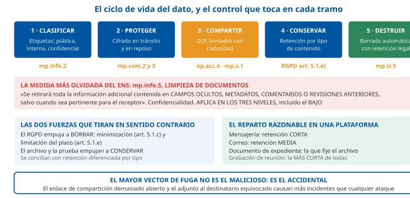

# Tema 40. Herramientas de trabajo en grupo. Sistemas de videoconferencia. Acondicionamiento de salas y equipos

**Bloque:** técnico  
**Enunciado oficial** (BOAM n.º 10.032, de 23 de diciembre de 2025): Herramientas de trabajo en grupo. Sistemas de videoconferencia. Acondicionamiento de salas y equipos.

Versión web: <https://ayuntamientomadrid.github.io/temario-tecnico-auxiliar/temas/tema-40.html> · PDF: [tema-40.pdf](tema-40.pdf) · Test: [../../../tests/tecnico/tema-40.md](../../../tests/tecnico/tema-40.md)

## Índice

- 1. Herramientas de trabajo en grupo
  - 1.1. Arquitectura y modelos de despliegue
  - 1.2. Funcionalidades clave de los entornos colaborativos
  - 1.3. Seguridad y gobernanza del espacio de trabajo
- 2. Sistemas de videoconferencia
  - 2.1. Arquitecturas y principios de videoconferencia
  - 2.2. Protocolos y transporte multimedia
  - 2.3. Códecs y calidad de servicio
  - 2.4. Interoperabilidad e integración
- 3. Acondicionamiento de salas y equipos
  - 3.1. Diseño ambiental y acondicionamiento de salas
  - 3.2. Equipamiento audiovisual e infraestructura
  - 3.3. Accesibilidad y mantenimiento de instalaciones
- 4. Marco jurídico y aplicación en la Administración pública
  - 4.1. Las sesiones a distancia de los órganos colegiados
  - 4.2. Protección de datos y grabación de reuniones
  - 4.3. Adecuación al Esquema Nacional de Seguridad
- Los diez datos que no se pueden fallar

### Conceptos clave para memorizar

| Concepto | Dato clave |
|----|----|
| **Qué es una herramienta de trabajo en grupo** | Software que da soporte a un **grupo de personas que persiguen un objetivo común y comparten un entorno**. La disciplina que lo estudia es el **CSCW** (*Computer-Supported Cooperative Work*, término acuñado por **Grief y Cashman en 1984**) y el producto se llama **groupware**. Se descompone en **tres funciones, las 3C**: **comunicación**, **coordinación** y **colaboración** |
| **La matriz de Johansen** | Clasifica el groupware por **dos ejes: el tiempo y el lugar**. Mismo tiempo y mismo lugar: **interacción cara a cara** (sala de reuniones, pizarra). Mismo tiempo y distinto lugar: **interacción síncrona distribuida** (videoconferencia, mensajería, edición simultánea). Distinto tiempo y mismo lugar: **interacción asíncrona** (turnos, tablón). Distinto tiempo y distinto lugar: **interacción asíncrona distribuida** (correo, foro, gestor documental, flujo de trabajo). **Es el esquema de clasificación de referencia** |
| **Los tres modelos de despliegue** | **SaaS** (el proveedor opera todo; la organización solo configura), **local** o *on-premise* (la organización opera todo) e **híbrido**. En España el principio rector de las AAPP **no es «nube primero» sino «nube híbrida primero»**, según la **Estrategia de nube híbrida de las Administraciones públicas** (diciembre de 2022) |
| **El precepto que extiende el ENS al proveedor** | **Artículo 2.3 del RD 311/2022**: el ENS se aplica también a **los sistemas de los proveedores privados** cuando prestan servicios o soluciones a las entidades del sector público. La medida específica es **`op.nub.1`** (protección de servicios en la nube), con **`op.ext.1` a `op.ext.4`** para los recursos externos |
| **Identidad federada: los tres protocolos** | **SAML 2.0** (OASIS, 2005; asertos XML; el clásico de la federación en AAPP) · **OpenID Connect** (capa de identidad sobre **OAuth 2.0**, `RFC 6749`, con **JWT**, `RFC 7519`) · **SCIM 2.0** (`RFC 7643` esquema y `RFC 7644` protocolo) para **aprovisionar y desaprovisionar cuentas**. **OAuth 2.0 autoriza, no autentica**: quien autentica es OIDC |
| **Edición concurrente: las tres soluciones** | **Bloqueo** (*check-out*: un solo escritor, cero conflictos, cero simultaneidad) · **Transformación operacional (OT)**, con **servidor central que reordena las operaciones** · **CRDT** (*tipo de datos replicado sin conflictos*), que **converge sin servidor central** y es la base de la edición colaborativa moderna y de los modos sin conexión |
| **Punto a punto, malla, MCU y SFU** | Con **N** participantes: la **malla** exige a cada uno **N−1 subidas y N−1 bajadas** (crece con el cuadrado y **no escala por encima de 4-6**). La **MCU** *mezcla y transcodifica*: **1 subida y 1 bajada** por participante, mucha CPU en el servidor y **una sola composición para todos**. La **SFU** *reenvía sin decodificar*: **1 subida y N−1 bajadas**, poca CPU, **maquetación libre en cada cliente** y **simulcast** para adaptarse a cada receptor. **La SFU es la arquitectura dominante hoy** |
| **H.323 frente a SIP** | **H.323** (**UIT-T**, versión vigente **8, de marzo de 2022**): arquitectura de **terminal, pasarela (*gateway*), controlador de acceso (*gatekeeper*) y unidad de control multipunto (MCU)**, codificación **binaria ASN.1/PER**, señalización **H.225.0** y control **H.245**. **SIP** (**IETF**, `RFC 3261`, 2002): **texto**, inspirado en HTTP, describe la sesión con **SDP** (**`RFC 8866`, que obsoletó a la `RFC 4566`**) mediante el modelo **oferta/respuesta** (`RFC 3264`). **Ninguno de los dos transporta media**: eso lo hace **RTP** (`RFC 3550`) |
| **WebRTC** | Conjunto de normas **W3C** (API de JavaScript) e **IETF** (protocolos), publicado como **bloque de RFC en enero de 2021**: `RFC 8825` visión general, `8826` y `8827` seguridad, `8834` RTP, `8835` transportes, `8831` canales de datos, `8837` marcado **DSCP**. **JSEP** es hoy la **`RFC 9429`** (abril de 2024), que **obsoletó a la `RFC 8829`**. **No define señalización**: la deja a la aplicación. **El cifrado es obligatorio**: **DTLS-SRTP** (`RFC 5764` y `RFC 3711`) |
| **Códecs obligatorios en WebRTC** | **Audio** (`RFC 7874`): **Opus** (`RFC 6716`) y **G.711**. **Vídeo** (`RFC 7742`): **VP8** (`RFC 6386`) **y H.264 Constrained Baseline** — los **dos**, para garantizar que dos navegadores cualesquiera se entiendan |
| **Ancho de banda de vídeo, orden de magnitud** | **H.264/AVC**: **360p ≈ 0,5 Mbit/s · 720p ≈ 1,5 Mbit/s · 1080p ≈ 3 Mbit/s**. **H.265/HEVC** y **AV1** dan la misma calidad con **≈ la mitad**; **H.266/VVC** (**publicada el 6 de julio de 2020**), con **un 40-50 % menos que HEVC**. El **audio** es despreciable en comparación: **Opus, de 6 a 510 kbit/s**, y **32 kbit/s ya es voz excelente** |
| **Presupuesto de retardo** | La **UIT-T G.114** fija el objetivo en **≤ 150 ms** de boca a oreja para una conversación cómoda; **entre 150 y 400 ms** es aceptable con reservas; **por encima de 400 ms**, inaceptable. **Fluctuación (*jitter*) por debajo de 30 ms** y **pérdida de paquetes por debajo del 1 %** |
| **Marcado DSCP para tiempo real** | `RFC 8837`: **audio EF (46)**, **vídeo AF41 (34)** en flujo de alta prioridad, y **datos** en clases inferiores. El principio que hay que saber: **el audio se prioriza por encima del vídeo**, porque una reunión sin vídeo funciona y sin audio no |
| **Travesía de NAT** | **STUN** (`RFC 8489`) descubre la dirección pública: es **barato** y no lleva tráfico. **TURN** (`RFC 8656`) **retransmite todo el media** cuando no hay camino directo: es **caro** y hay que dimensionarlo. **ICE** (`RFC 8445`) es el **algoritmo que prueba los candidatos y elige el mejor camino** |
| **Tiempo de reverberación exigible** | **CTE, Documento Básico HR** (RD 1371/2007): en **aulas y salas de conferencias vacías** de volumen **menor que 350 m³**, **T ≤ 0,7 s**; **incluyendo el total de las butacas**, **T ≤ 0,5 s**; en restaurantes y comedores vacíos, **T ≤ 0,9 s**. Por encima de **350 m³** la sala exige **estudio específico** |
| **Iluminación de una sala de reuniones** | **UNE-EN 12464-1:2022**: **500 lx** de iluminancia mantenida, **UGR ≤ 19** (deslumbramiento), **Uo ≥ 0,60** (uniformidad) y **Ra ≥ 80** (reproducción cromática), medidos sobre el **plano de trabajo a 0,85 m** |
| **DISCAS: el tamaño de la pantalla** | **ANSI/AVIXA V202.01** (edición vigente **:2026**; formulación de la edición **:2016**). Dos categorías: **decisión básica (BDM)** y **decisión analítica (ADM)**. **BDM**: `IH = FV / (200 × %EH)`, con **factor de agudeza 200**. **ADM**: `IH = (IR × FV) / 3438`, con **factor de agudeza 3438** (los minutos de arco que hay en un radián). **Espectador más cercano**: `CV = (IH + IO) × 1,732`, y **ningún espectador a más de 60° respecto de cualquier punto de la imagen** |
| **Accesibilidad de la sala y de la plataforma** | **EN 301 549** (versión armonizada citada en el DOUE: **V3.2.1, de marzo de 2021**; en España, **UNE-EN 301549:2022**), aplicable por el **RD 1112/2018** a los sitios y aplicaciones del sector público. **RD 193/2023**, exigible en bienes y servicios **nuevos de titularidad pública desde el 1 de enero de 2025** y en los existentes susceptibles de ajuste razonable **antes del 1 de enero de 2026**. **Ley 11/2023** (transposición de la Directiva (UE) 2019/882), cuyo **título I es aplicable desde el 28 de junio de 2025** |
| **Sesiones a distancia: los dos regímenes** | **Art. 17.1 de la Ley 40/2015** (régimen **general**): los órganos colegiados pueden reunirse a distancia **como regla ordinaria**, siempre que se asegure **la identidad, el contenido de las manifestaciones, el momento en que se producen, la interactividad e intercomunicación en tiempo real y la disponibilidad de los medios durante la sesión**; el **apartado 5** sitúa el acuerdo **en la sede del órgano**. **Art. 46.3 de la Ley 7/1985 (LBRL)** (régimen **local, más estricto**): solo ante **fuerza mayor, grave riesgo colectivo o catástrofe pública**, con los miembros **en territorio español** y garantizando el **carácter público o secreto** de la sesión |
| **Las medidas del ENS que tocan este tema** | **`mp.if.3`** *acondicionamiento de los locales* (temperatura y humedad, amenazas del análisis de riesgos y **protección del cableado**), **`mp.if.1`** áreas separadas y **`mp.if.2`** identificación de las personas · **`mp.eq.4`** *otros dispositivos conectados a la red*, que **nombra expresamente los «dispositivos multimedia: proyectores, altavoces inteligentes»** · **`mp.eq.1`** puesto de trabajo despejado · **`mp.s.1`** correo electrónico y **`mp.s.2`** servicios web · **`mp.info.5`** **limpieza de documentos** (metadatos, campos ocultos, comentarios y revisiones anteriores) · **`mp.com.2`** y **`mp.com.3`** · **`op.exp.8`** registro de la actividad · **`op.nub.1`** y **`op.ext.1-4`** |
| **Cifrado extremo a extremo de la colaboración** | **MLS** (*Messaging Layer Security*, **`RFC 9420`, julio de 2023**) para la **mensajería de grupo**, y **SFrame** (*Secure Frame*, **`RFC 9605`, agosto de 2024**) para el **media en tiempo real**. Son las dos piezas que permiten que **ni siquiera la SFU vea el contenido**, y **prácticamente ningún temario del mercado las recoge** |

## Contenido

### Convenciones del documento

Este tema incluye cuatro tipos de **cajas callout** para facilitar el estudio:

> **Dato clave.** Información de alta densidad memorística: numeración de RFC y de recomendaciones de la UIT, tasas binarias, umbrales de retardo, valores acústicos y lumínicos, plazos normativos y códigos del ENS.

> **Ejercicio resuelto.** Problema resuelto paso a paso: dimensionar el ancho de banda de una reunión, calcular el tamaño de una pantalla, decidir entre MCU y SFU, contar flujos en una malla.

> **Ejemplo de aplicación en el ayto.** Aplicación de la teoría al entorno municipal (Salón de Plenos, Junta Municipal de Distrito, Oficina de Atención a la Ciudadanía, sala de formación del IAM, teletrabajo del personal municipal).

> **Relación con otros temas.** Enlace conceptual a otros temas del temario oficial.

**Cómo leer este tema.** El enunciado oficial encadena **tres materias que parecen inconexas y no lo son**: unas herramientas informáticas, un sistema de comunicación y una obra civil. Lo que las une es que **las tres describen el mismo objeto visto desde tres distancias distintas**: el trabajo de un grupo de personas que no está en el mismo sitio. La primera parte responde a *con qué software se organiza ese grupo*; la segunda, a *cómo viaja su voz y su imagen*; y la tercera, a *qué tiene que cumplir la habitación física desde la que uno de ellos se conecta*. Un opositor que estudie las tres por separado se llevará tres montones de datos sueltos; uno que las estudie como tres capas del mismo problema entenderá por qué la tercera existe —porque **la calidad percibida de una reunión a distancia la determina casi siempre la sala, no la red**— y responderá mejor a los casos prácticos.

**Dónde está el peso del tema.** No en el mismo sitio en la parte teórica y en la práctica. En la **teórica**, lo rentable es la **clasificación** (la matriz de tiempo y lugar del *groupware*, la escala punto a punto / malla / MCU / SFU, la diferencia entre H.323 y SIP) y el **dato cerrado** (número de RFC, tasa binaria, umbral de retardo, valor de reverberación, plazo normativo). En la **práctica**, lo rentable es el **cálculo sencillo y el diagnóstico**: cuántos flujos genera una reunión, cuánto ancho de banda necesita, por qué se oye eco, qué medida del ENS incumple un altavoz inteligente instalado en una sala de juntas. Este tema está escrito para que las dos cosas se puedan estudiar del mismo texto.

**Un aviso sobre la volatilidad.** Es el tema del temario en el que más tienta escribir nombres de producto, y el que más rápido envejece si se hace. Aquí se ha evitado deliberadamente: se describen **arquitecturas, protocolos y normas**, que duran, y no versiones comerciales, que no. Cuando ha hecho falta ejemplificar con una plataforma concreta se ha hecho de forma genérica —«una suite ofimática en la nube»— con una única excepción justificada: las **guías CCN-STIC de la serie 885**, que se citan porque son documentos oficiales españoles y porque su sola existencia es un dato examinable.

**Fronteras con otros temas, declaradas de entrada.** Este tema toca de refilón media docena de materias que el temario oficial atribuye a otros temas. El reparto adoptado, para que el solapamiento no se lea ni como omisión ni como repetición:

- El **Tema 31** cubre los **paradigmas de computación distribuida y los servicios en la nube**: IaaS, PaaS, SaaS y los tipos de nube. Aquí esos modelos se recorren **solo como decisión de despliegue** de una herramienta de trabajo en grupo, y en §1.1.1 se dedican a ello unos párrafos, no una sección.
- El **Tema 32** cubre la **seguridad de los sistemas, la criptografía y la firma**. Aquí DTLS, SRTP, MLS y SFrame se citan **por lo que hacen**, no por cómo cifran.
- Los **Temas 33, 34 y 37** cubren las **comunicaciones**, la **pila de protocolos** y las **redes locales con su cableado**. Aquí solo aparece lo que el media en tiempo real exige de la red: retardo, fluctuación, pérdida y marcado de prioridad.
- El **Tema 36** cubre la **seguridad perimetral, el acceso remoto y las VPN**. Aquí solo la travesía de NAT y de cortafuegos del media, en §2.2.2.
- El **Tema 25** cubre la **accesibilidad, el diseño universal y la usabilidad** como materia. Aquí, en §3.3.1, solo su aplicación a una sala multimedia y a una plataforma de reunión.
- El **Tema 39** cubre los **principios del ENS y del ENI** y el **Tema 29** la **gestión de incidencias**. Aquí se citan las medidas concretas que recaen sobre este objeto, y el mantenimiento del parque de salas como caso particular de la gestión del servicio.

**Caso de referencia usado en todo el tema** (contexto Ayuntamiento de Madrid, supuesto simplificado): el **Ayuntamiento despliega una plataforma corporativa de trabajo en grupo** para sus empleados —correo, mensajería, calendario, repositorio documental y reuniones— y, en paralelo, **acondiciona el Salón de Sesiones de una Junta Municipal de Distrito** para que pueda celebrar sesiones a distancia y **cinco salas de reunión pequeñas** en el edificio de la Junta. Ese escenario permite instanciar todo el tema: la elección del modelo de despliegue y la identidad federada (§1.1), el trabajo diario del personal (§1.2), la gobernanza y la protección de la información municipal (§1.3), la arquitectura y los protocolos de la sesión (§2), la acústica, la iluminación, las pantallas, el audio y la accesibilidad de la sala (§3) y las reglas jurídicas que hacen válida —o nula— una sesión celebrada así (§4).

------------------------------------------------------------------------

### 1. Herramientas de trabajo en grupo

**Definición.** Una **herramienta de trabajo en grupo**, o **groupware**, es un sistema informático que **da soporte a un conjunto de personas comprometidas en una tarea u objetivo común y que les proporciona una interfaz a un entorno compartido** \[ELLIS\]. Las dos mitades de la definición son igual de importantes, en especial la segunda: no basta con que varias personas usen el mismo programa —eso lo hace también un procesador de textos instalado en cien equipos—; hace falta que exista un **entorno compartido**, es decir, un espacio de información que todas ven, que todas pueden modificar y en el que **la acción de una es visible para las demás**.

La disciplina que estudia este software se llama **CSCW** (*Computer-Supported Cooperative Work*, «trabajo cooperativo asistido por ordenador»), término acuñado en **1984** por **Irene Grief y Paul Cashman** en el taller que reunió por primera vez a quienes trabajaban en el asunto desde la informática, la sociología del trabajo y la psicología \[GREIF\]. Conviene retener la distinción: **CSCW es la disciplina; *groupware* es el producto**.

**Las tres funciones: el modelo de las 3C.** Toda herramienta de trabajo en grupo se descompone en tres funciones, y casi todas las clasificaciones que circulan son variantes de esta (ver **diagrama D1**):

1.  **Comunicación.** Intercambiar información entre personas. Es la función más antigua y la más visible: correo, mensajería, foro, videoconferencia. Su unidad es **el mensaje**.
2.  **Coordinación.** Organizar quién hace qué y cuándo, de modo que el esfuerzo de unos no anule el de otros. Calendario, gestión de tareas, flujo de trabajo, asignación de turnos. Su unidad es **la tarea o el evento**.
3.  **Colaboración.** Producir conjuntamente un resultado. Edición compartida de un documento, pizarra común, repositorio con control de versiones. Su unidad es **el artefacto**: el objeto que el grupo construye.

La utilidad práctica de esta descomposición es diagnóstica. Cuando una organización se queja de que «la herramienta no funciona», casi siempre lo que falla es **la coordinación**, no la comunicación: hay mensajes de sobra y nadie sabe quién tiene que hacer qué.

**La clasificación canónica: la matriz de Johansen.** En 1988 **Robert Johansen** propuso clasificar el *groupware* según **dos ejes independientes, el tiempo y el lugar**, cada uno con dos valores \[GREIF\]. El resultado es una tabla de cuatro celdas que sigue siendo, cuarenta años después, **el esquema de clasificación de referencia** (ver **diagrama D1**):

|  | **Mismo lugar** | **Distinto lugar** |
|----|----|----|
| **Mismo tiempo** (síncrono) | **Interacción cara a cara**: sala de reuniones, pizarra, sistemas de apoyo a la decisión en grupo, mesa interactiva | **Interacción síncrona distribuida**: videoconferencia, mensajería instantánea, pizarra compartida, edición simultánea, compartición de pantalla |
| **Distinto tiempo** (asíncrono) | **Interacción asíncrona**: tablón de anuncios, turnos de trabajo sobre un mismo puesto, quiosco compartido | **Interacción asíncrona distribuida**: correo electrónico, foro, repositorio documental, flujo de trabajo, wiki, gestor de tareas |

> **Dato clave.** De la matriz de Johansen hay que saber **los dos ejes** (tiempo y lugar), **las cuatro celdas** y, sobre todo, **saber colocar en su celda una herramienta concreta que dé el enunciado**. Los dos casos que más se fallan son el **correo electrónico** —asíncrono y distribuido, esquina inferior derecha— y la **pizarra compartida en línea**, que es **síncrona y distribuida** si varios escriben a la vez, pero pasa a asíncrona si se usa como tablón. Un ejemplo: «una wiki municipal en la que varios departamentos redactan un procedimiento, cada uno cuando puede, ¿en qué cuadrante está?». Respuesta: **distinto tiempo y distinto lugar**.

**Por qué existe este software en una Administración.** No es una moda de gestión: hay un fundamento jurídico directo. El **artículo 47 bis del TREBEP**, introducido por el Real Decreto-ley 29/2020, define el **teletrabajo** como la modalidad de prestación de servicios a distancia en la que «el contenido competencial del puesto de trabajo puede desarrollarse \[...\] fuera de las dependencias de la Administración, mediante el uso de tecnologías de la información y comunicación», lo somete a **autorización expresa**, lo declara **voluntario y reversible** salvo supuestos excepcionales justificados, lo remite a **negociación colectiva** y —el apartado que interesa aquí— obliga a que «la Administración proporcionará y mantendrá a las personas que trabajen en esta modalidad, **los medios tecnológicos necesarios para su actividad**» \[TREBEP\]. Esa obligación es la que convierte la plataforma de trabajo en grupo en **infraestructura administrativa**, no en una comodidad.

> **Relación con otros temas.** El régimen jurídico del personal al servicio de la Administración, y con él el artículo 47 bis del TREBEP en su contexto completo, es materia del **Tema 5**. La **desconexión digital** del artículo 88 de la LOPDGDD, que es la contrapartida del teletrabajo, se retoma en §1.3 de este mismo tema.

#### 1.1. Arquitectura y modelos de despliegue

La primera decisión de una organización que va a implantar una herramienta de trabajo en grupo no es qué producto compra, sino **dónde vive el servicio y quién lo opera**. Esa decisión condiciona todo lo demás: el coste, la velocidad de despliegue, el régimen jurídico de los datos, las obligaciones de seguridad y hasta la forma de dar de alta a un empleado.

##### 1.1.1. Modelos de servicio en la nube, locales e híbridos

**Los tres modelos.** La escala clásica tiene tres posiciones (ver **diagrama D2**):

1.  **Local** (*on-premise*). La organización instala el software en sus propios servidores, en su propio centro de proceso de datos, y **lo opera íntegramente**: sistema operativo, base de datos, aplicación, copias de seguridad, actualizaciones y capacidad. Es el modelo tradicional del correo corporativo y del servidor de ficheros.
2.  **Servicio en la nube**, normalmente en la modalidad de **software como servicio** (**SaaS**). El proveedor opera **toda la pila**; la organización solo **configura** el servicio y **administra a sus usuarios y sus datos**. Es el modelo dominante hoy en las suites de trabajo en grupo.
3.  **Híbrido**. Una parte del servicio se presta desde la nube y otra permanece en las instalaciones propias, con una identidad y unas políticas comunes. Los repartos habituales: los **documentos sensibles** se quedan dentro y el resto sale; o bien el **directorio de identidad** se queda dentro y las aplicaciones salen.

**Lo que de verdad cambia entre ellos: la frontera de responsabilidad.** El concepto que hay que saber explicar es el de **responsabilidad compartida**. En un servicio en la nube, la seguridad no se delega entera: **el proveedor responde de la seguridad *del* servicio y la organización, de la seguridad *en* el servicio**. El proveedor garantiza que la plataforma está parcheada, que el centro de datos es seguro y que hay redundancia; la organización sigue siendo responsable de **quién tiene cuenta, con qué permisos, con qué política de conservación, con qué configuración de compartición externa y con qué copia de seguridad de sus propios contenidos**. La mayoría de los incidentes de una plataforma colaborativa no son fallos del proveedor: son **carpetas compartidas con «cualquiera que tenga el enlace»**, que es responsabilidad íntegra del cliente.

**El régimen español: no es «nube primero».** Este es un dato que distingue un material bien hecho de uno copiado. La **Estrategia de nube híbrida de las Administraciones públicas**, de diciembre de 2022, articulada en **siete pilares y diecinueve iniciativas**, no adopta el principio anglosajón de *cloud first* sino el de **«nube híbrida primero»**: la Administración debe poder combinar nube pública, nube privada —**NubeSARA** es la nube privada de las Administraciones— e infraestructura propia, eligiendo en cada caso según la criticidad y la naturaleza del dato \[ESTRATEGIA-NUBE\]. Quien conteste «cloud first» en un examen de una Administración española estará contestando el principio de otro país.

**La consecuencia jurídica: el ENS alcanza al proveedor.** El **artículo 2.3 del Real Decreto 311/2022** extiende el Esquema Nacional de Seguridad a **los sistemas de información de los proveedores privados cuando prestan servicios o proveen soluciones a las entidades del sector público** \[ENS\]. Es decir: cuando el Ayuntamiento contrata una suite de trabajo en grupo en la nube, **el ENS no se queda en la puerta del Ayuntamiento**. Se materializa en dos bloques de medidas del anexo II:

- **`op.nub.1` — Protección de servicios en la nube.** Aplica en **las tres categorías** (BÁSICA, MEDIA y ALTA). Exige que el sistema que presta el servicio cumpla las medidas que correspondan a su modelo —**SaaS, PaaS o IaaS**— según las guías CCN-STIC aplicables, y que, cuando el servicio lo suministre un tercero, sus sistemas **sean conformes con el ENS** o cumplan una guía CCN-STIC que incluya, entre otros, requisitos de **auditoría de pruebas de penetración, transparencia, cifrado y gestión de claves y jurisdicción de los datos**. El **refuerzo R1** (categoría MEDIA en adelante) exige **servicios certificados** bajo una metodología reconocida por el Organismo de Certificación del Esquema Nacional de Evaluación y Certificación; el **refuerzo R2** (ALTA), configuración conforme a una guía CCN-STIC específica.
- **`op.ext.1` a `op.ext.4` — Recursos externos.** Contratación y **acuerdos de nivel de servicio** (`op.ext.1`), **gestión diaria** (`op.ext.2`), **protección de la cadena de suministro** (`op.ext.3`, que **solo aplica en categoría ALTA**) e **interconexión de sistemas** (`op.ext.4`). Ninguna de las cuatro aplica en categoría BÁSICA.

> **Dato clave.** Los **cuatro requisitos** que `op.nub.1.2` exige a la guía CCN-STIC cuando el servicio lo presta un tercero son: **auditoría de pruebas de penetración**, **transparencia**, **cifrado y gestión de claves** y **jurisdicción de los datos**. Y la trampa habitual: `op.nub.1` **aplica ya en categoría BÁSICA**; lo que no aplica en BÁSICA son las medidas de **recursos externos** `op.ext.1` a `op.ext.4`, y `op.ext.3` **solo aplica en ALTA**.

**Las guías que materializan todo esto.** El Centro Criptológico Nacional publica guías de configuración segura por producto, y su existencia es en sí misma un dato examinable: la serie **CCN-STIC-885** cubre la suite ofimática en la nube más extendida —**885A** para la suite en conjunto, **885B** para el repositorio documental, **885C** para el correo y **885D**, específicamente, **para la herramienta de reuniones y trabajo en equipo**—, y la **CCN-STIC-823** trata la utilización de servicios en la nube en general \[CCN-885D\]. Que exista una guía oficial española dedicada a configurar una plataforma de trabajo en equipo conforme al ENS dice mucho de cuánto pesa este asunto en la Administración real.

> **Ejemplo de aplicación en el ayto.** El Ayuntamiento tiene que decidir el modelo de despliegue de la plataforma corporativa. Un análisis honesto no da un ganador único, sino un reparto. El **correo, la mensajería, el calendario y las reuniones** son buenos candidatos a **SaaS**: son servicios de disponibilidad crítica, con picos, que se benefician de la escala del proveedor y cuya información, aun siendo sensible, es sobre todo organizativa. El **repositorio de expedientes** con datos de vecinos es otra cosa: ahí pesa la **jurisdicción de los datos**, el `mp.info.1` y la **evaluación de impacto** del artículo 35 del RGPD, y la respuesta razonable suele ser **nube privada o instalación propia**. Y el **directorio de identidad** conviene que sea **la fuente de la verdad interna**, federada hacia fuera, para que un empleado que causa baja pierda el acceso a todo en un solo sitio. El resultado es exactamente lo que la Estrategia nacional llama **híbrido**, y no es una componenda: es el modelo recomendado.

##### 1.1.2. Gestión de identidades y control de acceso federado

Si el servicio vive fuera y las personas están dentro, hay que resolver un problema que en el modelo local no existía: **cómo demuestra una persona ante un sistema ajeno que es quien dice ser, sin que ese sistema custodie su contraseña**. La respuesta se llama **federación de identidad** y descansa en tres protocolos que hay que saber distinguir (ver **diagrama D3**).

**Los papeles.** En toda federación hay tres actores: el **proveedor de identidad** (la organización, que sabe quién es cada empleado y guarda sus credenciales), el **proveedor de servicio** o **parte confiante** (la plataforma, que necesita saberlo pero no quiere custodiarlo) y el **usuario**. La idea central es que **la credencial nunca llega al proveedor de servicio**: lo que llega es una **afirmación firmada** del proveedor de identidad diciendo «esta persona se ha autenticado ante mí, se llama así y pertenece a este grupo».

**SAML 2.0.** Norma de **OASIS**, publicada en **marzo de 2005**, basada en **XML** \[SAML2\]. Su unidad es el **aserto** (*assertion*), que puede ser de **autenticación**, de **atributo** o de **decisión de autorización**. El perfil más usado es el de **navegador con POST**: el usuario intenta entrar en la plataforma, esta lo redirige al proveedor de identidad de su organización, allí se autentica, y el navegador entrega de vuelta a la plataforma un aserto XML firmado. Es **el protocolo clásico de la federación en la Administración** y sigue siendo el que sostienen la mayoría de las integraciones corporativas.

**OAuth 2.0 y OpenID Connect.** Aquí está la distinción que más se falla. **OAuth 2.0** (`RFC 6749`) es un marco de **autorización delegada**: sirve para que una aplicación obtenga permiso para actuar **en nombre de** un usuario sobre un recurso de terceros —«esta herramienta de calendario puede leer mis eventos»— mediante un **testigo de acceso**. Define cuatro papeles: **propietario del recurso**, **cliente**, **servidor de autorización** y **servidor de recursos** \[RFC6749\]. Lo que **no** hace es autenticar: OAuth 2.0 no dice *quién eres*, dice *qué puede hacer esta aplicación*. **OpenID Connect** es la **capa de identidad construida encima**: añade un **testigo de identidad** (*ID token*) en formato **JWT** (`RFC 7519`, un objeto JSON firmado y compacto), un punto final de **información de usuario** y un mecanismo de **descubrimiento** del proveedor \[OIDC\] \[RFC7519\].

> **Dato clave.** La frase que hay que llevar memorizada: **«OAuth 2.0 autoriza; OpenID Connect autentica; SCIM aprovisiona»**. Y el dato de apoyo: el testigo de identidad de OpenID Connect es un **JWT**, definido en la **`RFC 7519`**; el marco OAuth 2.0 es la **`RFC 6749`**, de octubre de 2012.

**SCIM 2.0: el que casi nadie estudia y siempre falta.** Federar la autenticación resuelve el inicio de sesión, pero **no crea ni borra cuentas**. De eso se ocupa **SCIM** (*System for Cross-domain Identity Management*), definido en dos RFC de septiembre de 2015: la **`RFC 7643`**, que fija el **esquema** de usuario y de grupo, y la **`RFC 7644`**, que fija el **protocolo**, una API REST sobre JSON con operaciones de creación, consulta, modificación y borrado \[RFC7643\]. Su valor práctico es exactamente el que su nombre no sugiere: **cuando un empleado causa baja en el sistema de personal, SCIM propaga automáticamente el desaprovisionamiento a la plataforma en la nube**. Sin SCIM, esa baja depende de que alguien se acuerde de hacerla a mano, que es la causa raíz de una fracción sustancial de las cuentas huérfanas que encuentra cualquier auditoría.

**Lo que el ENS exige aquí.** Dos medidas de la familia de control de acceso: **`op.acc.5`**, mecanismo de autenticación para **usuarios externos**, y **`op.acc.6`**, para **usuarios de la organización**, ambas con dimensiones **CITA** y con refuerzos crecientes que empujan hacia el **segundo factor** \[ENS\]. En una plataforma colaborativa expuesta a internet, la autenticación **multifactor** no es una recomendación de buenas prácticas: es la forma normal de cumplir estas medidas en categoría MEDIA y ALTA.

> **Ejercicio resuelto.** *Enunciado.* Una Junta de Distrito convoca a un colegio profesional externo a una reunión periódica en la plataforma municipal. ¿Qué opciones hay para que esas personas entren, y cuál procede? *Razonamiento.* Hay tres, y se ordenan de peor a mejor. **(a) Crear cuentas municipales a los externos.** Es lo peor: se convierten en identidades del Ayuntamiento, hay que gestionarlas, mantenerlas y, sobre todo, **acordarse de borrarlas**; es la fábrica clásica de cuentas huérfanas. **(b) Enlace público de invitado sin autenticación.** Rápido y cómodo, pero cualquiera con el enlace entra: incompatible con `op.acc.5` en cuanto la información tenga algún nivel, y con el control del aforo de una reunión de trabajo. **(c) Federación con el proveedor de identidad del colegio profesional, o acceso de invitado autenticado con verificación por un segundo factor y caducidad.** Es la correcta. *Solución.* **(c)**. Con dos matices que el corrector valora: el acceso de invitado debe llevar **fecha de caducidad** y **revisión periódica**, porque una invitación sin vencimiento es una cuenta huérfana con otro nombre; y los invitados deben quedar **claramente identificados como externos en la interfaz de la reunión**, porque una parte del riesgo de fuga de información en una reunión no es técnico sino de percepción: la gente habla distinto cuando sabe que hay alguien de fuera.

#### 1.2. Funcionalidades clave de los entornos colaborativos

Resuelto el dónde y el quién, queda el qué. Las funciones de una plataforma de trabajo en grupo se pueden agrupar siguiendo las **3C**, y así se ordenan los tres subepígrafes que siguen: **comunicación** (§1.2.1), **colaboración** sobre documentos (§1.2.2) y **coordinación** de tareas y procesos (§1.2.3).

##### 1.2.1. Comunicación e intercambio de información síncrono y asíncrono

**La distinción que ordena todo.** Un canal es **síncrono** si exige que las partes estén presentes a la vez, y **asíncrono** si no. La diferencia no es solo técnica: determina **el coste de interrupción**, que es el problema real de una organización moderna. Un canal síncrono impone un turno inmediato al receptor; uno asíncrono le deja decidir cuándo atiende. Una plataforma bien gobernada define **qué se comunica por cada canal**, y una mal gobernada lo convierte todo en síncrono (ver **diagrama D4**).

**Los canales asíncronos.**

- **Correo electrónico.** Sigue siendo la herramienta asíncrona universal y **el único canal verdaderamente interoperable entre organizaciones distintas**. Se apoya en **SMTP** para el transporte (`RFC 5321`), en el **formato de mensaje de internet** (`RFC 5322`) y, en el acceso del cliente, en **IMAP**, cuya versión vigente es **IMAP4rev2**, definida en la **`RFC 9051`** de agosto de 2021, que **obsoletó la `RFC 3501`** \[RFC9051\]. Es también, por eso mismo, la superficie de ataque más grande de cualquier organización, lo que explica que el ENS le dedique una medida propia (§1.3.1).
- **Foros y espacios de discusión persistentes.** Conversación organizada por tema y no por destinatario, con historial. Su ventaja sobre el correo es que **el conocimiento queda en un sitio y no en cien buzones**.
- **Wikis y bases de conocimiento.** Escritura colectiva de contenido duradero, con historial de versiones y atribución. Distinto tiempo, distinto lugar.

**Los canales síncronos.**

- **Mensajería instantánea con presencia.** El protocolo abierto de referencia es **XMPP**, definido en la **`RFC 6120`** (núcleo) y la **`RFC 6121`** (mensajería y presencia), con identificadores de la forma `usuario@dominio/recurso` y **federación entre servidores** al estilo del correo \[RFC6120\]. Su extensión **XEP-0045** define la **sala de conversación multiusuario** \[XMPP-SF\]. La mayoría de las plataformas comerciales usan protocolos propios, pero **el vocabulario de referencia es el de XMPP**: contacto, presencia, disponibilidad, sala.
- **Videoconferencia y compartición de pantalla.** Es la sección §2 completa.
- **Pizarra compartida y edición simultánea.** Es §1.2.2.

**El concepto de presencia.** Merece atención propia porque es lo que hace utilizable un canal síncrono: **el estado publicado de disponibilidad de una persona**. Los estados canónicos —disponible, ausente, ocupado, no molestar, sin conexión— proceden del modelo de XMPP y se formalizan en el **formato de información de presencia (PIDF)**, `RFC 3863`, con su paquete de eventos para SIP en la `RFC 3856`. La presencia tiene una cara oscura que la LOPDGDD obliga a mirar: **es un dato sobre la actividad del trabajador**, y su uso para control de jornada o de productividad entra de lleno en el ámbito del artículo 87 (intimidad frente al uso de dispositivos) y del artículo 88 (**desconexión digital**) \[RGPD\].

**El transporte de la señalización moderna.** Casi todas las plataformas actuales sostienen la conversación y la actualización en vivo sobre **WebSocket** (`RFC 6455`), un canal bidireccional y persistente que se abre promoviendo (*upgrade*) una conexión HTTP y que evita el sondeo continuo del servidor \[RFC6455\]. Es un dato pequeño pero importante: **la señalización de una reunión y el «alguien está escribiendo» viajan normalmente por WebSocket, no por HTTP convencional**.

> **Dato clave.** Cuatro numeraciones clave de esta parte: **XMPP núcleo = `RFC 6120`**, **XMPP mensajería y presencia = `RFC 6121`**, **WebSocket = `RFC 6455`** e **IMAP4rev2 = `RFC 9051`** (2021, que obsoletó la 3501). Y una trampa: **XMPP no es un protocolo de videoconferencia**; la señalización multimedia sobre XMPP es su extensión **Jingle** (**XEP-0166**), que es la alternativa federada a SIP.

##### 1.2.2. Gestión documental y edición concurrente

**El problema.** Dos personas abren el mismo documento y escriben a la vez. Sin ningún mecanismo, gana la última que guarda y el trabajo de la otra desaparece: es la **actualización perdida**, el problema clásico de la concurrencia. Hay exactamente **tres familias de solución**, y hay que saber ordenarlas (ver **diagrama D5**).

**1. Bloqueo (control pesimista).** Quien abre el documento lo **reserva** (*check-out*) y nadie más puede escribir hasta que lo devuelve. Es lo que hace el método `LOCK` de **WebDAV** (`RFC 4918`) y lo que hacía el servidor de ficheros de toda la vida \[RFC4918\]. **Ventaja**: no hay conflictos posibles, y es simple de entender y de auditar. **Inconvenientes**: **no hay simultaneidad**, y aparece el problema del **bloqueo huérfano** —alguien reserva un documento, se va de vacaciones y nadie puede tocarlo—, que obliga a temporizadores y a intervención administrativa.

**2. Transformación operacional (OT).** El documento no se transmite entero: se transmiten **operaciones** («inserta la letra *a* en la posición 7», «borra tres caracteres desde la posición 12»). Cuando dos operaciones concurrentes llegan a un mismo punto, **se transforman una contra otra** para que el resultado sea el mismo en todas las réplicas. El planteamiento procede de los trabajos de Ellis y Gibbs \[ELLIS\]. **Ventaja**: simultaneidad real, carácter a carácter. **Inconvenientes**: exige un **servidor central que imponga un orden**, y las funciones de transformación son notoriamente difíciles de escribir sin errores.

**3. CRDT (tipo de datos replicado sin conflictos).** Se diseñan las estructuras de datos de modo que **las operaciones concurrentes conmuten**: da igual en qué orden lleguen, el resultado converge \[SHAPIRO\]. Los hay basados en **estado** —se intercambia la réplica completa y se fusiona con una operación de unión— y basados en **operaciones**. **Ventaja decisiva**: **convergen sin servidor central**, lo que los hace la base natural del **trabajo sin conexión** y de la sincronización entre dispositivos. **Inconveniente**: el coste en metadatos, porque cada elemento arrastra identificadores que permiten ordenarlo sin árbitro.

> **Dato clave.** La comparación se resume así: **el bloqueo evita el conflicto impidiendo la concurrencia**; **la transformación operacional lo resuelve reordenando operaciones y necesita un servidor central**; **el CRDT lo evita por diseño, haciendo que las operaciones conmuten, y no necesita servidor central**. Si el enunciado menciona **modo sin conexión** o **sincronización entre varios dispositivos del mismo usuario**, la respuesta es **CRDT**.

**Lo demás que hace un gestor documental.** Además de resolver la concurrencia, un repositorio de trabajo en grupo debe aportar **control de versiones** con historial y restauración, **metadatos** que permitan clasificar y buscar, **flujos de aprobación**, **retención y purga** (§1.3.1) y **registro de accesos** (§1.3.2). En una Administración hay una obligación añadida: **los formatos**. La **Norma Técnica de Interoperabilidad de Catálogo de estándares** del ENI determina qué formatos puede usar una Administración para el documento que produce y que va a intercambiar o conservar, lo que impide, por ejemplo, cerrar un expediente en un formato propietario cuya lectura dentro de treinta años no esté garantizada \[ENI\].

> **Relación con otros temas.** El **Esquema Nacional de Interoperabilidad**, sus normas técnicas y el concepto de documento y expediente electrónicos son materia del **Tema 39**. La **gestión documental en el procedimiento administrativo** y el registro se tratan en el **Tema 6**.

> **Ejemplo de aplicación en el ayto.** Un pliego de contratación de una Junta de Distrito lo redactan a la vez el servicio gestor, la asesoría jurídica y el técnico del IAM. Con **bloqueo**, trabajarían en fila y el pliego tardaría tres veces más. Con **edición concurrente**, los tres escriben en el mismo documento y el sistema conserva **quién escribió qué**, lo que además tiene valor administrativo: el historial de versiones documenta la intervención de cada unidad. Pero hay un matiz que conviene enseñar: **el documento que se firma y se publica no es el documento colaborativo**. En algún momento hay que **congelar una versión**, exportarla al formato que exija el catálogo de estándares del ENI y **limpiarla de metadatos y comentarios** antes de que salga —que es exactamente lo que ordena la medida `mp.info.5` del ENS, y se detalla en §1.3.1—.

##### 1.2.3. Planificación, gestión de tareas y flujos de trabajo

Es la **C de coordinación**, y en la práctica es la que decide si una implantación se percibe como útil o como ruido.

**El calendario y la invitación.** Detrás de algo tan cotidiano como convocar una reunión hay una pila normalizada. El formato del objeto de calendario es **iCalendar**, definido en la **`RFC 5545`**, cuya unidad es el componente **`VEVENT`** —con sus propiedades `DTSTART`, `DTEND`, `SUMMARY`, `LOCATION`, `ORGANIZER`, `ATTENDEE` y `RRULE` para la repetición—. El **protocolo de interoperabilidad** que gobierna la conversación entre organizador y asistentes es **iTIP** (`RFC 5546`), con sus métodos **`REQUEST`**, **`REPLY`**, **`CANCEL`** y **`COUNTER`**, y los estados de participación **`NEEDS-ACTION`**, **`ACCEPTED`**, **`DECLINED`** y **`TENTATIVE`**. Cuando ese diálogo viaja por correo electrónico se llama **iMIP** (`RFC 6047`). Y el acceso al calendario alojado en un servidor es **CalDAV** (`RFC 4791`), una extensión de WebDAV, con su hermano **CardDAV** (`RFC 6352`) para los contactos \[RFC5545\] \[RFC4918\].

> **Dato clave.** La pila del calendario, en cadena: **iCalendar = formato (`RFC 5545`)**, **iTIP = protocolo de la invitación (`RFC 5546`)**, **iMIP = iTIP sobre correo (`RFC 6047`)**, **CalDAV = acceso al calendario del servidor (`RFC 4791`)** y **CardDAV = lo mismo para contactos (`RFC 6352`)**. Es también la respuesta técnica a por qué una invitación enviada desde una plataforma se puede aceptar desde otra distinta: **porque el formato y el protocolo están normalizados, aunque las plataformas no lo estén**.

**La gestión de tareas.** Sus elementos son siempre los mismos: la **tarea** con responsable, fecha límite y estado; la **dependencia** entre tareas; el **tablero** que hace visible el estado del conjunto; y la **métrica** de avance. Los dos enfoques dominantes son el **tablero de flujo** —columnas de estado por las que la tarea avanza, con límite de trabajo en curso— y la **planificación temporal** con diagrama de barras y ruta crítica. Basta con distinguir la finalidad de cada uno: el tablero optimiza **el flujo**, la planificación optimiza **el plazo**.

**El flujo de trabajo.** Es el escalón siguiente y el que más valor tiene en una Administración: **la automatización de una secuencia de pasos con reglas, responsables y condiciones**. Una petición se crea, se enruta al responsable que corresponda según una regla, este aprueba o rechaza, y el sistema notifica y registra. Sus componentes son el **modelo del proceso**, el **motor** que lo ejecuta, la **bandeja de tareas** de cada actor y la **traza**. La conexión con el procedimiento administrativo es evidente y no es casual: un flujo de trabajo bien modelado es **un procedimiento administrativo interno hecho ejecutable**, con la ventaja añadida de que deja **prueba automática de quién hizo qué y cuándo**, que es justo lo que exige `op.exp.8`.

> **Relación con otros temas.** El **procedimiento administrativo** —concepto, fases, plazos y recursos— es materia del **Tema 7**. El **modelado de procesos y los diagramas de flujo** se tratan en el **Tema 16**.

> **Ejemplo de aplicación en el ayto.** La solicitud de teletrabajo del artículo 47 bis del TREBEP es un candidato de manual a flujo de trabajo: la persona la presenta, la jefatura informa, recursos humanos verifica el cumplimiento de los criterios objetivos acordados en negociación colectiva, y se resuelve autorizando o denegando. Modelado como flujo, el sistema garantiza tres cosas que un circuito por correo no garantiza: que **no se salte ningún paso**, que **haya plazo y aviso** en cada uno, y que quede **traza completa**, que es lo que permite acreditar después que los criterios se aplicaron por igual. Es un buen ejemplo de que la herramienta de trabajo en grupo no es solo comodidad: **es garantía procedimental**.

#### 1.3. Seguridad y gobernanza del espacio de trabajo

Un espacio de trabajo compartido concentra, en un solo sitio y con acceso desde internet, **el correo, los documentos, las conversaciones y las reuniones de toda la organización**. Eso lo convierte en el objetivo más valioso que tiene, y explica por qué la seguridad de estas plataformas no es un apéndice de su administración sino la mitad del trabajo.

##### 1.3.1. Prevención de fugas de datos y políticas de conservación

**El ciclo de vida de la información.** La forma ordenada de plantear esta materia es seguir el dato desde que nace hasta que se destruye, y colocar en cada tramo el control que corresponde (ver **diagrama D6**): **clasificación** → **protección en uso y en tránsito** → **control de la compartición** → **conservación** → **destrucción**.

**Clasificación y etiquetado.** No se puede proteger lo que no se ha clasificado. El ENS lo formula como medida: **`mp.info.2`, calificación de la información**, con dimensión de **confidencialidad**, que **no aplica en nivel BAJO** y sí en MEDIO y ALTO \[ENS\]. En la práctica se materializa en **etiquetas** aplicadas al documento o al contenedor —pública, de uso interno, confidencial— de las que cuelgan políticas automáticas: cifrado, prohibición de reenvío, marca de agua o caducidad del acceso.

**Prevención de fugas de datos (DLP).** Es el conjunto de controles que **inspecciona el contenido en movimiento y bloquea o avisa** cuando detecta información que no debería salir. Actúa en tres puntos: **en el punto final** (el equipo del usuario), **en la red** y **en el propio servicio en la nube**. Sus reglas combinan **patrones** —un número de DNI, un número de cuenta bancaria, un número de la Seguridad Social—, **etiquetas de clasificación** y **contexto** (quién, hacia dónde, cuántos elementos a la vez). Las dos lecciones prácticas que conviene retener: la primera, que **el DLP produce falsos positivos** y que una implantación que empieza bloqueando en vez de avisando termina siendo desactivada por presión de los usuarios; y la segunda, que **el mayor vector de fuga no es el malicioso sino el accidental**: el enlace de compartición demasiado abierto y el adjunto al destinatario equivocado.

**La medida del ENS que casi nadie recuerda: `mp.info.5`, limpieza de documentos.** Tiene dimensión de **confidencialidad** y **aplica en los tres niveles**. Su texto ordena que «en el proceso de limpieza de documentos, se retirará de estos **toda la información adicional contenida en campos ocultos, metadatos, comentarios o revisiones anteriores**, salvo cuando dicha información sea pertinente para el receptor del documento», y añade que «esta medida es especialmente relevante cuando el documento se difunde ampliamente, como ocurre cuando se ofrece al público en un servidor web u otro tipo de repositorio de información» \[ENS\]. Es exactamente el riesgo que crea un entorno de edición colaborativa: **el documento que se publica arrastra el historial de quién escribió qué, los comentarios internos y los cambios rechazados**. Ha habido casos sonados de documentos oficiales publicados con comentarios internos legibles bajo tres clics.

> **Dato clave.** `mp.info.5` **«Limpieza de documentos»** es una de las medidas del ENS con menos presencia en los temarios. Cuatro cosas hay que retener: qué retira (**campos ocultos, metadatos, comentarios y revisiones anteriores**), su **excepción** (salvo que la información sea **pertinente para el receptor**), su **dimensión** (confidencialidad) y que **aplica en los tres niveles**, incluido el BAJO.

**Protección del correo: `mp.s.1`.** Categoría **BÁSICA, MEDIA y ALTA**, dimensiones «Todas». Su texto se organiza en dos mitades. La primera protege la información: el contenido «tanto en el cuerpo de los mensajes como en los anexos» y la «información de encaminamiento de mensajes y establecimiento de conexiones». La segunda protege a la organización frente a lo que llega por correo: **correo no solicitado**, **código dañino** y **código móvil de tipo micro-aplicación**. Y añade un tercer bloque de **normas de uso** que deben contener «limitaciones al uso como soporte de comunicaciones privadas» y «actividades de concienciación y formación» \[ENS\]. Ese último requisito es el que convierte una política de correo en obligación normativa y no en recomendación.

**Conservación y destrucción.** Una política de conservación fija **cuánto tiempo se guarda cada tipo de contenido y qué pasa después**. Tiene dos motores que empujan en sentidos opuestos y hay que saber conciliarlos:

- **El RGPD empuja a borrar.** El artículo 5.1.e) impone la **limitación del plazo de conservación**: los datos personales se mantendrán «durante no más tiempo del necesario para los fines del tratamiento». Y el 5.1.c), la **minimización**. Guardar todo para siempre no es prudencia: es un incumplimiento \[RGPD\].
- **La normativa de archivo y la eventual necesidad probatoria empujan a conservar.** Un expediente administrativo tiene su propio régimen de conservación, y una organización puede necesitar retener contenido por un litigio.

La conciliación se llama **política de retención diferenciada por tipo de contenido**, con **retención legal** (*legal hold*) como excepción que congela el borrado de un ámbito concreto mientras dura un procedimiento. Aplicado a una plataforma colaborativa, el reparto razonable es: **conversaciones de mensajería, retención corta**; **correo, media**; **documentos de expediente, la que fije la normativa de archivo**; **grabaciones de reunión, la más corta de todas**, por las razones que se ven en §4.2.

> **Ejemplo de aplicación en el ayto.** Un servicio municipal comparte una carpeta de trabajo con una empresa adjudicataria. Tres controles la separan de un incidente. **Uno**, la compartición se hace **con la identidad de la empresa federada o con invitados autenticados y con caducidad**, nunca con un enlace de «cualquiera con el enlace». **Dos**, la carpeta está **etiquetada** y el DLP impide que de ella salgan documentos con datos personales fuera del ámbito acordado. **Tres**, existe **fecha de fin**: cuando el contrato termina, el acceso se extingue solo. El fallo típico, y es un fallo de gobernanza y no de tecnología, es que **el contrato acaba y la carpeta sigue compartida**, a veces durante años.

##### 1.3.2. Auditoría de actividad y gestión de permisos

**El modelo de permisos.** Toda plataforma colaborativa combina cuatro elementos: **el sujeto** (usuario, grupo o aplicación), **el objeto** (fichero, carpeta, espacio, sala), **el verbo** (leer, escribir, comentar, compartir, administrar) y **el alcance** (interno, externo, público). De su combinación salen los dos vicios recurrentes de cualquier auditoría: la **acumulación de privilegios** —el empleado que cambia de puesto y conserva los permisos del anterior— y la **compartición residual**, ya vista.

Los principios que corrigen ambos son los de siempre y el ENS los recoge: **mínimo privilegio**, **necesidad de conocer**, **segregación de funciones y tareas** (`op.acc.3`, que **no aplica en categoría BÁSICA**) y **revisión periódica de los derechos de acceso**, que es el contenido de `op.acc.4`, *proceso de gestión de derechos de acceso*, aplicable **en las tres categorías** \[ENS\]. La forma práctica de aplicarlos es **asignar permisos a grupos y no a personas**, y hacer que la pertenencia al grupo la determine el puesto en el sistema de personal, propagada por **SCIM** (§1.1.2). Así, un cambio de destino reajusta los permisos solo.

**El registro de la actividad: `op.exp.8`.** Es la medida que da soporte a todo lo anterior. Dimensión de **trazabilidad**, aplica en las tres categorías y **acumula refuerzos con una intensidad poco común**: en nivel MEDIO añade **R1, R2, R3 y R4**, y en nivel ALTO, además, **R5** \[ENS\]. Lo que hay que registrar en una plataforma de trabajo en grupo: **inicios de sesión** con éxito y con fallo, **accesos a documentos** con nivel, **cambios de permisos y de compartición**, **creación y eliminación de cuentas**, **actuaciones de los administradores** y **exportaciones masivas**, que son la firma característica de una exfiltración.

Tres cautelas sobre los registros, que son las que distinguen una respuesta buena de una correcta:

1.  **El registro debe estar protegido frente a modificación**, incluida la del propio administrador; si no, no prueba nada.
2.  **El registro es en sí mismo un tratamiento de datos personales** del empleado, y por tanto necesita **base jurídica, información previa y plazo de conservación propio**. Un registro de actividad guardado indefinidamente y consultable sin control es un problema de protección de datos, no una medida de seguridad.
3.  **Registrar no es vigilar.** El artículo 87 de la LOPDGDD, sobre el derecho a la intimidad en el uso de los dispositivos digitales, exige que los criterios de utilización se hayan establecido **con participación de la representación de los trabajadores** \[RGPD\]. Un registro que se use para medir el rendimiento individual sin ese marco es ilícito aunque sea técnicamente impecable.

> **Relación con otros temas.** La **protección de datos personales** en su conjunto, y en particular los derechos digitales de los artículos 87 a 91 de la LOPDGDD, se estudia en su contexto en los **Temas 6, 25 y 32**. La **gestión de identidades y de usuarios en la red corporativa** es materia del **Tema 30**, y los **principios del ENS**, del **Tema 39**.

> **Dato clave.** De las medidas de control de acceso conviene fijar dos excepciones: **`op.acc.3`, segregación de funciones y tareas, NO aplica en categoría BÁSICA**; y **`op.exp.8`, registro de la actividad, aplica en las tres categorías** y es de las que más refuerzos acumula —**cuatro en nivel MEDIO y cinco en ALTO**—.

------------------------------------------------------------------------

### 2. Sistemas de videoconferencia

Un sistema de videoconferencia resuelve un problema aparentemente simple y realmente difícil: **transportar voz e imagen entre varias personas con un retardo lo bastante pequeño como para que puedan interrumpirse**. Esa última condición es la que lo cambia todo. Un vídeo bajo demanda tolera segundos de retardo, porque nadie espera respuesta; una conversación no tolera más de una fracción de segundo, porque **por encima de cierto umbral las personas empiezan a pisarse**. De esa exigencia se derivan todas las decisiones de arquitectura, de protocolo y de códec que siguen.

#### 2.1. Arquitecturas y principios de videoconferencia

##### 2.1.1. Modelos de comunicación punto a punto y multipunto

**Punto a punto.** Dos participantes, un flujo en cada sentido. Es el caso trivial y el único en el que el media puede ir **directamente** de un extremo al otro sin ningún elemento intermedio, si la red lo permite. Ventajas: mínimo retardo, mínimo coste, cifrado extremo a extremo sin dificultad. Es el modelo de una llamada entre dos personas.

**Multipunto en malla completa.** Cada participante envía su flujo **a todos los demás** y recibe el de todos los demás. Con **N** participantes, cada uno mantiene **N−1 subidas y N−1 bajadas**, y el sistema en conjunto sostiene **N × (N−1)** flujos (ver **diagrama D7**). Es la arquitectura más simple de programar y **la que peor escala**, por una razón asimétrica que conviene entender: el problema **no es la bajada, es la subida**. Una conexión doméstica típica tiene mucha más capacidad de descarga que de carga, de modo que el cuello de botella aparece en el enlace ascendente del participante mucho antes que en el descendente. En la práctica, **una malla deja de ser viable a partir de cuatro a seis participantes**.

> **Ejercicio resuelto.** *Enunciado.* Una reunión de **6 participantes** en malla completa, con vídeo de **720p a 1,5 Mbit/s** y audio a **40 kbit/s**. Calcule la carga de subida de cada participante, la de bajada y el total de flujos. Compare con **10 participantes**. *Cálculo con 6.* Cada participante envía su flujo a los otros **5**: subida `= 5 × (1,5 + 0,04) = 5 × 1,54 = 7,7 Mbit/s`. Bajada, lo mismo: **7,7 Mbit/s**. Flujos totales en el sistema: `6 × 5 = 30`. *Cálculo con 10.* Subida `= 9 × 1,54 = 13,86 Mbit/s`; bajada, igual. Flujos totales: `10 × 9 = 90`. *Lectura.* Al pasar de 6 a 10 participantes —un 67 % más de gente— **la carga por participante crece un 80 % y el número de flujos se triplica**. Una subida de 13,9 Mbit/s está fuera del alcance de la mayoría de las conexiones domésticas y también de un enlace de oficina compartido por varias personas en reunión. **Conclusión: la malla es inviable, hay que ir a un servidor central**. Y el dato que el corrector busca: el crecimiento es **cuadrático en el sistema y lineal en cada participante**, y **la restricción que muerde primero es la subida**.

**Multipunto con servidor central.** Cada participante mantiene **una sola conexión, con el servidor**. Es la arquitectura de toda plataforma real, y admite dos implementaciones que hay que saber distinguir con precisión: la **MCU** y la **SFU**. Se ven en el subepígrafe siguiente.

**Difusión y seminario en línea.** Caso aparte: **un emisor y muchos receptores pasivos**, sin necesidad de interacción simétrica. Aquí la restricción de retardo se relaja —nadie va a interrumpir— y la arquitectura puede apoyarse en **distribución escalonada** o incluso en **difusión bajo demanda con segmentos**, con retardos de varios segundos a cambio de una escalabilidad prácticamente ilimitada. **Un pleno retransmitido a la ciudadanía es esto**, y no una videoconferencia: la interacción, si la hay, es la de los concejales entre sí, no la de los miles de espectadores.

> **Dato clave.** La fórmula de la malla: con **N** participantes, **cada uno** sostiene **N−1 subidas y N−1 bajadas**, y el sistema, **N × (N−1)** flujos. Con servidor central, **cada participante sostiene 1 subida**; las bajadas dependen de si el servidor mezcla (**1**) o reenvía (**N−1**).

##### 2.1.2. Infraestructura central de conmutación: MCU y SFU

**MCU (unidad de control multipunto).** Recibe los flujos de todos, **los decodifica, los mezcla en una composición única y la vuelve a codificar**, enviando a cada participante **un solo flujo** con la reunión ya montada. En la terminología de la **`RFC 7667`** (*RTP Topologies*) es un **mezclador** \[RFC3550\]. En H.323 la MCU se descompone formalmente en dos piezas: el **controlador multipunto (MC)**, que negocia capacidades, y el **procesador multipunto (MP)**, que hace la mezcla \[H323\].

- **Ventajas.** El cliente puede ser mínimo: recibe **un flujo, siempre igual**, lo que la hace ideal para terminales heredados, para equipos de sala de poca potencia y para interoperar con mundos distintos. Consume **poco ancho de banda de bajada**.
- **Inconvenientes.** La **transcodificación es carísima en cómputo**: es el elemento más caro de escalar de toda la arquitectura. Introduce **retardo adicional**, porque decodificar y recodificar lleva tiempo. **Todos ven la misma composición**, decidida en el servidor. Y, decisivamente, **impide el cifrado extremo a extremo**: para mezclar hay que descifrar.

**SFU (unidad de reenvío selectivo).** **No decodifica nada.** Recibe los flujos y **los reenvía tal cual** a los participantes que corresponda, decidiendo cuáles y con qué calidad. En la terminología de la `RFC 7667` es un **reenviador selectivo**.

- **Ventajas.** **Consumo de cómputo muy bajo** en el servidor, porque solo mueve paquetes. **Retardo mínimo**, al no haber transcodificación. **Cada cliente compone su propia vista**, y puede decidir a quién ve grande y a quién pequeño. Y, con la técnica adecuada, **permite cifrado extremo a extremo**.
- **Inconvenientes.** El cliente recibe **hasta N−1 flujos** y tiene que decodificarlos y componerlos: exige **más capacidad de bajada y más potencia en el terminal**.

**Las dos técnicas que hacen viable la SFU.** Aquí está el detalle que separa una explicación superficial de una completa:

- **Simulcast**, normalizado en la **`RFC 8853`**: cada emisor envía **varias versiones simultáneas de su vídeo con distinta calidad** —por ejemplo, 1080p, 360p y 180p— y **la SFU elige, para cada receptor, la que le conviene** según su ancho de banda y el tamaño con el que lo esté mostrando. El coste es que **el emisor sube más**.
- **Codificación escalable (SVC)**: un único flujo estructurado en **capas**, una base y varias de mejora; la SFU **descarta capas** para adaptar la calidad. Es más eficiente que el *simulcast* porque el emisor sube menos, y es la razón por la que los códecs modernos incorporan escalabilidad.

**El cifrado extremo a extremo en multipunto: SFrame.** Un problema clásico de la videoconferencia de grupo era que **el servidor siempre veía el contenido**, porque SRTP protege el tramo entre el extremo y el servidor, no de extremo a extremo. La solución normalizada es **SFrame** (*Secure Frame*), **`RFC 9605`, de agosto de 2024**: cifra **el fotograma completo antes de empaquetarlo en RTP**, de modo que **la SFU puede seguir leyendo las cabeceras RTP para encaminar, pero no puede descifrar el contenido** \[RFC9605\]. Su equivalente para la mensajería de grupo es **MLS**, `RFC 9420`, de julio de 2023 \[RFC9420\]. Estas dos piezas cierran un hueco que estuvo abierto quince años y **no aparecen prácticamente en ningún temario de oposición del mercado**.

> **Dato clave.** La comparación **MCU frente a SFU** es central en toda la sección §2. La forma corta de fijarla: **la MCU mezcla y transcodifica** (1 bajada por participante, mucha CPU, composición única, retardo mayor, **imposible cifrado extremo a extremo**); **la SFU reenvía sin decodificar** (hasta N−1 bajadas, poca CPU, composición libre en el cliente, retardo mínimo, **compatible con extremo a extremo mediante SFrame**). Y el dato de cierre: **la SFU es la arquitectura dominante en las plataformas actuales**, y el *simulcast* de la **`RFC 8853`** es lo que la hace funcionar con participantes de capacidad desigual.

> **Ejemplo de aplicación en el ayto.** El Ayuntamiento tiene dos escenarios y **no admiten la misma respuesta**. La **reunión ordinaria** de un servicio, con quince personas desde sus puestos y desde casa, es **SFU**: participantes con conexiones muy dispares, cada uno con su vista, coste de servidor bajo. La **sesión de una Junta de Distrito** en la que hay **equipos de sala heredados basados en H.323** conviviendo con participantes por navegador exige una **MCU o una pasarela de transcodificación**, porque el terminal de sala antiguo no sabe recibir seis flujos ni componerlos: necesita **uno solo, ya montado**. La lección práctica: **la arquitectura no la elige la moda, la elige el terminal más viejo que hay que admitir**.

#### 2.2. Protocolos y transporte multimedia

**La separación que hay que entender antes que nada.** En todo sistema de videoconferencia hay **tres planos distintos**, y confundirlos es el error más común:

1.  **Señalización.** Establecer, modificar y terminar la sesión: llamar, aceptar, colgar, añadir a alguien. Es donde viven **H.323** y **SIP**.
2.  **Descripción y negociación de la sesión.** Acordar qué códecs, qué direcciones y qué puertos se van a usar. Es donde vive **SDP**, con el modelo **oferta/respuesta**.
3.  **Transporte del media.** Mover la voz y la imagen. Es donde vive **RTP**, con su control **RTCP** y su versión segura **SRTP**.

> **Dato clave.** **Ni H.323 ni SIP transportan audio ni vídeo**. Los dos son protocolos de **señalización**; el media va siempre por **RTP** (`RFC 3550`, norma de internet **STD 64**), sobre **UDP**.

##### 2.2.1. Protocolos de señalización H.323 y SIP

**H.323: la vía de la UIT.** Es la primera familia completa de videoconferencia sobre red de paquetes y procede del mundo de las telecomunicaciones, lo que se nota en todo: es una **arquitectura cerrada, completa y binaria**. Su versión vigente es la **8, aprobada en marzo de 2022** —dato verificado en el propio sitio de la UIT, frente a la versión 7 de 2009 que citan casi todos los temarios— \[H323\].

Define **cuatro elementos** (ver **diagrama D9**):

- **Terminal.** El punto final: obligatorio soporte de audio, opcionales vídeo y datos.
- **Pasarela** (*gateway*). Traduce hacia otras redes o protocolos: RDSI con **H.320**, telefonía convencional, o SIP.
- **Controlador de acceso** (*gatekeeper*). El elemento **opcional pero decisivo**: si existe, gestiona la **traducción de direcciones** (nombre de usuario a dirección de transporte), el **control de admisión**, la **gestión del ancho de banda** y la **gestión de la zona**. Una «zona» es el conjunto de puntos finales gestionados por un mismo controlador de acceso.
- **Unidad de control multipunto (MCU)**, con su **MC** (control) y su **MP** (procesado).

Sus protocolos internos: **H.225.0** para el **registro, admisión y estado (RAS)** frente al controlador de acceso y para la **señalización de llamada**; **H.245** para el **control**, la **negociación de capacidades** y la **apertura de canales lógicos**; **H.235** para la **seguridad**; la serie **H.450.x** para los **servicios suplementarios** (transferencia, desvío, retención); **H.239** para el **segundo flujo de vídeo** —el *dual stream* que permite ver a la vez a la persona y su presentación, y que es el dato de H.323 más relevante después de los cuatro elementos—; y la serie **H.460**, en particular **H.460.18** y **H.460.19**, para la **travesía de cortafuegos y NAT** \[H239\]. Todo ello codificado en **ASN.1 con reglas de codificación empaquetada (PER)**: **binario**, compacto y **difícil de depurar**.

**SIP: la vía del IETF.** Publicado como **`RFC 3261`** en julio de 2002, obsoletando la `RFC 2543` \[RFC3261\]. Todo lo contrario de H.323: **textual**, deliberadamente parecido a HTTP, **modular** y extensible. No es un protocolo de videoconferencia sino un **protocolo general de establecimiento de sesiones**, que sirve igual para una llamada de voz, una videoconferencia, una sesión de mensajería o un juego.

Sus **métodos** básicos: **`INVITE`** (iniciar o modificar una sesión), **`ACK`** (confirmar la respuesta final a un `INVITE`), **`BYE`** (terminar), **`CANCEL`** (abortar una petición en curso), **`REGISTER`** (publicar dónde está localizable un usuario) y **`OPTIONS`** (consultar capacidades). Sus **entidades**: **agente de usuario** (cliente y servidor), **servidor apoderado** (*proxy*), **servidor de redirección** y **registrador**. Sus **direcciones**: `sip:nombre@dominio` y, sobre TLS, `sips:`. Sus **códigos de respuesta**, calcados de HTTP en su estructura de tres cifras: **1xx** provisional (el célebre **`180 Ringing`**), **2xx** éxito (**`200 OK`**), **3xx** redirección, **4xx** error del cliente, **5xx** error del servidor y **6xx** fallo global (ver **diagrama D10**).

El establecimiento canónico de una llamada es la secuencia **`INVITE` → `100 Trying` → `180 Ringing` → `200 OK` → `ACK`**, tras la cual **el media fluye directamente entre los extremos por RTP**, sin pasar por el servidor apoderado. La conferencia con SIP se enmarca en la **`RFC 4353`**, y el modelo de datos de la conferencia centralizada, en las **`RFC 6501`** y **`6502`** (**XCON**).

**SDP: la descripción, no la negociación.** Un matiz que se confunde a menudo. **SDP** —*Session Description Protocol*— **no es un protocolo pese a su nombre**: es un **formato de descripción** en líneas `clave=valor` (`v=` versión, `o=` origen, `s=` nombre de la sesión, `c=` información de conexión, `t=` tiempo, `m=` descripción del media, `a=` atributos). No transporta nada ni negocia nada por sí mismo: **lo transporta otro protocolo** —SIP en el cuerpo del `INVITE`— y **lo negocia el modelo oferta/respuesta** de la **`RFC 3264`**: un extremo ofrece lo que sabe hacer, el otro responde con la intersección \[RFC8866\].

> **Dato clave.** **La especificación vigente de SDP es la `RFC 8866`, de enero de 2021, que obsoletó la `RFC 4566`**. Prácticamente todos los temarios del mercado siguen citando la 4566. Verificado contra el índice oficial del RFC Editor en agosto de 2026. Del mismo modo: **STUN es la `RFC 8489`** (obsoletó la 5389), **TURN es la `RFC 8656`** (obsoletó la 5766) e **ICE es la `RFC 8445`** (obsoletó la 5245).

**La comparación.** Es la otra comparación central de §2:

| Criterio | **H.323** | **SIP** |
|----|----|----|
| Organismo | **UIT-T** | **IETF** |
| Publicación y versión vigente | 1996; **versión 8, marzo de 2022** | **`RFC 3261`**, julio de 2002 |
| Codificación | **Binaria**, ASN.1/PER | **Texto** |
| Filosofía | Arquitectura **completa y cerrada** | **Modular y extensible** |
| Descripción de la sesión | **H.245** (negociación de capacidades) | **SDP** con oferta/respuesta |
| Elementos | Terminal, pasarela, **controlador de acceso**, MCU | Agente de usuario, **apoderado**, redirección, **registrador** |
| Direccionamiento | Alias E.164 o de tipo H.323 | **URI** `sip:` y `sips:` |
| Transporte del media | **RTP** | **RTP** |
| Situación actual | **Heredado**, vivo en equipos de sala e interconexión con RDSI | **Dominante** en telefonía IP e interconexión de plataformas |

##### 2.2.2. El estándar WebRTC y la comunicación en tiempo real

**Qué es exactamente.** **WebRTC** no es un protocolo: es **un conjunto de normas que permite a un navegador establecer comunicación en tiempo real con otro sin necesidad de instalar nada** \[W3C-RTC\]. Se reparte en dos organismos: el **W3C** define la **interfaz de programación de JavaScript** —`RTCPeerConnection`, `getUserMedia` para la captura de cámara y micrófono, `getDisplayMedia` para la captura de pantalla— y el **IETF** define **los protocolos que van por debajo**. Ese conjunto de protocolos se publicó, en su mayor parte, como **un bloque de RFC en enero de 2021** \[RFC8825\] (ver **diagrama D11**):

- **`RFC 8825`** — visión general del conjunto.
- **`RFC 8826`** y **`RFC 8827`** — consideraciones y **arquitectura de seguridad**.
- **`RFC 8829`** — **JSEP**, el modelo de establecimiento de la sesión desde JavaScript, **hoy sustituida por la `RFC 9429`, de abril de 2024**.
- **`RFC 8834`** — uso de **RTP** en WebRTC; **`RFC 8835`** — transportes.
- **`RFC 8831`** y **`RFC 8832`** — **canales de datos** y su protocolo de establecimiento.
- **`RFC 8837`** — **marcado DSCP** para la calidad de servicio.
- **`RFC 8853`** — **simulcast**; **`RFC 8858`** — multiplexación exclusiva de RTP y RTCP; **`RFC 8864`** — negociación de canales de datos con SDP.
- **`RFC 8865`** — **texto en tiempo real (T.140)** sobre canales de datos, que es un **requisito de accesibilidad** y enlaza con §3.3.1.

**Las tres características que definen WebRTC.**

1.  **No define la señalización.** Es su decisión de diseño más característica y la que más confunde. WebRTC **no dice cómo se avisa al otro extremo de que queremos llamarle**: eso lo resuelve la aplicación, normalmente por **WebSocket**, y puede usar SIP, un protocolo propio o cualquier cosa. Lo que sí normaliza es **qué se intercambia** por ese canal: **descripciones SDP** siguiendo el modelo oferta/respuesta, según el procedimiento de JSEP (`RFC 9429`).
2.  **El cifrado es obligatorio.** No hay WebRTC sin cifrar. El media va por **SRTP** (`RFC 3711`) con las claves negociadas mediante **DTLS-SRTP** (`RFC 5764`), y los canales de datos, por **SCTP sobre DTLS**. Un examen puede preguntar si el cifrado es opcional: **no lo es**.
3.  **Incluye canales de datos.** Además de audio y vídeo, WebRTC ofrece un canal **arbitrario y bidireccional** entre los extremos (`RFC 8831`), configurable como **fiable u ordenado o ninguna de las dos cosas**, sobre **SCTP encapsulado en DTLS**. Es lo que sostiene la pizarra compartida, la transferencia de ficheros y el chat de la reunión.

**La travesía de NAT: STUN, TURN e ICE.** El obstáculo práctico de toda comunicación directa entre dos puntos de internet es que casi ninguno tiene dirección pública propia: están detrás de **traducción de direcciones de red** y de cortafuegos. Se resuelve con tres piezas que hay que distinguir sin vacilar (ver **diagrama D12**):

- **STUN** (*Session Traversal Utilities for NAT*, **`RFC 8489`**). Un servidor sencillo al que el cliente pregunta «¿con qué dirección y puerto me ves?». La respuesta le permite descubrir su **candidato reflexivo por servidor**. **Es baratísimo**: no transporta media, solo responde preguntas.
- **TURN** (*Traversal Using Relays around NAT*, **`RFC 8656`**). Cuando no hay camino directo posible, un servidor **retransmite todo el tráfico** entre los extremos. **Funciona siempre y es caro**: consume ancho de banda y capacidad proporcionales al número de sesiones, y hay que dimensionarlo.
- **ICE** (*Interactive Connectivity Establishment*, **`RFC 8445`**). **No es un servidor: es el algoritmo.** Recoge todos los **candidatos** —**anfitrión** (dirección local), **reflexivo por servidor** (la que descubre STUN) y **retransmitido** (la que ofrece TURN)—, los **empareja**, lanza **comprobaciones de conectividad** con mensajes STUN y **elige el mejor camino que funcione**, prefiriendo siempre el más directo.

> **Dato clave.** La tríada se confunde a menudo. **STUN descubre** la dirección pública y no lleva media. **TURN retransmite** el media y es el recurso caro de último recurso. **ICE es el algoritmo que prueba los candidatos y decide**. Regla mnemotécnica útil: **STUN pregunta, TURN carga, ICE decide**. Y un dato de dimensionamiento: en una red corporativa bien configurada, **la mayoría de las sesiones no necesitan TURN**; el porcentaje que sí lo necesita —típicamente pequeño pero nunca cero— es el que determina el tamaño del servidor.

**Códecs obligatorios.** WebRTC impone un **mínimo común** para garantizar que dos implementaciones cualesquiera se entiendan: en **audio**, la `RFC 7874` obliga a **Opus y G.711**; en **vídeo**, la `RFC 7742` obliga a **VP8 y H.264 en perfil Constrained Baseline**, **los dos** \[RFC7874\]. Que sean dos y no uno es el resultado de una disputa histórica sobre patentes.

> **Ejemplo de aplicación en el ayto.** La sede electrónica municipal quiere ofrecer **atención por videollamada** a la ciudadanía. WebRTC es la elección obvia y por una razón que no es técnica sino de servicio público: **no exige instalar nada**. Una persona mayor que necesita ayuda con un trámite no va a instalar un cliente ni a crearse una cuenta; abre un enlace en su navegador y ya está. Ahora bien, la decisión arrastra tres consecuencias que hay que prever: hay que **desplegar TURN** para las personas cuyo operador o cuya red no permita conexión directa; hay que **cumplir accesibilidad**, incluido el **texto en tiempo real** de la `RFC 8865` y la posibilidad de subtitulado (§3.3.1); y hay que resolver **la identificación de la persona atendida**, que es un requisito administrativo y no técnico.

#### 2.3. Códecs y calidad de servicio

##### 2.3.1. Códecs de compresión de audio y vídeo

**Por qué hay que comprimir.** Un cálculo de una línea lo explica: vídeo en **1080p** (1.920 × 1.080), a **30 imágenes por segundo**, con **24 bits por píxel**, ocupa `1920 × 1080 × 30 × 24 ≈ 1.492.992.000 bit/s`, es decir, **cerca de 1,5 Gbit/s sin comprimir**. Un códec de calidad razonable lo entrega en **3 Mbit/s**: un factor de compresión de **unas 500 veces**. Todo lo que sigue es la explicación de cómo.

**Los mecanismos de la compresión de vídeo**, en el orden en que actúan:

1.  **Redundancia espacial** (compresión *intra*): dentro de una misma imagen, los píxeles vecinos se parecen. Se explota con **transformada**, **cuantificación** y **codificación entrópica**.
2.  **Redundancia temporal** (compresión *inter*): entre dos imágenes consecutivas, casi todo se repite. Se explota con **estimación y compensación de movimiento**: en lugar de la imagen, se transmite **el vector de desplazamiento de los bloques y el residuo**. Es de aquí de donde sale la mayor parte de la compresión, y también la razón de que una videoconferencia con fondo estático consuma mucho menos que una con alguien caminando.
3.  **Redundancia perceptual**: el ojo humano es mucho más sensible a la luminancia que a la crominancia, lo que permite **submuestrear el color** (4:2:0).

**Los tipos de imagen** que resultan y que hay que saber nombrar: **imagen I** (*intra*, comprimida sola, es el punto de entrada al flujo), **imagen P** (predicha a partir de las anteriores) e **imagen B** (predicha bidireccionalmente, a partir de anteriores y posteriores). Y aquí un detalle específico de la videoconferencia que la distingue del vídeo bajo demanda: **en tiempo real no se usan imágenes B**, porque predecir a partir de imágenes futuras obliga a esperar a que lleguen, y esa espera es retardo.

**El otro detalle específico del tiempo real: la petición de imagen completa.** Cuando alguien se incorpora a una reunión en curso, o cuando se pierde un paquete que rompe la cadena de predicción, el receptor no puede descodificar nada hasta que llegue una **imagen I**. Por eso el receptor **la pide expresamente**, con los **mensajes de control del códec** definidos en la **`RFC 5104`** sobre el perfil con realimentación **AVPF** de la `RFC 4585`: la **petición de imagen completa (FIR)** y la **indicación de pérdida de imagen (PLI)** \[RFC3550\]. Es el mecanismo que explica el «tarda un segundo en verse» al entrar en una reunión.

**Los códecs de vídeo que hay que conocer.**

| Códec | Organismo y año | Nota |
|----|----|----|
| **H.261** y **H.263** | UIT-T, 1988 y 1996 | Videoconferencia sobre RDSI (H.320). **Históricos** |
| **H.264 / AVC** | UIT-T e ISO/IEC, 2003 | **El más extendido con diferencia**. Perfil **Constrained Baseline** obligatorio en WebRTC. Carga útil RTP en la `RFC 6184` |
| **VP8** | Google, `RFC 6386` (2011) | **Libre de regalías**. **Obligatorio en WebRTC** junto con H.264 |
| **H.265 / HEVC** | UIT-T e ISO/IEC, 2013 | ≈ **50 % menos de tasa** que H.264 a igual calidad. Adopción frenada por las patentes. Carga útil RTP en la `RFC 7798` |
| **VP9** | Google, 2013 | Alternativa libre a HEVC, con escalabilidad |
| **AV1** | Alliance for Open Media, 2018 | **Libre de regalías**, eficiencia comparable o superior a HEVC. Adopción creciente |
| **H.266 / VVC** | UIT-T e ISO/IEC, **6 de julio de 2020** | **Entre un 40 y un 50 % menos que HEVC**. Pensado para 4K, 8K, HDR e inmersivo |

**Los códecs de audio.** El audio consume dos órdenes de magnitud menos que el vídeo, lo que no lo hace menos importante: **es el que decide si la reunión sirve**.

| Códec | Tasa | Nota |
|----|----|----|
| **G.711** | **64 kbit/s** | PCM, banda estrecha (3,4 kHz). El clásico de la telefonía. **Obligatorio en WebRTC** |
| **G.722** | 64, 56 y 48 kbit/s | **Banda ancha (7 kHz)**. Salto de calidad perceptible sobre G.711 a la misma tasa |
| **G.729** | **8 kbit/s** | Voz muy comprimida, para enlaces estrechos |
| **Opus** | **6 a 510 kbit/s** | **`RFC 6716`**. Libre de regalías, adaptativo, de banda estrecha a **banda completa (48 kHz)**, trama de **2,5 a 60 ms**. **Obligatorio en WebRTC** y **el códec de la videoconferencia moderna** |
| **AAC-LD y AAC-ELD** | ≈ 24-64 kbit/s | Baja latencia, usados en equipos de sala profesionales |

**El procesado de audio, que no es el códec y suele confundirse.** Antes de codificar, un sistema decente aplica tres tratamientos, exigidos por la `RFC 7874`: **cancelación de eco acústico** (AEC), que elimina de lo que capta el micrófono lo que acaba de salir por el altavoz —sin ella, el interlocutor se oye a sí mismo con retardo, que es el defecto más molesto de una sala mal montada—; **supresión de ruido** (NS); y **control automático de ganancia** (AGC), que iguala el volumen de quien habla cerca y quien habla lejos.

> **Dato clave.** Los códecs **obligatorios en WebRTC** son cuatro y conviene retenerlos como conjunto: **audio, Opus y G.711** (`RFC 7874`); **vídeo, VP8 y H.264 Constrained Baseline** (`RFC 7742`). El orden de magnitud de la eficiencia también: cada generación de vídeo da **aproximadamente la mitad de tasa** que la anterior a igual calidad —H.264 → HEVC ≈ 50 %, HEVC → VVC ≈ 40-50 %—. Y **H.266/VVC se finalizó el 6 de julio de 2020**.

##### 2.3.2. Calidad de servicio y gestión de ancho de banda

**Los cuatro parámetros.** La calidad de una comunicación en tiempo real la determinan cuatro magnitudes, y conviene saber qué le hace cada una a la reunión (ver **diagrama D14**):

1.  **Ancho de banda.** Si falta, el códec baja la calidad o el flujo se corta. Es el parámetro más visible y **el menos crítico de los cuatro**, porque un códec adaptativo se defiende bien.
2.  **Retardo** (latencia). El acumulado de captura, codificación, red, almacenamiento intermedio, decodificación y reproducción. La referencia normativa es la **UIT-T G.114**: **150 ms o menos** de boca a oreja para una conversación cómoda, **hasta 400 ms** aceptable con reservas, **por encima de 400 ms** inaceptable \[G114\]. Su efecto característico: **la gente se pisa**.
3.  **Fluctuación** (*jitter*): la variación del retardo entre paquetes. Se combate con un **almacenamiento intermedio de reproducción** que la absorbe, pero ese almacenamiento **añade retardo**: es el compromiso central del diseño. Objetivo habitual: **por debajo de 30 ms**.
4.  **Pérdida de paquetes.** Objetivo: **por debajo del 1 %**. Su efecto es distinto según el media: en **audio** produce cortes y se disimula con **ocultación de pérdidas**; en **vídeo** rompe la cadena de predicción y produce artefactos que persisten hasta la siguiente imagen I.

**Las tres estrategias para conseguirlo**, y su orden de coste:

1.  **Sobredimensionar.** Poner ancho de banda de sobra. Funciona dentro de la red propia y no funciona fuera.
2.  **Priorizar: servicios diferenciados.** Marcar los paquetes de tiempo real con un **punto de código DSCP** (`RFC 2474`) para que la electrónica de red los atienda antes. La **`RFC 8837`** fija el marcado recomendado para WebRTC: **audio, EF (46)**; **vídeo, AF41 (34)** para el flujo de alta prioridad; **datos**, en clases inferiores \[RFC2474\]. El principio que hay que saber razonar: **el audio se prioriza por encima del vídeo**, porque una reunión sin vídeo funciona y una reunión sin audio no existe. La cautela: **el marcado solo sirve si la red lo respeta**; fuera del dominio administrativo propio, un DSCP se puede reescribir o ignorar.
3.  **Adaptar: control de congestión.** El extremo mide continuamente el estado de la red a partir de los informes **RTCP** y **ajusta la tasa del códec**. Los requisitos están en la **`RFC 8836`**. Es la estrategia que de verdad sostiene una reunión por internet, donde no se puede ni sobredimensionar ni priorizar.

> **Ejercicio resuelto.** *Enunciado.* Dimensione el enlace de una sala de la Junta de Distrito que participará en sesiones con **12 personas conectadas**, arquitectura **SFU**, recibiendo **1 flujo destacado a 720p (1,5 Mbit/s)** y **hasta 8 flujos pequeños a 180p (0,2 Mbit/s)**, y enviando **1 flujo a 720p**. Audio **40 kbit/s** por participante. Añada un **30 % de margen** por encabezados y ráfagas. *Bajada.* Vídeo: `1,5 + (8 × 0,2) = 1,5 + 1,6 = 3,1 Mbit/s`. Audio: la SFU suele reenviar solo los tres locutores más activos, `3 × 0,04 = 0,12 Mbit/s`. Subtotal `= 3,22 Mbit/s`. Con el 30 %: `3,22 × 1,3 ≈ `**`4,2 Mbit/s`**. *Subida.* `1,5 + 0,04 = 1,54 Mbit/s`; con el 30 %: `1,54 × 1,3 ≈ `**`2,0 Mbit/s`**. *Lectura y matices que se valoran.* La cifra desnuda es engañosa: **4,2 Mbit/s de bajada y 2 Mbit/s de subida no es lo que hay que contratar**, es lo que **hay que reservar para esta sala**. Sobre ello hay que (a) **sumar el resto del tráfico del edificio**, (b) comprobar que **la subida alcanza**, que es la que muerde, y (c) **marcar y priorizar** el tráfico con DSCP para que la descarga de una actualización de sistema operativo en el despacho de al lado no arruine el pleno. Y una advertencia final: si en la sala hay **cinco personas conectadas cada una con su portátil**, hay **cinco veces esa subida**, que es el error de dimensionamiento más repetido en la práctica. La solución no es más ancho de banda: es **un solo terminal de sala**.

> **Dato clave.** Los cuatro umbrales forman un conjunto: **retardo ≤ 150 ms** (G.114; hasta 400 ms tolerable), **fluctuación \< 30 ms**, **pérdida \< 1 %** y ancho de banda según resolución (**360p ≈ 0,5 · 720p ≈ 1,5 · 1080p ≈ 3 Mbit/s** con H.264). Y el marcado: **audio EF (46), vídeo AF41 (34)**, según la `RFC 8837`.

#### 2.4. Interoperabilidad e integración

##### 2.4.1. Integración con plataformas de trabajo en grupo

La videoconferencia dejó de ser un sistema aparte hace más de una década. Hoy es **una función del espacio de trabajo**, y esa integración se articula en cuatro puntos que conviene enumerar porque son los que se piden en un pliego:

1.  **Integración con el calendario.** La reunión se convoca desde el calendario y **el propio evento lleva el enlace**, la sala de reunión física reservada y la lista de asistentes. Técnicamente, un campo dentro del `VEVENT` de iCalendar (§1.2.3).
2.  **Integración con el directorio y la identidad.** El acceso a la reunión usa **la misma identidad federada** que el resto de la plataforma (§1.1.2), lo que permite distinguir automáticamente participantes internos y externos y aplicar políticas distintas a cada uno.
3.  **Integración con el espacio documental y con la conversación.** La reunión hereda el contexto: los documentos del equipo, el historial de la conversación, la lista de tareas acordadas. Es lo que convierte una reunión en un eslabón de un proceso en vez de un suceso aislado.
4.  **Integración con la telefonía.** Un participante que no tiene red debe poder entrar **por teléfono**, a través de una pasarela que traduzca de la red telefónica conmutada a la sesión. Sigue siendo un requisito real: **es el mecanismo de respaldo cuando la red falla**, y en una sesión de un órgano colegiado puede ser la diferencia entre que haya quórum y que no lo haya.

**Un ámbito de integración que crece: el terminal de sala.** Los sistemas modernos de sala se integran con la plataforma de forma que la sala **aparece como un recurso reservable** en el calendario y **se une sola a la reunión** a la hora prevista. Ese automatismo tiene una contrapartida de seguridad que enlaza con §1.3 y con el ENS: el terminal de sala es un **dispositivo permanentemente conectado, con cámara y micrófono, y a menudo con credenciales guardadas**. Es exactamente el objeto que contempla la medida **`mp.eq.4`**, y se trata en §4.3.

##### 2.4.2. Interoperabilidad entre sistemas y entornos heterogéneos

**El problema real de una Administración.** Ninguna organización grande tiene un solo sistema. Un Ayuntamiento típico convive con: **equipos de sala heredados** basados en H.323, a veces con enlaces RDSI residuales de H.320; **la plataforma corporativa** de trabajo en grupo; **las plataformas de otras Administraciones** con las que hay que reunirse (Comunidad Autónoma, Administración General del Estado, juzgados); y **el navegador de la ciudadanía**. Hacer que todo eso se entienda es el contenido de este epígrafe (ver **diagrama D15**).

**Las cuatro vías de interoperación**, de más limpia a más sucia:

1.  **Estándar común.** Si todos los extremos hablan **SIP y RTP** con códecs compartidos, la interoperación es directa. Es la vía ideal y la que hay que exigir en un pliego.
2.  **Pasarela** (*gateway*). Un elemento que **traduce señalización** entre mundos: H.323 a SIP, SIP a WebRTC, o red telefónica conmutada a SIP. Si los códecs coinciden, la pasarela solo traduce señalización y es barata.
3.  **Transcodificación.** Si además los códecs no coinciden, hay que **decodificar y recodificar el media**. Funciona siempre, y **cuesta cómputo, retardo y calidad**: cada recodificación degrada. Es el recurso al que obliga un terminal antiguo.
4.  **Interoperación por marcado telefónico.** El mínimo común denominador: **entrar por teléfono**. Se pierde el vídeo pero se conserva la participación, y **para un órgano colegiado eso puede bastar jurídicamente**, porque el artículo 17.1 de la Ley 40/2015 considera medios válidos «el correo electrónico, **las audioconferencias** y las videoconferencias» \[L40-2015\].

**Lo que hay que exigir en un pliego para no quedarse atrapado.** Cuatro requisitos, redactados sin marca conforme al artículo 126.6 de la LCSP \[LCSP\]:

- **Señalización normalizada**: soporte de **SIP** (`RFC 3261`) y, si hay parque heredado, de **H.323**.
- **Códecs normalizados**: al menos **H.264 y VP8** en vídeo, **Opus y G.711** en audio; es decir, **el mínimo de WebRTC**, que garantiza el entendimiento con un navegador.
- **Acceso por navegador sin instalación**, basado en **WebRTC**, y **acceso telefónico** de respaldo.
- **Exportabilidad de los datos**: grabaciones y actas en **formatos del catálogo de estándares del ENI** \[ENI\], y no en un contenedor propietario que ate la conservación a un proveedor.

> **Dato clave.** La escala de interoperación, ordenada: **estándar común** (sin coste) → **pasarela** (traduce señalización) → **transcodificación** (traduce también el media: **cuesta cómputo, retardo y calidad**) → **audio por teléfono** (mínimo común denominador). Y el dato jurídico que la acompaña: **la audioconferencia es medio válido** para una sesión a distancia de un órgano colegiado según el artículo 17.1 de la Ley 40/2015; no hace falta vídeo para que la sesión sea válida.

> **Ejemplo de aplicación en el ayto.** Una comisión municipal se reúne con técnicos de la Comunidad de Madrid y con un colegio profesional. El Ayuntamiento usa su plataforma; la Comunidad, otra distinta; el colegio, una tercera. **La solución no es que las tres plataformas se federen** —eso rara vez existe—, sino que **una de ellas actúe de anfitriona y las demás entren por navegador**, que es precisamente para lo que sirve WebRTC. Y para el técnico que no puede entrar porque su red corporativa bloquea el media, el respaldo es **el número de teléfono de la sesión**. Es poco elegante y funciona siempre, y en una sesión con quórum ajustado es lo que evita tener que suspender.

------------------------------------------------------------------------

### 3. Acondicionamiento de salas y equipos

La tercera parte del enunciado es la que suele estudiarse peor y la que más rinde, porque es donde el temario se sale de la informática y entra en un terreno —la acústica, la iluminación, la ergonomía— donde hay **cifras normativas concretas y cerradas**. Y porque es la parte que explica una observación que cualquiera ha hecho: **dos reuniones con la misma plataforma y la misma red pueden ser radicalmente distintas según la sala desde la que se hagan**.

**El principio que ordena la sección.** En una comunicación a distancia, **la calidad percibida la fija el eslabón más débil**, y el eslabón más débil casi nunca es la red: es **el audio de la sala**. Un participante que se conecta desde una sala con eco, con el micrófono a cuatro metros y a contraluz frente a una ventana arruinará la reunión aunque el enlace sea de fibra y el códec sea el mejor. De ahí que el temario oficial dedique un tercio del enunciado a la habitación.

#### 3.1. Diseño ambiental y acondicionamiento de salas

##### 3.1.1. Acústica, insonorización y acondicionamiento lumínico

**Las dos acústicas que no hay que confundir.** Es la distinción fundamental de este epígrafe y la que más se falla:

- **Aislamiento acústico** (o insonorización): impedir que el sonido **entre o salga** de la sala. Se resuelve con **masa, estanqueidad y desacoplamiento**: tabiques pesados, puertas con junta, ausencia de rendijas, suelos flotantes. Sirve para **la confidencialidad y para que no moleste el ruido de fuera**.
- **Acondicionamiento acústico** (o corrección): controlar **cómo se comporta el sonido dentro** de la sala. Se resuelve con **absorción y difusión**: paneles, moqueta, cortinas, techo absorbente. Sirve para **la inteligibilidad**.

Son problemas distintos, con soluciones distintas y a menudo contrapuestas: **una sala perfectamente aislada puede tener una acústica interior pésima**, y de hecho suele tenerla, porque los materiales que aíslan son duros y reflectantes.

**El tiempo de reverberación.** Es el parámetro rey del acondicionamiento: **el tiempo que tarda el nivel de presión sonora en caer 60 dB tras cesar la fuente**, y por eso se anota **T60** o **RT60**. Se mide conforme a la **UNE-EN ISO 3382** \[AENOR-ACUS\]. Su efecto es directo: **una reverberación alta hace que cada sílaba se solape con la siguiente y destruye la inteligibilidad**, y en una videoconferencia el efecto se multiplica, porque el micrófono capta la sala entera y no solo la voz.

Los valores exigibles en España los fija el **Documento Básico HR del Código Técnico de la Edificación**, aprobado por el **Real Decreto 1371/2007**, en su apartado 2.2 \[CTE-HR\]:

- **Aulas y salas de conferencias vacías** (sin ocupación y sin mobiliario) de volumen **menor que 350 m³**: **T ≤ 0,7 s**.
- **Aulas y salas de conferencias vacías pero incluyendo el total de las butacas**, con el mismo límite de volumen: **T ≤ 0,5 s**.
- **Restaurantes y comedores vacíos**: **T ≤ 0,9 s**.
- Y una exigencia de absorción para zonas comunes de edificios de uso residencial público, docente y hospitalario colindantes con recintos protegidos con los que comparten puertas: **área de absorción acústica equivalente de al menos 0,2 m² por cada metro cúbico** del volumen del recinto.

Por encima de **350 m³**, el Documento Básico no fija un valor: la sala requiere **estudio específico de acondicionamiento acústico**, que es lo que corresponde a un salón de plenos de tamaño medio.

> **Dato clave.** Los tres valores del **DB-HR** se confunden con facilidad entre sí: **0,7 s** (aula o sala de conferencias **vacía**, sin mobiliario, **V \< 350 m³**), **0,5 s** (la misma **con todas las butacas**) y **0,9 s** (restaurantes y comedores vacíos). Y el umbral de **350 m³** por encima del cual hace falta estudio específico. Nótese la lógica: **las butacas absorben**, y por eso el límite con butacas es más exigente.

**El ruido de fondo.** El segundo parámetro acústico. Un ruido de fondo alto —clima, proyector, ordenadores, calle— **obliga a levantar la voz y satura el micrófono**. Los criterios de uso profesional son las curvas **NC** (*Noise Criteria*) y **NR**: para una sala de reuniones o de videoconferencia, el objetivo habitual es **NC-25 a NC-30**, del orden de **35 a 40 dBA** de ruido de fondo \[NC-CURVES\]. No es una exigencia reglamentaria del CTE sino un criterio de diseño de aceptación general, y conviene declararlo así.

**La geometría.** Tres reglas prácticas que se derivan de lo anterior: **evitar superficies paralelas duras y enfrentadas**, que producen **eco flotante** entre ellas; **evitar las plantas cuadradas exactas**, por la concentración de modos propios en las mismas frecuencias; y **evitar las paredes cóncavas y las cúpulas**, que focalizan el sonido en un punto. Una sala rectangular con proporciones no enteras, con techo absorbente y con al menos una pared tratada es acústicamente correcta sin nada extraordinario.

**El acondicionamiento lumínico.** La norma de referencia es la **UNE-EN 12464-1:2022**, *Iluminación de los lugares de trabajo en interiores*, que para **oficinas y salas de reuniones y conferencias** exige \[UNE12464\]:

- **Iluminancia mantenida de 500 lx** sobre el plano de trabajo, situado convencionalmente a **0,85 m** del suelo.
- **Índice unificado de deslumbramiento UGR ≤ 19**.
- **Uniformidad Uo ≥ 0,60**: el punto menos iluminado no puede recibir menos del 60 % de la iluminancia media.
- **Índice de rendimiento de color Ra ≥ 80**.

La edición de 2022 introdujo el concepto de **zona de actividad**, que permite tratar de forma distinta partes de la misma sala, y contempla expresamente los puestos con **pantallas de visualización**.

Pero para una sala de videoconferencia hay tres reglas específicas que la norma de iluminación de oficinas no cubre y que son las que de verdad marcan la diferencia:

1.  **La luz principal debe venir de frente, no de detrás.** Una persona sentada **de espaldas a una ventana** aparece como una silueta negra, porque la cámara expone para la luz de fondo. Es el defecto más frecuente y el más fácil de corregir: **girar la mesa**.
2.  **La luz debe ser difusa y no directa.** Un foco puntual produce sombras duras y deslumbramiento; un plano luminoso amplio, no.
3.  **La iluminación de la sala y la pantalla se estorban.** Cuanta más luz ambiente cae sobre la pantalla, **menor es la relación de contraste** de lo que se proyecta. Es el objeto de la norma **ANSI/AVIXA V201.01:2021**, *Image System Contrast Ratio*, que es la que liga formalmente ambas cosas \[AVIXA\]. La solución de diseño es **iluminación zonificada y regulable**: poder bajar la luz sobre la zona de pantalla sin dejar a oscuras a las personas, porque **si se apagan las luces para ver mejor la proyección, los participantes remotos dejan de ver a nadie**.

> **Ejemplo de aplicación en el ayto.** Las cinco salas pequeñas de la Junta de Distrito comparten un defecto de origen: **son despachos reconvertidos**. Tienen **suelo duro, paredes lisas enfrentadas y una mesa con la ventana detrás**. El resultado, sin tocar un solo equipo, es previsible: **reverberación alta**, voz poco inteligible para los remotos, **eco** por reflexión del altavoz hacia el micrófono, y personas en contraluz. La intervención más rentable no es comprar cámaras mejores: es **poner techo absorbente y alguna superficie tratada, y girar la mesa 90 grados**. La regla que conviene llevar aprendida para un caso práctico: **en acondicionamiento de salas, el dinero rinde muchísimo más en acústica que en electrónica**.

#### 3.2. Equipamiento audiovisual e infraestructura

##### 3.2.1. Dispositivos de captura y reproducción de audio y vídeo

**Captación de audio: la variable decisiva.** Si hay que elegir una sola cosa en la que invertir, es esta. Los tipos de micrófono y su patrón polar:

- **Omnidireccional**: capta por igual en todas las direcciones. Sencillo y **capta también toda la sala**, incluido el ruido y la reverberación.
- **Cardioide**: capta sobre todo por delante y rechaza por detrás. Es el patrón de uso general.
- **Supercardioide e hipercardioide**: más directivos, con un pequeño lóbulo trasero.
- **Formación de haces** (*array* con conformación de haz): varios micrófonos cuyas señales se combinan electrónicamente para **apuntar hacia quien habla y rechazar el resto**. Es la tecnología de los micrófonos de techo modernos y **la única solución razonable para una sala grande**.

**La regla de oro de la captación**, que resume la mitad de esta sección: **la relación entre señal y ruido depende del cuadrado de la distancia**. Acercar el micrófono a la mitad de distancia mejora unos **6 dB**. Por eso **un micrófono cerca de quien habla siempre supera a uno caro y lejano**, y por eso el peor montaje posible es el portátil solitario en el centro de una mesa de doce.

**El procesado de audio de la sala.** Ya se citó en §2.3.1 y aquí toma cuerpo físico: la **cancelación de eco acústico** es imprescindible en cualquier sala con altavoces y micrófonos abiertos a la vez, porque sin ella lo que sale por el altavoz vuelve a entrar por el micrófono y **el interlocutor se oye a sí mismo con retardo**. En salas grandes se combina con **supresión de realimentación** para evitar el acoplamiento, con **compuertas de ruido** que cierran los micrófonos inactivos y con **mezcla automática**, que abre solo el micrófono de quien habla.

**Reproducción.** La norma **ANSI/AVIXA A102.01:2022**, *Audio Coverage Uniformity*, define cómo se caracteriza y se verifica que **el nivel sonoro sea uniforme en toda la zona de escucha** \[AVIXA\]. El criterio práctico: mejor **varios altavoces distribuidos a bajo nivel** que **uno potente en un extremo**, porque el primero da uniformidad y el segundo obliga a que quien está cerca sufra para que quien está lejos oiga.

**Captación de vídeo.** Los parámetros que se especifican en un pliego: **resolución** (1080p es el estándar razonable; 4K solo tiene sentido en salas grandes o cuando se va a recortar la imagen), **campo de visión** —una sala ancha necesita gran angular, y un gran angular aleja ópticamente a las personas—, **sensibilidad** en condiciones de poca luz, y funciones de **encuadre automático** y **seguimiento del locutor**, que hoy son habituales y evitan la imagen de plano general permanente donde no se distingue quién habla.

> **Dato clave.** Dos datos clave de esta parte: los **patrones polares** (omnidireccional, cardioide, supercardioide, hipercardioide y de haz conformado) y el hecho de que **la cancelación de eco acústico (AEC) es lo que impide que el interlocutor se oiga a sí mismo**; sin ella, cualquier sala con altavoz y micrófono abiertos produce eco. No confundir **eco** (retorno de la propia voz, problema de AEC) con **reverberación** (cola sonora de la sala, problema de acondicionamiento) ni con **acoplamiento** (pitido por realimentación).

##### 3.2.2. Visualización, cableado y electrónica de red

**El tamaño de la pantalla no es una opinión: hay una norma.** Es el contenido más diferencial de esta sección. La norma **ANSI/AVIXA V202.01**, conocida como **DISCAS** (*Display Image Size for 2D Content in Audiovisual Systems*), calcula **el tamaño mínimo de imagen y la zona de visión válida** a partir de la distancia de los espectadores y del tipo de contenido. Su edición vigente es la **V202.01:2026**; la formulación que sigue es la de la edición **:2016** \[DISCAS\] (ver **diagrama D17**).

Define **dos categorías de necesidad visual**:

- **Decisión básica (BDM).** El espectador debe poder tomar decisiones sobre lo que ve **sin necesidad de resolver cada detalle**: presentaciones, aulas, salas de juntas, señalización informativa.
- **Decisión analítica (ADM).** El espectador debe **resolver cada elemento** de la imagen: imagen médica, planos de ingeniería o arquitectura, esquemas eléctricos, inspección fotográfica, análisis forense.

**Las fórmulas**, con sus dos **factores de agudeza**, que son los números que hay que memorizar:

- **BDM**, factor de agudeza **200**: `IH = FV / (200 × %EH)`, donde `IH` es la altura mínima de imagen, `FV` la distancia del espectador más lejano y `%EH` el **porcentaje de altura de elemento**, es decir, la altura del elemento más pequeño que hay que leer —típicamente la letra— expresada como porcentaje de la altura de la imagen. Despejando: `FV = IH × %EH × 200`.
- **ADM**, factor de agudeza **3438**: `IH = (IR × FV) / 3438`, donde `IR` es la **resolución vertical** de la imagen. Y `FV = (IH / IR) × 3438`. El número 3438 no es arbitrario: es, redondeado, **la cantidad de minutos de arco que hay en un radián**, y encarna la agudeza visual de un ojo de 20/20 —capaz de resolver un minuto de arco—.
- **Espectador más cercano**: `CV = (IH + IO) × 1,732`, donde `IO` es el **desplazamiento vertical** de la imagen respecto de la altura del ojo y **1,732** es la tangente de 60°, que corresponde al límite de **30° por encima de la posición del ojo**. Y una restricción horizontal: **ningún espectador debe formar más de 60°** respecto de cualquier punto de la imagen.

> **Ejercicio resuelto.** *Enunciado.* En una sala de juntas de la Junta de Distrito, el asistente más alejado se sienta a **6 metros** de la pantalla. El contenido son documentos y presentaciones (**decisión básica**) con un tamaño de letra que corresponde a un **%EH del 2 %**. ¿Qué altura mínima debe tener la imagen? ¿Y qué pasaría si el contenido fuera un plano de urbanismo que hay que examinar en detalle, con una pantalla de **1080 líneas**? *Caso BDM.* `IH = FV / (200 × %EH) = 6 / (200 × 0,02) = 6 / 4 = `**`1,5 m`**` de altura de imagen`. En formato 16:9, eso son `1,5 × 16/9 = 2,67 m` de ancho, es decir, una **diagonal de unas 120 pulgadas**. Una pantalla de 65 pulgadas —altura de imagen ≈ 0,81 m— **no cumple**: con ella, el espectador más lejano admisible estaría a `FV = 0,81 × 0,02 × 200 = 3,24 m`. *Caso ADM.* `IH = (IR × FV) / 3438 = (1080 × 6) / 3438 = 6480 / 3438 = `**`1,88 m`**, todavía mayor. Con una pantalla de 1,5 m de altura, la distancia máxima para examen analítico sería `FV = (1,5 / 1080) × 3438 = `**`4,78 m`**. *Lectura.* Dos conclusiones que el corrector busca. La primera: **el requisito analítico es más exigente que el básico**, y por tanto una sala pensada para presentaciones no sirve para examinar planos. La segunda, y es la que tiene consecuencias presupuestarias: **la pantalla que la norma exige suele ser bastante más grande que la que se instala por costumbre**, y la alternativa —cuando la pared o el presupuesto no dan— **no es resignarse, sino reducir la distancia del espectador más lejano** reorganizando la sala, o **aumentar el tamaño del contenido**, que es lo que hace crecer el `%EH` y relaja la exigencia. Es decir: **el tamaño de letra de la presentación es una variable de diseño de la sala**, cosa que casi nadie tiene en cuenta.

**Tecnologías de visualización.** Basta con distinguirlas por su criterio de elección: **proyector** —imagen grande y barata por pulgada, **exige controlar la luz ambiente**, mantenimiento de lámpara o fuente láser—; **pantalla plana** —brillo alto, **funciona con luz ambiente**, límite físico de tamaño y peso—; **pared de LED** —cualquier tamaño, brillo altísimo, coste alto, es la solución de un salón de plenos grande—; y **pantalla interactiva**, que añade captura de escritura y sustituye a la pizarra.

**Cableado y electrónica.** Cuatro puntos que se piden en un pliego:

- **Interfaces**: **HDMI** y **DisplayPort** como estándares de vídeo digital, con **HDCP** como protección de contenido —que es, dicho sea de paso, la causa habitual de las pantallas en negro sin motivo aparente—. **USB-C con modo alternativo DisplayPort** permite hoy llevar vídeo, datos y alimentación por un solo cable hasta el portátil, que es la solución más limpia para una sala de reuniones.
- **Distancias**: el cobre de HDMI tiene un alcance corto y poco fiable en tiradas largas; por encima de unos metros se recurre a **extensores sobre par trenzado** o a **AV sobre IP**, es decir, a transportar el vídeo encapsulado sobre la red de datos.
- **AV sobre IP**: la tendencia dominante, que convierte el sistema audiovisual en **otro servicio de la red**. Su consecuencia es que **la red deja de ser un asunto ajeno**: pasa a necesitar **VLAN propia**, **multidifusión bien configurada** y **calidad de servicio** (§2.3.2), lo que conecta este epígrafe con las medidas `mp.com.4` del ENS.
- **Alimentación por Ethernet (PoE)**: cámaras, micrófonos de techo, paneles de control y pantallas de reserva de sala se alimentan por el propio cable de red, lo que simplifica la instalación y **traslada al conmutador la responsabilidad del presupuesto de potencia**.
- **Armarios**: la norma **ANSI/AVIXA F502.02:2020 (R2023)** fija los requisitos mínimos de **diseño del bastidor** audiovisual, y la **F501.01:2015**, el **etiquetado del cableado** \[AVIXA\]. Puede parecer menor y no lo es: **el etiquetado es lo que decide si una avería se resuelve en diez minutos o en dos horas**.

> **Relación con otros temas.** El **cableado estructurado**, sus subsistemas, las categorías de par trenzado y las normas **ISO/IEC 11801** y **EN 50173**, así como el detalle de **PoE** (802.3af, at y bt), son materia del **Tema 37**. Los **elementos de visualización** como periférico se tratan en el **Tema 12**, y la **segmentación en VLAN y el control de tráfico**, en los **Temas 30 y 37**.

#### 3.3. Accesibilidad y mantenimiento de instalaciones

##### 3.3.1. Accesibilidad universal en salas multimedia

**Los tres conceptos jurídicos.** Proceden del **Real Decreto Legislativo 1/2013**, texto refundido de la Ley General de derechos de las personas con discapacidad, y conviene conocer su definición \[RDL1-2013\]:

- **Accesibilidad universal**: la condición que deben cumplir entornos, procesos, bienes, productos y servicios para ser **comprensibles, utilizables y practicables por todas las personas** en condiciones de seguridad y comodidad y de la forma **más autónoma y natural posible**.
- **Diseño para todas las personas** (diseño universal): la actividad de concebir desde el origen entornos y productos **utilizables por todos sin necesidad de adaptación**. Es preventivo.
- **Ajustes razonables**: las modificaciones y adaptaciones **necesarias y adecuadas del ambiente físico, social y actitudinal** a las necesidades específicas de una persona, que **no impongan una carga desproporcionada**. Es correctivo y **individual**.

La distinción clave: **el diseño universal se aplica a todos y de antemano; el ajuste razonable se aplica a una persona concreta y a posteriori**, y tiene el límite de la carga desproporcionada.

**El calendario normativo, que es lo que más se falla.** Hay **tres normas superpuestas** con **tres calendarios distintos**:

1.  **Real Decreto 1112/2018**, que traspone la Directiva (UE) 2016/2102: obliga a que **los sitios web y las aplicaciones móviles del sector público** sean accesibles conforme a la **EN 301 549**, con **declaración de accesibilidad** y **mecanismo de comunicación y queja** \[RD1112\].
2.  **Real Decreto 193/2023**, sobre condiciones básicas de accesibilidad de **los bienes y servicios a disposición del público**. Su **disposición final sexta** fija el calendario, verificado contra el BOE: exigible en **bienes y servicios nuevos de titularidad pública desde el 1 de enero de 2025**; en los **privados que concierten o suministren las Administraciones**, también desde el **1 de enero de 2025**; en el **resto de los privados nuevos**, desde el **1 de enero de 2029**; y en los **ya existentes susceptibles de ajustes razonables**, **antes del 1 de enero de 2026** para los públicos y los concertados, y **antes del 1 de enero de 2030** para el resto \[RD193\].
3.  **Ley 11/2023**, cuyo título I traspone la Directiva (UE) 2019/882 —el *Acta Europea de Accesibilidad*—, **aplicable desde el 28 de junio de 2025**, con régimen transitorio para lo ya prestado \[L11-2023\].

> **Dato clave.** Las **cuatro fechas del RD 193/2023** son datos cerrados: **1 de enero de 2025** (bienes y servicios **nuevos** de titularidad pública y privados concertados por las Administraciones), **1 de enero de 2026** (**ajustes razonables** en los **existentes** públicos y concertados), **1 de enero de 2029** (resto de los **privados nuevos**) y **1 de enero de 2030** (resto de los privados **existentes**). Y la quinta fecha que se mezcla con ellas: **28 de junio de 2025**, aplicación del título I de la **Ley 11/2023**.

**La norma técnica: EN 301 549.** Es el estándar europeo armonizado de **requisitos de accesibilidad de productos y servicios TIC**, elaborado conjuntamente por **CEN, CENELEC y ETSI**. La versión **citada en el Diario Oficial de la Unión Europea** a efectos de la Directiva de accesibilidad web es la **V3.2.1, de marzo de 2021**, adoptada en España como **UNE-EN 301549:2022**; la revisión **V4.1.1** está prevista para incorporar las **WCAG 2.2** \[EN301549\]. Su alcance es más ancho de lo que suele creerse: **no cubre solo sitios web**, sino también **hardware**, **documentos** y **servicios de comunicación**. Los capítulos que importan aquí:

- **Capítulo 5** — requisitos genéricos.
- **Capítulo 6** — **comunicación bidireccional de voz** y **vídeo en tiempo real**: incluye el **texto en tiempo real (RTT)** y la calidad mínima de vídeo necesaria para que sea viable la **lengua de signos**, que exige más cuadros por segundo y menos retardo que una conversación hablada.
- **Capítulo 8** — **hardware** y entorno físico.

**Lo que hay que exigir a una sala y a una plataforma.** Traducido a requisitos concretos:

- **En la plataforma**: **subtitulado** en directo y **transcripción**; **texto en tiempo real** durante la reunión, que WebRTC soporta mediante la **`RFC 8865`** sobre canales de datos; **compatibilidad con lectores de pantalla** en toda la interfaz; **manejo completo por teclado**, sin depender del ratón; y **contraste suficiente** y tamaño de texto ajustable.
- **En la sala física**: **acceso sin barreras** y espacio de maniobra para silla de ruedas; **puestos reservados** con visión de la pantalla y del intérprete; **bucle de inducción magnética** para portadores de audífono, que el propio RD 193/2023 exige instalar en las salas de los espacios escénicos de titularidad pública \[RD193\]; **iluminación adecuada del rostro** de quien habla, que no es un lujo sino un requisito para la **lectura labial**; y **paneles de control alcanzables** y con marcado táctil.

> **Ejemplo de aplicación en el ayto.** El Salón de Sesiones de la Junta de Distrito celebra sesiones abiertas a la ciudadanía. La accesibilidad no se agota en la rampa de entrada. Hace falta, como mínimo: **posiciones reservadas** con visión directa de la pantalla y del intérprete de lengua de signos; **bucle de inducción magnética** señalizado; **subtitulado** de la retransmisión; y —el requisito que más se olvida— **iluminación frontal suficiente sobre quien interviene**, porque sin ella ni la lectura labial ni la interpretación en lengua de signos funcionan. Y una precisión que conviene tener presente: los **plazos del RD 193/2023 ya han vencido** para bienes y servicios **nuevos** de titularidad pública, exigibles desde el **1 de enero de 2025**, y el plazo de los **ajustes razonables** en instalaciones existentes venció el **1 de enero de 2026**.

##### 3.3.2. Mantenimiento preventivo y gestión de incidencias

**El problema real de un parque de salas.** Una organización con decenas de salas equipadas no tiene un problema de tecnología: tiene un problema de **gestión de servicio**. Y tiene una característica que lo hace peculiar: **el fallo se descubre siempre en el peor momento**, que es cuando empieza la reunión. Nadie entra en una sala vacía a comprobar si el proyector enciende.

**Los tres tipos de mantenimiento** y su definición:

- **Correctivo**: se actúa **después** del fallo. Es inevitable en parte, y es el que produce la sensación de que «nada funciona».
- **Preventivo**: se actúa **antes**, según un **calendario**. Limpieza de ópticas, revisión de conectores, comprobación de firmware, prueba de cada sala con una periodicidad fijada.
- **Predictivo**: se actúa **cuando un indicador anuncia** el fallo. Requiere **monitorización remota**: horas de lámpara, temperatura, errores de red, estado de los dispositivos.

**La monitorización remota** es lo que convierte el preventivo en predictivo y es hoy el estándar profesional: una consola que ve **el estado de todas las salas**, avisa cuando un equipo no responde, cuando falta un cable de sala o cuando un dispositivo lleva demasiado tiempo sin actualizarse. Su ganancia principal no es económica sino de percepción: **permite detectar el fallo antes que el usuario**.

**El encaje con la gestión del servicio.** El vocabulario es el de **ITIL 4** y la **UNE-ISO/IEC 20000-1** \[ITIL\], y su aplicación a un parque de salas se concreta así:

- **Gestión de incidencias**: restaurar el servicio **lo antes posible**. En una sala, el objetivo no es reparar: es **que la reunión se pueda celebrar**, aunque sea con una solución provisional.
- **Gestión de problemas**: encontrar la **causa raíz** de las incidencias repetidas. Si tres salas fallan por lo mismo, no son tres incidencias: es **un problema**.
- **Gestión de peticiones**: la solicitud de un servicio previsto —montar una sesión híbrida, prestar un equipo.
- **Gestión de configuración y activos**: saber **qué hay en cada sala**, con qué versión de firmware y desde cuándo. Sin ese inventario, ni el preventivo ni el predictivo son posibles. El ENS lo exige como medida: **`op.exp.1`, inventario de activos**, aplicable **en las tres categorías** \[ENS\].
- **Acuerdos de nivel de servicio**: con una particularidad de este ámbito que conviene defender en un caso práctico: **los tiempos de respuesta deben referirse al calendario de reuniones, no al reloj**. Una sala averiada a las nueve menos cuarto con pleno a las nueve es una urgencia; la misma avería un viernes por la tarde, no.

**El procedimiento de sala antes de la sesión.** La medida más rentable de todas y la más barata: una **comprobación previa protocolizada**. Para una sesión con valor jurídico —la de un órgano colegiado— debe incluir, como mínimo: prueba de **audio bidireccional**, prueba de **vídeo**, prueba de **compartición de contenido**, comprobación de que **el enlace y las credenciales funcionan**, verificación de la **grabación** si va a haberla, y disponibilidad del **plan de respaldo**: el número de acceso telefónico y un equipo alternativo. En §4.1 se ve por qué esto no es celo profesional sino **prevención de un vicio de procedimiento**.

> **Relación con otros temas.** La **gestión de la resolución de incidencias**, el centro de atención al usuario y el marco completo de gestión de servicios TI son materia del **Tema 29**. La **monitorización y el control de tráfico** de la red que soporta las salas se tratan en el **Tema 30**, y las **copias de seguridad** de las grabaciones y actas, en el **Tema 26**.

------------------------------------------------------------------------

### 4. Marco jurídico y aplicación en la Administración pública

> **Material complementario.** El enunciado oficial de este tema no nombra este apartado. Se mantiene porque sitúa la materia en el Ayuntamiento y en la normativa que le aplica, pero lo exigible es lo que enumera el título del tema.

Las tres materias del enunciado convergen en un mismo punto, que es una **sesión administrativa válida celebrada a distancia**: cuándo puede un Pleno reunirse a distancia y qué hay que garantizar.

#### 4.1. Las sesiones a distancia de los órganos colegiados

**Hay dos regímenes, no uno.** Es el punto que se falla más, porque los temarios suelen citar solo el general (ver **diagrama D18**).

**Régimen general: artículo 17 de la Ley 40/2015.** Su apartado 1 establece que «todos los órganos colegiados se podrán constituir, convocar, celebrar sus sesiones, adoptar acuerdos y remitir actas **tanto de forma presencial como a distancia**, salvo que su reglamento interno recoja **expresa y excepcionalmente** lo contrario». Es decir: **a distancia es la regla ordinaria, y lo excepcional es prohibirlo**. A continuación fija **cinco condiciones** que hay que asegurar «por medios electrónicos, considerándose también tales los telefónicos, y audiovisuales» \[L40-2015\]:

1.  **La identidad de los miembros** o de las personas que los suplan.
2.  **El contenido de sus manifestaciones**.
3.  **El momento en que estas se producen**.
4.  **La interactividad e intercomunicación entre ellos en tiempo real**.
5.  **La disponibilidad de los medios durante la sesión**.

Y concluye: «entre otros, se considerarán incluidos entre los medios electrónicos válidos, **el correo electrónico, las audioconferencias y las videoconferencias**».

Otros tres apartados del mismo artículo importan aquí. El **apartado 2** admite el quórum con asistencia «**presencial o a distancia**», incluidos el presidente y el secretario. El **apartado 3** exige que la convocatoria haga constar «las condiciones en las que se va a celebrar la sesión, **el sistema de conexión** y, en su caso, **los lugares en que estén disponibles los medios técnicos** necesarios para asistir y participar en la reunión». Y el **apartado 5** resuelve una duda que parece teórica y no lo es: «cuando se asista a distancia, los acuerdos se entenderán adoptados **en el lugar donde tenga la sede el órgano colegiado** y, en su defecto, donde esté ubicada la presidencia».

**Régimen local: artículo 46.3 de la Ley 7/1985 (LBRL).** Introducido por el **Real Decreto-ley 11/2020**, es **notablemente más restrictivo** y es el que se aplica a los órganos colegiados de las entidades locales —Pleno, Junta de Gobierno Local, Juntas Municipales de Distrito, comisiones—. Solo permite constituirse, celebrar sesiones y adoptar acuerdos a distancia **cuando concurran «situaciones excepcionales de fuerza mayor, de grave riesgo colectivo, o catástrofes públicas»** que impidan o dificulten de manera desproporcionada el normal funcionamiento del régimen presencial, apreciadas por el alcalde o presidente. Y añade tres exigencias propias \[LBRL\]:

- Los miembros participantes deben encontrarse **en territorio español**.
- Debe quedar **acreditada su identidad**.
- Deben disponerse los medios para **garantizar el carácter público o secreto de la sesión** según proceda legalmente.

Considera medios válidos «las audioconferencias, videoconferencias, u otros sistemas tecnológicos o audiovisuales que garanticen adecuadamente **la seguridad tecnológica, la efectiva participación política de sus miembros, la validez del debate y votación de los acuerdos** que se adopten».

> **Dato clave.** El contraste entre los dos regímenes es la cuestión jurídica central de este tema, y la trampa consiste en dar la respuesta general en un supuesto local. **Artículo 17.1 de la Ley 40/2015: régimen general, la sesión a distancia es ORDINARIA**, admisible siempre salvo prohibición expresa del reglamento interno. **Artículo 46.3 de la LBRL: régimen local, la sesión a distancia es EXCEPCIONAL**, solo ante **fuerza mayor, grave riesgo colectivo o catástrofe pública**, con los miembros **en territorio español**. Los tres requisitos exclusivos del régimen local —**territorio español, apreciación de la situación por el alcalde o presidente y garantía del carácter público o secreto**— son los que discriminan la respuesta correcta.

**Consecuencia técnica de todo lo anterior.** Los cinco requisitos del artículo 17.1 se traducen en especificaciones concretas del sistema, y esa traducción es exactamente lo que un caso práctico pide:

| Requisito jurídico | Traducción técnica |
|----|----|
| **Identidad** de los miembros | **Identidad federada** con la del Ayuntamiento y **autenticación multifactor**; nunca enlace anónimo. Nombre mostrado verificado, no editable por el participante. Refuerzo con **vídeo activo** durante la intervención |
| **Contenido** de las manifestaciones | **Audio inteligible** —de ahí toda la §3.1— y, en su caso, **grabación** o acta detallada; **transcripción** como apoyo |
| **Momento** en que se producen | **Marca de tiempo** fiable en la grabación y en el registro de la sesión; el registro de conexiones y desconexiones acredita **quién estaba presente en cada votación** |
| **Interactividad en tiempo real** | **Retardo dentro del umbral de la G.114**; canal de petición de palabra; imposibilidad de que una intervención llegue fuera de turno por retardo excesivo |
| **Disponibilidad de los medios** durante la sesión | **Redundancia**: enlace de respaldo, **acceso telefónico**, equipo alternativo y **procedimiento de comprobación previa** (§3.3.2). Un corte que impida a un miembro participar en una votación **puede viciar el acuerdo** |

> **Ejemplo de aplicación en el ayto.** La consecuencia práctica de la última fila merece subrayarse, porque es la que convierte un asunto técnico en un asunto jurídico. Si durante la votación de un acuerdo **un vocal pierde la conexión y no puede emitir su voto**, no ha ocurrido una incidencia informática: ha ocurrido un **posible vicio de procedimiento**. Por eso la comprobación previa de sala de §3.3.2 y la existencia de un **respaldo telefónico** no son buenas prácticas de mantenimiento: son **medidas de garantía jurídica**. Y por eso la persona técnica que atiende la sesión debe tener instrucciones claras sobre qué hacer y a quién avisar si eso ocurre —normalmente, comunicarlo de inmediato a la secretaría del órgano, que es quien decide si se suspende, se repite la votación o se hace constar en acta—.

#### 4.2. Protección de datos y grabación de reuniones

**Toda reunión a distancia es un tratamiento de datos personales.** Circulan por ella la **imagen** y la **voz** de personas identificadas, que son datos personales; y si se graba, se crea **un fichero**. Los deberes que se derivan \[RGPD\]:

- **Base jurídica** (art. 6). En una Administración, normalmente el **cumplimiento de una obligación legal** o el **ejercicio de poderes públicos**, no el consentimiento —que en una relación laboral o de servicio es un fundamento débil, porque difícilmente es libre—.
- **Información previa** (art. 13). Hay que informar **antes de empezar** de que se graba, con qué finalidad, cuánto se conserva y a quién se cede. El aviso automático de la plataforma ayuda pero **no sustituye** a la información completa.
- **Minimización y limitación del plazo** (art. 5). Grabar **solo lo necesario** y conservarlo **solo el tiempo necesario**. Una política razonable distingue: la sesión de un órgano colegiado, cuya grabación puede tener valor de acta y seguirá el régimen de archivo del expediente; y una reunión de trabajo ordinaria, cuya grabación, si existe, debe tener **plazo corto y borrado automático**.
- **Encargado del tratamiento** (art. 28). El proveedor de la plataforma es **encargado**, y hace falta **contrato** con el contenido que el artículo exige. Enlaza con `op.ext.1`.
- **Transferencias internacionales** (arts. 44 a 49). Si el proveedor trata datos fuera del Espacio Económico Europeo, hay que resolver la **base de la transferencia**. Es también el requisito de **jurisdicción de los datos** que exige `op.nub.1.2` \[ENS\].
- **Evaluación de impacto** (art. 35). Procede cuando el tratamiento es de alto riesgo: grabación sistemática, tratamiento a gran escala, o funciones de análisis biométrico o de comportamiento.

**Las funciones que hay que mirar con lupa.** Las plataformas modernas incorporan capacidades que **crean tratamientos nuevos sin que nadie lo decida**: transcripción y resumen automáticos, **análisis de participación** (quién habló cuánto), **detección de atención**, reconocimiento facial para encuadre, y almacenamiento indefinido de la conversación del chat. Cada una de ellas debe evaluarse antes de activarse. Y las que miden el comportamiento individual del empleado chocan de frente con el **artículo 87 de la LOPDGDD**, que exige que los criterios de utilización de los dispositivos digitales se establezcan **con participación de la representación de los trabajadores**, y con el **artículo 88**, sobre **desconexión digital** \[RGPD\].

> **Dato clave.** Tres artículos del RGPD se aplican a este supuesto y conviene tenerlos asociados: **art. 28**, el proveedor de la plataforma es **encargado del tratamiento** y hace falta contrato; **art. 35**, **evaluación de impacto** si el tratamiento es de alto riesgo; **arts. 44 a 49**, **transferencias internacionales**, que es el mismo problema que el ENS llama **jurisdicción de los datos** en `op.nub.1.2`. Y de la LOPDGDD, los **artículos 87, 88 y 89**: intimidad en el uso de dispositivos, **desconexión digital** y videovigilancia y grabación de sonidos.

#### 4.3. Adecuación al Esquema Nacional de Seguridad

El ENS toca este tema por tres frentes: **el local**, **el equipo** y **el servicio**. Conviene recorrerlos en ese orden porque es el orden en que se olvidan.

**El local: la familia `mp.if`.** Es el bloque de **protección de las instalaciones e infraestructuras**, y es donde el ENS conecta literalmente con la tercera parte del enunciado de este tema:

- **`mp.if.1` — Áreas separadas y con control de acceso.** Dimensiones «Todas», **aplica en las tres categorías**. Exige que el equipamiento del centro de proceso de datos se instale «en la medida de lo posible, en áreas separadas, específicas para su función» y que se controlen los accesos «de forma que solo se pueda acceder por las entradas previstas» \[ENS\].
- **`mp.if.2` — Identificación de las personas.** También en las tres categorías: el procedimiento de control de acceso «identificará a las personas que accedan a los locales donde hay equipamiento esencial \[...\] **registrando las correspondientes entradas y salidas**».
- **`mp.if.3` — Acondicionamiento de los locales.** **Es la medida cuyo nombre coincide literalmente con el enunciado del tema.** Aplica en las tres categorías y exige que los locales dispongan «de elementos adecuados para el eficaz funcionamiento del equipamiento allí instalado», y en especial para asegurar: **`mp.if.3.1`** las **condiciones de temperatura y humedad**; **`mp.if.3.2`** la **protección frente a las amenazas identificadas en el análisis de riesgos**; y **`mp.if.3.3`** la **protección del cableado frente a incidentes fortuitos o deliberados** \[ENS\].
- Completan la familia **`mp.if.4`** energía eléctrica (con refuerzo R1 en niveles MEDIO y ALTO), **`mp.if.5`** protección frente a incendios, **`mp.if.6`** protección frente a inundaciones —que **no aplica en nivel BAJO**— y **`mp.if.7`** registro de entrada y salida de equipamiento.

> **Dato clave.** Los **tres requisitos de `mp.if.3`** son: **temperatura y humedad**, **protección frente a las amenazas del análisis de riesgos** y **protección del cableado**. Y las excepciones de la familia, que son las que discriminan: **`mp.if.6` (inundaciones) no aplica en nivel BAJO**, y **`mp.if.4` (energía eléctrica) añade el refuerzo R1 en niveles MEDIO y ALTO**. El resto de la familia **aplica en las tres categorías**.

**El equipo: `mp.eq.4`, la medida que nombra los proyectores.** Es el hallazgo normativo más específico de este tema. La medida **`mp.eq.4`, «Otros dispositivos conectados a la red»**, tiene dimensión de **confidencialidad** y su texto enumera expresamente a qué afecta: «a) **Dispositivos multifunción**: impresoras, escáneres, etc. b) **Dispositivos multimedia: proyectores, altavoces inteligentes, etc.** c) Dispositivos **internet de las cosas**. d) Dispositivos de **invitados y los personales de los propios empleados** (BYOD). e) Otros» \[ENS\]. Es decir: **el ENS contempla nominalmente el equipamiento audiovisual de una sala de reuniones**. Sus requisitos:

- **`mp.eq.4.1`**: los dispositivos «deberán contar con una configuración de seguridad adecuada de manera que se garantice **el control del flujo definido de entrada y salida de la información**».
- **`mp.eq.4.2`**: los que dispongan de **almacenamiento temporal o permanente** deben proporcionar «la funcionalidad necesaria para **eliminar información de soportes de información**».
- **Refuerzo R1** (niveles MEDIO y ALTO): uso, cuando sea posible, de **productos o servicios certificados**.
- **Refuerzo R2**: disponer de soluciones que permitan **visualizar los dispositivos presentes en la red, controlar su conexión y desconexión y verificar su configuración**.

Aplicado a una sala: el terminal de videoconferencia, la pantalla interactiva y el micrófono de techo **son «otros dispositivos conectados a la red»**, con las obligaciones que eso conlleva —contraseñas cambiadas, firmware actualizado, servicios innecesarios desactivados y borrado de la información que almacenen—.

**La red: `mp.com.4`.** El equipamiento audiovisual debe vivir en **su propio segmento**, separado del de los usuarios y del de administración. Es lo que ordena **`mp.com.4`, «Separación de flujos de información en la red»**, que **no aplica en categoría BÁSICA** y cuyo **refuerzo R1 nombra la segmentación lógica mediante VLAN**, con segregación mínima en **usuarios, servicios y administración** \[ENS\]. Con AV sobre IP (§3.2.2) esto deja de ser teoría: el sistema audiovisual **es** tráfico de red.

**El puesto: `mp.eq.1`.** «Puesto de trabajo despejado», que exige que los puestos permanezcan «sin que exista material distinto del necesario en cada momento», con refuerzo **R1** de almacenamiento del material en lugar cerrado en categorías MEDIA y ALTA \[ENS\]. Tiene una lectura moderna que conviene señalar: **en una videollamada, el puesto despejado incluye lo que se ve detrás**. Un expediente sobre la mesa, una pizarra con datos o una pantalla con información sensible al fondo del encuadre son una fuga de información tan real como un correo mal enviado.

**El servicio y el documento.** Ya vistos en §1: **`op.nub.1`** y **`op.ext.1-4`** para la plataforma en la nube; **`mp.s.1`** para el correo y **`mp.s.2`** para los servicios web; **`mp.info.5`** para la limpieza de documentos; **`mp.com.2`** y **`mp.com.3`** para la confidencialidad y la integridad y autenticidad de las comunicaciones, que en videoconferencia se materializan en **SRTP y DTLS**; y **`op.exp.8`** para el registro de la actividad.

> **Relación con otros temas.** El **Esquema Nacional de Seguridad** en su conjunto —principios básicos, requisitos mínimos, categorización de sistemas, las dimensiones y el ciclo de conformidad— es materia del **Tema 39**, junto con el **Esquema Nacional de Interoperabilidad**. La **seguridad física de los centros de proceso de datos** se trata también en el **Tema 32**.

------------------------------------------------------------------------

### Los diez datos que no se pueden fallar

1.  **La matriz de Johansen** clasifica el *groupware* por **tiempo y lugar**: mismo tiempo y mismo lugar (cara a cara), mismo tiempo y distinto lugar (**videoconferencia, mensajería, edición simultánea**), distinto tiempo y mismo lugar (turnos, tablón) y distinto tiempo y distinto lugar (**correo, foro, repositorio, flujo de trabajo**). Y las **3C**: comunicación, coordinación y colaboración. **CSCW es la disciplina; *groupware*, el producto.**

&nbsp;

1.  **OAuth 2.0 autoriza (`RFC 6749`); OpenID Connect autentica, con un testigo JWT (`RFC 7519`); SCIM aprovisiona y desaprovisiona cuentas (`RFC 7643` esquema y `RFC 7644` protocolo); SAML 2.0 (OASIS, 2005) es la federación clásica con asertos XML.**

&nbsp;

1.  **La concurrencia documental tiene tres soluciones**: **bloqueo** (evita el conflicto impidiendo la simultaneidad; `LOCK` de WebDAV, `RFC 4918`), **transformación operacional** (lo resuelve reordenando operaciones, **necesita servidor central**) y **CRDT** (lo evita por diseño, las operaciones conmutan, **no necesita servidor central**: es la base del modo sin conexión).

&nbsp;

1.  **Con N participantes, la malla exige a cada uno N−1 subidas y N−1 bajadas**, y al sistema **N × (N−1)** flujos; **no escala por encima de 4-6**, y el cuello de botella es **la subida**. La **MCU mezcla y transcodifica** (1 bajada, mucha CPU, composición única, **imposible extremo a extremo**); la **SFU reenvía sin decodificar** (N−1 bajadas, poca CPU, composición libre, **compatible con SFrame**), con **simulcast** de la `RFC 8853`.

&nbsp;

1.  **Ni H.323 ni SIP transportan media: el media va por RTP (`RFC 3550`, STD 64).** **H.323** es de la **UIT-T**, binario ASN.1/PER, **versión vigente la 8 de marzo de 2022**, con terminal, pasarela, **controlador de acceso** y MCU, señalización **H.225.0**, control **H.245** y **segundo flujo H.239**. **SIP** es del **IETF**, `RFC 3261`, textual, con `INVITE`, `ACK`, `BYE`, `CANCEL`, `REGISTER` y `OPTIONS`.

&nbsp;

1.  **SDP es la `RFC 8866` (enero de 2021), que obsoletó la `RFC 4566`** —el dato que casi ningún temario recoge—, y **no negocia nada**: es un formato, negociado por el modelo **oferta/respuesta** de la `RFC 3264`. En la travesía de NAT: **STUN pregunta (`RFC 8489`), TURN carga (`RFC 8656`), ICE decide (`RFC 8445`)**.

&nbsp;

1.  **WebRTC no define señalización y obliga a cifrar** (SRTP con claves por DTLS-SRTP). Publicado en bloque en **enero de 2021** (`RFC 8825` y siguientes), con **JSEP hoy en la `RFC 9429`**, de 2024. **Códecs obligatorios: Opus y G.711 en audio (`RFC 7874`); VP8 y H.264 *Constrained Baseline* en vídeo (`RFC 7742`)**.

&nbsp;

1.  **Los cuatro umbrales de calidad**: **retardo ≤ 150 ms** de boca a oreja (**UIT-T G.114**; hasta 400 ms con reservas), **fluctuación \< 30 ms**, **pérdida \< 1 %** y ancho de banda de **≈ 0,5 / 1,5 / 3 Mbit/s** para 360p / 720p / 1080p con H.264. Marcado DSCP de la `RFC 8837`: **audio EF (46), vídeo AF41 (34)**; **el audio se prioriza sobre el vídeo**.

&nbsp;

1.  **Las cifras de la sala**: **CTE DB-HR**, tiempo de reverberación **≤ 0,7 s** en aula o sala de conferencias vacía de **menos de 350 m³**, **≤ 0,5 s** con todas las butacas y **≤ 0,9 s** en restaurantes; **UNE-EN 12464-1:2022**, **500 lx**, **UGR ≤ 19**, **Uo ≥ 0,60** y **Ra ≥ 80** a **0,85 m**; **DISCAS (ANSI/AVIXA V202.01)**, **BDM `IH = FV / (200 × %EH)`** con factor **200**, **ADM `IH = (IR × FV) / 3438`** con factor **3438**, y **`CV = (IH + IO) × 1,732`**.

&nbsp;

1.  **Los dos regímenes de la sesión a distancia**: **artículo 17.1 de la Ley 40/2015**, régimen **general y ordinario**, con los cinco requisitos —**identidad, contenido, momento, interactividad en tiempo real y disponibilidad de los medios**— y el acuerdo entendido adoptado **en la sede del órgano** (apartado 5); y **artículo 46.3 de la LBRL**, régimen **local y excepcional**, solo ante **fuerza mayor, grave riesgo colectivo o catástrofe pública**, con los miembros **en territorio español**. Y del ENS: **`mp.if.3` acondicionamiento de los locales** (temperatura y humedad, amenazas del análisis de riesgos y **cableado**), **`mp.eq.4`**, que nombra literalmente los **«dispositivos multimedia: proyectores, altavoces inteligentes»**, y **`mp.info.5`, limpieza de documentos**.

## Diagramas

### Índice de diagramas

| ID | Título | Sección | Tipo |
|----|----|----|----|
| D1 | Las 3C del trabajo en grupo y la matriz de Johansen | §1 | Modelo + matriz |
| D2 | Los tres modelos de despliegue y la frontera de responsabilidad | §1.1.1 | Comparativa de capas |
| D3 | Identidad federada: SAML, OpenID Connect y SCIM | §1.1.2 | Flujo + reparto de papeles |
| D4 | Canales síncronos y asíncronos: coste de interrupción | §1.2.1 | Eje comparativo |
| D5 | Edición concurrente: bloqueo, transformación operacional y CRDT | §1.2.2 | Comparativa de tres vías |
| D6 | El ciclo de vida de la información en el espacio colaborativo | §1.3 | Cadena de controles |
| D7 | Punto a punto, malla y servidor central: cuántos flujos | §2.1.1 | Topologías + cálculo |
| D8 | MCU frente a SFU: la comparación central | §2.1.2 | Tabla-esquema |
| D9 | H.323: los cuatro elementos y los protocolos internos | §2.2.1 | Arquitectura |
| D10 | SIP: el establecimiento de una llamada paso a paso | §2.2.1 | Diagrama de secuencia |
| D11 | La pila de WebRTC y el bloque de RFC de enero de 2021 | §2.2.2 | Pila de protocolos |
| D12 | Travesía de NAT: STUN pregunta, TURN carga, ICE decide | §2.2.2 | Escenario + candidatos |
| D13 | Códecs de audio y vídeo: tabla de decisión | §2.3.1 | Escala comparativa |
| D14 | Los cuatro parámetros de calidad y sus umbrales | §2.3.2 | Umbrales + marcado DSCP |
| D15 | Interoperabilidad: las cuatro vías, de la limpia a la sucia | §2.4.2 | Escala de degradación |
| D16 | Acondicionamiento de la sala: acústica y luz, con sus cotas | §3.1.1 | Corte de sala + valores |
| D17 | DISCAS: cómo se calcula el tamaño de la pantalla | §3.2.2 | Planta + fórmulas |
| D18 | Los dos regímenes de la sesión a distancia y el ENS de la sala | §4 | Comparativa jurídica |

------------------------------------------------------------------------

### D1 · Las 3C del trabajo en grupo y la matriz de Johansen

**Sección**: §1 — Herramientas de trabajo en grupo **Propósito**: Fijar de una sola vez los dos esquemas de clasificación del tema: las tres funciones del *groupware* y la matriz de dos ejes de Johansen, con ejemplos colocados en su celda.

------------------------------------------------------------------------

### D2 · Los tres modelos de despliegue y la frontera de responsabilidad

**Sección**: §1.1.1 — Modelos de servicio en la nube, locales e híbridos **Propósito**: Mostrar que lo que cambia entre modelos no es dónde está el servidor, sino **dónde cae la frontera de responsabilidad**, y anclar el precepto que extiende el ENS al proveedor.

------------------------------------------------------------------------

### D3 · Identidad federada: SAML, OpenID Connect y SCIM

**Sección**: §1.1.2 — Gestión de identidades y control de acceso federado **Propósito**: Separar sin ambigüedad los tres protocolos por su función —autenticar, autorizar y aprovisionar— y mostrar que la credencial nunca llega al proveedor de servicio.

------------------------------------------------------------------------

### D4 · Canales síncronos y asíncronos: coste de interrupción

**Sección**: §1.2.1 — Comunicación e intercambio de información síncrono y asíncrono **Propósito**: Ordenar los canales por el turno que imponen al receptor, que es el criterio que de verdad decide la gobernanza de una plataforma, y colgar de cada uno su protocolo normalizado.

------------------------------------------------------------------------

### D5 · Edición concurrente: bloqueo, transformación operacional y CRDT

**Sección**: §1.2.2 — Gestión documental y edición concurrente **Propósito**: Contraponer las tres únicas familias de solución al problema de la actualización perdida, con su coste y con la pista que las delata en un enunciado.

------------------------------------------------------------------------

### D6 · El ciclo de vida de la información en el espacio colaborativo

**Sección**: §1.3 — Seguridad y gobernanza del espacio de trabajo **Propósito**: Seguir el dato desde que nace hasta que se destruye y colgar de cada tramo el control y la medida del ENS que le corresponden, incluida la más olvidada de todas.

------------------------------------------------------------------------

### D7 · Punto a punto, malla y servidor central: cuántos flujos

**Sección**: §2.1.1 — Modelos de comunicación punto a punto y multipunto **Propósito**: Es el diagrama de cálculo del tema. Fija las fórmulas de la malla y muestra por qué el cuello de botella es la subida y no la bajada.

------------------------------------------------------------------------

### D8 · MCU frente a SFU: la comparación central

**Sección**: §2.1.2 — Infraestructura central de conmutación: MCU y SFU **Propósito**: Fijar la comparación fila a fila, incluida la consecuencia que casi nunca se explica: la MCU impide el cifrado extremo a extremo y la SFU lo permite mediante SFrame.

------------------------------------------------------------------------

### D9 · H.323: los cuatro elementos y los protocolos internos

**Sección**: §2.2.1 — Protocolos de señalización H.323 y SIP **Propósito**: Fijar la arquitectura de H.323 con la nomenclatura exacta y su versión vigente, que casi ningún temario recoge bien.

------------------------------------------------------------------------

### D10 · SIP: el establecimiento de una llamada paso a paso

**Sección**: §2.2.1 — Protocolos de señalización H.323 y SIP **Propósito**: Mostrar la secuencia canónica de SIP y, sobre todo, el hecho que más se falla: el media no pasa por el servidor apoderado.

------------------------------------------------------------------------

### D11 · La pila de WebRTC y el bloque de RFC de enero de 2021

**Sección**: §2.2.2 — El estándar WebRTC y la comunicación en tiempo real **Propósito**: Presentar la pila completa por capas y el mapa de RFC, señalando el hueco deliberado —la señalización— y la actualización de JSEP que ningún temario recoge.

------------------------------------------------------------------------

### D12 · Travesía de NAT: STUN pregunta, TURN carga, ICE decide

**Sección**: §2.2.2 — El estándar WebRTC y la comunicación en tiempo real **Propósito**: Deshacer la confusión más repetida del tema separando las tres piezas por su función y por su coste, y mostrando los tres tipos de candidato.

------------------------------------------------------------------------

### D13 · Códecs de audio y vídeo: tabla de decisión

**Sección**: §2.3.1 — Códecs de compresión de audio y vídeo **Propósito**: Concentrar en un solo sitio los códecs con su año, su organismo y su tasa, y marcar los cuatro obligatorios en WebRTC, que conviene retener como conjunto.

------------------------------------------------------------------------

### D14 · Los cuatro parámetros de calidad y sus umbrales

**Sección**: §2.3.2 — Calidad de servicio y gestión de ancho de banda **Propósito**: Reunir los cuatro umbrales como conjunto, con el efecto perceptible de cada uno y el marcado DSCP recomendado.

------------------------------------------------------------------------

### D15 · Interoperabilidad: las cuatro vías, de la limpia a la sucia

**Sección**: §2.4.2 — Interoperabilidad entre sistemas y entornos heterogéneos **Propósito**: Ordenar las opciones por lo que cuestan y cerrar con el dato jurídico que las acompaña: la audioconferencia basta para una sesión válida.

------------------------------------------------------------------------

### D16 · Acondicionamiento de la sala: acústica y luz, con sus cotas

**Sección**: §3.1.1 — Acústica, insonorización y acondicionamiento lumínico **Propósito**: Separar aislamiento de acondicionamiento —la confusión central del epígrafe— y reunir en un sitio los valores normativos exigibles, que son datos cerrados.

------------------------------------------------------------------------

### D17 · DISCAS: cómo se calcula el tamaño de la pantalla

**Sección**: §3.2.2 — Visualización, cableado y electrónica de red **Propósito**: Es el contenido más diferencial de §3. Fija las dos categorías, los dos factores de agudeza y las fórmulas, y muestra la zona de visión válida en planta.

------------------------------------------------------------------------

### D18 · Los dos regímenes de la sesión a distancia y el ENS de la sala

**Sección**: §4 — Marco jurídico y aplicación en la Administración pública **Propósito**: Cerrar el tema con la comparación jurídica que más se falla y con el mapa de medidas del ENS que recaen sobre una sala municipal, incluida la que nombra los proyectores.

------------------------------------------------------------------------

## Casos prácticos

Los tres casos recorren el supuesto de referencia del tema (ver la pestaña Contenido, «Convenciones»): el Ayuntamiento **despliega una plataforma corporativa de trabajo en grupo** y **acondiciona el Salón de Sesiones de una Junta Municipal de Distrito** más cinco salas de reunión pequeñas del mismo edificio. El **Caso 1** trabaja la **elección y el despliegue de la plataforma**: modelo, identidad, gobernanza de la información y encaje en el ENS y en el RGPD (§1). El **Caso 2**, el **diseño técnico y jurídico de una sesión a distancia**: arquitectura, protocolos, dimensionamiento y los requisitos que hacen válida la sesión (§2 y §4). Y el **Caso 3**, el **acondicionamiento de la sala**: diagnóstico de cuatro quejas, cálculo del tamaño de pantalla, accesibilidad y mantenimiento (§3).

------------------------------------------------------------------------

### Caso 1 — Despliegue de la plataforma corporativa de trabajo en grupo

#### Enunciado

El Instituto de Informática del Ayuntamiento de Madrid (IAM) debe implantar una **plataforma corporativa de trabajo en grupo** para el personal municipal. Datos de partida:

- Alcance: **aproximadamente 28.000 empleados** municipales, con **rotación y movilidad interna elevadas** entre áreas y distritos.
- Servicios que debe cubrir: **correo, mensajería, calendario, repositorio documental, edición colaborativa y reuniones**.
- El **teletrabajo** está implantado conforme al artículo 47 bis del TREBEP y afecta a una parte significativa de la plantilla.
- Coexisten **dos tipos de información** muy distintos: información **organizativa interna** (convocatorias, actas de coordinación, borradores) e información de **expedientes** con datos personales de vecinos.
- El sistema está categorizado como **MEDIA** en las dimensiones de confidencialidad, integridad, trazabilidad y autenticidad, y **ALTA** en disponibilidad para los servicios de atención a la ciudadanía.
- Colaboran habitualmente con la plataforma **empresas adjudicatarias** y **colegios profesionales** externos.
- Una auditoría interna previa detectó **1.400 cuentas activas de personas que ya no prestan servicio** y **más de 3.000 carpetas compartidas mediante enlaces abiertos sin caducidad**.

Se pide un informe técnico previo a la licitación.

#### Cuestiones

**Cuestión 1 — Modelo de despliegue y frontera de responsabilidad (3 puntos).** Proponga el **modelo de despliegue** para cada uno de los cuatro bloques de servicio (correo y mensajería; calendario y reuniones; repositorio de expedientes; directorio de identidad), justificando cada elección. Explique el reparto de responsabilidades que resulta y **cite las medidas del ENS que se activan** por el hecho de contratar el servicio a un tercero, con su aplicación por categoría.

**Cuestión 2 — Identidad y las 1.400 cuentas huérfanas (3 puntos).** Diseñe la **arquitectura de identidad**: qué protocolo resuelve cada función, cómo se integra a los externos y, en particular, **qué mecanismo impide que vuelvan a aparecer cuentas huérfanas**. Indique las medidas del ENS aplicables.

**Cuestión 3 — Gobernanza de la información y las 3.000 carpetas abiertas (2 puntos).** Proponga los **controles** que corrigen el hallazgo de las carpetas compartidas y establezca una **política de conservación** diferenciada por tipo de contenido, conciliando las dos fuerzas normativas que operan en sentido contrario. Cite las medidas del ENS y los preceptos del RGPD aplicables.

**Cuestión 4 — Publicación de documentos y protección de datos (2 puntos).** El Ayuntamiento publicará en su portal de transparencia documentos elaborados de forma colaborativa en la plataforma. Identifique el **riesgo específico** que ese flujo introduce, la **medida del ENS** que lo aborda y las **obligaciones de protección de datos** derivadas de la contratación del servicio.

#### Solución orientativa

- **C1**: (§1.1.1) El reparto razonable **no es un modelo único**, y se valora expresamente que el opositor no dé una respuesta uniforme:

| Bloque de servicio | Modelo propuesto | Justificación |
|----|----|----|
| **Correo y mensajería** | **SaaS** | Disponibilidad crítica, con picos, y se beneficia de la escala del proveedor. La información es sensible pero sobre todo organizativa |
| **Calendario y reuniones** | **SaaS** | Mismo razonamiento, con el añadido de que la interoperación externa (invitaciones, reuniones con otras Administraciones) es mucho más fácil desde la nube |
| **Repositorio de expedientes** | **Nube privada o instalación propia** | Pesan la **jurisdicción de los datos**, la medida `mp.info.1` y la **evaluación de impacto** del art. 35 del RGPD. Es el bloque donde el riesgo justifica el coste de operar |
| **Directorio de identidad** | **Interno**, federado hacia fuera | Debe ser la **fuente de la verdad**, para que una baja se ejecute en un solo sitio y se propague |

El resultado es un modelo **híbrido**, que es exactamente lo que recomienda la **Estrategia de nube híbrida de las Administraciones públicas** de diciembre de 2022: el principio español **no es «nube primero» sino «nube híbrida primero»**, con **NubeSARA** como nube privada de referencia.

**Frontera de responsabilidad.** Rige el modelo de **responsabilidad compartida**: el proveedor responde de la seguridad **del** servicio —plataforma parcheada, centro de datos, redundancia— y el Ayuntamiento, de la seguridad **en** el servicio: quién tiene cuenta, con qué permisos, con qué política de compartición externa y con qué conservación. Se valora que se señale que **los dos hallazgos de la auditoría son responsabilidad íntegra del cliente**, no del proveedor.

**Medidas del ENS que se activan.** El fundamento es el **artículo 2.3 del RD 311/2022**, que extiende el ENS a los sistemas de los proveedores privados que prestan servicios al sector público. De ahí:

| Medida | Contenido | Aplicación en el supuesto (categoría MEDIA) |
|----|----|----|
| **`op.nub.1`** | Protección de servicios en la nube | Aplica **ya en BÁSICA**; en MEDIA, **+ R1** (servicios certificados). Sus cuatro exigencias: **pruebas de penetración, transparencia, cifrado y gestión de claves y jurisdicción de los datos** |
| **`op.ext.1`** | Contratación y acuerdos de nivel de servicio | Aplica en MEDIA. Es donde encaja el contrato del art. 28 del RGPD |
| **`op.ext.2`** | Gestión diaria | Aplica en MEDIA |
| **`op.ext.4`** | Interconexión de sistemas | Aplica en MEDIA (**+ R1 en ALTA**) |
| **`op.ext.3`** | Protección de la cadena de suministro | **No aplica**: solo en categoría ALTA |

Se valora que se cite la existencia de las **guías CCN-STIC** que materializan todo esto —la serie **885**, con una guía específica para la herramienta de reuniones y trabajo en equipo, y la **CCN-STIC-823** sobre utilización de servicios en la nube—, y que se redacte la prescripción **sin marca**, conforme al **art. 126.6 de la LCSP**.

- **C2**: (§1.1.2) La arquitectura se articula en **tres protocolos con tres funciones distintas**, y la respuesta debe separarlas sin ambigüedad:

| Función | Protocolo | Papel en el supuesto |
|----|----|----|
| **Autenticar** | **SAML 2.0** (OASIS, 2005) u **OpenID Connect** sobre **OAuth 2.0** (`RFC 6749`), con testigo **JWT** (`RFC 7519`) | El empleado se autentica ante el **directorio municipal**; a la plataforma solo llega un **aserto o testigo firmado**. La contraseña nunca sale del Ayuntamiento |
| **Autorizar** | **OAuth 2.0** | Permisos delegados de aplicaciones que actúan en nombre del usuario. Por sí solo **no autentica** |
| **Aprovisionar** | **SCIM 2.0** (`RFC 7643` esquema, `RFC 7644` protocolo) | **Es la respuesta al hallazgo de las 1.400 cuentas huérfanas** |

**El mecanismo que impide que reaparezcan** es **SCIM enlazado al sistema de personal como fuente autoritativa**: el alta, el cambio de destino y, sobre todo, **la baja** se propagan automáticamente a la plataforma. Se valora expresamente que se señale que **sin SCIM la baja depende de que alguien la recuerde**, y que con 28.000 empleados y alta rotación eso es una garantía inexistente. Complemento imprescindible: **asignar permisos a grupos y no a personas**, con la pertenencia al grupo determinada por el puesto, de modo que un cambio de destino reajuste los permisos solo y no se produzca **acumulación de privilegios**.

**Los externos** no deben recibir cuentas municipales. Las dos vías correctas, por este orden: **federación con el proveedor de identidad de la empresa o colegio profesional**, o **acceso de invitado autenticado con segundo factor**. En ambos casos, con **fecha de caducidad**, **revisión periódica** y **etiqueta visible de externo** en la interfaz de la reunión.

**Medidas del ENS**: `op.acc.5` (mecanismo de autenticación de **usuarios externos**), `op.acc.6` (**usuarios de la organización**) —ambas empujan al **segundo factor** en categoría MEDIA—, `op.acc.4` (**proceso de gestión de derechos de acceso**, aplicable en las tres categorías, que es el que exige la revisión) y `op.acc.3` (**segregación de funciones y tareas**, que **no aplica en BÁSICA** pero sí aquí).

- **C3**: (§1.3) **Controles frente a las carpetas abiertas**, en el orden en que hay que aplicarlos:

1.  **Cambiar el valor por omisión** de la compartición: que un enlace nazca **restringido a la organización**, y que abrirlo al exterior sea una acción deliberada y registrada.
2.  **Caducidad obligatoria** en toda compartición externa, con renovación expresa.
3.  **Etiquetado y clasificación** del contenido (`mp.info.2`, dimensión de confidencialidad, **no aplica en nivel BAJO** y sí aquí), del que cuelgan políticas automáticas.
4.  **Prevención de fugas de datos (DLP)** sobre patrones —DNI, cuenta bancaria, número de la Seguridad Social— combinados con la etiqueta y el contexto. Se valora que se advierta de que **una implantación que empieza bloqueando en lugar de avisando termina desactivada**, y que **el mayor vector de fuga es el accidental**, no el malicioso.
5.  **Campaña de revisión** de las 3.000 comparticiones existentes, con caducidad automática de las que nadie reclame.
6.  **Registro** de toda la actividad: `op.exp.8`, aplicable en las tres categorías, con **cuatro refuerzos en nivel MEDIO**.

**Política de conservación.** Las dos fuerzas: el **RGPD empuja a borrar** —**minimización**, art. 5.1.c), y **limitación del plazo de conservación**, art. 5.1.e)— y la **normativa de archivo y la necesidad probatoria empujan a conservar**. Se concilian con **retención diferenciada por tipo de contenido** y **retención legal** como excepción que congela el borrado mientras dure un procedimiento:

| Contenido | Retención propuesta |
|----|----|
| Mensajería instantánea | **Corta** |
| Correo electrónico | **Media** |
| Documento incorporado a expediente | La que fije la **normativa de archivo** |
| Grabación de reunión de trabajo | **La más corta de todas**, con borrado automático |

Se valora que se diga expresamente que **guardar todo para siempre no es prudencia: es un incumplimiento**.

- **C4**: (§1.3.1 y §4.2) **El riesgo específico** es que el documento elaborado de forma colaborativa **arrastra al portal el historial de quién escribió qué, los comentarios internos y los cambios rechazados**. Es un riesgo propio de la edición concurrente y no existe cuando el documento lo redacta una sola persona.

**La medida del ENS** que lo aborda es **`mp.info.5`, «Limpieza de documentos»**: exige retirar «toda la información adicional contenida en **campos ocultos, metadatos, comentarios o revisiones anteriores**, salvo cuando dicha información sea pertinente para el receptor», y su texto subraya que **es especialmente relevante cuando el documento se difunde ampliamente, como al ofrecerlo al público en un servidor web**. Tiene dimensión de confidencialidad y **aplica en los tres niveles, incluido el BAJO**. Se valora que se proponga incorporar la limpieza **al propio flujo de publicación**, de forma automática, y no dejarla al cuidado de quien publica.

**Obligaciones de protección de datos derivadas de la contratación**: el proveedor es **encargado del tratamiento** (**art. 28** del RGPD) y hace falta contrato con el contenido que el artículo exige; si trata datos fuera del Espacio Económico Europeo, hay que resolver la **base de la transferencia** (**arts. 44 a 49**), que es lo que `op.nub.1.2` llama **jurisdicción de los datos**; procede **evaluación de impacto** (**art. 35**) al menos para el bloque de expedientes; y hay que informar y fijar plazos conforme al **art. 13** y al **art. 5**. Se valora la mención de los **artículos 87 y 88 de la LOPDGDD** —intimidad en el uso de los dispositivos digitales y **desconexión digital**— por su incidencia sobre el registro de actividad y sobre la presencia publicada del empleado.

#### Criterios de evaluación

| Cuestión | Puntos | Se valora |
|----|----|----|
| C1 | 3 | Que **no dé un modelo único** sino un reparto justificado por bloque · «nube híbrida primero» y no «nube primero» · responsabilidad compartida bien enunciada · **art. 2.3** del ENS como fundamento · `op.nub.1` con sus cuatro exigencias y `op.ext` con sus excepciones por categoría |
| C2 | 3 | Separar **autenticar, autorizar y aprovisionar** sin confundirlos · **SCIM como respuesta a las cuentas huérfanas** · permisos por grupo y no por persona · externos por federación o invitación con caducidad, nunca con cuenta municipal · `op.acc.3` a `op.acc.6` |
| C3 | 2 | Cambiar el valor por omisión antes que perseguir enlaces · caducidad obligatoria · advertencia sobre el DLP que bloquea de entrada · las **dos fuerzas** del RGPD y del archivo, y su conciliación por tipo de contenido · `op.exp.8` |
| C4 | 2 | Identificar el riesgo como **propio de la edición colaborativa** · citar **`mp.info.5`** con su contenido y su alcance en los tres niveles · automatizar la limpieza en el flujo de publicación · art. 28, arts. 44-49 y art. 35 del RGPD |

------------------------------------------------------------------------

#### Preguntas tipo test sobre este caso

##### 1. En el supuesto planteado, ¿qué modelo de despliegue procede para el repositorio de expedientes con datos personales de vecinos?

- a) SaaS público, igual que el correo, porque la escala del proveedor garantiza mejor la disponibilidad del servicio.
- b) Nube pública sin más condiciones, porque el principio del sector público español es «nube primero».
- c) Nube privada o instalación propia, porque pesan la jurisdicción de los datos, mp.info.1 y la evaluación de impacto.

**Respuesta correcta:** c) · **Referencia:** Caso 1, cuestión 1 · §1.1.1

No hay un modelo único: el correo y el calendario encajan en SaaS, pero en el repositorio de expedientes el riesgo justifica el coste de operar. El principio español no es «nube primero», sino «nube híbrida primero».

##### 2. ¿Dónde debe residir el directorio de identidad de la plataforma?

- a) En el propio Ayuntamiento, federado hacia fuera, como fuente de la verdad para que una baja se ejecute en un solo sitio.
- b) En el SaaS del proveedor, que pasa a ser la fuente de la verdad de las altas y las bajas de todo el personal municipal.
- c) Duplicado en cada uno de los servicios, para que cada bloque gestione sus propias cuentas de forma independiente.

**Respuesta correcta:** a) · **Referencia:** Caso 1, cuestión 1 · §1.1.1

El directorio interno es la fuente de la verdad: una baja se ejecuta una sola vez y se propaga a los servicios federados.

##### 3. Con el correo y el calendario en SaaS, ¿de quién son responsabilidad las 1.400 cuentas activas de personas que ya no prestan servicio y las 3.000 carpetas abiertas?

- a) Del proveedor, que en la modalidad SaaS responde de toda la seguridad de la plataforma contratada.
- b) Íntegramente del Ayuntamiento: cuentas, permisos y compartición son seguridad en el servicio, no del servicio.
- c) De ambos a partes iguales, porque la responsabilidad compartida reparte cada incidencia por mitades.

**Respuesta correcta:** b) · **Referencia:** Caso 1, cuestión 1 · §1.1.1

En la responsabilidad compartida, el proveedor responde de la seguridad del servicio (plataforma, centro de datos, redundancia) y el cliente, de la seguridad en el servicio: quién tiene cuenta, con qué permisos y con qué compartición.

##### 4. El sistema es de categoría MEDIA. ¿Qué exige op.nub.1 a la plataforma contratada en la nube?

- a) La medida base y su refuerzo R1: que los servicios en la nube estén certificados.
- b) Nada, porque op.nub.1 solo empieza a aplicarse en los sistemas de categoría ALTA.
- c) Solo el refuerzo R2, la configuración conforme a una guía CCN-STIC específica.

**Respuesta correcta:** a) · **Referencia:** Caso 1, cuestión 1 · §1.1.1 · op.nub.1 ENS

op.nub.1 aplica en las tres categorías; desde MEDIA añade el R1 (servicios certificados) y en ALTA, el R2 (configuración conforme a una guía CCN-STIC específica).

##### 5. ¿Qué mecanismo impide que vuelvan a aparecer cuentas huérfanas como las 1.400 detectadas?

- a) OpenID Connect, que al autenticar cada inicio de sesión elimina las cuentas de quien ya no presta servicio.
- b) OAuth 2.0, que al revocar los permisos delegados elimina también la cuenta de la plataforma en la nube.
- c) SCIM 2.0 enlazado al sistema de personal como fuente autoritativa, que propaga altas, cambios y bajas.

**Respuesta correcta:** c) · **Referencia:** Caso 1, cuestión 2 · §1.1.2

Federar la autenticación resuelve el inicio de sesión, pero no crea ni borra cuentas: eso lo hace SCIM. Sin SCIM, con 28.000 empleados y alta rotación, la baja depende de que alguien se acuerde.

##### 6. Con una movilidad interna elevada entre áreas y distritos, ¿cómo deben asignarse los permisos en la plataforma?

- a) A cada persona individualmente, revisándolos cuando el propio empleado lo solicite al cambiar de destino.
- b) A grupos cuya pertenencia determina el puesto, de modo que un cambio de destino los reajuste sin acumular privilegios.
- c) A cada persona, conservando los permisos anteriores tras un cambio de destino para no interrumpir su trabajo.

**Respuesta correcta:** b) · **Referencia:** Caso 1, cuestión 2 · §1.1.2 · §1.3.2

Asignar permisos a grupos y no a personas evita la acumulación de privilegios: el cambio de destino reajusta los permisos automáticamente.

##### 7. ¿Cómo deben acceder a la plataforma las empresas adjudicatarias y los colegios profesionales externos?

- a) Con una cuenta municipal para cada persona externa, igual que el personal, para simplificar su gestión.
- b) Con enlaces abiertos sin autenticación, que el organizador de cada reunión comparte antes de empezar.
- c) Por federación con su propio proveedor de identidad o como invitados con segundo factor, con caducidad y revisión.

**Respuesta correcta:** c) · **Referencia:** Caso 1, cuestión 2 · §1.1.2

Los externos no reciben cuentas municipales. Entran por federación o como invitados autenticados con segundo factor, siempre con fecha de caducidad, revisión periódica y etiqueta visible de externo.

##### 8. Frente a las 3.000 carpetas compartidas con enlaces abiertos sin caducidad, ¿qué control debe aplicarse en primer lugar?

- a) Implantar desde el primer día un DLP que bloquee toda compartición que contenga datos personales.
- b) Cambiar el valor por omisión: que todo enlace nazca restringido y abrirlo fuera sea deliberado y registrado.
- c) Revisar una a una las 3.000 carpetas antes de cambiar ninguna configuración de la plataforma.

**Respuesta correcta:** b) · **Referencia:** Caso 1, cuestión 3 · §1.3

Primero se cambia el valor por omisión; después vienen la caducidad obligatoria, el etiquetado, el DLP y la revisión de lo existente. Un DLP que empieza bloqueando en lugar de avisando acaba desactivado.

##### 9. El RGPD empuja a borrar y la normativa de archivo, a conservar. ¿Cómo se concilian en la política de conservación de la plataforma?

- a) Con retención diferenciada por tipo de contenido y retención legal que congela el borrado durante un procedimiento.
- b) Conservando todo de forma indefinida, que es la opción más prudente ante cualquier requerimiento futuro.
- c) Borrando todo a los 30 días, porque la minimización del RGPD prevalece siempre sobre la normativa de archivo.

**Respuesta correcta:** a) · **Referencia:** Caso 1, cuestión 3 · §1.3.1 · art. 5.1.c) y e) RGPD

La minimización y la limitación del plazo de conservación (art. 5.1.c y e del RGPD) se concilian con la necesidad de archivo mediante plazos por tipo de contenido: mensajería corta, correo media, expediente la de archivo y grabaciones la más corta. Guardarlo todo para siempre es un incumplimiento.

##### 10. Se publicarán en el portal de transparencia documentos elaborados en colaboración en la plataforma. ¿Qué medida del ENS aborda el riesgo específico de ese flujo?

- a) mp.info.2, clasificación del contenido, que impide publicar documentos de edición concurrente.
- b) op.exp.8, registro de la actividad, que conserva el historial de quién escribió cada parte.
- c) mp.info.5, limpieza de documentos, que retira metadatos, comentarios y revisiones anteriores.

**Respuesta correcta:** c) · **Referencia:** Caso 1, cuestión 4 · §1.3.1 · mp.info.5 ENS

El documento colaborativo arrastra el historial de autores, los comentarios internos y los cambios rechazados. mp.info.5 ordena retirarlos antes de difundirlo; aplica en los tres niveles y conviene automatizarla en el flujo de publicación.

### Caso 2 — Sesión a distancia de una Junta Municipal de Distrito

#### Enunciado

Por una **situación excepcional de grave riesgo colectivo** apreciada por el Concejal Presidente, la **Junta Municipal de un Distrito** debe celebrar su sesión ordinaria **a distancia**. Datos de partida:

- El órgano tiene **26 miembros** con derecho a voto, más **secretario** y **personal técnico de apoyo**.
- **18 miembros** se conectarán desde su domicilio o despacho, cada uno con su equipo. **8 miembros y el secretario** estarán presentes en el **Salón de Sesiones**, que dispone de **un único terminal de sala**.
- La sesión es **pública** y debe **retransmitirse a la ciudadanía**; se estima una audiencia de **hasta 900 personas**.
- El Salón de Sesiones conserva un **equipo de videoconferencia heredado basado en H.323**, que se usa para conectar con otras dependencias municipales.
- La plataforma corporativa es de **arquitectura SFU** y se accede por navegador.
- Cada participante remoto envía **720p a 1,5 Mbit/s** y **audio a 40 kbit/s**; recibe **un flujo destacado a 720p** y **hasta 8 flujos pequeños a 180p (0,2 Mbit/s)**, más el audio de los **3 locutores más activos**.
- El enlace del edificio de la Junta es de **100 Mbit/s simétricos**, compartido con el resto de la actividad de la sede.

Se pide un informe técnico y jurídico previo a la sesión.

#### Cuestiones

**Cuestión 1 — Arquitectura y flujos (3 puntos).** Justifique por qué **no procede** una arquitectura en malla y calcule los flujos que generaría. Determine la **arquitectura adecuada** para cada uno de los tres colectivos —miembros remotos, sala y ciudadanía— y explique qué elemento hace falta para integrar el equipo heredado H.323, con su coste.

**Cuestión 2 — Dimensionamiento del enlace (3 puntos).** Calcule el **ancho de banda de subida y de bajada** que consume el Salón de Sesiones y valore si el enlace de 100 Mbit/s es suficiente. Identifique el **error de dimensionamiento más frecuente** en un supuesto como este y su corrección. Proponga la configuración de **calidad de servicio** con los umbrales y el marcado aplicables.

**Cuestión 3 — Régimen jurídico de la sesión (2 puntos).** Determine **qué norma rige** la celebración a distancia de esta sesión, qué requisitos impone y en qué se diferencia del régimen general. Indique además dónde se entienden adoptados los acuerdos.

**Cuestión 4 — Traducción técnica de los requisitos jurídicos y plan de respaldo (2 puntos).** Traduzca a **especificaciones concretas del sistema** los cinco requisitos del artículo 17.1 de la Ley 40/2015 y diseñe el **plan de respaldo**. Explique qué debe hacer el personal técnico si un miembro pierde la conexión durante una votación.

#### Solución orientativa

- **C1**: (§2.1) **La malla queda descartada por cálculo**, no por criterio. Con **N = 27** puntos finales, cada uno sostendría `27 − 1 = 26` subidas y 26 bajadas, y el sistema, `27 × 26 = `**`702 flujos`**. La carga por participante sería `26 × 1,54 = `**`40 Mbit/s de subida`**, cifra fuera del alcance de cualquier conexión doméstica. Se valora que se explicite que **el crecimiento es cuadrático en el sistema y lineal en cada participante**, y que **la restricción que muerde primero es la subida**, porque en una conexión típica es muy inferior a la bajada.

**Arquitectura por colectivo**, que es el punto que discrimina una respuesta buena:

| Colectivo | Arquitectura | Razón |
|----|----|----|
| **18 miembros remotos** | **SFU** | Conexiones muy dispares; cada uno compone su vista; coste de servidor bajo; **simulcast** (`RFC 8853`) adapta la calidad a cada receptor |
| **Sala (8 miembros + secretario)** | **Un único terminal de sala** conectado a la misma SFU | No son 9 participantes: **son uno**. Es la corrección del error de la C2 |
| **900 personas de la ciudadanía** | **Difusión**, no videoconferencia | No hay interacción: la restricción de retardo se relaja y la escalabilidad se resuelve con distribución escalonada o segmentos, con varios segundos de retardo |

Se valora expresamente la distinción del tercer colectivo: **retransmitir un pleno no es una videoconferencia**, y tratarlo como tal es un error de diseño costoso.

**Integración del equipo H.323 heredado.** Hace falta una **pasarela** que traduzca la señalización entre H.323 y el mundo SIP o WebRTC de la plataforma. Si además los códecs no coinciden, hará falta **transcodificación**, es decir, decodificar y recodificar el media, **con coste de cómputo, retardo y calidad**, porque cada recodificación degrada. Se valora la conclusión de fondo: **la arquitectura no la elige la moda, la elige el terminal más viejo que hay que admitir**; y la recomendación práctica de comprobar con antelación si el equipo heredado es realmente necesario en esta sesión, porque evitarlo ahorra la pasarela.

- **C2**: (§2.3.2) **Cálculo para el terminal de sala**:

*Bajada.* Vídeo: `1,5 + (8 × 0,2) = 1,5 + 1,6 = 3,1 Mbit/s`. Audio de los tres locutores: `3 × 0,04 = 0,12 Mbit/s`. Subtotal `= 3,22 Mbit/s`. Con un **30 % de margen** por encabezados y ráfagas: `3,22 × 1,3 ≈ `**`4,2 Mbit/s`**.

*Subida.* `1,5 + 0,04 = 1,54 Mbit/s`; con el 30 %: `≈ `**`2,0 Mbit/s`**.

*Retransmisión a la ciudadanía.* Si se emite desde la sede, hay que **sumar el flujo de salida hacia la plataforma de difusión** —del orden de **3 a 6 Mbit/s** para 1080p—, no 900 veces ese valor: **la distribución a los 900 espectadores la hace la plataforma, no el edificio**. Se valora que se detecte este punto, porque el error inverso —multiplicar por la audiencia— es frecuente.

*Valoración del enlace.* **100 Mbit/s simétricos son holgadamente suficientes** para unos 8 a 10 Mbit/s de necesidad total. Pero se valora que se diga que **la cifra no es lo que hay que contratar, sino lo que hay que reservar**, y que el riesgo real no es la capacidad sino **la competencia con el resto del tráfico de la sede**.

**El error de dimensionamiento más frecuente**, y es el que el enunciado prepara deliberadamente: **suponer que los 8 miembros presentes en la sala se conectan cada uno con su portátil**. En ese caso la subida sería `8 × 1,54 × 1,3 ≈ `**`16 Mbit/s`** en lugar de 2, y aparecerían además **eco y acoplamiento** por tener ocho micrófonos y ocho altavoces abiertos en la misma habitación. **La corrección no es más ancho de banda: es un solo terminal de sala**, con el resto de los equipos con micrófono y altavoz apagados.

**Calidad de servicio.** Umbrales aplicables: **retardo ≤ 150 ms** de boca a oreja (**UIT-T G.114**; hasta 400 ms tolerable, por encima inaceptable), **fluctuación \< 30 ms** y **pérdida \< 1 %**. Marcado conforme a la **`RFC 8837`**: **audio EF (46)**, **vídeo AF41 (34)** y datos en clases inferiores, con la regla de fondo de que **el audio se prioriza por encima del vídeo**. Se valora la cautela de que **el marcado solo sirve dentro del dominio administrativo propio**: fuera de la red municipal el DSCP se puede reescribir o ignorar, y allí lo que sostiene la sesión es la **adaptación del códec por control de congestión** (`RFC 8836`).

- **C3**: (§4.1) **La norma aplicable es el artículo 46.3 de la Ley 7/1985, reguladora de las Bases del Régimen Local**, no el artículo 17 de la Ley 40/2015. Es el error que el caso busca provocar, y distinguirlo es lo que vale los puntos.

|  | **Art. 17 de la Ley 40/2015 (general)** | **Art. 46.3 de la LBRL (local, el aplicable)** |
|----|----|----|
| Carácter | La sesión a distancia es la **regla ordinaria**, salvo prohibición expresa del reglamento interno | **Excepcional** |
| Presupuesto habilitante | Ninguno | **Fuerza mayor, grave riesgo colectivo o catástrofe pública**, apreciados por el alcalde o presidente |
| Ubicación de los miembros | Sin restricción | **En territorio español** |
| Publicidad | No lo menciona | Debe garantizarse el **carácter público o secreto** de la sesión |
| Medios válidos | Correo electrónico, **audioconferencias** y videoconferencias | Audioconferencias, videoconferencias u otros sistemas que garanticen **seguridad tecnológica, efectiva participación política, validez del debate y de la votación** |

En el supuesto **concurre el presupuesto habilitante** —grave riesgo colectivo apreciado por el Concejal Presidente—, de modo que la sesión **puede celebrarse a distancia**, siempre que los 18 miembros remotos se encuentren **en territorio español**, quede **acreditada su identidad** y se garantice el **carácter público** de la sesión, que en este caso se satisface con la retransmisión a la ciudadanía.

**Dónde se entienden adoptados los acuerdos.** Conforme al **artículo 17.5 de la Ley 40/2015**, aplicable supletoriamente, **en el lugar donde tenga la sede el órgano colegiado** y, en su defecto, donde esté ubicada la presidencia. No en el domicilio de quienes votan.

- **C4**: (§4.1) **Traducción de los cinco requisitos**:

| Requisito del art. 17.1 | Especificación técnica |
|----|----|
| **Identidad** de los miembros | Acceso con **identidad federada** municipal y **segundo factor**; nombre mostrado **verificado y no editable** por el participante; **nunca** enlace anónimo. Refuerzo con vídeo activo durante la intervención |
| **Contenido** de las manifestaciones | **Audio inteligible** —lo que exige el acondicionamiento del Caso 3— y **grabación** o acta detallada, con transcripción como apoyo |
| **Momento** en que se producen | **Marca de tiempo** fiable en la grabación y **registro de conexiones y desconexiones**, que es lo que acredita **quién estaba presente en cada votación** |
| **Interactividad en tiempo real** | Retardo **dentro del umbral de la G.114** y **canal de petición de palabra**, para que ninguna intervención llegue fuera de turno |
| **Disponibilidad** de los medios durante la sesión | **Redundancia**: enlace de respaldo, **acceso telefónico**, equipo alternativo en sala y **comprobación previa protocolizada** |

**Plan de respaldo**, que debe estar escrito antes de la sesión: (a) **número de acceso telefónico** publicado en la convocatoria —el artículo 17.1 admite expresamente la **audioconferencia**, de modo que quien entre por teléfono participa válidamente—; (b) **enlace de datos alternativo** en la sede, por ejemplo móvil; (c) **equipo de sala de reserva**; y (d) **comprobación previa** con prueba de audio bidireccional, de vídeo, de compartición de contenido, del enlace y de las credenciales, y verificación de la grabación.

**Qué hacer si un miembro pierde la conexión durante una votación.** Es el punto de más valor de todo el caso. **No ha ocurrido una incidencia informática: ha ocurrido un posible vicio de procedimiento**, porque el requisito de **disponibilidad de los medios durante la sesión** ha dejado de cumplirse para ese miembro. La instrucción correcta al personal técnico es: **comunicarlo de inmediato a la secretaría del órgano**, que es quien decide si se suspende, se repite la votación o se hace constar en acta; **no** intentar resolverlo en silencio ni dejar que la votación se cierre. Se valora que se concluya que, por esta razón, **la comprobación previa y el respaldo telefónico no son buenas prácticas de mantenimiento sino medidas de garantía jurídica**.

#### Criterios de evaluación

| Cuestión | Puntos | Se valora |
|----|----|----|
| C1 | 3 | Descartar la malla **por cálculo** (702 flujos, 40 Mbit/s de subida) y no por criterio · arquitectura **distinta por colectivo** · reconocer que **la retransmisión a 900 personas es difusión, no videoconferencia** · pasarela y, en su caso, transcodificación para el H.323, con su coste |
| C2 | 3 | Cálculo correcto de 4,2 Mbit/s de bajada y 2,0 de subida con el margen · no multiplicar la retransmisión por la audiencia · detectar el **error de los ocho portátiles** y corregirlo con **un solo terminal de sala** · umbrales de G.114, fluctuación y pérdida · marcado **EF y AF41** con la cautela del dominio propio |
| C3 | 2 | Aplicar el **art. 46.3 de la LBRL** y **no** el art. 17 de la Ley 40/2015 · los tres requisitos exclusivos del régimen local · verificar que concurre el presupuesto habilitante · el acuerdo se adopta **en la sede del órgano** |
| C4 | 2 | Traducir los **cinco** requisitos a especificaciones concretas · plan de respaldo con **acceso telefónico** como medio válido · y sobre todo: identificar la caída durante la votación como **posible vicio de procedimiento** y comunicarlo a la secretaría |

------------------------------------------------------------------------

#### Preguntas tipo test sobre este caso

##### 1. Si los 27 puntos finales de la sesión se conectaran en malla completa, ¿cuántos flujos sostendría el sistema?

- a) 702 flujos (27 × 26), con unos 40 Mbit/s de subida para cada participante.
- b) 54 flujos (27 × 2), con 1,54 Mbit/s de subida para cada participante.
- c) 351 flujos (27 × 26 / 2), con unos 20 Mbit/s de subida por participante.

**Respuesta correcta:** a) · **Referencia:** Caso 2, cuestión 1 · §2.1

En malla, cada uno de los N participantes mantiene N − 1 subidas y N − 1 bajadas, y el sistema sostiene N × (N − 1) flujos: 27 × 26 = 702. La subida por participante sería 26 × 1,54 ≈ 40 Mbit/s, fuera del alcance de una conexión doméstica.

##### 2. ¿Qué arquitectura procede para los 18 miembros que se conectan desde su domicilio o despacho?

- a) Malla completa, porque cada miembro compone su propia vista sin servidor intermedio.
- b) SFU con simulcast, que adapta la calidad a cada receptor con un coste de servidor bajo.
- c) Difusión por segmentos, con varios segundos de retardo, como la de la ciudadanía.

**Respuesta correcta:** b) · **Referencia:** Caso 2, cuestión 1 · §2.1

Con conexiones muy dispares, la SFU permite que cada uno componga su vista, y el simulcast (RFC 8853) adapta la calidad a cada receptor. La difusión no sirve a quien debe intervenir y votar.

##### 3. ¿Cómo debe resolverse la retransmisión para las 900 personas de la ciudadanía?

- a) Como participantes de la SFU con el micrófono silenciado, para que sigan la sesión en tiempo real.
- b) Como una segunda sala de la videoconferencia, conectada a la misma SFU mediante la pasarela H.323.
- c) Como difusión y no como videoconferencia: no hay interacción y se admiten varios segundos de retardo.

**Respuesta correcta:** c) · **Referencia:** Caso 2, cuestión 1 · §2.1

Retransmitir un pleno no es una videoconferencia: sin interacción, la restricción de retardo se relaja y la escala se resuelve con distribución escalonada o por segmentos.

##### 4. ¿Qué hace falta para integrar en la sesión el equipo de videoconferencia heredado del Salón, basado en H.323?

- a) Nada: los navegadores admiten H.323 de forma nativa y la plataforma WebRTC lo integra sin intermediarios.
- b) Una pasarela que traduzca la señalización H.323 a SIP o WebRTC y, si los códecs no coinciden, transcodificación.
- c) Una segunda SFU, que reenvía los flujos H.323 a los participantes sin traducir la señalización ni el media.

**Respuesta correcta:** b) · **Referencia:** Caso 2, cuestión 1 · §2.4.2

La pasarela traduce la señalización; si los códecs difieren, hay que decodificar y recodificar, con coste de cómputo, retardo y pérdida de calidad. Conviene comprobar si el equipo heredado es realmente necesario.

##### 5. ¿Cuánto ancho de banda de bajada consume el terminal único del Salón, con un 30 % de margen?

- a) Unos 4,2 Mbit/s: 3,1 Mbit/s de vídeo más 0,12 de audio, multiplicado por 1,3.
- b) Unos 3,2 Mbit/s: 3,1 Mbit/s de vídeo más 0,12 de audio, sin añadir margen alguno.
- c) Unos 17,6 Mbit/s: nueve flujos de vídeo a 1,5 Mbit/s, multiplicado por 1,3.

**Respuesta correcta:** a) · **Referencia:** Caso 2, cuestión 2 · §2.3.2

Bajada: 1,5 + (8 × 0,2) = 3,1 Mbit/s de vídeo y 3 × 0,04 = 0,12 de audio; 3,22 × 1,3 ≈ 4,2 Mbit/s. Los ocho flujos pequeños van a 0,2 Mbit/s, no a 1,5.

##### 6. ¿Cuál es el error de dimensionamiento más frecuente en un supuesto como este?

- a) Olvidar multiplicar el flujo de salida de la retransmisión por las 900 personas que componen la audiencia estimada.
- b) No contar el audio de los tres locutores más activos, que duplica la bajada necesaria del terminal de sala.
- c) Suponer que los 8 miembros de la sala se conectan cada uno con su portátil: unos 16 Mbit/s de subida, más eco y acoplamiento.

**Respuesta correcta:** c) · **Referencia:** Caso 2, cuestión 2 · §2.3.2

La corrección no es más ancho de banda, sino un solo terminal de sala. La distribución a los 900 espectadores la hace la plataforma de difusión, no el edificio, y el audio de los locutores solo suma 0,12 Mbit/s.

##### 7. ¿Qué marcado de servicios diferenciados procede, conforme a la RFC 8837, para el audio y el vídeo de la sesión?

- a) Audio EF (46) y vídeo AF41 (34), con el audio priorizado por encima del vídeo.
- b) Vídeo EF (46) y audio AF41 (34), porque el vídeo es el que más ancho de banda consume.
- c) Audio y vídeo en la misma clase EF (46), para que lleguen siempre sincronizados.

**Respuesta correcta:** a) · **Referencia:** Caso 2, cuestión 2 · §2.3.2

La regla de fondo es que el audio se prioriza sobre el vídeo. El marcado solo surte efecto dentro del dominio propio: fuera de la red municipal la sesión se sostiene por la adaptación del códec al control de congestión.

##### 8. ¿Qué norma rige la celebración a distancia de esta sesión de la Junta Municipal de Distrito?

- a) El artículo 17 de la Ley 40/2015, régimen general en el que la sesión a distancia es la regla ordinaria.
- b) Solo el reglamento orgánico de la Junta, sin sujeción a ninguna norma básica del Estado.
- c) El artículo 46.3 de la Ley 7/1985 (LBRL), régimen excepcional de los órganos colegiados locales.

**Respuesta correcta:** c) · **Referencia:** Caso 2, cuestión 3 · §4.1 · art. 46.3 LBRL

A los órganos colegiados locales, incluidas las Juntas Municipales de Distrito, se les aplica el artículo 46.3 de la LBRL: la sesión a distancia es excepcional y exige fuerza mayor, grave riesgo colectivo o catástrofe pública apreciados por el alcalde o presidente.

##### 9. Apreciado el grave riesgo colectivo por el Concejal Presidente, ¿qué exige el régimen aplicable respecto de los 18 miembros remotos?

- a) Que se conecten desde una dependencia municipal, con su identidad acreditada en persona por el secretario.
- b) Que estén en territorio español, que se acredite su identidad y que se garantice el carácter público de la sesión.
- c) Solo que mantengan el vídeo activo, porque el régimen local no admite la participación por audioconferencia.

**Respuesta correcta:** b) · **Referencia:** Caso 2, cuestión 3 · §4.1 · art. 46.3 LBRL

El artículo 46.3 de la LBRL exige que los miembros se encuentren en territorio español y que se acredite su identidad, y que se garantice el carácter público o secreto de la sesión; aquí, la publicidad se satisface con la retransmisión. Admite audioconferencias y videoconferencias.

##### 10. Un miembro remoto pierde la conexión durante una votación. ¿Qué debe hacer el personal técnico?

- a) Comunicarlo de inmediato a la secretaría del órgano, que decide si suspende, repite la votación o lo hace constar en acta.
- b) Intentar reconectarlo sin avisar y dejar que la votación se cierre, para no interrumpir el desarrollo de la sesión.
- c) Computar su voto como abstención, que es la regla supletoria para este caso en el artículo 17 de la Ley 40/2015.

**Respuesta correcta:** a) · **Referencia:** Caso 2, cuestión 4 · §4.1 · art. 17.1 Ley 40/2015

Deja de cumplirse la disponibilidad de los medios para ese miembro, lo que puede viciar el acuerdo: es un posible vicio de procedimiento, no una simple incidencia informática, y lo decide la secretaría.

### Caso 3 — Acondicionamiento del Salón de Sesiones y de las salas de reunión

#### Enunciado

Tras la sesión del Caso 2, la Junta de Distrito recibe **cuatro quejas** y encarga al IAM un informe de acondicionamiento del **Salón de Sesiones** y de las **cinco salas de reunión** del edificio. Datos de partida:

- El **Salón de Sesiones** mide **14 × 9 × 3,8 m** (**478,8 m³**), tiene **suelo de mármol**, **paredes lisas enfrentadas** y **techo de escayola continua**. Dispone de una **pantalla de 75 pulgadas** (altura de imagen **0,93 m**), instalada con el borde inferior a **1,10 m** del suelo. El asistente más alejado se sitúa a **9,5 m** de la pantalla.
- Las **cinco salas de reunión** son **despachos reconvertidos**, con suelo duro, paredes lisas enfrentadas, y la mesa colocada **con la ventana detrás** de quien preside.
- En cada sala de reunión, el equipo consiste en **un portátil en el centro de una mesa de doce plazas**.
- Las cuatro quejas recibidas:

1.  «Desde casa **no se entendía** lo que decían los que estaban en el salón; se oía como en una cueva».
2.  «Cuando yo hablaba, **me oía a mí mismo** un instante después».
3.  «Los concejales que estaban en la sala **salían como sombras**, no se les veía la cara».
4.  «**No se leía** lo que se proyectaba en la pantalla desde las últimas filas».

- Una vecina con discapacidad auditiva presentó además un **escrito solicitando** que las sesiones sean accesibles.

Se pide un informe técnico con diagnóstico, propuesta y plan de mantenimiento.

#### Cuestiones

**Cuestión 1 — Diagnóstico de las cuatro quejas (3 puntos).** Identifique la **causa técnica** de cada una de las cuatro quejas, **sin confundir fenómenos distintos**, y proponga la corrección de cada una. Indique la norma aplicable donde exista.

**Cuestión 2 — Acondicionamiento acústico y lumínico del Salón de Sesiones (2 puntos).** Determine qué exige el **Documento Básico HR** del Código Técnico de la Edificación a un recinto de estas dimensiones y qué procede en consecuencia. Indique los valores de **iluminación** exigibles y las reglas específicas de una sala de videoconferencia.

**Cuestión 3 — Cálculo del tamaño de pantalla conforme a DISCAS (3 puntos).** Compruebe si la pantalla de 75 pulgadas cumple para **decisión básica** con un contenido cuyo elemento más pequeño tiene un **%EH del 2 %**. Calcule la **altura de imagen necesaria** y la **distancia máxima admisible** con la pantalla actual. Compruebe también el **espectador más cercano** y proponga alternativas si la pantalla necesaria no cabe.

**Cuestión 4 — Accesibilidad y mantenimiento (2 puntos).** Enumere las medidas de **accesibilidad** que procede adoptar y el **marco normativo** aplicable con sus plazos. Diseñe el **plan de mantenimiento** del parque de seis salas y su encaje con la gestión del servicio y con el ENS.

#### Solución orientativa

- **C1**: (§3.1 y §3.2) Las cuatro quejas describen **cuatro fenómenos distintos**, y el mérito de la respuesta está en no mezclarlos:

| Queja | Fenómeno | Causa | Corrección |
|----|----|----|----|
| 1\. «Como en una cueva» | **Reverberación** excesiva | Suelo de mármol, paredes lisas y techo continuo: superficies duras y reflectantes, sin absorción. El micrófono capta la sala entera y no solo la voz | **Acondicionamiento acústico**: techo absorbente, tratamiento de al menos una pared, moqueta o alfombra. Medición conforme a la **UNE-EN ISO 3382** |
| 2\. «Me oía a mí mismo» | **Eco acústico** | Lo que sale por el altavoz vuelve a entrar por el micrófono y se reenvía al emisor con retardo | **Cancelación de eco acústico (AEC)**, exigida por la `RFC 7874` a todo punto final WebRTC. En sala grande, con **supresión de realimentación**, **compuertas de ruido** y **mezcla automática** |
| 3\. «Salían como sombras» | **Contraluz** | La luz principal viene de detrás del sujeto y la cámara expone para el fondo | **Reorientar la mesa** para que la luz venga de frente; luz **difusa** y no directa. Es la corrección más barata de todas |
| 4\. «No se leía la pantalla» | **Tamaño de imagen insuficiente** para la distancia | La pantalla no cumple los requisitos de la norma de tamaño de imagen para el espectador más lejano | Recalcular conforme a **DISCAS** (cuestión 3) |

Se valora **explícitamente** que no se confundan los tres fenómenos acústicos: **reverberación** (cola sonora de la sala, problema de acondicionamiento), **eco** (retorno de la propia voz, problema de cancelación) y **acoplamiento** (pitido por realimentación, problema de ganancia). Y que se señale la **relación entre señal y ruido**: depende del cuadrado de la distancia, de modo que **acercar el micrófono a la mitad de distancia mejora unos 6 dB**, y por eso **el portátil solitario en el centro de una mesa de doce plazas es el peor montaje posible**. En las cinco salas pequeñas, la respuesta correcta es un **micrófono cercano o de haz conformado** y **techo absorbente**, no una cámara mejor.

- **C2**: (§3.1.1) El Salón mide **478,8 m³**, es decir, **por encima de los 350 m³**. En consecuencia, **el Documento Básico HR no fija un valor límite de tiempo de reverberación para este recinto**: procede un **estudio específico de acondicionamiento acústico**. Se valora que se sepa el umbral y que **no se aplique mecánicamente el valor de 0,7 s**.

Para contexto y para las cinco salas pequeñas, que sí están por debajo del umbral, los valores del apartado 2.2 del **DB-HR** son: **0,7 s** en aula o sala de conferencias **vacía**, sin ocupación ni mobiliario; **0,5 s** en la misma **incluyendo el total de las butacas**; y **0,9 s** en restaurantes y comedores vacíos.

Conviene añadir el criterio de **ruido de fondo**, que el CTE no fija pero que la práctica profesional sitúa en **NC-25 a NC-30**, del orden de **35 a 40 dBA**, y declararlo como criterio de diseño y no como exigencia reglamentaria. Y las tres **reglas geométricas**: evitar superficies paralelas duras enfrentadas —que es exactamente el defecto del Salón—, evitar plantas cuadradas exactas y evitar paredes cóncavas.

**Iluminación.** Conforme a la **UNE-EN 12464-1:2022**, para oficinas y salas de reuniones y conferencias: **500 lx** de iluminancia mantenida, **UGR ≤ 19**, **Uo ≥ 0,60** y **Ra ≥ 80**, sobre el plano de trabajo a **0,85 m** del suelo. A ello se añaden las **tres reglas propias de una sala de vídeo**: (1) **luz de frente y no de detrás**; (2) **luz difusa y no puntual**; y (3) **iluminación zonificada y regulable**, porque la luz ambiente que cae sobre la pantalla **reduce la relación de contraste** —es el objeto de la norma **ANSI/AVIXA V201.01:2021**— y, si se apagan las luces para ver la proyección, **los participantes remotos dejan de ver a nadie**.

- **C3**: (§3.2.2) Aplicación de **DISCAS (ANSI/AVIXA V202.01)**, categoría de **decisión básica**, factor de agudeza **200**:

*Altura de imagen necesaria para el espectador más lejano.* `IH = FV / (200 × %EH) = 9,5 / (200 × 0,02) = 9,5 / 4 = `**`2,375 m`**

*Comprobación de la pantalla actual.* La pantalla de 75 pulgadas tiene **IH = 0,93 m**, muy por debajo de los 2,375 m necesarios. **No cumple.**

*Distancia máxima admisible con la pantalla actual.* `FV = IH × %EH × 200 = 0,93 × 0,02 × 200 = `**`3,72 m`**

Es decir, con la pantalla instalada **solo cumplen las primeras filas, hasta 3,72 m**, frente a los 9,5 m reales. **La queja 4 está técnicamente fundada.**

*Espectador más cercano.* El desplazamiento vertical de la imagen respecto de la altura del ojo de un espectador sentado —tomada convencionalmente en torno a **1,10 m**— es aproximadamente `IO ≈ 0`, ya que el borde inferior está a 1,10 m. Con la pantalla actual: `CV = (IH + IO) × 1,732 = (0,93 + 0) × 1,732 ≈ `**`1,61 m`**. Ningún asiento está tan cerca, de modo que **por este lado no hay incumplimiento**. Debe comprobarse además la restricción horizontal: **ningún espectador a más de 60°** respecto de cualquier punto de la imagen, lo que en una sala de 14 m de ancho obliga a revisar los asientos de los extremos de las primeras filas.

*Alternativas si una imagen de 2,375 m de altura no cabe.* Se valora que la respuesta **no sea resignarse**, sino ofrecer las tres salidas de la norma:

1.  **Aumentar el tamaño del contenido**, es decir, subir el **%EH**. Con un **%EH del 5 %** —tipografía grande de presentación—, `IH = 9,5 / (200 × 0,05) = `**`0,95 m`**: la pantalla actual, con 0,93 m, **se queda a dos centímetros y todavía no cumple**. Con un **%EH del 6 %**, `IH = 9,5 / 12 = `**`0,79 m`**, y entonces **sí cumple con margen**. La lección, que es el hallazgo del ejercicio: **el tamaño de letra de la presentación es una variable de diseño de la sala**, y una plantilla corporativa con tipografía grande puede ahorrar una obra.
2.  **Acercar al espectador más lejano**, reorganizando la disposición de los asientos.
3.  **Instalar una imagen mayor** —pared de LED o proyección— o **pantallas de refuerzo** intermedias para las filas traseras.

Se valora la conclusión de fondo: **la pantalla que la norma exige suele ser bastante mayor que la que se instala por costumbre**, y la comprobación cuesta dos operaciones aritméticas.

- **C4**: (§3.3) **Accesibilidad.** El escrito de la vecina obliga a actuar, y el marco es triple:

| Norma | Contenido | Plazo |
|----|----|----|
| **RD 1112/2018** | Accesibilidad de sitios web y aplicaciones móviles del sector público conforme a la **EN 301 549** (versión citada en el DOUE: **V3.2.1**, de 2021; en España, **UNE-EN 301549:2022**), con **declaración de accesibilidad** y mecanismo de queja | Vigente |
| **RD 193/2023** | Condiciones básicas de accesibilidad de **los bienes y servicios a disposición del público** | **1 de enero de 2025** para los nuevos de titularidad pública; **1 de enero de 2026** para los ajustes razonables en los existentes públicos. **Ambos plazos ya han vencido** |
| **Ley 11/2023** | Transposición de la Directiva (UE) 2019/882 (Acta Europea de Accesibilidad) | Título I aplicable desde el **28 de junio de 2025** |

**Medidas concretas**, separando plataforma y sala:

- *En la plataforma*: **subtitulado** en directo y **transcripción**; **texto en tiempo real** durante la sesión, que WebRTC soporta con la **`RFC 8865`** sobre canales de datos; **compatibilidad con lectores de pantalla**; **manejo completo por teclado**; y contraste y tamaño de texto ajustables. Base normativa: **capítulo 6 de la EN 301 549**, sobre comunicación bidireccional de voz y vídeo en tiempo real.
- *En la sala física*: **bucle de inducción magnética** señalizado —que el propio RD 193/2023 exige instalar en las salas de los espacios escénicos de titularidad pública—; **posiciones reservadas** con visión directa de la pantalla y del intérprete de lengua de signos; **acceso sin barreras** y espacio de maniobra; y **iluminación frontal suficiente sobre quien interviene**, que **no es un lujo**: sin ella no funcionan ni la lectura labial ni la interpretación en lengua de signos. Es, además, la misma corrección que resuelve la queja 3.

Se valora que se distinga **diseño para todas las personas** —preventivo, para todos y desde el origen— de **ajuste razonable** —correctivo, individual y con el límite de la carga desproporcionada—, conforme al **RDL 1/2013**.

**Plan de mantenimiento** de las seis salas:

- **Inventario de configuración** de cada sala: qué equipos, con qué versión de firmware y desde cuándo. Es la base de todo lo demás y el ENS lo exige como **`op.exp.1`, inventario de activos**, aplicable en las tres categorías.
- **Preventivo por calendario**: limpieza de ópticas, revisión de conectores, actualización de firmware y **prueba completa de cada sala** con periodicidad fijada.
- **Predictivo mediante monitorización remota**: consola que ve el estado de las seis salas y **detecta el fallo antes que el usuario**, que es la ganancia principal y no la económica.
- **Correctivo** con encaje en la gestión de servicio (**ITIL 4** y **UNE-ISO/IEC 20000-1**): **incidencias** —restaurar el servicio, que aquí significa **que la reunión se pueda celebrar**, aunque sea con solución provisional—, **problemas** —si tres salas fallan por lo mismo, no son tres incidencias sino un problema— y **peticiones**.
- **Acuerdos de nivel de servicio referidos al calendario de reuniones y no al reloj**: una sala averiada a las nueve menos cuarto con sesión a las nueve es una urgencia; la misma avería un viernes por la tarde, no.
- **Comprobación previa protocolizada** antes de toda sesión con valor jurídico, según lo visto en el Caso 2.
- **Encaje en el ENS**: los equipos de sala son **`mp.eq.4`, otros dispositivos conectados a la red**, cuyo texto nombra literalmente los «**dispositivos multimedia: proyectores, altavoces inteligentes**»; deben tener configuración de seguridad adecuada, capacidad de **eliminar la información almacenada** y, en categoría MEDIA, **refuerzo R1** de productos certificados. El local está sujeto a **`mp.if.3`, acondicionamiento de los locales** —temperatura y humedad, amenazas del análisis de riesgos y **protección del cableado**—, y la red audiovisual, a **`mp.com.4`**, que exige **segmento separado** y cuyo refuerzo R1 nombra las VLAN.

#### Criterios de evaluación

| Cuestión | Puntos | Se valora |
|----|----|----|
| C1 | 3 | **No confundir reverberación, eco y acoplamiento** · asignar a cada queja su fenómeno y su corrección · la relación señal-ruido y el cuadrado de la distancia · señalar el **portátil en el centro de la mesa** como el peor montaje posible |
| C2 | 2 | Calcular el volumen (**478,8 m³**) y concluir que **excede los 350 m³**, por lo que procede **estudio específico** y no el valor de 0,7 s · conocer los tres valores del DB-HR · **500 lx, UGR ≤ 19, Uo ≥ 0,60 y Ra ≥ 80** a 0,85 m · las tres reglas propias de una sala de vídeo |
| C3 | 3 | Aplicar correctamente `IH = FV / (200 × %EH)` y obtener **2,375 m** · concluir que la pantalla **no cumple** y calcular la distancia máxima real (**3,72 m**) · comprobar el espectador más cercano y la restricción de 60° · ofrecer las **tres alternativas**, incluida la de **subir el %EH** |
| C4 | 2 | Las **tres normas de accesibilidad con sus plazos**, advirtiendo de que ya han vencido · separar medidas de plataforma y de sala · **bucle de inducción** e **iluminación frontal** como requisito, no como mejora · inventario, preventivo, predictivo y correctivo · **`op.exp.1`, `mp.eq.4`, `mp.if.3` y `mp.com.4`** · acuerdos de nivel de servicio **referidos al calendario de reuniones** |

#### Preguntas tipo test sobre este caso

##### 1. Primera queja: «Desde casa no se entendía lo que decían los que estaban en el salón; se oía como en una cueva». ¿Cuál es el diagnóstico y la corrección?

- a) Eco acústico del terminal de sala; activar la cancelación de eco en el equipo de videoconferencia del Salón.
- b) Reverberación excesiva por superficies duras; acondicionamiento acústico con techo absorbente, pared tratada y moqueta.
- c) Acoplamiento por exceso de ganancia; bajar el volumen de los altavoces del Salón durante las intervenciones.

**Respuesta correcta:** b) · **Referencia:** Caso 3, cuestión 1 · §3.1

El mármol, las paredes lisas enfrentadas y el techo continuo no absorben: el micrófono capta la sala entera. Es un problema de acondicionamiento, distinto del eco (cancelación) y del acoplamiento (ganancia).

##### 2. Segunda queja: «Cuando yo hablaba, me oía a mí mismo un instante después». ¿Cuál es el diagnóstico y la corrección?

- a) Reverberación del Salón; se corrige con techo absorbente y moqueta en todo el recinto.
- b) Acoplamiento; se corrige acercando el micrófono al altavoz y subiendo la ganancia.
- c) Eco acústico: lo que sale por el altavoz entra por el micrófono; se corrige con cancelación de eco (AEC).

**Respuesta correcta:** c) · **Referencia:** Caso 3, cuestión 1 · §3.2.1

El sonido del altavoz vuelve a entrar por el micrófono y se reenvía al emisor con retardo. La RFC 7874 exige cancelación de eco acústico a todo punto final WebRTC.

##### 3. Tercera queja: «Los concejales que estaban en la sala salían como sombras». ¿Cuál es la corrección más barata?

- a) Reorientar la mesa para que la luz venga de frente, con luz difusa y no directa.
- b) Sustituir la cámara de la sala por otra de resolución 4K y mayor sensibilidad.
- c) Bajar la iluminación general de la sala durante toda la sesión retransmitida.

**Respuesta correcta:** a) · **Referencia:** Caso 3, cuestión 1 · §3.1.1

Es un contraluz: la luz principal viene de detrás del sujeto y la cámara expone para el fondo. Se corrige con luz de frente y difusa, sin cambiar de equipo.

##### 4. En las salas de reunión, el equipo es un portátil en el centro de una mesa de doce plazas. ¿Por qué es el peor montaje posible?

- a) Porque la cámara de un portátil no puede captar a la vez a más de seis personas sentadas alrededor de la mesa.
- b) Porque un portátil no admite la cancelación de eco acústico que la RFC 7874 exige a los equipos de sala.
- c) Porque la relación señal-ruido depende del cuadrado de la distancia: acercar el micrófono a la mitad mejora unos 6 dB.

**Respuesta correcta:** c) · **Referencia:** Caso 3, cuestión 1 · §3.2.1

Con el micrófono lejos de casi todos los que hablan, la voz llega débil frente al ruido y la reverberación. La solución es un micrófono cercano o de haz conformado y techo absorbente, no una cámara mejor.

##### 5. Además de los 500 lx de la UNE-EN 12464-1:2022, ¿qué reglas de iluminación propias de una sala de vídeo deben aplicarse en el Salón?

- a) Luz cenital directa y puntual sobre la mesa, que realza el contraste de la cámara.
- b) Luz de frente, difusa y no puntual, e iluminación zonificada y regulable.
- c) Apagar todas las luces mientras se proyecta, para mejorar el contraste de la pantalla.

**Respuesta correcta:** b) · **Referencia:** Caso 3, cuestión 2 · §3.1.1

La luz ambiente sobre la pantalla reduce el contraste, pero si se apagan las luces para ver la proyección, los participantes remotos dejan de ver a nadie: por eso la iluminación se zonifica y se regula.

##### 6. Conforme a DISCAS, decisión básica, ¿qué altura de imagen necesita el asistente más alejado, a 9,5 m, si el elemento más pequeño tiene un %EH del 2 %?

- a) 2,375 m, porque IH = 9,5 / (200 × 0,02).
- b) 0,93 m, la altura de la pantalla de 75 pulgadas.
- c) 3,72 m, porque IH = 0,93 × 0,02 × 200.

**Respuesta correcta:** a) · **Referencia:** Caso 3, cuestión 3 · §3.2.2

En decisión básica, IH = FV / (200 × %EH) = 9,5 / 4 = 2,375 m. La pantalla actual mide 0,93 m de alto, muy por debajo de lo necesario; 3,72 m es la distancia máxima, no una altura.

##### 7. Con la pantalla actual, de 0,93 m de altura de imagen, ¿hasta qué distancia cumple la norma para ese contenido?

- a) Hasta 9,3 m (0,93 × 10), de modo que cumple prácticamente en todo el Salón.
- b) Hasta 3,72 m (0,93 × 0,02 × 200), frente a los 9,5 m reales: no cumple.
- c) Hasta 1,61 m, que es la distancia a la que se sitúa el espectador más cercano.

**Respuesta correcta:** b) · **Referencia:** Caso 3, cuestión 3 · §3.2.2

FV = IH × %EH × 200 = 0,93 × 0,02 × 200 = 3,72 m: solo cumplen las primeras filas, y la cuarta queja está técnicamente fundada. 1,61 m es la distancia mínima del espectador más cercano.

##### 8. Si una imagen de 2,375 m de altura no cabe en el Salón, ¿qué alternativa permite cumplir con la pantalla actual?

- a) Subir el %EH al 6 % con tipografía grande: la altura necesaria baja a 0,79 m.
- b) Subir el %EH al 5 % con tipografía grande: la altura necesaria baja a 0,95 m.
- c) Bajar el %EH al 1 % con más contenido: la altura necesaria baja a 1,19 m.

**Respuesta correcta:** a) · **Referencia:** Caso 3, cuestión 3 · §3.2.2

Con un 6 %, IH = 9,5 / 12 = 0,79 m y la pantalla de 0,93 m cumple con margen. Con un 5 % hacen falta 0,95 m y no cumple por dos centímetros; bajar el %EH aumenta la altura necesaria (9,5 / 2 = 4,75 m).

##### 9. Una vecina con discapacidad auditiva pide que las sesiones sean accesibles. ¿Qué medida corresponde a la sala física?

- a) Ninguna en la sala: basta con subtitular en la plataforma, porque el RD 193/2023 no alcanza a los espacios físicos.
- b) Subir el volumen de los altavoces del Salón, lo que hace innecesario instalar el bucle de inducción magnética.
- c) Bucle de inducción magnética señalizado e iluminación frontal de quien interviene, para la lectura labial y la lengua de signos.

**Respuesta correcta:** c) · **Referencia:** Caso 3, cuestión 4 · §3.3.1

En la sala física: bucle de inducción magnética señalizado, que el RD 193/2023 exige en salas de espacios escénicos públicos; posiciones reservadas con visión de la pantalla y del intérprete; e iluminación frontal, sin la cual no funcionan la lectura labial ni la lengua de signos.

##### 10. En el plan de mantenimiento, tres de las seis salas fallan por la misma causa. ¿Cómo debe gestionarse conforme a ITIL 4?

- a) Como tres incidencias, cada una con su propio nivel de servicio.
- b) Como un problema, no como tres incidencias independientes.
- c) Como tres peticiones de servicio, sin investigar la causa común.

**Respuesta correcta:** b) · **Referencia:** Caso 3, cuestión 4 · §3.3.2

La incidencia busca restaurar el servicio, aunque sea con una solución provisional; cuando varias fallan por la misma causa, se trata como un problema para eliminarla.

## Fuentes

### Tier 1 — Normas, especificaciones y normativa aplicable

#### Trabajo en grupo, identidad y colaboración

| ID | Referencia |
|----|----|
| `[RFC6749]` | IETF. **[RFC 6749](https://www.rfc-editor.org/rfc/rfc6749)**: *The OAuth 2.0 Authorization Framework* (octubre de 2012). Marco de **autorización delegada** sobre el que se construye OpenID Connect. Define los papeles de **propietario del recurso**, **cliente**, **servidor de autorización** y **servidor de recursos**, y los tipos de concesión. Actualizada por las [`RFC 8252`](https://www.rfc-editor.org/rfc/rfc8252), `8996` y **`9700`** (buenas prácticas de seguridad). El punto que hay que tener claro: **OAuth 2.0 autoriza, no autentica**. |
| `[RFC7519]` | IETF. **[RFC 7519](https://www.rfc-editor.org/rfc/rfc7519)**: *JSON Web Token* (**JWT**) (mayo de 2015). Formato compacto y firmado de transporte de afirmaciones entre partes; es el vehículo del **testigo de identidad** (*ID token*) de OpenID Connect. Actualizada por las [`RFC 7797`](https://www.rfc-editor.org/rfc/rfc7797) y `8725` (buenas prácticas). |
| `[SAML2]` | **OASIS**. *Security Assertion Markup Language* (**SAML**) **v2.0** (marzo de 2005). Marco XML de **federación de identidad**: **aserto** de autenticación, de atributo y de decisión de autorización; papeles de **proveedor de identidad** (IdP) y **proveedor de servicio** (SP); perfil de **navegador con POST**. Es el protocolo clásico de la federación en la Administración española. |
| `[OIDC]` | **OpenID Foundation**. *OpenID Connect Core 1.0* (noviembre de 2014, con erratas posteriores). **Capa de identidad sobre OAuth 2.0**: añade el **testigo de identidad** en formato JWT, el punto final de **información de usuario** y el **descubrimiento** del proveedor. Es lo que convierte una autorización en una autenticación. |
| `[RFC7643]` | IETF. **[RFC 7643](https://www.rfc-editor.org/rfc/rfc7643)**: *System for Cross-domain Identity Management: Core Schema* (**SCIM 2.0**, septiembre de 2015), y **[RFC 7644](https://www.rfc-editor.org/rfc/rfc7644)**: *SCIM: Protocol*. Definen el **esquema de usuario y de grupo** y la **API REST** para **aprovisionar, modificar y desaprovisionar cuentas** entre el directorio de la organización y el proveedor del servicio en la nube. Ambas actualizadas por las [`RFC 9865`](https://www.rfc-editor.org/rfc/rfc9865) y `9967`. Es la pieza que hace que **una baja de personal se propague sola** a la plataforma colaborativa. |
| `[RFC9420]` | IETF. **[RFC 9420](https://www.rfc-editor.org/rfc/rfc9420)**: *The Messaging Layer Security (MLS) Protocol* (**julio de 2023**). Protocolo de **cifrado extremo a extremo para mensajería de grupo** con **coste logarítmico** en el número de miembros, secreto hacia adelante y recuperación tras compromiso. Es la respuesta normalizada al problema de que los esquemas de par en par no escalan a un grupo de trabajo. |
| `[RFC9051]` | IETF. **[RFC 9051](https://www.rfc-editor.org/rfc/rfc9051)**: *Internet Message Access Protocol (IMAP) — Version 4rev2* (agosto de 2021), que **obsoletó la [`RFC 3501`](https://www.rfc-editor.org/rfc/rfc3501)**. Con **[RFC 5321](https://www.rfc-editor.org/rfc/rfc5321)** (SMTP) y **[RFC 5322](https://www.rfc-editor.org/rfc/rfc5322)** (formato del mensaje) constituyen la base del correo, que sigue siendo la herramienta asíncrona más usada de cualquier organización. |
| `[RFC5545]` | IETF. **[RFC 5545](https://www.rfc-editor.org/rfc/rfc5545)**: *iCalendar* (septiembre de 2009), **[RFC 5546](https://www.rfc-editor.org/rfc/rfc5546)**: *iTIP* (protocolo de interoperabilidad independiente del transporte) y **[RFC 6047](https://www.rfc-editor.org/rfc/rfc6047)**: *iMIP* (iTIP sobre correo electrónico). Son el **formato y el protocolo de la invitación de calendario**: el objeto `VEVENT`, los estados `NEEDS-ACTION`, `ACCEPTED`, `DECLINED` y `TENTATIVE`, y los métodos `REQUEST`, `REPLY` y `CANCEL`. Explican por qué una invitación enviada desde una plataforma se puede aceptar desde otra. |
| `[RFC4918]` | IETF. **[RFC 4918](https://www.rfc-editor.org/rfc/rfc4918)**: *HTTP Extensions for Web Distributed Authoring and Versioning* (**WebDAV**, junio de 2007), con **[RFC 4791](https://www.rfc-editor.org/rfc/rfc4791)** (**CalDAV**, calendarios) y **[RFC 6352](https://www.rfc-editor.org/rfc/rfc6352)** (**CardDAV**, contactos). Extensiones de HTTP para **escritura remota**: métodos `PROPFIND`, `PROPPATCH`, `MKCOL`, `COPY`, `MOVE`, `LOCK` y `UNLOCK`. El **bloqueo de WebDAV** es la forma canónica de resolver la edición concurrente por exclusión mutua. |
| `[RFC6120]` | IETF. **[RFC 6120](https://www.rfc-editor.org/rfc/rfc6120)**: *Extensible Messaging and Presence Protocol (XMPP): Core* (marzo de 2011) y **[RFC 6121](https://www.rfc-editor.org/rfc/rfc6121)**: *Instant Messaging and Presence*. Mensajería y **presencia** basadas en XML, con identificadores `usuario@dominio/recurso` y **federación entre servidores**. Complementadas por las **XEP** de la XMPP Standards Foundation, entre ellas la **XEP-0045** (*Multi-User Chat*). |
| `[RFC6455]` | IETF. **[RFC 6455](https://www.rfc-editor.org/rfc/rfc6455)**: *The WebSocket Protocol* (diciembre de 2011). Canal bidireccional y persistente sobre una conexión HTTP promovida (*upgrade*): es el transporte habitual de la **señalización** de las plataformas colaborativas y de la actualización en vivo de un documento compartido. |
| `[ISO27001]` | **ISO/IEC 27001:2022**: *Sistemas de gestión de la seguridad de la información — Requisitos*, e **ISO/IEC 27002:2022**, con sus **93 controles** en cuatro temas (organizativos, de personas, físicos y tecnológicos). Se citan como marco de referencia de la gobernanza del espacio de trabajo y por su correspondencia con el ENS. |

#### Videoconferencia: señalización, transporte y códecs

| ID | Referencia |
|----|----|
| `[H323]` | **UIT-T H.323**: *Packet-based multimedia communications systems*. **Versión vigente: la 8, aprobada en marzo de 2022** —verificada en el sitio de la UIT en agosto de 2026, frente a la versión 7 de 2009 que citan la mayoría de los temarios—. Define los cuatro elementos de la arquitectura: **terminal**, **pasarela** (*gateway*), **controlador de acceso** (*gatekeeper*) y **unidad de control multipunto** (**MCU**, compuesta de **MC** y **MP**). Referencia las **H.225.0** (señalización de llamada y empaquetado de flujos, edición de 2022) y **H.245** (control, apertura de canales lógicos y negociación de capacidades). Codificación **binaria ASN.1/PER**. |
| `[H239]` | **UIT-T H.239**: *Role management and additional media channels for H.3xx-series terminals*. Es el mecanismo del **segundo flujo de vídeo** —el «doble flujo» o *dual stream*— que permite ver simultáneamente a la persona y su presentación. Con **UIT-T H.235** (seguridad y cifrado en H.323), **H.450.x** (servicios suplementarios: transferencia, desvío, retención) y **H.460.18** y **H.460.19** (travesía de cortafuegos y NAT en H.323). |
| `[H320]` | **UIT-T H.320**: *Narrow-band visual telephone systems and terminal equipment*. Videoconferencia sobre **RDSI** y sobre circuitos conmutados: es el estándar **anterior a IP**, con multiplexación **H.221**, control **H.242** y códecs **H.261** y **H.263**. Se cita porque **el temario obliga a saber de dónde viene la videoconferencia** y porque explica el papel de las pasarelas heredadas. |
| `[RFC3261]` | IETF. **[RFC 3261](https://www.rfc-editor.org/rfc/rfc3261)**: *SIP: Session Initiation Protocol* (julio de 2002), que **obsoletó la [`RFC 2543`](https://www.rfc-editor.org/rfc/rfc2543)**. Protocolo de **señalización textual** inspirado en HTTP: métodos `INVITE`, `ACK`, `BYE`, `CANCEL`, `REGISTER` y `OPTIONS`; entidades **agente de usuario**, **servidor apoderado** (*proxy*), **servidor de redirección** y **registrador**; direcciones `sip:` y `sips:`; el «triángulo» de establecimiento `INVITE` → `180 Ringing` → `200 OK` → `ACK`. Actualizada por más de veinte RFC posteriores. Complementada por la **[RFC 4353](https://www.rfc-editor.org/rfc/rfc4353)** (marco de conferencia con SIP) y las **[RFC 6501](https://www.rfc-editor.org/rfc/rfc6501)** y **6502** (modelo de datos de conferencia centralizada, **XCON**). |
| `[RFC8866]` | IETF. **[RFC 8866](https://www.rfc-editor.org/rfc/rfc8866)**: *SDP: Session Description Protocol* (**enero de 2021**), que **obsoletó la [`RFC 4566`](https://www.rfc-editor.org/rfc/rfc4566)** —dato que casi ningún temario recoge—. SDP **no negocia ni transporta nada**: es un **formato de descripción** de la sesión, en líneas `clave=valor` (`v=`, `o=`, `s=`, `c=`, `t=`, `m=`, `a=`). El intercambio se gobierna con el modelo **oferta/respuesta** de la **[RFC 3264](https://www.rfc-editor.org/rfc/rfc3264)**, actualizada a su vez por la **[RFC 9143](https://www.rfc-editor.org/rfc/rfc9143)** (multiplexación de media, **BUNDLE**). |
| `[RFC3550]` | IETF. **[RFC 3550](https://www.rfc-editor.org/rfc/rfc3550)**: *RTP: A Transport Protocol for Real-Time Applications* (julio de 2003), **norma de internet STD 64**. Define la **cabecera RTP** con **número de secuencia**, **marca de tiempo**, **SSRC** y **CSRC**, y el protocolo de control **RTCP** con sus informes de **emisor** y de **receptor**. Extendida por la **[RFC 4585](https://www.rfc-editor.org/rfc/rfc4585)** (perfil con realimentación, **AVPF**) y la **[RFC 5104](https://www.rfc-editor.org/rfc/rfc5104)** (**mensajes de control del códec**: petición de imagen completa **FIR** y **PLI**, esenciales cuando alguien se incorpora a una reunión). Las topologías se clasifican en la **[RFC 7667](https://www.rfc-editor.org/rfc/rfc7667)** (*RTP Topologies*, que obsoletó la [`RFC 5117`](https://www.rfc-editor.org/rfc/rfc5117)), de donde procede la distinción entre mezclador, retransmisor y **reenviador selectivo**. |
| `[RFC3711]` | IETF. **[RFC 3711](https://www.rfc-editor.org/rfc/rfc3711)**: *The Secure Real-time Transport Protocol* (**SRTP**, marzo de 2004). Cifrado, autenticación e integridad del flujo RTP; **cifra la carga útil pero deja la cabecera en claro**, para que los elementos intermedios puedan encaminar. Actualizada por la **[RFC 9335](https://www.rfc-editor.org/rfc/rfc9335)** (*Cryptex*, enero de 2023), que permite **cifrar también las extensiones de cabecera y los CSRC**. La negociación de claves en WebRTC se hace con **DTLS-SRTP** (**[RFC 5764](https://www.rfc-editor.org/rfc/rfc5764)**). |
| `[RFC9605]` | IETF. **[RFC 9605](https://www.rfc-editor.org/rfc/rfc9605)**: *Secure Frame (SFrame): Lightweight Authenticated Encryption for Real-Time Media* (**agosto de 2024**). **Cifrado extremo a extremo del media en tiempo real**, aplicado **al fotograma completo y no al paquete**, de modo que **una SFU puede reenviar sin poder descifrar**. Es la pieza que faltaba para que una videoconferencia multipunto pueda ser extremo a extremo de verdad, y **no aparece en los temarios del mercado**. |
| `[RFC8825]` | IETF. **[RFC 8825](https://www.rfc-editor.org/rfc/rfc8825)**: *Overview: Real-Time Protocols for Browser-Based Applications* (enero de 2021). Documento cabecera del **bloque WebRTC**, publicado en su mayor parte en enero de 2021: **`8826`** consideraciones de seguridad, **`8827`** arquitectura de seguridad, **`8829`** JSEP —**obsoletada por la [`RFC 9429`](https://www.rfc-editor.org/rfc/rfc9429), de abril de 2024**—, **`8830`** identificación de flujos (*msid*), **`8831`** canales de datos, **`8832`** protocolo de establecimiento de canales de datos, **`8834`** transporte de media y uso de RTP, **`8835`** transportes, **`8836`** requisitos de control de congestión, **`8837`** **marcado DSCP para la calidad de servicio**, **`8853`** *simulcast*, **`8858`** multiplexación exclusiva de RTP y RTCP, **`8864`** negociación de canales de datos con SDP y **`8865`** **texto en tiempo real (T.140)** sobre canales de datos, que es un requisito de accesibilidad. |
| `[RFC8445]` | IETF. **[RFC 8445](https://www.rfc-editor.org/rfc/rfc8445)**: *Interactive Connectivity Establishment* (**ICE**, julio de 2018), que **obsoletó la [`RFC 5245`](https://www.rfc-editor.org/rfc/rfc5245)**. Algoritmo de **recogida de candidatos** (anfitrión, reflexivo por servidor y retransmitido), **emparejamiento**, **comprobaciones de conectividad** y **elección del camino**. Se apoya en **STUN** (**[RFC 8489](https://www.rfc-editor.org/rfc/rfc8489)**, febrero de 2020, que obsoletó la [`RFC 5389`](https://www.rfc-editor.org/rfc/rfc5389)) y en **TURN** (**[RFC 8656](https://www.rfc-editor.org/rfc/rfc8656)**, febrero de 2020, que obsoletó las [`RFC 5766`](https://www.rfc-editor.org/rfc/rfc5766) y `6156`). |
| `[RFC6716]` | IETF. **[RFC 6716](https://www.rfc-editor.org/rfc/rfc6716)**: *Definition of the Opus Audio Codec* (septiembre de 2012). Códec de audio **libre de regalías**, de **6 a 510 kbit/s**, con retardo de trama configurable de **2,5 a 60 ms**, banda desde estrecha hasta **completa (48 kHz)** y conmutación entre un modo de voz (heredado de SILK) y uno de música (heredado de CELT). Es **el códec de audio de la videoconferencia moderna**. |
| `[RFC7874]` | IETF. **[RFC 7874](https://www.rfc-editor.org/rfc/rfc7874)**: *WebRTC Audio Codec and Processing Requirements* (mayo de 2016). Declara **obligatorios Opus y G.711** en todo punto final WebRTC, y exige tratamiento de **cancelación de eco acústico** y de ruido. Su pareja de vídeo es la **[RFC 7742](https://www.rfc-editor.org/rfc/rfc7742)**: *WebRTC Video Processing and Codec Requirements* (marzo de 2016), que declara **obligatorios VP8** ([`RFC 6386`](https://www.rfc-editor.org/rfc/rfc6386)) **y H.264 en su perfil Constrained Baseline**. |
| `[H264]` | **UIT-T H.264 / ISO/IEC 14496-10**: *Advanced Video Coding* (**AVC**), y **UIT-T H.265 / ISO/IEC 23008-2**: *High Efficiency Video Coding* (**HEVC**), y **UIT-T H.266 / ISO/IEC 23090-3**: *Versatile Video Coding* (**VVC**), **finalizada el 6 de julio de 2020**, con **entre un 40 y un 50 % menos de tasa binaria que HEVC** a igual calidad percibida. Formatos de carga útil RTP en las **[RFC 6184](https://www.rfc-editor.org/rfc/rfc6184)** (H.264) y **[RFC 7798](https://www.rfc-editor.org/rfc/rfc7798)** (HEVC). Se citan junto a **AV1**, de la *Alliance for Open Media* (2018), alternativa libre de regalías. |
| `[G711]` | **UIT-T G.711** (**PCM**, banda estrecha, **64 kbit/s**), **G.722** (banda ancha de **7 kHz**, a 64, 56 y 48 kbit/s), **G.729** (**8 kbit/s**, voz comprimida) y **G.719** (banda completa a baja tasa). Se citan como la escala clásica de códecs de audio de la telefonía y de la videoconferencia heredada, frente a la que se mide Opus. |
| `[G114]` | **UIT-T G.114**: *One-way transmission time*. Fija el objetivo de **retardo de boca a oreja en 150 ms o menos** para una conversación cómoda, admite **hasta 400 ms** con reservas y considera **inaceptable** todo lo que pase de ahí. Con **UIT-T P.800** (nota media de opinión, **MOS**) y **P.910** (métodos subjetivos de evaluación de la calidad de vídeo). |
| `[RFC2474]` | IETF. **[RFC 2474](https://www.rfc-editor.org/rfc/rfc2474)** (campo **DS** en las cabeceras IPv4 e IPv6) y **[RFC 4594](https://www.rfc-editor.org/rfc/rfc4594)** (guía de configuración de clases de servicio diferenciado). Definen los **puntos de código DSCP** —**EF** para el reenvío expedito, la familia **AF** y el reenvío por omisión— sobre los que se apoya el marcado que la **[RFC 8837](https://www.rfc-editor.org/rfc/rfc8837)** recomienda para WebRTC. |

#### Salas, equipos, accesibilidad y normativa española

| ID | Referencia |
|----|----|
| `[DISCAS]` | **ANSI/AVIXA V202.01**: *Display Image Size for 2D Content in Audiovisual Systems* (**DISCAS**). **Edición vigente: V202.01:2026**, según el listado oficial de normas publicadas de AVIXA consultado en agosto de 2026; la formulación que se reproduce aquí procede del texto de la **edición V202.01:2016**. Define las dos categorías de necesidad visual —**decisión básica (BDM)** y **decisión analítica (ADM)**—, el concepto de **porcentaje de altura de elemento (%EH)**, los **factores de agudeza 200 (BDM) y 3438 (ADM)**, y el cálculo del **espectador más lejano** y del **más cercano**, este último con el límite de **30° por encima de la posición del ojo** y de **60° en el plano horizontal**. |
| `[AVIXA]` | Resto de normas **ANSI/AVIXA** citadas, verificadas en el listado oficial de normas publicadas en agosto de 2026: **A102.01:2022** *Audio Coverage Uniformity* (uniformidad de cobertura sonora en las zonas de escucha), **A103.01:2023** *Sound System Spectral Balance*, **A104.01** *Dynamic Range in Audiovisual Systems*, **V201.01:2021** *Image System Contrast Ratio* (relación de contraste del sistema de imagen, que es la norma que liga la **iluminación de la sala** con la **legibilidad de la pantalla**), **D401.01:2023** *Documentation Requirements for Audiovisual Systems*, **D402.02:2013 (R2024)** *AV Systems Performance Verification*, **F501.01:2015** *Cable Labeling for AV Systems*, **F502.02:2020 (R2023)** *Rack Design for AV Systems* y **S601.01:2021** *Energy Management for Audiovisual Systems*. |
| `[CTE-HR]` | **Código Técnico de la Edificación**, **Documento Básico HR — Protección frente al ruido**, aprobado por el **[Real Decreto 1371/2007](https://www.boe.es/buscar/doc.php?id=BOE-A-2007-18400), de 19 de octubre**. **Verificado contra el PDF oficial de `codigotecnico.org`**. De su apartado **2.2** proceden literalmente los **valores límite del tiempo de reverberación**: **0,7 s** en aulas y salas de conferencias **vacías** de volumen inferior a **350 m³**, **0,5 s** en las mismas **incluyendo el total de las butacas** y **0,9 s** en restaurantes y comedores vacíos; y la exigencia de un **área de absorción acústica equivalente de al menos 0,2 m² por cada metro cúbico** en determinadas zonas comunes. Define además el aislamiento a ruido aéreo `DnT,A` y a ruido de impactos `L'nT,w`, y remite la medición a la **UNE-EN ISO 3382** para el tiempo de reverberación. |
| `[UNE12464]` | **UNE-EN 12464-1:2022**: *Luz e iluminación. Iluminación de los lugares de trabajo. Parte 1: Lugares de trabajo en interiores*. Fija para **oficinas y salas de reuniones y conferencias** una **iluminancia mantenida de 500 lx**, un **índice unificado de deslumbramiento UGR ≤ 19**, una **uniformidad Uo ≥ 0,60** y un **índice de rendimiento de color Ra ≥ 80**, referidos al **plano de trabajo a 0,85 m** del suelo. La edición de 2022 introdujo el concepto de **zona de actividad** y contempla expresamente los puestos con **pantallas de visualización**. |
| `[EN301549]` | **EN 301 549**: *Requisitos de accesibilidad para productos y servicios TIC*. Norma armonizada europea elaborada conjuntamente por **CEN, CENELEC y ETSI**. La versión **citada en el Diario Oficial de la Unión Europea** a efectos de la [Directiva (UE) 2016/2102](https://eur-lex.europa.eu/legal-content/ES/TXT/?uri=CELEX:32016L2102) es la **V3.2.1, de marzo de 2021**, adoptada en España como **UNE-EN 301549:2022**; la revisión **V4.1.1** está prevista para incorporar las **[WCAG 2.2](https://www.w3.org/TR/WCAG22/)**. Sus capítulos relevantes aquí son el **5** (requisitos genéricos), el **6** (**comunicación bidireccional de voz** y **vídeo en tiempo real**, con **texto en tiempo real** y subtitulado) y el **8** (**hardware** y entorno físico). |
| `[RD1112]` | **[Real Decreto 1112/2018](https://www.boe.es/buscar/act.php?id=BOE-A-2018-12699), de 7 de septiembre**, sobre **accesibilidad de los sitios web y aplicaciones para dispositivos móviles del sector público**, que traspone la **[Directiva (UE) 2016/2102](https://eur-lex.europa.eu/legal-content/ES/TXT/?uri=CELEX:32016L2102)**. Impone el nivel **AA de las WCAG** a través de la EN 301 549, la **declaración de accesibilidad**, el **mecanismo de comunicación y queja** y la revisión periódica. |
| `[RD193]` | **[Real Decreto 193/2023](https://www.boe.es/buscar/act.php?id=BOE-A-2023-7417), de 21 de marzo**, por el que se regulan las **condiciones básicas de accesibilidad y no discriminación** de las personas con discapacidad para el acceso y utilización de **los bienes y servicios a disposición del público**. **Verificado contra el PDF consolidado del BOE** (`BOE-A-2023-7417`). Su **disposición final sexta** fija el calendario: exigible en **bienes y servicios nuevos de titularidad pública desde el 1 de enero de 2025**; en los **ya existentes susceptibles de ajustes razonables**, **antes del 1 de enero de 2026** cuando sean de titularidad pública o los concierten las Administraciones; y **1 de enero de 2029 y 2030** para el resto de los privados. |
| `[L11-2023]` | **[Ley 11/2023](https://www.boe.es/buscar/act.php?id=BOE-A-2023-11022), de 8 de mayo**, de trasposición de directivas de la Unión Europea, cuyo **título I** traspone la **[Directiva (UE) 2019/882](https://eur-lex.europa.eu/legal-content/ES/TXT/?uri=CELEX:32019L0882)** sobre los **requisitos de accesibilidad de los productos y servicios** (*Acta Europea de Accesibilidad*). **El título I es aplicable desde el 28 de junio de 2025**, con un régimen transitorio para los productos y servicios ya prestados. Alcanza expresamente a los **servicios de comunicaciones electrónicas** y a los **equipos informáticos de uso general y sus sistemas operativos**. |
| `[RDL1-2013]` | **[Real Decreto Legislativo 1/2013](https://www.boe.es/buscar/act.php?id=BOE-A-2013-12632), de 29 de noviembre**, por el que se aprueba el texto refundido de la **Ley General de derechos de las personas con discapacidad y de su inclusión social**. Fuente de los conceptos de **accesibilidad universal**, **diseño para todas las personas** y **ajustes razonables**. |
| `[L40-2015]` | **[Ley 40/2015](https://www.boe.es/buscar/act.php?id=BOE-A-2015-10566), de 1 de octubre**, de Régimen Jurídico del Sector Público. **Verificada contra el PDF consolidado del BOE**. **Artículo 17**, *Convocatorias y sesiones*: apartado **1**, que permite a **todos** los órganos colegiados constituirse, convocar, celebrar sesiones, adoptar acuerdos y remitir actas **tanto de forma presencial como a distancia**, salvo que su reglamento interno recoja «expresa y excepcionalmente» lo contrario, y que enumera lo que hay que asegurar por medios electrónicos y audiovisuales —**identidad**, **contenido de las manifestaciones**, **momento en que se producen**, **interactividad e intercomunicación en tiempo real** y **disponibilidad de los medios durante la sesión**—, considerando medios válidos «el correo electrónico, las audioconferencias y las videoconferencias»; apartado **2** (quórum, con asistencia **presencial o a distancia**); apartado **3** (contenido de la convocatoria: condiciones de celebración, **sistema de conexión** y lugares con medios técnicos disponibles); y apartado **5** (**el acuerdo se entiende adoptado en la sede del órgano**). También el **artículo 156** (ENS y ENI). |
| `[LBRL]` | **[Ley 7/1985](https://www.boe.es/buscar/act.php?id=BOE-A-1985-5392), de 2 de abril, reguladora de las Bases del Régimen Local**. **Verificada contra el PDF consolidado del BOE**. **Artículo 46.3**, introducido por el **[Real Decreto-ley 11/2020](https://www.boe.es/buscar/act.php?id=BOE-A-2020-4208)**: régimen **específico y más restrictivo** de las sesiones a distancia de los órganos colegiados de las entidades locales, que solo procede cuando concurran «situaciones excepcionales de **fuerza mayor**, de **grave riesgo colectivo**, o **catástrofes públicas**», exige que los miembros participantes se encuentren **en territorio español** y que quede acreditada su identidad, y obliga a disponer los medios para **garantizar el carácter público o secreto** de la sesión. Considera medios válidos «las audioconferencias, videoconferencias, u otros sistemas tecnológicos o audiovisuales». |
| `[TREBEP]` | **[Real Decreto Legislativo 5/2015](https://www.boe.es/buscar/act.php?id=BOE-A-2015-11719)**, texto refundido del **Estatuto Básico del Empleado Público**. **Artículo 47 bis**, *Teletrabajo*, introducido por el **[Real Decreto-ley 29/2020](https://www.boe.es/buscar/act.php?id=BOE-A-2020-11415)**: define el teletrabajo, lo somete a **autorización expresa**, lo declara **voluntario y reversible**, lo remite a **negociación colectiva** y obliga a la Administración a **proporcionar y mantener los medios tecnológicos**. Es el fundamento jurídico de que exista una plataforma corporativa de trabajo en grupo. |
| `[ENS]` | **[Real Decreto 311/2022](https://www.boe.es/buscar/act.php?id=BOE-A-2022-7191), de 3 de mayo**, por el que se regula el **Esquema Nacional de Seguridad**. **Verificado literalmente contra el PDF consolidado del BOE** (`BOE-A-2022-7191`). **Artículo 2.3**: extensión al **proveedor privado** que presta servicios o soluciones al sector público. Medidas citadas del anexo II: **`mp.if.1`** áreas separadas y con control de acceso, **`mp.if.2`** identificación de las personas, **`mp.if.3`** **acondicionamiento de los locales** (temperatura y humedad, amenazas del análisis de riesgos y **protección del cableado**), **`mp.if.4`** a **`mp.if.7`**; **`mp.eq.1`** puesto de trabajo despejado y **`mp.eq.4`** **otros dispositivos conectados a la red**, cuyo texto enumera expresamente los «**dispositivos multimedia: proyectores, altavoces inteligentes**», los de **internet de las cosas** y los de **invitados y BYOD**; **`mp.com.1`** a **`mp.com.4`**; **`mp.info.1`** datos personales y **`mp.info.5`** **limpieza de documentos** (retirada de «campos ocultos, metadatos, comentarios o revisiones anteriores»); **`mp.s.1`** protección del correo electrónico y **`mp.s.2`** servicios y aplicaciones web; **`op.acc.5`** y **`op.acc.6`**; **`op.exp.8`** registro de la actividad; **`op.nub.1`** protección de servicios en la nube y **`op.ext.1`** a **`op.ext.4`** recursos externos. Desarrollo completo en el **Tema 39**. |
| `[RGPD]` | **[Reglamento (UE) 2016/679](https://eur-lex.europa.eu/legal-content/ES/TXT/?uri=CELEX:32016R0679)**, General de Protección de Datos, y **[Ley Orgánica 3/2018](https://www.boe.es/buscar/act.php?id=BOE-A-2018-16673), de 5 de diciembre**, de Protección de Datos Personales y garantía de los derechos digitales (**LOPDGDD**). Preceptos citados: **art. 5** (principios, con **minimización** y **limitación del plazo de conservación**), **art. 6** (licitud), **art. 13** (información), **art. 28** (**encargado del tratamiento**, que es la figura del proveedor de la plataforma), **arts. 44 a 49** (**transferencias internacionales**), **art. 32** (seguridad) y **art. 35** (**evaluación de impacto**). De la LOPDGDD, los **artículos 87 a 91**, sobre los **derechos digitales en el ámbito laboral**: **intimidad en el uso de dispositivos** (art. 87), **desconexión digital** (art. 88) y **videovigilancia y grabación de sonidos** (art. 89). |
| `[ENI]` | **[Real Decreto 4/2010](https://www.boe.es/buscar/act.php?id=BOE-A-2010-1331)**, por el que se regula el **Esquema Nacional de Interoperabilidad**, y sus **Normas Técnicas de Interoperabilidad**, en particular las de **Documento electrónico**, **Expediente electrónico**, **Política de firma** y **Catálogo de estándares**, que es la que gobierna qué formatos puede usar una Administración para intercambiar los documentos que produce un grupo de trabajo. Desarrollo completo en el **Tema 39**. |
| `[LCSP]` | **[Ley 9/2017](https://www.boe.es/buscar/act.php?id=BOE-A-2017-12902), de 8 de noviembre**, de Contratos del Sector Público. Marco de la contratación del equipamiento audiovisual y del servicio de plataforma colaborativa: **prescripciones técnicas** (arts. 124 y siguientes) y **prohibición de mencionar marcas** salvo con la coletilla «o equivalente» (**art. 126.6**). Se cita como marco del ejemplo de pliego. |

------------------------------------------------------------------------

### Tier 2 — Literatura canónica, guías de organismos y documentación técnica

| ID | Referencia |
|----|----|
| `[GREIF]` | **Grief, I.** y **Cashman, P.** (1984). Trabajo del que procede la acuñación del término **CSCW** (*Computer-Supported Cooperative Work*) en el taller celebrado ese año, y **Johansen, R.** (1988), *Groupware: Computer Support for Business Teams*, Free Press, origen de la **matriz de clasificación por tiempo y lugar** que sigue siendo el esquema canónico de la materia. |
| `[ELLIS]` | **Ellis, C. A.; Gibbs, S. J.; Rein, G. L.** *Groupware: Some Issues and Experiences*. **Communications of the ACM**, vol. 34, n.º 1, enero de 1991. Artículo de referencia del que procede la **definición canónica de groupware** —«sistemas informáticos que dan soporte a un grupo de personas comprometidas en una tarea u objetivo común y que proporcionan una interfaz a un entorno compartido»— y el análisis del **espacio de trabajo compartido**. De los mismos autores procede la formulación original de la **transformación operacional** aplicada a la edición concurrente. |
| `[SHAPIRO]` | **Shapiro, M.; Preguiça, N.; Baquero, C.; Zawirski, M.** *Conflict-Free Replicated Data Types*. INRIA, 2011. Formulación de los **CRDT** y de la distinción entre los basados en **estado** y los basados en **operaciones**, y demostración de la **convergencia sin coordinación**. Es el fundamento teórico de la edición colaborativa moderna y del trabajo sin conexión. |
| `[TANENBAUM]` | **Tanenbaum, A. S.; Feamster, N.; Wetherall, D.** *Computer Networks*, 6.ª ed. Pearson. Tratamiento del **multimedia en tiempo real**, del **almacenamiento intermedio contra la fluctuación** (*jitter buffer*) y de la relación entre pérdida, retardo y calidad percibida. |
| `[KUROSE]` | **Kurose, J. F.; Ross, K. W.** *Computer Networking: A Top-Down Approach*, 8.ª ed. Pearson. Capítulo de **redes multimedia**: voz y vídeo sobre IP, **eliminación de la fluctuación**, **ocultación de pérdidas**, códecs y las tres estrategias de mejora de la calidad (sobredimensionar, priorizar y adaptar). |
| `[CCN-885D]` | **CCN-STIC-885D**: *Guía de configuración segura para Microsoft Teams*, y el resto de la serie **885** —**885A** Office 365, **885B** SharePoint Online, **885C** Exchange Online—, junto con la **CCN-STIC-823** (*Utilización de servicios en la nube*), la **CCN-STIC-884A** (Azure) y la **CCN-STIC-807** (*Criptología de empleo en el ENS*). Guías del **Centro Criptológico Nacional**, de referencia obligada para materializar el ENS sobre una plataforma colaborativa concreta. Se citan por su existencia y su función, no por su detalle de configuración, que envejece con el producto. |
| `[CCN-ENS]` | **Portal del ENS del Centro Criptológico Nacional** y serie **CCN-STIC-800** en general, incluida la **CCN-STIC-801** (responsabilidades y funciones), la **CCN-STIC-808** (verificación del cumplimiento) y la **CCN-STIC-844** (*Manual de usuario de videoconferencia*). Se consulta también el listado oficial de **Instrucciones Técnicas de Seguridad** efectivamente publicadas, que sigue siendo corto. |
| `[ESTRATEGIA-NUBE]` | **Estrategia de nube híbrida de las Administraciones públicas** (diciembre de 2022), Secretaría General de Administración Digital. Estructurada en **siete pilares** y **diecinueve iniciativas**, con **NubeSARA** como nube privada de las Administraciones. El matiz que casi nadie recoge: **el principio español no es «nube primero» sino «nube híbrida primero»**. |
| `[AENOR-ACUS]` | **UNE-EN ISO 3382-1, -2 y -3**: medición de parámetros acústicos de recintos —**tiempo de reverberación**, **claridad C50 y C80**, **definición D50** y, en la parte 3, **oficinas diáfanas**—, y **UNE-EN ISO 9921** (evaluación de la comunicación verbal, con el **índice de transmisión del habla, STI**). Son las normas de medida a las que remite el **Documento Básico HR** y con las que se comprueba en obra si una sala cumple. |
| `[NC-CURVES]` | Criterios de **ruido de fondo** de uso profesional en diseño de salas: curvas **NC** (*Noise Criteria*) y **NR** (*Noise Rating*), de la **ISO 1996** y de la práctica de la ingeniería acústica. Para una sala de reuniones o de videoconferencia el objetivo habitual se sitúa en **NC-25 a NC-30**, equivalente aproximadamente a **35-40 dBA** de ruido de fondo. Se citan como criterio de diseño de aceptación general, no como exigencia reglamentaria. |
| `[XMPP-SF]` | **XMPP Standards Foundation**, serie **XEP**. En particular **XEP-0045** (*Multi-User Chat*), **XEP-0166** (*Jingle*, la señalización de sesiones multimedia sobre XMPP, alternativa a SIP en entornos federados) y **XEP-0313** (archivo de mensajes). Se citan para acreditar que existe una vía de **mensajería federada abierta** distinta de las plataformas propietarias. |
| `[W3C-RTC]` | **W3C**, *[WebRTC 1.0: Real-Time Communication Between Browsers](https://www.w3.org/TR/webrtc/)*, recomendación, y las especificaciones asociadas de **`getUserMedia`** (captura de cámara y micrófono), **`getDisplayMedia`** (captura de pantalla) e *Insertable Streams*, que es el mecanismo por el que un navegador puede aplicar **SFrame** sobre los fotogramas antes de enviarlos. |
| `[ITIL]` | **ITIL 4** y **UNE-ISO/IEC 20000-1:2018**. Marco de la **gestión de servicios de tecnologías de la información**: gestión de **incidencias**, de **peticiones**, de **problemas**, de **activos** y de **nivel de servicio**, con sus acuerdos (**ANS**), que es el vocabulario en el que se redacta el mantenimiento de un parque de salas. Desarrollo completo en el **Tema 29**. |

------------------------------------------------------------------------

### Tier 3 — Marco administrativo municipal de contexto

| ID | Referencia |
|----|----|
| `[BOAM10032]` | **BOAM 10.032**: bases y **temario oficial** de la convocatoria de Técnico Auxiliar de Informática (C1) del Ayuntamiento de Madrid. Fuente del enunciado literal de este tema y de los temas con los que limita. |
| `[IAM]` | **Instituto de Informática del Ayuntamiento de Madrid (IAM)**: organismo autónomo responsable de los sistemas de información y de las comunicaciones corporativas del Ayuntamiento. Contexto de los ejemplos y de los tres casos prácticos. |
| `[ROP]` | **Reglamento Orgánico del Pleno del Ayuntamiento de Madrid** y **Reglamento Orgánico del Gobierno y de la Administración**. Marco del funcionamiento de los órganos colegiados municipales —Pleno, Junta de Gobierno, Juntas Municipales de Distrito y comisiones— sobre el que se proyecta el artículo 46.3 de la LBRL. Desarrollo en los **Temas 3 y 4**. |

------------------------------------------------------------------------

### Nota sobre lo que este tema NO desarrolla

Seis materias colindantes se citan pero **no se desarrollan aquí**, porque el temario oficial las atribuye a otros temas:

- Los **modelos de servicio en la nube** en sí (IaaS, PaaS, SaaS; nubes pública, privada e híbrida) y los paradigmas de computación distribuida son el **Tema 31**. Aquí solo se recorren en lo que decide el despliegue de una herramienta de trabajo en grupo.
- La **criptografía**, la **firma electrónica** y los conceptos generales de seguridad son el **Tema 32**. Aquí se citan DTLS, SRTP, MLS y SFrame por su papel funcional, no por su interior.
- Los **medios de transmisión**, los **equipos de interconexión** y la **conmutación** son el **Tema 33**; las **redes locales** y el **cableado estructurado**, el **Tema 37**; y el **modelo OSI y la pila TCP/IP**, el **Tema 34**.
- La **seguridad perimetral**, el **acceso remoto** y las **VPN** son el **Tema 36**. Aquí solo aparece la travesía de NAT y de cortafuegos en lo que afecta al media en tiempo real.
- La **accesibilidad, el diseño universal y la usabilidad** como materia propia son el **Tema 25**. Aquí se tratan únicamente aplicados a **la sala y a la plataforma de reunión**.
- Los **principios del ENS y del ENI** son el **Tema 39**, y la **gestión de incidencias** y el centro de atención al usuario, el **Tema 29**. Aquí se citan las medidas concretas que recaen sobre una sala y sobre un espacio de trabajo compartido, y el mantenimiento del parque de salas como aplicación particular.
